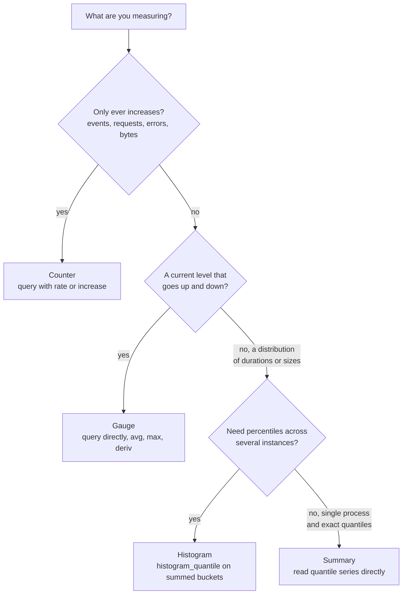
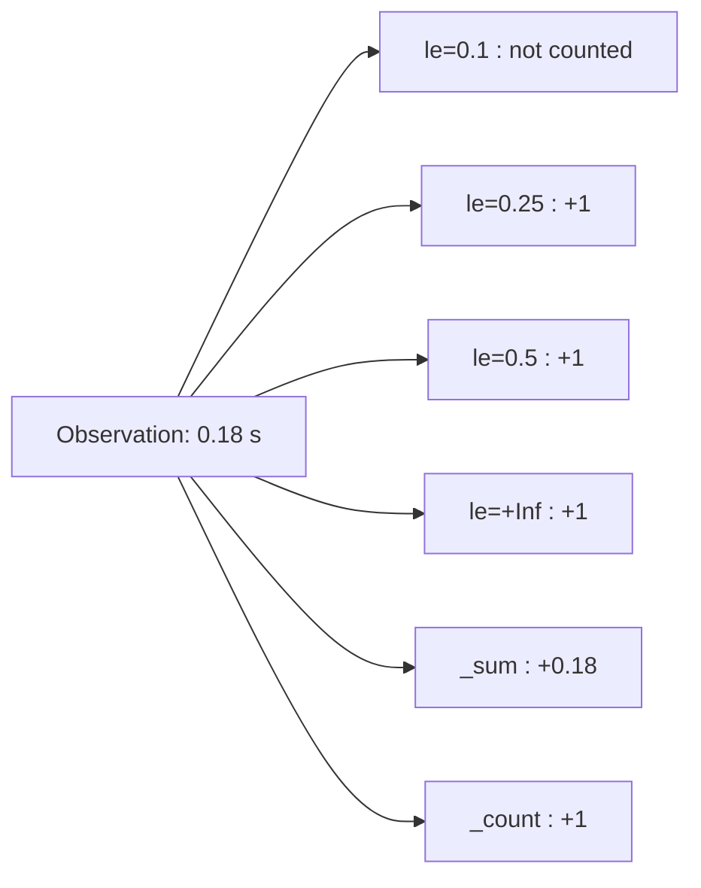

# L10.4 — Counters, Gauges, Histograms and Summaries

> **Level 10: Observability** · Topic 4 of 11 · ⏱ ~3 hours · Difficulty: Intermediate

## 1. What it is

A **metric** is a named number that your program exposes so a monitoring system can read it repeatedly. Prometheus
defines four **metric types**, which differ in what the number *means* and therefore in how you may query it:

- **Counter** - a number that only goes up (and resets to zero when the process restarts). "Requests served so far."
- **Gauge** - a number that goes up and down. "Connections open right now", "memory in use", "queue depth".
- **Histogram** - counts of observations falling into pre-defined **buckets** (plus a sum and a count). "How many requests
  took less than 100 ms, less than 250 ms, less than 500 ms...". Percentiles are estimated from it at query time.
- **Summary** - like a histogram, but the percentiles (**quantiles**) are computed inside the application and exposed
  directly.

Every distinct combination of **labels** on a metric creates its own time series. The number of such series is the
metric's **cardinality**, and it is the single biggest operational risk in this topic.

## 2. Why it matters in DevOps

- **Picking the wrong type gives wrong answers.** A gauge used for "total requests" loses data every restart; an average
  used for latency hides the slowest users; a summary cannot be combined across 20 pods.
- **Cardinality is what takes Prometheus down.** One engineer adding `user_id` as a label can create millions of series,
  exhaust memory and blind the whole team's monitoring. Hosted metric services typically bill by active series, so the
  same mistake becomes a bill.
- **You are the one instrumenting.** DevOps engineers write exporters, review application pull requests and decide
  which metrics a service must expose. Good metrics are designed, not sprinkled.

## 3. Real-world system example

**Kubernetes components.** The API server exposes the histogram `apiserver_request_duration_seconds` (labelled by verb,
resource and more), and the counter `apiserver_request_total` (labelled by verb, code and more). Cluster operators compute
request rate, error rate and latency percentiles from exactly these. Kubernetes labels its metrics with stability levels
(alpha, beta, stable) and has changed or removed labels and buckets on some metrics over time precisely because of
cardinality and cost, which is a good illustration of why the label set is part of the metric's public contract.

**Hosted Prometheus services** (Grafana Cloud, Amazon Managed Service for Prometheus and similar) price largely on
active series or ingested samples, so teams there run cardinality reports and drop labels or whole metrics before
data leaves the cluster.

## 4. Diagram

Choosing the type:



How a histogram turns one observation into cumulative buckets (buckets are `le`, "less than or equal"):



## 5. How it works

| Type | Exposed series | Query pattern | Use for | Never use for |
|------|----------------|---------------|---------|---------------|
| **Counter** | `name_total` | `rate(name_total[5m])`, `increase(...)` | requests, errors, bytes sent, jobs finished | values that can decrease |
| **Gauge** | `name` | `name`, `avg_over_time`, `max_over_time`, `deriv` | memory, queue depth, pool connections, temperature, "last deploy time" | event counts (a restart loses them) |
| **Histogram** | `name_bucket{le="..."}`, `name_sum`, `name_count` | `histogram_quantile(0.95, sum by (le)(rate(name_bucket[5m])))` | request latency, response size, anything you want percentiles or SLO ratios for | unbounded values with no sensible bucket range |
| **Summary** | `name{quantile="0.99"}`, `name_sum`, `name_count` | read the `quantile` series; `rate(sum)/rate(count)` for the mean | per-process quantiles that need to be exact | anything you aggregate across instances |

**Histogram vs summary.** Prefer histograms: they aggregate across instances (add the buckets), the quantile is chosen at
query time, and you can compute "fraction of requests faster than 300 ms" from one bucket. The price is that the
percentile is an *estimate* (linear interpolation inside a bucket), so buckets must bracket your target. A summary gives
exact quantiles per process but you cannot average or combine them, and the quantiles are fixed in code.

**A worked histogram estimate.** Suppose 20 requests produce cumulative counts: `le=0.1` is 9, `le=0.25` is 20. The median
is the 10th observation, which falls in the `(0.1, 0.25]` bucket, so the estimate is
`0.1 + (0.25 - 0.1) * (10 - 9) / (20 - 9) = 0.114` seconds. If your buckets were only `le=1` and `le=+Inf`, every answer
would be "somewhere under 1 second". Bucket design decides precision.

**Buckets.** The prom-client default is exponential from 5 ms to 10 s. Better: choose boundaries around your SLO and your
real distribution, e.g. `[0.025, 0.05, 0.1, 0.25, 0.5, 1, 2.5]` for a service with a 500 ms target. More buckets = more
series (each bucket is a series per label combination). Newer Prometheus versions also support **native histograms**,
which use dynamic high-resolution buckets in a single series; they are opt-in and still require client and server support,
so this topic uses classic histograms.

**Naming conventions** (Prometheus best practices):

- `snake_case`, with an application prefix: `shop_orders_total`.
- Counters end in `_total`.
- Use **base units** and name them: `_seconds`, `_bytes` (never milliseconds or megabytes), `_ratio` for 0-1 values.
- A metric name describes *what* is measured; **labels** describe the dimension. Not `orders_ok_total` and `orders_failed_total`,
  but `shop_orders_total{outcome="ok"}`.
- A metric should have one meaning: avoid summing things that should not be summed across a label.

**Cardinality, with numbers.** Series count = product of the distinct values of every label (and a histogram multiplies
that by its buckets, because each bucket, the `+Inf` bucket, `_sum` and `_count` are all separate series). A latency
histogram with 7 routes, 5 status codes and 10 bucket boundaries is `7 x 5 x (10 + 1 + 2) = 455` series per instance;
across 20 pods, 9,100. Add `user_id` with a million values and it becomes billions of potential series. Memory
cost is roughly proportional to *active* series (a few kilobytes each, depending on version and labels), so the limit is
reached surprisingly fast.

| Safe labels (bounded) | Dangerous labels (unbounded) |
|-----------------------|------------------------------|
| `method`, `status_code`, `route` (the pattern `/users/:id`), `outcome`, `region`, `version` | `user_id`, `email`, `request_id`, `trace_id`, full URL path with ids, `error_message`, timestamps, IP addresses |

Put unbounded values in logs and traces, where one record per event is the design.

**Guard rails in Prometheus:** per-scrape `sample_limit` and `label_limit` in `scrape_configs` make a misbehaving target
fail its scrape instead of flooding the server; `metric_relabel_configs` with `action: drop` removes an offending metric
or label; the TSDB status page (Status → TSDB Status) lists the highest-cardinality metrics and labels.

**Instrumenting well.** Instrument at boundaries: incoming requests (rate, errors, duration), outgoing calls to
dependencies, queues (depth, age of oldest item), resource pools (in use, waiting) and business events (orders, payments).
Create counter label combinations you care about at startup with `inc(labels, 0)`, because a series that has never been
incremented does not exist and `rate()` / `increase()` of a missing series returns nothing.

## 6. Step-by-step guide

**Prerequisites:** Node.js 22 or newer, `curl`. Optional: the Prometheus stack from
[Prometheus and PromQL](02-prometheus-and-promql.md) to query the results. No cost.

1. **Create the project.**
   ```bash
   mkdir -p ~/l10-metrics && cd ~/l10-metrics
   npm init -y >/dev/null && npm install express prom-client
   ```

2. **Write `metrics-lab.js`:** one metric of each type, plus a deliberate cardinality mistake.
   ```js
   const express = require('express');
   const client = require('prom-client');

   const register = new client.Registry();
   client.collectDefaultMetrics({ register });

   // COUNTER: only goes up. Name ends in _total.
   const orders = new client.Counter({
     name: 'shop_orders_total',
     help: 'Orders processed, by outcome',
     labelNames: ['outcome'],
     registers: [register],
   });
   orders.inc({ outcome: 'ok' }, 0); // pre-create the series so rate() and alerts see it from the start
   orders.inc({ outcome: 'failed' }, 0);

   // GAUGE: goes up and down. Set from a collect() callback so it is read at scrape time.
   const pool = { total: 10, idle: 7, waiting: 0 }; // stand-in for a real pg Pool
   const poolConnections = new client.Gauge({
     name: 'shop_db_pool_connections',
     help: 'Database pool connections by state',
     labelNames: ['state'],
     registers: [register],
     collect() {
       this.set({ state: 'total' }, pool.total);
       this.set({ state: 'idle' }, pool.idle);
       this.set({ state: 'waiting' }, pool.waiting);
     },
   });
   const deployTime = new client.Gauge({
     name: 'shop_last_deploy_timestamp_seconds',
     help: 'Unix time of the last deploy',
     registers: [register],
   });
   deployTime.setToCurrentTime();

   // HISTOGRAM: buckets chosen around the latency target (0.5 s). Aggregatable across instances.
   const duration = new client.Histogram({
     name: 'shop_http_request_duration_seconds',
     help: 'HTTP request latency',
     labelNames: ['route'],
     buckets: [0.025, 0.05, 0.1, 0.25, 0.5, 1, 2.5],
     registers: [register],
   });

   // SUMMARY: quantiles computed inside this process. Cannot be aggregated across instances.
   const payment = new client.Summary({
     name: 'shop_payment_duration_seconds',
     help: 'Payment provider call duration',
     percentiles: [0.5, 0.9, 0.99],
     maxAgeSeconds: 600,
     ageBuckets: 5,
     registers: [register],
   });

   // ANTI-PATTERN on purpose: a label whose values are unbounded.
   const bad = new client.Counter({
     name: 'shop_bad_requests_total',
     help: 'Do not do this',
     labelNames: ['user'],
     registers: [register],
   });

   const app = express();
   app.get('/order', async (req, res) => {
     const stop = duration.startTimer({ route: '/order' });
     const pay = payment.startTimer();
     await new Promise((r) => setTimeout(r, 20 + Math.random() * 200));
     pay();
     const ok = Math.random() > 0.1;
     orders.inc({ outcome: ok ? 'ok' : 'failed' });
     stop();
     res.status(ok ? 200 : 500).json({ ok });
   });
   app.get('/bad', (req, res) => {
     bad.inc({ user: req.query.user || 'anonymous' }); // one new series per distinct user
     res.json({ counted: true });
   });
   app.get('/metrics', async (req, res) => {
     res.set('Content-Type', register.contentType);
     res.end(await register.metrics());
   });
   app.listen(3000, () => console.log('metrics lab on :3000'));
   ```

3. **Run it and generate orders.**
   ```bash
   node metrics-lab.js &
   sleep 1; for i in $(seq 20); do curl -s -o /dev/null localhost:3000/order; done
   ```

4. **Read the counter and the gauges.**
   ```bash
   curl -s localhost:3000/metrics | grep -E '^shop_(orders_total|db_pool|last_deploy)'
   ```
   Similar to:
   ```text
   shop_orders_total{outcome="ok"} 19
   shop_orders_total{outcome="failed"} 1
   shop_db_pool_connections{state="total"} 10
   shop_db_pool_connections{state="idle"} 7
   shop_db_pool_connections{state="waiting"} 0
   shop_last_deploy_timestamp_seconds 1791531800.711
   ```
   Run the order loop again and note that the counter only grows; the pool gauge is read fresh at every scrape.

5. **Read the histogram and the summary.**
   ```bash
   curl -s localhost:3000/metrics | grep -E '^shop_(http_request|payment)_duration_seconds'
   ```
   Similar to:
   ```text
   shop_http_request_duration_seconds_bucket{le="0.1",route="/order"} 9
   shop_http_request_duration_seconds_bucket{le="0.25",route="/order"} 20
   shop_http_request_duration_seconds_bucket{le="+Inf",route="/order"} 20
   shop_http_request_duration_seconds_sum{route="/order"} 2.40
   shop_http_request_duration_seconds_count{route="/order"} 20
   shop_payment_duration_seconds{quantile="0.99"} 0.214
   shop_payment_duration_seconds_count 20
   ```
   Buckets are **cumulative**: the `0.25` count includes everything counted in `0.1`. Estimate the median by hand with the
   formula in section 5, using your own numbers.

6. **Cause a cardinality explosion on purpose.**
   ```bash
   echo "series before: $(curl -s localhost:3000/metrics | grep -vc '^#')"
   for i in $(seq 200); do curl -s -o /dev/null "localhost:3000/bad?user=u$i"; done
   echo "series after:  $(curl -s localhost:3000/metrics | grep -vc '^#')"
   ```
   The count grows by 200: one new series per user. In production each is stored for every scrape, forever (until it goes stale).

7. **(Optional) Scrape it with Prometheus and find the culprit.** Add `host.docker.internal:3000` (or the container name) as a
   target in your `prometheus.yml`, then run:
   ```promql
   count({__name__=~"shop_.*"})
   count by (__name__) ({__name__=~"shop_.*"})
   topk(5, count by (__name__) ({__name__=~".+"}))
   ```
   The last query is expensive on a large server; use it on the lab, and use Status → TSDB Status in the UI for real systems.

8. **Fix it.** Stop the app (`kill %1`). Delete the `bad` counter and the `/bad` route. If you must keep per-user detail,
   log it (see [Structured Logging](05-structured-logging.md)) instead of labelling it.

## 7. Real-world scenario

*Illustrative scenario.* A developer wanted to debug a slow endpoint for specific customers and added the full request
path as a label: `http_requests_total{path="/orders/8f3a..."}`. Within a day the Prometheus pod was OOM-killed and
restarted in a loop; each restart replayed the write-ahead log and ran out of memory again. Dashboards and alerts were
blind during the next incident.

The on-call engineer restored service by raising the memory limit temporarily, then used the TSDB status page to find the
metric with millions of series. A `metric_relabel_configs` rule dropped the `path` label at the scrape layer, and a
`sample_limit` was added so one bad target fails its own scrape rather than the server. The permanent fix was code: the
label became the *route pattern* (`/orders/:id`), and the customer-specific question moved to structured logs and traces.

**Lesson:** labels are for dimensions you aggregate by. If you would never write `sum by (this_label)`, it does not belong
on a metric.

## 8. Common mistakes and best practices

**Don't**

- Put user ids, request ids, emails, raw URLs or error messages in labels.
- Use a gauge for something that should be a counter (you lose increments across restarts and cannot `rate()` it).
- Take `rate()` of a gauge, or read a counter without `rate()`.
- Average summary quantiles from several pods, or average histogram quantiles.
- Use the default buckets blindly when your SLO is at 300 ms and almost everything lands in one bucket.
- Rename or change the meaning of an exposed metric silently; dashboards and alerts depend on it.

**Do**

- Use counters for events, gauges for levels, histograms for latency and sizes.
- Name with units and `_total`; use base units (seconds, bytes).
- Keep every label bounded and documented; add a rough series budget per service.
- Pre-initialise important label combinations to zero so alerts and `rate()` work from the first scrape.
- Instrument the four golden signals first; add business metrics after.
- Set `sample_limit` on scrape jobs and review the TSDB status page regularly.

## 9. Tasks

- [ ] **T1 — Meet the four types** *(≈30 min, beginner)*
  - **Goal:** see each type's exposition format.
  - **Steps:**
    1. Run section 6 steps 1-5.
    2. For each of the five `shop_*` metrics, write its type and one PromQL expression you would use to chart it.
  - **Done when:** your table has counter → `rate`, gauge → direct, histogram → `histogram_quantile` and summary → direct quantile series.

- [ ] **T2 — Estimate a percentile by hand** *(≈30 min, intermediate)*
  - **Goal:** understand what `histogram_quantile` does.
  - **Steps:**
    1. Send 50 requests to `/order`; copy the `_bucket` lines.
    2. Calculate the median and p90 using linear interpolation inside the bucket that contains the rank.
    3. Compare with `shop_payment_duration_seconds{quantile="0.5"}` (a different metric, but a similar shape), and with `histogram_quantile` in Prometheus if you scraped it.
  - **Done when:** your hand calculation is within one bucket width of the Prometheus result and you can explain the gap.

- [ ] **T3 — Instrument a new endpoint properly** *(≈45 min, intermediate)*
  - **Goal:** apply naming, types and label discipline.
  - **Steps:**
    1. Add `GET /search?q=...`. Record a histogram `shop_search_duration_seconds` with label `outcome` (`hit`/`miss`), and a counter `shop_search_results_total`.
    2. Do **not** label by query text. Log the query text instead.
    3. Add `shop_search_inflight` as a gauge using `inc()` and `dec()` around the handler.
  - **Done when:** `/metrics` shows all three, with no unbounded label, and `shop_search_inflight` returns to 0 after the requests finish.

- [ ] **T4 — Break it: cardinality bomb and its fix** *(≈45 min, intermediate)*
  - **Goal:** detect, measure and stop an explosion.
  - **Steps:**
    1. Scrape the lab with Prometheus (step 7) and run the `/bad` loop with 2000 users.
    2. Find the offending metric with `topk` and the TSDB status page.
    3. Add `metric_relabel_configs` that drops `shop_bad_requests_total`, and a `sample_limit: 1000` to the job; reload, and show what the target status says when the limit is exceeded.
  - **Done when:** the bad metric no longer appears and you can show the scrape error caused by `sample_limit` in `/targets`.

- [ ] **T5 — Choose buckets for an SLO** *(≈45 min, advanced)*
  - **Goal:** make a histogram answer an SLO question accurately.
  - **Steps:**
    1. State an SLO: "99% of `/order` requests complete within 300 ms".
    2. Redefine the histogram buckets with a boundary at exactly `0.3`.
    3. Write the PromQL for the fraction under target: `sum(rate(..._bucket{le="0.3"}[5m])) / sum(rate(..._count[5m]))`.
  - **Done when:** the query returns a value you can compare to 0.99, and you can say why a missing `0.3` bucket would make it unusable.

- [ ] **T6 — Prove it: type and cardinality review** *(≈45 min, advanced)*
  - **Goal:** review someone else's instrumentation like a senior engineer.
  - **Steps:**
    1. Write down five proposed metrics for `shop-api` (for example `active_users` with `user_id` label, `request_count`, `latency_ms` average gauge, `cache_hits`, `queue_size`).
    2. Fix each: correct type, name, unit, labels, and estimate the series count.
    3. Explain your corrections out loud.
  - **Done when:** every fixed metric has a justified type, unit and bounded labels, and the total series estimate for 20 pods fits a stated budget.

## 10. Self-check questions

1. Why can you not use a gauge for "total requests served"?
2. What does the `le` label mean, and why are histogram buckets cumulative?
3. Why can't you average the p99 of several instances, and what do you do instead?
4. How many series does a histogram with 4 routes, 3 status codes and 10 bucket boundaries create per instance?
5. Name three labels you must never use and where that information belongs instead.
6. Why pre-initialise counters with `inc(labels, 0)`?

<details>
<summary>Answers</summary>

1. A gauge can go down and is typically reset or recreated on restart; you would lose increments and could not use `rate()` correctly. A counter's resets are detected and handled by `rate()`.
2. `le` is "less than or equal"; each bucket counts observations at or below its boundary, so counts are cumulative and the `+Inf` bucket equals `_count`. This lets buckets be summed across instances and quantiles interpolated.
3. Quantiles are not additive. Sum the `_bucket` rates across instances and run `histogram_quantile` on the sum.
4. 4 x 3 x (10 bucket boundaries + the `+Inf` bucket + `_sum` + `_count`) = 4 x 3 x 13 = 156 series per instance.
5. `user_id`, `request_id`, `email` (also full URLs, error messages). They belong in logs and trace attributes.
6. A series that was never incremented does not exist, so `rate()`, `increase()` and "errors are zero" alerts have nothing to evaluate until the first event; pre-creating at zero makes them work from the first scrape.
</details>

## 11. Further reading

- Prometheus documentation (prometheus.io/docs): "Metric types", "Instrumentation best practices", "Metric and label naming", "Histograms and summaries".
- `prom-client` README (npm) for the Node.js API; the equivalent client libraries exist for Go, Python, Java and others.
- *Prometheus: Up & Running* by Brian Brazil, chapters on instrumentation and cardinality.
- OpenTelemetry documentation: "Metrics" (instrument types) for how these map to OTel.
- See also: [Prometheus and PromQL](02-prometheus-and-promql.md), [What to Monitor](11-what-to-monitor.md).

<!-- nav -->
---
← Previous: [Grafana Dashboards](03-grafana-dashboards.md) · [Level 10 index](README.md) · Next: [Structured Logging](05-structured-logging.md) →
