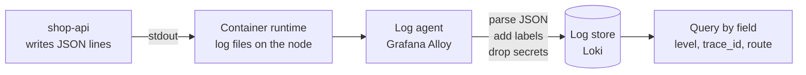
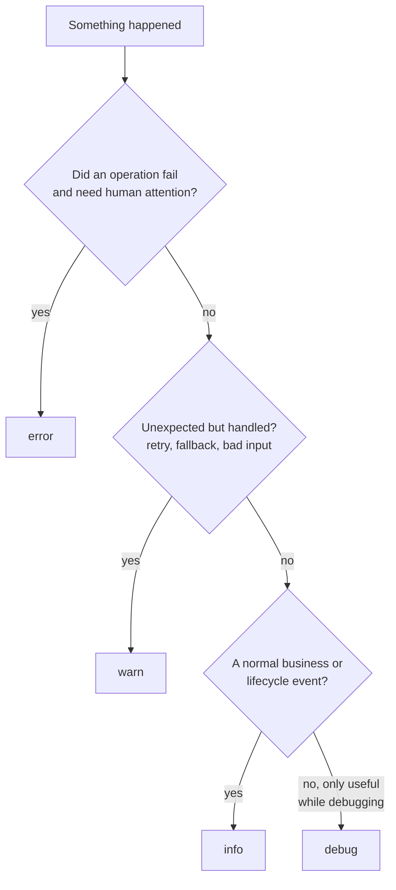

# L10.5 — Structured Logging

> **Level 10: Observability** · Topic 5 of 11 · ⏱ ~3 hours · Difficulty: Beginner

## 1. What it is

A **log** is a timestamped record of something that happened in a program. **Unstructured** logging writes sentences:
`Order 8231 created for user 42 in 120ms`. To find "all orders over 100 ms" you must write a regular expression that
breaks the next time someone rewords the message.

**Structured logging** writes each event as data, almost always one **JSON** object per line (also called JSON Lines
or NDJSON):

```json
{"level":"info","time":"2026-10-09T10:15:42.123Z","service":"shop-api","msg":"order created","order_id":"o-8231","user_id":"u-42","duration_ms":120}
```

The message is a constant string; everything variable lives in named **fields**. Machines can now filter, count and
group by any field (`duration_ms > 100`, `user_id = "u-42"`), and humans still read the `msg`.

## 2. Why it matters in DevOps

- **Searchability under pressure.** At 3 a.m. you want `level=error AND route=/checkout`, not a regex.
- **Aggregation.** Log systems such as Loki, Elasticsearch and CloudWatch Logs Insights can parse JSON and compute
  counts and percentiles from fields. Free-text lines cannot be reliably parsed once the wording changes.
- **Correlation.** A `trace_id` or `request_id` field on every line is what ties logs to traces and to other services
  (see [Correlation IDs](07-correlation-ids.md)).
- **Security and compliance.** Logs are a classic data leak: passwords, tokens and personal data written "just for
  debugging" end up in a third-party log service with a different retention and access policy than your database.
- **Cost.** Log volume drives the bill. Levels and a deliberate "what is worth logging" policy keep it manageable.

## 3. Real-world system example

**Stripe's "canonical log lines".** Stripe's engineering blog describes emitting, for every API request, one extra
structured log line at the end of the request containing the key facts (HTTP method, path, status, duration, user,
authentication, rate-limit decisions, database time and so on) as key/value pairs. Because it is one line per request with
all the fields, it can be queried like a table, which makes it a powerful complement to metrics.

**The Twelve-Factor App** (factor XI) states that an app should treat logs as an event stream written to `stdout`, and
leave routing and storage to the environment. That is exactly how containers on Docker and Kubernetes work: the runtime
captures `stdout`/`stderr` to files (for Kubernetes under `/var/log/pods`, see
[Filesystem Hierarchy](../level-01-linux-fundamentals/01-filesystem-hierarchy.md)) and a log agent ships them. Schemas such as
the **Elastic Common Schema (ECS)** and the **OpenTelemetry log data model** standardise field names and severity numbers
so that tools agree on what `trace_id` or "error" means.

## 4. Diagram

Where structured logs flow in a containerised system:



Choosing a level:



## 5. How it works

**Levels** (pino, the common Node.js logger, uses these; other libraries are close): `trace` < `debug` < `info` < `warn`
< `error` < `fatal`. The configured level is a floor: at `info`, `debug` and `trace` calls are dropped cheaply.

| Level | Use for | Example |
|-------|---------|---------|
| `fatal` | The process cannot continue | `cannot connect to database at startup` |
| `error` | An operation failed and someone may need to act | `payment provider returned 502` |
| `warn` | Handled, but worth knowing | `retrying inventory call (attempt 2)`; a rejected request |
| `info` | Normal events you want in production | `order created`, `server listening`, one summary line per request |
| `debug` | Detail for diagnosing; off in production by default | `validating cart`, SQL text |
| `trace` | Very verbose step-by-step | rarely used |

**A good log line has these fields:**

| Field | Why |
|-------|-----|
| `time` | ISO 8601 in UTC (`2026-10-09T10:15:42.123Z`), never local time or a format without a zone |
| `level` | As a string (`"info"`), not a number, so queries are readable |
| `service`, `env`, `version` | Which app, which environment, which release; essential when many services share one log store |
| `msg` | Short **constant** description (group-able). Never interpolate ids into it |
| `request_id`, `trace_id`, `span_id` | Correlation (see [Correlation IDs](07-correlation-ids.md)) |
| Context fields | `user_id`, `order_id`, `route`, `status`, `duration_ms`: the facts specific to the event |
| `err` | Error `type`, `message` and `stack` as fields, not a stack trace spread across many lines |

**Context with child loggers.** Create a logger per request that already carries `request_id` and `user_id`; every line
logged through it includes them without the developer remembering. In Node.js, `pino-http` creates `req.log`, and
`req.log.child({ user_id })` adds more. In other languages, use the equivalent (Python `structlog` bind, Go `slog.With`,
Java MDC).

**Log events, not noise.** Prefer one rich line per request (the canonical line) plus a few meaningful events over
dozens of "entering function X" lines.

**What not to log.** Never write these, at any level:

- Passwords, API keys, session tokens, JWTs, private keys, `Authorization` and `Cookie` headers.
- Full payment card numbers and CVVs (a compliance violation), and other regulated data.
- Personal data (email, phone, address, health data, precise location) unless there is a documented need; prefer an
  opaque id (`user_id`) and a short retention. Laws such as GDPR apply to logs too.
- Entire request or response bodies by default.
- Anything you cannot delete later: logs are often immutable and replicated.

Defence in depth: do not pass sensitive objects to the logger in the first place; add **redaction** in the logger
(`redact` paths in pino) for known fields; and scrub again in the collector (Alloy or the OpenTelemetry Collector) as a safety net.
Redaction only protects fields it knows by path: a password interpolated into a message string is not caught.

**Where to write.** In containers, write to `stdout` and let the platform ship it. On VMs, write to a file under `/var/log`
with **rotation** (`logrotate`, see [Daemons and systemd](../level-01-linux-fundamentals/09-daemons-and-systemd.md) and
[journalctl](../level-01-linux-fundamentals/11-systemctl-and-journalctl.md)) or to journald. Never let a log file grow unbounded.

**Performance.** Use a fast structured logger (pino) rather than `console.log` with string building, and do not log inside
tight loops. Logging is I/O: at high volume it can become a bottleneck or a cost problem.

## 6. Step-by-step guide

**Prerequisites:** Node.js 22 or newer, `curl`, and `jq` (`sudo apt-get install -y jq` or `brew install jq`). No cost.

1. **Create the project.**
   ```bash
   mkdir -p ~/l10-logging && cd ~/l10-logging
   npm init -y >/dev/null && npm install express pino pino-http
   ```

2. **Write the logger once** in `logger.js`. Everything reuses it.
   ```js
   const pino = require('pino');

   module.exports = pino({
     level: process.env.LOG_LEVEL || 'info',
     base: { service: 'shop-api', env: process.env.APP_ENV || 'dev', version: process.env.APP_VERSION || '0.0.0-dev' },
     timestamp: pino.stdTimeFunctions.isoTime,           // "2026-10-09T10:15:42.123Z" instead of epoch milliseconds
     formatters: { level: (label) => ({ level: label }) }, // "level":"info" instead of 30
     redact: {
       paths: ['password', '*.password', 'token', '*.token', 'card.number', 'req.headers.authorization', 'req.headers.cookie'],
       censor: '[REDACTED]',
     },
   });
   ```

3. **Write the app** in `app.js`: request IDs, a per-request child logger and the three outcomes (created, rejected, crashed).
   ```js
   const crypto = require('node:crypto');
   const express = require('express');
   const pinoHttp = require('pino-http');
   const logger = require('./logger');

   const app = express();
   app.use(express.json());
   app.use(
     pinoHttp({
       logger,
       genReqId: (req, res) => {
         const id = req.headers['x-request-id'] || crypto.randomUUID();
         res.setHeader('x-request-id', id);
         return id;
       },
       serializers: {
         req: (req) => ({ id: req.id, method: req.method, url: req.url }),
         res: (res) => ({ statusCode: res.statusCode }),
       },
       customLogLevel: (req, res, err) => (err || res.statusCode >= 500 ? 'error' : res.statusCode >= 400 ? 'warn' : 'info'),
       autoLogging: { ignore: (req) => req.url === '/healthz' },
     }),
   );

   app.get('/healthz', (req, res) => res.send('ok'));

   app.post('/orders', (req, res) => {
     const { userId, items } = req.body;
     const log = req.log.child({ user_id: userId });   // every line below carries user_id and the request id
     log.debug({ items }, 'validating cart');          // hidden at the default level (info)
     if (!items || items.length === 0) {
       log.warn({ reason: 'empty_cart' }, 'order rejected');
       return res.status(400).json({ error: 'empty cart' });
     }
     const orderId = 'o-' + Math.floor(Math.random() * 1e6);
     log.info({ order_id: orderId, item_count: items.length, amount_cents: 4999 }, 'order created');
     res.status(201).json({ order_id: orderId });
   });

   app.get('/boom', () => { throw new Error('inventory service unreachable'); });

   app.use((err, req, res, next) => {
     res.err = err;   // pino-http logs it, with the stack, on the "request errored" line
     res.status(500).json({ error: 'internal error', request_id: req.id });
   });

   app.listen(3000, () => logger.info({ port: 3000 }, 'shop-api listening'));
   ```

4. **Run it** (leave it running, logs print here), and from a second terminal send three requests.
   ```bash
   node app.js | tee app.log
   ```
   ```bash
   curl -s -XPOST localhost:3000/orders -H 'content-type: application/json' -H 'x-request-id: req-1' \
     -d '{"userId":"u-42","items":[{"sku":"kbd"}]}'
   curl -s -XPOST localhost:3000/orders -H 'content-type: application/json' -d '{"userId":"u-43","items":[]}'
   curl -s localhost:3000/boom
   ```
   Expect one JSON line per event, similar to:
   ```json
   {"level":"info","time":"2026-10-09T07:45:06.569Z","service":"shop-api","env":"dev","version":"0.0.0-dev","req":{"id":"req-1","method":"POST","url":"/orders"},"user_id":"u-42","order_id":"o-381660","item_count":1,"amount_cents":4999,"msg":"order created"}
   {"level":"warn","time":"...","service":"shop-api",...,"user_id":"u-43","reason":"empty_cart","msg":"order rejected"}
   {"level":"error","time":"...","service":"shop-api",...,"res":{"statusCode":500},"err":{"type":"Error","message":"inventory service unreachable","stack":"Error: inventory service unreachable\n    at ..."},"msg":"request errored"}
   ```
   Notice `user_id` and the request id on lines that never mentioned them in the call: that is the child logger at work.

5. **Query the logs with `jq`.**
   ```bash
   jq -c 'select(.level=="error") | {time, msg, request_id: .req.id}' app.log      # all errors
   jq -r 'select(.user_id=="u-42") | .msg' app.log                                  # everything for one user
   jq -s 'group_by(.level) | map({level: .[0].level, count: length})' app.log        # count by level
   ```
   These are the same questions you will later ask in Loki with LogQL ([Loki](06-loki-log-aggregation.md)).

6. **Change the level without changing code.** Restart with debug on and send the order again; the `validating cart` line appears.
   ```bash
   LOG_LEVEL=debug node app.js
   ```

7. **Prove redaction works, and see its limit.**
   ```bash
   LOG_LEVEL=debug node -e "
   const l = require('./logger');
   l.info({ password: 'hunter2', user: { token: 'abc' } }, 'redaction test');
   l.info('login attempt password=hunter2');
   "
   ```
   The first line shows `"password":"[REDACTED]"` and `"token":"[REDACTED]"`. The second line prints `hunter2` in the clear:
   redaction only works on known field paths, not on text inside a message.

8. **Stop the app** (`Ctrl+C`).

## 7. Real-world scenario

*Illustrative scenario.* A support ticket says "my order did not go through at about 14:20". Under the old plain-text
logging an engineer greps `shop-api.log` for the customer's email, finds nothing (the app logged `user 42`), then greps
for `42` and gets 9,000 matches.

After moving to structured logs with a request id, support gives the engineer the `x-request-id` shown in the app's error
page. One query, `request_id="..."`, returns four lines in order: request received, payment call started, `payment
provider returned 502` at `warn` with `attempt=3`, and the final 500. The cause is a flaky provider, visible in two minutes.
A later review of the old logs also finds a full `Authorization` header written at debug level; it is removed and the
affected token rotated.

**Lesson:** consistent fields turn logs from text into a database, and what you *must not* log needs as much attention as
what you do.

## 8. Common mistakes and best practices

**Don't**

- Build messages with string concatenation (`'order ' + id + ' failed'`): you lose the field and the grouping.
- Log multi-line stack traces as separate lines; log them as one `err.stack` field.
- Log at `error` for things that are not errors (a 404, a validation failure); alerts and dashboards will cry wolf.
- Log and rethrow at every layer: one failure becomes five identical error lines. Log where you handle it.
- Log secrets, tokens, full card numbers, request bodies or raw personal data.
- Use user ids, emails or request ids as **labels** in the log store (see [Loki](06-loki-log-aggregation.md)); keep them as fields.

**Do**

- Emit one JSON object per line to `stdout` and let the platform ship it.
- Use a constant `msg` and variable fields; use consistent field names across all services.
- Include `service`, `env`, `version` and `trace_id`/`request_id` on every line.
- Use ISO 8601 UTC timestamps and string levels.
- Make the log level configurable via an environment variable and default to `info` in production.
- Log one summary ("canonical") line per request with status, duration and key identifiers.
- Review logs for sensitive data as part of code review; redact and scrub in two places.

## 9. Tasks

- [ ] **T1 — Convert a plain log to structured** *(≈30 min, beginner)*
  - **Goal:** feel the difference.
  - **Steps:**
    1. Write a script that prints `console.log('order ' + id + ' created for user ' + user + ' in ' + ms + 'ms')` ten times.
    2. Write the same with pino and fields.
    3. Using only `grep`/`awk` for the first and `jq` for the second, list orders slower than 100 ms.
  - **Done when:** both queries work, and you can say which survives a message rewording.

- [ ] **T2 — Follow the lab** *(≈45 min, beginner)*
  - **Goal:** build the logging setup from section 6.
  - **Steps:**
    1. Do steps 1-5.
    2. Add a `GET /orders/:id` route that logs `order fetched` with `order_id` and a `duration_ms` field you measure.
    3. Use `jq` to compute the count of lines by `level` for your traffic.
  - **Done when:** `jq` shows counts for at least `info` and `warn`, and your new route logs `duration_ms`.

- [ ] **T3 — Break it: leak a secret, then stop it** *(≈45 min, intermediate)*
  - **Goal:** see exactly what redaction can and cannot do.
  - **Steps:**
    1. Log `req.headers` in full for one route and confirm the `authorization` header appears (use a fake token `<YOUR_TOKEN>`).
    2. Add `req.headers.authorization` to `redact.paths` and verify it is censored.
    3. Log a message string containing a fake password and show redaction does not catch it. Fix the call site instead.
  - **Done when:** you can show three log lines: leaked, redacted, and "fixed at the source".

- [ ] **T4 — Levels at runtime** *(≈45 min, intermediate)*
  - **Goal:** control volume without redeploying code.
  - **Steps:**
    1. Run the app with `LOG_LEVEL=warn`, `info` and `debug`; count lines for the same 20 requests each time.
    2. Add a debug-only line inside a loop and measure the difference in output size.
    3. Write down the level policy you would use in production and when you would raise it temporarily.
  - **Done when:** you have three line counts and a one-paragraph policy.

- [ ] **T5 — Automate a log contract check** *(≈60 min, advanced)*
  - **Goal:** make "good logs" a test, not an opinion.
  - **Steps:**
    1. Write a test (`node --test`, or a shell script with `jq -e`) that runs the app, sends requests and fails if any line is not valid JSON or lacks `time`, `level`, `service` and `msg`.
    2. Fail it also when a line contains the string `Bearer ` or a `password` value.
    3. Run it in CI (see [GitHub Actions Pipelines](../level-05-cicd/02-github-actions-pipelines.md)).
  - **Done when:** the check passes on good output and fails when you deliberately add a bad log line.

- [ ] **T6 — Prove it: write the team's logging standard** *(≈45 min, advanced)*
  - **Goal:** explain structured logging well enough to enforce it.
  - **Steps:**
    1. Without the guide, write a one-page standard for `shop-api`: required fields, level meanings, what never to log, where redaction happens.
    2. Apply it to one real log line and show the before and after.
  - **Done when:** a teammate can review a pull request against your standard and flag a violation.

## 10. Self-check questions

1. Why should `msg` be a constant string with the variable parts in fields?
2. What is the difference between `warn` and `error`, and who is paged for each?
3. What is a child logger or context logger, and what problem does it solve?
4. Give four things you must never log, and two controls that protect against accidents.
5. Why do containers log to `stdout` instead of a file?
6. What is a canonical log line?

<details>
<summary>Answers</summary>

1. The constant message lets you group and count the same event, and fields make values searchable; interpolated text defeats both.
2. `warn` is handled or recoverable and normally does not page; `error` means an operation failed and may need action. Alerting is usually on error *rates*, not on single lines.
3. A logger pre-loaded with context (request id, user id) so every line includes it automatically; no one has to remember to add it.
4. Passwords, tokens/keys, full card numbers, personal data and full request bodies. Controls: do not pass sensitive objects to the logger, plus redaction in the logger and scrubbing in the collector (and review).
5. The platform captures `stdout`/`stderr`, handles rotation and shipping, and the container's filesystem is disposable; the app stays simple and portable.
6. One structured line per request, emitted at the end, containing all the key facts (route, status, duration, user, dependencies). It can be queried like a table.
</details>

## 11. Further reading

- *The Twelve-Factor App* (12factor.net), factor XI: Logs.
- Stripe engineering blog: "Fast and flexible observability with canonical log lines".
- pino documentation (getpino.io): levels, child loggers, redaction, transports.
- OpenTelemetry documentation: "Logs" and the log data model; Elastic Common Schema reference.
- OWASP Logging Cheat Sheet for what to log and what to avoid.
- See also: [Log Aggregation with Loki](06-loki-log-aggregation.md), [Correlation IDs](07-correlation-ids.md), [OWASP Top 10](../level-11-security-devsecops/05-owasp-top-10.md).

<!-- nav -->
---
← Previous: [Counters, Gauges, Histograms and Summaries](04-metric-types.md) · [Level 10 index](README.md) · Next: [Log Aggregation with Loki](06-loki-log-aggregation.md) →
