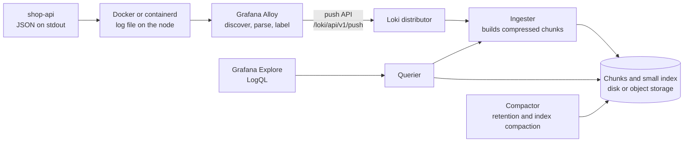
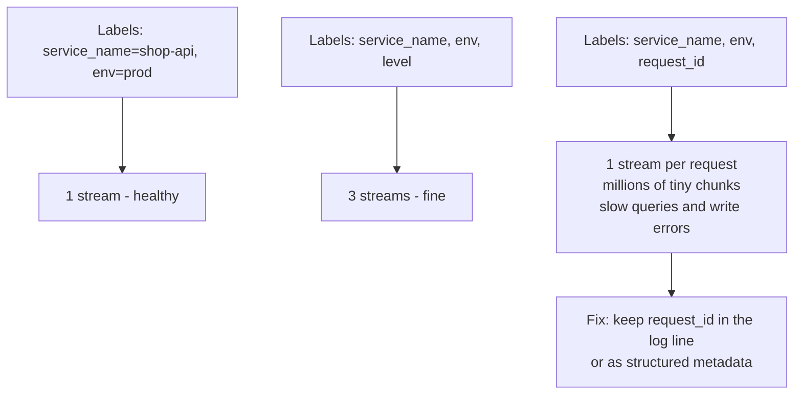

# L10.6 — Log Aggregation with Loki

> **Level 10: Observability** · Topic 6 of 11 · ⏱ ~4 hours · Difficulty: Intermediate

## 1. What it is

**Log aggregation** means collecting the logs of every container, VM and service into one searchable place, so that
"what did `shop-api` say at 14:20?" is a query instead of an `ssh` into five machines. A **log agent** runs next to the
workloads, reads their output and pushes it to a central **log store**.

**Grafana Loki** is an open-source log store designed to be cheap to run. Elasticsearch-style systems build a full-text
index of every word in every line. Loki takes the approach Prometheus takes for metrics: it indexes only a small set of
**labels** (`service_name="shop-api"`, `env="prod"`) and stores the log text itself, compressed, in **chunks** on disk or
object storage (S3, GCS). Queries pick streams by label, then scan the text with filters. The index stays tiny, storage is
cheap, and the cost moves to query time. The query language is **LogQL**, which deliberately looks like PromQL.

The agent that ships logs to Loki today is **Grafana Alloy**, Grafana's distribution of the OpenTelemetry Collector with
Prometheus-style pipelines. It replaces **Promtail**, which Grafana has deprecated and put into maintenance. Do not start
new setups on Promtail.

## 2. Why it matters in DevOps

- **Containers are disposable.** When a pod or container dies its local log file goes with it. Shipping logs off the
  machine is the only way to read the last words of something that crashed.
- **Incidents cross services.** One failing checkout touches Nginx, `shop-api`, a worker and a database. You need all
  their logs on one screen, filtered by one identifier (see [Correlation IDs](07-correlation-ids.md)).
- **Cost control.** Log volume is often the largest part of an observability bill. Label design, retention and what you
  ship decide whether Loki costs a few dollars or a few thousand.
- **The classic failure is a label mistake.** Putting a user id or request id in a label creates millions of tiny streams
  (high **cardinality**) and Loki slows down or rejects writes. Understanding labels is the whole skill.
- **Retention is a policy decision**, often with legal weight: keep security logs for a year, debug logs for two days.

## 3. Real-world system example

**Grafana Labs** created Loki (announced in 2018) and runs it for Grafana Cloud Logs; it is open source under the AGPL
licence and is built to be operated in the same way as Prometheus, with the same label model and a similar service
discovery and relabelling vocabulary. **Kubernetes** is the typical target: the container runtime writes each pod's
`stdout` and `stderr` to files under `/var/log/pods` on the node, and a log agent running as a **DaemonSet** (one per node,
see [DaemonSets](../level-08-kubernetes/11-daemonsets.md)) tails them, attaches labels such as `namespace`, `pod` and
`container` from the Kubernetes API, and pushes to Loki.

The same architectural choice (index metadata, scan content) is the main difference from **Elasticsearch/OpenSearch**-based
stacks, which index the content of every line: faster arbitrary full-text search, but larger indexes and a higher
operating cost. On AWS the managed alternative is CloudWatch Logs (see [CloudWatch](../level-06-cloud-aws/18-cloudwatch.md)),
and many teams run Loki for application logs and keep CloudWatch for AWS service logs.

## 4. Diagram

The path of a log line, and what Loki stores:



Labels define streams. Every unique label set is a separate stream with its own chunks, which is why labels must be few
and bounded:



## 5. How it works

**Streams and labels.** A *stream* is all log lines that share exactly the same label set. Loki indexes label names and
values; it does not index the text. Good labels are **low cardinality** (a few dozen values at most) and describe *where*
a line came from: `service_name`, `container`, `namespace`, `cluster`, `env`. Bad labels are anything unbounded: user id,
request id, trace id, URL path, IP address, timestamps.

**Structured metadata** (Loki 3.0 and later) is the right home for high-cardinality identifiers such as `trace_id` and
`request_id`. They are key-value pairs stored with each line but outside the stream identity, so they cost no extra
streams, and you can filter on them without parsing the line: `{service_name="shop-api"} | trace_id="..."`. Loki also
fills in `service_name` (derived from labels such as `service`, `app` or `container`) and `detected_level` (from a `level`
field it finds in the line) automatically in recent versions.

**LogQL** has two kinds of query.

| Kind | Starts with | Returns | Example |
|------|-------------|---------|---------|
| Log query | a stream selector `{...}` | log lines | `{service_name="shop-api"} \|= "timeout"` |
| Metric query | an aggregation such as `rate` or `count_over_time` | numbers over time | `sum(rate({service_name="shop-api"}[5m]))` |

A log query is a **pipeline**, evaluated left to right. Put the cheapest filters first:

| Stage | Meaning |
|-------|---------|
| `{a="b", c=~"x.+"}` | Stream selector (required). Operators `=` `!=` `=~` `!~`. Must contain at least one matcher that is not empty |
| `\|= "text"`, `!= "text"` | Line contains / does not contain a string |
| `\|~ "regex"`, `!~ "regex"` | Line matches / does not match a regular expression |
| `\| json`, `\| logfmt`, `\| pattern "<ip> - <_>"` | Parse the line and extract fields as temporary labels |
| `\| status >= 500`, `\| level="error"` | Filter on a label or extracted field (numbers compare numerically) |
| `\| line_format "{{.method}} {{.route}}"` | Rewrite the displayed line with a Go template |
| `\| trace_id="abc"` | Filter on structured metadata (no parser needed) |

Metric queries wrap a log query in a **range** (`[5m]`): `rate()` (lines per second), `count_over_time()`,
`bytes_rate()`, and for numbers inside the line `quantile_over_time(0.95, ... | unwrap duration_ms [5m]) by (route)`.
Aggregate with `sum by (...)`, `topk`, exactly as in PromQL ([Prometheus and PromQL](02-prometheus-and-promql.md)).

One gotcha: if an extracted field has the same name as an existing label, the extracted one is renamed with an
`_extracted` suffix (for example a JSON field `service` becomes `service_extracted` when a `service` label exists). This
is why the lab below names the stream label `service_name` while the application logs a field called `service`.

**Collecting with Alloy.** Alloy configuration is a graph of components connected by `forward_to` / exported values:
`discovery.docker` finds containers, `discovery.relabel` turns their metadata into labels, `loki.source.docker` reads the
logs, `loki.process` parses and edits lines, `loki.write` sends them to Loki. Promtail did the same job with a YAML
`scrape_configs` file; the concepts (targets, relabeling, pipeline stages) carry over, which makes migrating easy.

**Retention.** Loki does not delete data on its own. The **compactor** component enforces retention when you set
`compactor.retention_enabled: true` together with a `limits_config.retention_period` (a multiple of the 24 h index
period). Deletion is delayed (`retention_delete_delay`) so a mistake can still be caught. You can set shorter retention
for noisy streams with `retention_stream` rules. Retention is the main lever on storage cost.

**Limits to know.** Loki rejects lines or streams over per-tenant limits (ingestion rate, line size, label count,
active streams) with HTTP 429; the agent retries, so sustained 429s mean you ship too much or have too many streams.

## 6. Step-by-step guide

**Prerequisites:** the Compose project `~/l10-prom` from [Prometheus and PromQL](02-prometheus-and-promql.md) and
[Grafana Dashboards](03-grafana-dashboards.md) (the project folder must be named `l10-prom`, because the Alloy config
below filters on the Compose project name), Docker with Compose v2, Node.js 22+ and about 1 GB of free RAM. No cost. Image
tags were current when written; if one is gone, take the newest tag of that image and check its release notes. On Linux
Alloy reads the Docker socket, which is root-equivalent on that host; that is acceptable on a laptop, not as a pattern for
shared servers (there you tail the log files instead, with `loki.source.file`).

1. **Make `shop-api` write structured logs.** Install pino (the logger from [Structured Logging](05-structured-logging.md))
   in the app, then edit `~/l10-prom/shop-api/app.js`.
   ```bash
   cd ~/l10-prom/shop-api && npm install pino
   ```
   At the top, after the `require` lines, create the logger:
   ```js
   const pino = require('pino');
   const log = pino({
     base: { service: 'shop-api' },
     timestamp: pino.stdTimeFunctions.isoTime,
     formatters: { level: (label) => ({ level: label }) },
   });
   ```
   Replace the timing middleware so it also writes one *canonical* line per request:
   ```js
   app.use((req, res, next) => {
     const stop = duration.startTimer();
     res.on('finish', () => {
       const route = req.route ? req.route.path : 'unmatched';
       const seconds = stop({ method: req.method, route, status_code: res.statusCode });
       if (route === '/metrics') return; // do not log the scrapes
       const level = res.statusCode >= 500 ? 'error' : 'info';
       log[level]({ method: req.method, route, status: res.statusCode, duration_ms: Math.round(seconds * 1000) }, 'request completed');
     });
     next();
   });
   ```
   and change the last line to `app.listen(3000, () => log.info({ port: 3000 }, 'shop-api listening'));`. Each request now
   prints a line like
   `{"level":"info","time":"2026-10-09T12:32:19.051Z","service":"shop-api","method":"GET","route":"/products","status":200,"duration_ms":120,"msg":"request completed"}`.

2. **Write the Loki config** `~/l10-prom/loki/loki.yml` (single process, local disk, 7 days of retention).
   ```yaml
   auth_enabled: false

   server:
     http_listen_port: 3100

   common:
     instance_addr: 127.0.0.1
     path_prefix: /loki
     replication_factor: 1
     ring:
       kvstore:
         store: inmemory
     storage:
       filesystem:
         chunks_directory: /loki/chunks
         rules_directory: /loki/rules

   schema_config:
     configs:
       - from: "2024-04-01"
         store: tsdb
         object_store: filesystem
         schema: v13
         index:
           prefix: index_
           period: 24h

   limits_config:
     retention_period: 168h          # keep 7 days
     allow_structured_metadata: true
     volume_enabled: true

   compactor:
     working_directory: /loki/compactor
     retention_enabled: true         # without this, retention_period is ignored
     retention_delete_delay: 2h
     delete_request_store: filesystem

   analytics:
     reporting_enabled: false
   ```
   `auth_enabled: false` means a single tenant; in a shared deployment every request carries an `X-Scope-OrgID` header.

3. **Write the Alloy pipeline** `~/l10-prom/alloy/config.alloy`.
   ```alloy
   // 1. Find containers of this Compose project through the Docker API.
   discovery.docker "containers" {
     host = "unix:///var/run/docker.sock"

     filter {
       name   = "label"
       values = ["com.docker.compose.project=l10-prom"]
     }
   }

   // 2. Turn container metadata into labels. Keep them few and bounded.
   discovery.relabel "containers" {
     targets = []

     rule {
       source_labels = ["__meta_docker_container_name"]
       regex         = "/(.*)"
       target_label  = "container"
     }

     rule {
       source_labels = ["__meta_docker_container_label_com_docker_compose_service"]
       target_label  = "service_name"
     }
   }

   // 3. Read the logs of every discovered container.
   loki.source.docker "containers" {
     host          = "unix:///var/run/docker.sock"
     targets       = discovery.docker.containers.targets
     relabel_rules = discovery.relabel.containers.rules
     labels        = { env = "lab" }
     forward_to    = [loki.process.json.receiver]
   }

   // 4. Parse JSON lines. Identifiers go to structured metadata, never to labels.
   loki.process "json" {
     stage.json {
       expressions = { trace_id = "trace_id", request_id = "request_id" }
     }

     stage.structured_metadata {
       values = { trace_id = "", request_id = "" }
     }

     forward_to = [loki.write.local.receiver]
   }

   // 5. Ship to Loki.
   loki.write "local" {
     endpoint {
       url = "http://loki:3100/loki/api/v1/push"
     }
   }
   ```
   The `trace_id` and `request_id` fields do not exist yet; missing fields are skipped. The next topic adds them.

4. **Add Loki and Alloy to `~/l10-prom/compose.yaml`** (under `services:`; add `loki-data: {}` under `volumes:`).
   ```yaml
     loki:
       image: grafana/loki:3.7.8
       command: ["-config.file=/etc/loki/loki.yml"]
       volumes:
         - ./loki/loki.yml:/etc/loki/loki.yml:ro
         - loki-data:/loki
       ports: ["3100:3100"]

     alloy:
       image: grafana/alloy:v1.20.1
       command:
         - run
         - --server.http.listen-addr=0.0.0.0:12345
         - --storage.path=/var/lib/alloy/data
         - /etc/alloy/config.alloy
       volumes:
         - ./alloy/config.alloy:/etc/alloy/config.alloy:ro
         - /var/run/docker.sock:/var/run/docker.sock:ro
       ports: ["12345:12345"]
       depends_on: [loki]
   ```
   Also add two scrape jobs to `prometheus/prometheus.yml` so you can watch the pipeline itself, then reload later in step 6:
   ```yaml
     - job_name: loki
       static_configs:
         - targets: ["loki:3100"]
     - job_name: alloy
       static_configs:
         - targets: ["alloy:12345"]
   ```

5. **Provision Loki as a Grafana data source.** Append to `~/l10-prom/grafana/provisioning/datasources/datasources.yml`
   under `datasources:` (the `uid` is what dashboards and later derived fields refer to):
   ```yaml
     - name: Loki
       uid: loki
       type: loki
       access: proxy
       url: http://loki:3100
   ```

6. **Start everything and wait for Loki.**
   ```bash
   cd ~/l10-prom && docker compose up -d --build
   curl -X POST http://localhost:9090/-/reload
   sleep 30; curl -s localhost:3100/ready
   ```
   Loki answers `Ingester not ready: waiting for 15s after being ready` for the first seconds, then `ready`. Open the Alloy
   UI at <http://localhost:12345> and check that `loki.source.docker.containers` and `loki.write.local` are healthy. If
   no logs arrive, `docker compose logs alloy | tail` usually shows a socket permission or config error.

7. **See the labels Loki indexed.**
   ```bash
   curl -s localhost:3100/loki/api/v1/labels
   curl -s localhost:3100/loki/api/v1/label/service_name/values
   ```
   Expect labels similar to `container`, `env`, `service_name` and values such as `shop-api`, `grafana`, `prometheus`.

8. **Query logs in Grafana Explore** (<http://localhost:3001>, Explore, choose Loki, switch to *Code* mode). Run these in
   order and read what each one does:
   ```logql
   {service_name="shop-api"}
   {service_name="shop-api"} |= "completed" != "/products"
   {service_name="shop-api"} | json | status >= 500
   {service_name="shop-api"} | json | duration_ms > 500
   {service_name="shop-api"} | json | route="/checkout" | status >= 500 | line_format "{{.method}} {{.route}} -> {{.status}} in {{.duration_ms}}ms"
   {service_name="shop-api"} | detected_level="error"
   ```
   Expect a stream of JSON lines; the third query shows only the roughly 4 percent of requests that failed, with the
   parsed fields (`status`, `route`, `duration_ms`) listed next to each line. `| json` turns every JSON field into a label
   you can filter on for this query only.

9. **Turn logs into numbers (metric queries).**
   ```logql
   sum by (detected_level) (count_over_time({service_name="shop-api"}[5m]))
   sum(rate({service_name="shop-api"} | json | status >= 500 [5m])) / sum(rate({service_name="shop-api"} [5m]))
   quantile_over_time(0.95, {service_name="shop-api"} | json | unwrap duration_ms [5m]) by (route)
   ```
   The second is the error ratio computed from logs (it should be close to the `0.04` that PromQL reports from metrics:
   two pillars, same truth). The third needs a numeric field after `unwrap`. Note the first query includes the single
   `listening` line; filter with `|= "completed"` for a pure request count.

10. **Check retention is switched on and inspect volume.**
    ```bash
    curl -s localhost:3100/config | grep -E 'retention_(period|enabled)'
    curl -s -G localhost:3100/loki/api/v1/series --data-urlencode 'match[]={env="lab"}' | python3 -c "import sys,json; print(len(json.load(sys.stdin)['data']), 'streams')"
    ```
    You should see `retention_enabled: true`, `retention_period: 168h` and a stream count equal to the number of
    containers, roughly 6 to 10. Keep this number in mind for task T3.

11. **Stop** when finished (keep the files; later topics build on them): `docker compose stop loki alloy`.

## 7. Real-world scenario

*Illustrative scenario.* A team moves its logs from a hosted full-text service to self-run Loki to cut cost. Within a week
Loki starts returning `429 Too Many Outstanding Requests` to the agents and Grafana queries time out. The investigation
starts with the Loki and Alloy metrics already in Prometheus: active streams have grown from about 40 to over 600,000.
A developer had added `request_id` as a label in the Alloy pipeline "so we can click on it". Every request created a new
stream with one or two lines in it.

The fix has three parts: remove `request_id` from `stage.labels` and send it as structured metadata (so
`{service_name="shop-api"} | request_id="..."` still works), restart the agents, and let the compactor expire the old
streams after retention passes. A guard is added to the pipeline review checklist: *labels must come from a bounded set,
and a pull request that adds a label states its cardinality*. Query time returns to normal; the bill is lower than before
the migration.

**Lesson:** in Loki the label set is the schema. Identifiers belong in the log line or structured metadata.

## 8. Common mistakes and best practices

**Don't**

- Use unbounded values (user id, request id, trace id, IP, URL path) as labels.
- Promote every JSON field to a label "just in case". Parse at query time with `| json`.
- Forget to enable the compactor, then wonder why disk usage never drops: retention is not active without it.
- Ship `debug` logs from every service to production Loki at full volume; filter or sample at the agent.
- Start new projects on Promtail, or mount the Docker socket into untrusted containers.
- Query with a broad selector such as `{env=~".+"}` over days; the more streams and time you scan, the slower and costlier.

**Do**

- Keep fewer than about ten label names, each with bounded values; put identifiers in structured metadata.
- Narrow queries with the stream selector first, then line filters (`|=`), then parsers (`| json`).
- Log JSON from the application ([Structured Logging](05-structured-logging.md)) and parse it in the agent only for what you need.
- Scrape Loki's and Alloy's own `/metrics` and alert on stream count, dropped entries and 429 rates.
- Set retention per environment or stream (short for dev and debug, long for audit/security), and write the policy down.
- Redact or drop sensitive lines in the agent as a safety net (`stage.replace`, `stage.drop`), not as the only control.

## 9. Tasks

- [ ] **T1 — Follow the lab** *(≈60 min, beginner)*
  - **Goal:** get logs from `shop-api` into Loki and query them in Grafana.
  - **Steps:**
    1. Do steps 1-8 of section 6.
    2. In Explore run `{service_name="shop-api"} | json | status >= 500` and open one line to see the parsed fields.
    3. Run `curl -s localhost:3100/loki/api/v1/labels` and list the labels.
  - **Done when:** Explore shows only `status >= 500` lines for `shop-api`, and the labels call returns `service_name`.

- [ ] **T2 — Answer three questions with LogQL** *(≈45 min, intermediate)*
  - **Goal:** use log and metric queries instead of scrolling.
  - **Steps:**
    1. Write a query that returns the slowest 20 `/checkout` requests (lines with `duration_ms > 800`).
    2. Write a metric query for the error ratio per route.
    3. Compare your error ratio with the PromQL error ratio from [Prometheus and PromQL](02-prometheus-and-promql.md) for the same 5 minutes.
  - **Done when:** both numbers are within a few percent of each other and you can explain why they may differ slightly (sampling window, scrape timing).

- [ ] **T3 — Break it: create a cardinality explosion, then fix it** *(≈45 min, intermediate)*
  - **Goal:** see why labels must be bounded.
  - **Steps:**
    1. Record the stream count with the `series` call from step 10.
    2. In `config.alloy`, add `stage.labels { values = { status = "" } }` after `stage.json` and extend `expressions` with `status = "status"`. Restart Alloy. This is bounded (a handful of values), so the count grows only a little.
    3. Now do the harmful version: extract `duration_ms` and make it a label. Restart, generate traffic for two minutes and count streams again.
    4. Revert the change and explain the difference.
  - **Done when:** you have three stream counts (baseline, status label, duration_ms label) and a sentence explaining why the third is unacceptable in production.

- [ ] **T4 — Retention policy** *(≈45 min, intermediate)*
  - **Goal:** shorten retention for noisy streams without touching the rest.
  - **Steps:**
    1. Add a `retention_stream` rule under `limits_config` that keeps `{env="dev"}` for `48h` with `priority: 1`.
    2. Restart Loki and confirm with `curl -s localhost:3100/config | grep -A4 retention_stream`.
    3. Write down which streams in your own system deserve a shorter or longer period and why (for example audit logs).
  - **Done when:** the config endpoint shows your rule and you have a written three-line retention policy.

- [ ] **T5 — Automate: scrub secrets in the pipeline and ship a dashboard** *(≈60 min, advanced)*
  - **Goal:** make safe logging and visibility part of the repo.
  - **Steps:**
    1. Add this block to `loki.process "json"` (before `stage.structured_metadata`), log a line containing `password=hunter2` from the app, and confirm Loki stores the redacted version. Check the syntax first with `docker run --rm -v "$PWD/alloy:/c" grafana/alloy:v1.20.1 validate /c/config.alloy`.
       ```alloy
       stage.replace {
         expression = "(?i)(password=)\\S+"
         replace    = "${1}[REDACTED]"
       }
       ```
    2. Create a dashboard JSON with a logs panel (`{service_name="shop-api"} | json | status >= 500`) and a stat panel (the error ratio from T2), provision it like the dashboard in [Grafana Dashboards](03-grafana-dashboards.md), and commit it.
  - **Done when:** the redacted line is visible in Explore and `docker compose up` alone brings up the dashboard.

- [ ] **T6 — Prove it: explain the label model** *(≈30 min, advanced)*
  - **Goal:** explain Loki's design well enough to review someone's pipeline.
  - **Steps:**
    1. Without the guide, draw on paper: agent, Loki write path, streams, chunks, and where retention happens.
    2. Take a proposed Alloy config that labels logs with `user_id`, `path` and `level`, and mark each label good or bad with a reason and a better home.
  - **Done when:** a teammate can use your explanation to decide where `trace_id` should live and why.

## 10. Self-check questions

1. What does Loki index, and what does that choice trade away compared with Elasticsearch?
2. Why is `request_id` a bad label but a good structured-metadata key?
3. What is the difference between `|= "error"`, `| json | level="error"` and `| detected_level="error"`?
4. Write a LogQL metric query for errors per second per service from JSON logs.
5. A disk full alarm shows Loki storage growing forever. What is the first configuration you check?
6. Why replace Promtail with Alloy?

<details>
<summary>Answers</summary>

1. Only the labels (stream identity) are indexed; line content is stored compressed and scanned at query time. It trades fast arbitrary full-text search for a much smaller index and lower storage and operating cost.
2. Every distinct label value creates a new stream, so a per-request value creates millions of streams. Structured metadata is attached to a line without creating streams, and it can be filtered directly.
3. The first is a substring match on the raw text (can match the word in a message), the second parses JSON and compares the extracted `level` field, and the third filters on metadata Loki detected automatically from the line. Prefer the structured ones; they are exact.
4. For example `sum by (service_name) (rate({env="prod"} | json | level="error" [5m]))`.
5. Whether `compactor.retention_enabled` is true (with `delete_request_store` set) and what `limits_config.retention_period` is; without the compactor, nothing is deleted.
6. Promtail is deprecated and in maintenance; Alloy is the supported agent, speaks OpenTelemetry as well as Loki/Prometheus, and handles logs, metrics and traces in one process.
</details>

## 11. Further reading

- Grafana Loki documentation (grafana.com/docs/loki): "Get started", "Label best practices", "LogQL", "Log retention" and "Structured metadata".
- Grafana Alloy documentation: components `discovery.docker`, `loki.source.docker`, `loki.process`, `loki.write`, and the Promtail-to-Alloy migration guide.
- *The Twelve-Factor App*, factor XI (Logs), for why apps write to `stdout`.
- See also: [Structured Logging](05-structured-logging.md), [Correlation IDs](07-correlation-ids.md), [Docker Compose](../level-04-docker/08-docker-compose.md).

<!-- nav -->
---
← Previous: [Structured Logging](05-structured-logging.md) · [Level 10 index](README.md) · Next: [Correlation IDs and Request IDs](07-correlation-ids.md) →
