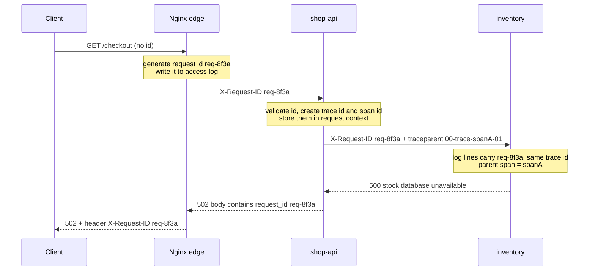
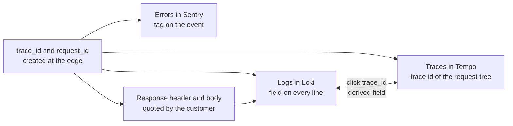

# L10.7 — Correlation IDs and Request IDs

> **Level 10: Observability** · Topic 7 of 11 · ⏱ ~3 hours · Difficulty: Intermediate

## 1. What it is

A **request ID** is a unique string attached to one incoming request at the edge of your system (the load balancer, the
reverse proxy or the first service). A **correlation ID** is the same idea stretched across many requests or services: a
single value that lets you collect every log line, metric exemplar and error that belongs to one piece of work, even after the
work hops through five services and a queue. In practice teams use the two words almost interchangeably; the header is
usually called `X-Request-ID` or `X-Correlation-ID`.

A **trace ID** is the standardised, tracing-system version of the same thing. The **W3C Trace Context** specification (a W3C
Recommendation) defines an HTTP header, `traceparent`, with four dash-separated parts:
`00-4bf92f3577b34da6a3ce929d0e0e4736-00f067aa0ba902b7-01` = version, **trace id** (32 hex characters, shared by the whole
request tree), **parent span id** (16 hex characters, the caller's current step) and flags (`01` means "sampled").
Distributed tracing ([next topic](08-distributed-tracing.md)) generates and propagates this automatically; correlation IDs are
what you add so that *logs* carry the same identifier.

## 2. Why it matters in DevOps

- **Without an ID, a customer complaint is a needle in a haystack.** "Checkout failed at 14:20" matches thousands of lines.
  "Request `req-8f3a…` failed" matches the four lines that matter, in all services.
- **Propagation is the hard part.** Generating an ID is trivial. The ID only helps if every service forwards it on every
  outgoing call and puts it in every log line. One service that drops the header cuts the chain in two.
- **It links the pillars.** A `trace_id` in a log line is the bridge from a log to a trace and back
  ([three pillars](01-three-pillars.md)). In Grafana you click the id in a Loki log line and land on the trace in Tempo.
- **It speeds up support.** If your API returns the ID in the response header and in error bodies, support can quote it and
  engineers can find the request in seconds.
- **Untrusted input.** An ID that comes from the internet is user input. Unvalidated, it can carry newlines (log injection),
  huge strings or endless unique values (cardinality problems in a log store).

## 3. Real-world system example

**Stripe** returns a `Request-Id` header on every API response and shows request ids in its dashboard logs, and its support
guidance asks for the id when you report a problem; the same pattern appears in the canonical log lines described in
[Structured Logging](05-structured-logging.md). **Cloudflare** adds a `CF-Ray` header to every response, which is the
identifier you quote to their support. **AWS Application Load Balancers** add an `X-Amzn-Trace-Id` header to requests they
forward, so a request can be followed from the load balancer's access log into your application logs (see
[Application Load Balancer](../level-06-cloud-aws/14-alb.md)). **Nginx** exposes a `$request_id` variable (a random 32-hex
string, available since version 1.11.0) precisely so it can be written to the access log and forwarded upstream with
`proxy_set_header`. **Heroku**'s router documents an `X-Request-ID` it will generate or pass through.

Modern stacks standardise on the **W3C Trace Context** headers (`traceparent`, `tracestate`), implemented by OpenTelemetry
SDKs, major cloud tracing products and most service meshes, which replaced older vendor formats such as Zipkin's B3 headers
in new systems.

## 4. Diagram

One request through the sample system. The id is created (or accepted) once at the edge and copied into every hop:



How the identifier ties the signals together:



## 5. How it works

**Where the ID comes from.** The first component that sees a request either accepts a valid ID from the caller or generates
a new one. The edge is the best place (load balancer or Nginx), because it also sees requests that never reach your code. Each
service then repeats the same rule: *accept if valid, otherwise generate*.

| Item | Typical format | Notes |
|------|----------------|-------|
| `X-Request-ID` / `X-Correlation-ID` | UUID or 16-32 hex characters | Not standardised, but a long-standing convention |
| `traceparent` | `00-<32 hex>-<16 hex>-<2 hex>` | W3C standard; carries trace id, parent span id and sampling flag |
| `tracestate` | `vendor=value,...` | Optional vendor extras next to `traceparent` |
| `baggage` | `userId=u-42,tier=gold` | W3C Baggage: key-value pairs that travel with the request. Visible to every service you call, never put secrets or personal data in it |

**Validate inbound IDs.** Accept only a bounded alphabet and length (for example `^[A-Za-z0-9._-]{8,64}$`) and replace
anything else. Without this, a client can write newlines or fake log lines into your logs, or send a different value per
request to bloat any system that indexes the id. Treat `traceparent` the same way: if it does not parse, start a new trace.

**Carry the ID inside the process.** In Node.js the right tool is `AsyncLocalStorage`: you store the ids once in middleware
and any code running later in the same request, including code after `await`, can read them without passing them as
function arguments. Other languages have equivalents (Java and Logback MDC, Python `contextvars`, Go `context.Context`).
A logger "mixin" then adds the ids to every log line automatically, so developers cannot forget.

**Propagate on every outgoing call.** HTTP clients, queue producers and background jobs must copy the id into headers or
message attributes (and a consumer must restore it). OpenTelemetry instrumentation does this for `traceparent`
automatically for common HTTP clients and message libraries; for your own `X-Request-ID` you add a small client wrapper or
interceptor.

**Return the ID.** Put it in the response header and in the error body, as `shop-api` does below. That one line makes
support tickets cheap.

**Link logs to traces.** If every log line contains `trace_id` (the 32-hex value) and your tracing backend uses the same
value, the two systems can link to each other. Grafana does this with a **derived field** on the Loki data source (a regular
expression that finds the id in a log line and turns it into a link to the Tempo data source), and from a trace back to its
logs with **trace to logs** on the Tempo data source. In Loki, store `trace_id` as structured metadata, not as a label
([Loki](06-loki-log-aggregation.md)). When you use OpenTelemetry (see [OpenTelemetry](09-opentelemetry.md)), the logging
integration reads the active span and adds `trace_id` and `span_id` for you.

**Pitfalls.** Asynchronous hand-offs lose context: a message put on a queue needs the id in its attributes, a cron job has no
inbound request and must create its own. Thread pools and callbacks can lose `AsyncLocalStorage` context in some libraries.
Logging in an event handler that fires later (for example `res.on('finish')`) may run outside the request's context, so
capture the context object and restore it, as the lab does.

## 6. Step-by-step guide

**Prerequisites:** Node.js 22 or newer, `curl`, `jq`, optionally Docker for the Nginx edge in step 9. No cost. This lab is
self-contained: two small services on your machine, `shop-api` (port 8080) calling `inventory` (port 8081).

1. **Create the project.**
   ```bash
   mkdir -p ~/l10-corr && cd ~/l10-corr
   npm init -y >/dev/null && npm install express pino
   ```

2. **Write the shared context code** `context.js`: validation, request context, a logger that adds the ids and a
   client wrapper that propagates them.
   ```js
   const { AsyncLocalStorage } = require('node:async_hooks');
   const crypto = require('node:crypto');
   const pino = require('pino');

   const als = new AsyncLocalStorage();

   // Never trust an inbound id blindly: bound its length and alphabet (log injection, cardinality, abuse).
   const REQUEST_ID_OK = /^[A-Za-z0-9._-]{8,64}$/;
   // W3C Trace Context: version-traceid-parentid-flags, all lowercase hex.
   const TRACEPARENT = /^([0-9a-f]{2})-([0-9a-f]{32})-([0-9a-f]{16})-([0-9a-f]{2})$/;

   const hex = (bytes) => crypto.randomBytes(bytes).toString('hex');

   function parseTraceparent(header) {
     const m = TRACEPARENT.exec(header || '');
     if (!m || m[1] === 'ff' || /^0+$/.test(m[2]) || /^0+$/.test(m[3])) return null;
     return { traceId: m[2], parentSpanId: m[3] };
   }

   function makeLogger(service) {
     return pino({
       base: { service },
       timestamp: pino.stdTimeFunctions.isoTime,
       formatters: { level: (label) => ({ level: label }) },
       mixin: () => ({ ...als.getStore() }), // every line gets request_id, trace_id, span_id (a copy: pino would otherwise write into the store)
     });
   }

   // Express middleware: establish the ids once, at the edge of this service.
   function context(req, res, next) {
     const inbound = req.headers['x-request-id'];
     const tp = parseTraceparent(req.headers['traceparent']);
     const store = {
       request_id: REQUEST_ID_OK.test(inbound || '') ? inbound : `req-${crypto.randomUUID()}`,
       trace_id: tp ? tp.traceId : hex(16),
       span_id: hex(8),
     };
     if (tp) store.parent_span_id = tp.parentSpanId;
     res.setHeader('x-request-id', store.request_id);
     req.ctx = store;
     als.run(store, next);
   }

   // Call another service and pass the ids on. This is "propagation".
   function callService(url) {
     const ctx = als.getStore();
     return fetch(url, {
       headers: {
         'x-request-id': ctx.request_id,
         traceparent: `00-${ctx.trace_id}-${ctx.span_id}-01`, // our span is the parent of the callee's span
       },
     });
   }

   module.exports = { als, makeLogger, context, callService };
   ```
   The `mixin` returns a *copy* of the store on purpose: pino merges the fields of each log call into whatever the mixin
   returns, and returning the store itself would leak fields from one log line into all later lines of the request.

3. **Write the downstream service** `inventory.js`.
   ```js
   const express = require('express');
   const { als, makeLogger, context } = require('./context');

   const log = makeLogger('inventory');
   const app = express();
   app.use(context);

   app.get('/reserve', async (req, res) => {
     log.info({ sku: 'kbd', qty: 1 }, 'reserving stock');
     if (req.query.fail) {
       log.error({ sku: 'kbd' }, 'stock database unavailable');
       return res.status(500).json({ error: 'stock database unavailable' });
     }
     res.json({ reserved: true });
   });

   app.listen(8081, () => log.info({ port: 8081 }, 'inventory listening'));
   ```

4. **Write the front service** `shop-api.js`: one canonical log line per request, a call to `inventory`, and the request
   id returned in the body.
   ```js
   const express = require('express');
   const { als, makeLogger, context, callService } = require('./context');

   const log = makeLogger('shop-api');
   const app = express();
   app.use(context);

   // One canonical line per request, with the same ids as every other line of the request.
   app.use((req, res, next) => {
     const started = process.hrtime.bigint();
     const ctx = req.ctx;
     res.on('finish', () => {
       const duration_ms = Number(process.hrtime.bigint() - started) / 1e6;
       const level = res.statusCode >= 500 ? 'error' : 'info';
       // 'finish' fires outside the request's async context, so restore it explicitly.
       als.run(ctx, () => log[level]({ method: req.method, route: req.path, status: res.statusCode, duration_ms: Math.round(duration_ms) }, 'request completed'));
     });
     next();
   });

   app.get('/checkout', async (req, res) => {
     log.info('checkout started');
     const suffix = req.query.fail ? '?fail=1' : '';
     const r = await callService(`http://localhost:8081/reserve${suffix}`);
     if (!r.ok) {
       log.error({ upstream: 'inventory', upstream_status: r.status }, 'inventory call failed');
       return res.status(502).json({ error: 'try again later', request_id: req.ctx.request_id });
     }
     log.info('checkout finished');
     res.json({ status: 'paid', request_id: req.ctx.request_id });
   });

   // Express 5 passes rejected promises here, for example when inventory is down.
   app.use((err, req, res, next) => {
     log.error({ err }, 'unhandled error');
     res.status(500).json({ error: 'internal error', request_id: req.ctx.request_id });
   });

   app.listen(8080, () => log.info({ port: 8080 }, 'shop-api listening'));
   ```

5. **Run both services**, capturing each one's logs to a file.
   ```bash
   node inventory.js > inventory.log 2>&1 &
   node shop-api.js  > shop-api.log  2>&1 &
   sleep 1
   ```

6. **Send requests** with no id, with your own id, and with a failing downstream.
   ```bash
   curl -si localhost:8080/checkout | grep -iE '^HTTP|x-request-id|request_id'
   curl -s  localhost:8080/checkout -H 'x-request-id: support-ticket-4711'
   curl -s  'localhost:8080/checkout?fail=1' -H 'x-request-id: ticket-0001'
   ```
   Expect `x-request-id: req-<uuid>` on the first response, `{"status":"paid","request_id":"support-ticket-4711"}` on the
   second and `{"error":"try again later","request_id":"ticket-0001"}` on the third.

7. **Follow one request across both services.** This is the whole point: one filter, two services.
   ```bash
   jq -c 'select(.request_id=="ticket-0001") | {service, level, msg, span_id, parent_span_id}' shop-api.log inventory.log
   ```
   Expect five lines, similar to the following. Look at `parent_span_id` on the `inventory` lines: it equals the `span_id`
   of `shop-api`, which is how a tracing system rebuilds the tree.
   ```json
   {"service":"shop-api","level":"info","msg":"checkout started","span_id":"37283b0f879a1c74","parent_span_id":null}
   {"service":"shop-api","level":"error","msg":"inventory call failed","span_id":"37283b0f879a1c74","parent_span_id":null}
   {"service":"shop-api","level":"error","msg":"request completed","span_id":"37283b0f879a1c74","parent_span_id":null}
   {"service":"inventory","level":"info","msg":"reserving stock","span_id":"bc8508e2fb83aeb8","parent_span_id":"37283b0f879a1c74"}
   {"service":"inventory","level":"error","msg":"stock database unavailable","span_id":"bc8508e2fb83aeb8","parent_span_id":"37283b0f879a1c74"}
   ```
   Now pick the trace instead: send a request with a standard `traceparent` and find it by `trace_id`.
   ```bash
   curl -s 'localhost:8080/checkout?fail=1' \
     -H 'traceparent: 00-4bf92f3577b34da6a3ce929d0e0e4736-00f067aa0ba902b7-01'
   jq -c 'select(.trace_id=="4bf92f3577b34da6a3ce929d0e0e4736") | {service, msg}' shop-api.log inventory.log
   ```
   Both services logged the caller's trace id, and `shop-api`'s `parent_span_id` is `00f067aa0ba902b7`.

8. **Test hostile input.** A bad id is replaced rather than logged.
   ```bash
   curl -si localhost:8080/checkout -H 'x-request-id: bad id with spaces' | grep -i x-request-id
   ```
   The response shows a fresh `req-<uuid>`, not your string.

9. **Generate the id at the edge with Nginx.** Save this as `edge.conf`. It keeps a well-formed client id, otherwise uses
   Nginx's own `$request_id`, writes it to a JSON access log, forwards it upstream and returns it to the client.
   ```nginx
   map $http_x_request_id $req_id {
       default                          $request_id;          # no id from the client: use nginx's own 32-hex id
       "~^[A-Za-z0-9._-]{8,64}$"        $http_x_request_id;   # keep a well-formed client id
   }

   log_format json_edge escape=json
       '{"time":"$time_iso8601","service":"nginx","request_id":"$req_id",'
       '"method":"$request_method","uri":"$uri","status":$status,'
       '"request_time":$request_time,"upstream_response_time":"$upstream_response_time"}';

   server {
       listen 80;
       access_log /dev/stdout json_edge;

       location / {
           proxy_pass http://host.docker.internal:8080;
           proxy_set_header X-Request-ID $req_id;        # to the app
           proxy_hide_header X-Request-ID;               # drop the app's copy so the client gets one header
           add_header       X-Request-ID $req_id always; # back to the client
       }
   }
   ```
   ```bash
   docker run --rm -d --name edge --add-host=host.docker.internal:host-gateway -p 8090:80 \
     -v "$PWD/edge.conf:/etc/nginx/conf.d/default.conf:ro" nginx:stable-alpine
   curl -si localhost:8090/checkout | grep -iE '^HTTP|x-request-id'
   docker logs edge | tail -1
   ```
   The id in the response header, in the Nginx access log line and in the `shop-api` log line is now the same 32-hex string.
   Without `proxy_hide_header` the client would get two `X-Request-ID` headers (the app's and Nginx's).

10. **Preview the logs-to-traces link in Grafana.** With the Loki data source from [Loki](06-loki-log-aggregation.md) and a
    Tempo data source with uid `tempo` (you add it in the next topics and the capstone), this derived field turns the
    `trace_id` in a JSON log line into a link. The `$$` is needed because Grafana expands `$` in provisioning files.
    ```yaml
      - name: Loki
        uid: loki
        type: loki
        access: proxy
        url: http://loki:3100
        jsonData:
          derivedFields:
            - name: trace_id
              matcherType: regex
              matcherRegex: '"trace_id":"(\w+)"'
              url: '$${__value.raw}'
              datasourceUid: tempo
              urlDisplayLabel: View trace
    ```

11. **Clean up.**
    ```bash
    docker stop edge 2>/dev/null
    kill $(jobs -p)
    ```

## 7. Real-world scenario

*Illustrative scenario.* A customer emails: "my payment failed at about 14:20 and I was charged." Before correlation ids, the
on-call engineer searches the `shop-api` logs for the customer's email, finds nothing (it is not logged, correctly), and
then reads 9,000 error lines from the payment provider in that minute.

After the change, the checkout error page shows `Reference: req-8f3a...`, taken from the response body. The engineer pastes
it into Grafana Explore against Loki, sees five lines across `nginx`, `shop-api` and `payments`, and clicks the `trace_id`
derived field to open the trace in Tempo: the `payments` span waited 29 seconds on the provider and the `shop-api` call
timed out at 30 seconds, but the provider had still completed the charge. The cause (a missing idempotency key on retry) is
found in minutes, not hours. The lesson in the postmortem: the id was the cheap part; making **every** service forward it
(the older `reports` batch job had to be fixed because it dropped the header) was the work.

**Lesson:** an identifier is only as good as its weakest hop. Test propagation end to end, not per service.

## 8. Common mistakes and best practices

**Don't**

- Trust an inbound id: unvalidated values enable log injection and unbounded cardinality.
- Generate a new id in every service. You then have five ids for one request and none of them links the story.
- Use user ids, emails or any personal data as the correlation id or in `baggage`.
- Make `request_id` or `trace_id` a Loki **label**. Use structured metadata or keep it in the line.
- Forget asynchronous boundaries: queue messages, scheduled jobs and callbacks lose context unless you carry it explicitly.
- Log the id in some lines only. If the logger does not add it automatically, it will be missing when you need it.

**Do**

- Generate (or accept a valid) id at the outermost edge, and return it in a response header and in error bodies.
- Adopt W3C `traceparent` for tracing and keep `X-Request-ID` for human-facing support references.
- Put the ids in a context object and have the logger add them to every line through a mixin or filter.
- Add the id to metrics exemplars, error reports (Sentry tags) and queue message attributes.
- Write a test that sends a request through the whole stack and asserts the same id appears in every service's log.
- Document the header names and the validation rule in the platform's logging standard.

## 9. Tasks

- [ ] **T1 — Follow an id across two services** *(≈45 min, beginner)*
  - **Goal:** build the lab and prove propagation.
  - **Steps:**
    1. Do steps 1-7 of section 6.
    2. Use `jq` to print, for your own `x-request-id`, every log line of both services in time order (`jq -s 'sort_by(.time)'` over both files).
  - **Done when:** the output shows `shop-api` and `inventory` lines under one `request_id`, and `inventory`'s `parent_span_id` matches `shop-api`'s `span_id`.

- [ ] **T2 — Add a third hop** *(≈45 min, intermediate)*
  - **Goal:** extend propagation to a new service.
  - **Steps:**
    1. Create `payments.js` on port 8082 with a `/charge` route that logs through `makeLogger('payments')`.
    2. Make `inventory` or `shop-api` call it with `callService`.
    3. Request `/checkout` with `x-request-id: three-hops-1` and filter all three log files.
  - **Done when:** three services show the same `request_id` and `trace_id`, and each `parent_span_id` points to the caller's `span_id`.

- [ ] **T3 — Break it: drop the header, then catch it with a test** *(≈45 min, intermediate)*
  - **Goal:** see how a single careless hop breaks correlation, and guard against it.
  - **Steps:**
    1. In `callService`, remove the `x-request-id` header. Request `/checkout` with your own id and see that `inventory` logs a different one.
    2. Write a shell or `node --test` script that starts both services, sends one request with a known id and fails if the id is missing from either log file.
    3. Restore the header and make the test pass.
  - **Done when:** the test fails with the header removed and passes with it restored.

- [ ] **T4 — Edge id and validation** *(≈45 min, intermediate)*
  - **Goal:** generate the id at Nginx and validate it everywhere.
  - **Steps:**
    1. Run the Nginx edge from step 9.
    2. Send requests with no id, a good id, and bad ids (one containing spaces, one of 500 characters, one with a double quote).
    3. Compare the id in the Nginx log, response header and `shop-api` log for each case.
  - **Done when:** all three show one id per request, and a malformed id is replaced in both Nginx and `shop-api`.

- [ ] **T5 — Link logs to traces in Grafana** *(≈60 min, advanced)*
  - **Goal:** click from a log line to a trace.
  - **Steps:**
    1. Finish the Loki stack from [Loki](06-loki-log-aggregation.md), then complete [Distributed Tracing](08-distributed-tracing.md) or the capstone so a Tempo data source with uid `tempo` exists.
    2. Add the derived field from step 10 to the Loki data source, restart Grafana and open a `shop-api` log line that contains a `trace_id`.
    3. Add `tracesToLogsV2` (or use the *Logs for this span* button) on the Tempo data source to link back.
  - **Done when:** you move from a log line to its trace and back using only links.

- [ ] **T6 — Prove it: write the propagation contract** *(≈45 min, advanced)*
  - **Goal:** explain correlation IDs well enough to enforce them.
  - **Steps:**
    1. Without the guide, write a half-page standard for `shop-api`: header names, who generates, validation regex, what is returned to clients, how queues and cron jobs carry it, and what must never be in `baggage`.
    2. Draw the sequence from client to database and mark every place the id could be lost.
  - **Done when:** a teammate can implement a new service from your document and a test confirms the id appears in its logs.

## 10. Self-check questions

1. What is the difference between a request ID and a trace ID?
2. What are the four fields of a `traceparent` header?
3. Why validate an inbound `X-Request-ID`?
4. Why should `trace_id` be structured metadata in Loki rather than a label?
5. Name two places where correlation commonly breaks in a real system.
6. What is `AsyncLocalStorage` used for here?

<details>
<summary>Answers</summary>

1. A request ID is any unique string used to find one request in logs; a trace ID is the standard (W3C) identifier shared by all spans of a trace, propagated in `traceparent` and understood by tracing tools. They can be the same value or two linked ones.
2. Version (`00`), trace id (32 hex), parent span id (16 hex) and trace flags (`01` = sampled).
3. It is user input: bad values can inject fake log lines or newlines, be huge, or be unique per request and inflate indexes. Accept a bounded alphabet and length, otherwise generate a new id.
4. A label creates a stream per value (millions of streams); structured metadata is stored with the line, creates no extra streams and is still filterable.
5. Message queues and background jobs (the context is not carried automatically), and HTTP calls made with a client that was not wrapped or instrumented; also thread or callback boundaries that lose async context.
6. It holds per-request state (ids) that any later code in that request, including after `await`, can read, so loggers and clients add the ids without passing them around.
</details>

## 11. Further reading

- W3C Trace Context specification (w3.org/TR/trace-context) and W3C Baggage specification.
- OpenTelemetry documentation: "Context propagation".
- Nginx documentation: the `$request_id` variable (ngx_http_core_module) and `proxy_set_header`.
- Stripe API documentation: request IDs; Cloudflare documentation: the `CF-Ray` header.
- Grafana documentation: Loki data source "derived fields" and Tempo "trace to logs".
- See also: [Structured Logging](05-structured-logging.md), [Log Aggregation with Loki](06-loki-log-aggregation.md), [Distributed Tracing](08-distributed-tracing.md), [Reverse Proxies and Load Balancers](../level-02-networking/08-reverse-proxies-and-load-balancers.md).

<!-- nav -->
---
← Previous: [Log Aggregation with Loki](06-loki-log-aggregation.md) · [Level 10 index](README.md) · Next: [Distributed Tracing](08-distributed-tracing.md) →
