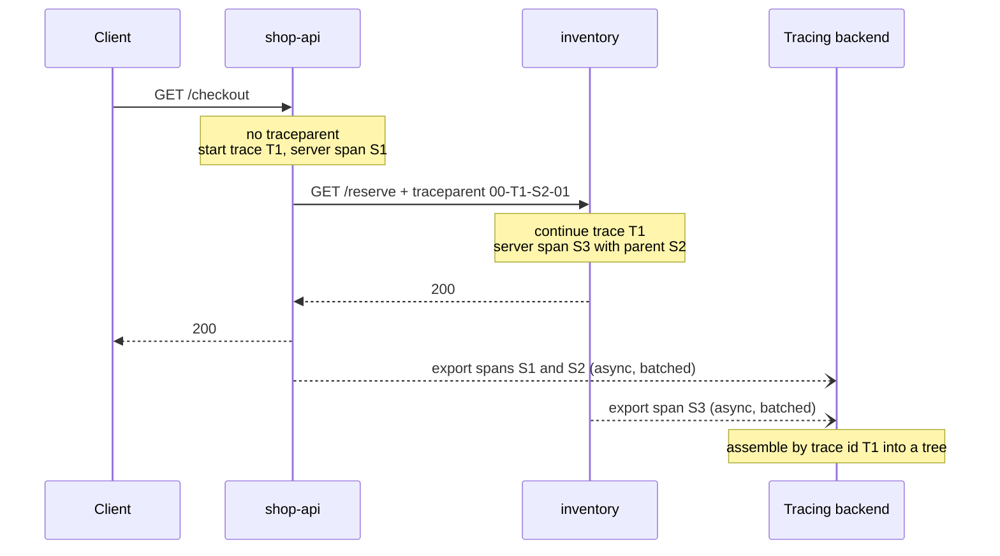

# L10.8 — Distributed Tracing

> **Level 10: Observability** · Topic 8 of 11 · ⏱ ~4 hours · Difficulty: Intermediate

## 1. What it is

A **distributed trace** is the recorded story of one request as it travels through many services. It is made of
**spans**: each span is one timed step (an incoming HTTP request, a database query, a call to another service) with a start
time, a duration, a name, a status and key-value **attributes**. Spans point to their **parent span**, so together they form
a tree. Every span of one request shares the same **trace ID**.

Metrics tell you *that* checkout is slow, and logs tell you what one service said. A trace tells you **where the time went**
across services: "of the 840 ms, 800 ms was one database query inside `inventory`". For that to work the trace ID and the
parent span ID must travel with the request from service to service. That is **context propagation**, and it is done with
the `traceparent` HTTP header described in [Correlation IDs](07-correlation-ids.md).

A **tracing backend** stores and displays traces. The two common open-source ones are **Jaeger** and **Grafana Tempo**.

## 2. Why it matters in DevOps

- **Latency in a microservice system is a path, not a number.** A p99 of 3 seconds on `/checkout` could be any of eight
  downstream calls. Tracing points to the guilty hop in seconds instead of a day of log archaeology.
- **It reveals hidden structure.** Traces show N+1 query patterns, serial calls that could run in parallel, retries that
  multiply load and dependencies nobody documented.
- **It links the pillars.** Logs and metrics get a `trace_id`; from a spike on a dashboard you jump to an example slow trace
  ([three pillars](01-three-pillars.md)).
- **Cost and overhead are real.** Tracing every request in a high-traffic system is expensive in CPU, network and storage,
  so you must understand **sampling**, or you will either blow the budget or throw away the traces you need.
- **Broken propagation silently breaks it.** One service that does not forward the headers splits a trace into pieces.

## 3. Real-world system example

**Google Dapper.** Google published a 2010 paper describing Dapper, its internal distributed tracing system. It introduced
ideas now standard: trace and span IDs carried in request context, low-overhead instrumentation in shared client libraries,
and **sampling** only a small fraction of requests to keep overhead low. It inspired open-source systems: **Zipkin**
(from Twitter) and **Jaeger** (from Uber, now a CNCF graduated project). **Grafana Tempo** (from Grafana Labs) takes a
different storage approach: it indexes almost nothing and stores trace data in cheap object storage, retrieving traces by
trace ID and searching with **TraceQL**, its query language.

Most of the industry has since converged on **OpenTelemetry** ([next but one topic](09-opentelemetry.md)) for instrumentation, which
is the merger of two earlier projects, OpenTracing and OpenCensus, and on the W3C `traceparent` header. In a Kubernetes system
the same traces can also come from a service mesh sidecar (see [Service Mesh](../level-12-advanced-networking/09-service-mesh.md)).

## 4. Diagram

One trace for `GET /checkout` in the sample system. Time flows left to right; each indented box is a child span:

```mermaid
gantt
    title Trace for GET /checkout - 840 ms
    dateFormat  x
    axisFormat %L ms
    section shop-api
    GET /checkout (server span)        :0, 840
    validate cart (internal)           :0, 20
    HTTP call to inventory (client)    :20, 830
    section inventory
    GET /reserve (server span)         :25, 825
    SELECT stock (database query)      :30, 820
```



How the trace context moves between services:



## 5. How it works

**Span anatomy.** Each span has: trace ID, span ID, parent span ID, a **name** (low cardinality, such as `GET /checkout`,
never a URL with ids), start and end time, **kind**, **status**, **attributes**, optional **events** (timestamped notes, for
example an exception) and optional **links** (to other traces, used for queues and batches).

| Span kind | Meaning |
|-----------|---------|
| `SERVER` | Handling an incoming request |
| `CLIENT` | Making an outgoing request or call |
| `INTERNAL` | Work inside one service (a function, a database call you wrap by hand) |
| `PRODUCER` / `CONSUMER` | Putting a message on a queue / processing one |

**Attributes** follow OpenTelemetry **semantic conventions** so that tools agree on names: `http.request.method`,
`http.route`, `http.response.status_code`, `db.system.name`, `server.address`, and on the process, the resource attribute
`service.name`. Older instrumentation versions used `http.method` and `http.status_code`; check what your version emits
before writing queries (the lab shows how).

**Context propagation.** Inside a process the active span is held in context (in Node.js with `AsyncLocalStorage`). When code
makes an outgoing call, an instrumented client injects the `traceparent` header (and optionally `tracestate` and
`baggage`); the receiving service extracts it and starts its span as a child. The format is
`00-<trace id 32 hex>-<parent span id 16 hex>-<flags>`. For messages, the same fields go into message headers or
attributes. If any hop is not instrumented the context is dropped, and the next service starts a new, unrelated trace.

**Sampling.** You almost never store every trace.

| Strategy | Where it decides | How it works | Trade-off |
|----------|------------------|--------------|-----------|
| **Head sampling** | At the start of the trace, in the SDK | Probabilistic (keep 10 percent by trace ID) or rate-limited. With `parentbased` samplers each service follows the first decision, so a trace is complete or absent | Cheap and simple, but it decides before knowing whether the request will fail or be slow, so rare errors may be dropped |
| **Tail sampling** | After the trace is complete, in a collector | Buffers all spans of a trace for a few seconds, then keeps it if it has an error, is slower than a threshold, or matches a policy; samples the rest at a low rate | Keeps the interesting traces, but needs a collector tier, memory, and all spans of one trace sent to the same collector instance |
| **Always on / off** | SDK | Everything or nothing | Fine for development and low traffic |

In the SDK you choose with environment variables, for example `OTEL_TRACES_SAMPLER=parentbased_traceidratio` and
`OTEL_TRACES_SAMPLER_ARG=0.1`. Tail sampling is configured in the OpenTelemetry Collector ([OpenTelemetry](09-opentelemetry.md)).
A common production recipe: head-sample a small percentage everywhere for cost, or tail-sample to keep 100 percent of errors and
slow requests plus a small share of normal ones. Because sampling removes data, derive request counts and error rates from
**metrics**, never by counting traces.

**Backends.**

| | Jaeger (v2) | Grafana Tempo |
|---|-------------|---------------|
| Origin | Uber, CNCF graduated | Grafana Labs |
| Ingest | OTLP natively (v2 is built on the OpenTelemetry Collector) | OTLP, Jaeger and Zipkin formats |
| Storage | In memory for demos; Elasticsearch/OpenSearch, Cassandra, ClickHouse and others for production | Object storage (S3, GCS, Azure) or local disk; minimal index |
| Query | Jaeger UI search by service, operation, tags, duration; trace by ID | Trace by ID, **TraceQL** search, metrics from traces; best inside Grafana |
| Typical fit | Standalone tracing UI | You already run Grafana, Loki and Prometheus and want one place |

Jaeger version 1 reached end of life; new deployments should use version 2 and send OTLP.

**TraceQL** selects spans with conditions inside braces, for example
`{ resource.service.name = "shop-api" && duration > 500ms }`, `{ status = error }`, or a structural query
`{ resource.service.name = "shop-api" } >> { status = error }` (an error span anywhere below a `shop-api` span). Attributes are
prefixed `span.` or `resource.`.

**What to put in spans.** Add attributes that help you ask questions later (`shop.sku`, `shop.order_id`, `tenant`), never
secrets or raw personal data, and avoid unbounded names. Record errors with the exception event and an error status. Wrap
important work that auto-instrumentation cannot see, but do not wrap every function: thousands of tiny spans cost money and
make traces unreadable.

## 6. Step-by-step guide

**Prerequisites:** Node.js 22 or newer, Docker, `curl`. No cost; about 500 MB of RAM. The instrumentation is switched on with
a small bootstrap file; [OpenTelemetry](09-opentelemetry.md) explains it in depth, so here treat it as a switch. Package and
image versions below were current when written; if a tag is gone, use the newest.

1. **Start Jaeger** (UI on 16686, OTLP receivers on 4317 for gRPC and 4318 for HTTP; storage is in memory, so a restart
   forgets everything).
   ```bash
   docker run --rm -d --name jaeger -p 16686:16686 -p 4317:4317 -p 4318:4318 jaegertracing/jaeger:2.22.0
   ```
   Open <http://localhost:16686>; it shows an empty search form.

2. **Create the project.**
   ```bash
   mkdir -p ~/l10-trace && cd ~/l10-trace
   npm init -y >/dev/null
   npm install express @opentelemetry/api @opentelemetry/sdk-node @opentelemetry/auto-instrumentations-node
   ```

3. **Write the tracing bootstrap** `tracing.js`.
   ```js
   // Loaded with: node --require ./tracing.js app.js   (it must run before express is imported)
   const { NodeSDK } = require('@opentelemetry/sdk-node');
   const { getNodeAutoInstrumentations } = require('@opentelemetry/auto-instrumentations-node');

   const sdk = new NodeSDK({
     // The service name and the exporter endpoint come from OTEL_* environment variables.
     instrumentations: [
       getNodeAutoInstrumentations({
         '@opentelemetry/instrumentation-fs': { enabled: false }, // very noisy, rarely useful
       }),
     ],
   });

   sdk.start();

   // Flush buffered spans on shutdown so the last requests are not lost.
   process.on('SIGTERM', () => sdk.shutdown().finally(() => process.exit(0)));
   process.on('SIGINT', () => sdk.shutdown().finally(() => process.exit(0)));
   ```

4. **Write the front service** `shop-api.js`. It has no tracing code at all.
   ```js
   const express = require('express');

   const app = express();
   const sleep = (ms) => new Promise((r) => setTimeout(r, ms));

   app.get('/checkout', async (req, res) => {
     await sleep(10 + Math.random() * 20);                      // validate the cart
     const qs = new URLSearchParams(req.query).toString();
     const r = await fetch(`http://localhost:8081/reserve${qs ? '?' + qs : ''}`); // the trace context travels in this call
     if (!r.ok) return res.status(502).json({ error: 'inventory unavailable' });
     await sleep(5);                                            // write the order
     res.json({ status: 'paid' });
   });

   app.listen(8080, () => console.log('shop-api listening on :8080'));
   ```

5. **Write the downstream service** `inventory.js`, with one hand-written span around a simulated database query.
   `?slow=1` makes the query take 800 ms and `?fail=1` makes it fail.
   ```js
   const express = require('express');
   const { trace, SpanStatusCode } = require('@opentelemetry/api');

   const tracer = trace.getTracer('inventory');
   const sleep = (ms) => new Promise((r) => setTimeout(r, ms));
   const app = express();

   // A manual span around work that auto-instrumentation cannot see (here, a simulated database query).
   async function queryStock(sku, slow, fail) {
     return tracer.startActiveSpan('SELECT stock', async (span) => {
       span.setAttribute('db.system.name', 'postgresql');
       span.setAttribute('db.operation.name', 'SELECT');
       span.setAttribute('shop.sku', sku);
       try {
         await sleep(slow ? 800 : 15);
         if (fail) throw new Error('connection pool exhausted');
         return { sku, available: 12 };
       } catch (err) {
         span.recordException(err);
         span.setStatus({ code: SpanStatusCode.ERROR, message: err.message });
         throw err;
       } finally {
         span.end();
       }
     });
   }

   app.get('/reserve', async (req, res) => {
     try {
       const stock = await queryStock('kbd', Boolean(req.query.slow), Boolean(req.query.fail));
       res.json({ reserved: true, ...stock });
     } catch (err) {
       res.status(500).json({ error: err.message });
     }
   });

   app.listen(8081, () => console.log('inventory listening on :8081'));
   ```

6. **Run both services with tracing on.** The only difference between them is the service name.
   ```bash
   export OTEL_EXPORTER_OTLP_ENDPOINT=http://localhost:4318
   export OTEL_NODE_RESOURCE_DETECTORS=env,host,os,process   # skip cloud-metadata probes (they print a harmless warning on a laptop)
   OTEL_SERVICE_NAME=inventory node --require ./tracing.js inventory.js &
   OTEL_SERVICE_NAME=shop-api  node --require ./tracing.js shop-api.js  &
   ```

7. **Generate three kinds of traffic.**
   ```bash
   for i in 1 2 3 4 5; do curl -s localhost:8080/checkout; done      # fast
   curl -s 'localhost:8080/checkout?slow=1'                           # one slow database query
   curl -s 'localhost:8080/checkout?fail=1'                           # database error, becomes a 502
   ```
   Expect `{"status":"paid"}` five times, then `{"status":"paid"}` after about 0.8 s, then `{"error":"inventory unavailable"}`.

8. **Read the slow trace.** In the Jaeger UI choose Service `shop-api`, press *Find Traces*, and sort by *Longest First*.
   Open the top trace (about 840 ms). You should see one trace with spans from two services, similar to:
   ```text
   shop-api   GET /checkout                  840 ms   (server)
     shop-api   middleware / request handler  ...      (internal, added by the Express instrumentation)
     shop-api   GET                           805 ms   (client: the call to inventory)
       inventory  GET /reserve                800 ms    (server)
         inventory  SELECT stock              800 ms    (your manual span)
   ```
   Click `SELECT stock`: its tags include `db.system.name=postgresql` and `shop.sku=kbd`. The answer to "where did the
   time go?" is one line. Now open the failing trace: the `SELECT stock` span is marked as an error with an
   `exception` event holding the message `connection pool exhausted`, and the error propagates up to the `502`.

9. **Confirm propagation is what makes the tree.** Stop `inventory`, restart it *without* tracing, and compare.
   ```bash
   kill %1
   node inventory.js &
   curl -s 'localhost:8080/checkout?slow=1'
   ```
   In Jaeger the new trace contains only `shop-api` spans; the 800 ms is visible as a long client span, but there is no child:
   a black box. (Note that the shell job number may differ; use `jobs` to check. Restart the instrumented version afterwards.)

10. **Try head sampling.** Restart both services with a 25 percent probabilistic sampler and send 80 requests.
    ```bash
    export OTEL_TRACES_SAMPLER=parentbased_traceidratio OTEL_TRACES_SAMPLER_ARG=0.25
    # restart both services as in step 6, then:
    for i in $(seq 80); do curl -s localhost:8080/checkout > /dev/null; done
    ```
    Search in Jaeger: around 20 traces (give or take, it is random), and every trace that exists has spans from *both*
    services, because `inventory` follows the decision carried in `traceparent` (its flags byte). Unset the two variables
    afterwards.

11. **Optional: the same data in Tempo.** Tempo ingests OTLP too and is queried with TraceQL, usually through Grafana. The
    [OpenTelemetry](09-opentelemetry.md) lab adds Tempo and the Grafana *Explore* view. Queries you can try there on this
    data (verified against Tempo 2.10):
    ```text
    { resource.service.name = "shop-api" && duration > 500ms }
    { status = error }
    { span.db.system.name = "postgresql" && duration > 500ms }
    { resource.service.name = "shop-api" } >> { resource.service.name = "inventory" && status = error }
    { span.http.route = "/checkout" && span.http.response.status_code >= 500 }
    ```
    The last query uses `http.response.status_code`; with the older name (`span.http.status_code`) it returns nothing on this
    data. Attribute names depend on the instrumentation version.

12. **Clean up.**
    ```bash
    kill $(jobs -p); docker stop jaeger
    ```

## 7. Real-world scenario

*Illustrative scenario.* After a release, `GET /checkout` p99 climbs from 400 ms to 2.5 s. CPU is flat, error rate is flat,
and the logs from `shop-api` show nothing unusual because the slowness is not in `shop-api`. On the dashboard, the latency
panel has an exemplar (a sample trace ID) attached to the p99 bucket. The engineer opens that trace: the 2.4 seconds are
eleven sequential `SELECT stock` spans inside `inventory`, each about 200 ms. The new release looped over cart items and
queried one SKU at a time (the classic N+1 pattern). No log line or metric would have shown the *shape* of the problem; the
waterfall did.

The fix batches the lookup into one query; p99 returns to normal. The team adds an alert on span count per trace for
`inventory` and keeps tail sampling to retain every trace slower than 1 second, so such traces are always available.

**Lesson:** traces show structure (serial versus parallel, repeated calls) that aggregates hide.

## 8. Common mistakes and best practices

**Don't**

- Put ids, URLs with ids, or user data in span **names**; use a route template and put ids in attributes only where needed.
- Assume 100 percent of traces are stored. Never compute request counts or error rates from traces; use metrics.
- Forget async boundaries: queues, background jobs and custom HTTP clients need explicit propagation.
- Instrument every function; the trace becomes noise and the bill grows.
- Put secrets, tokens or personal data in attributes. Traces are widely readable and retained.
- Run tracing with in-memory Jaeger in production, or without capacity planning for traces per second.

**Do**

- Start with automatic instrumentation for HTTP, database and messaging, then add a few hand-written spans for business steps.
- Set `service.name` (and `service.version`, `deployment.environment.name`) on every service so traces are filterable.
- Use `parentbased` samplers so a trace is complete or absent, and tail-sample to keep errors and slow requests.
- Put `trace_id` in logs ([Correlation IDs](07-correlation-ids.md)) and exemplars on latency histograms.
- Record exceptions on spans and set the error status, so `{ status = error }` finds them.
- Test propagation end to end in CI: one request, then assert that spans from every service share a trace ID.

## 9. Tasks

- [ ] **T1 — Follow the lab** *(≈60 min, beginner)*
  - **Goal:** see a two-service trace in Jaeger.
  - **Steps:**
    1. Do steps 1-8 of section 6.
    2. In Jaeger, find the slow trace and read the duration of each span.
  - **Done when:** you can state, from the UI alone, which span accounts for the slow request and what its attributes say.

- [ ] **T2 — Add a third service and a parallel call** *(≈60 min, intermediate)*
  - **Goal:** see serial versus parallel work in a waterfall.
  - **Steps:**
    1. Create `payments.js` on port 8082 with a route that sleeps 300 ms.
    2. In `shop-api`, call `inventory` and `payments`: first one after the other, then with `Promise.all`.
    3. Compare the two waterfalls and their total durations.
  - **Done when:** you have two traces whose total durations differ by roughly the shorter call, and you can point at the overlap.

- [ ] **T3 — Break it: lose the context, then fix it** *(≈45 min, intermediate)*
  - **Goal:** understand propagation by breaking it.
  - **Steps:**
    1. Run `inventory` without `--require ./tracing.js` (step 9) and observe the black box.
    2. Restore it, then restart `shop-api` with `OTEL_NODE_ENABLED_INSTRUMENTATIONS=http,express` set. This enables only those two instrumentations, so the built-in `fetch` call (which uses undici, not the `http` module) is no longer instrumented.
    3. Send a request. Observe two disconnected traces (one containing `GET /checkout`, another starting at `GET /reserve` with no parent), then remove the variable and restart.
  - **Done when:** you can show a broken trace and a healthy one, and explain which header was missing and why the trace split.

- [ ] **T4 — Sampling experiment** *(≈45 min, intermediate)*
  - **Goal:** measure what head sampling keeps.
  - **Steps:**
    1. Send 100 requests with `OTEL_TRACES_SAMPLER_ARG` set to `1`, `0.5` and `0.1`; count traces in Jaeger each time.
    2. Make `inventory` use `always_on` while `shop-api` uses `parentbased_traceidratio` at 0.1; compare counts and describe what you see.
    3. Write down which strategy you would use for a service with 2,000 requests per second and why.
  - **Done when:** you have the three counts, an explanation of the mixed configuration, and a justified recommendation.

- [ ] **T5 — Automate a propagation test** *(≈60 min, advanced)*
  - **Goal:** make "traces are connected" a test.
  - **Steps:**
    1. Write a script that starts Jaeger and both services, sends one request, waits a few seconds, and fetches the trace from Jaeger's API (for version 2, `GET /api/v3/traces?query.service_name=shop-api&query.start_time_min=...&query.start_time_max=...` returns OTLP JSON).
    2. Assert that the result contains spans from both `shop-api` and `inventory` with the same trace ID.
    3. Run it in CI ([GitHub Actions Pipelines](../level-05-cicd/02-github-actions-pipelines.md)).
  - **Done when:** the script exits 0 when propagation works and non-zero when you run `inventory` without tracing.

- [ ] **T6 — Prove it: explain where the time went** *(≈45 min, advanced)*
  - **Goal:** use tracing to diagnose, then explain it.
  - **Steps:**
    1. Without the guide, build the two-service system, make one dependency slow, and find it using only a trace.
    2. Write five sentences: what a span is, how the trace ID got from `shop-api` to `inventory`, what sampling you would use in production and why, and what a trace cannot tell you.
  - **Done when:** a teammate can reproduce your finding from your notes and understands why counts must come from metrics.

## 10. Self-check questions

1. What are the main fields of a span, and how do spans form a tree?
2. What does the `traceparent` header contain, and who creates and reads it?
3. What is the difference between head and tail sampling, and when is tail sampling worth its cost?
4. Why must you not count requests or errors from traces?
5. Name two situations where trace context is lost.
6. What is the practical difference between Jaeger and Tempo?

<details>
<summary>Answers</summary>

1. Trace id, span id, parent span id, name, start and duration, kind, status, attributes, events and links. Each span stores its parent's span id; all spans of a request share the trace id, and the backend assembles the tree.
2. Version, trace id (32 hex), parent span id (16 hex) and flags (sampled). The calling service's instrumented client injects it; the receiving service extracts it and starts a child span.
3. Head sampling decides at the start (simple, cheap, may miss rare errors); tail sampling decides after the trace is complete in a collector, so it can keep all errors and slow traces, but needs collector memory and routing of all spans of a trace to one instance. Worth it when failures and tail latency matter more than the extra infrastructure.
4. Sampling drops traces, so the counts are biased and depend on the sampler; metrics are complete and cheap.
5. A hop that is not instrumented or that uses a custom client that does not inject headers; queues, background jobs, cron jobs and callbacks that lose async context.
6. Jaeger is a standalone tracing system with its own UI and pluggable databases; Tempo stores traces in object storage with almost no index, is queried by trace id and TraceQL, and is designed to be used through Grafana alongside Loki and Prometheus.
</details>

## 11. Further reading

- Sigelman et al., "Dapper, a Large-Scale Distributed Systems Tracing Infrastructure" (Google technical report, 2010).
- OpenTelemetry documentation: "Traces", "Context propagation", "Sampling" and the semantic conventions.
- Jaeger documentation (jaegertracing.io): "Getting started" and the v2 architecture notes.
- Grafana Tempo documentation: "TraceQL" and "Sampling".
- W3C Trace Context specification (w3.org/TR/trace-context).
- See also: [Correlation IDs](07-correlation-ids.md), [OpenTelemetry](09-opentelemetry.md), [Service Level Indicators](../level-14-sre/01-slis.md).

<!-- nav -->
---
← Previous: [Correlation IDs and Request IDs](07-correlation-ids.md) · [Level 10 index](README.md) · Next: [OpenTelemetry](09-opentelemetry.md) →
