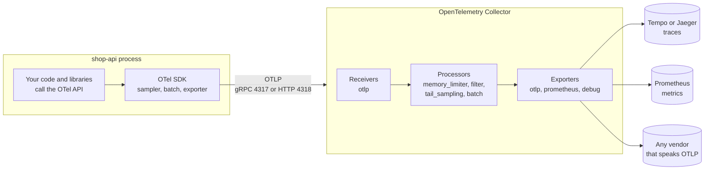
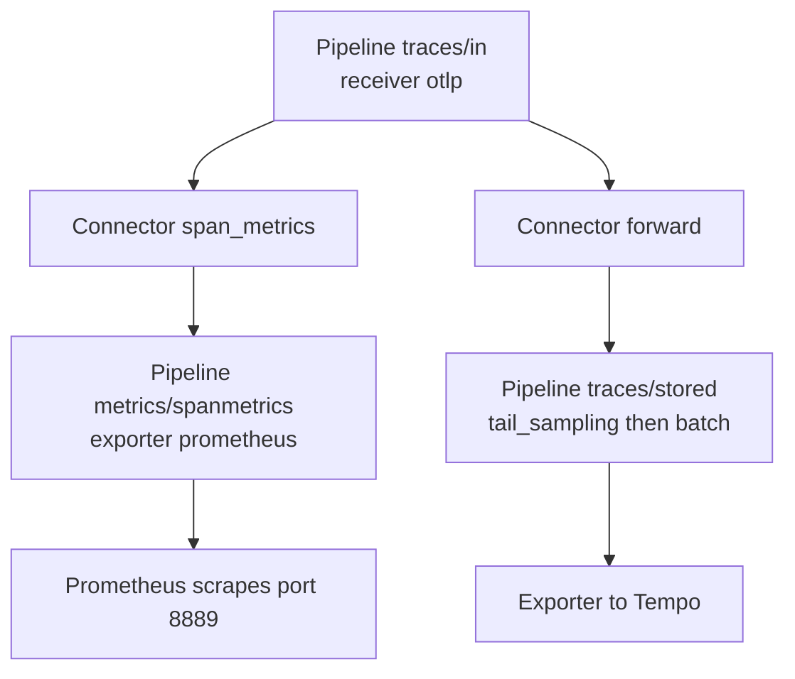

# L10.9 — OpenTelemetry

> **Level 10: Observability** · Topic 9 of 11 · ⏱ ~5 hours · Difficulty: Advanced

## 1. What it is

**OpenTelemetry** (usually written **OTel**) is the open standard and toolkit for producing and moving telemetry: traces,
metrics and logs. It is a project of the Cloud Native Computing Foundation (CNCF), formed by merging two earlier projects,
OpenTracing and OpenCensus. It does **not** store or display anything. It is the layer between your code and whichever
backend you choose (Jaeger, Tempo, Prometheus, Loki, Datadog, Honeycomb, CloudWatch, and many more).

It consists of five parts you should be able to name:

| Part | What it is |
|------|------------|
| **API** | The small, stable interface that application and library code calls (`tracer.startSpan`, `meter.createCounter`). Without an SDK it does nothing, so libraries can use it safely |
| **SDK** | The implementation per language: sampling, batching, resource detection, exporters. You configure it once at startup |
| **Instrumentation** | Code that creates telemetry for you: **automatic** (agents and library hooks for HTTP, databases, queues) and **manual** (your own spans and metrics) |
| **OTLP** | The **OpenTelemetry Protocol**, the wire format (protobuf over gRPC on port 4317 or over HTTP on port 4318, with the paths `/v1/traces`, `/v1/metrics`, `/v1/logs`) |
| **Collector** | A standalone service that receives telemetry, processes it (batch, filter, sample, redact) and exports it to one or more backends |

Plus the **semantic conventions**: agreed attribute names (`http.route`, `db.system.name`, `service.name`) so every tool reads
the data the same way.

## 2. Why it matters in DevOps

- **Vendor neutrality.** Instrument once with OTel and change backends by editing a Collector config, not by re-instrumenting
  fifty services. Moving from a commercial vendor to self-hosted Tempo (or the other direction) stops being a rewrite.
- **One consistent way** to get traces, metrics and logs out of services written in different languages.
- **Operational control in the Collector.** Retries, buffering, redaction of sensitive attributes, dropping noisy health-check spans,
  tail sampling and sending the same data to two backends all happen in one place that you control, outside application code.
- **Cost control.** Sampling and filtering before data reaches a paid backend is the main lever on an observability bill.
- **Failure modes are your problem.** A Collector without memory limits can crash under load; an exporter pointed at the wrong
  address silently drops data; high-cardinality attributes explode metrics. Understanding the pipeline is part of the job.

## 3. Real-world system example

OpenTelemetry is one of the most active projects in the CNCF, and most major observability vendors and cloud providers accept
OTLP directly or ship their own distribution of the Collector. Examples: AWS offers the **AWS Distro for OpenTelemetry (ADOT)**;
Google Cloud and Azure Monitor have OpenTelemetry integrations; **Grafana Alloy** is Grafana's distribution of the Collector; Jaeger version 2 is itself built on the OpenTelemetry
Collector framework. In Kubernetes the **OpenTelemetry Operator** can inject automatic instrumentation into pods through an
annotation such as `instrumentation.opentelemetry.io/inject-nodejs: "true"` and manage Collectors as custom resources
(see [Operators](../level-16-advanced-kubernetes/04-operators.md)).

A common production topology: every node runs a Collector in **agent** mode (a DaemonSet, see
[DaemonSets](../level-08-kubernetes/11-daemonsets.md)) that receives OTLP from local pods and adds Kubernetes metadata; those agents forward
to a small pool of **gateway** Collectors that do tail sampling, redaction and routing to the backends.

## 4. Diagram

How telemetry flows, and where each OTel part sits:



A Collector can also turn one signal into another with a **connector**, which is how this topic produces RED metrics from spans:



## 5. How it works

**Resource and attributes.** Every piece of telemetry belongs to a **resource**: the thing producing it, described by
attributes such as `service.name`, `service.version`, `deployment.environment.name`, `host.name`, `k8s.pod.name`. `service.name` is the
single most important one; without it backends show `unknown_service`. Set it with `OTEL_SERVICE_NAME`, and add the others with
`OTEL_RESOURCE_ATTRIBUTES=service.version=1.4.2,deployment.environment.name=prod`.

**Configure the SDK with environment variables.** Every language SDK reads the same variables, so deployment config looks the
same whether the service is Node, Java or Go:

| Variable | Meaning |
|----------|---------|
| `OTEL_SERVICE_NAME` | Logical service name |
| `OTEL_RESOURCE_ATTRIBUTES` | Extra resource attributes, comma-separated `key=value` |
| `OTEL_EXPORTER_OTLP_ENDPOINT` | Where to send (HTTP default `http://localhost:4318`, gRPC default `http://localhost:4317`) |
| `OTEL_EXPORTER_OTLP_PROTOCOL` | `grpc`, `http/protobuf` or `http/json` |
| `OTEL_EXPORTER_OTLP_HEADERS` | Auth headers for a vendor, such as `api-key=<YOUR_KEY>` |
| `OTEL_TRACES_EXPORTER`, `OTEL_METRICS_EXPORTER`, `OTEL_LOGS_EXPORTER` | `otlp`, `console` or `none` per signal |
| `OTEL_TRACES_SAMPLER`, `OTEL_TRACES_SAMPLER_ARG` | Head sampling ([Distributed Tracing](08-distributed-tracing.md)) |

**Automatic versus manual instrumentation.** Automatic instrumentation gives you spans for inbound HTTP, outbound HTTP,
database drivers, Redis, gRPC and message libraries with no code changes. The mechanism depends on the language:

| Language | Zero-code approach |
|----------|--------------------|
| Node.js | `node --require @opentelemetry/auto-instrumentations-node/register app.js` (or a small bootstrap file, as in the lab) |
| Java | `java -javaagent:opentelemetry-javaagent.jar -jar app.jar` |
| Python | `opentelemetry-instrument python app.py` |
| .NET | The OpenTelemetry .NET automatic instrumentation installer or startup hook |
| Go | No runtime hooks: use instrumentation libraries such as `otelhttp`, or the eBPF-based auto-instrumentation |
| Kubernetes | The OTel Operator injects the agent from an `Instrumentation` resource and a pod annotation |

Add **manual** spans for business operations the libraries cannot know about (`checkout.reserve_stock`) and for key
attributes (`shop.order_id`). Avoid double instrumentation (two agents creating the same span).

**The Collector pipeline.** The configuration has five sections:

| Section | Role | Examples |
|---------|------|----------|
| `receivers` | Accept data | `otlp`, `prometheus`, `filelog`, `hostmetrics` |
| `processors` | Transform data in order | `memory_limiter` (first), `resource`, `attributes`, `filter`, `tail_sampling`, `batch` (last) |
| `exporters` | Send data out | `otlp_grpc`, `otlp_http`, `prometheus`, `debug`, vendor exporters |
| `connectors` | Join two pipelines (an exporter in one, a receiver in the next) | `span_metrics`, `forward`, `count` |
| `service` | Wire them into **pipelines** per signal, plus the collector's own telemetry | `pipelines: traces: receivers: [otlp] ...` |

A component that is defined but not listed in a pipeline does nothing. Names can carry an instance suffix
(`otlp_grpc/tempo`, `otlp_grpc/jaeger`). Older releases call the exporter `otlp` and the connector `spanmetrics`; the current names are
`otlp_grpc` and `span_metrics`. The old names still work as aliases but print a deprecation warning.

**Distributions.** The `core` distribution is tiny; `contrib` includes hundreds of community components (`tail_sampling`,
`span_metrics`, `filelog`). For production you can build a custom Collector with only the components you use with the
OpenTelemetry Collector Builder (`ocb`) to shrink size and attack surface.

**Agent versus gateway.** An *agent* Collector sits near the workload (sidecar or DaemonSet): low latency, adds host metadata,
local buffering. A *gateway* Collector is a central, scalable tier: tail sampling (all spans of a trace must reach the same
instance, usually via a load-balancing exporter), redaction, fan-out to multiple backends and credentials for vendors in one place.

**Why a Collector at all?** The SDK can export straight to a backend. The Collector adds: retries and buffering so a backend
outage does not hurt applications, one place to rotate credentials, changing or adding backends without redeploying apps,
sampling and PII scrubbing, and conversion between formats (Jaeger, Zipkin, Prometheus, OTLP).

**Metrics and logs.** OTel also covers metrics (counters, gauges, histograms; see [Metric Types](04-metric-types.md)) and logs, and
the Collector can receive Prometheus-style scrapes or tail log files. Maturity differs by language and signal: traces are the
most mature, metrics are stable in most SDKs, logs support varies. Check the language's status table in the docs before
committing to a signal. Many teams keep **Prometheus** client libraries for metrics ([Prometheus and PromQL](02-prometheus-and-promql.md))
and use OTel for traces, which is exactly what the capstone does.

## 6. Step-by-step guide

**Prerequisites:** the `shop-api` and `inventory` services and `tracing.js` from [Distributed Tracing](08-distributed-tracing.md)
in `~/l10-trace` (stop the standalone Jaeger container from that topic if it is still running, since both want ports
4317 and 4318), Docker with Compose v2, about 1.5 GB of free RAM. No cost. Versions were current when written; if a tag is
gone, use the newest one and re-read its release notes. The services themselves need **no code change**: they already send
OTLP to `http://localhost:4318`, which will now be the Collector.

1. **Write the Collector config** `~/l10-trace/otel-collector.yml`.
   ```yaml
   receivers:
     otlp:
       protocols:
         grpc:
           endpoint: 0.0.0.0:4317     # must be explicit: the default is localhost only
         http:
           endpoint: 0.0.0.0:4318

   processors:
     memory_limiter:                  # protects the collector itself; always first
       check_interval: 1s
       limit_mib: 256
       spike_limit_mib: 64
     resource/env:
       attributes:
         - key: deployment.environment.name
           value: lab
           action: upsert
     batch:                           # group spans before sending; always last
       timeout: 2s

   connectors:
     span_metrics:                    # turns spans into request, error and duration metrics
       metrics_flush_interval: 15s
       histogram:
         explicit:
           buckets: [10ms, 50ms, 100ms, 250ms, 500ms, 1s, 2.5s]
       dimensions:
         - name: http.route
         - name: http.response.status_code

   exporters:
     otlp_grpc/tempo:
       endpoint: tempo:4317
       tls:
         insecure: true               # lab only; use TLS between tiers in production
     prometheus:
       endpoint: 0.0.0.0:8889         # Prometheus scrapes the span-derived metrics here
     debug:
       verbosity: basic               # prints a one-line summary per batch to the collector log

   service:
     pipelines:
       traces:
         receivers: [otlp]
         processors: [memory_limiter, resource/env, batch]
         exporters: [otlp_grpc/tempo, span_metrics, debug]
       metrics/spanmetrics:
         receivers: [span_metrics]
         exporters: [prometheus]
     telemetry:
       metrics:
         level: normal
         readers:
           - pull:
               exporter:
                 prometheus:
                   host: 0.0.0.0
                   port: 8888         # the collector's own metrics
   ```
   Check it without starting anything (this needs the contrib image):
   ```bash
   docker run --rm -v "$PWD/otel-collector.yml:/c.yaml:ro" otel/opentelemetry-collector-contrib:0.162.0 validate --config=/c.yaml && echo valid
   ```

2. **Write the Tempo config** `~/l10-trace/tempo.yml` (single process, local disk, one day of retention).
   ```yaml
   stream_over_http_enabled: true

   server:
     http_listen_port: 3200

   distributor:
     receivers:
       otlp:
         protocols:
           grpc:
             endpoint: 0.0.0.0:4317
           http:
             endpoint: 0.0.0.0:4318

   ingester:
     max_block_duration: 5m

   compactor:
     compaction:
       block_retention: 24h          # keep traces for one day in the lab

   storage:
     trace:
       backend: local
       wal:
         path: /var/tempo/wal
       local:
         path: /var/tempo/blocks
   ```

3. **Write the Prometheus config** `~/l10-trace/prometheus.yml` and the Grafana data sources
   `~/l10-trace/grafana/provisioning/datasources/datasources.yml`.
   ```yaml
   global:
     scrape_interval: 15s

   scrape_configs:
     - job_name: otel-collector        # the collector's own health: accepted, refused and dropped spans
       static_configs:
         - targets: ["otel-collector:8888"]

     - job_name: otel-spanmetrics      # RED metrics derived from spans
       honor_labels: true              # keep job="shop-api" etc. from the metric instead of overwriting it
       static_configs:
         - targets: ["otel-collector:8889"]
   ```
   ```yaml
   apiVersion: 1
   datasources:
     - name: Prometheus
       uid: prometheus
       type: prometheus
       access: proxy
       url: http://prometheus:9090
       isDefault: true

     - name: Tempo
       uid: tempo
       type: tempo
       access: proxy
       url: http://tempo:3200
       jsonData:
         nodeGraph:
           enabled: true
   ```

4. **Write the Compose file** `~/l10-trace/compose.yaml`.
   ```yaml
   services:
     otel-collector:
       image: otel/opentelemetry-collector-contrib:0.162.0
       command: ["--config=/etc/otelcol/config.yaml"]
       volumes:
         - ./otel-collector.yml:/etc/otelcol/config.yaml:ro
       ports:
         - "4317:4317"   # OTLP gRPC
         - "4318:4318"   # OTLP HTTP
       depends_on: [tempo]

     tempo-init:                       # the Tempo image runs as uid 10001 and cannot write a fresh volume
       image: busybox:1.37
       user: root
       command: ["sh", "-c", "chown -R 10001:10001 /var/tempo"]
       volumes:
         - tempo-data:/var/tempo

     tempo:
       image: grafana/tempo:2.10.8
       command: ["-config.file=/etc/tempo/tempo.yml"]
       volumes:
         - ./tempo.yml:/etc/tempo/tempo.yml:ro
         - tempo-data:/var/tempo
       depends_on:
         tempo-init:
           condition: service_completed_successfully

     prometheus:
       image: prom/prometheus:v3.15.0
       command:
         - --config.file=/etc/prometheus/prometheus.yml
         - --storage.tsdb.retention.time=2d
       volumes:
         - ./prometheus.yml:/etc/prometheus/prometheus.yml:ro
       ports: ["9090:9090"]

     grafana:
       image: grafana/grafana:13.0.10
       environment:
         GF_SECURITY_ADMIN_USER: admin
         GF_SECURITY_ADMIN_PASSWORD: admin   # lab only
       volumes:
         - ./grafana/provisioning:/etc/grafana/provisioning:ro
       ports: ["3001:3000"]
       depends_on: [prometheus, tempo]

   volumes:
     tempo-data: {}
   ```

5. **Start the stack and wait for Tempo** (it reports ready about 30 seconds after start).
   ```bash
   cd ~/l10-trace && docker compose up -d
   docker compose ps
   sleep 30; docker compose exec tempo wget -qO- localhost:3200/ready
   ```
   Expect the services `otel-collector`, `tempo`, `prometheus` and `grafana` running (`tempo-init` exits with code 0 after
   its one job), and `ready` from Tempo. If Tempo says `Ingester not ready`, wait a little longer.

6. **Run the two services against the Collector** (identical to the previous topic, since the Collector listens on 4318).
   ```bash
   export OTEL_EXPORTER_OTLP_ENDPOINT=http://localhost:4318
   export OTEL_NODE_RESOURCE_DETECTORS=env,host,os,process
   export OTEL_RESOURCE_ATTRIBUTES=service.version=1.0.0
   OTEL_SERVICE_NAME=inventory node --require ./tracing.js inventory.js &
   OTEL_SERVICE_NAME=shop-api  node --require ./tracing.js shop-api.js  &
   sleep 2
   for i in $(seq 30); do curl -s localhost:8080/checkout > /dev/null; done
   curl -s 'localhost:8080/checkout?slow=1' > /dev/null; curl -s 'localhost:8080/checkout?fail=1' > /dev/null
   ```

7. **Watch the Collector work.** The `debug` exporter prints one line per batch, and the Collector's own metrics count what it
   handled (Prometheus scrapes them from port 8888; here you read them from inside the Prometheus container).
   ```bash
   docker compose logs otel-collector | grep -a Traces | tail -3
   docker compose exec prometheus wget -qO- otel-collector:8888/metrics | grep -E '^otelcol_(receiver_accepted|exporter_sent)_spans'
   ```
   The first prints lines such as `Traces ... {"resource spans": 2, "spans": 14}`. The second shows a pair of counters like
   `otelcol_receiver_accepted_spans{...} 200` and `otelcol_exporter_sent_spans{exporter="otlp_grpc/tempo",...} 200`. Equal
   numbers mean nothing was dropped; a growing `otelcol_exporter_send_failed_spans` means the link to Tempo is broken.

8. **Find traces in Grafana.** Open <http://localhost:3001> (user `admin`, password `admin`), go to *Explore*, pick *Tempo*,
   choose the *TraceQL* query type and run:
   ```text
   { resource.service.name = "shop-api" && duration > 500ms }
   { status = error }
   ```
   Click a trace ID to open the waterfall. Under the span's resource attributes you see `deployment.environment.name=lab` (added by
   the Collector's `resource/env` processor) and `service.version=1.0.0` (set by the SDK from `OTEL_RESOURCE_ATTRIBUTES`).
   Neither the services nor their code changed.

9. **Query RED metrics derived from spans** in Prometheus (<http://localhost:9090/query>). The `span_metrics` connector counted every
   server span, which is a way to get request rate, errors and latency even for code that has no Prometheus instrumentation.
   ```promql
   sum by (service_name) (rate(traces_span_metrics_calls_total{span_kind="SPAN_KIND_SERVER"}[1m]))
   sum by (service_name) (rate(traces_span_metrics_calls_total{span_kind="SPAN_KIND_SERVER", status_code="STATUS_CODE_ERROR"}[5m]))
     / sum by (service_name) (rate(traces_span_metrics_calls_total{span_kind="SPAN_KIND_SERVER"}[5m]))
   histogram_quantile(0.95, sum by (service_name, le) (rate(traces_span_metrics_duration_milliseconds_bucket{span_kind="SPAN_KIND_SERVER"}[5m])))
   ```
   The last result is in milliseconds. Generate more traffic if the `rate` queries are empty (they need two samples in the window).

10. **Prove vendor neutrality: add a second backend without touching the apps.** Add Jaeger to `compose.yaml` under
    `services:`, add an exporter in the Collector, and list it in the `traces` pipeline.
    ```yaml
      jaeger:
        image: jaegertracing/jaeger:2.22.0
        ports: ["16686:16686"]
    ```
    ```yaml
    exporters:
      otlp_grpc/jaeger:
        endpoint: jaeger:4317
        tls:
          insecure: true
    service:
      pipelines:
        traces:
          exporters: [otlp_grpc/tempo, otlp_grpc/jaeger, span_metrics, debug]
    ```
    (Merge these into the existing sections; do not create a second `exporters:` or `service:` key.) Then
    `docker compose up -d jaeger && docker compose restart otel-collector`, send more requests, and open
    <http://localhost:16686>: the same traces now appear in Jaeger as well as in Tempo, with no change to `shop-api` or
    `inventory`. This is what an OTLP-based setup buys you.

11. **Switch from head sampling to tail sampling and keep metrics complete.** Replace the Collector config with this version of
    the processors, connectors and pipelines (the receivers, exporters and `telemetry` blocks stay as they are). Spans first go
    through `span_metrics` (so metrics see 100 percent of traffic) and are then forwarded to a second pipeline that applies
    tail sampling.
    ```yaml
    processors:
      memory_limiter:
        check_interval: 1s
        limit_mib: 256
        spike_limit_mib: 64
      resource/env:
        attributes:
          - key: deployment.environment.name
            value: lab
            action: upsert
      tail_sampling:
        decision_wait: 10s             # how long to wait for the rest of a trace before deciding
        policies:
          - name: keep-errors
            type: status_code
            status_code:
              status_codes: [ERROR]
          - name: keep-slow
            type: latency
            latency:
              threshold_ms: 500
          - name: sample-the-rest
            type: probabilistic
            probabilistic:
              sampling_percentage: 10
      batch:
        timeout: 2s

    connectors:
      span_metrics:
        metrics_flush_interval: 15s
        histogram:
          explicit:
            buckets: [10ms, 50ms, 100ms, 250ms, 500ms, 1s, 2.5s]
        dimensions:
          - name: http.route
          - name: http.response.status_code
      forward/sampling: {}             # hands spans from one pipeline to the next

    service:
      pipelines:
        traces/in:                     # sees 100 percent of spans: metrics are computed here
          receivers: [otlp]
          processors: [memory_limiter, resource/env]
          exporters: [span_metrics, forward/sampling]
        traces/stored:                 # only the kept traces go to storage
          receivers: [forward/sampling]
          processors: [tail_sampling, batch]
          exporters: [otlp_grpc/tempo, debug]
        metrics/spanmetrics:
          receivers: [span_metrics]
          exporters: [prometheus]
    ```
    Restart the Collector, send 100 normal requests plus three `?slow=1` and three `?fail=1`, wait 30 seconds and search in
    Tempo. You should find all six interesting traces plus only about a tenth of the normal ones. In a test run of this exact
    configuration, 106 requests produced 18 stored traces, including all 3 slow and all 3 failed ones. The request-rate query
    from step 9 still counts all 106, which is the reason metrics are computed before sampling.

12. **Zero-code option.** You do not need `tracing.js` at all for simple cases:
    ```bash
    OTEL_SERVICE_NAME=inventory OTEL_EXPORTER_OTLP_ENDPOINT=http://localhost:4318 \
      node --require @opentelemetry/auto-instrumentations-node/register inventory.js
    ```
    The service appears in Tempo with the same automatic spans. Use `tracing.js` when you need to set options, such as
    turning individual instrumentations off.

13. **Clean up.**
    ```bash
    kill $(jobs -p); cd ~/l10-trace && docker compose down      # add -v to delete stored traces
    ```

## 7. Real-world scenario

*Illustrative scenario.* A company has fifty services and an expensive commercial APM tool, each service using the vendor's
proprietary agent. The contract is up for renewal, and switching would mean touching every service. The platform team
introduces OpenTelemetry in three steps. First, a gateway Collector receives OTLP and exports to the existing vendor, so
nothing changes for anyone. Second, services are re-instrumented one at a time with the OTel agent (a Java option or a Node
`--require`, added by the shared Docker base image), pointing at the Collector. Third, the Collector gains a second exporter
for a self-hosted Tempo and Prometheus stack, run in parallel for a month to compare results.

During the parallel run the team finds two problems the Collector makes easy to fix: health-check spans make up 40 percent of
all spans (dropped with a `filter` processor) and a service puts user emails into a span attribute (deleted with an
`attributes` processor, then fixed at the source). The bill drops, the vendor is removed from the pipeline with a one-line
change and no service is redeployed.

**Lesson:** the Collector is the control point. Applications emit standard OTLP; everything about cost, privacy and destination
is configuration you own.

## 8. Common mistakes and best practices

**Don't**

- Forget `service.name`: every service shows up as `unknown_service` and traces cannot be filtered.
- Rely on the default OTLP receiver address in containers: it can bind to `localhost` only. Set `0.0.0.0:4317/4318` explicitly.
- Put `batch` before `memory_limiter`, or omit `memory_limiter`: the Collector can be killed by the OOM killer under load.
- Run tail sampling on several Collector replicas without routing all spans of a trace to the same one: traces get split and
  decisions become wrong.
- Compute request counts from sampled traces. Compute span metrics before sampling, or keep RED metrics in your metrics system.
- Use high-cardinality attributes (`user.id`, full URL) as `span_metrics` dimensions: they become labels on every series.
- Run `contrib` with all components in a locked-down production environment without considering a custom build.
- Export to a backend over plaintext across a network you do not control. Use TLS and authentication headers.

**Do**

- Instrument with OTel APIs and semantic conventions, export OTLP, and keep backend details in the Collector.
- Set `service.name`, `service.version` and `deployment.environment.name` everywhere, using environment variables.
- Always run a `memory_limiter` first and `batch` last; monitor the Collector itself (`otelcol_*` metrics) and alert on send failures.
- Start with automatic instrumentation, add a few manual spans, and review attribute names against the conventions.
- Version the Collector configuration in Git and validate it in CI with the `validate` command.
- Pin Collector image versions and read release notes on upgrade: component names and options change, as `otlp` to `otlp_grpc` did.

## 9. Tasks

- [ ] **T1 — Follow the lab** *(≈75 min, intermediate)*
  - **Goal:** run the Collector, Tempo, Prometheus and Grafana and see traces and span metrics.
  - **Steps:**
    1. Do steps 1-9 of section 6.
    2. In Tempo run `{ status = error }` and open one trace.
    3. In Prometheus run the three queries from step 9.
  - **Done when:** you can show an error trace in Grafana and the error ratio per service in Prometheus, both without any change to the application code.

- [ ] **T2 — Add a processor: drop health checks and scrub an attribute** *(≈45 min, intermediate)*
  - **Goal:** control data in the Collector.
  - **Steps:**
    1. Add a `/healthz` route to `shop-api` and call it often.
    2. Add a `filter/health` processor (`error_mode: ignore`, `traces: span: ['attributes["http.route"] == "/healthz"']`) to the traces pipeline.
    3. Add an `attributes/scrub` processor that deletes an attribute you set on a span (for example `user.email`).
    4. Validate with the `validate` command, restart and check Tempo.
  - **Done when:** no `/healthz` traces appear in Tempo and the scrubbed attribute is missing from stored spans.

- [ ] **T3 — Break it: wrong endpoint, then find it with metrics** *(≈45 min, intermediate)*
  - **Goal:** diagnose a silent telemetry loss.
  - **Steps:**
    1. Change the Tempo exporter endpoint to `tempo:4999`. Restart the Collector and send requests.
    2. Observe that the applications work and no traces arrive. Find the evidence in `docker compose logs otel-collector` and in `otelcol_exporter_send_failed_spans`.
    3. Fix the endpoint and watch the counters recover.
  - **Done when:** you can state which log line and which metric revealed the failure and write an alert expression for it.

- [ ] **T4 — Vendor neutrality drill** *(≈45 min, intermediate)*
  - **Goal:** switch backends without touching an application.
  - **Steps:**
    1. Do step 10 (Jaeger alongside Tempo).
    2. Remove the Tempo exporter, keep only Jaeger, and restart the Collector.
    3. Confirm applications were not restarted (process start times) while traces moved.
  - **Done when:** traces only appear in Jaeger and you can explain what stayed the same (SDK, OTLP, code).

- [ ] **T5 — Tail sampling with a test** *(≈60 min, advanced)*
  - **Goal:** keep every error and slow trace, and prove it.
  - **Steps:**
    1. Do step 11.
    2. Script it: send 200 normal requests, 5 slow and 5 failing; query Tempo's search API (`/api/search`) and assert all 10 interesting traces exist.
    3. Compare the stored trace count with the span-metric request count.
  - **Done when:** your script passes, and you can explain why stored traces are fewer than the request count while the metric is complete.

- [ ] **T6 — Prove it: draw and defend the pipeline** *(≈45 min, advanced)*
  - **Goal:** explain OTel end to end.
  - **Steps:**
    1. Without the guide, draw the path of one span from `tracer.startSpan` to the Tempo disk: API, SDK, sampler, batch, OTLP, receiver, processors, exporter.
    2. Write down where you would put redaction, tail sampling, and the memory limiter, and why in that order.
    3. List what would change if the company moved from Tempo to a commercial vendor.
  - **Done when:** a teammate can use your drawing to find why spans are missing, and your migration list contains no application code change.

## 10. Self-check questions

1. What is the difference between the OTel API and SDK, and why do libraries depend only on the API?
2. What is OTLP, and which ports does it use?
3. Why put a Collector between applications and a backend?
4. What are the five top-level sections of a Collector config, and what happens to a component that is defined but not used in a pipeline?
5. Why should `memory_limiter` come first and `batch` last?
6. Why compute span metrics before tail sampling?

<details>
<summary>Answers</summary>

1. The API is the stable interface for creating telemetry; the SDK implements sampling, batching and export. Without an SDK the API is a no-op, so library authors can instrument without forcing a choice (or version) of SDK on their users.
2. The OpenTelemetry Protocol, the standard wire format for traces, metrics and logs: gRPC on port 4317 or HTTP on port 4318 (`/v1/traces`, `/v1/metrics`, `/v1/logs`), protobuf or JSON.
3. Retries and buffering, central redaction and sampling, credential management, fan-out to several backends and the freedom to change backends without redeploying applications.
4. `receivers`, `processors`, `exporters`, `connectors` and `service` (plus optional `extensions`). Unused components are ignored: nothing runs until a pipeline references them.
5. `memory_limiter` must run first so it can refuse data before work is done when memory is tight; `batch` must be last so the data is grouped just before export, after filtering and sampling reduced it.
6. Sampling discards traces, which would make rates and error ratios wrong. Computing metrics from 100 percent of spans first keeps them accurate while storage sees only the sample.
</details>

## 11. Further reading

- OpenTelemetry documentation (opentelemetry.io/docs): "Concepts", "Collector", "Instrumentation" for your language, "Zero-code instrumentation" and the status/maturity page.
- OpenTelemetry Semantic Conventions reference.
- OTLP specification (the `opentelemetry-proto` repository).
- Collector configuration documentation, and the `opentelemetry-collector-contrib` repository READMEs for `tail_sampling`, `span_metrics` (connector), `filter` and `attributes` processors.
- Grafana Tempo and Jaeger documentation for OTLP ingestion.
- See also: [Distributed Tracing](08-distributed-tracing.md), [Correlation IDs](07-correlation-ids.md), [Sentry](10-sentry.md), [What to Monitor](11-what-to-monitor.md).

<!-- nav -->
---
← Previous: [Distributed Tracing](08-distributed-tracing.md) · [Level 10 index](README.md) · Next: [Sentry](10-sentry.md) →
