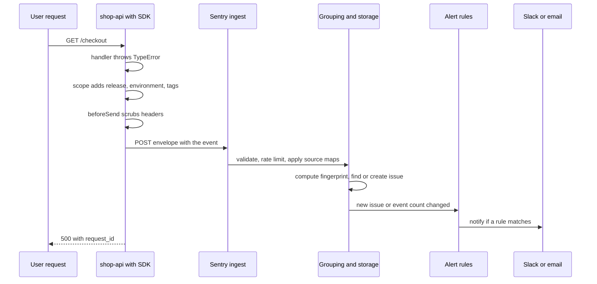

# L10.10 — Sentry

> **Level 10: Observability** · Topic 10 of 11 · ⏱ ~4 hours · Difficulty: Intermediate

## 1. What it is

**Sentry** is an **error tracking** service: your application embeds a small SDK (software development kit) that catches
exceptions and crashes, adds context (stack trace, release, environment, request details, tags, breadcrumbs of what happened just
before) and sends one **event** per error to Sentry. Sentry then **groups** events that share a cause into a single **issue**, so
ten thousand identical `TypeError`s become one row with a counter, a first-seen time, a last-seen time, the releases that were
affected and the users who hit it.

Metrics tell you *that* something is wrong ("5 percent of checkouts fail"). Logs tell you *what happened* on one request, if
you know which request to look at. An error tracker answers a third question directly: **which exact line of code threw, since
which release, how often, and who is affected?** It also handles the boring parts that make errors actionable:

| Concept | What it means |
|---------|---------------|
| **DSN** (Data Source Name) | The URL an SDK sends events to. It identifies a project and contains a public key. It is not a secret in browsers, but treat it as configuration, not as source code |
| **Event and issue** | An event is one occurrence. An issue is a group of events with the same **fingerprint** (by default derived from the stack trace and error type) |
| **Release** | A version label for a deploy, such as `shop-api@1.4.2` or a Git commit hash. Events carry it, so you can see "introduced in 1.4.2, fixed in 1.4.3" |
| **Environment** | `production`, `staging`, `lab`. Lets you alert on production only |
| **Source maps** | Files that map minified or compiled code back to your original source, so the stack trace shows `src/checkout.ts:28` instead of `dist/app.js:1:829` |
| **Alert rule** | A condition that notifies a person or channel: "a new issue appears in production", "an issue gets more than 50 events in 10 minutes" |
| **Breadcrumbs, tags, context** | Extra data on an event: recent log lines and HTTP calls, searchable key-value labels (`request_id`), and structured blobs |

## 2. Why it matters in DevOps

- **Mean time to understand drops.** A metrics alert wakes you; Sentry hands you the stack trace, the release and the first
  bad deploy. Without it the on-call engineer greps logs across hosts.
- **Errors are triaged, not just counted.** Grouping, ownership (code owners), "resolved in next release" and regression
  detection turn an exception stream into a work queue.
- **Release safety.** Because every event knows its release, a bad deploy shows up as a new issue tied to one version within
  minutes. That feeds the rollback decision ([Rollback](../level-05-cicd/07-rollback.md)).
- **Catches what metrics hide.** A handled-but-wrong error that returns HTTP 200, a background job that throws, or a rare
  error in a single code path rarely moves a dashboard. An error tracker sees each one.
- **It is also a risk.** Events can contain personal data and secrets (request bodies, headers, local variables). Cost scales
  with event volume, and a retry loop can burn a monthly quota in an hour. Both need deliberate configuration.

## 3. Real-world system example

Sentry started as an open-source exception logger for Django and grew into a hosted product (sentry.io) with SDKs for most
languages and frameworks. Its SDKs are open source, and the server can be run yourself: the `getsentry/self-hosted` repository
installs it with Docker Compose, but it is a multi-service system (databases, queues, workers) that needs a machine with
several CPU cores and well over 8 GB of RAM, so many teams use the hosted service instead. Compatible alternatives such as
**GlitchTip** implement the Sentry ingestion API with a much smaller footprint, and commercial peers include Rollbar and
Bugsnag. Check each product's current licence and pricing pages before choosing.

A common production pattern, and the one this topic builds: the CI pipeline creates a **release** named after the Git commit,
uploads **source maps** for exactly the files being shipped, tells Sentry about the **deploy** to an environment, and the
running app reports `release` and `environment` in `Sentry.init`. Sentry integrates with Git hosts (GitHub, GitLab and
others) to show **suspect commits** (the commits that touched the failing lines) and with chat tools (Slack, Microsoft Teams)
and incident tools (PagerDuty, Opsgenie) for notifications.

## 4. Diagram

What happens between an exception and a notification:



And how a release makes stack traces readable and regressions visible:

```mermaid
flowchart LR
    B["CI build<br/>compile and minify with source maps"] --> I["sentry-cli sourcemaps inject<br/>adds debug IDs"]
    I --> UP["sentry-cli sourcemaps upload<br/>release shop-api@1.4.2"]
    UP --> DEP["Deploy the same files<br/>release and environment set"]
    DEP --> EV["Event arrives<br/>minified stack and debug ID"]
    EV --> MAP["Sentry looks up the map<br/>original file and line"]
    MAP --> ISS["Issue shows src/checkout.ts:28<br/>first seen in 1.4.2"]
    ISS --> FIX["Fix ships in 1.4.3<br/>mark resolved in next release"]
    FIX --> REG["Same error in 1.4.4?<br/>issue reopens as a regression"]
```



## 5. How it works

**Capture.** The SDK installs global handlers for uncaught exceptions and unhandled promise rejections, and you call
`Sentry.captureException(err)` for errors you catch yourself. Web frameworks usually offer an error-handler hook (for Express,
`Sentry.setupExpressErrorHandler(app)`, or your own handler as in the lab). Nothing blocks the request: events are queued and
sent in the background, and `Sentry.flush()` or `Sentry.close()` waits for them on shutdown.

**Context.** A **scope** carries data that is attached to events: `setTag` (indexed, searchable, low cardinality values such as
`route` or `request_id`), `setContext` (structured blobs, not searchable), `setUser` (use an opaque ID, not an email). Use
`Sentry.withScope` to attach data to one event only. Copy the `request_id` and trace ID from
[Correlation IDs](07-correlation-ids.md) into tags, so an issue links to the exact logs and trace.

**Grouping.** Events are grouped by a **fingerprint**, by default computed from the stack trace (and the error type and message
when there is no stack). Good grouping needs good stack traces, which is why source maps matter. Override it with a custom
fingerprint when a framework wraps every error in the same frame, or when one cause produces messages with changing numbers.
Over-grouping hides distinct bugs; under-grouping gives you 400 issues for one bug.

**Releases.** Set `release` in `Sentry.init` to the same string you register in CI. Sentry then shows per-release issue lists,
"new in this release", regressions, and (for sessions-based SDKs) crash-free rates. A release can have **commits** attached
(`sentry-cli releases set-commits --auto`, which needs the repository integration) that power suspect commits and
"resolve in next release". A **deploy** record marks when a release reached an environment.

**Source maps.** Compiled, bundled or minified JavaScript produces stack frames like `server.js:1:829`. A source map translates
that position back to the original file, line and column. Two ways to get readable frames:

| Approach | How | Notes |
|----------|-----|-------|
| Upload to Sentry | `sentry-cli sourcemaps inject` then `sourcemaps upload` in CI | Needed for browser code, because users run your minified bundle. Never publish the `.map` files publicly if the source is private |
| Node's own mapping | Run with `node --enable-source-maps` | Node rewrites `error.stack` before the SDK reads it; works for servers you control but adds startup and memory cost |

Modern Sentry matches maps to events through **debug IDs**: `inject` writes a unique ID into each built file and its map, so a
mismatch between "the code that runs" and "the map that was uploaded" is detected instead of silently showing wrong lines.
Older setups matched by release name plus file path (`--url-prefix`); keep the release name correct either way.

**Alert rules.** Typical rules, in order of usefulness:

| Rule | Trigger | Action |
|------|---------|--------|
| New issue in production | An issue is seen for the first time | Message to the team channel |
| Regression | A resolved issue reappears | Notify the issue owner |
| Spike | An issue exceeds N events in M minutes | Page or high-priority message |
| High volume of unhandled errors | Count of errors per time window above a threshold | Notify, link to the dashboard |

Sentry has different rule types in its UI (issue-based rules and metric-based rules whose names and layout change between
releases); look for the "Alerts" section of your project. Always filter by `environment:production` so staging never pages
anybody.

**Sampling and cost.** `sampleRate` (errors) defaults to sending all of them; Sentry also offers inbound filters, spike
protection and per-project rate limits server-side. Use `ignoreErrors` for known noise (browser extensions, client
disconnects) and fix retry loops at their source. Performance tracing is a separate, separately sampled feature
(`tracesSampleRate`); this level uses OpenTelemetry for traces ([OpenTelemetry](09-opentelemetry.md)).

**Privacy.** Anything in an event is data you ship to a third party. Control it at three levels: SDK options for what is
collected by default (the option names differ between SDK major versions: older versions use `sendDefaultPii`, version 11
uses a `dataCollection` object, so read the docs for your version), `beforeSend` to delete or mask fields in code, and
server-side data scrubbing rules. Never put tokens, passwords or full card numbers in tags or contexts.

**Sentry or OpenTelemetry on the same Node process.** Recent Sentry Node SDKs were built on OpenTelemetry. Version 11 does not
register its own tracer provider unless `enableOpenTelemetrySetup` is set, so it coexists with an OTel SDK that you start
yourself (as the capstone does); older major versions needed `skipOpenTelemetrySetup: true` for that. Check the SDK's
migration notes when you upgrade.

**Errors versus metrics, logs and traces.**

| Question | Best tool |
|----------|-----------|
| Is the error rate above the SLO right now? | Metrics and an alert ([Prometheus and PromQL](02-prometheus-and-promql.md)) |
| Which exception, on which line, since which release? | Sentry |
| What did this one request do, in order? | Logs, found via `request_id` |
| Which downstream call made it slow? | Traces |
| Did the error come back after the fix? | Sentry (regression) |

Use them together: the metric alert is the smoke alarm, Sentry is the cause, the trace and logs are the reconstruction.

## 6. Step-by-step guide

**Prerequisites:** Node.js 22 or newer, `curl`. For steps 1-8 nothing else is needed: a tiny local server plays the part of
Sentry so you can see exactly what the SDK sends. Steps 9-12 need a Sentry account (the free plan is enough; no card
required at the time of writing, check the pricing page) with one project of type Node.js. No other cost. The code was run
with `@sentry/node` 11.6, `@sentry/cli` 3.8, Express 5 and esbuild 0.28; newer versions may rename options.

1. **Create the project.**
   ```bash
   mkdir -p ~/l10-sentry/src && cd ~/l10-sentry
   npm init -y >/dev/null
   npm install express @sentry/node
   npm install --save-dev typescript esbuild @sentry/cli @types/express @types/node
   ```

2. **Write the TypeScript service** `src/server.ts`. It has a deliberate bug: orders without a coupon make
   `applyDiscount` throw a `TypeError`. The error handler adds a `request_id` and a `route` tag to the event.
   ```ts
   import { randomUUID } from 'node:crypto';
   import express, { NextFunction, Request, Response } from 'express';
   import * as Sentry from '@sentry/node';

   // An empty or missing DSN turns the SDK into a no-op, so the app also runs without any account.
   Sentry.init({
     dsn: process.env.SENTRY_DSN,
     release: process.env.SENTRY_RELEASE, // must equal the release the source maps were uploaded for
     environment: process.env.APP_ENV ?? 'lab',
     beforeSend(event) {
       // Last line of defence for privacy: drop credentials before the event leaves the process.
       if (event.request?.headers) {
         delete event.request.headers['authorization'];
         delete event.request.headers['cookie'];
       }
       return event;
     },
   });

   interface Order {
     id: string;
     total: number;
     coupon?: { percent: number };
   }

   function applyDiscount(order: Order): number {
     // Bug on purpose: orders without a coupon make this line throw a TypeError.
     return order.total - (order.total * order.coupon!.percent) / 100;
   }

   const app = express();

   app.use((req: Request, res: Response, next: NextFunction) => {
     const id = req.header('x-request-id') ?? `req-${randomUUID()}`;
     res.locals.requestId = id;
     res.setHeader('x-request-id', id);
     next();
   });

   app.get('/healthz', (_req: Request, res: Response) => {
     res.json({ ok: true });
   });

   app.get('/checkout', (req: Request, res: Response) => {
     const withCoupon = req.query.coupon === '1';
     const order: Order = { id: 'ord_1001', total: 4200, coupon: withCoupon ? { percent: 10 } : undefined };
     res.json({ id: order.id, charged: applyDiscount(order) });
   });

   // Express 5 forwards errors from sync and async handlers here.
   app.use((err: Error, req: Request, res: Response, _next: NextFunction) => {
     Sentry.withScope((scope) => {
       scope.setTag('request_id', res.locals.requestId);
       scope.setTag('route', req.route?.path ?? 'unmatched');
       scope.setContext('order', { id: 'ord_1001' });
       Sentry.captureException(err);
     });
     console.error(JSON.stringify({ level: 'error', msg: err.message, request_id: res.locals.requestId }));
     res.status(500).json({ error: 'internal error', request_id: res.locals.requestId });
   });

   app.listen(8080, () => console.log('lab listening on :8080'));
   ```
   `Sentry.setupExpressErrorHandler(app)` is the one-line alternative to the custom handler; the custom one is shown because it
   lets you add tags.

3. **Write a stand-in for Sentry's ingest endpoint** `sink.js`. It prints a summary of each event envelope it receives.
   ```js
   const http = require('node:http');

   http.createServer((req, res) => {
     const chunks = [];
     req.on('data', (c) => chunks.push(c));
     req.on('end', () => {
       const lines = Buffer.concat(chunks).toString().split('\n').filter(Boolean);
       for (let i = 1; i < lines.length; i += 2) {
         const itemHeader = JSON.parse(lines[i]);
         if (itemHeader.type !== 'event') continue;
         const e = JSON.parse(lines[i + 1]);
         const ex = e.exception.values[e.exception.values.length - 1];
         const top = ex.stacktrace.frames[ex.stacktrace.frames.length - 1];
         console.log(JSON.stringify({
           release: e.release, environment: e.environment, tags: e.tags,
           type: ex.type, value: ex.value, frame: `${top.filename}:${top.lineno}:${top.colno}`,
         }, null, 2));
       }
       res.setHeader('content-type', 'application/json');
       res.end('{}');
     });
   }).listen(9999, () => console.log('sink listening on :9999'));
   ```
   An envelope is newline-delimited JSON: an envelope header, then pairs of an item header and an item payload. The loop reads
   the payload of every `event` item.

4. **Add a `tsconfig.json`, type-check and build a minified bundle with a source map.** `--packages=external` keeps
   `node_modules` out of the bundle, so only your code is minified.
   ```bash
   cat > tsconfig.json <<'EOF'
   { "compilerOptions": { "target": "ES2022", "module": "NodeNext", "moduleResolution": "NodeNext",
     "strict": true, "noEmit": true, "esModuleInterop": true, "skipLibCheck": true }, "include": ["src"] }
   EOF
   npx tsc -p . && echo typecheck ok
   npx esbuild src/server.ts --bundle --packages=external --platform=node --format=cjs \
     --minify --sourcemap --outfile=dist/server.js
   ls dist
   ```
   Expect `typecheck ok` and `server.js  server.js.map` in `dist/`. The bundle is a couple of kilobytes on one line.

5. **Run without a DSN and trigger the bug.** Nothing is sent anywhere, but the app still fails the same way.
   ```bash
   node dist/server.js & APP=$!
   sleep 1
   curl -s 'localhost:8080/checkout?coupon=1'; echo
   curl -s localhost:8080/checkout; echo
   kill $APP
   ```
   Expect `{"id":"ord_1001","charged":3780}` and then `{"error":"internal error","request_id":"req-..."}`. The SDK is
   disabled when `SENTRY_DSN` is empty, which is also how you keep tests and local runs quiet.

6. **Run with the DSN pointing at the sink and read the event.** The DSN format is `http(s)://<public key>@<host>/<project id>`.
   ```bash
   node sink.js & SINK=$!
   SENTRY_DSN=http://examplePublicKey@localhost:9999/1 SENTRY_RELEASE=shop-api@1.0.0 node dist/server.js & APP=$!
   sleep 1; curl -s -H 'x-request-id: req-demo-0001' localhost:8080/checkout; echo
   ```
   After a second or two the sink prints something like:
   ```json
   {
     "release": "shop-api@1.0.0",
     "environment": "lab",
     "tags": { "request_id": "req-demo-0001", "route": "/checkout" },
     "type": "TypeError",
     "value": "Cannot read properties of undefined (reading 'percent')",
     "frame": "/home/you/l10-sentry/dist/server.js:1:829"
   }
   ```
   This is the whole contract: release, environment, your tags, the exception and a stack frame. The position
   (`server.js:1:829`) is useless to a human, which is the problem source maps solve. The exact column may differ.

7. **Resolve the position with the source map, offline.** `sentry-cli` can do the lookup that Sentry does for you.
   ```bash
   npx sentry-cli sourcemaps resolve dist/server.js.map -l 1 -c 829
   ```
   Expect a line saying the same token is located at `line 28, column 53 in source file ../src/server.ts`: the exact
   expression `order.coupon!.percent`. Use the line and column from your own step 6 output.

8. **See Node's own mapping.** Stop the app, restart it with the flag and trigger the error again.
   ```bash
   kill $APP
   SENTRY_DSN=http://examplePublicKey@localhost:9999/1 SENTRY_RELEASE=shop-api@1.0.0 \
     node --enable-source-maps dist/server.js & APP=$!
   sleep 1; curl -s localhost:8080/checkout; sleep 2
   ```
   The sink now prints `src/server.ts:28:53` as the frame, because Node rewrote the stack before the SDK read it. This is fine for
   a server you run yourself. For browser bundles, where you do not control the runtime, you must upload source maps.
   Stop everything with `kill $APP $SINK`.

9. **Use a real Sentry project.** In the Sentry UI create a project (platform Node.js) and copy its DSN from
   *Project Settings, Client Keys (DSN)*. Run the minified build again with the real DSN (do not commit it):
   ```bash
   export SENTRY_DSN='<YOUR_DSN>'
   SENTRY_RELEASE=shop-api@1.0.0 node dist/server.js & APP=$!
   sleep 1
   for i in 1 2 3 4 5; do curl -s localhost:8080/checkout > /dev/null; done
   ```
   Open *Issues*. Expect **one** issue (`TypeError: Cannot read properties of undefined (reading 'percent')`) with 5 events, not five issues:
   that is grouping. Open it and look at the tags (`request_id`, `route`, `release`, `environment`), the breadcrumbs and the
   stack trace, which still shows `dist/server.js:1:829` because no map is uploaded yet.

10. **Create a release and upload source maps, the way CI would.** Create an auth token (*Settings, Developer Settings*, an
    organization or internal integration token with permission to create releases) and export three variables. `sentry-cli`
    reads them automatically. Save the commands as `release.sh`:
    ```bash
    #!/usr/bin/env bash
    set -euo pipefail
    : "${SENTRY_AUTH_TOKEN:?set a token}" "${SENTRY_ORG:?set the org slug}" "${SENTRY_PROJECT:?set the project slug}"
    RELEASE="${RELEASE:-shop-api@1.0.1}"      # in CI use the Git commit: shop-api@$(git rev-parse --short HEAD)

    npx sentry-cli releases new "$RELEASE"
    npx sentry-cli sourcemaps inject dist                              # writes debug IDs into the files that will be shipped
    npx sentry-cli sourcemaps upload --release "$RELEASE" dist
    # npx sentry-cli releases set-commits "$RELEASE" --auto            # needs the repository integration and a Git checkout
    npx sentry-cli releases finalize "$RELEASE"
    npx sentry-cli deploys new --release "$RELEASE" -e lab
    echo "$RELEASE"
    ```
    ```bash
    export SENTRY_AUTH_TOKEN='<YOUR_TOKEN>' SENTRY_ORG='<your-org-slug>' SENTRY_PROJECT='<your-project-slug>'
    bash release.sh
    ```
    Order matters: build, **inject**, upload, then deploy exactly those injected files. If you rebuild after uploading, the debug
    IDs no longer match. `sentry-cli` prints an upload report; check the release in *Releases* shows the artifact bundle.

11. **Run the new release and confirm readable frames.** Restart the app (injected files, new release), trigger the error, and
    open the new event.
    ```bash
    kill $APP; SENTRY_RELEASE=shop-api@1.0.1 node dist/server.js & APP=$!
    sleep 1; curl -s localhost:8080/checkout > /dev/null
    ```
    The stack trace now shows `src/server.ts` line 28 with source context, in the function `applyDiscount`, and the event
    belongs to release `shop-api@1.0.1`. Events from `1.0.0` still show minified frames: maps are per release (or debug ID).

12. **Fix, resolve and watch for regression.** Change the function to `order.coupon?.percent ?? 0`, rebuild, create release
    `shop-api@1.0.2` with `RELEASE=shop-api@1.0.2 bash release.sh` and restart. In the issue, choose *Resolve, in the next release*
    (or *in 1.0.2*). Now deliberately re-introduce the bug as release `1.0.3`, trigger it: the issue is marked as a **regression**
    and reopens. Then create the alert in the next step.

13. **Create an alert rule.** In the project open *Alerts, Create Alert* and make an issue alert with these conditions:
    environment equals `lab` (use `production` for real services), the issue is first seen or is a regression, action: send an
    email to yourself (or a Slack message if the integration is installed). Trigger a new kind of error (add a second buggy route)
    and confirm the message arrives. Then add a second rule: "an issue has more than 10 events in 5 minutes", and test it with a
    `for` loop.

14. **Clean up.**
    ```bash
    kill $APP $SINK 2>/dev/null; cd ~ && rm -rf ~/l10-sentry
    ```
    Delete the test project (*Settings, General Settings, Remove Project*) and revoke the auth token.

## 7. Real-world scenario

*Illustrative scenario.* On a Friday afternoon `shop-api` 2.8.0 is deployed. The Prometheus error-ratio alert stays green: 5xx
responses rose from 0.4 percent to 1.1 percent, below the 5 percent threshold. An hour later support reports that "applying a
coupon charges the wrong amount". There are no failing requests because the code catches the exception and falls back to the
full price, logging a warning and calling `captureException`.

In Sentry the on-call engineer opens *Issues*, sorts by *First seen*, and sees a new issue,
`TypeError: Cannot read properties of undefined (reading 'percent')`, 1,900 events, **first seen in `shop-api@2.8.0`**, with a
suspect commit touching `applyDiscount`. The tag `route` is `/checkout`, and the `request_id` of any event opens the matching
logs in Loki. The issue also carries a trace ID tag, so the trace shows the call made right before. The fix is a one-line
null check, released as 2.8.1 and marked "resolved in 2.8.1". The next day a similar error appears from another code path:
because the fingerprint differs, it is a fresh issue and the new-issue alert posts to the team channel instead of being buried
in the old one.

**Lesson:** metrics told them nothing was on fire; the error tracker showed a defect hiding behind a graceful fallback, tied
it to a release, and gave the exact line. Alerting on *new issues in production* caught what threshold alerts cannot.

## 8. Common mistakes and best practices

**Don't**

- Ship minified code without source maps, or upload maps for a different build than the one deployed: the frames are
  unreadable or, with old setups, silently wrong.
- Publish `.map` files to a public CDN when the source is private (upload them to Sentry and delete them from the deploy
  artifact instead).
- Forget `release` and `environment`: you lose "introduced in", regressions and the ability to alert on production only.
- Page people on every new issue. Route new-issue alerts to a channel, and page only on spikes or on errors that map to an SLO.
- Send personal data: user emails as tags, request bodies, tokens in URLs. Use opaque IDs, `beforeSend` and server-side scrubbing.
- Log the same error to Sentry from every layer (handler, middleware, caller): one failure becomes five events and the quota
  goes five times faster.
- Put the auth token in the repository or the built image. It belongs in the CI secret store
  ([Secrets and Environment Variables](../level-05-cicd/05-secrets-and-environment-variables.md)).
- Use high-cardinality values (full URLs, timestamps) as tags or inside the error message used for grouping.

**Do**

- Create the release, upload maps, then deploy, in one pipeline step, and use the Git commit in the release name.
- Tag every event with the `request_id` and trace ID so an issue leads to the logs and trace, and the trace leads back
  ([Correlation IDs](07-correlation-ids.md)).
- Alert on *new issue in production*, *regression* and *spike*; keep staging quiet.
- Resolve issues "in next release" so regressions are detected, and assign owners (code owners files or ownership rules).
- Set `ignoreErrors` for known noise, and fix retry storms at the source.
- Keep metrics for rates and SLOs, Sentry for causes: see [What to Monitor](11-what-to-monitor.md).

## 9. Tasks

- [ ] **T1 — Follow the lab to a readable stack trace** *(≈75 min, beginner)*
  - **Goal:** send an error to Sentry and read it at the original source line.
  - **Steps:**
    1. Do steps 1-9 of section 6 (local sink first, then your real project).
    2. Do steps 10 and 11 to upload source maps and create a release.
    3. Screenshot or copy the stack trace before and after the upload.
  - **Done when:** the issue shows `src/server.ts` and `applyDiscount` with source context, belongs to a named release, and has the `request_id` tag.

- [ ] **T2 — Capture a handled error with context** *(≈40 min, intermediate)*
  - **Goal:** report errors that return a normal response.
  - **Steps:**
    1. Add a `/price` route that catches a parsing error, falls back to a default and returns HTTP 200.
    2. Call `Sentry.captureException` with tags `route` and `sku`, and `setContext('cart', {...})` with non-sensitive fields.
    3. Call it 20 times with 3 different `sku` values.
  - **Done when:** Sentry shows one issue with 20 events that you can filter by `sku:<value>`, while a request-rate panel would show only 200 responses.

- [ ] **T3 — Release, regression and resolve** *(≈45 min, intermediate)*
  - **Goal:** follow an issue through its life cycle.
  - **Steps:**
    1. Release `shop-api@1.0.1` with the bug, then fix and release `1.0.2`; resolve the issue "in 1.0.2".
    2. Re-introduce the bug as `1.0.3` and trigger it.
    3. Open *Releases* and compare new issues per release.
  - **Done when:** the issue reopens as a regression attributed to `1.0.3`, and you can show which release first contained the error.

- [ ] **T4 — Break the source maps, then fix them** *(≈40 min, intermediate)*
  - **Goal:** recognise the failure mode of mismatched maps.
  - **Steps:**
    1. Upload maps (step 10), then rebuild with `esbuild` without running `inject` and without uploading, and deploy that build.
    2. Trigger the error and look at the frames.
    3. Fix by running build, `inject`, `upload` in order, and compare.
  - **Done when:** you can explain why the first deploy showed minified or wrong frames and show the corrected trace with the debug ID in the build output.

- [ ] **T5 — Automate the release in CI** *(≈60 min, advanced)*
  - **Goal:** make release creation part of the pipeline.
  - **Steps:**
    1. Write a GitHub Actions job ([GitHub Actions Pipelines](../level-05-cicd/02-github-actions-pipelines.md)) that builds, runs `sentry-cli` as in `release.sh` using the Git SHA as the release name, and receives `SENTRY_AUTH_TOKEN` from a repository secret.
    2. Make the app read `SENTRY_RELEASE` from a build argument or environment variable set to the same SHA.
    3. Make the job fail if the upload fails.
  - **Done when:** pushing a commit creates a Sentry release named after it, and an error from the deployed build has that release and readable frames.

- [ ] **T6 — Prove it: choose the right tool** *(≈45 min, advanced)*
  - **Goal:** explain when to use Sentry versus metrics, logs and traces.
  - **Steps:**
    1. Without the guide, cause three different problems in the lab: an exception, a slow request and a rise in 5xx. For each, write down which tool detects it first and which gives the root cause.
    2. Configure an alert for new production issues and prove it by triggering a new error type.
    3. Write five lines on what data you removed or masked before events leave the app, and why.
  - **Done when:** your table is correct for all three problems, the alert fires on the new error type, and a teammate can find your `request_id` in both Sentry and the logs.

## 10. Self-check questions

1. What is the difference between a Sentry event and an issue, and what decides how events are grouped?
2. Why does a release matter, and what must be true about its name for source maps and regressions to work?
3. Why is a stack frame like `app.js:1:829` useless, and what are two ways to make it readable?
4. Name three alert rules you would create for a production service, and one you would not send to a pager.
5. A metrics dashboard shows 200 responses only, yet Sentry shows a new issue with thousands of events. How can this be?
6. What privacy risks come with error tracking, and what controls do you have?

<details>
<summary>Answers</summary>

1. An event is one captured occurrence. An issue is a group of events with the same fingerprint, by default derived from the stack trace (and error type when there is no stack). Custom fingerprints change the grouping.
2. The release labels which build produced an error. It enables "first seen in", regression detection and per-release source maps. The string set in `Sentry.init` must equal the one created and used for the upload in CI.
3. It is a position in minified code. Upload source maps to Sentry (with `inject` and `upload`, matched by debug ID), or run Node with `--enable-source-maps` so the stack is already mapped.
4. New issue in production, regression and spike of events in a short window. Sending every new issue to a pager causes alert fatigue; send it to a chat channel ([Alert Fatigue Reduction](../level-14-sre/08-alert-fatigue-reduction.md)).
5. The code caught the error and returned a normal response (graceful fallback) but still reported it with `captureException`, or a background job failed. Request metrics only see the HTTP result.
6. Events can contain personal data, tokens and request bodies and are sent to a third party. Control it with SDK data-collection options, `beforeSend`, server-side scrubbing, opaque user IDs and never putting secrets in tags.
</details>

## 11. Further reading

- Sentry documentation (docs.sentry.io): platform guide for Node.js, "Releases", "Source Maps", "Alerts" and "Data Management" (scrubbing and privacy).
- Sentry CLI documentation, including the `sourcemaps` and `releases` commands.
- Sentry Self-Hosted documentation (the `getsentry/self-hosted` repository) for hardware requirements and upgrade notes.
- See also: [Correlation IDs](07-correlation-ids.md), [OpenTelemetry](09-opentelemetry.md), [The Three Pillars](01-three-pillars.md), [What to Monitor](11-what-to-monitor.md).

<!-- nav -->
---
← Previous: [OpenTelemetry](09-opentelemetry.md) · [Level 10 index](README.md) · Next: [What to Monitor: Golden Signals, RED and USE](11-what-to-monitor.md) →
