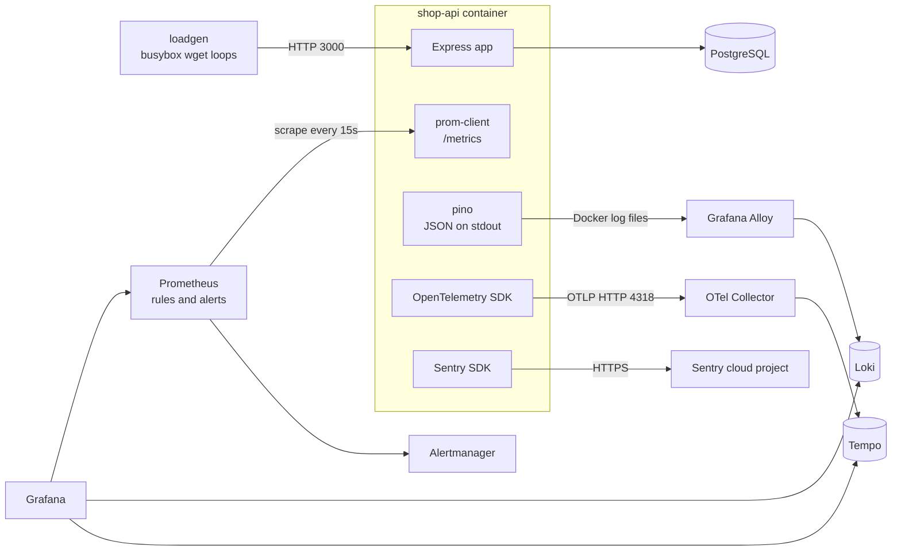
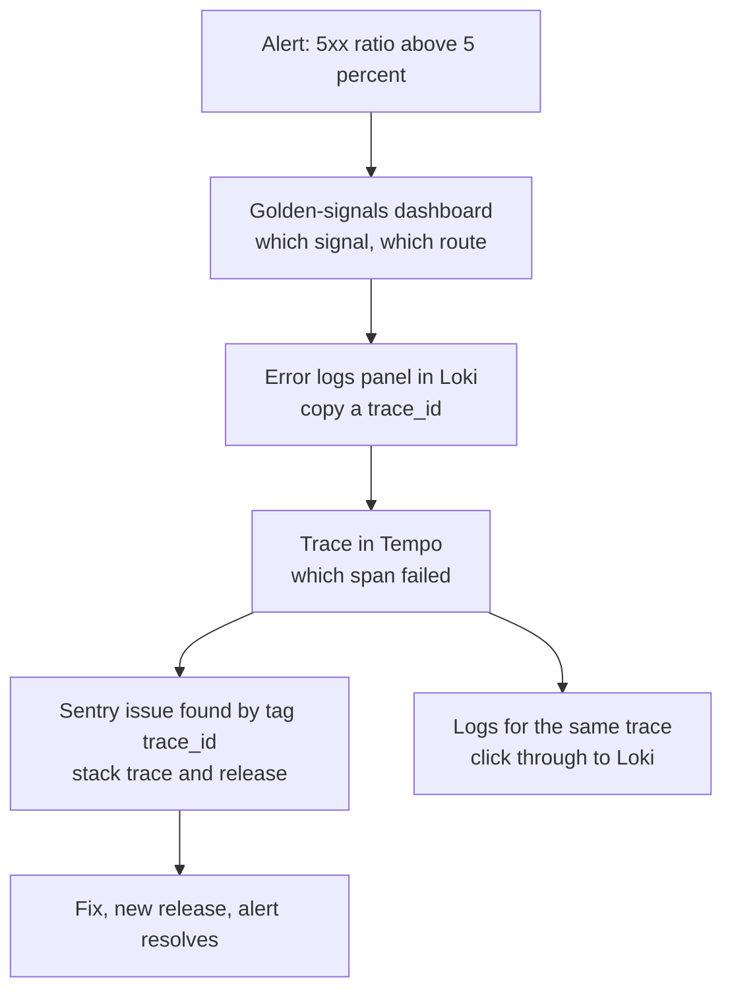

# L10 Capstone — Observable shop-api

> **Level 10: Observability** · Capstone · ⏱ ~8 hours

## 1. Goal and outcome

Take the `shop-api` sample app (Node.js API + PostgreSQL) and make it fully observable with the tools of this level, then prove
it by breaking it on purpose and finding the cause using only the telemetry.

By the end you will have, in one Docker Compose project that runs on a laptop:

- **Metrics:** Prometheus scraping `shop-api`, the host and the observability stack itself ([Prometheus and PromQL](02-prometheus-and-promql.md), [Counters, Gauges, Histograms and Summaries](04-metric-types.md)).
- **Dashboards:** a provisioned Grafana **golden-signals dashboard** (latency, traffic, errors, saturation) kept in Git ([Grafana Dashboards](03-grafana-dashboards.md), [What to Monitor](11-what-to-monitor.md)).
- **Logs:** structured JSON logs shipped by Grafana Alloy to **Loki**, searchable by `request_id` and `trace_id` ([Structured Logging](05-structured-logging.md), [Log Aggregation with Loki](06-loki-log-aggregation.md)).
- **Traces:** OpenTelemetry instrumentation, an **OpenTelemetry Collector** and **Tempo**, with one click between a log line and its trace ([Distributed Tracing](08-distributed-tracing.md), [OpenTelemetry](09-opentelemetry.md)).
- **Correlation:** the same `request_id` and `trace_id` in the response, the logs, the trace and the error report ([Correlation IDs](07-correlation-ids.md)).
- **Errors:** **Sentry** receiving exceptions tagged with release, environment, `request_id` and `trace_id` ([Sentry](10-sentry.md)).
- **An alert:** a Prometheus rule on the 5xx ratio that fires, shows in Alertmanager, links to the dashboard and resolves ([The Three Pillars](01-three-pillars.md) explains why each signal is used).

## 2. Architecture



The path of one investigation, which is what the whole build is for:



## 3. Prerequisites and cost

- Docker with Compose v2 (see [Docker Compose](../level-04-docker/08-docker-compose.md)), Node.js 22 or newer and `curl`.
- About **4 GB of free RAM** and 3 GB of disk for images. Run on Linux, macOS or Windows with WSL 2.
- A free **Sentry** account with one Node.js project (the free plan is enough at the time of writing; no card). Sentry is the only
  external service, and the rest of the build works without it: an empty DSN disables the SDK.
- **Cost: none.** Everything runs locally. Passwords below (`admin`, `postgres`) are for this lab only. Image tags were current
  when written; if a tag is gone, use the newest one and read its release notes.
- Do this level's topics first. The capstone repeats the key code, but the reasoning is in the topics.

## 4. Build it step by step

All files live in `~/l10-capstone`. Compose is told its project name explicitly (the `name:` key) because the Alloy config
filters on it.

### Milestone 1: the app, PostgreSQL, Prometheus, Grafana and the load

**1.1 Create the layout and install the dependencies.**

```bash
mkdir -p ~/l10-capstone/{shop-api,postgres,prometheus/rules,alertmanager,loki,alloy,otel,tempo,grafana/provisioning/datasources,grafana/provisioning/dashboards,grafana/dashboards}
cd ~/l10-capstone/shop-api
npm init -y >/dev/null
npm install express prom-client pino pg @sentry/node @opentelemetry/api @opentelemetry/sdk-node @opentelemetry/auto-instrumentations-node
```

**1.2 Write the database seed** `~/l10-capstone/postgres/init.sql`.

```sql
CREATE TABLE products (
  id          serial PRIMARY KEY,
  name        text    NOT NULL,
  price_cents integer NOT NULL
);
INSERT INTO products (name, price_cents) VALUES ('keyboard', 4900), ('mouse', 2500), ('monitor', 15900);

CREATE TABLE orders (
  id          bigserial PRIMARY KEY,
  total_cents integer     NOT NULL,
  created_at  timestamptz NOT NULL DEFAULT now()
);
```

**1.3 Write the tracing bootstrap** `~/l10-capstone/shop-api/tracing.js`.

```js
// Loaded with: node --require ./tracing.js app.js   (it must run before express and pg are imported)
const { NodeSDK } = require('@opentelemetry/sdk-node');
const { getNodeAutoInstrumentations } = require('@opentelemetry/auto-instrumentations-node');

// The service name, resource attributes and exporter endpoint come from OTEL_* environment variables.
const sdk = new NodeSDK({
  instrumentations: [
    getNodeAutoInstrumentations({
      '@opentelemetry/instrumentation-fs': { enabled: false }, // very noisy, rarely useful
      '@opentelemetry/instrumentation-http': {
        // Do not create a trace for every Prometheus scrape and health check.
        ignoreIncomingRequestHook: (req) => req.url === '/metrics' || req.url === '/healthz',
      },
    }),
  ],
});

sdk.start();

module.exports = { sdk }; // app.js flushes it on shutdown
```

**1.4 Write the app** `~/l10-capstone/shop-api/app.js`. It carries all four instrumentation layers; the comments name the topic
for each. The routes are `/products` (reads PostgreSQL), `/checkout` (holds a pooled connection and inserts an order),
`/chaos` (failure injection for the drills; **never expose such an endpoint on a real service**), `/metrics` and `/healthz`.

```js
const { randomUUID } = require('node:crypto');
const express = require('express');
const client = require('prom-client');
const pino = require('pino');
const { Pool } = require('pg');
const Sentry = require('@sentry/node');
const { trace, SpanStatusCode } = require('@opentelemetry/api');
const { sdk } = require('./tracing'); // already started by --require; this returns the same module

// ---------- Sentry (topic 10): errors only. An empty DSN turns the SDK into a no-op ----------
Sentry.init({
  dsn: process.env.SENTRY_DSN || undefined,
  release: process.env.SENTRY_RELEASE || 'shop-api@dev',
  environment: process.env.APP_ENV || 'lab',
});

// ---------- Structured logs (topic 5): one JSON object per line on stdout ----------
const log = pino({
  base: { service: 'shop-api' },
  timestamp: pino.stdTimeFunctions.isoTime,
  formatters: { level: (label) => ({ level: label }) },
  serializers: { err: pino.stdSerializers.err },
});

// ---------- Metrics (topics 2 and 4) ----------
client.collectDefaultMetrics(); // process_*, nodejs_* (CPU, memory, event loop lag, GC)

const duration = new client.Histogram({
  name: 'http_request_duration_seconds',
  help: 'HTTP request latency in seconds',
  labelNames: ['method', 'route', 'status_code'],
  buckets: [0.01, 0.025, 0.05, 0.1, 0.25, 0.5, 1, 2.5, 5],
});
const orders = new client.Counter({
  name: 'shop_orders_total',
  help: 'Checkout attempts by result',
  labelNames: ['result'],
});

// ---------- Database pool, with its own saturation metrics (topic 11) ----------
// Reads PGHOST, PGUSER, PGPASSWORD and PGDATABASE from the environment.
const POOL_MAX = 5;
const pool = new Pool({ max: POOL_MAX, connectionTimeoutMillis: 2000 });
pool.on('error', (err) => log.error({ err }, 'idle database client error'));

new client.Gauge({
  name: 'db_pool_connections',
  help: 'Database pool connections by state',
  labelNames: ['state'],
  collect() {
    this.set({ state: 'total' }, pool.totalCount);
    this.set({ state: 'idle' }, pool.idleCount);
    this.set({ state: 'waiting' }, pool.waitingCount);
  },
});
new client.Gauge({ name: 'db_pool_max_connections', help: 'Configured pool size' }).set(POOL_MAX);

// ---------- Failure injection for the drills. LAB ONLY: never expose this on a real service ----------
const chaos = { errorRate: 0.01, slowMs: 0 };

const app = express();

app.use((req, res, next) => {
  // Correlation (topic 7): a request id, plus the trace id of the span OpenTelemetry started for this request.
  // The OTel pino instrumentation already adds trace_id and span_id to every log line, so only request_id is added here.
  const inbound = req.get('x-request-id') || '';
  const requestId = /^[A-Za-z0-9._-]{8,64}$/.test(inbound) ? inbound : `req-${randomUUID()}`;
  const spanContext = trace.getActiveSpan()?.spanContext();
  req.ctx = { request_id: requestId, trace_id: spanContext?.traceId }; // for the response body and Sentry tags
  req.log = log.child({ request_id: requestId });
  res.setHeader('x-request-id', requestId);

  const stop = duration.startTimer();
  res.on('finish', () => {
    const route = req.route ? req.route.path : 'unmatched'; // the route pattern, never the raw URL
    const seconds = stop({ method: req.method, route, status_code: res.statusCode });
    if (route === '/metrics' || route === '/healthz') return; // do not log scrapes and probes
    const level = res.statusCode >= 500 ? 'error' : 'info';
    req.log[level]({ method: req.method, route, status: res.statusCode, duration_ms: Math.round(seconds * 1000) }, 'request completed');
  });
  next();
});

app.get('/healthz', (req, res) => res.json({ ok: true }));

app.get('/products', async (req, res) => {
  const { rows } = await pool.query('SELECT id, name, price_cents FROM products ORDER BY id');
  res.json(rows);
});

app.get('/checkout', async (req, res) => {
  if (Math.random() < chaos.errorRate) throw new Error('payment provider timeout');
  const db = await pool.connect(); // waits here when the pool is exhausted
  try {
    if (chaos.slowMs > 0) await db.query('SELECT pg_sleep($1)', [chaos.slowMs / 1000]); // a slow query holding a connection
    const total = 1000 + Math.floor(Math.random() * 9000);
    const { rows } = await db.query('INSERT INTO orders (total_cents) VALUES ($1) RETURNING id', [total]);
    orders.inc({ result: 'paid' });
    req.log.info({ order_id: rows[0].id }, 'order created');
    res.json({ status: 'paid', order_id: rows[0].id, request_id: req.ctx.request_id });
  } finally {
    db.release();
  }
});

app.post('/chaos', express.json(), (req, res) => {
  chaos.errorRate = Number(req.body?.errorRate ?? chaos.errorRate);
  chaos.slowMs = Number(req.body?.slowMs ?? chaos.slowMs);
  log.warn({ chaos }, 'chaos settings changed');
  res.json(chaos);
});

app.get('/metrics', async (req, res) => {
  res.set('Content-Type', client.register.contentType);
  res.end(await client.register.metrics());
});

// Express 5 forwards errors from async handlers here.
app.use((err, req, res, next) => {
  const route = req.route ? req.route.path : 'unmatched';
  if (route === '/checkout') orders.inc({ result: 'failed' });

  const span = trace.getActiveSpan();
  span?.recordException(err);
  span?.setStatus({ code: SpanStatusCode.ERROR, message: err.message });

  Sentry.withScope((scope) => {
    scope.setTag('request_id', req.ctx.request_id);
    scope.setTag('route', route);
    if (req.ctx.trace_id) scope.setTag('trace_id', req.ctx.trace_id);
    Sentry.captureException(err);
  });

  req.log.error({ err, route }, 'unhandled error');
  res.status(500).json({ error: 'internal error', request_id: req.ctx.request_id, trace_id: req.ctx.trace_id });
});

const server = app.listen(3000, () => log.info({ port: 3000, pool_max: POOL_MAX }, 'shop-api listening'));

// Flush everything on shutdown so the last requests, errors and spans are not lost.
async function shutdown() {
  server.close();
  await Promise.allSettled([pool.end(), Sentry.close(2000), sdk.shutdown()]);
  process.exit(0);
}
process.on('SIGTERM', shutdown);
process.on('SIGINT', shutdown);
```

In this app the OpenTelemetry pino instrumentation (part of the auto-instrumentation bundle) adds `trace_id`, `span_id` and
`trace_flags` to each log line written inside a request. The only identifier added by hand is the `request_id`.

**1.5 Write the Dockerfile and `.dockerignore`.**

```dockerfile
FROM node:24-alpine
WORKDIR /app
COPY package*.json ./
RUN npm ci --omit=dev
COPY app.js tracing.js ./
USER node
EXPOSE 3000
CMD ["node", "--require", "./tracing.js", "app.js"]
```

```bash
printf 'node_modules\n' > ~/l10-capstone/shop-api/.dockerignore
printf 'SENTRY_DSN=\n' > ~/l10-capstone/.env          # filled in during milestone 4
printf '.env\nnode_modules\n' > ~/l10-capstone/.gitignore
```

**1.6 Write the Prometheus config** `~/l10-capstone/prometheus/prometheus.yml`.

```yaml
global:
  scrape_interval: 15s
  evaluation_interval: 15s

rule_files:
  - /etc/prometheus/rules/*.yml

alerting:
  alertmanagers:
    - static_configs:
        - targets: ["alertmanager:9093"]

scrape_configs:
  - job_name: prometheus
    static_configs:
      - targets: ["localhost:9090"]

  - job_name: shop-api
    static_configs:
      - targets: ["shop-api:3000"]
        labels:
          environment: lab

  - job_name: node
    static_configs:
      - targets: ["node-exporter:9100"]
```

**1.7 Write a minimal Alertmanager config** `~/l10-capstone/alertmanager/alertmanager.yml` (it receives and groups alerts; no
notification target yet, see the stretch goals).

```yaml
route:
  receiver: default
  group_by: [alertname, job]
  group_wait: 10s
  group_interval: 1m
  repeat_interval: 4h
receivers:
  - name: default
```

**1.8 Write the Grafana provisioning files.** The data source `uid` values are fixed so dashboards can refer to them.
`~/l10-capstone/grafana/provisioning/datasources/datasources.yml`:

```yaml
apiVersion: 1
datasources:
  - name: Prometheus
    uid: prometheus
    type: prometheus
    access: proxy
    url: http://prometheus:9090
    isDefault: true
    jsonData:
      timeInterval: 15s      # must match the scrape interval so $__rate_interval is right
```

`~/l10-capstone/grafana/provisioning/dashboards/dashboards.yml`:

```yaml
apiVersion: 1
providers:
  - name: shop-api
    orgId: 1
    folder: Shop API
    type: file
    disableDeletion: true
    allowUiUpdates: false
    updateIntervalSeconds: 30
    options:
      path: /etc/grafana/dashboards
```

**1.9 Write the Compose file** `~/l10-capstone/compose.yaml`. Later milestones append services under `services:`.

```yaml
name: l10-capstone

services:
  postgres:
    image: postgres:17-alpine
    environment:
      POSTGRES_DB: shop
      POSTGRES_PASSWORD: postgres        # lab only
    volumes:
      - pg-data:/var/lib/postgresql/data
      - ./postgres/init.sql:/docker-entrypoint-initdb.d/init.sql:ro
    healthcheck:
      test: ["CMD-SHELL", "pg_isready -U postgres -d shop"]
      interval: 5s
      retries: 10

  shop-api:
    build: ./shop-api
    ports: ["3000:3000"]
    environment:
      PGHOST: postgres
      PGUSER: postgres
      PGPASSWORD: postgres
      PGDATABASE: shop
      OTEL_SERVICE_NAME: shop-api
      OTEL_RESOURCE_ATTRIBUTES: service.version=1.0.0,deployment.environment.name=lab
      OTEL_EXPORTER_OTLP_ENDPOINT: http://otel-collector:4318   # nothing listens until milestone 3: spans are dropped quietly
      OTEL_METRICS_EXPORTER: none        # metrics go through Prometheus, not OTLP
      OTEL_LOGS_EXPORTER: none           # logs go through stdout and Alloy
      SENTRY_DSN: ${SENTRY_DSN:-}
      SENTRY_RELEASE: shop-api@1.0.0
      APP_ENV: lab
    depends_on:
      postgres:
        condition: service_healthy

  loadgen:
    image: busybox:1.37
    depends_on: [shop-api]
    command:
      - sh
      - -c
      - |
        worker() { while true; do wget -q -O /dev/null "http://shop-api:3000$$1" 2>/dev/null; sleep 0.2; done; }
        worker /products & worker /products & worker /checkout & worker /checkout & worker /checkout & worker /checkout & worker /checkout & worker /checkout &
        wait

  node-exporter:
    image: prom/node-exporter:v1.12.1
    command: ["--path.rootfs=/host"]
    pid: host
    volumes: ["/:/host:ro,rslave"]       # Docker Desktop (macOS/Windows): delete this line and "pid: host"

  alertmanager:
    image: prom/alertmanager:v0.34.1
    volumes: ["./alertmanager/alertmanager.yml:/etc/alertmanager/alertmanager.yml:ro"]
    ports: ["9093:9093"]

  prometheus:
    image: prom/prometheus:v3.15.0
    command:
      - --config.file=/etc/prometheus/prometheus.yml
      - --storage.tsdb.path=/prometheus
      - --storage.tsdb.retention.time=3d
      - --web.enable-lifecycle
    volumes:
      - ./prometheus:/etc/prometheus:ro
      - prom-data:/prometheus
    ports: ["9090:9090"]
    depends_on: [shop-api, node-exporter, alertmanager]

  grafana:
    image: grafana/grafana:13.0.10
    ports: ["3001:3000"]                 # host 3001, because shop-api uses 3000
    environment:
      GF_SECURITY_ADMIN_USER: admin
      GF_SECURITY_ADMIN_PASSWORD: admin  # lab only
    volumes:
      - ./grafana/provisioning:/etc/grafana/provisioning:ro
      - ./grafana/dashboards:/etc/grafana/dashboards:ro
      - grafana-data:/var/lib/grafana
    depends_on: [prometheus]

volumes:
  pg-data: {}
  prom-data: {}
  grafana-data: {}
  loki-data: {}
  tempo-data: {}
```

The `$$1` is Compose's escape for a literal `$1` (the function argument inside the shell script).

**1.10 Start it and check the first pillar.**

```bash
cd ~/l10-capstone
docker compose up -d --build
docker compose ps
curl -s localhost:3000/products; echo
curl -s localhost:3000/metrics | grep -E '^(db_pool|shop_orders|http_request_duration_seconds_count)' | head
```

Expect the services running (`postgres` healthy), a JSON array of three products, and metric lines such as
`db_pool_connections{state="idle"} 5`. Open <http://localhost:9090/targets>: `shop-api`, `node` and `prometheus` are `UP`.
In <http://localhost:9090/query> run `sum by (route) (rate(http_request_duration_seconds_count[1m]))` and see each
`/checkout` and `/products` route at several requests per second, `/checkout` highest (similar to; it depends on your machine).

**Checkpoint:** Prometheus has your app's metrics, and Grafana at <http://localhost:3001> (user `admin`, password `admin`) has a working Prometheus data source.

### Milestone 2: structured logs into Loki

**2.1 Write the Loki config** `~/l10-capstone/loki/loki.yml` (single process, local disk, 3 days retention).

```yaml
auth_enabled: false

server:
  http_listen_port: 3100

common:
  instance_addr: 127.0.0.1
  path_prefix: /loki
  replication_factor: 1
  ring:
    kvstore:
      store: inmemory
  storage:
    filesystem:
      chunks_directory: /loki/chunks
      rules_directory: /loki/rules

schema_config:
  configs:
    - from: "2024-04-01"
      store: tsdb
      object_store: filesystem
      schema: v13
      index:
        prefix: index_
        period: 24h

limits_config:
  retention_period: 72h
  allow_structured_metadata: true
  volume_enabled: true

compactor:
  working_directory: /loki/compactor
  retention_enabled: true
  retention_delete_delay: 2h
  delete_request_store: filesystem

analytics:
  reporting_enabled: false
```

**2.2 Write the Alloy pipeline** `~/l10-capstone/alloy/config.alloy`. Labels stay few and bounded (`service_name`, `container`,
`env`); the identifiers go to structured metadata, never to labels ([Log Aggregation with Loki](06-loki-log-aggregation.md) explains why).

```alloy
discovery.docker "containers" {
  host = "unix:///var/run/docker.sock"

  filter {
    name   = "label"
    values = ["com.docker.compose.project=l10-capstone"]
  }
}

discovery.relabel "containers" {
  targets = []

  rule {
    source_labels = ["__meta_docker_container_name"]
    regex         = "/(.*)"
    target_label  = "container"
  }

  rule {
    source_labels = ["__meta_docker_container_label_com_docker_compose_service"]
    target_label  = "service_name"
  }
}

loki.source.docker "containers" {
  host          = "unix:///var/run/docker.sock"
  targets       = discovery.docker.containers.targets
  relabel_rules = discovery.relabel.containers.rules
  labels        = { env = "lab" }
  forward_to    = [loki.process.json.receiver]
}

loki.process "json" {
  stage.json {
    expressions = { trace_id = "trace_id", request_id = "request_id" }
  }

  stage.structured_metadata {
    values = { trace_id = "", request_id = "" }
  }

  forward_to = [loki.write.local.receiver]
}

loki.write "local" {
  endpoint {
    url = "http://loki:3100/loki/api/v1/push"
  }
}
```

**2.3 Append Loki and Alloy to `compose.yaml`** under `services:`.

```yaml
  loki:
    image: grafana/loki:3.7.8
    command: ["-config.file=/etc/loki/loki.yml"]
    volumes:
      - ./loki/loki.yml:/etc/loki/loki.yml:ro
      - loki-data:/loki
    ports: ["3100:3100"]

  alloy:
    image: grafana/alloy:v1.20.1
    command:
      - run
      - --server.http.listen-addr=0.0.0.0:12345
      - --storage.path=/var/lib/alloy/data
      - /etc/alloy/config.alloy
    volumes:
      - ./alloy/config.alloy:/etc/alloy/config.alloy:ro
      - /var/run/docker.sock:/var/run/docker.sock:ro
    ports: ["12345:12345"]
    depends_on: [loki]
```

On Linux Alloy reads the Docker socket, which is root-equivalent on that host: acceptable on a laptop, not as a pattern for shared servers.

**2.4 Append two scrape jobs and the Loki data source.** Under `scrape_configs:` in `prometheus/prometheus.yml`:

```yaml
  - job_name: loki
    static_configs:
      - targets: ["loki:3100"]
  - job_name: alloy
    static_configs:
      - targets: ["alloy:12345"]
```

Under `datasources:` in `grafana/provisioning/datasources/datasources.yml`. The derived field turns every `trace_id` in a log
line into a link that opens the trace in Tempo (added in milestone 3). The `$$` is Grafana's escape for a literal `$`.

```yaml
  - name: Loki
    uid: loki
    type: loki
    access: proxy
    url: http://loki:3100
    jsonData:
      derivedFields:
        - name: trace_id
          matcherRegex: '"trace_id":"(\w+)"'
          url: '$${__value.raw}'
          datasourceUid: tempo
          urlDisplayLabel: Open trace
```

**2.5 Apply and query.**

```bash
docker compose up -d
docker compose restart grafana
curl -X POST http://localhost:9090/-/reload
sleep 30; curl -s localhost:3100/ready
```

In Grafana, *Explore*, data source Loki, mode *Code*:

```logql
{service_name="shop-api"} | json | status >= 500
sum(rate({service_name="shop-api"} | json | status >= 500 [1m])) / sum(rate({service_name="shop-api"} |= "request completed" [1m]))
```

Expect JSON lines with `request_id` and `trace_id` fields (the first query returns the small fraction of requests that
fail at baseline, under 1 percent) and an error ratio near the one Prometheus reports.

**Checkpoint:** you can find all logs of one request by `request_id` in Loki: `{service_name="shop-api"} | request_id="<id>"`.

### Milestone 3: traces through the Collector into Tempo

**3.1 Write the Collector config** `~/l10-capstone/otel/otel-collector.yml`.

```yaml
receivers:
  otlp:
    protocols:
      grpc:
        endpoint: 0.0.0.0:4317
      http:
        endpoint: 0.0.0.0:4318

processors:
  memory_limiter:
    check_interval: 1s
    limit_mib: 256
    spike_limit_mib: 64
  batch:
    timeout: 2s

exporters:
  otlp_grpc/tempo:
    endpoint: tempo:4317
    tls:
      insecure: true                 # lab only; use TLS between tiers in production
  debug:
    verbosity: basic

service:
  pipelines:
    traces:
      receivers: [otlp]
      processors: [memory_limiter, batch]
      exporters: [otlp_grpc/tempo, debug]
  telemetry:
    metrics:
      level: normal
      readers:
        - pull:
            exporter:
              prometheus:
                host: 0.0.0.0
                port: 8888           # the collector's own metrics
```

Validate it before starting (this needs the contrib image):

```bash
cd ~/l10-capstone
docker run --rm -v "$PWD/otel/otel-collector.yml:/c.yaml:ro" otel/opentelemetry-collector-contrib:0.162.0 validate --config=/c.yaml && echo valid
```

**3.2 Write the Tempo config** `~/l10-capstone/tempo/tempo.yml`.

```yaml
stream_over_http_enabled: true

server:
  http_listen_port: 3200

distributor:
  receivers:
    otlp:
      protocols:
        grpc:
          endpoint: 0.0.0.0:4317
        http:
          endpoint: 0.0.0.0:4318

ingester:
  max_block_duration: 5m

compactor:
  compaction:
    block_retention: 72h

storage:
  trace:
    backend: local
    wal:
      path: /var/tempo/wal
    local:
      path: /var/tempo/blocks
```

**3.3 Append the Collector and Tempo to `compose.yaml`.**

```yaml
  otel-collector:
    image: otel/opentelemetry-collector-contrib:0.162.0
    command: ["--config=/etc/otelcol/config.yaml"]
    volumes:
      - ./otel/otel-collector.yml:/etc/otelcol/config.yaml:ro
    ports: ["4318:4318"]
    depends_on: [tempo]

  tempo-init:                            # the Tempo image runs as uid 10001 and cannot write a fresh volume
    image: busybox:1.37
    user: root
    command: ["sh", "-c", "chown -R 10001:10001 /var/tempo"]
    volumes:
      - tempo-data:/var/tempo

  tempo:
    image: grafana/tempo:2.10.8
    command: ["-config.file=/etc/tempo/tempo.yml"]
    volumes:
      - ./tempo/tempo.yml:/etc/tempo/tempo.yml:ro
      - tempo-data:/var/tempo
    depends_on:
      tempo-init:
        condition: service_completed_successfully
```

**3.4 Add the pipeline's own metrics to Prometheus and Tempo to Grafana.** Under `scrape_configs:`:

```yaml
  - job_name: otel-collector           # accepted, refused and dropped spans
    static_configs:
      - targets: ["otel-collector:8888"]
  - job_name: tempo
    static_configs:
      - targets: ["tempo:3200"]
```

Under `datasources:`. Clicking *Logs for this span* in a trace opens Loki, filtered by the service and the trace ID:

```yaml
  - name: Tempo
    uid: tempo
    type: tempo
    access: proxy
    url: http://tempo:3200
    jsonData:
      nodeGraph:
        enabled: true
      tracesToLogsV2:
        datasourceUid: loki
        spanStartTimeShift: '-5m'
        spanEndTimeShift: '5m'
        filterByTraceID: true
        tags:
          - key: service.name
            value: service_name
```

**3.5 Apply, generate a failing request, follow the id.**

```bash
docker compose up -d
docker compose restart grafana
curl -X POST http://localhost:9090/-/reload
sleep 30; docker compose exec tempo wget -qO- localhost:3200/ready
curl -s -XPOST -H 'content-type: application/json' -d '{"errorRate":1}' localhost:3000/chaos; echo
curl -si localhost:3000/checkout
curl -s -XPOST -H 'content-type: application/json' -d '{"errorRate":0.01}' localhost:3000/chaos; echo
```

Tempo reports `ready` after about 30 seconds. The failing response carries an `x-request-id` header and a JSON body with
`request_id` and `trace_id`. In Grafana *Explore* with Tempo, paste the `trace_id` in the *TraceID* query type: you see the
`GET` server span marked as an error with an `exception` event. Then in Loki run `{service_name="shop-api"} | trace_id="<that id>"` and
confirm that the log lines and the trace share the id. In the Loki results, the derived field shows an *Open trace* link.

**Checkpoint:** one `trace_id` links a log line, a trace and (next milestone) an error report. In Tempo,
`{ resource.service.name = "shop-api" && status = error }` lists the failing requests.

### Milestone 4: Sentry

**4.1 Create a Sentry project** (platform Node.js), copy its DSN from *Project Settings, Client Keys (DSN)* and put it in
the git-ignored `.env`: `SENTRY_DSN=<YOUR_DSN>`. Recreate the app container so it picks it up:

```bash
cd ~/l10-capstone
sed -i.bak 's|^SENTRY_DSN=.*|SENTRY_DSN=<YOUR_DSN>|' .env && rm .env.bak     # edit .env by hand if you prefer
docker compose up -d shop-api
docker compose exec shop-api printenv SENTRY_RELEASE
```

Expect `shop-api@1.0.0`. The `Sentry.init` call in `app.js` and the error handler (which tags `request_id`, `route` and `trace_id`)
are already in place; the DSN is the only missing part. The project uses `release` and `environment` so Sentry can tell which
build and which environment an error came from ([Sentry](10-sentry.md)).

**4.2 Cause an error and find it three ways.**

```bash
curl -s -XPOST -H 'content-type: application/json' -d '{"errorRate":1}' localhost:3000/chaos; echo
for i in 1 2 3; do curl -s localhost:3000/checkout; echo; done
curl -s -XPOST -H 'content-type: application/json' -d '{"errorRate":0.01}' localhost:3000/chaos; echo
```

In Sentry open *Issues*: expect one issue `Error: payment provider timeout` with 3 events, release `shop-api@1.0.0`, environment
`lab`, and the tags `request_id`, `route` and `trace_id`. Search `trace_id:<id from one response>` in Sentry, then paste the same id into Tempo
and Loki. Three tools, one id.

**Checkpoint:** from any one of {a response body, a log line, a trace, a Sentry event} you reach the other three.

### Milestone 5: the golden-signals dashboard

**5.1 Write the dashboard** `~/l10-capstone/grafana/dashboards/golden-signals.json`. It has the four golden signals on top, as
stat panels coloured by threshold, then one time series per signal, then the saturation of the database pool, the event loop,
CPU and memory, and the error logs from Loki. The file is long (one panel per line); you can also build it panel by panel in
the Grafana UI and use *Export, Export as JSON*.

<details>
<summary>golden-signals.json</summary>

```json
{
  "uid": "shop-api-golden",
  "title": "shop-api golden signals",
  "tags": ["shop-api", "golden-signals"],
  "schemaVersion": 39,
  "version": 1,
  "editable": true,
  "refresh": "10s",
  "time": {"from": "now-30m", "to": "now"},
  "templating": {"list": []},
  "annotations": {"list": []},
  "panels": [
    {"id":1,"type":"stat","title":"Traffic: requests per second","description":"Golden signal: traffic","datasource":{"type":"prometheus","uid":"prometheus"},"gridPos":{"x":0,"y":0,"w":6,"h":4},"targets":[{"refId":"A","expr":"sum(rate(http_request_duration_seconds_count{job=\"shop-api\"}[$__rate_interval]))","legendFormat":"","datasource":{"type":"prometheus","uid":"prometheus"}}],"options":{"reduceOptions":{"calcs":["lastNotNull"]},"colorMode":"background","graphMode":"area"},"fieldConfig":{"defaults":{"unit":"reqps","thresholds":{"mode":"absolute","steps":[{"color":"blue","value":null}]}},"overrides":[]}},
    {"id":2,"type":"stat","title":"Errors: 5xx ratio","description":"Golden signal: errors. Red at the alert threshold, 5 percent","datasource":{"type":"prometheus","uid":"prometheus"},"gridPos":{"x":6,"y":0,"w":6,"h":4},"targets":[{"refId":"A","expr":"(sum(rate(http_request_duration_seconds_count{job=\"shop-api\", status_code=~\"5..\"}[$__rate_interval])) or vector(0)) / sum(rate(http_request_duration_seconds_count{job=\"shop-api\"}[$__rate_interval]))","legendFormat":"","datasource":{"type":"prometheus","uid":"prometheus"}}],"options":{"reduceOptions":{"calcs":["lastNotNull"]},"colorMode":"background","graphMode":"area"},"fieldConfig":{"defaults":{"unit":"percentunit","thresholds":{"mode":"absolute","steps":[{"color":"green","value":null},{"color":"yellow","value":0.01},{"color":"red","value":0.05}]}},"overrides":[]}},
    {"id":3,"type":"stat","title":"Latency: p95","description":"Golden signal: latency","datasource":{"type":"prometheus","uid":"prometheus"},"gridPos":{"x":12,"y":0,"w":6,"h":4},"targets":[{"refId":"A","expr":"histogram_quantile(0.95, sum by (le) (rate(http_request_duration_seconds_bucket{job=\"shop-api\"}[$__rate_interval])))","legendFormat":"","datasource":{"type":"prometheus","uid":"prometheus"}}],"options":{"reduceOptions":{"calcs":["lastNotNull"]},"colorMode":"background","graphMode":"area"},"fieldConfig":{"defaults":{"unit":"s","thresholds":{"mode":"absolute","steps":[{"color":"green","value":null},{"color":"yellow","value":0.5},{"color":"red","value":1}]}},"overrides":[]}},
    {"id":4,"type":"stat","title":"Saturation: requests waiting for a DB connection","description":"Golden signal: saturation of the connection pool","datasource":{"type":"prometheus","uid":"prometheus"},"gridPos":{"x":18,"y":0,"w":6,"h":4},"targets":[{"refId":"A","expr":"sum(db_pool_connections{job=\"shop-api\", state=\"waiting\"})","legendFormat":"","datasource":{"type":"prometheus","uid":"prometheus"}}],"options":{"reduceOptions":{"calcs":["lastNotNull"]},"colorMode":"background","graphMode":"area"},"fieldConfig":{"defaults":{"unit":"none","thresholds":{"mode":"absolute","steps":[{"color":"green","value":null},{"color":"yellow","value":1},{"color":"red","value":5}]}},"overrides":[]}},
    {"id":5,"type":"timeseries","title":"Latency: p50, p95, p99","description":"Quantiles come from histogram buckets, aggregated across instances","datasource":{"type":"prometheus","uid":"prometheus"},"gridPos":{"x":0,"y":4,"w":12,"h":8},"targets":[{"refId":"A","expr":"histogram_quantile(0.5, sum by (le) (rate(http_request_duration_seconds_bucket{job=\"shop-api\"}[$__rate_interval])))","legendFormat":"p50","datasource":{"type":"prometheus","uid":"prometheus"}},{"refId":"B","expr":"histogram_quantile(0.95, sum by (le) (rate(http_request_duration_seconds_bucket{job=\"shop-api\"}[$__rate_interval])))","legendFormat":"p95","datasource":{"type":"prometheus","uid":"prometheus"}},{"refId":"C","expr":"histogram_quantile(0.99, sum by (le) (rate(http_request_duration_seconds_bucket{job=\"shop-api\"}[$__rate_interval])))","legendFormat":"p99","datasource":{"type":"prometheus","uid":"prometheus"}}],"options":{"legend":{"displayMode":"list","placement":"bottom"},"tooltip":{"mode":"multi"}},"fieldConfig":{"defaults":{"unit":"s","custom":{"fillOpacity":10,"lineWidth":1,"showPoints":"never"},"min":0},"overrides":[]}},
    {"id":6,"type":"timeseries","title":"Traffic: requests per second by route","description":"","datasource":{"type":"prometheus","uid":"prometheus"},"gridPos":{"x":12,"y":4,"w":12,"h":8},"targets":[{"refId":"A","expr":"sum by (route) (rate(http_request_duration_seconds_count{job=\"shop-api\", route!~\"/metrics|/healthz\"}[$__rate_interval]))","legendFormat":"{{route}}","datasource":{"type":"prometheus","uid":"prometheus"}}],"options":{"legend":{"displayMode":"list","placement":"bottom"},"tooltip":{"mode":"multi"}},"fieldConfig":{"defaults":{"unit":"reqps","custom":{"fillOpacity":10,"lineWidth":1,"showPoints":"never"},"min":0},"overrides":[]}},
    {"id":7,"type":"timeseries","title":"Errors: 5xx ratio (alert threshold 5 percent)","description":"The dashed line is the alert threshold","datasource":{"type":"prometheus","uid":"prometheus"},"gridPos":{"x":0,"y":12,"w":12,"h":8},"targets":[{"refId":"A","expr":"(sum(rate(http_request_duration_seconds_count{job=\"shop-api\", status_code=~\"5..\"}[$__rate_interval])) or vector(0)) / sum(rate(http_request_duration_seconds_count{job=\"shop-api\"}[$__rate_interval]))","legendFormat":"5xx ratio","datasource":{"type":"prometheus","uid":"prometheus"}}],"options":{"legend":{"displayMode":"list","placement":"bottom"},"tooltip":{"mode":"multi"}},"fieldConfig":{"defaults":{"unit":"percentunit","custom":{"fillOpacity":10,"lineWidth":1,"showPoints":"never","thresholdsStyle":{"mode":"line"}},"min":0,"thresholds":{"mode":"absolute","steps":[{"color":"green","value":null},{"color":"red","value":0.05}]}},"overrides":[]}},
    {"id":8,"type":"timeseries","title":"Errors: 5xx per second by route","description":"","datasource":{"type":"prometheus","uid":"prometheus"},"gridPos":{"x":12,"y":12,"w":12,"h":8},"targets":[{"refId":"A","expr":"sum by (route) (rate(http_request_duration_seconds_count{job=\"shop-api\", status_code=~\"5..\"}[$__rate_interval]))","legendFormat":"{{route}}","datasource":{"type":"prometheus","uid":"prometheus"}}],"options":{"legend":{"displayMode":"list","placement":"bottom"},"tooltip":{"mode":"multi"}},"fieldConfig":{"defaults":{"unit":"reqps","custom":{"fillOpacity":10,"lineWidth":1,"showPoints":"never"},"min":0},"overrides":[]}},
    {"id":9,"type":"timeseries","title":"Saturation: database pool","description":"In use climbing to max, with waiting above zero, means requests queue for a connection","datasource":{"type":"prometheus","uid":"prometheus"},"gridPos":{"x":0,"y":20,"w":12,"h":8},"targets":[{"refId":"A","expr":"max(db_pool_connections{job=\"shop-api\", state=\"total\"}) - max(db_pool_connections{job=\"shop-api\", state=\"idle\"})","legendFormat":"in use","datasource":{"type":"prometheus","uid":"prometheus"}},{"refId":"B","expr":"max(db_pool_connections{job=\"shop-api\", state=\"waiting\"})","legendFormat":"waiting","datasource":{"type":"prometheus","uid":"prometheus"}},{"refId":"C","expr":"max(db_pool_max_connections{job=\"shop-api\"})","legendFormat":"max","datasource":{"type":"prometheus","uid":"prometheus"}}],"options":{"legend":{"displayMode":"list","placement":"bottom"},"tooltip":{"mode":"multi"}},"fieldConfig":{"defaults":{"unit":"none","custom":{"fillOpacity":10,"lineWidth":1,"showPoints":"never"},"min":0},"overrides":[]}},
    {"id":10,"type":"timeseries","title":"Saturation: Node.js event loop lag p99","description":"","datasource":{"type":"prometheus","uid":"prometheus"},"gridPos":{"x":12,"y":20,"w":12,"h":8},"targets":[{"refId":"A","expr":"max(nodejs_eventloop_lag_p99_seconds{job=\"shop-api\"})","legendFormat":"p99 lag","datasource":{"type":"prometheus","uid":"prometheus"}}],"options":{"legend":{"displayMode":"list","placement":"bottom"},"tooltip":{"mode":"multi"}},"fieldConfig":{"defaults":{"unit":"s","custom":{"fillOpacity":10,"lineWidth":1,"showPoints":"never"},"min":0},"overrides":[]}},
    {"id":11,"type":"timeseries","title":"CPU: process cores used and host utilisation","description":"","datasource":{"type":"prometheus","uid":"prometheus"},"gridPos":{"x":0,"y":28,"w":12,"h":8},"targets":[{"refId":"A","expr":"sum(rate(process_cpu_seconds_total{job=\"shop-api\"}[$__rate_interval]))","legendFormat":"shop-api cores","datasource":{"type":"prometheus","uid":"prometheus"}},{"refId":"B","expr":"1 - avg(rate(node_cpu_seconds_total{mode=\"idle\"}[$__rate_interval]))","legendFormat":"host utilisation (0 to 1)","datasource":{"type":"prometheus","uid":"prometheus"}}],"options":{"legend":{"displayMode":"list","placement":"bottom"},"tooltip":{"mode":"multi"}},"fieldConfig":{"defaults":{"unit":"none","custom":{"fillOpacity":10,"lineWidth":1,"showPoints":"never"},"min":0},"overrides":[]}},
    {"id":12,"type":"timeseries","title":"Memory: shop-api resident set","description":"","datasource":{"type":"prometheus","uid":"prometheus"},"gridPos":{"x":12,"y":28,"w":12,"h":8},"targets":[{"refId":"A","expr":"max(process_resident_memory_bytes{job=\"shop-api\"})","legendFormat":"RSS","datasource":{"type":"prometheus","uid":"prometheus"}}],"options":{"legend":{"displayMode":"list","placement":"bottom"},"tooltip":{"mode":"multi"}},"fieldConfig":{"defaults":{"unit":"bytes","custom":{"fillOpacity":10,"lineWidth":1,"showPoints":"never"},"min":0},"overrides":[]}},
    {"id":13,"type":"logs","title":"Error logs (Loki)","datasource":{"type":"loki","uid":"loki"},"gridPos":{"x":0,"y":36,"w":24,"h":9},"targets":[{"refId":"A","datasource":{"type":"loki","uid":"loki"},"expr":"{service_name=\"shop-api\"} | json | level=\"error\"","queryType":"range"}],"options":{"showTime":true,"wrapLogMessage":true,"sortOrder":"Descending","enableLogDetails":true}}
  ]
}
```

</details>

Grafana reloads provisioned dashboards every 30 seconds. Check:

```bash
python3 -m json.tool grafana/dashboards/golden-signals.json > /dev/null && echo valid
curl -s -u admin:admin 'http://localhost:3001/api/search?query=golden' | python3 -m json.tool | grep -E '"(title|uid)"'
```

Open **Dashboards, Shop API, shop-api golden signals**. Expect traffic in the tens of requests per second, errors well under
1 percent, p95 in the tens of milliseconds, and the pool in use at a few connections with `waiting` at zero.

**5.2 Read the dashboard like an operator.** Each question in the left column has exactly one answer on the right:

| Question | Signal | Panel |
|----------|--------|-------|
| How long do users wait? | Latency | p50, p95, p99 (aggregated histogram buckets, never averaged percentiles) |
| How much work is arriving? | Traffic | Requests per second, by route |
| How often does it fail? | Errors | 5xx ratio against the 5 percent line, 5xx per route |
| How full is the system? | Saturation | DB pool in use, waiting and max; event loop lag; CPU; memory |

### Milestone 6: the alert and the drill

**6.1 Write the rules** `~/l10-capstone/prometheus/rules/shop-api.yml`.

```yaml
groups:
  - name: shop-api-recording
    rules:
      - record: job:http_requests:rate5m
        expr: sum by (job) (rate(http_request_duration_seconds_count[5m]))
      - record: job:http_request_errors:ratio_rate5m
        expr: |
          sum by (job) (rate(http_request_duration_seconds_count{status_code=~"5.."}[5m]))
          /
          sum by (job) (rate(http_request_duration_seconds_count[5m]))
      - record: job:http_request_duration_seconds:p95_5m
        expr: |
          histogram_quantile(0.95,
            sum by (job, le) (rate(http_request_duration_seconds_bucket[5m])))

  - name: shop-api-alerts
    rules:
      - alert: ShopApiHighErrorRatio
        expr: |
          job:http_request_errors:ratio_rate5m{job="shop-api"} > 0.05
          and
          job:http_requests:rate5m{job="shop-api"} > 1
        for: 2m
        labels:
          severity: page
          service: shop-api
        annotations:
          summary: "shop-api 5xx ratio is {{ $value | humanizePercentage }} (threshold 5%)"
          description: "More than 5 percent of requests failed for 2 minutes at over 1 request per second."
          dashboard: "http://localhost:3001/d/shop-api-golden"
          first_step: "Open the dashboard, find the failing route, copy a trace_id from the error logs panel."

      - alert: ShopApiLatencyHigh
        expr: job:http_request_duration_seconds:p95_5m{job="shop-api"} > 1
        for: 5m
        labels:
          severity: page
          service: shop-api
        annotations:
          summary: "shop-api p95 latency is {{ $value | humanizeDuration }}"
          dashboard: "http://localhost:3001/d/shop-api-golden"

      - alert: ShopApiDbPoolSaturated
        expr: max(db_pool_connections{job="shop-api", state="waiting"}) > 0
        for: 3m
        labels:
          severity: ticket
          service: shop-api
        annotations:
          summary: "Requests have waited for a database connection for 3 minutes"

      - alert: ShopApiDown
        expr: up{job="shop-api"} == 0
        for: 1m
        labels:
          severity: page
          service: shop-api
        annotations:
          summary: "shop-api target {{ $labels.instance }} is down"
```

The error alert has two conditions: a ratio above 5 percent, and more than one request per second, so a single failed request
at night cannot page anyone. The alert text links to the dashboard and states the first step (reasoning in [What to Monitor](11-what-to-monitor.md)).

**6.2 Check the file, load it and look at the alert.**

```bash
docker run --rm --entrypoint promtool -v "$PWD/prometheus/rules:/rules:ro" prom/prometheus:v3.15.0 check rules /rules/shop-api.yml
curl -X POST http://localhost:9090/-/reload
curl -s localhost:9090/api/v1/rules | python3 -m json.tool | grep -E '"(name|health)"' | head
```

Expect `SUCCESS: 7 rules found` and `"health": "ok"` for each rule. <http://localhost:9090/alerts> lists the four alerts as inactive.

**6.3 Run the incident drill.** Make 40 percent of checkouts fail and watch the whole chain. It takes three to five minutes
because the rule looks at a five-minute window and waits two minutes.

```bash
curl -s -XPOST -H 'content-type: application/json' -d '{"errorRate":0.4}' localhost:3000/chaos; echo
```

1. The dashboard's *Errors* stat turns red and the *5xx ratio* line crosses the threshold.
2. At <http://localhost:9090/alerts>, `ShopApiHighErrorRatio` goes Pending, then Firing. <http://localhost:9093> shows it grouped.
3. Follow the investigation path from section 2: failing route on the dashboard, a `trace_id` from the *Error logs* panel, the trace in Tempo, the
   Sentry issue by tag.

Resolve it and watch the alert clear:

```bash
curl -s -XPOST -H 'content-type: application/json' -d '{"errorRate":0.01}' localhost:3000/chaos; echo
```

**6.4 Second drill: saturation without errors at first.** Make every checkout hold a database connection for 1.5 seconds. There
are six checkout workers and only five pool connections, so requests queue.

```bash
curl -s -XPOST -H 'content-type: application/json' -d '{"slowMs":1500}' localhost:3000/chaos; echo
```

Watch the pool panel (in use at max, `waiting` above zero), then latency rise, long before errors appear. Raise it to `3000`
and the pool starts timing out (`timeout exceeded when trying to connect`), producing 5xx responses and a new Sentry issue.
Reset with `{"slowMs":0}`. This is the sequence from [What to Monitor](11-what-to-monitor.md): saturation first, then latency, then errors.

## 5. Tasks

- [ ] **T1 — Bring up the metrics stack** *(milestone 1, ≈60 min, intermediate)*
  - **Topics exercised:** [Prometheus and PromQL](02-prometheus-and-promql.md), [Counters, Gauges, Histograms and Summaries](04-metric-types.md), [Grafana Dashboards](03-grafana-dashboards.md)
  - **Goal:** `shop-api` is scraped and queryable, and Grafana has a provisioned data source.
  - **Steps:**
    1. Complete milestone 1.
    2. From `curl localhost:3000/metrics`, name one counter, one gauge and one histogram your code defines and one that `collectDefaultMetrics` adds.
    3. In Prometheus run the request rate, 5xx ratio and p95 queries.
  - **Done when:** `/targets` shows all targets `UP`, and you can state the metric type of `shop_orders_total`, `db_pool_connections` and `http_request_duration_seconds`.

- [ ] **T2 — Ship structured logs and query them** *(milestone 2, ≈60 min, intermediate)*
  - **Topics exercised:** [Structured Logging](05-structured-logging.md), [Log Aggregation with Loki](06-loki-log-aggregation.md)
  - **Goal:** JSON logs are in Loki with bounded labels.
  - **Steps:**
    1. Complete milestone 2.
    2. List the labels Loki indexed: `curl -s localhost:3100/loki/api/v1/labels`.
    3. Write a LogQL query for slow requests (`duration_ms > 500`) and another for the error ratio from logs.
  - **Done when:** the labels are only a handful (`service_name`, `container`, `env`, and Loki's own), `request_id` is not one of them, and both queries return results after you run drill 6.4.

- [ ] **T3 — Follow one request across logs, trace and error report** *(milestones 3 and 4, ≈75 min, advanced)*
  - **Topics exercised:** [Correlation IDs](07-correlation-ids.md), [Distributed Tracing](08-distributed-tracing.md), [OpenTelemetry](09-opentelemetry.md), [Sentry](10-sentry.md)
  - **Goal:** one `trace_id` finds the same failure in four places.
  - **Steps:**
    1. Complete milestones 3 and 4.
    2. Cause one failing request and record its `request_id` and `trace_id` from the response.
    3. Find it in Loki (by `trace_id`), Tempo (the trace and its `exception` event) and Sentry (tag search).
    4. In Tempo click *Logs for this span* and in Loki click *Open trace*.
  - **Done when:** you can show the four views with the same id, and explain why the id is in logs as structured metadata and not a Loki label.

- [ ] **T4 — Finish and defend the golden-signals dashboard** *(milestone 5, ≈75 min, intermediate)*
  - **Topics exercised:** [Grafana Dashboards](03-grafana-dashboards.md), [What to Monitor](11-what-to-monitor.md)
  - **Goal:** a dashboard in Git that answers "is it broken, where, and why".
  - **Steps:**
    1. Provision the dashboard from milestone 5 and confirm it loads without clicking *Import*.
    2. Add a `route` variable to the traffic and error panels (`label_values(http_request_duration_seconds_count{job="shop-api"}, route)`).
    3. Add one panel for the order outcome rate from `shop_orders_total` (`sum by (result) (rate(shop_orders_total[$__rate_interval]))`).
    4. Edit the file, wait 30 seconds, and see the change.
  - **Done when:** the dashboard has the variable and the new panel from the file in Git, and you can name which of the four golden signals each panel shows.

- [ ] **T5 — Make the alert fire, then resolve** *(milestone 6, ≈60 min, intermediate)*
  - **Topics exercised:** [Prometheus and PromQL](02-prometheus-and-promql.md), [What to Monitor](11-what-to-monitor.md), [Sentry](10-sentry.md)
  - **Goal:** an alert that is tested, not hoped for.
  - **Steps:**
    1. Complete milestone 6 up to step 6.3.
    2. Record the time between injecting the failure and `Firing`, and explain it from the `5m` rate window and `for: 2m`.
    3. Create a Sentry issue alert (new issue in `lab`, notify by email) and confirm it fires for a new error type.
  - **Done when:** you have screenshots or notes of the alert Pending, Firing in Alertmanager and Resolved, plus the time-to-fire explained.

- [ ] **T6 — Break it: diagnose pool saturation from signals only** *(milestone 6, ≈60 min, advanced)*
  - **Topics exercised:** [What to Monitor](11-what-to-monitor.md), [Prometheus and PromQL](02-prometheus-and-promql.md), [Distributed Tracing](08-distributed-tracing.md)
  - **Goal:** find a cause that CPU and memory do not show.
  - **Steps:**
    1. A teammate (or you, with the terminal output hidden) sets `slowMs` to a value between 1000 and 4000 without telling you.
    2. Without reading `/chaos` state, identify from the dashboard that the pool is saturated, and from a trace which span is slow (a `pg.query` span whose statement is `SELECT pg_sleep($1)`).
    3. Compare the order of events: waiting connections, then latency, then errors.
  - **Done when:** you can state the injected delay within about 500 ms from a trace, and explain why CPU stayed low.

- [ ] **T7 — Prove it: rebuild the observability from memory** *(all milestones, ≈90 min, advanced)*
  - **Topics exercised:** all 11 topics of this level
  - **Goal:** show that you understand the system, not just the commands.
  - **Steps:**
    1. Run `docker compose down -v`. Without opening the milestones, bring up Prometheus, Grafana and the app again, and re-create one panel for each golden signal and the 5xx alert.
    2. Draw the architecture from section 2 from memory and mark what each arrow carries (port, protocol, format).
    3. Present a 5-minute incident walk-through: inject a failure, detect it with the alert, locate it with the dashboard, prove the cause with a trace and logs, and confirm the fix in the dashboard.
  - **Done when:** a teammate can follow your walk-through, the alert fires and resolves again, and you can answer why each of the three pillars and Sentry was needed.

## 6. Verification checklist

Run these when you finish; every line should be true.

- [ ] `docker compose ps` shows all services running or, for `tempo-init`, exited 0.
- [ ] `curl -s localhost:9090/api/v1/targets | python3 -m json.tool | grep -c '"health": "up"'` equals the number of scrape targets (7).
- [ ] `http_request_duration_seconds_count`, `db_pool_connections` and `shop_orders_total` return series in Prometheus.
- [ ] A Loki query `{service_name="shop-api"} | json | status >= 500` returns lines with `request_id` and `trace_id`.
- [ ] `docker compose logs otel-collector | grep -a Traces | tail -1` shows span batches, and `otelcol_exporter_send_failed_spans` is `0` or absent.
- [ ] A trace found by `trace_id` in Tempo and the Loki lines with the same id agree on the request they describe.
- [ ] Sentry has an issue with release `shop-api@1.0.0`, environment `lab` and a `trace_id` tag.
- [ ] The dashboard `shop-api golden signals` exists, shows data for all four signals, and is stored as `grafana/dashboards/golden-signals.json`.
- [ ] `ShopApiHighErrorRatio` went Pending, Firing and back to inactive during the drill, and appeared in Alertmanager.
- [ ] No secret is committed: `.env` is git-ignored, and the only passwords are the obvious lab values.
- [ ] You can explain why the alert is on the 5xx ratio and not on CPU, and what the pool `waiting` metric adds.

## 7. Teardown

```bash
cd ~/l10-capstone
docker compose down -v          # stops everything and deletes the stored metrics, logs, traces and database
cd ~ && rm -rf ~/l10-capstone    # only if you do not want to keep the project
```

In Sentry, delete the test project (*Settings, General Settings, Remove Project*) or remove the DSN, and delete any Sentry
alert rules you created. Nothing in this project costs money while running, but Docker images and volumes use disk: `docker system df` shows how much.

## 8. Stretch goals and what to learn next

- **Alert delivery:** add a Slack or e-mail receiver to Alertmanager, with `severity: page` routed differently from `severity: ticket`.
- **SLO-based alerting:** turn the 5 percent threshold into an SLO with a burn-rate alert on two windows (see [Service Level Objectives](../level-14-sre/02-slos.md) and [Alert Fatigue Reduction](../level-14-sre/08-alert-fatigue-reduction.md)).
- **Metrics from traces:** add the `span_metrics` connector to the Collector ([OpenTelemetry](09-opentelemetry.md)) and compare span-derived RED metrics with your hand-written ones.
- **Tail sampling:** keep every error and slow trace, and 10 percent of the rest, with the `tail_sampling` processor.
- **Exemplars:** attach `trace_id` exemplars to the latency histogram so a slow bucket in Grafana links to a trace.
- **Add Redis and Nginx** to complete the sample application, and give them exporters and their USE panels ([What to Monitor](11-what-to-monitor.md)).
- **Run it on Kubernetes:** deploy the same stack with Helm charts ([Charts](../level-09-helm/01-charts.md)) on a local cluster ([Cluster, Nodes and Control Plane](../level-08-kubernetes/01-cluster-architecture.md)), using the Collector as a DaemonSet.
- **Next level:** [Level 11: Security and DevSecOps](../level-11-security-devsecops/01-linux-and-ssh-hardening.md). The lab endpoint `/chaos`, the default passwords and the Docker socket mount that this capstone used are exactly the kind of risks it teaches you to find and remove.

<!-- nav -->
---
← Previous: [What to Monitor: Golden Signals, RED and USE](11-what-to-monitor.md) · [Level 10 index](README.md) · Next level: [Level 11 — Security / DevSecOps](../level-11-security-devsecops/README.md) →
