# Level 10 — Observability

> **Goal:** Master the three pillars - metrics, logs and traces - and know what to monitor.

| | |
|---|---|
| **Recommended time** | 3-4 weeks |
| **Topics** | 11 |
| **Practice / capstone** | Add Prometheus, Grafana, Loki, OpenTelemetry and Sentry to the sample app and build a golden-signals dashboard with an alert. |

## Topics

| # | Topic | What you will learn |
|---|-------|---------------------|
| 1 | [The Three Pillars: Metrics, Logs and Traces](01-three-pillars.md) | monitoring vs observability, when to use which signal |
| 2 | [Prometheus and PromQL](02-prometheus-and-promql.md) | pull model, scrape config, exporters, rate(), histogram_quantile, recording/alert rules |
| 3 | [Grafana Dashboards](03-grafana-dashboards.md) | data sources, panels, variables, dashboards as code, provisioning |
| 4 | [Counters, Gauges, Histograms and Summaries](04-metric-types.md) | when to use each, instrumenting an app, cardinality |
| 5 | [Structured Logging](05-structured-logging.md) | JSON logs, levels, context fields, what not to log |
| 6 | [Log Aggregation with Loki](06-loki-log-aggregation.md) | Promtail/Alloy, labels, LogQL, retention |
| 7 | [Correlation IDs and Request IDs](07-correlation-ids.md) | propagation across services, linking logs to traces |
| 8 | [Distributed Tracing](08-distributed-tracing.md) | spans, traces, context propagation, sampling, Jaeger/Tempo |
| 9 | [OpenTelemetry](09-opentelemetry.md) | SDK, collector, auto-instrumentation, OTLP, vendor neutrality |
| 10 | [Sentry](10-sentry.md) | error tracking, releases, source maps, alert rules, vs metrics |
| 11 | [What to Monitor: Golden Signals, RED and USE](11-what-to-monitor.md) | CPU memory disk network, request rate, error rate, latency, DB connections, queues |
| ★ | [Level capstone project](99-capstone-project.md) | Add Prometheus, Grafana, Loki, OpenTelemetry and Sentry to the sample app and build a golden-signals dashboard with an alert. |

## How to work through this level

1. Read each topic in order: *what it is → why it matters → real-world example → diagram → guide*.
2. Do **every task** in the topic's *Tasks* section and tick the box (`- [x]`) in your own fork or notes.
3. Answer the *Self-check questions* without looking, then reveal the answers.
4. Finish with the **capstone project**, which combines all topics of the level.
5. Move on only when you can do the capstone's *Prove it* task without the guide.

## Topic flow

```mermaid
flowchart LR
    T1["1. The Three Pillars: Metrics, Logs and Traces"]
    T2["2. Prometheus and PromQL"]
    T3["3. Grafana Dashboards"]
    T4["4. Counters, Gauges, Histograms and Summaries"]
    T5["5. Structured Logging"]
    T6["6. Log Aggregation with Loki"]
    T7["7. Correlation IDs and Request IDs"]
    T8["8. Distributed Tracing"]
    T9["9. OpenTelemetry"]
    T10["10. Sentry"]
    T11["11. What to Monitor: Golden Signals, RED and USE"]
    CAP(["Capstone"])
    T1 --> T2 --> T3 --> T4 --> T5 --> T6 --> T7 --> T8 --> T9 --> T10 --> T11 --> CAP
```

---
← [Level 9 — Helm](../level-09-helm/README.md) · [Roadmap home](../README.md) · [Level 11 — Security / DevSecOps](../level-11-security-devsecops/README.md) →
