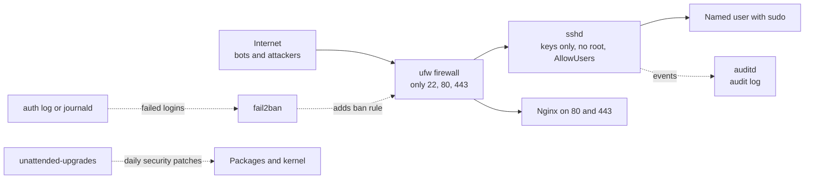
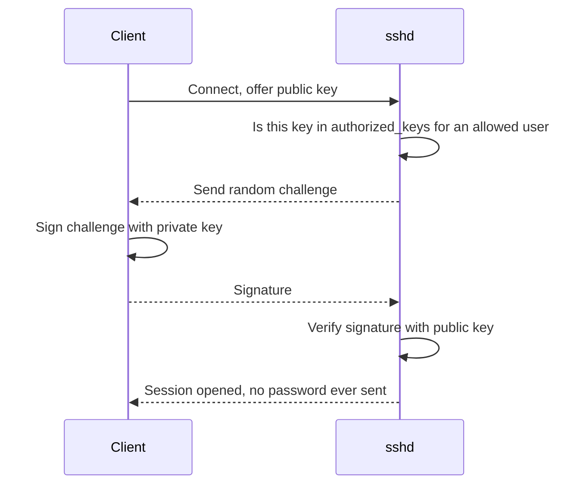

# L11.1 — Linux Security and SSH Hardening

> **Level 11: Security / DevSecOps** · Topic 1 of 13 · ⏱ ~4 hours · Difficulty: Intermediate

## 1. What it is

**Hardening** means shrinking the number of ways into a machine and limiting what an intruder can do if they get
in. For a Linux server that is exposed to the internet, the front door is almost always **SSH (Secure Shell)**, so
the first hardening job is to make SSH accept only **key-based logins for named, non-root users**. Around that door
you add a **host firewall** (`ufw`, the "Uncomplicated Firewall"), a **brute-force blocker** (`fail2ban`),
**automatic security patching** (`unattended-upgrades`) and an **audit trail** (`auditd`, the Linux Audit daemon) so
that you can see what happened afterwards.

None of these tools is exotic. Hardening is the discipline of applying a short checklist to *every* server, every
time, ideally from code (cloud-init, Ansible or an image build) rather than by hand. The layers overlap on purpose:
if one fails (a new SSH vulnerability, a mistyped firewall rule) another still stands. This is called
**defence in depth**.

## 2. Why it matters in DevOps

- **Bots find you in minutes.** A fresh VPS with port 22 open starts collecting failed `root` and `admin` login
  attempts almost immediately. Password authentication on such a host is a countdown.
- **Unpatched software is the classic root cause.** The 2017 Equifax breach started with an Apache Struts
  vulnerability (CVE-2017-5638) for which a fix had already been published; the patch simply had not been applied.
- **Compliance and audits** (SOC 2, ISO 27001, PCI DSS) ask for exactly these controls: key-only access, least
  privilege, patching cadence, and logs that prove who did what.
- **Blast radius.** A shared `root` password or one leaked laptop key that works on every server turns one incident
  into a fleet-wide incident. Per-person keys and `sudo` give you attribution and revocation.

See also: [Users, Groups, sudo and root](../level-01-linux-fundamentals/07-users-groups-sudo-root.md) and
[SSH Keys, known_hosts and authorized_keys](../level-01-linux-fundamentals/12-ssh-keys-and-authorized-keys.md).

## 3. Real-world system example

**Cloud providers have moved away from "SSH with a long-lived key to every box".**

- **AWS Systems Manager Session Manager** lets operators open a shell on an EC2 instance through the AWS API,
  authorised by IAM and logged to CloudTrail, with **no inbound port 22** at all.
- **Google Cloud OS Login** ties SSH access to IAM identities, so removing a person from the organisation removes
  their SSH access everywhere, instead of hunting for a stale key in dozens of `authorized_keys` files.
- **Ubuntu** ships `unattended-upgrades` enabled by default on server images for security updates, and publishes
  hardening guidance; the **CIS Benchmarks** (Center for Internet Security) give a scored checklist for
  Ubuntu, Debian and RHEL that auditors and tools such as **Lynis** and OpenSCAP reference.

The same checklist you build here is what those benchmarks formalise: no root login, no passwords, minimal open
ports, automatic patching, auditing.

## 4. Diagram

Layers between the internet and your shell:



What a key-based login looks like (why a stolen password is useless):



## 5. How it works

| Control | Where it lives | What it stops |
|---------|----------------|---------------|
| `PermitRootLogin no` | `sshd_config` | direct attacks on the all-powerful `root` account; forces attribution via `sudo` |
| `PasswordAuthentication no` | `sshd_config` | password guessing and credential stuffing |
| `AllowUsers deploy alice` | `sshd_config` | any account not on the list, even if it has a key |
| `MaxAuthTries`, `LoginGraceTime` | `sshd_config` | slow guessing and idle half-open connections |
| `ufw` default deny | kernel netfilter via `ufw` | services you forgot were listening |
| `fail2ban` | `/etc/fail2ban/jail.local` | repeated failures from one IP, by adding a temporary firewall ban |
| `unattended-upgrades` | `/etc/apt/apt.conf.d/` | known vulnerabilities sitting unpatched for months |
| `auditd` rules | `/etc/audit/rules.d/` | "who changed `sshd_config` and when" going unanswered |

Details worth knowing:

- **Drop-in files win by order.** Modern OpenSSH includes `/etc/ssh/sshd_config.d/*.conf`, and for most options the
  **first value read wins**. Files are read alphabetically, so a cloud image's `50-cloud-init.conf` that says
  `PasswordAuthentication yes` will beat your `99-hardening.conf`. Name yours `10-hardening.conf`.
- **Validate before reload.** `sshd -t` checks syntax; `sshd -T` prints the *effective* configuration after all
  includes. Always keep your current session open and test a second one before closing it.
- **Service names differ:** `ssh` on Debian and Ubuntu, `sshd` on RHEL, Fedora and Amazon Linux.
- **Docker and ufw:** ports published with `-p 8080:80` are opened by Docker directly in `iptables`, bypassing
  `ufw` rules. Bind to localhost (`-p 127.0.0.1:8080:80`) or put a proxy in front.
- **Auditing is evidence, not prevention.** `auditd` writes to `/var/log/audit/audit.log`; ship it off the box
  (see [Observability](../level-10-observability/06-loki-log-aggregation.md)) so an intruder cannot erase it.

## 6. Step-by-step guide

**Prerequisites:** a **disposable** Ubuntu 22.04 or 24.04 machine you can reach over SSH: a local VM
(Multipass, Vagrant, VirtualBox, UTM) or a free-tier or cheapest VPS. A VPS may cost a few cents per hour; destroy it
at the end. **Never** practise a firewall or `sshd` change on a server you cannot reach through a console, because
you can lock yourself out. Replace `203.0.113.10` with your server's address.

1. **Create a non-root admin user and install your public key.** On the server (as root or an existing sudo user):
   ```bash
   sudo adduser --disabled-password --gecos "" deploy
   sudo usermod -aG sudo deploy
   sudo mkdir -p /home/deploy/.ssh
   echo "ssh-ed25519 AAAA...your-public-key... you@laptop" | sudo tee /home/deploy/.ssh/authorized_keys
   sudo chown -R deploy:deploy /home/deploy/.ssh
   sudo chmod 700 /home/deploy/.ssh && sudo chmod 600 /home/deploy/.ssh/authorized_keys
   ```
   From your laptop, confirm it works **before touching sshd**: `ssh deploy@203.0.113.10 'id'` should print
   `uid=1001(deploy) ... groups=...,27(sudo)`.

   Because the account has no password, give it passwordless sudo only if you accept that trade-off
   (`echo 'deploy ALL=(ALL) NOPASSWD:ALL' | sudo tee /etc/sudoers.d/deploy`), or set a password with `sudo passwd deploy`.

2. **Write the SSH hardening drop-in.**
   ```bash
   sudo tee /etc/ssh/sshd_config.d/10-hardening.conf >/dev/null <<'EOF'
   PermitRootLogin no
   PasswordAuthentication no
   KbdInteractiveAuthentication no
   PubkeyAuthentication yes
   AllowUsers deploy
   MaxAuthTries 3
   LoginGraceTime 30
   X11Forwarding no
   AllowAgentForwarding no
   EOF
   sudo sshd -t && echo "syntax ok"
   ```
   Expect `syntax ok`. Then check the *effective* values (this catches the cloud-init override):
   ```bash
   sudo sshd -T | grep -Ei '^(permitrootlogin|passwordauthentication|allowusers|maxauthtries)'
   ```
   Expect `permitrootlogin no`, `passwordauthentication no`, `allowusers deploy`, `maxauthtries 3`.

3. **Reload (not restart) and test from a second terminal, keeping the first open.**
   ```bash
   sudo systemctl reload ssh        # use "sshd" on RHEL-family systems
   ```
   In a new laptop terminal:
   ```bash
   ssh deploy@203.0.113.10 'echo ok'                       # works
   ssh -o PubkeyAuthentication=no deploy@203.0.113.10      # Permission denied (publickey)
   ssh root@203.0.113.10                                   # Permission denied (publickey)
   ```

4. **Turn on the firewall, allowing SSH first.**
   ```bash
   sudo ufw default deny incoming
   sudo ufw default allow outgoing
   sudo ufw limit 22/tcp          # allow SSH but rate-limit repeated connections
   sudo ufw allow 80/tcp
   sudo ufw allow 443/tcp
   sudo ufw enable
   sudo ufw status verbose
   ```
   Expect `Status: active`, `Default: deny (incoming), allow (outgoing)` and rows for 22, 80, 443 (plus IPv6 rows).

5. **Install and configure fail2ban.**
   ```bash
   sudo apt-get update && sudo apt-get install -y fail2ban
   sudo tee /etc/fail2ban/jail.local >/dev/null <<'EOF'
   [DEFAULT]
   bantime  = 1h
   findtime = 10m
   maxretry = 5
   backend  = systemd

   [sshd]
   enabled = true
   EOF
   sudo systemctl enable --now fail2ban
   sudo fail2ban-client status sshd
   ```
   Expect a status block with `Currently failed`, `Total banned` and a `Banned IP list`. Never edit `jail.conf`
   itself; package upgrades overwrite it. To unban yourself: `sudo fail2ban-client set sshd unbanip <IP>`.

6. **Enable automatic security updates.**
   ```bash
   sudo apt-get install -y unattended-upgrades
   sudo tee /etc/apt/apt.conf.d/20auto-upgrades >/dev/null <<'EOF'
   APT::Periodic::Update-Package-Lists "1";
   APT::Periodic::Unattended-Upgrade "1";
   EOF
   sudo unattended-upgrade --dry-run --debug 2>&1 | tail -5
   ```
   Look for lines such as `Allowed origins are: ...-security` and `No packages found that can be upgraded
   unattended` (or a list of packages). Kernel updates still need a reboot; check `/var/run/reboot-required`.

7. **Add audit rules for the files that matter.**
   ```bash
   sudo apt-get install -y auditd
   sudo tee /etc/audit/rules.d/hardening.rules >/dev/null <<'EOF'
   -w /etc/ssh/sshd_config -p wa -k sshd_config
   -w /etc/ssh/sshd_config.d/ -p wa -k sshd_config
   -w /etc/sudoers -p wa -k sudoers
   -w /etc/sudoers.d/ -p wa -k sudoers
   -w /etc/passwd -p wa -k identity
   EOF
   sudo augenrules --load
   sudo auditctl -l
   echo "# test" | sudo tee -a /etc/ssh/sshd_config.d/10-hardening.conf >/dev/null
   sudo ausearch -k sshd_config -i | tail -12
   ```
   `ausearch` should show a record naming the `tee` command, the user and the file written.

8. **Score yourself with Lynis (optional).**
   ```bash
   sudo apt-get install -y lynis
   sudo lynis audit system --quick | grep -E 'Hardening index|Warnings'
   ```
   The "hardening index" is a rough number; use the *suggestions* list as a to-do list, not a target to maximise.

## 7. Real-world scenario

*(Illustrative, not a documented incident.)* A small team runs `shop-api` on one VPS. The monitoring graph for CPU
shows a nightly spike and `journalctl -u ssh` is full of `Failed password for invalid user admin` lines from many
addresses. Nobody got in, but the logs are noisy and sshd is burning CPU on authentication attempts. The investigation
reveals `PasswordAuthentication yes` was left in `/etc/ssh/sshd_config.d/50-cloud-init.conf`, and the shared `ubuntu`
account has a weak password used by two contractors.

The fix: create per-person users with keys, disable passwords in a `10-hardening.conf` (so it wins over cloud-init),
enable `fail2ban`, and rotate the credentials. A week later `fail2ban-client status sshd` shows hundreds of banned
addresses and zero successful logins from unknown IPs. **Lesson:** the vulnerability was not exotic; it was a
default nobody had verified with `sshd -T`. Bake the checks into the image or cloud-init so the next server is born
hardened.

## 8. Common mistakes and best practices

**Don't**

- Disable password login before you have tested key login from a second session. Locking yourself out of a VPS is the most common hardening incident.
- Share one account or one private key among a team. You lose attribution and cannot revoke one person.
- Run `ufw enable` before `ufw allow 22` (or `limit 22`).
- Assume `ufw` protects Docker-published ports. It does not.
- Expose SSH to `0.0.0.0/0` on a production database or internal host when a bastion, VPN or Session Manager would do.
- Keep audit logs only on the machine that might be compromised.

**Do**

- Use `ed25519` keys protected by a passphrase and an agent; remove leavers' keys the day they leave.
- Prefer identity-aware access (Session Manager, OS Login, a VPN or bastion) over public SSH where possible.
- Put hardening in code: cloud-init, Ansible or a golden image, then verify with `sshd -T` in CI.
- Patch automatically for security updates and reboot on a schedule; alert if `/var/run/reboot-required` is old.
- Forward auth and audit logs to central storage and alert on unusual `sudo` or `sshd_config` changes.

## 9. Tasks

*Run all tasks on a throwaway VM or VPS you own. Destroy it when finished.*

- [ ] **T1 — Create a key-only admin user** *(≈30 min, beginner)*
  - **Goal:** log in as a named non-root user with a key.
  - **Steps:**
    1. Generate a key if needed: `ssh-keygen -t ed25519 -C "you@laptop"`.
    2. Follow step 1 of the guide to create `deploy` and install the public key.
    3. Log in with `ssh deploy@<server-ip> id`.
  - **Done when:** the command prints `uid=...(deploy)` with the `sudo` group and no password prompt.

- [ ] **T2 — Harden sshd and prove it** *(≈30 min, intermediate)*
  - **Goal:** root and password logins are impossible.
  - **Steps:**
    1. Apply the `10-hardening.conf` drop-in and reload.
    2. Run `ssh root@<ip>` and `ssh -o PubkeyAuthentication=no deploy@<ip>`.
    3. Run `sudo sshd -T | grep -Ei 'permitroot|passwordauth'` on the server.
  - **Done when:** both attempts say `Permission denied (publickey)` and `sshd -T` shows `no` for both options.

- [ ] **T3 — Firewall and brute-force defence** *(≈40 min, intermediate)*
  - **Goal:** only intended ports are reachable and repeated failures get banned.
  - **Steps:**
    1. Configure `ufw` and `fail2ban` as in steps 4-5.
    2. From a **second machine you own** (not your only admin laptop), run `ssh baduser@<ip>` six times in a row.
    3. Run `sudo fail2ban-client status sshd` and then unban that IP.
  - **Done when:** the banned list contains the second machine's IP and you can explain why `maxretry` and `bantime` were chosen.

- [ ] **T4 — Break it and fix it: the cloud-init override** *(≈30 min, intermediate)*
  - **Goal:** understand drop-in precedence.
  - **Steps:**
    1. Rename your file to `99-hardening.conf` and add `PasswordAuthentication yes` to a file named `50-test.conf`.
    2. Run `sudo sshd -T | grep passwordauthentication`.
    3. Explain which file won and why, then fix it by renaming/removing so the result is `no`.
  - **Done when:** `sshd -T` shows `passwordauthentication no` again and you can state the "first value wins" rule.

- [ ] **T5 — Automate it** *(≈45 min, advanced)*
  - **Goal:** make hardening repeatable.
  - **Steps:**
    1. Write a `harden.sh` script (or cloud-init `#cloud-config` with `write_files` and `runcmd`) containing steps 2-7.
    2. Make it idempotent: running it twice must not duplicate lines or fail.
    3. Add a final check block that exits non-zero if `sshd -T` does not show the expected values.
  - **Done when:** a brand-new VM becomes hardened by running your script once, and the check block exits `0`.

- [ ] **T6 — Prove it: audit trail and patching** *(≈30 min, advanced)*
  - **Goal:** answer "who changed SSH config?" and "are we patched?" from evidence.
  - **Steps:**
    1. Without the guide, modify `sshd_config.d` as the `deploy` user via `sudo` and retrieve the event with `ausearch -k sshd_config -i`.
    2. Show the last automatic upgrade run (`/var/log/unattended-upgrades/`).
    3. Write a five-line summary: who, what, when, from which session, and the patch state.
  - **Done when:** your summary names the user, command and timestamp taken directly from the audit log.

## 10. Self-check questions

1. Why is `PermitRootLogin no` combined with `sudo` safer than logging in as root?
2. What does `sshd -T` show that `cat /etc/ssh/sshd_config` does not?
3. Why did your hardening file need a lower number than `50-cloud-init.conf`?
4. Why can `ufw` fail to protect a container published with `-p 8080:80`?
5. What does `fail2ban` actually do when it "bans" an IP, and what does it not protect against?
6. Name two ways to avoid exposing port 22 to the internet at all.

<details>
<summary>Answers</summary>

1. Every admin action is tied to a named user and logged by `sudo`; the root account has no password to guess; you can revoke one person without changing a shared secret.
2. The effective configuration after all `Include` files and defaults are merged, which is what the daemon really uses.
3. For most options sshd uses the first value it reads, and drop-ins are read in alphabetical order, so `10-` is read before `50-`.
4. Docker adds its own `iptables` rules for published ports, which are evaluated before the `ufw` chains; bind the port to `127.0.0.1` or manage the DOCKER-USER chain.
5. It watches logs and inserts a temporary firewall rule for the source IP. It does not stop a stolen key, a vulnerable daemon or a slow distributed attack from many IPs.
6. AWS Systems Manager Session Manager, a VPN, a bastion host with a tightly restricted security group, or Google Cloud IAP/OS Login.
</details>

## 11. Further reading

- OpenSSH manual pages: `man sshd_config`, `man ssh` (also at openssh.com).
- CIS Benchmarks for Ubuntu Linux (Center for Internet Security), free PDF after registration.
- Ubuntu Server documentation: security section (OpenSSH, ufw, unattended-upgrades).
- `man ufw`, `man jail.conf` (fail2ban), `man auditctl` and `man audit.rules`.
- *Linux Basics for Hackers* and *The Linux Command Line* for background; Lynis documentation at cisofy.com.

<!-- nav -->
---
← Previous level: [Level 10 — Observability](../level-10-observability/README.md) · [Level 11 index](README.md) · Next: [Least-privilege IAM](02-least-privilege-iam.md) →
