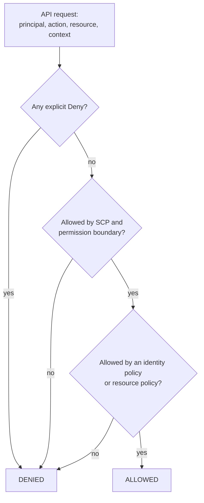
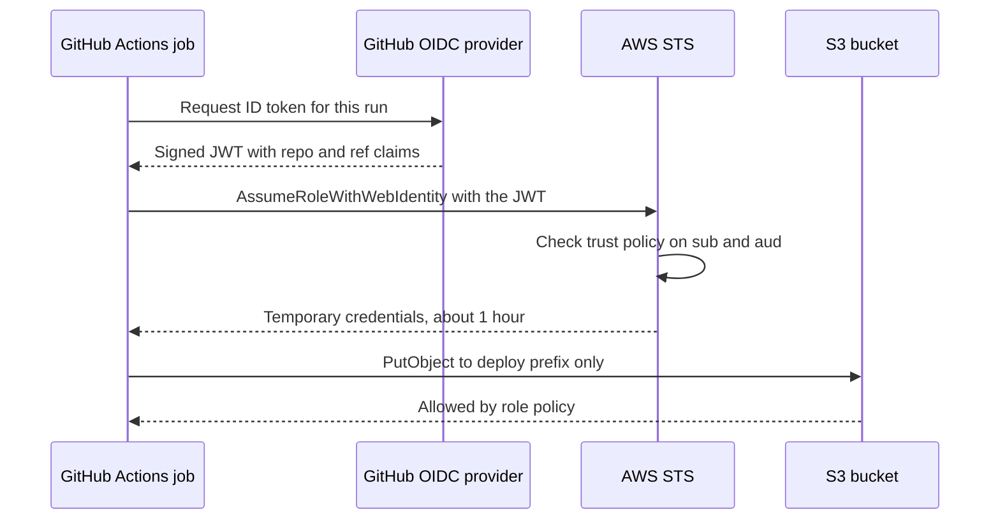

# L11.2 — Least-privilege IAM

> **Level 11: Security / DevSecOps** · Topic 2 of 13 · ⏱ ~4 hours · Difficulty: Intermediate

## 1. What it is

**IAM (Identity and Access Management)** answers two questions for every cloud API call: *who is calling?* and
*are they allowed to do this to that resource?* **Least privilege** is the rule that every identity, human or
machine, gets only the permissions its job needs, on only the resources it touches, only for as long as it needs
them.

In AWS the building blocks are **policies** (JSON documents listing allowed or denied *actions* on *resources*,
optionally with *conditions*), **users** (long-lived identities, best avoided), **roles** (identities that are
*assumed* temporarily and issue short-lived credentials) and **permission boundaries** (a ceiling that caps what
a role or user can ever be granted). Other clouds use different names (GCP IAM bindings, Azure RBAC) but the same
ideas. This topic uses AWS; the basics of the service are in [IAM](../level-06-cloud-aws/07-iam.md).

## 2. Why it matters in DevOps

- **Credentials leak.** Pipelines, laptops and containers all carry credentials. If the leaked credential can only
  read one S3 prefix, the incident is small. If it is `AdministratorAccess`, the incident is the whole account.
- **Automation multiplies mistakes.** A Terraform or CI role with `"Action": "*", "Resource": "*"` can delete
  production in one bad `apply`.
- **Audits ask for it.** Access reviews, SOC 2 and ISO 27001 all look for scoped roles, MFA and removal of unused access.
- **Wildcards are easy; scoping is work.** Teams start with `*` "to get unblocked" and never come back. The skill
  is making the scoped path as easy as the lazy one.

## 3. Real-world system example

**Capital One, 2019.** In the publicly documented 2019 breach, an attacker exploited a server-side request
forgery weakness in a misconfigured web application firewall running on an EC2 instance. The request reached the
EC2 **instance metadata service** and returned temporary credentials for the instance's IAM role. That role was
permitted to list and read many S3 buckets, so the stolen credentials were enough to copy data on the order of
100 million customer records (court documents and the company's statements describe it). The entry point was a
web flaw, but the *size* of the breach was an IAM problem: the role had far more S3 access than a firewall
needs. AWS later introduced IMDSv2 (session-oriented metadata requests) in late 2019 to make this class of theft
harder, and recommends requiring it.

**GitHub Actions to AWS** is the modern good example. Instead of storing an `AWS_ACCESS_KEY_ID` secret in GitHub,
a workflow uses **OpenID Connect (OIDC)**: GitHub issues a short-lived signed token, AWS verifies it against a
trust policy that names the exact repository and branch, and returns temporary credentials for a narrowly scoped
role. No long-lived key exists to leak.

## 4. Diagram

How a policy decision is made (simplified AWS evaluation):



Role assumption with OIDC from CI, no stored keys:



## 5. How it works

**Policy anatomy** (identity-based policy):

| Element | Meaning | Least-privilege habit |
|---------|---------|-----------------------|
| `Effect` | `Allow` or `Deny` | Use `Deny` for guardrails you never want overridden |
| `Action` | API calls such as `s3:GetObject` | List exact actions; avoid `s3:*` |
| `Resource` | ARN(s) the action applies to | Name the bucket and prefix; avoid `"*"` |
| `Condition` | Extra requirements | Require MFA, source VPC, tag match, or a specific org |

**The four layers of "who may do what":**

| Mechanism | Grants permissions? | Purpose |
|-----------|--------------------|---------|
| Identity policy (on user/role) | yes | "This role may read the config bucket" |
| Resource policy (on bucket, key, queue) | yes | "This bucket allows that role, even cross-account" |
| **Permission boundary** | no, only limits | Ceiling for a role/user: effective = identity policy ∩ boundary |
| **SCP (Service Control Policy)** | no, only limits | Ceiling for whole accounts in AWS Organizations (see [topic 3](03-cloud-security-groups-and-policies.md)) |

**Role assumption.** A role has two policies: a **trust policy** (who may assume it) and a **permissions policy**
(what it can do once assumed). `sts:AssumeRole` returns temporary credentials (access key, secret and session
token) that expire. Humans assume roles from an SSO login; EC2, ECS and Lambda attach roles to workloads; CI
assumes roles via OIDC.

**IAM Access Analyzer** has three useful modes: (1) **external access findings** show resources (buckets, roles,
KMS keys, queues) shared outside your account or organisation; (2) **policy validation** lints a policy for
errors, security warnings and overly broad grants (`aws accessanalyzer validate-policy`); (3) **policy generation**
builds a least-privilege policy from the actions a role actually performed according to CloudTrail. Unused-access
analysis is a paid feature; the basic external-access analyzer and policy validation are free at the time of writing,
so check current pricing.

**Process for getting to least privilege:** start from what the workload does, write the narrowest policy, test it
with the policy simulator, deploy, watch `AccessDenied` events in CloudTrail, widen only where justified, and
review "last accessed" data to remove what is unused.

## 6. Step-by-step guide

**Prerequisites:** an AWS account (free tier is fine; IAM itself is free), AWS CLI v2 configured with an
administrator profile for the sandbox, and `jq`. Everything here is IAM metadata, so cost is $0, but still set a
billing alarm on any account you experiment in and delete what you create in the cleanup step. Replace
`123456789012` with your account ID (`aws sts get-caller-identity --query Account --output text`).

1. **Write a deliberately over-broad policy and let Access Analyzer judge it.**
   ```bash
   cat > bad-policy.json <<'EOF'
   {
     "Version": "2012-10-17",
     "Statement": [{ "Effect": "Allow", "Action": "s3:*", "Resource": "*" }]
   }
   EOF
   aws accessanalyzer validate-policy \
     --policy-type IDENTITY_POLICY \
     --policy-document file://bad-policy.json \
     --query 'findings[].{type:findingType,issue:issueCode,msg:findingDetails}' --output table
   ```
   Expect findings such as `SECURITY_WARNING` / `PASS_ROLE_WITH_STAR_IN_RESOURCE` style messages or a warning about
   a wildcard action or resource. Exact codes vary by validator version.

2. **Write the least-privilege version for `shop-api`.** The API only needs to read objects under `uploads/` in
   one bucket and read one secret:
   ```bash
   cat > shop-api-policy.json <<'EOF'
   {
     "Version": "2012-10-17",
     "Statement": [
       {
         "Sid": "ReadUploadsOnly",
         "Effect": "Allow",
         "Action": ["s3:GetObject"],
         "Resource": "arn:aws:s3:::shop-api-example-assets/uploads/*"
       },
       {
         "Sid": "ListUploadsPrefix",
         "Effect": "Allow",
         "Action": ["s3:ListBucket"],
         "Resource": "arn:aws:s3:::shop-api-example-assets",
         "Condition": { "StringLike": { "s3:prefix": ["uploads/*"] } }
       },
       {
         "Sid": "ReadOneSecret",
         "Effect": "Allow",
         "Action": ["secretsmanager:GetSecretValue"],
         "Resource": "arn:aws:secretsmanager:us-east-1:123456789012:secret:shop-api/db-*"
       }
     ]
   }
   EOF
   aws accessanalyzer validate-policy --policy-type IDENTITY_POLICY \
     --policy-document file://shop-api-policy.json --query 'findings' --output json
   ```
   Expect `[]` (no findings).

3. **Create a role the API can assume, with a trust policy limited to EC2 and a permission boundary.** First the boundary,
   which caps the role to S3 read and Secrets Manager read no matter what is attached later:
   ```bash
   cat > boundary.json <<'EOF'
   {
     "Version": "2012-10-17",
     "Statement": [{
       "Effect": "Allow",
       "Action": ["s3:GetObject", "s3:ListBucket", "secretsmanager:GetSecretValue", "logs:*"],
       "Resource": "*"
     }]
   }
   EOF
   aws iam create-policy --policy-name shop-api-boundary --policy-document file://boundary.json
   aws iam create-policy --policy-name shop-api-access --policy-document file://shop-api-policy.json

   cat > trust.json <<'EOF'
   {
     "Version": "2012-10-17",
     "Statement": [{
       "Effect": "Allow",
       "Principal": { "Service": "ec2.amazonaws.com" },
       "Action": "sts:AssumeRole"
     }]
   }
   EOF
   aws iam create-role --role-name shop-api-role \
     --assume-role-policy-document file://trust.json \
     --permissions-boundary arn:aws:iam::123456789012:policy/shop-api-boundary
   aws iam attach-role-policy --role-name shop-api-role \
     --policy-arn arn:aws:iam::123456789012:policy/shop-api-access
   ```

4. **Prove the policy with the simulator (no real resources needed).**
   ```bash
   aws iam simulate-principal-policy \
     --policy-source-arn arn:aws:iam::123456789012:role/shop-api-role \
     --action-names s3:GetObject s3:PutObject s3:DeleteObject \
     --resource-arns arn:aws:s3:::shop-api-example-assets/uploads/logo.png \
     --query 'EvaluationResults[].{action:EvalActionName,decision:EvalDecision}' --output table
   ```
   Expect `s3:GetObject` = `allowed` and `s3:PutObject`, `s3:DeleteObject` = `implicitDeny`.

5. **Assume a role and see temporary credentials.** Create a role you (as an admin) may assume, then:
   ```bash
   aws sts assume-role --role-arn arn:aws:iam::123456789012:role/<ROLE_YOU_CAN_ASSUME> \
     --role-session-name lab --duration-seconds 900 \
     --query 'Credentials.{expires:Expiration,key:AccessKeyId}' --output table
   ```
   Note the `Expiration` timestamp ~15 minutes ahead and that the key id starts with `ASIA` (temporary) rather than `AKIA` (long-lived).
   A quick way to practise: add a role whose trust policy names your own IAM user, then run `aws sts assume-role` against it.

6. **Require MFA for sensitive roles (trust policy condition).**
   ```json
   {
     "Effect": "Allow",
     "Principal": { "AWS": "arn:aws:iam::123456789012:user/alice" },
     "Action": "sts:AssumeRole",
     "Condition": { "Bool": { "aws:MultiFactorAuthPresent": "true" } }
   }
   ```

7. **Replace CI access keys with OIDC.** The trust policy of the deploy role (the GitHub OIDC provider must exist in
   the account first):
   ```json
   {
     "Version": "2012-10-17",
     "Statement": [{
       "Effect": "Allow",
       "Principal": { "Federated": "arn:aws:iam::123456789012:oidc-provider/token.actions.githubusercontent.com" },
       "Action": "sts:AssumeRoleWithWebIdentity",
       "Condition": {
         "StringEquals": { "token.actions.githubusercontent.com:aud": "sts.amazonaws.com" },
         "StringLike":   { "token.actions.githubusercontent.com:sub": "repo:example-org/shop-api:ref:refs/heads/main" }
       }
     }]
   }
   ```
   The workflow then uses `aws-actions/configure-aws-credentials` with `role-to-assume` and `permissions: id-token: write`
   (see [Environments and Secrets](../level-03-git-and-github/12-environments-and-secrets.md)).

8. **Cleanup.**
   ```bash
   aws iam detach-role-policy --role-name shop-api-role --policy-arn arn:aws:iam::123456789012:policy/shop-api-access
   aws iam delete-role --role-name shop-api-role
   aws iam delete-policy --policy-arn arn:aws:iam::123456789012:policy/shop-api-access
   aws iam delete-policy --policy-arn arn:aws:iam::123456789012:policy/shop-api-boundary
   ```

## 7. Real-world scenario

*(Illustrative.)* The `shop-api` deploy pipeline used an IAM user `ci-deployer` with `AdministratorAccess`, its
access key stored as a CI secret. A contractor's laptop was compromised and the key was used from an unfamiliar
country to launch dozens of large EC2 instances for crypto-mining; the first sign was a billing alarm. The team
disabled the key, terminated the instances and reviewed CloudTrail (`aws cloudtrail lookup-events`) to confirm nothing
else was touched.

Fix: replace the user with an OIDC-assumed role limited to `ecr:PutImage`, `ecs:UpdateService` and `iam:PassRole` on one
named role; add an SCP denying expensive instance families outside `us-east-1`; add a budget alarm. **Lesson:**
the original key was not "stolen harder" than any other; its permissions made the incident expensive.

## 8. Common mistakes and best practices

**Don't**

- Use `"Action": "*"` or `"Resource": "*"` outside a short-lived experiment.
- Create IAM users with long-lived access keys for people or for CI when roles and SSO exist.
- Leave `iam:PassRole`, `iam:CreateRole` or `iam:AttachRolePolicy` broadly granted: they are privilege-escalation paths.
- Use the root account for daily work; enable MFA on it and lock it away.
- Trust a role to "any principal in the account" (`"Principal": {"AWS": "123456789012"}`) when you meant one role.

**Do**

- Prefer roles and short-lived credentials: SSO for humans, instance/task roles for workloads, OIDC for CI.
- Start from zero and add actions, using CloudTrail and Access Analyzer policy generation to find the real set.
- Scope by resource ARN and use conditions (`aws:PrincipalOrgID`, `aws:SourceVpc`, tags, MFA).
- Put permission boundaries on roles that developers can create, so delegated admin cannot escalate.
- Review Access Analyzer findings and "last accessed" data monthly; delete unused roles and keys.
- Require IMDSv2 on EC2 (`HttpTokens=required`).

## 9. Tasks

- [ ] **T1 — Lint a bad policy** *(≈20 min, beginner)*
  - **Goal:** see what automated validation flags.
  - **Steps:**
    1. Create `bad-policy.json` (`s3:*` on `*`) and run `aws accessanalyzer validate-policy`.
    2. List each finding and what it means.
  - **Done when:** you can name at least two issues and show the validator returns `[]` for your fixed version.

- [ ] **T2 — Write the scoped policy for shop-api** *(≈30 min, intermediate)*
  - **Goal:** turn a requirement into a narrow policy.
  - **Steps:**
    1. Requirement: "read objects under `uploads/` in one bucket, read one secret, write logs to one log group".
    2. Write the JSON, validate it, and run `simulate-principal-policy` for three allowed and three denied actions.
  - **Done when:** the simulator table shows the three expected `allowed` and three `implicitDeny` results.

- [ ] **T3 — Permission boundary stops escalation** *(≈40 min, intermediate)*
  - **Goal:** prove a boundary caps even an admin policy.
  - **Steps:**
    1. Create a role with the boundary from step 3.
    2. Attach the AWS managed `AmazonS3FullAccess` policy to it.
    3. Simulate `s3:PutObject` and `s3:DeleteObject` on the role.
  - **Done when:** `PutObject` is denied (boundary has no `Put`) even though the identity policy would allow it; you can explain "intersection, not union".

- [ ] **T4 — Break it: wrong trust policy** *(≈30 min, intermediate)*
  - **Goal:** debug an `AccessDenied` on `AssumeRole`.
  - **Steps:**
    1. Create a role whose trust policy names a different user ARN, and try `aws sts assume-role`.
    2. Read the error, then fix the `Principal` and retry; add the MFA condition and observe the new failure without MFA.
  - **Done when:** you have seen `AccessDenied` for the wrong principal, success after the fix, and can say which policy (trust vs permissions) each error pointed to.

- [ ] **T5 — Replace a CI key with OIDC** *(≈60 min, advanced)*
  - **Goal:** no long-lived AWS secret in a repository's settings.
  - **Steps:**
    1. Create the GitHub OIDC provider and the role from step 7, scoped to your repo and `main`.
    2. In a test repo, add a workflow with `permissions: { id-token: write, contents: read }` that assumes the role and runs `aws sts get-caller-identity`.
    3. Push from a different branch and confirm the assume fails.
  - **Done when:** `main` prints the assumed-role ARN and a feature branch fails with `Not authorized to perform sts:AssumeRoleWithWebIdentity`.

- [ ] **T6 — Prove it: access review** *(≈45 min, advanced)*
  - **Goal:** audit an account for over-privilege.
  - **Steps:**
    1. Without the guide, list all IAM users with access keys and their last-used dates (`aws iam generate-credential-report`, `aws iam get-credential-report`).
    2. Identify every role/policy containing `"Action": "*"` or `"Resource": "*"`.
    3. Write a short remediation plan with the narrowest replacement for the three worst offenders.
  - **Done when:** the plan lists specific principals, evidence from the credential report, and the proposed scoped policy for each.

## 10. Self-check questions

1. What is the difference between a role's trust policy and its permissions policy?
2. Does a permission boundary grant permissions? Explain how it combines with an identity policy.
3. Why are temporary credentials safer than access keys, and how can you recognise them?
4. In the Capital One incident, which two weaknesses combined, and which one does least privilege address?
5. What does IAM Access Analyzer's policy generation use as its input?
6. Why is `iam:PassRole` with `Resource: "*"` dangerous?

<details>
<summary>Answers</summary>

1. The trust policy says who may assume the role; the permissions policy says what the assumed role may do.
2. No. It only limits. Effective permissions are the intersection of what the identity policy allows and what the boundary allows.
3. They expire automatically (minutes to hours), so a leak has a short useful life; access key IDs starting with `ASIA` come with a session token, whereas `AKIA` keys are long-lived.
4. A web application flaw (SSRF reaching the metadata service) and an over-permissioned instance role. Least privilege limits the second, shrinking what the stolen credentials can reach.
5. CloudTrail logs of the actions the identity actually performed during a chosen period.
6. A principal could pass a more powerful role to a service they can control (for example launch a compute resource with an admin role) and thereby escalate.
</details>

## 11. Further reading

- AWS documentation: *IAM User Guide* (policy evaluation logic, permissions boundaries, access analyzer).
- AWS Well-Architected Framework: Security pillar.
- *AWS Security Best Practices in IAM* (AWS docs page of that name).
- Rhino Security Labs and Datadog Security Labs write-ups on IAM privilege escalation paths (search their blogs).
- Related: [KMS](../level-06-cloud-aws/15-kms.md) key policies use the same ideas.

<!-- nav -->
---
← Previous: [Linux Security and SSH Hardening](01-linux-and-ssh-hardening.md) · [Level 11 index](README.md) · Next: [Cloud Security Groups and Policies](03-cloud-security-groups-and-policies.md) →
