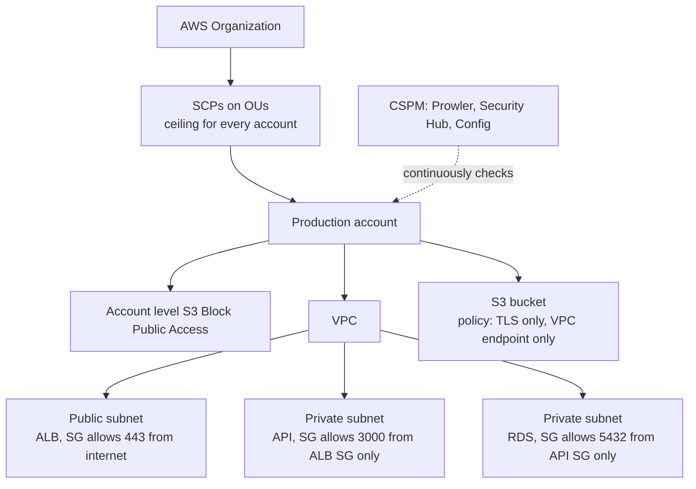
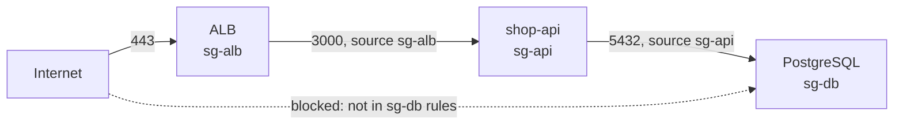

# L11.3 — Cloud Security Groups and Policies

> **Level 11: Security / DevSecOps** · Topic 3 of 13 · ⏱ ~4 hours · Difficulty: Intermediate

## 1. What it is

In the cloud, "the network" and "the permissions" are both configuration, and a single wrong line can expose a
database or a bucket to the whole internet. This topic is about the guardrails at the **resource and account level**:

- **Security groups (SGs)** are stateful virtual firewalls attached to network interfaces (EC2, RDS, load balancers).
  They define *which traffic may reach a resource*. Anything not allowed is dropped.
- **Resource policies such as S3 bucket policies** define *who may touch a resource*, including requirements like
  "only over HTTPS" or "only from my VPC endpoint".
- **Service Control Policies (SCPs)** in AWS Organizations are account-wide ceilings: "nobody in these accounts,
  not even an administrator, may disable CloudTrail or use a region we do not operate in".
- **CSPM (Cloud Security Posture Management)** tools continuously scan your cloud configuration against rules
  (CIS Benchmarks, vendor best practices) and report drift such as "SSH open to the world".

The first three *prevent*; CSPM *detects* what slipped through.

## 2. Why it matters in DevOps

- **Misconfiguration is the common cause.** Public buckets, databases reachable from `0.0.0.0/0` and
  admin ports open to the internet are the classic cloud data exposures, and almost never need an exploit.
- **Speed creates risk.** Terraform lets one engineer create 50 security groups in a minute. Without
  checks in the pipeline, one copy-pasted `cidr_blocks = ["0.0.0.0/0"]` goes to production.
- **Guardrails scale; reviews do not.** An SCP protects every current and future account with one document.
- **Cost and compliance.** Region restrictions prevent a stolen key from mining crypto in a region nobody monitors, and
  auditors expect evidence of continuous posture checks.

## 3. Real-world system example

**AWS S3 Block Public Access and secure-by-default buckets.** After years of public-bucket data leaks across many
companies, AWS introduced **S3 Block Public Access** (2018) and, in April 2023, changed the defaults so new buckets
have Block Public Access enabled and ACLs disabled. The lesson is that safe defaults beat documentation.

**AWS Control Tower** ships "guardrails" implemented as SCPs (preventive) and AWS Config rules (detective): for
example, disallowing changes to CloudTrail configuration across a landing-zone's accounts. **Prowler** is a widely
used open-source CSPM scanner that checks an AWS account against CIS and other benchmarks, and **AWS Security Hub**
aggregates posture findings; commercial CSPMs (Wiz, Prisma Cloud, Microsoft Defender for Cloud) cover several
clouds. Netflix open-sourced Security Monkey years ago for this kind of continuous cloud auditing (the project has
since been archived), showing the idea is not new: *scan constantly, because configuration drifts*.

For Kubernetes-based stacks the equivalent ceiling is covered later by Pod Security and NetworkPolicies.

## 4. Diagram

Layered controls from the account down to the packet:



Why chaining security groups beats IP lists:



## 5. How it works

**Security groups vs network ACLs** (more in [Security Groups and NACLs](../level-06-cloud-aws/06-security-groups-and-nacls.md)):

| | Security group | Network ACL |
|---|---|---|
| Attached to | network interface / resource | subnet |
| State | stateful (return traffic automatic) | stateless |
| Rules | allow only (implicit deny) | allow and deny, ordered |
| Best use | primary, fine-grained control | coarse subnet-level backstop |

**Security group habits:** reference other SGs as the *source* (`sg-api` may reach `sg-db`), never open `22` or `3389`
to `0.0.0.0/0`, keep databases in private subnets with no public IP, restrict **egress** too for sensitive tiers, and
tag every SG with an owner.

**Bucket policy building blocks:**

| Control | Mechanism |
|---------|-----------|
| Never public | account-level and bucket-level **Block Public Access** (all four settings on) |
| TLS only | `Deny` with `Condition: {"Bool": {"aws:SecureTransport": "false"}}` |
| Encryption required | default bucket encryption (SSE-S3 is automatic now; use SSE-KMS where you need key control) |
| Only my network | `aws:SourceVpce` or `aws:SourceVpc` condition with a gateway VPC endpoint |
| Only my organisation | `aws:PrincipalOrgID` condition for cross-account sharing |
| Recoverable | versioning on, plus MFA delete or Object Lock for critical data |

**SCP semantics:** an SCP never grants. It sets the maximum an account's principals can ever do. It does not
apply to the organisation's management account, so keep that account empty of workloads. Test by attaching to a
sandbox OU first, because a wrong `Deny` can break the pipeline that applies the fix.

**CSPM workflow:** scan -> triage by severity and exposure -> fix in code (Terraform) -> re-scan -> keep a
baseline. The best findings are shifted left: the same rules run in CI on the IaC before it is applied
(Trivy `config`, Checkov, tfsec's successors), see [Terraform CI/CD](../level-07-terraform-iac/07-terraform-ci-cd.md).

## 6. Step-by-step guide

**Prerequisites:** Docker (for Trivy), and for the live steps an AWS sandbox account with a billing alarm. Steps 1-3
are static analysis of files on your laptop and cost nothing. Steps 4-6 create a few free-tier-eligible or free
resources (a bucket, a security group); they are removed in the cleanup step. Scan **only** your own code and your own account.

1. **Write an intentionally insecure Terraform file.**
   ```bash
   mkdir -p cloud-lab && cd cloud-lab
   cat > bad.tf <<'EOF'
   resource "aws_security_group" "api" {
     name        = "shop-api-bad"
     description = "intentionally insecure demo"

     ingress {
       description = "SSH from anywhere"
       from_port   = 22
       to_port     = 22
       protocol    = "tcp"
       cidr_blocks = ["0.0.0.0/0"]
     }
     ingress {
       description = "Postgres from anywhere"
       from_port   = 5432
       to_port     = 5432
       protocol    = "tcp"
       cidr_blocks = ["0.0.0.0/0"]
     }
   }

   resource "aws_s3_bucket" "assets" {
     bucket = "shop-api-example-assets-bad"
   }
   resource "aws_s3_bucket_acl" "assets" {
     bucket = aws_s3_bucket.assets.id
     acl    = "public-read"
   }
   EOF
   ```

2. **Scan it with Trivy's misconfiguration scanner.**
   ```bash
   docker run --rm -v "$PWD":/work -w /work aquasec/trivy:latest config --severity HIGH,CRITICAL .
   ```
   Expect output similar to a table listing the file, a rule ID such as `AWS-0107` ("an ingress security group rule
   allows traffic from /0") and findings for the world-open ports; exact rule IDs and wording change between versions.

3. **Write the fixed version.** Put the database behind an SG chain and lock the bucket down:
   ```bash
   rm bad.tf
   cat > good.tf <<'EOF'
   variable "vpc_id" { type = string }

   resource "aws_security_group" "alb" {
     name_prefix = "shop-alb-"
     vpc_id      = var.vpc_id
     ingress {
       description = "HTTPS from the internet"
       from_port   = 443
       to_port     = 443
       protocol    = "tcp"
       cidr_blocks = ["0.0.0.0/0"]
     }
   }

   resource "aws_security_group" "api" {
     name_prefix = "shop-api-"
     vpc_id      = var.vpc_id
     ingress {
       description     = "App port from the load balancer only"
       from_port       = 3000
       to_port         = 3000
       protocol        = "tcp"
       security_groups = [aws_security_group.alb.id]
     }
   }

   resource "aws_security_group" "db" {
     name_prefix = "shop-db-"
     vpc_id      = var.vpc_id
     ingress {
       description     = "Postgres from the API only"
       from_port       = 5432
       to_port         = 5432
       protocol        = "tcp"
       security_groups = [aws_security_group.api.id]
     }
   }

   resource "aws_s3_bucket" "assets" {
     bucket = "shop-api-example-assets"
   }
   resource "aws_s3_bucket_public_access_block" "assets" {
     bucket                  = aws_s3_bucket.assets.id
     block_public_acls       = true
     block_public_policy     = true
     ignore_public_acls      = true
     restrict_public_buckets = true
   }
   resource "aws_s3_bucket_versioning" "assets" {
     bucket = aws_s3_bucket.assets.id
     versioning_configuration { status = "Enabled" }
   }
   EOF
   docker run --rm -v "$PWD":/work -w /work aquasec/trivy:latest config --severity HIGH,CRITICAL .
   ```
   The world-open ingress finding on the `alb` group (443 from `0.0.0.0/0`) may still be reported because the rule is
   intentionally public; a public HTTPS listener is acceptable and you document it with an ignore comment
   (`#trivy:ignore:<rule-id>` above the resource) rather than silencing the whole scan. Findings about SG
   *egress*, KMS encryption or logging are advisory; address them as your risk level requires.

4. **Find open security groups in a live account (read-only).**
   ```bash
   aws ec2 describe-security-groups \
     --filters Name=ip-permission.cidr,Values=0.0.0.0/0 \
     --query 'SecurityGroups[].{id:GroupId,name:GroupName,ports:IpPermissions[?contains(IpRanges[].CidrIp, `0.0.0.0/0`)].[FromPort,ToPort]}' \
     --output json
   ```
   Any group exposing `22`, `3389`, `5432`, `3306`, `6379` or `27017` to `0.0.0.0/0` deserves an immediate look.

5. **Apply a TLS-only, no-public-access policy to a bucket you own.**
   ```bash
   BUCKET=shop-api-example-assets-$RANDOM
   aws s3api create-bucket --bucket "$BUCKET" --region us-east-1
   aws s3api put-public-access-block --bucket "$BUCKET" \
     --public-access-block-configuration BlockPublicAcls=true,IgnorePublicAcls=true,BlockPublicPolicy=true,RestrictPublicBuckets=true
   cat > policy.json <<EOF
   {
     "Version": "2012-10-17",
     "Statement": [{
       "Sid": "DenyInsecureTransport",
       "Effect": "Deny",
       "Principal": "*",
       "Action": "s3:*",
       "Resource": ["arn:aws:s3:::$BUCKET", "arn:aws:s3:::$BUCKET/*"],
       "Condition": { "Bool": { "aws:SecureTransport": "false" } }
     }]
   }
   EOF
   aws s3api put-bucket-policy --bucket "$BUCKET" --policy file://policy.json
   aws s3api get-bucket-policy-status --bucket "$BUCKET"
   ```
   Expect `"IsPublic": false`. Try to add a policy with `"Principal": "*"` and an `Allow` and observe that Block Public Access rejects it.

6. **Review an SCP (do not attach to your only account).** SCPs need AWS Organizations; read these and apply them to a
   sandbox OU only if you have one. They do not affect the management account.
   ```json
   {
     "Version": "2012-10-17",
     "Statement": [
       {
         "Sid": "ProtectAuditTrail",
         "Effect": "Deny",
         "Action": ["cloudtrail:StopLogging", "cloudtrail:DeleteTrail",
                    "config:StopConfigurationRecorder", "guardduty:DeleteDetector"],
         "Resource": "*"
       },
       {
         "Sid": "OnlyUsEast1",
         "Effect": "Deny",
         "NotAction": ["iam:*", "organizations:*", "route53:*", "cloudfront:*", "sts:*", "support:*"],
         "Resource": "*",
         "Condition": { "StringNotEquals": { "aws:RequestedRegion": ["us-east-1"] } }
       }
     ]
   }
   ```
   Note the `NotAction` list: global services have no region, so they must be excluded or you lock yourself out.

7. **Run a CSPM scan (Prowler) against your sandbox account.**
   ```bash
   docker run --rm -ti -v "$HOME/.aws:/home/prowler/.aws:ro" -v "$PWD/prowler-out:/home/prowler/output" \
     toniblyx/prowler:latest aws --severity critical high --region us-east-1
   ```
   Check Prowler's current docs for the exact image name and flags; they change between major versions. Review the
   HTML/CSV report in `prowler-out/`. Scan only accounts you own.

8. **Cleanup.**
   ```bash
   aws s3 rb "s3://$BUCKET" --force
   rm -rf cloud-lab prowler-out
   ```

## 7. Real-world scenario

*(Illustrative.)* A developer debugging a slow query temporarily adds an inbound rule to the `shop-db` security group:
`5432` from `0.0.0.0/0`, "just for an hour". They go to lunch and forget. Three days later the on-call engineer sees a
spike in failed authentication attempts in the PostgreSQL logs from addresses worldwide. A daily Prowler scan had
already flagged the open `5432`, but the report went to an unwatched mailbox.

The fix: remove the rule, rotate the database password (in case of a successful guess), restrict the SG to the API's SG,
add a Config rule/Security Hub control with an alert to the team channel, and add a Trivy `config` gate to the Terraform
pipeline plus an SCP-based or IAM-based restriction on who may call `AuthorizeSecurityGroupIngress`. **Lesson:**
exposure windows are short if detection pages a human; they are long if findings go to a report nobody reads.

## 8. Common mistakes and best practices

**Don't**

- Open admin or database ports to `0.0.0.0/0`, even "temporarily".
- Put databases in public subnets or give them public IPs.
- Make a bucket public to serve files. Use CloudFront with Origin Access Control or pre-signed URLs.
- Attach an SCP to production without testing it in a sandbox OU first.
- Forget global services (`iam`, `route53`, `cloudfront`) in a region-deny SCP.
- Treat CSPM output as a to-do list nobody owns.

**Do**

- Chain security groups (source = another SG) and keep one SG per role (alb, api, db).
- Turn on account-level S3 Block Public Access and enforce TLS in bucket policies.
- Run IaC scanning in CI and CSPM in the account; both catch different failures.
- Use SCPs for non-negotiable rules: protect audit logging, restrict regions, block leaving the organisation.
- Route high-severity findings to an alert channel with an owner and an SLA.

## 9. Tasks

- [ ] **T1 — Scan insecure IaC** *(≈30 min, beginner)*
  - **Goal:** catch misconfigurations before they exist.
  - **Steps:**
    1. Create `bad.tf` as in step 1.
    2. Run `trivy config` and note the findings for SSH, Postgres and the ACL.
  - **Done when:** the scan reports at least the two world-open ingress rules and you can explain each in a sentence.

- [ ] **T2 — Fix it with an SG chain** *(≈40 min, intermediate)*
  - **Goal:** restrict the database to the API tier only.
  - **Steps:**
    1. Replace the CIDR rules with `security_groups = [...]` references (step 3).
    2. Re-run the scan and compare findings.
  - **Done when:** no HIGH/CRITICAL finding remains for the `api` and `db` groups, and any remaining one has a justified ignore comment.

- [ ] **T3 — Lock a bucket down** *(≈30 min, intermediate)*
  - **Goal:** private, TLS-only, versioned bucket.
  - **Steps:**
    1. Create a bucket and apply Block Public Access and the TLS-only policy (step 5).
    2. Try `curl http://<bucket>.s3.amazonaws.com/` and `aws s3api put-bucket-policy` with a public `Allow`.
  - **Done when:** `get-bucket-policy-status` says `IsPublic: false` and the public policy upload is rejected.

- [ ] **T4 — Find a real exposure** *(≈30 min, intermediate)*
  - **Goal:** detect an open rule in your own account.
  - **Steps:**
    1. Create a throwaway SG allowing `22` from `0.0.0.0/0`.
    2. Run the step 4 query, find it, then delete it.
  - **Done when:** the query lists the throwaway SG's ID before deletion and not after.

- [ ] **T5 — Write and reason about an SCP** *(≈45 min, advanced)*
  - **Goal:** understand ceilings and their failure modes.
  - **Steps:**
    1. Write an SCP denying `ec2:RunInstances` unless the instance type is in an allow-list of three small types.
    2. Explain what happens to an admin in that account who tries a larger type, and what happens in the management account.
    3. If you have an Organizations sandbox, attach it to a test OU and verify.
  - **Done when:** you can predict the outcome in both accounts and, if tested, the CLI returns `explicit deny in a service control policy`.

- [ ] **T6 — Prove it: put guardrails in CI** *(≈60 min, advanced)*
  - **Goal:** make insecure Terraform unmergeable.
  - **Steps:**
    1. Without the guide, add a GitHub Actions job that runs `trivy config --exit-code 1 --severity HIGH,CRITICAL .` on pull requests.
    2. Open a PR that adds a world-open SG rule and confirm the check fails; then fix it and confirm it passes.
  - **Done when:** you have a red check on the bad PR and a green check on the fixed one, and can describe why a CSPM scan is still needed.

## 10. Self-check questions

1. Why is "source = another security group" better than listing IP addresses?
2. What does an SCP do that an IAM policy cannot?
3. A bucket has a policy with `Principal: "*"` but Block Public Access is on. Is it public? Why?
4. Why must a region-deny SCP use `NotAction` for some services?
5. What is the difference between preventive and detective controls? Give one example of each from this topic.
6. Why is the management account not affected by SCPs, and what does that imply?

<details>
<summary>Answers</summary>

1. Instances scale and change IPs; an SG reference follows membership automatically, so the rule stays correct and cannot be reached from outside that group.
2. Set a ceiling across whole accounts that even account administrators cannot exceed; IAM policies only grant or deny to identities inside the account and can be changed by those admins.
3. No. Block Public Access overrides public policies and ACLs, so the bucket stays non-public.
4. Global services such as IAM, Route 53 and CloudFront are not tied to a region, so a naive region deny would block them and could lock administrators out.
5. Preventive stops the action (SCP, Block Public Access); detective finds it afterwards (Prowler, Security Hub, Config rules).
6. SCPs do not apply to the management account, so it should host no workloads and be tightly protected with MFA and minimal access.
</details>

## 11. Further reading

- AWS documentation: *Security groups*, *Amazon S3 Block Public Access*, *Service control policies*, *AWS Security Hub*.
- CIS AWS Foundations Benchmark (Center for Internet Security).
- Prowler and Trivy documentation (github.com/prowler-cloud/prowler, trivy.dev).
- *AWS Well-Architected Framework* Security Pillar: infrastructure protection.
- Next: [Secrets Management and Encryption](04-secrets-management-and-encryption.md).

<!-- nav -->
---
← Previous: [Least-privilege IAM](02-least-privilege-iam.md) · [Level 11 index](README.md) · Next: [Secrets Management and Encryption](04-secrets-management-and-encryption.md) →
