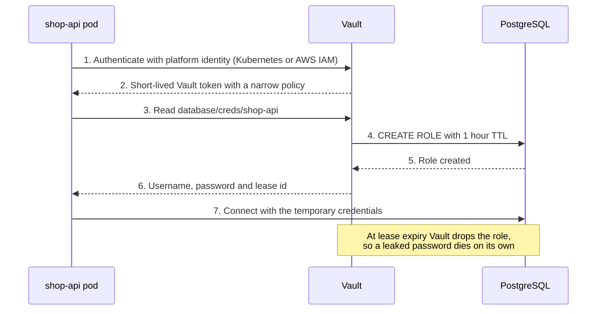
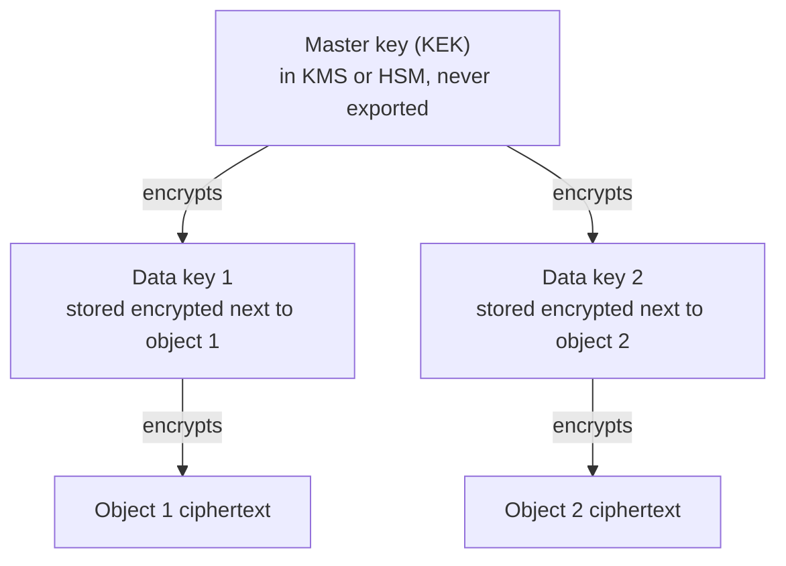

# L11.4 — Secrets Management and Encryption

> **Level 11: Security / DevSecOps** · Topic 4 of 13 · ⏱ ~5 hours · Difficulty: Intermediate

## 1. What it is

A **secret** is any value that grants access or decrypts data: database passwords, API tokens, TLS private keys,
cloud access keys, signing keys. **Secrets management** is the discipline of storing those values in a purpose-built
system, handing them to workloads only when needed, auditing every access, and replacing them regularly
(**rotation**) so a leaked value stops working.

**Encryption** is how the data those secrets protect stays unreadable to anyone who steals it. There are three
states to cover:

- **In transit:** data moving over a network is wrapped in TLS (Transport Layer Security), so a sniffer sees noise.
- **At rest:** data on disk (database files, S3 objects, EBS volumes, backups) is encrypted, so a stolen disk or snapshot is useless.
- **In use:** data in memory is plaintext; here you rely on access control and process isolation (hardware enclaves exist but are beyond this topic).

The glue between secrets and encryption is the **key**. Protecting keys is the hardest part, so production systems
use **envelope encryption**: a small master key (the *key-encryption key*, KEK) that never leaves a hardened service
encrypts many per-object *data keys* (DEKs), and the DEKs encrypt the actual data.

## 2. Why it matters in DevOps

- **Credentials in Git are the classic breach.** Keys committed to repositories, baked into images or pasted into CI logs are found by automated scanners within minutes of becoming public.
- **Static secrets never expire on their own.** A password shared by ten services and unchanged for three years is a standing invitation. Rotation turns a leak from permanent into temporary.
- **Auditors and incident responders ask "who read this secret, and when?"** A `.env` file on a laptop cannot answer; Vault or AWS Secrets Manager can.
- **Encryption is often a compliance requirement** (PCI DSS, HIPAA, SOC 2) and, done through a managed KMS, costs almost nothing in engineering effort.
- **Pipelines are secret-rich targets.** Everything in [CI/CD](../level-05-cicd/05-secrets-and-environment-variables.md) that deploys needs credentials, so the pipeline is a prime target.

## 3. Real-world system example

**HashiCorp Vault** is the best-known open-source secrets manager. Its documented design includes a **KV (key/value)
secrets engine** for static secrets, **dynamic secrets** (for example, the database engine creates a new PostgreSQL
user with a short lease for each requesting application and deletes it when the lease expires) and a **Transit engine**
that does "encryption as a service": applications send plaintext, receive ciphertext, and never hold the key. Vault
starts *sealed*: its master key is split with Shamir's Secret Sharing and several operators must provide shares to
unseal it. (Vault's licence changed to the Business Source License in 2023; the community fork **OpenBao** continues
under an open-source licence and is API-compatible for most uses.)

**AWS KMS and Secrets Manager** are the managed equivalents. KMS holds KEKs in hardware security modules (HSMs) and
exposes `GenerateDataKey`, `Encrypt` and `Decrypt`; S3, EBS and RDS use it for their server-side encryption with
customer-managed keys, and AWS documents this explicitly as envelope encryption. Secrets Manager stores secret values
encrypted under a KMS key, supports resource policies and CloudTrail auditing of every `GetSecretValue`, and rotates
secrets (for example RDS credentials) by running a Lambda function on a schedule. See the AWS-specific topics:
[KMS](../level-06-cloud-aws/15-kms.md) and [Secrets Manager](../level-06-cloud-aws/16-secrets-manager.md).

In Kubernetes, a `Secret` is only base64-encoded by default, which is why teams add encryption at rest for etcd,
an external secrets operator, or a CSI driver that mounts secrets from Vault or a cloud manager. See
[Kubernetes Secrets](../level-08-kubernetes/07-secrets.md).

## 4. Diagram

How an application obtains a short-lived database credential from Vault and how envelope encryption layers keys:





## 5. How it works

**Where secrets should and should not live**

| Location | Verdict | Why |
|----------|---------|-----|
| Source code, Git history | Never | Every clone has it forever; history rewriting does not un-leak it |
| Container image layers (`ENV`, `COPY .env`) | Never | `docker history` and registry pulls reveal them |
| Plain environment variables | Acceptable but weak | Visible in `/proc/<pid>/environ`, crash dumps, `docker inspect`, child processes |
| CI platform secrets (GitHub Actions secrets) | Fine for pipeline use | Masked in logs, scoped per environment; still static |
| Mounted file from a secrets manager (tmpfs) | Good | Not in the image, not in `docker inspect`, can be refreshed in place |
| Runtime fetch from Vault / Secrets Manager with workload identity | Best | No long-lived bootstrap secret; audited; supports rotation |

**Rotation strategies**

| Strategy | How it works | Trade-off |
|----------|--------------|-----------|
| Scheduled rotation | Secrets Manager runs a rotation Lambda every N days | Apps must re-read the secret; often two-user "alternating" scheme avoids downtime |
| Dynamic secrets | Vault mints a unique credential per request, TTL of minutes or hours | Strongest; needs apps that tolerate reconnecting |
| Rotate on suspicion | Emergency replacement after a leak | Needs a rehearsed runbook (see [Secrets Scanning](11-secrets-scanning.md)) |

**Encryption in transit:** terminate TLS 1.2 or 1.3 everywhere, including inside the VPC for databases (`sslmode=verify-full`
for PostgreSQL clients). Certificates are issued automatically (Let's Encrypt, ACM, internal CA) and renewed by machines, not people.
Background: [TCP connections and TLS handshakes](../level-02-networking/06-tcp-and-tls-handshakes.md).

**Encryption at rest:** prefer the platform's server-side encryption (S3 SSE-KMS, EBS and RDS encryption, encrypted
Kubernetes etcd) over hand-written crypto. When you must encrypt in the application, use an authenticated mode
(AES-256-GCM or ChaCha20-Poly1305) from a vetted library, never a home-grown scheme and never ECB mode.

**Envelope encryption** steps: (1) ask KMS for a data key, receiving it in plaintext and encrypted form; (2) encrypt the
data locally with the plaintext key, then discard it from memory; (3) store the encrypted data key next to the ciphertext;
(4) to read, ask KMS to decrypt the data key, then decrypt locally. Benefits: big data never travels to KMS, KMS calls are few,
and rotating the KEK only requires re-wrapping small keys instead of re-encrypting terabytes.

## 6. Step-by-step guide

**Prerequisites:** Docker for Vault in dev mode (free, local, throwaway), OpenSSL (preinstalled on most Linux/macOS).
Nothing here touches the cloud, so there is no cost. Dev mode stores everything in memory with a fixed root token and
no TLS; **never use it for real secrets.**

1. **Demonstrate envelope encryption with OpenSSL.** This mimics what KMS does, so you can see the moving parts.
   ```bash
   mkdir -p ~/envelope-lab && cd ~/envelope-lab
   openssl rand -hex 32 > kek.key                    # master key (in real life: lives in KMS)
   echo 'card=4111-1111-1111-1111' > secret.txt
   openssl rand -hex 32 > dek.key                    # fresh data key for this object
   openssl enc -aes-256-cbc -pbkdf2 -salt -in secret.txt -out secret.enc -pass file:dek.key
   openssl enc -aes-256-cbc -pbkdf2 -salt -in dek.key -out dek.key.enc -pass file:kek.key
   shred -u dek.key secret.txt 2>/dev/null || rm -f dek.key secret.txt
   ls
   ```
   Expect `dek.key.enc`, `kek.key`, `secret.enc`. The plaintext data key and the plaintext file are gone.
   (`-aes-256-cbc` keeps the demo portable; production code should use an authenticated mode such as AES-GCM through a library.)

2. **Decrypt the way a reader would: unwrap the data key first.**
   ```bash
   openssl enc -d -aes-256-cbc -pbkdf2 -in dek.key.enc -out dek.key -pass file:kek.key
   openssl enc -d -aes-256-cbc -pbkdf2 -in secret.enc -pass file:dek.key
   ```
   Output: `card=4111-1111-1111-1111`.

3. **Rotate the master key by re-wrapping only the small data key.** The big ciphertext is untouched.
   ```bash
   openssl rand -hex 32 > kek2.key
   openssl enc -aes-256-cbc -pbkdf2 -salt -in dek.key -out dek.key.enc -pass file:kek2.key
   mv kek2.key kek.key
   rm dek.key
   ```
   Repeat step 2: it still works, and the old KEK can now be destroyed. This is exactly what KMS key rotation relies on.

4. **Start Vault in dev mode.**
   ```bash
   docker run -d --name vault-dev --cap-add=IPC_LOCK -p 127.0.0.1:8200:8200 \
     -e VAULT_DEV_ROOT_TOKEN_ID=dev-only-token hashicorp/vault:latest
   export VAULT_ADDR=http://127.0.0.1:8200 VAULT_TOKEN=dev-only-token
   docker exec -e VAULT_ADDR=http://127.0.0.1:8200 -e VAULT_TOKEN=dev-only-token vault-dev vault status
   ```
   Expect `Initialized true` and `Sealed false`. (Dev mode auto-unseals; production uses a real seal and storage backend.)
   Pin a specific image tag instead of `latest` for anything beyond a lab.

5. **Store and read a static secret (KV v2).**
   ```bash
   v() { docker exec -i -e VAULT_ADDR=http://127.0.0.1:8200 -e VAULT_TOKEN=dev-only-token vault-dev vault "$@"; }
   v kv put -mount=secret shop-api/db username=shop password='<YOUR_DB_PASSWORD>'
   v kv get -mount=secret shop-api/db
   v kv get -mount=secret -field=password shop-api/db
   ```
   `kv put` prints a `version 1` metadata table; each later `put` creates a new version you can roll back to.

6. **Use a narrow policy instead of the root token.** An app should only read its own path.
   ```bash
   cat <<'EOF' | v policy write shop-api-read -
   path "secret/data/shop-api/*" {
     capabilities = ["read"]
   }
   EOF
   v token create -policy=shop-api-read -ttl=15m -field=token
   ```
   Copy the printed token, then prove the policy works (replace `<TOKEN>`):
   ```bash
   docker exec -e VAULT_ADDR=http://127.0.0.1:8200 -e VAULT_TOKEN=<TOKEN> vault-dev vault kv get -mount=secret shop-api/db          # works
   docker exec -e VAULT_ADDR=http://127.0.0.1:8200 -e VAULT_TOKEN=<TOKEN> vault-dev vault kv put -mount=secret shop-api/db x=1     # permission denied
   ```

7. **Try encryption as a service with the Transit engine.**
   ```bash
   v secrets enable transit
   v write -f transit/keys/shop-api
   CT=$(v write -field=ciphertext transit/encrypt/shop-api plaintext=$(printf 'alice@example.com' | base64))
   echo "$CT"                                   # looks like vault:v1:...
   v write -field=plaintext transit/decrypt/shop-api ciphertext="$CT" | base64 -d; echo
   v write -f transit/keys/shop-api/rotate      # new key version
   v write -field=ciphertext transit/rewrap/shop-api ciphertext="$CT"   # now vault:v2:...
   ```
   The application stores only `ciphertext`; the key never leaves Vault, and `rewrap` upgrades old data without ever exposing plaintext.

8. **(Optional, AWS) Do the same with real services.** Costs: a customer-managed KMS key and each Secrets Manager secret carry a small monthly charge
   plus per-request fees. Set a billing alarm first, and delete both at the end.
   ```bash
   aws secretsmanager create-secret --name shop-api/db --secret-string '{"username":"shop","password":"<YOUR_DB_PASSWORD>"}'
   aws secretsmanager get-secret-value --secret-id shop-api/db --query SecretString --output text
   aws secretsmanager delete-secret --secret-id shop-api/db --force-delete-without-recovery   # cleanup
   ```

9. **Clean up.**
   ```bash
   docker rm -f vault-dev; rm -rf ~/envelope-lab
   ```

## 7. Real-world scenario

*Illustrative, not a documented incident.* The `shop-api` team keeps its PostgreSQL password in a `.env` file that was
copied into three repositories, two Docker images and a laptop that was later lost. An auditor asks, "Who has used this
password in the last 90 days?" Nobody can answer, and rotating it means redeploying six services at once, which is
why it has not been rotated in two years.

The team moves to Vault with the database secrets engine. Each pod authenticates using its Kubernetes service account
and receives a PostgreSQL user that lives one hour. The first rollout fails: the app opens a connection pool at start-up
and keeps it after the credentials expire, so queries fail an hour later. The fix is to renew the lease and rebuild
the pool when the credentials change (or use Vault Agent to re-render the config and signal the app).

**Lesson:** the credential is no longer the thing to protect; the *identity* of the workload is. Rotation stopped being scary
because it happens every hour and the app is built for it. Audit logs now answer the auditor's question in one query.

## 8. Common mistakes and best practices

**Don't**

- Commit `.env` files, put secrets in `ENV` or `ARG` in a Dockerfile, or echo them in CI logs.
- Treat base64 as encryption (Kubernetes `Secret` objects are only base64 unless etcd encryption is enabled).
- Use one shared secret for every environment, or give every service the root/admin credential.
- Store the unseal keys or the Vault root token next to the Vault data; revoke the root token after setup.
- Invent your own crypto, use ECB mode, hard-code IVs, or reuse a nonce with AES-GCM.
- Disable TLS verification (`rejectUnauthorized: false`, `curl -k`) to "make it work".

**Do**

- Give workloads an identity (IAM role, Kubernetes service account) and let them fetch secrets at runtime.
- Prefer dynamic or short-lived credentials; where static secrets remain, rotate on a schedule and rehearse emergency rotation.
- Scope policies per application and per path; audit-log every read and alert on unusual access.
- Encrypt at rest with a managed KMS, one key per data classification or environment, with automatic key rotation on.
- Enforce TLS 1.2+ in transit including to the database (`sslmode=verify-full`), and automate certificate renewal.
- Add secret scanning ([Secrets Scanning](11-secrets-scanning.md)) so mistakes are caught before they leave a laptop.

## 9. Tasks

- [ ] **T1 — Envelope-encrypt a file by hand** *(≈30 min, beginner)*
  - **Goal:** feel how a KEK protects a DEK that protects data.
  - **Steps:**
    1. Follow steps 1-2 of the guide with your own text file.
    2. Show that deleting `kek.key` makes the data unrecoverable even though both other files remain.
  - **Done when:** you decrypt successfully with the KEK, and fail with a different random KEK (OpenSSL reports a bad decrypt).

- [ ] **T2 — Run Vault and read a secret with a least-privilege token** *(≈45 min, beginner)*
  - **Goal:** use KV v2 and a scoped policy.
  - **Steps:**
    1. Do steps 4-6 of the guide.
    2. Create a second secret at `secret/shop-api/redis` and confirm the scoped token can read it.
    3. Create `secret/other-team/db` and confirm the scoped token is denied.
  - **Done when:** the allowed read succeeds and the denied read prints `permission denied`.

- [ ] **T3 — Rotate a key without re-encrypting data** *(≈30 min, intermediate)*
  - **Goal:** prove the point of envelope encryption.
  - **Steps:**
    1. Re-wrap the data key under a new KEK (guide step 3) and decrypt again.
    2. In Vault, rotate the Transit key and `rewrap` an existing ciphertext (guide step 7).
    3. Decrypt both the old (`v1`) and rewrapped (`v2`) ciphertexts.
  - **Done when:** both decrypt to the same plaintext and the rewrapped value starts with `vault:v2:`.

- [ ] **T4 — Find the leaked secret** *(≈30 min, intermediate)*
  - **Goal:** see how easily "private" secrets are exposed in images and environment variables.
  - **Steps:**
    1. Build a throwaway image with `ENV DB_PASSWORD=hunter2` in its Dockerfile.
    2. Retrieve the value with `docker history --no-trunc <image>` and `docker inspect <container>`.
    3. Rewrite it to read the password from a file mounted at runtime (`docker run -v $(pwd)/db_password:/run/secrets/db_password:ro ...`) and repeat the inspection.
  - **Done when:** the password is visible in step 2 and absent from image history and `docker inspect` output in step 3.

- [ ] **T5 — Build a rotation-friendly connection** *(≈60 min, advanced)*
  - **Goal:** make an app survive credential changes.
  - **Steps:**
    1. Enable Vault's database engine against a local PostgreSQL container (see the Vault database secrets engine documentation) with a role whose TTL is 2 minutes.
    2. Write a small Node.js script using `pg` that fetches credentials, queries every 10 seconds, and re-fetches credentials before the lease ends.
    3. Watch it run for 10 minutes across at least four rotations.
  - **Done when:** the script's log shows queries succeeding across multiple distinct usernames with no errors.

- [ ] **T6 — Prove it: choose the right home for each secret** *(≈30 min, advanced)*
  - **Goal:** justify design decisions without notes.
  - **Steps:**
    1. For `shop-api` list every secret (DB password, Redis password, JWT signing key, TLS private key, CI deploy credentials, Stripe key).
    2. For each, write where it lives, how the app gets it, how it rotates, and who can read it.
    3. Present it to a teammate and defend one trade-off.
  - **Done when:** every secret has a storage location, delivery method, rotation plan and owner, and none sits in Git or an image.

## 10. Self-check questions

1. Why does envelope encryption use data keys instead of sending the data to KMS directly?
2. What is the difference between encryption at rest and in transit, and which attacker does each stop?
3. Why are dynamic secrets safer than rotated static ones?
4. Is a Kubernetes `Secret` encrypted? What would you add?
5. A developer pushed an API key to a public repo and deleted the commit minutes later. Is it safe? (Think before you read the answer.)

<details>
<summary>Answers</summary>

1. KMS only handles small payloads and calls are slow and metered; local encryption with a data key is fast, and rotating the KEK only requires re-wrapping the small keys.
2. In transit protects against network eavesdropping and tampering; at rest protects against stolen disks, snapshots and backups. Neither helps if an attacker holds valid credentials and the app decrypts for them.
3. Each credential is unique, short-lived and tied to a lease, so a leak expires by itself and access can be attributed to one workload.
4. By default it is only base64-encoded; enable encryption at rest for etcd with a KMS provider, or use an external secrets manager.
5. No. Automated scanners and forks may already have copied it; treat it as compromised, revoke and rotate it, then clean up.
</details>

## 11. Further reading

- HashiCorp Vault documentation (secrets engines: KV, Database, Transit) and the OpenBao project documentation.
- AWS Key Management Service Developer Guide (concepts: envelope encryption, key rotation) and the AWS Secrets Manager User Guide (rotation).
- OWASP Cheat Sheet Series: *Secrets Management* and *Cryptographic Storage*.
- *Serious Cryptography* by Jean-Philippe Aumasson, for the underlying primitives.

<!-- nav -->
---
← Previous: [Cloud Security Groups and Policies](03-cloud-security-groups-and-policies.md) · [Level 11 index](README.md) · Next: [OWASP Top 10](05-owasp-top-10.md) →
