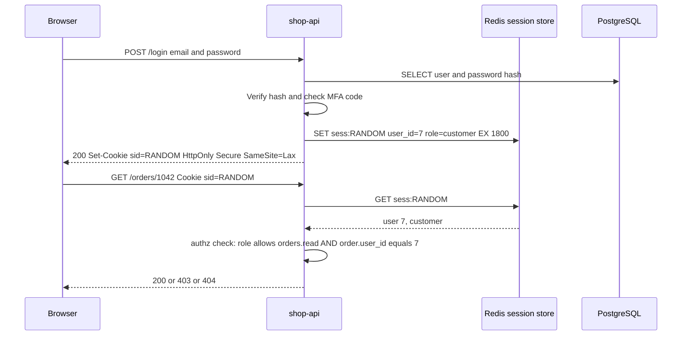
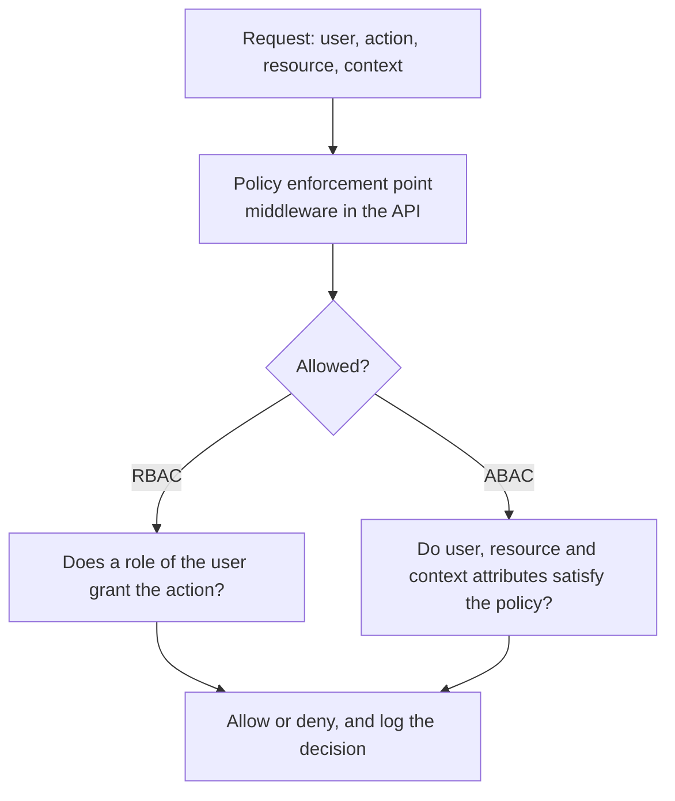

# L11.6 — Authentication and Authorization

> **Level 11: Security / DevSecOps** · Topic 6 of 13 · ⏱ ~5 hours · Difficulty: Intermediate

## 1. What it is

Two questions guard every system, and they are different questions:

- **Authentication (authn): "Who are you?"** Proving an identity with something you know (password), have (phone,
  hardware key) or are (biometric). The result is a verified identity, such as "user 7, Alice".
- **Authorization (authz): "What are you allowed to do?"** Deciding whether that identity may perform this action on this
  resource, such as "may Alice read order 1042?".

Authn happens once per login (or per token); authz happens on **every request**. Confusing them is the root of the most common
web vulnerability class, Broken Access Control ([OWASP A01](05-owasp-top-10.md)): the app knew who the caller was but never asked
whether they were allowed.

Around those two sit supporting ideas:

- **Sessions** let a stateless protocol (HTTP) remember an authenticated user: the server issues an unguessable session id in a cookie and keeps the state server-side (or gives the client a signed token; see [JWT and OAuth](07-jwt-and-oauth.md)).
- **RBAC (Role-Based Access Control)** grants permissions to roles (`admin`, `support`, `customer`) and assigns roles to users.
- **ABAC (Attribute-Based Access Control)** decides using attributes of the user, resource and context ("a support agent may view orders where `order.region == agent.region` during business hours").
- **MFA (Multi-Factor Authentication)** requires two or more different factor types, so a stolen password alone is useless.

## 2. Why it matters in DevOps

- **Humans and machines both authenticate.** Engineers log into consoles, CI jobs assume cloud roles, services call each other. Weak authn anywhere is an entry point.
- **Stolen credentials are the common initial access path** in breach reports year after year; MFA and short-lived credentials remove most of that risk cheaply.
- **Operational access is authorization design:** who may deploy to production, read secrets, approve a Terraform apply? That is RBAC applied to your platform ([Kubernetes RBAC](../level-08-kubernetes/18-rbac.md), [IAM](02-least-privilege-iam.md)).
- **Outages and breaches come from authz drift:** the "temporary" admin role nobody removed, the endpoint added without a permission check.

## 3. Real-world system example

**GitHub** announced that it would require all users who contribute code on github.com to enable two-factor authentication,
rolling that requirement out through 2023, because stolen account credentials were a leading way for attackers to reach source
code and publishing pipelines. It supports TOTP apps, hardware security keys, and passkeys (WebAuthn).

**Kubernetes** shows RBAC in its purest form: `Role`/`ClusterRole` objects list verbs on resources (`get`, `list`, `create` on `pods`), and
`RoleBinding`/`ClusterRoleBinding` objects attach those roles to users, groups or service accounts. Authentication
(certificates, OIDC tokens, service account tokens) is handled separately from authorization; the API server
asks the authorizer on every request.

**AWS IAM** supports both models: managed policies attached to roles are RBAC-like, while **ABAC** uses tags, for example
allowing a principal to touch only resources whose `Project` tag equals the principal's own `Project` tag, so one
policy scales to many teams.

## 4. Diagram

Session-based login and the per-request authorization check:



Where each model decides:



## 5. How it works

**Authentication factors and strength**

| Method | Factor | Notes |
|--------|--------|-------|
| Password | Know | Store only a salted slow hash (argon2id, scrypt, bcrypt); enforce length over complexity; check against breached-password lists |
| TOTP app (RFC 6238) | Have | 6-digit code derived from a shared secret and the current 30-second window; phishable in real time |
| SMS or email code | Have (weak) | Vulnerable to SIM swapping and interception; better than nothing |
| WebAuthn / passkeys / FIDO2 security key | Have (+ are) | Cryptographic and bound to the website's origin, so it resists phishing; the preferred option |
| Machine identity | n/a | Short-lived tokens via workload identity (IAM roles, Kubernetes service accounts, OIDC from CI) rather than long-lived keys |

**Session security checklist**

- Session id: at least 128 bits from a CSPRNG (cryptographically secure random generator), never derived from user data.
- Cookie flags: `HttpOnly` (JavaScript cannot read it), `Secure` (HTTPS only), `SameSite=Lax` or `Strict` (blunts CSRF, cross-site request forgery).
- Rotate the id on login (prevents session fixation), expire on idle and absolute timeouts, delete server-side on logout.
- State-changing requests from browsers also get a CSRF token or rely on `SameSite` plus origin checks.

**RBAC versus ABAC**

| | RBAC | ABAC |
|---|------|------|
| Decision input | The user's roles | Attributes of user, resource, action, environment |
| Strength | Simple, auditable, easy to explain | Fine-grained, scales without a role explosion |
| Weakness | "Role explosion" when exceptions pile up | Policies harder to read and test |
| Typical use | Admin vs support vs customer | "Only the owner", "same region", "business hours" |

Most real systems combine them: a role check first (can this *kind* of user do this action?), then an attribute check
(on *this* object?). Policy engines such as **OPA (Open Policy Agent)** or AWS **Cedar** externalise the rules so they are testable and
auditable.

**Principles:** deny by default; check on the server; check at the **object** level, not just the route; separate
authorization code from handlers so it cannot be forgotten; log denials.

## 6. Step-by-step guide

**Prerequisites:** Node.js 20+ (22 recommended). All steps run locally with zero dependencies, and no cloud account is needed.

1. **Store passwords correctly.** Create `auth.mjs`:
   ```bash
   mkdir -p ~/authz-lab && cd ~/authz-lab
   cat > auth.mjs <<'EOF'
   import { scryptSync, randomBytes, timingSafeEqual } from 'node:crypto';
   export function hashPassword(pw) {
     const salt = randomBytes(16);
     return `scrypt$${salt.toString('hex')}$${scryptSync(pw, salt, 64).toString('hex')}`;
   }
   export function verifyPassword(pw, stored) {
     const [, salt, hash] = stored.split('$');
     const candidate = scryptSync(pw, Buffer.from(salt, 'hex'), 64);
     return timingSafeEqual(candidate, Buffer.from(hash, 'hex'));
   }
   const stored = hashPassword('correct horse battery staple');
   console.log(stored.slice(0, 30) + '...');
   console.log('right:', verifyPassword('correct horse battery staple', stored));
   console.log('wrong:', verifyPassword('guess', stored));
   EOF
   node auth.mjs
   ```
   Expected: a `scrypt$<salt>...` prefix, then `right: true` and `wrong: false`. Run it twice: the stored string differs each time because the salt is random.

2. **Generate and verify a TOTP code (MFA) with the Node standard library.** This is RFC 6238, the algorithm behind authenticator apps.
   ```bash
   cat > totp.mjs <<'EOF'
   import { createHmac } from 'node:crypto';
   export function hotp(secret, counter, digits = 6) {
     const buf = Buffer.alloc(8);
     buf.writeBigUInt64BE(BigInt(counter));
     const h = createHmac('sha1', secret).update(buf).digest();
     const o = h[h.length - 1] & 0x0f;
     return String((h.readUInt32BE(o) & 0x7fffffff) % 10 ** digits).padStart(digits, '0');
   }
   export const totp = (secret, t = Date.now() / 1000, step = 30) => hotp(secret, Math.floor(t / step));
   // RFC 6238 test secret (never use this in production)
   const secret = Buffer.from('12345678901234567890');
   console.log('t=59          ', totp(secret, 59));
   console.log('t=1111111109  ', totp(secret, 1111111109));
   console.log('now           ', totp(secret));
   EOF
   node totp.mjs
   ```
   The first two lines print `287082` and `081804`, the last six digits of the RFC 6238 SHA-1 test vectors (94287082 and 07081804). The third line changes every 30 seconds.
   In production generate a random 160-bit secret per user, store it encrypted, accept the current and one neighbouring window, and block code reuse.

3. **Build an RBAC + ownership check as Express-style middleware.** Keep the policy in one table:
   ```bash
   cat > authz.mjs <<'EOF'
   const PERMISSIONS = {
     customer: ['orders:read:own', 'orders:create'],
     support:  ['orders:read:any'],
     admin:    ['orders:read:any', 'orders:delete', 'users:manage'],
   };
   export function can(user, action, resource) {
     const perms = PERMISSIONS[user.role] ?? [];                      // unknown role: nothing
     if (perms.includes(`${action}:any`) || perms.includes(action)) return true;
     if (perms.includes(`${action}:own`)) return resource?.ownerId === user.id;   // ABAC-style attribute check
     return false;                                                    // deny by default
   }
   const order = { id: 1042, ownerId: 9 };
   console.log('alice own?   ', can({ id: 7, role: 'customer' }, 'orders:read', { ownerId: 7 }));
   console.log('alice bob?   ', can({ id: 7, role: 'customer' }, 'orders:read', order));
   console.log('support bob? ', can({ id: 3, role: 'support' }, 'orders:read', order));
   console.log('typo role?   ', can({ id: 4, role: 'sudoer' }, 'orders:delete', order));
   EOF
   node authz.mjs
   ```
   Expected: `true`, `false`, `true`, `false`. The last line shows deny-by-default for an unknown role.

4. **Wire it into a route** (pattern for `shop-api`):
   ```js
   const authorize = (action, load) => async (req, res, next) => {
     const resource = load ? await load(req) : undefined;
     if (!can(req.user, action, resource)) {
       req.log.warn({ event: 'authz_denied', user: req.user.id, action }, 'denied');
       return res.sendStatus(resource ? 404 : 403);   // 404 avoids confirming that other users' objects exist
     }
     req.resource = resource; next();
   };
   app.get('/orders/:id', authenticate, authorize('orders:read', req => getOrder(req.params.id)), (req, res) => res.json(req.resource));
   ```

5. **Harden the session cookie** in an Express app using a Redis-backed store (`express-session` with `connect-redis`) or your own:
   ```js
   app.use(session({
     name: 'sid', secret: process.env.SESSION_SECRET, resave: false, saveUninitialized: false,
     cookie: { httpOnly: true, secure: true, sameSite: 'lax', maxAge: 30 * 60 * 1000 },
   }));
   // after successful login: req.session.regenerate(() => { req.session.userId = user.id; ... })
   ```
   Check the login response with `curl -si -X POST https://localhost:8443/login ... | grep -i set-cookie` (adjust host and port to your lab): you should see `HttpOnly; Secure; SameSite=Lax`.

6. **Infrastructure authz in miniature (optional):** if you have a kind cluster from [Kubernetes RBAC](../level-08-kubernetes/18-rbac.md), ask the API server the same question you just coded.
   ```bash
   kubectl auth can-i list pods --as=system:serviceaccount:default:default
   ```
   Expect `no`: a new service account has no permissions until a binding grants some.

## 7. Real-world scenario

*Illustrative, not a documented incident.* After a hiring spree, `shop-api` gains a "support" role. A developer adds
`DELETE /admin/orders/:id` and protects it with the `authenticate` middleware only, because "the admin UI never shows
the button to support staff". A contractor with a support login finds the route in the browser's JavaScript bundle,
calls it with `curl`, and deletes 200 test orders; a week later one real order disappears the same way.

Investigation shows the check existed only in the UI (function-level authorization missing on the server). The
fix is a central `authorize('orders:delete')` on the route, a unit test that every registered route has an authorization policy
(the test walks the framework's registered route list and fails if one lacks a policy marker), audit logs for destructive actions, and
quarterly review of who holds which role.

**Lesson:** hiding a button is not authorization. Enforce on the server, centrally, and test that no route can be added without a policy.

## 8. Common mistakes and best practices

**Don't**

- Use unsalted or fast hashes (MD5, SHA-1, plain SHA-256) for passwords, or store them reversibly.
- Give different error messages for "unknown user" and "wrong password", which allows user enumeration.
- Store session ids or tokens in `localStorage` where any XSS can steal them, if a cookie would do.
- Build authz from client-supplied data (`role=admin` in a request body or an unsigned cookie).
- Rely on SMS as the only second factor for privileged accounts.
- Share accounts, or leave default or service credentials in place.

**Do**

- Require MFA for all humans, and phishing-resistant MFA (WebAuthn/passkeys) for admins and production access.
- Rate limit and lock out login attempts; alert on credential-stuffing patterns.
- Centralise policy; check at the object level; deny by default; log every denial and every privileged action.
- Prefer SSO (single sign-on) through an identity provider so joiners, movers and leavers are managed in one place.
- Use short-lived, role-based credentials for machines ([least-privilege IAM](02-least-privilege-iam.md)).
- Review roles and access periodically and remove what is unused.

## 9. Tasks

- [ ] **T1 — Hash and verify passwords** *(≈20 min, beginner)*
  - **Goal:** store credentials safely.
  - **Steps:**
    1. Run `auth.mjs` from step 1 twice.
    2. Explain why the two stored strings differ but both verify the same password.
    3. Time `scryptSync` and say why slowness is a feature.
  - **Done when:** you demonstrate matching verification with different hashes, and can state the attacker-cost reason for slow hashing.

- [ ] **T2 — Generate matching TOTP codes** *(≈30 min, beginner)*
  - **Goal:** understand what an authenticator app does.
  - **Steps:**
    1. Run `totp.mjs` and confirm the RFC 6238 vectors.
    2. Encode a random 20-byte secret as Base32 (Python: `base64.b32encode`), add it to a TOTP app of your choice, and compare codes with your script.
  - **Done when:** your script and the app show the same 6-digit code in the same window.

- [ ] **T3 — Extend the policy with ABAC** *(≈45 min, intermediate)*
  - **Goal:** add contextual rules to a role table.
  - **Steps:**
    1. Add a `region` attribute to users and orders.
    2. Allow `support` to read orders only when `order.region === user.region`.
    3. Add four test cases (same region, different region, customer, unknown role) using `node:test`.
  - **Done when:** all four tests pass and fail appropriately if you remove the region check.

- [ ] **T4 — Break it: exploit missing authorization, then fix it** *(≈45 min, intermediate)*
  - **Goal:** experience function-level and object-level failures.
  - **Steps:**
    1. Build a two-route Express app with `authenticate` only; log in as a "customer" and call an admin route and another user's order.
    2. Add `authorize()` as in step 4.
    3. Write a test that enumerates registered routes and fails if one has no policy marker.
  - **Done when:** both attacks succeed before the fix, return 403/404 after, and the route-coverage test fails when you add an unprotected route.

- [ ] **T5 — Harden a session cookie** *(≈30 min, intermediate)*
  - **Goal:** make session theft and fixation harder.
  - **Steps:**
    1. Run a login endpoint that sets a cookie with and without the flags.
    2. Verify the headers with `curl -si`.
    3. Show that the session id changes after login (`regenerate`).
  - **Done when:** the final response header contains `HttpOnly`, `Secure` and `SameSite=Lax`, and the pre-login and post-login ids differ.

- [ ] **T6 — Prove it: review a pull request for authn/authz bugs** *(≈45 min, advanced)*
  - **Goal:** spot problems the way a reviewer would.
  - **Steps:**
    1. Write a 40-line Express file with five deliberate flaws (unsalted hash, no object check, role from the request body, missing rate limit, session cookie without flags).
    2. Swap with a peer or review your own after a day, listing each flaw, its OWASP category and the fix.
  - **Done when:** all five flaws are found and each has a concrete code-level fix.

## 10. Self-check questions

1. Give an example where a user is authenticated but not authorized.
2. Why must authorization be checked per object, not only per route?
3. Why is a TOTP code phishable, and what makes WebAuthn resistant?
4. What cookie flags do you set on a session cookie, and what does each prevent?
5. When would you choose ABAC over RBAC?

<details>
<summary>Answers</summary>

1. Alice is logged in (authenticated) but requests Bob's order or an admin endpoint, and the server must refuse (403 or 404).
2. A route like `/orders/:id` is allowed for all customers, yet each customer may only see their own orders; without an ownership check any id works (IDOR).
3. A user can type the code into a fake site that relays it in real time. WebAuthn signs a challenge bound to the real site's origin, so a look-alike domain gets nothing usable.
4. `HttpOnly` stops script access (XSS theft), `Secure` stops sending over HTTP, `SameSite` limits cross-site sending (CSRF).
5. When decisions depend on attributes (owner, region, time, data classification) that would need an explosion of roles, or when one policy must serve many teams, as in AWS tag-based access control.
</details>

## 11. Further reading

- OWASP Cheat Sheet Series: *Authentication*, *Session Management*, *Password Storage*, *Authorization* and *Multifactor Authentication*.
- NIST SP 800-63B, *Digital Identity Guidelines: Authentication and Lifecycle Management*.
- RFC 6238 (TOTP) and the W3C Web Authentication (WebAuthn) specification; the FIDO Alliance and passkeys.com for the passkey ecosystem.
- Open Policy Agent documentation, and the Kubernetes documentation on authenticating and RBAC authorization.

<!-- nav -->
---
← Previous: [OWASP Top 10](05-owasp-top-10.md) · [Level 11 index](README.md) · Next: [JWT and OAuth](07-jwt-and-oauth.md) →
