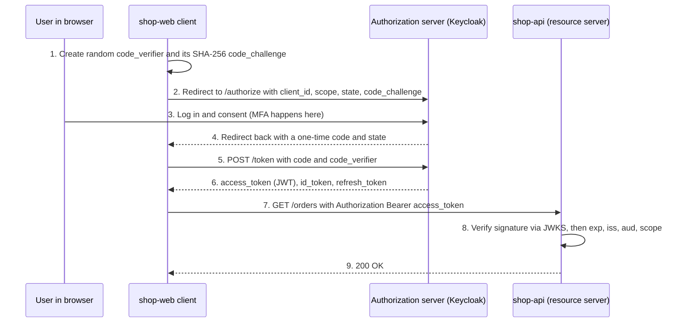
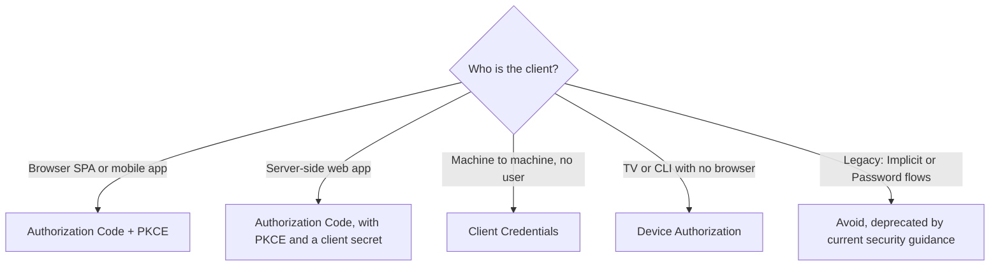

# L11.7 — JWT and OAuth

> **Level 11: Security / DevSecOps** · Topic 7 of 13 · ⏱ ~5 hours · Difficulty: Intermediate

## 1. What it is

**OAuth 2.0** (RFC 6749) is a framework for **delegated authorization**: it lets an application obtain limited access to a
resource on a user's behalf without ever seeing the user's password. "Sign in with GitHub, but only let this app read my
public repos" is OAuth. The parties are the **resource owner** (the user), the **client** (the app), the
**authorization server** (issues tokens) and the **resource server** (the API that accepts them).

**OpenID Connect (OIDC)** is a thin identity layer on top of OAuth 2.0. OAuth alone says "this token may call the API";
OIDC adds an **ID token** that says "the user is Alice, authenticated at this time by this provider". Login with Google,
Microsoft or Okta is OIDC.

A **JWT (JSON Web Token, RFC 7519, pronounced "jot")** is a compact, URL-safe string that carries signed claims. It is
the usual *format* of ID tokens and often of access tokens, but JWT and OAuth are different things: OAuth is a protocol,
JWT is a token format. A JWT has three Base64URL-encoded parts separated by dots:

```text
eyJhbGciOiJIUzI1NiIsInR5cCI6IkpXVCJ9 . eyJzdWIiOiI3Iiwicm9sZSI6ImN1c3RvbWVyIn0 . <signature>
        header (alg, typ)                       payload (claims)                  HMAC or RSA/ECDSA signature
```

Crucially, the first two parts are **encoded, not encrypted**: anyone holding the token can read the claims. The
signature only proves they have not been altered.

## 2. Why it matters in DevOps

- **Every modern platform speaks OIDC.** Kubernetes API authentication, Argo CD, Grafana, GitHub Actions to AWS federation, and cloud SSO all use it.
- **Replacing long-lived keys with OIDC federation** removes the biggest CI/CD secret: GitHub Actions or GitLab CI can assume a cloud role with a short-lived token instead of a stored access key ([Secrets Management](04-secrets-management-and-encryption.md)).
- **JWT mistakes are an outage and a breach waiting to happen:** accepting unsigned tokens, never expiring them, or being unable to revoke one after a compromise.
- **You will be asked to run the identity provider** (Keycloak, Dex, an IdP integration) and debug token errors such as "invalid audience" at 3 a.m.

## 3. Real-world system example

**GitHub Actions OIDC with AWS.** GitHub documents that each workflow run can request a signed OIDC token whose claims
identify the repository, branch/environment and workflow. AWS IAM can be configured with GitHub as an OIDC identity provider and a role
whose trust policy checks the `sub` and `aud` claims. The workflow exchanges the token for temporary AWS credentials
(`aws-actions/configure-aws-credentials` with `role-to-assume`). No AWS access key is stored in GitHub.

**Sign in with Google, Microsoft or Okta** use the Authorization Code flow with OIDC; applications discover endpoints
from the provider's `/.well-known/openid-configuration` document and verify ID tokens against the provider's published
public keys (the JWKS, JSON Web Key Set). **Kubernetes** can validate OIDC ID tokens from such a provider for user login (via flags such as `--oidc-issuer-url`).
**Keycloak** (open source, CNCF project) is a commonly self-hosted identity provider that implements all of this; it is what the lab below uses.

## 4. Diagram

The recommended browser/mobile flow today, **Authorization Code with PKCE (Proof Key for Code Exchange, RFC 7636)**:



Which flow for which client:



## 5. How it works

**OAuth 2.0 flows (grant types)**

| Flow | Use for | Notes |
|------|---------|-------|
| Authorization Code + PKCE | Browser, mobile and server apps with a user | The default today; PKCE stops stolen-code attacks |
| Client Credentials | Service to service, cron jobs | No user; the client authenticates with a secret or signed assertion; scope limits access |
| Device Authorization | CLIs, TVs, IoT | Show a short code; the user approves on another device |
| Refresh Token | Getting new access tokens | Long-lived, high value: store carefully, rotate on use |
| Implicit, Resource Owner Password | Legacy | Removed from the OAuth 2.1 draft and discouraged by the OAuth Security Best Current Practice |

**Tokens**

| Token | Audience | Lifetime | Purpose |
|-------|----------|----------|---------|
| Access token | The resource server (API) | Minutes (5-15 is common) | Authorizes API calls |
| Refresh token | The authorization server | Hours to days | Obtains new access tokens without re-login |
| ID token (OIDC) | The client | Minutes | Tells the client who logged in; never send it to an API as an access token |

**Standard claims to check on every token:** `iss` (issuer, who minted it), `aud` (audience, who it is for), `exp` (expiry), `nbf`/`iat` (validity window),
`sub` (subject, the user or client id), and `scope` or `roles` for permissions.

**Signing algorithms.** `HS256` uses one shared secret (both signer and verifier can mint tokens, so share it only inside one trust boundary).
`RS256`/`ES256` use a private key to sign and a public key to verify, so many APIs can verify tokens without being able to forge them. Prefer asymmetric signing for anything distributed.

**Pitfalls (the exam questions of JWT security)**

| Pitfall | What goes wrong | Fix |
|---------|-----------------|-----|
| `alg: none` | A library trusts the token's own header and skips verification; an attacker forges any claims | Pin the allowed algorithm(s) on the server; reject `none` |
| Algorithm confusion | Token header switched from `RS256` to `HS256`, signed with the public key as the HMAC secret | Allowlist the exact algorithm per key; use libraries that bind keys to algorithms |
| No expiry or very long expiry | A stolen token works for months | Short `exp`; refresh tokens rotated; reject tokens without `exp` |
| No revocation | JWTs are self-contained, so "log out" or "ban user" has no effect until expiry | Short lifetimes, a denylist of token ids (`jti`) in Redis, or token introspection (RFC 7662) for sensitive APIs |
| Missing `aud`/`iss` validation | A token minted for another service is accepted here | Validate both on every request |
| Secrets in the payload | Claims are readable by anyone | Put only what the API needs; never passwords or personal data |
| Weak HMAC secret | Brute-forced offline from one captured token | 256-bit random secret from a secrets manager, or use asymmetric keys |
| Storing tokens in `localStorage` | XSS steals them | Prefer `HttpOnly` cookies handled by a backend-for-frontend (BFF) |
| Skipping the `state` parameter | Login CSRF in the redirect flow | Generate and verify an unguessable `state` per request |
| Open redirect URIs | Authorization codes sent to an attacker | Register exact redirect URIs; no wildcards |

**Opaque vs JWT access tokens.** An opaque token is a random string the resource server validates by calling the authorization server (introspection): revocable instantly, one extra call. A JWT is validated locally
with cached public keys: fast and scalable, but not instantly revocable. Many platforms mix them: JWT with a 5-minute life plus a denylist for emergencies.

## 6. Step-by-step guide

**Prerequisites:** Node.js 20+ (22 recommended), `curl`, `openssl`, and Docker for the Keycloak part. Everything runs on your own machine at no cost.

1. **Decode a JWT yourself, then see why decoding is not verifying.**
   ```bash
   mkdir -p ~/jwt-lab && cd ~/jwt-lab
   cat > jwt.mjs <<'EOF'
   import { createHmac, timingSafeEqual } from 'node:crypto';
   const b64u = (b) => Buffer.from(b).toString('base64url');
   const fromB64u = (s) => Buffer.from(s, 'base64url');
   const SECRET = 'dev-only-secret-change-me';

   export function sign(payload, secret = SECRET) {
     const head = b64u(JSON.stringify({ alg: 'HS256', typ: 'JWT' }));
     const body = b64u(JSON.stringify(payload));
     const sig = createHmac('sha256', secret).update(`${head}.${body}`).digest();
     return `${head}.${body}.${b64u(sig)}`;
   }

   // VULNERABLE: trusts the alg claim in the token itself
   export function verifyBad(token, secret = SECRET) {
     const [h, p, s] = token.split('.');
     const header = JSON.parse(fromB64u(h));
     if (header.alg !== 'none') {
       const expected = createHmac('sha256', secret).update(`${h}.${p}`).digest();
       if (!timingSafeEqual(expected, fromB64u(s))) throw new Error('bad signature');
     }
     return JSON.parse(fromB64u(p));
   }

   // FIXED: server pins the algorithm and checks exp, iss, aud
   export function verifyGood(token, { secret = SECRET, iss, aud } = {}) {
     const parts = token.split('.');
     if (parts.length !== 3) throw new Error('malformed');
     const [h, p, s] = parts;
     if (JSON.parse(fromB64u(h)).alg !== 'HS256') throw new Error('alg not allowed');
     const expected = createHmac('sha256', secret).update(`${h}.${p}`).digest();
     const given = fromB64u(s);
     if (given.length !== expected.length || !timingSafeEqual(expected, given)) throw new Error('bad signature');
     const claims = JSON.parse(fromB64u(p));
     const now = Math.floor(Date.now() / 1000);
     if (typeof claims.exp !== 'number' || claims.exp < now) throw new Error('expired');
     if (iss && claims.iss !== iss) throw new Error('wrong issuer');
     if (aud && claims.aud !== aud) throw new Error('wrong audience');
     return claims;
   }

   const now = Math.floor(Date.now() / 1000);
   const token = sign({ sub: '7', role: 'customer', iss: 'https://auth.example.com', aud: 'shop-api', iat: now, exp: now + 900 });
   console.log('decoded payload:', JSON.parse(fromB64u(token.split('.')[1])));

   const forged = `${b64u(JSON.stringify({ alg: 'none', typ: 'JWT' }))}.${b64u(JSON.stringify({ sub: '1', role: 'admin', exp: now + 900 }))}.`;
   console.log('bad verifier accepts forged alg=none:', verifyBad(forged));
   try { verifyGood(forged, { iss: 'https://auth.example.com', aud: 'shop-api' }); } catch (e) { console.log('good verifier rejects:', e.message); }
   console.log('good verifier accepts real token, sub =', verifyGood(token, { iss: 'https://auth.example.com', aud: 'shop-api' }).sub);
   EOF
   node jwt.mjs
   ```
   Expected output (timestamps differ): the decoded payload with `sub`, `role`, `iss`, `aud`, `iat`, `exp`; then
   `bad verifier accepts forged alg=none: { sub: '1', role: 'admin', ... }`; then `good verifier rejects: alg not allowed`; then `... sub = 7`.
   You just forged an admin token against a flawed verifier, in a harmless local script, and proved the fix works. In real code use a maintained library (such as `jose`) and always pass the allowed algorithms explicitly.

2. **Create a PKCE verifier and challenge** (what a client does before redirecting).
   ```bash
   VERIFIER=$(openssl rand -base64 48 | tr -d '=+/\n' | cut -c1-64)
   CHALLENGE=$(printf %s "$VERIFIER" | openssl dgst -sha256 -binary | openssl base64 -A | tr '+/' '-_' | tr -d '=')
   echo "verifier:  $VERIFIER"; echo "challenge: $CHALLENGE"
   ```
   The challenge is 43 characters. Only the hash travels in the browser redirect; the verifier is sent later over the back channel, so a stolen code is useless without it.

3. **Run Keycloak locally as an identity provider.**
   ```bash
   docker run -d --name keycloak -p 127.0.0.1:8080:8080 \
     -e KC_BOOTSTRAP_ADMIN_USERNAME=admin -e KC_BOOTSTRAP_ADMIN_PASSWORD=admin \
     quay.io/keycloak/keycloak:latest start-dev
   ```
   Wait about a minute (`docker logs -f keycloak` until it says it is listening), then open http://127.0.0.1:8080, sign in as `admin`/`admin` (lab only), create a realm named `shop`.
   In `shop`: create a user `alice` with a password (turn off "temporary"), then create a client `shop-api-m2m` with *Client authentication* on and *Service accounts roles* enabled (this is the Client Credentials grant), and copy its secret from the *Credentials* tab.

4. **Read the OIDC discovery document and get a machine token.**
   ```bash
   curl -s http://127.0.0.1:8080/realms/shop/.well-known/openid-configuration | jq '{issuer, authorization_endpoint, token_endpoint, jwks_uri}'
   TOKEN=$(curl -s http://127.0.0.1:8080/realms/shop/protocol/openid-connect/token \
     -d grant_type=client_credentials -d client_id=shop-api-m2m -d client_secret='<CLIENT_SECRET>' | jq -r .access_token)
   echo "$TOKEN" | cut -d. -f2 | tr '_-' '/+' | base64 -d 2>/dev/null | jq '{iss, aud, exp, azp, scope}'
   ```
   Expect the issuer `http://127.0.0.1:8080/realms/shop`, an `exp` a few minutes ahead, and the client id in `azp`. (Padding warnings from `base64 -d` can be ignored.) Fetch the signing keys with `curl -s <jwks_uri> | jq '.keys[].kid'`.

5. **Verify the token the way `shop-api` should**, using the `jose` library which caches keys from the JWKS endpoint:
   ```bash
   npm init -y >/dev/null && npm install jose
   cat > verify.mjs <<'EOF'
   import { createRemoteJWKSet, jwtVerify } from 'jose';
   const jwks = createRemoteJWKSet(new URL('http://127.0.0.1:8080/realms/shop/protocol/openid-connect/certs'));
   const { payload } = await jwtVerify(process.env.TOKEN, jwks, {
     issuer: 'http://127.0.0.1:8080/realms/shop',
     algorithms: ['RS256'],            // pin the algorithm
     // audience: 'shop-api',          // add once you configure an audience mapper for the client
   });
   console.log('valid token for', payload.azp, 'expires', new Date(payload.exp * 1000).toISOString());
   EOF
   TOKEN="$TOKEN" node verify.mjs
   ```
   Change one character of the token and re-run: `jwtVerify` should throw a signature error.

6. **Observe revocation limits.** In Keycloak's admin console, log the user out or disable the client; the already-issued access token still verifies until `exp`. That is the cost of local JWT validation, and why access tokens are short-lived.

7. **Clean up.**
   ```bash
   docker rm -f keycloak; rm -rf ~/jwt-lab
   ```

## 7. Real-world scenario

*Illustrative, not a documented incident.* The `shop-api` team issues HS256 JWTs signed with the secret `shopsecret`
and a 30-day expiry because "mobile users hate logging in". A penetration tester captures one token from their own
account, runs an offline dictionary attack against the signature and recovers the secret in seconds, then mints a token with
`"role":"admin"`. The team rotates the secret, and every user is logged out because tokens cannot be selectively revoked.

The redesign: move login to Keycloak (OIDC), use asymmetric RS256 tokens with a 10-minute lifetime, store refresh tokens
in `HttpOnly` cookies handled by a backend-for-frontend, rotate refresh tokens on every use, validate `iss`, `aud` and `exp` in
`shop-api`, and keep a Redis denylist of `jti` values for emergency revocation.

**Lesson:** a JWT is only as strong as its key, its expiry and the verifier that checks it; and you must decide how you will revoke access before the day you need to.

## 8. Common mistakes and best practices

**Don't**

- Accept tokens without pinning the algorithm, or decode a JWT and trust it without verifying the signature.
- Put sensitive data in the payload, thinking Base64 hides it.
- Use the Implicit or Password flows for new apps, or register wildcard redirect URIs.
- Use one long-lived JWT as a session for months.
- Confuse ID tokens with access tokens, or send the ID token to APIs.
- Roll your own OAuth server or JWT library.

**Do**

- Use Authorization Code + PKCE for users, Client Credentials for services, and OIDC federation instead of stored cloud keys in CI.
- Verify signature, algorithm, `iss`, `aud`, `exp` (and `nbf`) on every request, with keys fetched from the JWKS endpoint and cached.
- Keep access tokens short-lived and rotate refresh tokens; plan revocation (denylist or introspection).
- Request the minimum scopes; check scopes or roles in the API, in addition to the token's validity ([Authentication and Authorization](06-authentication-and-authorization.md)).
- Keep signing keys in a secrets manager or KMS and rotate them; publish rotation through the JWKS `kid`.
- Log token validation failures and alert on spikes ([API Security](08-api-security.md)).

## 9. Tasks

- [ ] **T1 — Decode a token by hand** *(≈20 min, beginner)*
  - **Goal:** see exactly what a JWT contains.
  - **Steps:**
    1. Run step 1 and print the token's three parts.
    2. Decode header and payload using `base64 -d` or `node -e`.
    3. Explain what the signature proves and what it does not.
  - **Done when:** you can read every claim and explain why the payload is not secret.

- [ ] **T2 — Forge a token against a flawed verifier** *(≈30 min, intermediate)*
  - **Goal:** understand `alg: none` and why pinning matters.
  - **Steps:**
    1. Reproduce the forged-admin result with `verifyBad`.
    2. Add a second attack: take a valid token, change `role` to `admin` and keep the old signature. Show both verifiers reject it.
    3. Add a test file with all three cases using `node:test`.
  - **Done when:** the test suite proves `verifyBad` accepts `alg: none`, and `verifyGood` rejects all forgeries.

- [ ] **T3 — Stand up an OIDC provider and get tokens** *(≈60 min, intermediate)*
  - **Goal:** operate a real identity provider locally.
  - **Steps:**
    1. Follow steps 3-4 to get a Client Credentials token.
    2. Create a public client `shop-web` (no client authentication) with PKCE `S256` and redirect URI `http://127.0.0.1:3000/callback`.
    3. In a browser, build the `/authorize` URL by hand with a `code_challenge`, log in as `alice` and read the `code` from the redirect.
  - **Done when:** you exchange the code plus `code_verifier` at the token endpoint for an `id_token` whose `preferred_username` is `alice`, and a wrong verifier is rejected.

- [ ] **T4 — Add JWT verification to shop-api** *(≈60 min, advanced)*
  - **Goal:** protect a route with real token validation.
  - **Steps:**
    1. Add `jose` middleware as in step 5 to an Express route.
    2. Require a role or scope for `POST /orders`.
    3. Return 401 for invalid tokens and 403 for valid tokens lacking the scope.
  - **Done when:** `curl` shows 401 with no/garbled token, 403 with an under-privileged token, and 200 with a permitted token.

- [ ] **T5 — Break revocation, then mitigate it** *(≈45 min, advanced)*
  - **Goal:** feel the revocation gap and close it.
  - **Steps:**
    1. Show that a disabled Keycloak user's token still passes verification until expiry.
    2. Shorten the access-token lifetime to 2 minutes in the realm settings and re-test.
    3. Add a Redis denylist keyed by `jti` and check it after signature verification.
  - **Done when:** a denylisted token returns 401 immediately, while other tokens still work.

- [ ] **T6 — Prove it: choose the flow** *(≈30 min, advanced)*
  - **Goal:** pick and defend the right design.
  - **Steps:**
    1. Without notes, choose flow, token lifetime, storage location and revocation approach for four clients: a React SPA, an iOS app, a nightly batch job, and a GitHub Actions deploy to AWS.
    2. Write one sentence per choice explaining the threat it addresses.
  - **Done when:** the four designs avoid deprecated flows and stored long-lived secrets, and a reviewer cannot find a missing validation step.

## 10. Self-check questions

1. What is the difference between OAuth 2.0 and OIDC?
2. Why does a JWT signature not make its contents confidential?
3. What does PKCE protect against?
4. Name three JWT validation checks beyond the signature.
5. How do you "log out" a user holding a valid stateless JWT?

<details>
<summary>Answers</summary>

1. OAuth 2.0 delegates authorization (access tokens for APIs). OIDC adds authentication and identity (the ID token, standard claims, discovery and the UserInfo endpoint) on top.
2. A signature gives integrity, not secrecy. The payload is only Base64URL-encoded; use JWE (encrypted tokens) or keep sensitive data out.
3. An attacker who intercepts the authorization code (for example via a malicious app or a redirect) cannot redeem it without the secret code verifier that only the legitimate client holds.
4. Algorithm (pinned), `exp`/`nbf`, `iss`, `aud`, and scopes or roles for the requested action.
5. You cannot with the token alone: keep lifetimes short, revoke refresh tokens at the authorization server, and for emergencies deny-list the `jti` or use introspection for sensitive routes.
</details>

## 11. Further reading

- RFC 6749 (OAuth 2.0), RFC 7636 (PKCE), RFC 7519 (JWT), RFC 8725 (JWT Best Current Practices) and the OAuth 2.0 Security Best Current Practice document from the IETF OAuth working group.
- OpenID Connect Core 1.0 specification (openid.net).
- Keycloak documentation (keycloak.org) and the `jose` library documentation.
- GitHub Docs: *About security hardening with OpenID Connect*; OWASP Cheat Sheets for *JSON Web Token* and *OAuth 2.0*.

<!-- nav -->
---
← Previous: [Authentication and Authorization](06-authentication-and-authorization.md) · [Level 11 index](README.md) · Next: [API Security](08-api-security.md) →
