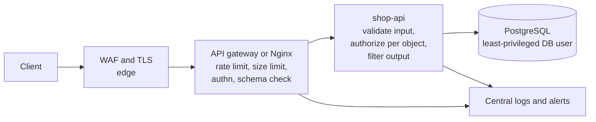
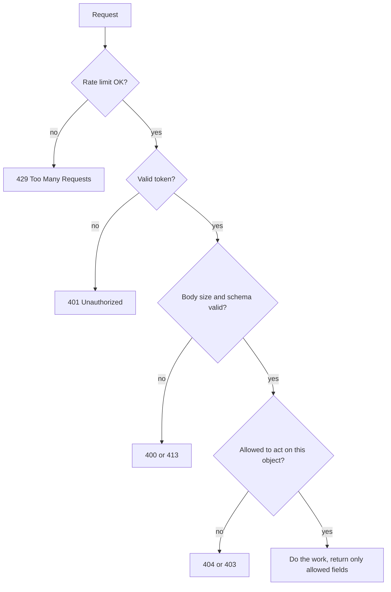

# L11.8 — API Security

> **Level 11: Security / DevSecOps** · Topic 8 of 13 · ⏱ ~5 hours · Difficulty: Intermediate

## 1. What it is

An **API (Application Programming Interface)** is the front door that mobile apps, web front ends, partners and other
services use to read and change your data. Unlike a web page, an API exposes **raw objects and actions** (`/orders/1042`,
`DELETE /users/7`) and is called by programs that can send millions of precisely crafted requests. **API security** is
the set of controls that make every one of those calls safe:

- **Authentication and authorization on every route**, down to the individual object and field.
- **Input validation:** reject anything that is not exactly what the endpoint expects.
- **Rate limiting and quotas:** bound how much any single client can consume.
- **Output control:** return only the fields the caller should see.
- **Gateway and edge controls:** TLS, WAF (Web Application Firewall), schema enforcement, logging and inventory.

The community reference list is the **OWASP API Security Top 10** (2023 edition), which complements the web
[OWASP Top 10](05-owasp-top-10.md) because APIs fail in different, mostly authorization-shaped, ways.

## 2. Why it matters in DevOps

- **APIs are the product's attack surface.** Everything in the sample stack (`shop-api` behind Nginx) is an API; there is no UI to hide behind.
- **Automation turns small flaws into big ones.** A missing ownership check on one endpoint becomes a full-database scrape with a 10-line loop.
- **Shadow and zombie APIs are an ops problem.** Old `/v1` routes, forgotten debug endpoints and undocumented partner routes survive because nobody owns the inventory.
- **Abuse is also a reliability issue.** Without rate limits, a buggy client or a scraper takes the service down; security and SRE controls overlap ([rate limiting](../level-12-advanced-networking/13-rate-limiting.md)).

## 3. Real-world system example

**Public API providers show the controls in practice.** **GitHub's REST API** documents rate limits (a low limit for
unauthenticated requests and a higher one for authenticated ones) and returns `X-RateLimit-Limit`, `X-RateLimit-Remaining` and
`X-RateLimit-Reset` headers; exceeding the limit returns an error and the client must back off. **Stripe's API** is documented to
use **restricted API keys** (a key limited to specific resources and permissions), **idempotency keys** so retried requests do not double-charge, and
versioned APIs so old behaviour is kept stable deliberately rather than by accident.

**API gateways** put these controls in one enforced place: **AWS API Gateway** offers throttling, usage plans with API keys,
request validation against a schema, and Lambda or Cognito/JWT authorizers; **Kong**, **NGINX** and **Envoy**-based gateways provide
rate limiting, authentication plugins and request transformation. The gateway is not a substitute for authorization in the service,
since only the service knows who owns object 1042, but it removes whole classes of abuse before traffic reaches the application.

## 4. Diagram

Layers of defence for a request to `shop-api`:



Request handling order inside the service (cheapest, safest checks first):



## 5. How it works

**OWASP API Security Top 10 (2023)**

| ID | Risk | Typical example | Primary control |
|----|------|-----------------|-----------------|
| API1 | Broken Object Level Authorization (BOLA) | `GET /orders/1042` returns someone else's order | Ownership check on every object access |
| API2 | Broken Authentication | Weak tokens, no lockout, JWT `alg: none` | Standard auth (OIDC), short tokens ([JWT and OAuth](07-jwt-and-oauth.md)) |
| API3 | Broken Object Property Level Authorization | Response leaks `internalNote`; request sets `isAdmin` (mass assignment) | Allowlist fields in and out |
| API4 | Unrestricted Resource Consumption | No rate limit, huge pages, expensive queries | Rate limits, quotas, pagination caps, timeouts |
| API5 | Broken Function Level Authorization | A normal user calls `DELETE /admin/orders/1` | Role check per route, deny by default |
| API6 | Unrestricted Access to Sensitive Business Flows | Bots buy out stock, abuse promo codes | Flow-specific limits, bot detection, device checks |
| API7 | Server-Side Request Forgery | `POST /webhooks` with `url=http://169.254.169.254/` | Destination allowlists, block private ranges |
| API8 | Security Misconfiguration | CORS `*`, verbose errors, missing TLS | Hardened baseline, config scanning |
| API9 | Improper Inventory Management | Forgotten `/v1`, staging API open to the internet | API catalogue, retire old versions, scan for drift |
| API10 | Unsafe Consumption of APIs | Trusting a third-party API's response blindly | Validate upstream data, timeouts, TLS verification |

**Rate limiting algorithms**

| Algorithm | How it works | Good for |
|-----------|-------------|----------|
| Fixed window | N requests per clock window | Simple; allows bursts at window edges |
| Sliding window | Rolling count over the last interval | Smoother fairness |
| Token bucket | Bucket refills at a steady rate; each request spends a token; bursts allowed up to capacity | Most APIs (the Nginx and the lab implementation) |
| Leaky bucket | Requests drain at a constant rate | Smoothing traffic to a fragile backend |

Choose the limit *key* deliberately: per IP is easy but penalises shared NATs; per API key or user is fairer; use stricter limits on login, password reset and other sensitive routes.
Return `429 Too Many Requests` with a `Retry-After` header.

**Input validation principles:** validate on the server against a schema (JSON Schema, Zod, Joi, OpenAPI), allowlist rather than blocklist,
check type, length, range and format, cap request body size, reject unknown fields, and canonicalise before validating.
Validation is *in addition to* parameterised queries and output encoding, not instead of them.

**Other essentials:** use HTTPS only; set explicit CORS origins; return generic errors; paginate with a maximum page size; set request timeouts and
payload limits; version your API and retire old versions; never put secrets or tokens in URLs (they end up in logs); write an access log line with
user, route, status and request id for every call ([correlation IDs](../level-10-observability/07-correlation-ids.md)).

## 6. Step-by-step guide

**Prerequisites:** Node.js 20+ (22 recommended) and `curl`. The lab server has no dependencies and listens only on `127.0.0.1`.
You will attack your own local process, nothing else.

1. **Create a small API with the controls built in.**
   ```bash
   mkdir -p ~/api-lab && cd ~/api-lab
   cat > api.mjs <<'EOF'
   import http from 'node:http';

   const USERS = { 'token-alice': { id: 7, role: 'customer' }, 'token-bob': { id: 9, role: 'customer' } };
   const ORDERS = { 1042: { id: 1042, ownerId: 9, total: 42.5, internalNote: 'fraud-review' } };

   // token bucket: burst of 5, refill 1 per second, per client IP
   const buckets = new Map();
   function allow(key, capacity = 5, refillPerSec = 1) {
     const now = Date.now() / 1000;
     const b = buckets.get(key) ?? { tokens: capacity, last: now };
     b.tokens = Math.min(capacity, b.tokens + (now - b.last) * refillPerSec);
     b.last = now;
     const ok = b.tokens >= 1;
     if (ok) b.tokens -= 1;
     buckets.set(key, b);
     return ok;
   }

   const send = (res, code, body) => {
     res.writeHead(code, { 'content-type': 'application/json' });
     res.end(JSON.stringify(body));
   };

   const readJson = (req) => new Promise((resolve, reject) => {
     let size = 0; const chunks = [];
     req.on('data', (c) => { size += c.length; if (size > 10_000) { reject(new Error('too_large')); req.destroy(); } else chunks.push(c); });
     req.on('end', () => { try { resolve(JSON.parse(Buffer.concat(chunks).toString() || '{}')); } catch { reject(new Error('bad_json')); } });
   });

   function validateOrder(b) {
     const allowed = new Set(['sku', 'qty']);
     if (Object.keys(b).some((k) => !allowed.has(k))) return 'unexpected field';   // blocks mass assignment
     if (typeof b.sku !== 'string' || !/^[A-Z0-9-]{3,20}$/.test(b.sku)) return 'sku invalid';
     if (!Number.isInteger(b.qty) || b.qty < 1 || b.qty > 10) return 'qty must be 1..10';
     return null;
   }

   http.createServer(async (req, res) => {
     if (!allow(req.socket.remoteAddress)) { res.setHeader('retry-after', '1'); return send(res, 429, { error: 'rate_limited' }); }

     const url = new URL(req.url, 'http://x');
     if (req.method === 'GET' && url.pathname === '/health') return send(res, 200, { ok: true });

     const user = USERS[(req.headers.authorization ?? '').replace('Bearer ', '')];
     if (!user) return send(res, 401, { error: 'unauthenticated' });

     const m = url.pathname.match(/^\/orders\/(\d+)$/);
     if (req.method === 'GET' && m) {
       const order = ORDERS[m[1]];
       if (!order || order.ownerId !== user.id) return send(res, 404, { error: 'not_found' });   // BOLA check
       const { internalNote, ownerId, ...publicView } = order;                                   // output allowlist
       return send(res, 200, publicView);
     }
     if (req.method === 'POST' && url.pathname === '/orders') {
       let body;
       try { body = await readJson(req); } catch (e) { return send(res, e.message === 'too_large' ? 413 : 400, { error: e.message }); }
       const problem = validateOrder(body);
       if (problem) return send(res, 400, { error: problem });
       return send(res, 201, { id: 1043, sku: body.sku, qty: body.qty });
     }
     send(res, 404, { error: 'not_found' });
   }).listen(8081, '127.0.0.1', () => console.log('listening on 127.0.0.1:8081'));
   EOF
   node api.mjs &
   ```
   Expect `listening on 127.0.0.1:8081`. The tokens are fake lab values; real APIs verify JWTs ([L11.7](07-jwt-and-oauth.md)).

2. **Authentication and BOLA.**
   ```bash
   curl -s -w " -> %{http_code}\n" http://127.0.0.1:8081/orders/1042
   curl -s -w " -> %{http_code}\n" -H "Authorization: Bearer token-alice" http://127.0.0.1:8081/orders/1042
   curl -s -w " -> %{http_code}\n" -H "Authorization: Bearer token-bob"   http://127.0.0.1:8081/orders/1042
   ```
   Expected: `{"error":"unauthenticated"} -> 401`, then `{"error":"not_found"} -> 404` for Alice (Bob's order), then `{"id":1042,"total":42.5} -> 200` for Bob.
   `internalNote` and `ownerId` never leave the server.

3. **Input validation and mass assignment.**
   ```bash
   curl -s -w " -> %{http_code}\n" -H "Authorization: Bearer token-alice" -d '{"sku":"MUG-1","qty":999}' http://127.0.0.1:8081/orders
   curl -s -w " -> %{http_code}\n" -H "Authorization: Bearer token-alice" -d '{"sku":"MUG-1","qty":1,"price":0}' http://127.0.0.1:8081/orders
   curl -s -w " -> %{http_code}\n" -H "Authorization: Bearer token-alice" -d '{"sku":"MUG-1","qty":2}' http://127.0.0.1:8081/orders
   ```
   Expected: `qty must be 1..10 -> 400`, `unexpected field -> 400` (the attacker tried to set `price`), then `201`.

4. **Rate limiting.** Wait 6 seconds for the bucket to refill, then hammer a cheap endpoint:
   ```bash
   sleep 6; for i in $(seq 1 8); do curl -s -o /dev/null -w "%{http_code} " http://127.0.0.1:8081/health; done; echo
   ```
   Expected: `200 200 200 200 200 429 429 429` (burst of 5, then refusals; exact count may vary by a request if your machine is slow).

5. **Put the same limits at the edge with Nginx** (what you would deploy in front of `shop-api`):
   ```nginx
   # in http { }
   limit_req_zone $binary_remote_addr zone=api:10m rate=10r/s;
   limit_req_zone $binary_remote_addr zone=login:10m rate=5r/m;
   client_max_body_size 1m;

   server {
       listen 443 ssl;
       server_name api.example.com;

       location /login {
           limit_req zone=login burst=5 nodelay;
           limit_req_status 429;
           proxy_pass http://shop_api;
       }
       location / {
           limit_req zone=api burst=20 nodelay;
           limit_req_status 429;
           proxy_pass http://shop_api;
       }
   }
   ```
   Validate syntax with `nginx -t`. Put a schema check in the gateway too if it supports one (AWS API Gateway request validators, Kong plugins).

6. **Scan the API contract for drift.** Write a minimal OpenAPI file for the routes above, list *every* route the server exposes, and diff them. Anything the server serves that the spec does not mention is API9 (inventory) debt.

7. **Clean up.**
   ```bash
   kill %1 2>/dev/null; cd ~ && rm -rf ~/api-lab
   ```

## 7. Real-world scenario

*Illustrative, not a documented incident.* A mobile app for a retailer calls `GET /api/users/{id}/addresses`. A security
researcher notices the id is sequential and loops from 1 to 500000. The API authenticates the request but never checks that
`{id}` equals the token's user, which is BOLA, so the loop retrieves 400,000 names and addresses overnight. There is no rate limit
and the logs do not distinguish 200s for your own id from 200s for others, so the first sign is the researcher's email.

The fix is layered: the service derives the user from the token and ignores the path id (or compares them); non-guessable ids; a per-user
rate limit and a per-IP limit at the gateway; an alert when one token requests many distinct user ids; and a unit test asserting a cross-user
request returns 404. The team also lists every route in an API catalogue to find forgotten ones.

**Lesson:** authentication answers "who is calling", and BOLA is about "may they touch *this* object". Rate limiting would not have prevented the bug but
would have turned a full scrape into a slow, noisy, detectable one.

## 8. Common mistakes and best practices

**Don't**

- Rely on "the front end hides that button" or on unguessable ids as your access control.
- Return whole database rows and let the client pick fields; bind request bodies straight into models (mass assignment).
- Leave `/v1`, `/debug`, `/swagger` and staging APIs reachable without owners or authentication.
- Put tokens or API keys in query strings, or log request bodies containing secrets.
- Use `CORS: *` with credentials, or return stack traces.
- Trust data from third-party APIs or webhooks without validation and signature checks.

**Do**

- Enforce authentication and per-object, per-function authorization on every route, in a shared middleware with a test that fails when a route lacks a policy.
- Validate with schemas, reject unknown fields, cap body size, page size and query cost, and set timeouts.
- Rate limit globally and tighten it for login, password reset, search, and any expensive or business-critical flow; return `429` and `Retry-After`.
- Keep an inventory of APIs and versions; retire old versions on a schedule; scan for undocumented routes.
- Terminate TLS at the gateway, use short-lived tokens and scoped keys, and log user, route, status and request id for every call.
- Verify webhook signatures (HMAC) and apply SSRF protections to any feature that fetches URLs.

## 9. Tasks

- [ ] **T1 — Run the hardened API and prove each control** *(≈30 min, beginner)*
  - **Goal:** see 401, 404, 400, 413 and 429 produced by distinct controls.
  - **Steps:**
    1. Run the lab server and the commands in steps 2-4.
    2. Add a request over 10,000 bytes (`head -c 20000 /dev/zero | tr '\0' a`) in a JSON string and observe the 413.
    3. Record which line of code produced each status.
  - **Done when:** you have a table of status code to control to line number for five statuses.

- [ ] **T2 — Add a vulnerable endpoint, then exploit it** *(≈45 min, intermediate)*
  - **Goal:** understand BOLA and mass assignment by causing them.
  - **Steps:**
    1. Add `GET /vulnerable/orders/:id` with no ownership check and `PATCH /vulnerable/users/me` that merges the entire body into the user object.
    2. Use `curl` as Alice to read Bob's order and to set `"role":"admin"` on herself.
    3. Fix both with an ownership check and a field allowlist.
  - **Done when:** both exploits work on the vulnerable routes and return 404/400 on the fixed ones.

- [ ] **T3 — Add per-user and per-route limits** *(≈45 min, intermediate)*
  - **Goal:** make rate limiting fit the endpoint.
  - **Steps:**
    1. Key the bucket by authenticated user (falling back to IP) instead of IP only.
    2. Give `POST /orders` a stricter bucket (for example 2 burst, 1 per 10 seconds) than `GET`.
    3. Add `X-RateLimit-Remaining` to responses.
  - **Done when:** Alice being limited does not limit Bob, and the stricter route returns 429 first.

- [ ] **T4 — Rate limit at Nginx** *(≈45 min, intermediate)*
  - **Goal:** enforce limits at the edge.
  - **Steps:**
    1. Run Nginx in Docker with the config from step 5 pointing at the lab API (use `host.docker.internal` or a Docker network).
    2. Fire 50 parallel requests with `xargs -P 20` or `hey`/`ab` against your own local port.
    3. Count 200s versus 429s in the Nginx access log.
  - **Done when:** the log shows 429 responses served by Nginx and the Node process received far fewer requests than you sent.

- [ ] **T5 — Write the OpenAPI contract and check inventory** *(≈45 min, advanced)*
  - **Goal:** find undocumented routes.
  - **Steps:**
    1. Write an OpenAPI 3 document for the lab API with request schemas for `POST /orders`.
    2. Validate requests against the schema in middleware (or a gateway).
    3. Add a test that lists the server's routes and fails if one is not in the spec.
  - **Done when:** adding an undocumented route makes the test fail.

- [ ] **T6 — Prove it: threat-model an API** *(≈45 min, advanced)*
  - **Goal:** apply the API Top 10 to a new design.
  - **Steps:**
    1. Without notes, pick `shop-api`'s five most important endpoints and for each write which API1-API10 risks apply and the specific control.
    2. Identify which controls belong at the gateway and which only the service can enforce.
  - **Done when:** every endpoint has at least two named risks with a control, and BOLA/BFLA controls are placed in the service.

## 10. Self-check questions

1. What is BOLA and why does authentication not prevent it?
2. Why return 404 rather than 403 for another user's object?
3. What is mass assignment, and what is the fix?
4. How does a token bucket allow bursts yet cap the average rate?
5. What can an API gateway do for security, and what must the service still do itself?

<details>
<summary>Answers</summary>

1. Broken Object Level Authorization: the caller is authenticated but can access objects belonging to others by changing an id. Authentication only identifies the caller; the service must check access to each object.
2. 404 does not confirm that the object exists, avoiding enumeration of valid ids (403 is acceptable when existence is not sensitive).
3. Binding client-supplied fields directly onto internal models lets attackers set fields like `role` or `price`. Use explicit allowlists of accepted fields.
4. Tokens accumulate up to the bucket capacity, so a client can burst up to that size, but tokens refill only at the steady rate, so the long-run average cannot exceed it.
5. It can terminate TLS, authenticate tokens, rate limit, validate schemas, size-limit and log. Only the service knows object ownership and business rules, so object- and function-level authorization stays in the service.
</details>

## 11. Further reading

- OWASP API Security Project: *API Security Top 10 (2023)*, and the OWASP Cheat Sheets for *REST Security*, *Input Validation* and *Mass Assignment*.
- Documentation for your gateway of choice: Kong, AWS API Gateway, or NGINX rate limiting (`ngx_http_limit_req_module`).
- OpenAPI Specification (openapis.org) and JSON Schema.
- *Hacking APIs* by Corey J. Ball (No Starch Press) for the attacker's view, to be practised only on your own labs.

<!-- nav -->
---
← Previous: [JWT and OAuth](07-jwt-and-oauth.md) · [Level 11 index](README.md) · Next: [Container Image Scanning (Trivy)](09-container-image-scanning.md) →
