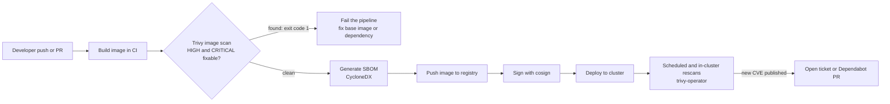
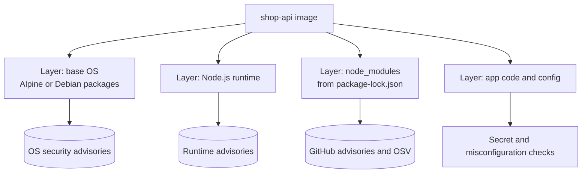

# L11.9 — Container Image Scanning (Trivy)

> **Level 11: Security / DevSecOps** · Topic 9 of 13 · ⏱ ~5 hours · Difficulty: Intermediate

## 1. What it is

A container image is a stack of layers containing an operating system's packages (Alpine `apk`, Debian `dpkg`), your language
dependencies (`node_modules`) and your own code. **Image scanning** inspects those layers, builds a list of every installed
package and version, and compares it against databases of known vulnerabilities (**CVEs**, Common Vulnerabilities and
Exposures, each with a **CVSS** severity score and a rating of LOW, MEDIUM, HIGH or CRITICAL).

**Trivy** (from Aqua Security, open source) is a popular all-in-one scanner. One binary scans:

- container images and image tarballs (OS packages and language dependencies),
- filesystems and Git repositories (lockfiles such as `package-lock.json`),
- infrastructure-as-code (`trivy config`: Dockerfiles, Terraform, Kubernetes manifests, Helm),
- secrets accidentally baked into files,
- and it can generate an **SBOM (Software Bill of Materials)**, a machine-readable inventory of everything inside the image
  (formats: **CycloneDX** and **SPDX**).

A scanner finds only *known* problems in *known* components. It is a smoke detector, not a guarantee.

## 2. Why it matters in DevOps

- **Images age like milk.** The image you built and verified in March contains packages that get new CVEs every week; "it passed
  last time" says little about today. Scanning must run on every build and on a schedule against what is already deployed.
- **Base images carry most of the risk.** A full `node:22` Debian image has hundreds of packages your app never uses; each is attack surface and scanner noise ([minimal base images](../level-04-docker/13-minimal-base-images.md), [multi-stage builds](../level-04-docker/10-multi-stage-builds.md)).
- **SBOMs answer "are we affected?" in minutes.** When Log4Shell (CVE-2021-44228, December 2021) landed, organisations with an inventory of what ran where could query it; those without searched repositories by hand.
- **Gates make security a pipeline property**, not a quarterly audit: a pull request that introduces a CRITICAL fixable vulnerability fails like a failing unit test ([CI/CD](../level-00-what-devops-is/02-ci-cd.md)).

## 3. Real-world system example

**Harbor**, the CNCF-graduated container registry, integrates Trivy as its default built-in vulnerability scanner: images pushed
to a project are scanned, and a project policy can block pulls of images above a chosen severity. **GitLab's Container Scanning**
feature uses Trivy as its underlying analyzer in recent versions, and Trivy has an official **GitHub Action** and a **Kubernetes
operator** (`trivy-operator`) that continuously scans workloads in a cluster and publishes `VulnerabilityReport` resources. Cloud
registries offer similar features natively (Amazon ECR scanning, Google Artifact Registry scanning, Azure Defender).

The pattern is the same everywhere: scan at **build time** (fail fast in CI), at **registry push/admission time** (stop bad images
reaching the cluster) and **continuously at runtime** (new CVEs are published about images you shipped last month).
Image *signing* (Sigstore cosign) then proves that the scanned image is the one that is deployed.

## 4. Diagram



Where the findings come from:



## 5. How it works

Trivy downloads a vulnerability database (refreshed several times a day) and a bundle of misconfiguration checks, extracts the image's layers, identifies the
OS (from `/etc/os-release`) and packages, reads lockfiles and language manifests, then matches versions against advisories.

**Key commands**

| Command | Purpose |
|---------|---------|
| `trivy image <ref>` | Scan an image from a registry or the local Docker daemon |
| `trivy image --input app.tar` | Scan a tarball produced by `docker save` (no daemon needed) |
| `trivy fs .` | Scan the project directory (lockfiles, secrets, config) |
| `trivy config .` | Scan Dockerfiles, Terraform, Kubernetes YAML for misconfigurations |
| `trivy image --format cyclonedx -o sbom.cdx.json <ref>` | Produce an SBOM |
| `trivy sbom sbom.cdx.json` | Scan an existing SBOM later, without the image |

**Useful flags**

| Flag | Meaning |
|------|---------|
| `--severity HIGH,CRITICAL` | Only report these severities |
| `--exit-code 1` | Exit non-zero when anything matching is found (this is the CI gate) |
| `--ignore-unfixed` | Skip vulnerabilities with no available fix (you cannot act on them yet) |
| `--format table\|json\|sarif\|cyclonedx\|spdx-json` | Output format (SARIF uploads to GitHub code scanning) |
| `--scanners vuln,secret,misconfig` | Choose scanners |
| `--ignorefile .trivyignore` | Suppress accepted findings (always with a reason and a review date) |

**Gate design.** A good gate is strict where it is actionable and loose where it is not:

| Situation | Policy |
|-----------|--------|
| New CRITICAL or HIGH with a fix available | Block the merge |
| Vulnerability with no fix | Report, do not block; track with an owner and a date |
| Accepted risk (not reachable, mitigated) | Suppress in an ignore file with a justification and an expiry, reviewed in PR |
| Scheduled scan finds a new CVE in a deployed image | Open an issue automatically; rebuild and redeploy |

**Reducing findings at the source:** use a smaller base (`alpine`, Debian slim, or distroless: see [Rootless and Minimal Containers](12-rootless-and-minimal-containers.md)),
a multi-stage build that leaves compilers out of the runtime image, `npm ci --omit=dev`, and a rebuild-on-base-update habit.
A scanner is not a substitute for patching: the fix is almost always "rebuild with a newer base image or dependency version".

## 6. Step-by-step guide

**Prerequisites:** Docker (a free local sandbox). Trivy runs as a container, so no install is needed. The first run downloads the
vulnerability database (tens to a few hundred MB, cached afterwards). Output below is *similar to* what you will see; package names and counts change daily.

1. **Create the `shop-api` sample and two Dockerfiles** (one deliberately poor, one improved).
   ```bash
   mkdir -p ~/trivy-lab && cd ~/trivy-lab
   cat > package.json <<'EOF'
   { "name": "shop-api", "version": "1.0.0", "main": "server.js",
     "dependencies": { "express": "4.17.1", "lodash": "4.17.15" } }
   EOF
   cat > server.js <<'EOF'
   const express = require('express');
   const app = express();
   app.get('/health', (req, res) => res.json({ ok: true }));
   app.listen(3000, () => console.log('shop-api on 3000'));
   EOF
   cat > Dockerfile.bad <<'EOF'
   FROM node:18
   WORKDIR /app
   COPY . .
   RUN npm install
   CMD ["node", "server.js"]
   EOF
   cat > Dockerfile.good <<'EOF'
   FROM node:22-alpine AS build
   WORKDIR /app
   COPY package*.json ./
   RUN npm install --omit=dev
   COPY server.js ./

   FROM node:22-alpine
   WORKDIR /app
   RUN addgroup -S app && adduser -S app -G app
   COPY --from=build --chown=app:app /app /app
   USER app
   CMD ["node", "server.js"]
   EOF
   docker build -f Dockerfile.bad  -t shop-api:bad  .
   docker build -f Dockerfile.good -t shop-api:good .
   ```
   The pinned old `express` and `lodash` versions are intentionally outdated so the scan has something to find. (For a real project, commit a lockfile and use `npm ci`.)

2. **Scan the poor image.**
   ```bash
   alias trivy='docker run --rm -v /var/run/docker.sock:/var/run/docker.sock -v trivy-cache:/root/.cache/ aquasec/trivy:latest'
   trivy image --severity HIGH,CRITICAL shop-api:bad
   ```
   You will see a summary similar to `Total: 40 (HIGH: 30, CRITICAL: 10)` split into sections per target (the OS packages, then `Node.js` for the lockfile),
   with columns Library, Vulnerability, Severity, Status, Installed Version, Fixed Version. Note the *Fixed Version* column: that is your to-do list.

3. **Compare with the improved image and the "fixable only" view.**
   ```bash
   trivy image --severity HIGH,CRITICAL shop-api:good
   trivy image --severity HIGH,CRITICAL --ignore-unfixed shop-api:good
   ```
   The second image should report far fewer findings; the remainder are mostly in the old `express`/`lodash` that you pinned. Bump them in `package.json`
   to current versions, rebuild, and scan again to drive the count to zero (or to unfixable-only).

4. **Turn it into a gate.** The exit code is what CI reads.
   ```bash
   trivy image --severity CRITICAL --exit-code 1 --ignore-unfixed shop-api:bad; echo "exit=$?"
   ```
   `exit=1` means the gate would fail the pipeline; `exit=0` means it passes. (Unfixed issues are skipped, so the result depends on what is fixable today.)

5. **Generate an SBOM and scan it later.**
   ```bash
   docker run --rm -v /var/run/docker.sock:/var/run/docker.sock -v trivy-cache:/root/.cache/ -v "$PWD":/out \
     aquasec/trivy:latest image --format cyclonedx --output /out/sbom.cdx.json shop-api:good
   jq '.components | length' sbom.cdx.json
   docker run --rm -v "$PWD":/work aquasec/trivy:latest sbom /work/sbom.cdx.json --severity HIGH,CRITICAL
   ```
   The component count is every OS and npm package in the image. Scanning the SBOM works without the image: that is how you answer "do we ship vulnerable-library-X?" across hundreds of stored SBOMs.

6. **Scan the Dockerfile and project for misconfigurations and secrets.**
   ```bash
   docker run --rm -v "$PWD":/work aquasec/trivy:latest config /work
   echo 'AWS_SECRET_ACCESS_KEY=wJalrXUtnFEMI/K7MDENG/bPxRfiCYEXAMPLEKEY' > leaked.env
   docker run --rm -v "$PWD":/work aquasec/trivy:latest fs --scanners secret /work
   rm leaked.env
   ```
   `config` should flag `Dockerfile.bad` (no non-root `USER`, no `HEALTHCHECK`). The secret scan reports the AWS-style key by rule name. That value is the documentation example key, not a real credential.

7. **Wire it into GitHub Actions.** Save as `.github/workflows/image-scan.yml` in your repo:
   ```yaml
   name: image-scan
   on:
     pull_request:
     push:
       branches: [main]
     schedule:
       - cron: "17 3 * * *"        # nightly rescan: new CVEs appear without code changes
   jobs:
     scan:
       runs-on: ubuntu-latest
       permissions:
         contents: read
         security-events: write      # upload SARIF to the Security tab
       steps:
         - uses: actions/checkout@v4
         - name: Build image
           run: docker build -t shop-api:${{ github.sha }} .
         - name: Trivy gate (HIGH and CRITICAL, fixable only)
           uses: aquasecurity/trivy-action@0.28.0   # pin to the full commit SHA of the release you reviewed
           with:
             image-ref: shop-api:${{ github.sha }}
             severity: HIGH,CRITICAL
             ignore-unfixed: true
             exit-code: "1"
             format: table
         - name: Trivy SARIF report
           if: always()
           uses: aquasecurity/trivy-action@0.28.0
           with:
             image-ref: shop-api:${{ github.sha }}
             format: sarif
             output: trivy.sarif
         - uses: github/codeql-action/upload-sarif@v3
           if: always()
           with: { sarif_file: trivy.sarif }
         - name: SBOM
           uses: aquasecurity/trivy-action@0.28.0
           with:
             image-ref: shop-api:${{ github.sha }}
             format: cyclonedx
             output: sbom.cdx.json
         - uses: actions/upload-artifact@v4
           with: { name: sbom, path: sbom.cdx.json }
   ```
   Third-party actions run with your pipeline's permissions, so pin them to a commit SHA and keep `permissions` minimal ([Dependency Scanning](10-dependency-scanning.md) covers supply-chain risks).

8. **Handle an accepted risk properly.** Create `.trivyignore`:
   ```text
   # CVE-2099-12345  not reachable: we never call the vulnerable parser. Owner: platform. Review by 2026-12-01
   CVE-2099-12345
   ```
   (The id above is a placeholder.) Trivy also supports a YAML ignore file (`.trivyignore.yaml`) with a `statement` and an `expired_at` date per entry, which forces the exception to be revisited.

9. **Clean up.**
   ```bash
   docker rmi shop-api:bad shop-api:good; docker volume rm trivy-cache; cd ~ && rm -rf ~/trivy-lab
   ```

## 7. Real-world scenario

*Illustrative, not a documented incident.* A Friday-afternoon deploy of `shop-api` succeeds. On Monday morning a new CRITICAL
CVE is announced for a system library (say, an XML or compression library) that the Debian-based `node:18` base image carries. The nightly
scheduled scan opens an issue: `shop-api:2.4.1 has 1 CRITICAL fixable`. The on-call engineer checks the SBOM index, sees the
library is in 9 of the company's 40 images, and a Dependabot-style base-image bump PR already exists for each. Seven pass CI and are merged by noon;
two use a pinned old base and need a manual fix.

The first attempt to move one service to the latest Alpine image fails at runtime: a native npm module was compiled against glibc and breaks on musl.
The team switches that service to `node:22-slim` (Debian) instead and records the reason in the Dockerfile.

**Lesson:** the vulnerability fix was a rebuild, and what made it fast was the inventory (SBOMs), the automation (nightly scans, update PRs) and the habit of
rebuilding often. Smaller bases reduce findings, but compatibility matters: choose the smallest base that actually works.

## 8. Common mistakes and best practices

**Don't**

- Scan once at release and never again. New CVEs are published against images you shipped long ago.
- Gate on every severity including unfixable issues; the team will learn to ignore or disable the gate.
- Suppress findings silently with no reason, owner or expiry.
- Use `latest` tags for base images, or leave the scanner version and database un-pinned in security-critical tooling without reviewing updates.
- Treat a clean scan as proof of safety: it cannot see unknown vulnerabilities, logic flaws or misconfiguration of the running container.
- Ship build tools, shells and package managers in runtime images.

**Do**

- Scan in CI on every PR, in the registry on push, and nightly against deployed images.
- Fail the build on fixable HIGH/CRITICAL; track the rest with owners and dates.
- Choose minimal, regularly updated bases; pin them by digest and let automation raise update PRs.
- Generate and store an SBOM for every released image, and sign images ([image scanning and container security](../level-04-docker/14-image-scanning-and-container-security.md)).
- Scan the Dockerfile and IaC (`trivy config`) as well as the image.
- Pin third-party CI actions and the scanner itself, and review changes to them.

## 9. Tasks

- [ ] **T1 — Scan, read and explain a report** *(≈30 min, beginner)*
  - **Goal:** read a Trivy table accurately.
  - **Steps:**
    1. Build both images and run step 2 on `shop-api:bad`.
    2. Pick three findings and for each write the package, installed version, fixed version and one-line impact (read the CVE link).
    3. Say which are in the OS layer versus the Node lockfile.
  - **Done when:** each of the three findings has a concrete remediation action (rebuild with X, upgrade Y to Z).

- [ ] **T2 — Drive the findings down** *(≈45 min, intermediate)*
  - **Goal:** fix rather than suppress.
  - **Steps:**
    1. Update `express` and `lodash` in `package.json` to current versions, run `npm install` to refresh the lockfile, rebuild `shop-api:good`.
    2. Re-scan with `--severity HIGH,CRITICAL --ignore-unfixed`.
    3. Record the before and after counts.
  - **Done when:** the gate command exits `0` on your improved image.

- [ ] **T3 — Create and use an SBOM** *(≈30 min, intermediate)*
  - **Goal:** use inventory to answer "are we affected?".
  - **Steps:**
    1. Generate CycloneDX SBOMs for both images.
    2. Use `jq` to find whether `lodash` is present and at which version in each: `jq -r '.components[] | select(.name=="lodash") | .name+" "+.version' sbom.cdx.json`.
    3. Scan one SBOM with `trivy sbom`.
  - **Done when:** you can list the `lodash` version per image from SBOMs alone, without running the images.

- [ ] **T4 — Break the pipeline on purpose** *(≈45 min, intermediate)*
  - **Goal:** see the gate work end to end.
  - **Steps:**
    1. Add the workflow from step 7 to a GitHub repo containing `shop-api` and a `Dockerfile`.
    2. Open a PR that downgrades a dependency to a vulnerable version.
    3. Confirm the check fails, read the log, fix the PR, confirm it goes green.
  - **Done when:** you have a failed run and a passing run on the same PR, and the SARIF results appear under the repo's Security tab (if code scanning is available for your repo type).

- [ ] **T5 — Automate scheduled rescans with an issue** *(≈60 min, advanced)*
  - **Goal:** catch new CVEs in already-built images.
  - **Steps:**
    1. Extend the scheduled job to scan the image tagged `latest` in your registry (GHCR works on a free account).
    2. On a non-zero exit, create a GitHub issue using `gh issue create` with the report attached, but only if an open issue with that label does not already exist.
    3. Trigger it manually with `workflow_dispatch`.
  - **Done when:** a failing scheduled run produces exactly one issue, and a second run does not create a duplicate.

- [ ] **T6 — Prove it: write the gate policy** *(≈30 min, advanced)*
  - **Goal:** defend a policy to a skeptical team.
  - **Steps:**
    1. Without notes, write a one-page policy for `shop-api` covering which severities block, how unfixed findings are tracked, how exceptions expire, and when rescans run.
    2. Explain why `--ignore-unfixed` is used and what its risk is.
  - **Done when:** a teammate can implement the policy from your page alone, and you can name two limits of image scanning.

## 10. Self-check questions

1. What does an image scanner compare, and against what?
2. Why does a scan that was clean last month need to run again?
3. What is an SBOM and when does it save you?
4. Why use `--ignore-unfixed`, and what should you do with those findings instead?
5. Name two ways to reduce the number of findings in an image without suppressing any.

<details>
<summary>Answers</summary>

1. The list of installed OS packages and language dependencies (with versions) found in the image layers, against vulnerability databases such as distro security trackers and the GitHub/OSV advisory data.
2. New CVEs are published continuously against components already inside your images, so the same image becomes vulnerable without any change.
3. A machine-readable inventory of all components in an artifact; it lets you search for a newly disclosed vulnerable library across everything you ship without pulling and scanning every image.
4. You cannot remediate a vulnerability with no available fix, so blocking on it only creates noise; record it with an owner and date, monitor for a fix and consider compensating controls.
5. Use a smaller, maintained base image or distroless, and a multi-stage build that excludes build tools and dev dependencies; also remove unused packages and dependencies.
</details>

## 11. Further reading

- Trivy documentation (trivy.dev and the aquasecurity/trivy repository documentation): image scanning, SBOM and CI integration.
- CycloneDX and SPDX specifications; Anchore Syft and Grype as alternative SBOM/scan tools.
- Sigstore cosign documentation for signing and verifying images.
- *Container Security* by Liz Rice (O'Reilly).

<!-- nav -->
---
← Previous: [API Security](08-api-security.md) · [Level 11 index](README.md) · Next: [Dependency Scanning (Snyk, Dependabot)](10-dependency-scanning.md) →
