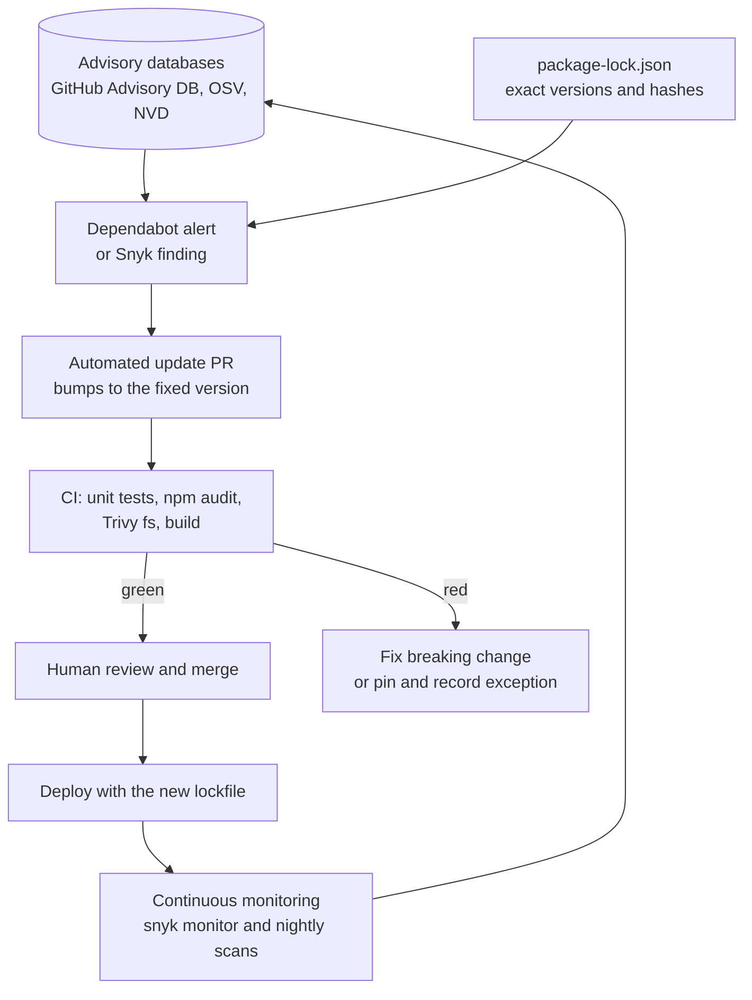
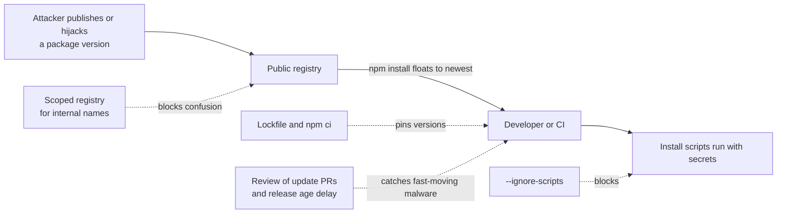

# L11.10 — Dependency Scanning (Snyk, Dependabot)

> **Level 11: Security / DevSecOps** · Topic 10 of 13 · ⏱ ~5 hours · Difficulty: Intermediate

## 1. What it is

Modern applications are mostly other people's code. A small Node.js service like `shop-api` declares a handful of
dependencies in `package.json` and pulls in hundreds more **transitive dependencies** (dependencies of dependencies).
**Dependency scanning**, formally **SCA (Software Composition Analysis)**, lists every component your project uses and checks each
name and version against databases of known vulnerabilities (CVEs and ecosystem advisories such as the GitHub Advisory Database).

Three ideas work together:

- **Lockfiles** (`package-lock.json`, `yarn.lock`, `pnpm-lock.yaml`, `poetry.lock`, `go.sum`) record the exact version and integrity hash of every dependency, so builds are reproducible and scanners know what is *really* installed.
- **Scanners:** `npm audit` (built in), **Snyk** (commercial, with a free tier), **GitHub Dependabot alerts**, Trivy (`trivy fs`), OSV-Scanner and others.
- **Automated update PRs:** **Dependabot** (built into GitHub) and **Renovate** (open source) open pull requests that bump vulnerable or outdated dependencies, so patching is a review-and-merge task instead of a research project.

The related and much harder problem is the **supply chain attack**, where the dependency itself is malicious rather than merely buggy, and no CVE exists yet.

## 2. Why it matters in DevOps

- **Known-vulnerable components are among the most common root causes of breaches**, and fixes are usually available before attackers use the bug at scale. Staying current is cheaper than incident response.
- **Transitive dependencies are invisible** until you scan: you never chose that vulnerable library, but you ship it.
- **Reproducibility is a security property.** Without a lockfile, `npm install` on Tuesday may fetch a different (possibly compromised) version than on Monday.
- **CI is a high-value target.** Install scripts and build plugins run with your pipeline's secrets, so dependency hygiene and [secrets management](04-secrets-management-and-encryption.md) belong together.
- **Compliance** (SOC 2, PCI DSS, customer questionnaires) increasingly asks for evidence of vulnerability management and SBOMs ([Container Image Scanning](09-container-image-scanning.md)).

## 3. Real-world system example

**Equifax (2017)** is the textbook case for outdated components: attackers exploited a known flaw in Apache Struts
(CVE-2017-5638) for which a patch existed. **Log4Shell (CVE-2021-44228, December 2021)** showed the transitive version: Log4j was embedded
in countless products, often several layers deep.

**Supply chain attacks** are different, because the "update" is the attack:

- **event-stream (npm, 2018):** the maintainer of a popular package handed it to a new contributor, who added a dependency (`flatmap-stream`) containing code that targeted a specific cryptocurrency wallet application.
- **ua-parser-js (npm, 2021):** the maintainer's account was hijacked and malicious versions were published, which included password-stealing and cryptomining code.
- **colors and faker (npm, 2022):** the author deliberately sabotaged their own widely used packages with a release that broke dependants.
- **Dependency confusion (2021):** researcher Alex Birsan showed that internal package names, when also published on a public registry with a higher version number, could be pulled in by build systems, running his harmless proof-of-concept code in the networks of many large companies.
- **xz Utils (CVE-2024-3094, March 2024):** a backdoor was inserted into releases of the xz compression library by a long-term contributor persona and was caught by a Microsoft engineer who noticed a small SSH login slowdown, before it reached most stable distributions.
- **SolarWinds (2020)** and **Codecov (2021)** targeted vendors' build systems and CI tooling, not libraries, but belong to the same class: trust placed in a software supplier was abused.

GitHub documents Dependabot alerts, security updates and version updates as free features across repositories; Renovate is widely used as the self-hosted or app-based alternative.

## 4. Diagram



Where a supply-chain attack slips in, and the matching controls:



## 5. How it works

**Direct vs transitive.** `npm ls --all` prints the whole tree; `npm explain lodash` shows *why* a package is present, which tells you which direct dependency to upgrade.

**Scanner comparison**

| Tool | Notes |
|------|-------|
| `npm audit` | Built in, free, uses the GitHub advisory data; `--audit-level=high` sets the failing threshold; `npm audit fix` applies semver-compatible upgrades |
| Dependabot alerts / security updates | Free on GitHub; alerts from the dependency graph, automatic PRs for vulnerable packages |
| Dependabot version updates | Scheduled PRs for *all* outdated dependencies, configured in `.github/dependabot.yml` |
| Snyk Open Source | Commercial with a limited free tier; richer database, fix advice, license checks, optional reachability analysis; CLI `snyk test` (point-in-time) and `snyk monitor` (continuous) |
| Trivy `fs` / OSV-Scanner | Free CLI tools that scan lockfiles in CI and also cover images and IaC |
| Renovate | Open-source updater with grouping, scheduling and many ecosystems |

**Triage: not every alert is an emergency.** Ask: is the vulnerable function reachable in our code? Is it a dev-only dependency? Is there a known exploit (CISA's *Known Exploited Vulnerabilities* catalogue, or a high EPSS score, the Exploit Prediction Scoring System)?
Prioritise fixable, reachable, exploited issues; schedule the rest; document exceptions with an owner and an expiry date.

**Semantic versioning and updates.** Patch and minor updates are normally safe to batch and auto-merge when tests are good; majors need human attention. Grouping updates in Dependabot (`groups:`) reduces PR noise.

**Hardening against malicious packages**

| Control | Why |
|---------|-----|
| Commit the lockfile; use `npm ci` in CI and Docker builds | Installs exactly what was reviewed, fails if `package.json` and the lock disagree |
| `npm ci --ignore-scripts` (then run needed build steps explicitly) | Blocks arbitrary `preinstall`/`postinstall` code; a major malware vector |
| Scoped packages plus a registry mapping (`@shop:registry=...` in `.npmrc`) | Internal names can only come from your registry, stopping dependency confusion |
| Review update PRs, and prefer a short delay before adopting brand-new releases | Malicious versions are usually discovered and pulled within days |
| `npm audit signatures`, npm provenance | Verifies registry signatures and, where publishers provide it, build provenance |
| Fewer dependencies; prefer well-maintained ones | Each one is trust you extend |
| Least-privilege CI tokens and no long-lived secrets in the build environment | Limits what an install script can steal ([Secrets Management](04-secrets-management-and-encryption.md)) |
| Generate an SBOM and monitor it | Lets you find affected services quickly when news breaks |

## 6. Step-by-step guide

**Prerequisites:** Node.js 20+ and npm, Docker (optional, for Trivy), a GitHub repository you own (for Dependabot). Free. Snyk needs a free account.

1. **Create a project with an outdated dependency and a lockfile.**
   ```bash
   mkdir -p ~/sca-lab && cd ~/sca-lab
   cat > package.json <<'EOF'
   { "name": "shop-api", "version": "1.0.0", "private": true,
     "dependencies": { "lodash": "4.17.15" } }
   EOF
   npm install --ignore-scripts
   ls
   ```
   Expect `node_modules`, `package-lock.json` and `package.json`. Commit the lockfile in a real project.

2. **Audit it.**
   ```bash
   npm audit
   npm audit --audit-level=high; echo "exit=$?"
   npm audit --json | jq .metadata.vulnerabilities
   ```
   The report (similar to) lists `lodash` with severity high, advisory links (GHSA ids), and "fix available". The gate command returns `exit=1`, which is what CI uses to fail a build. Advisories change over time, so your list may differ.

3. **Understand why a package is there, and fix it.**
   ```bash
   npm explain lodash
   npm install lodash@latest --ignore-scripts
   npm audit; echo "exit=$?"
   ```
   After upgrading, expect `found 0 vulnerabilities` and `exit=0`. Review the diff of `package-lock.json` before committing; it records the new version and `integrity` hash.

4. **Reproducible installs.** `npm ci` deletes `node_modules` and installs exactly the lockfile:
   ```bash
   npm ci --ignore-scripts
   npm audit signatures
   ```
   If you edit `package.json` without updating the lock, `npm ci` fails: this is the behaviour you want in CI. `audit signatures` reports that packages have verified registry signatures.

5. **Enable Dependabot.** In your GitHub repo create `.github/dependabot.yml`:
   ```yaml
   version: 2
   updates:
     - package-ecosystem: "npm"
       directory: "/"
       schedule:
         interval: "weekly"
         day: "monday"
       open-pull-requests-limit: 5
       groups:
         minor-and-patch:
           update-types: ["minor", "patch"]     # one PR for low-risk bumps
     - package-ecosystem: "docker"
       directory: "/"
       schedule:
         interval: "weekly"
     - package-ecosystem: "github-actions"
       directory: "/"
       schedule:
         interval: "weekly"
   ```
   In repository **Settings > Advanced Security** (named *Code security* in some plans) turn on the dependency graph, Dependabot alerts and Dependabot security updates.
   Within minutes to hours Dependabot opens PRs; each PR body lists release notes and a compatibility score. Open the **Insights > Dependency graph > Dependabot** tab to see its status or logs.

6. **Gate dependency vulnerabilities in CI.** Add `.github/workflows/deps.yml`:
   ```yaml
   name: dependency-scan
   on:
     pull_request:
     push:
       branches: [main]
     schedule:
       - cron: "23 4 * * *"
   permissions:
     contents: read
   jobs:
     audit:
       runs-on: ubuntu-latest
       steps:
         - uses: actions/checkout@v4
         - uses: actions/setup-node@v4
           with: { node-version: 22 }
         - run: npm ci --ignore-scripts
         - run: npm audit --audit-level=high --omit=dev     # block on high+ in production dependencies
         - run: npm audit signatures
         - name: Trivy lockfile scan
           uses: aquasecurity/trivy-action@0.28.0           # pin to a full commit SHA in real use
           with:
             scan-type: fs
             scan-ref: .
             severity: HIGH,CRITICAL
             ignore-unfixed: true
             exit-code: "1"
   ```

7. **(Optional) Try Snyk.** Create a free account, then:
   ```bash
   npx snyk auth                       # opens a browser for a token; in CI use the SNYK_TOKEN secret instead
   npx snyk test --severity-threshold=high
   npx snyk monitor                    # uploads a snapshot so Snyk alerts you about newly disclosed issues
   ```
   `snyk test` exits non-zero on findings at or above the threshold; `snyk monitor` is for ongoing alerting. Free-tier test limits apply.

8. **Defend against dependency confusion (local config only).** Pin your internal scope to your own registry so it cannot be hijacked:
   ```bash
   printf '@shop:registry=https://npm.internal.example.com/\n' >> .npmrc
   cat .npmrc
   ```
   Any `@shop/*` package now resolves only through the internal registry (the hostname is a placeholder). Public packages continue to resolve from the default registry.

9. **Clean up.** `cd ~ && rm -rf ~/sca-lab`.

## 7. Real-world scenario

*Illustrative, not a documented incident.* On a Tuesday a security news feed reports that a popular transitive dependency of the HTTP-client library used by `shop-api`
has a critical flaw being exploited. Within minutes the on-call engineer opens the SBOM index and finds the package in 6 of 31 services. Dependabot already opened
PRs for four of them overnight; CI is green on three. The fourth fails tests because the fix is a major version bump of a direct dependency with a changed API.

The team merges the three, deploys them, and assigns the fourth a half-day. While it is in progress they add a temporary WAF rule for the vulnerable request pattern and
record an exception with a 3-day expiry. Afterwards they add `npm explain` output to their runbook, turn on Dependabot grouping to reduce noise, and add a scheduled
audit job, because the alert was caught by luck of timing rather than by process.

**Lesson:** the speed of response is decided in advance by inventory (SBOMs), automation (update PRs, CI gates) and test coverage. Good tests are what make a "major bump during an incident" survivable.

## 8. Common mistakes and best practices

**Don't**

- Run `npm install` in CI or Dockerfiles without a lockfile, or ignore the lockfile in `.gitignore`.
- Merge Dependabot PRs without reading what changed, or auto-merge majors with weak tests.
- Disable audit failures ("it's always red") instead of triaging and setting a sensible threshold.
- Run install scripts with production secrets in the environment.
- Add a package for a ten-line function, or install lookalike names without checking the publisher and download history (typosquatting).
- Treat `npm audit fix --force` as safe: it can make breaking major upgrades.

**Do**

- Commit lockfiles, use `npm ci`, and update on a schedule so that updates stay small.
- Turn on Dependabot alerts, security updates and version updates (or Renovate) for every repo, including Docker and GitHub Actions ecosystems.
- Gate PRs on high/critical fixable vulnerabilities in production dependencies; track dev-only and unfixable ones separately.
- Pin CI actions by commit SHA; use `--ignore-scripts` where possible; scope internal packages to an internal registry.
- Keep an SBOM per release and monitor it continuously.
- Invest in tests; they are what make fast, safe patching possible.

## 9. Tasks

- [ ] **T1 — Audit and fix a vulnerable dependency** *(≈30 min, beginner)*
  - **Goal:** use `npm audit` as a tool, not a report.
  - **Steps:**
    1. Follow steps 1-3 of the guide.
    2. Record the exit code before and after the upgrade.
    3. Run `git diff package-lock.json` (initialise a repo if needed) and note what changed.
  - **Done when:** `npm audit` exits `0` after the fix and you can point to the lockfile line that changed.

- [ ] **T2 — Prove lockfiles protect you** *(≈30 min, intermediate)*
  - **Goal:** feel the difference between `npm install` and `npm ci`.
  - **Steps:**
    1. Edit a dependency version in `package.json` without running `npm install`.
    2. Run `npm ci` and read the error.
    3. Fix it properly and rerun.
  - **Done when:** you can explain, using that error, why CI uses `npm ci`.

- [ ] **T3 — Configure Dependabot and review a PR** *(≈60 min, intermediate)*
  - **Goal:** run an automated-update workflow.
  - **Steps:**
    1. Add the `dependabot.yml` from step 5 to a repo with an outdated dependency.
    2. Wait for (or manually trigger from the Dependabot tab) the first PR.
    3. Review it: release notes, lockfile diff, CI result. Merge or close with a comment.
  - **Done when:** at least one Dependabot PR has been merged after you checked its CI and diff.

- [ ] **T4 — Add the CI gate and break it** *(≈45 min, intermediate)*
  - **Goal:** make the pipeline enforce policy.
  - **Steps:**
    1. Add the workflow from step 6.
    2. Open a PR that downgrades `lodash` to `4.17.15`.
    3. Confirm the audit job fails; revert and confirm it passes.
  - **Done when:** the same PR shows a red then green check.

- [ ] **T5 — Reduce install-time risk** *(≈45 min, advanced)*
  - **Goal:** neutralise a malicious install script.
  - **Steps:**
    1. Create a local package with a `postinstall` script that writes `PWNED` to a file in `/tmp` (harmless), and install it from a path (`npm install ./evil-pkg`).
    2. Confirm the file appears; delete it.
    3. Reinstall with `--ignore-scripts` (or set `ignore-scripts=true` in `.npmrc`) and show nothing runs.
  - **Done when:** the marker file exists after the default install and is absent with scripts disabled, and you list two packages in your own project that legitimately need install scripts.

- [ ] **T6 — Prove it: write the supply-chain checklist** *(≈45 min, advanced)*
  - **Goal:** turn this topic into a team standard.
  - **Steps:**
    1. Without notes, write a one-page checklist covering lockfiles, scanners, update automation, install hardening, CI privileges and incident response for a compromised dependency.
    2. Explain how each control would have helped against event-stream, dependency confusion and Log4Shell, or why it would not.
  - **Done when:** each of the three scenarios maps to at least one preventing or limiting control, and one honest gap is identified.

## 10. Self-check questions

1. What is the difference between a direct and a transitive dependency, and how do you find out why a package is installed?
2. Why does CI use `npm ci` rather than `npm install`?
3. What does a vulnerability scanner not catch that a supply-chain attack relies on?
4. How do Dependabot security updates differ from version updates?
5. Which two controls reduce the impact of a malicious `postinstall` script?

<details>
<summary>Answers</summary>

1. Direct dependencies are listed in your `package.json`; transitive ones are pulled in by them. `npm ls --all` shows the tree and `npm explain <pkg>` shows the chain that requires it.
2. `npm ci` installs exactly what the lockfile says (with integrity hashes), fails on mismatch and never modifies the lock, so builds are reproducible and reviewed.
3. A brand-new malicious release has no CVE or advisory yet, so signature databases are blind to it; you need pinning, review, install hardening and release-age delays.
4. Security updates are opened in response to a known vulnerability alert; version updates run on your schedule for every outdated dependency regardless of vulnerabilities.
5. Disabling install scripts (`--ignore-scripts`) and keeping secrets and broad credentials out of the build environment.
</details>

## 11. Further reading

- GitHub Docs: *Dependabot* (alerts, security updates, version updates, `dependabot.yml` options reference).
- npm Docs: `npm audit`, `npm ci`, and package provenance; Snyk documentation for the CLI and Snyk Open Source.
- Renovate documentation (docs.renovatebot.com); OSV (osv.dev) and the CISA Known Exploited Vulnerabilities catalogue.
- OpenSSF Scorecard and the SLSA framework (slsa.dev) for supply-chain maturity models.

<!-- nav -->
---
← Previous: [Container Image Scanning (Trivy)](09-container-image-scanning.md) · [Level 11 index](README.md) · Next: [Secrets Scanning](11-secrets-scanning.md) →
