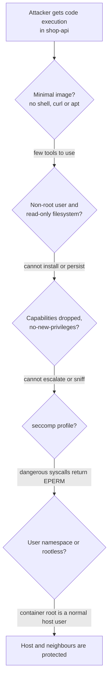
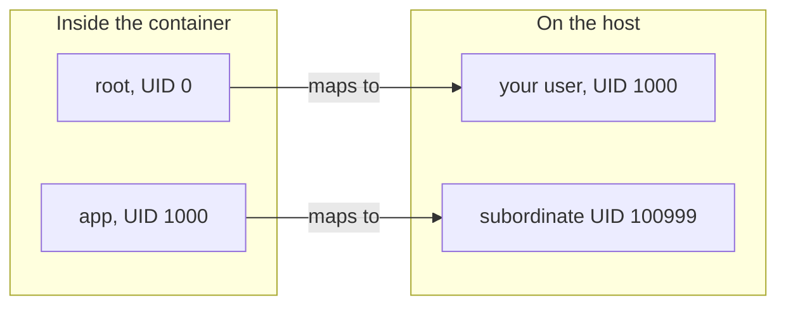

# L11.12 — Rootless and Minimal Containers

> **Level 11: Security / DevSecOps** · Topic 12 of 13 · ⏱ ~5 hours · Difficulty: Intermediate

## 1. What it is

A container is **not** a virtual machine: it is an ordinary Linux process (or tree of processes) that the kernel isolates using
namespaces (what it can see), cgroups (how much it can use) and security filters (what it may do). All containers on a host
share one kernel, so the strength of the isolation depends on how the process is configured. This topic is about shrinking what a compromised container can do.

Four layers of hardening, from the outside in:

- **Rootless runtime:** the container engine itself (Docker daemon or Podman) runs as an unprivileged user using **user namespaces**, so even "root inside the container" maps to an ordinary unprivileged UID on the host.
- **Non-root process:** the application runs as a dedicated non-zero UID (the `USER` instruction), never as UID 0.
- **Minimal image:** the image contains only the app and its runtime, with no shell, package manager or compilers. **Distroless** images (from Google) and `scratch` images are the extreme end.
- **Kernel-level restrictions:** drop **Linux capabilities** (slices of root's power such as `NET_RAW` or `SYS_ADMIN`), apply a **seccomp** profile (an allow-list of system calls), mount the filesystem read-only and block privilege escalation (`no-new-privileges`).

Principle: **assume the application will be compromised one day, and make that the least useful day of the attacker's career.**

## 2. Why it matters in DevOps

- **Container escapes exist.** Vulnerabilities in the kernel and in runtimes (for example **CVE-2019-5736** in `runc`, the low-level runtime used by Docker and Kubernetes) have let a process inside a container affect the host. Running as non-root, rootless and with fewer privileges removes preconditions for many such bugs.
- **Defaults are permissive.** A container started with `docker run` runs as root, keeps a set of default capabilities and has a writable filesystem, and `--privileged` or a mounted `/var/run/docker.sock` is effectively root on the host.
- **Less in the image means less to patch and less to abuse.** An attacker who gets code execution in a distroless container has no `sh`, `curl`, `apt` or `wget` to download tools with ([Container Image Scanning](09-container-image-scanning.md) also reports far fewer findings).
- **Platforms enforce it.** Kubernetes Pod Security Standards (the *restricted* profile) and many regulated environments require non-root users, dropped capabilities and a seccomp profile ([Pod Security](../level-16-advanced-kubernetes/03-pod-security.md)).

## 3. Real-world system example

**Docker rootless mode** (generally available since Docker 20.10) runs both the daemon and containers inside a user namespace without root privileges;
**Podman**, from Red Hat, is daemonless and rootless by default. **Kubernetes** supports running pods in user namespaces and defines
the **Pod Security Standards**: the *restricted* profile requires `runAsNonRoot`, `allowPrivilegeEscalation: false`, dropping all capabilities (adding back only `NET_BIND_SERVICE` if needed)
and a `RuntimeDefault` (or localhost) seccomp profile.

**Google's distroless images** (`gcr.io/distroless/...`) contain only the language runtime and its dependencies, a design Google documents as removing package managers, shells and other programs found in a standard Linux distribution. Other vendors publish similarly minimal, frequently rebuilt images (for example Chainguard Images and Docker Hardened Images, among others).
**Docker's default seccomp profile** blocks a few dozen of the 300+ Linux system calls (documented as such), and its default capability set is a deliberately reduced subset of root's. Hardening here means going further than the defaults.

## 4. Diagram

Stacked defences between a compromised app and the host:



Rootless: how UIDs are translated by the user namespace.



## 5. How it works

**Rootful vs rootless**

| | Rootful Docker (default) | Rootless Docker / Podman |
|---|---|---|
| Daemon user | root | unprivileged user |
| Container root maps to | host root (UID 0) | an unprivileged host UID via `/etc/subuid` |
| Impact of a runtime escape | Host root | The user's own privileges |
| Limitations | None | Cannot bind ports below 1024 by default, some storage and network drivers differ, no `--privileged` host access, cgroup limits need systemd delegation |

**Linux capabilities.** Historically "root" was one all-powerful identity. The kernel splits it into about 40 capabilities. Examples: `NET_BIND_SERVICE` (bind ports <1024), `NET_RAW` (raw sockets, ping, spoofing), `CHOWN`, `SETUID`, `SYS_ADMIN` (a very broad, "new root"), `SYS_PTRACE`.
Docker keeps a default subset (around 14); the secure pattern is **`--cap-drop=ALL`** then add back only what is needed.

**seccomp (secure computing mode).** A BPF filter evaluated on every system call. The default Docker/containerd profile and Kubernetes `RuntimeDefault` already block risky calls (such as `kexec_load`, `mount` variants and others). A custom profile can be tighter, generated by tracing your app in test.
Beware: `--security-opt seccomp=unconfined` turns the protection off.

**Other levers**

| Setting | Docker flag | Kubernetes `securityContext` |
|---------|-------------|------------------------------|
| Non-root user | `--user 10001:10001` or `USER` | `runAsNonRoot: true`, `runAsUser: 10001` |
| Read-only root FS | `--read-only --tmpfs /tmp` | `readOnlyRootFilesystem: true` + `emptyDir` |
| Drop capabilities | `--cap-drop=ALL` | `capabilities: { drop: ["ALL"] }` |
| No privilege gain (blocks setuid binaries) | `--security-opt no-new-privileges` | `allowPrivilegeEscalation: false` |
| seccomp | default, or `--security-opt seccomp=profile.json` | `seccompProfile: { type: RuntimeDefault }` |
| Limit resources | `--memory 256m --cpus 0.5 --pids-limit 200` | `resources.limits` ([requests and limits](../level-08-kubernetes/14-resource-requests-and-limits.md)) |

**Never:** `--privileged`, mounting `/var/run/docker.sock` (grants control of the host's Docker), `--pid=host`, `--net=host` for ordinary apps, mounting host paths like `/` or `/etc`, adding `SYS_ADMIN`.

**Minimal image options**

| Base | Size / content | Trade-off |
|------|----------------|-----------|
| `node:22` (Debian full) | Large, hundreds of packages | Easiest, most findings |
| `node:22-slim` | Debian minus extras | Good default; glibc compatible |
| `node:22-alpine` | Small, musl libc, BusyBox shell | Smallest with a shell; native modules built for glibc may fail |
| `gcr.io/distroless/nodejs22-debian12` | Runtime only, no shell | Very small attack surface; debug via `:debug` tag or ephemeral debug containers |
| `scratch` | Empty | Only for static binaries (Go, Rust) |

See also [Non-root Containers](../level-04-docker/11-non-root-containers.md), [Minimal Base Images](../level-04-docker/13-minimal-base-images.md) and [multi-stage builds](../level-04-docker/10-multi-stage-builds.md) for the build mechanics.

## 6. Step-by-step guide

**Prerequisites:** Linux with Docker (or a Linux VM/WSL2 for the rootless part). Everything runs locally and is free. Outputs are *similar to* what you will see.

1. **See the defaults, which are not safe.**
   ```bash
   docker run --rm alpine id
   docker run --rm alpine sh -c 'grep Cap /proc/self/status'
   ```
   `uid=0(root) gid=0(root)`. The `CapEff` line is a hex bitmask of the effective capabilities (a default Docker value like `00000000a80425fb`). Decode it if `capsh` is installed: `capsh --decode=00000000a80425fb`.

2. **Drop capabilities and watch operations fail.**
   ```bash
   docker run --rm alpine chown nobody /etc/hostname                   # works as default root
   docker run --rm --cap-drop=ALL alpine chown nobody /etc/hostname    # chown: ... Operation not permitted
   docker run --rm --cap-drop=ALL alpine sh -c 'grep CapEff /proc/self/status'   # CapEff: 0000000000000000
   ```
   Without `CHOWN` even root cannot change ownership. This is "root" with its power removed.

3. **Run non-root with a read-only filesystem.**
   ```bash
   docker run --rm --user 10001:10001 --read-only --tmpfs /tmp alpine sh -c 'id; touch /etc/x; touch /tmp/ok && echo tmp-ok'
   ```
   Expect `uid=10001`, `touch: /etc/x: Read-only file system` (or permission denied) and `tmp-ok`. A malicious process cannot drop a backdoor into the image filesystem.

4. **Build a hardened `shop-api` image on distroless.**
   ```bash
   mkdir -p ~/harden-lab && cd ~/harden-lab
   cat > package.json <<'EOF'
   { "name": "shop-api", "version": "1.0.0", "main": "server.js", "dependencies": {} }
   EOF
   cat > server.js <<'EOF'
   const http = require('http');
   http.createServer((req, res) => {
     if (req.url === '/health') { res.end('ok'); return; }
     res.end(JSON.stringify({ uid: process.getuid(), cwd: process.cwd() }));
   }).listen(3000, '0.0.0.0', () => console.log('shop-api on 3000'));
   EOF
   cat > Dockerfile <<'EOF'
   FROM node:22-slim AS build
   WORKDIR /app
   COPY package.json ./
   RUN npm install --omit=dev
   COPY server.js ./

   FROM gcr.io/distroless/nodejs22-debian12:nonroot
   WORKDIR /app
   COPY --from=build /app /app
   EXPOSE 3000
   HEALTHCHECK --interval=30s --timeout=3s CMD ["/nodejs/bin/node", "-e", "fetch('http://127.0.0.1:3000/health').then(r=>process.exit(r.ok?0:1)).catch(()=>process.exit(1))"]
   CMD ["server.js"]
   EOF
   docker build -t shop-api:hardened .
   docker run -d --name shop-hardened --read-only --cap-drop=ALL --security-opt no-new-privileges \
     --pids-limit 100 --memory 128m -p 127.0.0.1:3000:3000 shop-api:hardened
   curl -s http://127.0.0.1:3000/
   ```
   Output: `{"uid":65532,"cwd":"/app"}`; the `nonroot` distroless user is UID 65532. The distroless base has no shell, and the `HEALTHCHECK` runs Node directly.

5. **Prove there is nothing for an attacker to use.**
   ```bash
   docker exec -it shop-hardened sh        # fails: executable file not found
   docker image ls shop-api:hardened       # compare size with the node:22 full image
   docker run --rm -v /var/run/docker.sock:/var/run/docker.sock aquasec/trivy:latest image --severity HIGH,CRITICAL shop-api:hardened
   ```
   For debugging use the `:debug-nonroot` variant of the distroless image in a scratch container, or `docker debug` / a Kubernetes ephemeral container, rather than adding a shell to production.

6. **Write and test a custom seccomp profile (learning exercise).** A profile that allows everything except `mkdir`:
   ```bash
   cat > deny-mkdir.json <<'EOF'
   {
     "defaultAction": "SCMP_ACT_ALLOW",
     "syscalls": [
       { "names": ["mkdir", "mkdirat"], "action": "SCMP_ACT_ERRNO" }
     ]
   }
   EOF
   docker run --rm --security-opt seccomp=deny-mkdir.json alpine mkdir /newdir      # mkdir: ... Operation not permitted
   docker run --rm alpine mkdir /newdir && echo "default profile allows it"
   ```
   Note this profile *replaces* Docker's default, so it is more permissive than the default in other ways; real custom profiles start from the default JSON and remove calls, or use `defaultAction: SCMP_ACT_ERRNO` with an allow-list generated by tracing.

7. **Try rootless Docker (Linux host or VM, not Docker Desktop).**
   ```bash
   sudo apt-get update && sudo apt-get install -y uidmap dbus-user-session     # Debian/Ubuntu prerequisites
   dockerd-rootless-setuptool.sh install                                       # run as a normal user, not root
   export DOCKER_HOST=unix://$XDG_RUNTIME_DIR/docker.sock
   docker info --format '{{.SecurityOptions}}'      # includes name=rootless
   docker run --rm alpine id                         # uid=0 in the container...
   docker run --rm alpine cat /proc/self/uid_map     # ...but mapped to a high UID on the host
   ```
   Expect `rootless` in the security options and a `uid_map` like `0 1000 1` (container 0 is your host UID). The prerequisites and per-distro steps are in Docker's "Run the Docker daemon as a non-root user" documentation. As a no-install alternative use **Podman** (`podman run --rm alpine id` is rootless by default).

8. **Same settings in Kubernetes** (applies the same controls declaratively; see the Pod Security topic):
   ```yaml
   securityContext:                      # pod level
     runAsNonRoot: true
     runAsUser: 65532
     seccompProfile: { type: RuntimeDefault }
   containers:
     - name: shop-api
       image: shop-api:hardened
       securityContext:                  # container level
         allowPrivilegeEscalation: false
         readOnlyRootFilesystem: true
         capabilities: { drop: ["ALL"] }
   ```

9. **Clean up.**
   ```bash
   docker rm -f shop-hardened; docker rmi shop-api:hardened; cd ~ && rm -rf ~/harden-lab
   ```

## 7. Real-world scenario

*Illustrative, not a documented incident.* A report-rendering endpoint in `shop-api` has a template-injection flaw that gives an attacker remote code execution. Compare two deployments of the same code.

In the **old** deployment (root, full `node:22` image, writable filesystem, default capabilities, Docker socket mounted for "auto-restart logic") the attacker
runs `curl` to fetch a miner, installs tools with `apt`, uses the mounted socket to start a privileged container and has root on the host in minutes.

In the **new** deployment (distroless, UID 65532, read-only filesystem, all capabilities dropped, seccomp default, no socket) the same exploit lands in a Node process
where there is no shell to spawn, no package manager, no writable path except `/tmp`, no outbound tooling, and `NET_RAW` is gone so no network sniffing. The attacker can read
the application's own memory and environment, so the team still rotates its secrets, but the host and neighbours are safe, and egress rules plus alerts catch the unusual outbound connection.

**Lesson:** hardening does not remove the vulnerability, it shrinks the blast radius and buys time. Defence in depth means every layer assumes the previous one failed.

## 8. Common mistakes and best practices

**Don't**

- Run production containers as root, or use `--privileged` "to make it work".
- Mount `/var/run/docker.sock` into application containers.
- Use `seccomp=unconfined`, add `SYS_ADMIN`, or disable `no-new-privileges` without a documented reason.
- Switch to a tiny image and then re-add a shell, curl and compilers "for convenience".
- Assume rootless means invulnerable. The kernel is still shared; keep hosts patched.
- Chmod directories `777` to hide a permissions problem. Fix the ownership (`COPY --chown`) instead.

**Do**

- Set a numeric non-root `USER` (UID above 10000 is a sensible convention), bind to ports above 1024 and map them with Docker or a Service.
- Start from `--cap-drop=ALL` and add back the single capability that is required.
- Use `readOnlyRootFilesystem` with explicit writable volumes (`/tmp`, data dirs).
- Prefer minimal, regularly rebuilt bases; pin them by digest; scan every build.
- Run the container engine rootless where possible, especially on shared CI runners.
- Enforce the baseline automatically: Pod Security admission, linters such as `hadolint` and Trivy's config scanner for Dockerfiles and manifests.

## 9. Tasks

- [ ] **T1 — Measure the defaults** *(≈20 min, beginner)*
  - **Goal:** see how much power a default container has.
  - **Steps:**
    1. Run `docker run --rm alpine id` and print `CapEff` from `/proc/self/status`.
    2. Repeat with `--user 10001 --cap-drop=ALL`.
    3. Record both hex values and what changed.
  - **Done when:** you show uid 0 with a non-zero `CapEff` for the default run and uid 10001 with `CapEff: 0000000000000000` for the hardened run.

- [ ] **T2 — Harden the flags until it breaks, then fix it** *(≈45 min, intermediate)*
  - **Goal:** find the minimum privileges an app needs.
  - **Steps:**
    1. Run the stock `nginx` image with `--cap-drop=ALL --read-only` and note the errors.
    2. Add back only the capabilities, tmpfs mounts and user settings required (hint: it writes to `/var/cache/nginx`, `/var/run`, and wants to bind port 80; consider the `nginxinc/nginx-unprivileged` image).
    3. Document the final flag set.
  - **Done when:** Nginx serves a page on `127.0.0.1` with all capabilities dropped (or only the one you can justify) and a read-only root filesystem.

- [ ] **T3 — Build the distroless image and compare** *(≈45 min, intermediate)*
  - **Goal:** quantify the benefit.
  - **Steps:**
    1. Build `shop-api` once on `node:22` and once on distroless (step 4).
    2. Compare `docker image ls` size and `trivy image --severity HIGH,CRITICAL` counts.
    3. Try `docker exec -it <ctr> sh` on each.
  - **Done when:** you have a table of size, finding count and shell availability for both images.

- [ ] **T4 — Write a seccomp profile that blocks something real** *(≈45 min, advanced)*
  - **Goal:** understand syscall filtering.
  - **Steps:**
    1. Get Docker's default profile (from the Moby repository's `profiles/seccomp/default.json`; read it from the documentation or repository).
    2. Remove one syscall's allow entry (for example `unshare` or `ptrace`) or add it to an ERRNO list.
    3. Run a command that needs it (`unshare -r true` in an image that has `unshare`) with and without your profile.
  - **Done when:** the command succeeds with the default profile and fails with `Operation not permitted` under yours.

- [ ] **T5 — Go rootless** *(≈60 min, advanced)*
  - **Goal:** run containers without root on the host.
  - **Steps:**
    1. Install rootless Docker (step 7) or use Podman in a Linux VM.
    2. Run `alpine` and compare `id` inside with `ps -o user,pid,cmd` on the host.
    3. Try to bind port 80 and explain the error and one fix (`net.ipv4.ip_unprivileged_port_start` or publish a high port).
  - **Done when:** `ps` on the host shows the container process owned by your normal (or a subordinate) user, not root, and you explain `uid_map`.

- [ ] **T6 — Prove it: build a hardening checklist** *(≈30 min, advanced)*
  - **Goal:** make the hardening repeatable.
  - **Steps:**
    1. Without notes, write a 10-line container hardening checklist (image, user, filesystem, capabilities, seccomp, resources, runtime, scanning, secrets, debugging approach).
    2. Run `trivy config` or `hadolint` on a Dockerfile and compose file and fix what it reports against your checklist.
  - **Done when:** a Dockerfile and `docker run` command exist that satisfy all ten items, verified by `docker inspect` output.

## 10. Self-check questions

1. Why is "root in a container" dangerous even though it is namespaced?
2. What do Linux capabilities and seccomp each restrict?
3. What is the difference between running as non-root inside the container and running the engine rootless?
4. What do you lose with distroless images, and how do you debug them?
5. Why is mounting `/var/run/docker.sock` into a container equivalent to giving it host root?

<details>
<summary>Answers</summary>

1. Container root is UID 0 on the shared kernel, so a kernel or runtime vulnerability, a mounted host path or an extra capability can turn it into host root; user namespaces and dropped privileges lower the odds.
2. Capabilities divide root's privileges (what privileged operations a process may do); seccomp filters which system calls a process may make at all.
3. Non-root user inside limits what the app can do in the container; rootless engine means the daemon and the container's UID 0 map to an unprivileged host user, so an escape lands with limited privileges. They are complementary.
4. No shell, package manager or standard debugging tools. Debug with ephemeral containers (`kubectl debug`), the `:debug` image variant in a non-production copy, or `docker debug`, plus good logs and metrics.
5. Whoever can talk to the Docker daemon can ask it to start a privileged container with the host filesystem mounted, and the daemon runs as root.
</details>

## 11. Further reading

- Docker documentation: *Run the Docker daemon as a non-root user (Rootless mode)*, *Seccomp security profiles for Docker*, and *Runtime privilege and Linux capabilities*.
- Podman documentation (podman.io) and the Kubernetes documentation on Pod Security Standards and `securityContext`.
- Google's distroless project README (github.com/GoogleContainerTools/distroless).
- `man 7 capabilities`, `man 2 seccomp`, and *Container Security* by Liz Rice (O'Reilly).

<!-- nav -->
---
← Previous: [Secrets Scanning](11-secrets-scanning.md) · [Level 11 index](README.md) · Next: [Dynamic Testing with OWASP ZAP](13-dast-with-owasp-zap.md) →
