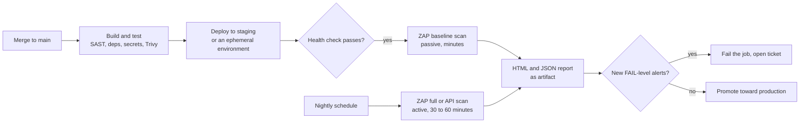
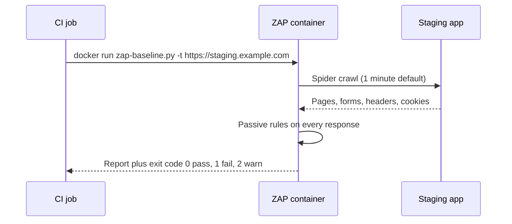

# L11.13 — Dynamic Testing with OWASP ZAP

> **Level 11: Security / DevSecOps** · Topic 13 of 13 · ⏱ ~5 hours · Difficulty: Intermediate

## 1. What it is

**DAST (Dynamic Application Security Testing)** tests a **running** application from the outside, the way an attacker
would: it sends HTTP requests, watches the responses and looks for signs of weakness (missing security headers, reflected input,
verbose errors, injectable parameters, exposed admin pages). It needs no access to source code and does not care which language the app is written in.

**OWASP ZAP (Zed Attack Proxy)** is the best-known free, open-source DAST tool. It started as an OWASP project; the
core ZAP developers now work at Checkmarx, and the tool remains open source. ZAP works as:

- an **intercepting proxy** between your browser and the app, so you can inspect and replay traffic,
- a **spider** (crawler) that discovers pages and endpoints, including an *AJAX spider* for JavaScript-heavy single-page apps,
- a **passive scanner**, which analyses the traffic it sees without attacking, and
- an **active scanner**, which sends malicious-looking payloads to find injection, XSS and other flaws.

For pipelines, ZAP ships ready-made packaged scripts in its Docker image: **baseline scan**, **full scan** and **API scan**.

**DAST vs SAST (Static Application Security Testing).** SAST reads source code without running it; DAST attacks the running system. They find different things and complement each other.

| | SAST | DAST |
|---|------|------|
| Looks at | Source or bytecode | Running app over HTTP |
| Needs | Code access, language support | A deployed target and its URL |
| Finds | Insecure code patterns, tainted data flows, hard-coded secrets | Misconfigurations, missing headers, runtime injection, auth/session issues |
| Misses | Runtime config, deployment issues | Code paths it never reaches; business logic |
| When | Early, every commit | After deploy to a test or staging environment |
| False positives | Common | Fewer, but often needs tuning |
| Examples | Semgrep, CodeQL, SonarQube | OWASP ZAP, Burp Suite, Nuclei |

## 2. Why it matters in DevOps

- **It tests what is actually deployed**: the real config, reverse proxy, TLS settings, headers and environment, which static tools cannot see ([OWASP A05 Security Misconfiguration](05-owasp-top-10.md)).
- **It is language-agnostic**, so one pipeline stage covers every service whatever its stack.
- **It closes the loop** after SAST, dependency, [image](09-container-image-scanning.md) and [secrets](11-secrets-scanning.md) scans: those check the artifact; ZAP checks the running system.
- **It must be done carefully.** An active scan fires attack payloads that can create junk data, trigger alarms or knock over a weak service, so scope, environment and timing are DevOps decisions.

## 3. Real-world system example

ZAP is a flagship OWASP project, and the project publishes official Docker images (`ghcr.io/zaproxy/zaproxy` and others) together with the packaged scans and
GitHub Actions for baseline, full and API scans, so that teams can drop it into CI/CD with no installation. A typical enterprise pattern, described in many vendor and OWASP
guides: run the quick **baseline scan** on every merge to staging (minutes, passive only), and a **full or API scan** on a schedule (nightly or weekly) in a dedicated, disposable environment, uploading the report
as a build artifact and opening tickets for new findings. OWASP also maintains **Juice Shop**, the deliberately vulnerable shop used as a safe target in the lab below, and **OWASP DevSlop**-style demos show the same approach in pipelines.

**Burp Suite** (PortSwigger) is the dominant commercial alternative for manual testing; **Nuclei** (ProjectDiscovery) runs template-based checks; cloud services provide managed DAST. The CI mechanics are similar for all of them.

## 4. Diagram



What the baseline scan does internally:



## 5. How it works

**Scan types in the ZAP Docker image**

| Script | What it does | Attacks the target? | Typical use |
|--------|--------------|---------------------|-------------|
| `zap-baseline.py` | Spiders the site for a short time (1 minute by default) and applies **passive** rules only | No (safe for most environments) | Every deploy to staging |
| `zap-full-scan.py` | Spider, then **active** scan with attack payloads | **Yes** | Nightly, in a disposable environment |
| `zap-api-scan.py` | Imports an OpenAPI/SOAP/GraphQL definition and scans those endpoints | Yes (active by default) | API-only services ([API Security](08-api-security.md)) |

**Important options of the packaged scans**

| Option | Meaning |
|--------|---------|
| `-t <url>` | Target URL (for the API scan, with `-f openapi` the definition URL or file) |
| `-r report.html`, `-J report.json`, `-w report.md` | Write reports into the mounted `/zap/wrk` directory |
| `-m <minutes>` | Maximum spider time |
| `-j` | Also run the AJAX spider (for single-page apps) |
| `-c <file>` | Rules configuration file: per-rule `IGNORE`, `INFO`, `WARN` or `FAIL` |
| `-g <file>` | Generate a starting config file listing all rules |
| `-I` | Do not fail the build on warnings (still fail on errors) |

**Exit codes:** `0` no alerts at the configured failing level, `1` at least one `FAIL`, `2` at least one `WARN`, `3` another error. By default baseline treats findings as `WARN`, so a pipeline will not fail on them until you
promote selected rules to `FAIL` in the config file; that gradual ratchet keeps the gate trusted.

**Authenticated scanning.** Most of an app is behind login. ZAP supports authentication through contexts, scripts and, in the automation framework, a YAML plan with a login step; or simply pass a header with a test-user token (the replacer rule `-z "-config replacer.full_list(0).matchtype=REQ_HEADER ..."`). Use dedicated low-privilege test accounts, never real users.

**Safety rules for running scans**

1. Only scan systems you own or have **written authorisation** to test. This is a legal matter as well as an ethical one.
2. Never actively scan production. Use staging or an ephemeral environment with fake data.
3. Warn your SRE team, and exempt the scanner's IP from alerts or tag its traffic, so a scan does not page anyone.
4. Rate limit and size the target; active scans create records, send emails and can fill queues.
5. Treat reports as sensitive: they list your weaknesses.

**Triage.** ZAP rates alerts High, Medium, Low and Informational, with a confidence level. Expect false positives (and tune with `-c`), and expect that many Low and Informational findings are best-practice header gaps that are cheap to fix and worth fixing once at the reverse proxy.

## 6. Step-by-step guide

**Prerequisites:** Docker. All targets in this guide run **on your own machine**: a Juice Shop container (deliberately vulnerable) and, later, your local `shop-api`. Do not point ZAP at anything you do not own. Free; the first image pull is a few hundred MB. The report outputs below are *similar to* what you will see.

1. **Start the target on a private Docker network.**
   ```bash
   docker network create zapnet
   docker run -d --name juice-shop --network zapnet -p 127.0.0.1:3000:3000 bkimminich/juice-shop
   curl -s -o /dev/null -w "%{http_code}\n" http://127.0.0.1:3000      # expect 200
   ```

2. **Run the baseline scan.**
   ```bash
   mkdir -p zap-out && chmod 777 zap-out          # the zap user inside the container must be able to write the report
   docker run --rm --network zapnet -v "$PWD/zap-out":/zap/wrk:rw -t ghcr.io/zaproxy/zaproxy:stable \
     zap-baseline.py -t http://juice-shop:3000 -r baseline.html -J baseline.json
   echo "exit=$?"
   ```
   It takes a couple of minutes. The console prints `PASS:` lines for rules that found nothing and `WARN-NEW:` lines such as `Content Security Policy (CSP) Header Not Set [10038]` or
   `Missing Anti-clickjacking Header [10020]`, then a summary like `FAIL-NEW: 0 FAIL-INACTIVE: 0 WARN-NEW: 8 ... PASS: 50`. `exit=2` means warnings were present.

3. **Read the report.** Open `zap-out/baseline.html` in a browser. For each alert read the description, the affected URLs, the evidence and the solution. Count High, Medium and Low alerts. Because Juice Shop is a single-page app, add `-j` (AJAX spider) to find more pages and re-run to compare the number of URLs.

4. **Turn warnings into a gate with a rules file.**
   ```bash
   docker run --rm --network zapnet -v "$PWD/zap-out":/zap/wrk:rw -t ghcr.io/zaproxy/zaproxy:stable \
     zap-baseline.py -t http://juice-shop:3000 -g gen.conf
   grep -E "^(10038|10020|10021)" zap-out/gen.conf
   ```
   Lines look like `10038	WARN	(Content Security Policy (CSP) Header Not Set)`. Edit `zap-out/gen.conf`, change the rules you want to enforce to `FAIL` and noisy ones to `IGNORE`, then run:
   ```bash
   docker run --rm --network zapnet -v "$PWD/zap-out":/zap/wrk:rw -t ghcr.io/zaproxy/zaproxy:stable \
     zap-baseline.py -t http://juice-shop:3000 -c gen.conf -r baseline.html; echo "exit=$?"
   ```
   With a rule at `FAIL` that triggers, expect `exit=1`: this is the pipeline-breaking behaviour.

5. **Run a full (active) scan, on your own lab target only.** This sends attack payloads and can take 30 minutes or more; limit it with `-m`.
   ```bash
   docker run --rm --network zapnet -v "$PWD/zap-out":/zap/wrk:rw -t ghcr.io/zaproxy/zaproxy:stable \
     zap-full-scan.py -t http://juice-shop:3000 -m 5 -j -r full.html
   ```
   Compare `full.html` with `baseline.html`: the active scan reports the issues that need real attack traffic (for example SQL injection or reflected XSS candidates). Never aim this at production.

6. **Fix a finding in your own app and prove it.** Add `helmet` to `shop-api` (security headers), run `shop-api` locally on the Docker network (for example with the hardened image from [L11.12](12-rootless-and-minimal-containers.md)), scan it before and after:
   ```bash
   docker run -d --name shop-api --network zapnet shop-api:hardened
   docker run --rm --network zapnet -v "$PWD/zap-out":/zap/wrk:rw -t ghcr.io/zaproxy/zaproxy:stable \
     zap-baseline.py -t http://shop-api:3000 -r shop-before.html
   ```
   Add the headers (`Content-Security-Policy`, `X-Content-Type-Options`, `Strict-Transport-Security` once on HTTPS), rebuild, re-run with `-r shop-after.html` and compare the warning counts.

7. **Wire it into CI against staging.** `.github/workflows/dast.yml`:
   ```yaml
   name: dast
   on:
     workflow_run:
       workflows: ["deploy-staging"]       # run after a successful staging deployment
       types: [completed]
     schedule:
       - cron: "30 1 * * *"                # nightly full scan
     workflow_dispatch:
   permissions:
     contents: read
   jobs:
     baseline:
       if: github.event_name != 'schedule'
       runs-on: ubuntu-latest
       steps:
         - uses: actions/checkout@v4
         - name: Wait for staging to be healthy
           run: |
             for i in $(seq 1 30); do
               curl -fsS https://staging.example.com/health && exit 0; sleep 10
             done; exit 1
         - name: ZAP baseline
           run: |
             mkdir -p zap-out && chmod 777 zap-out
             docker run --rm -v "$PWD/zap-out":/zap/wrk:rw -t ghcr.io/zaproxy/zaproxy:stable \
               zap-baseline.py -t https://staging.example.com -c .zap/rules.conf -r report.html -J report.json
         - uses: actions/upload-artifact@v4
           if: always()
           with: { name: zap-baseline-report, path: zap-out/ }
     full:
       if: github.event_name == 'schedule' || github.event_name == 'workflow_dispatch'
       runs-on: ubuntu-latest
       steps:
         - uses: actions/checkout@v4
         - name: ZAP full scan (staging only, 45 minute cap)
           run: |
             mkdir -p zap-out && chmod 777 zap-out
             docker run --rm -v "$PWD/zap-out":/zap/wrk:rw -t ghcr.io/zaproxy/zaproxy:stable \
               zap-full-scan.py -t https://staging.example.com -m 10 -j -c .zap/rules.conf -r full.html -I
         - uses: actions/upload-artifact@v4
           if: always()
           with: { name: zap-full-report, path: zap-out/ }
   ```
   `staging.example.com` is a placeholder for your own staging host. Commit the tuned rules file as `.zap/rules.conf` so changes to the policy are reviewed in pull requests. The full scan uses `-I` so that it reports but does not block until the team trusts the findings; the baseline job is the gate. Pin the ZAP image tag or digest once you have a known-good version.

8. **API scan (if you have an OpenAPI file).**
   ```bash
   docker run --rm --network zapnet -v "$PWD":/zap/wrk:rw -t ghcr.io/zaproxy/zaproxy:stable \
     zap-api-scan.py -t /zap/wrk/openapi.yaml -f openapi -r api-report.html
   ```
   Add `-O http://shop-api:3000` to override the server URL if the definition lists a different host.

9. **Clean up.**
   ```bash
   docker rm -f juice-shop shop-api 2>/dev/null; docker network rm zapnet; rm -rf zap-out
   ```

## 7. Real-world scenario

*Illustrative, not a documented incident.* The `shop-api` team adds a ZAP baseline scan against staging after each deploy, initially with every rule at `WARN`. The first
run reports 14 warnings, mostly missing headers, so the team fixes them once in the Nginx config (`add_header ... always`) and promotes those rules to `FAIL` in `.zap/rules.conf`. For weeks the stage is green.

Then a developer adds a debug route that returns stack traces. The baseline scan reports a new `FAIL`, "Application Error Disclosure", on the PR's staging deploy, the stage turns red and the route is fixed before release.
Separately, the nightly full scan finds a reflected cross-site scripting issue in a search parameter that no unit test covered; the ticket is fixed within a day and a regression test is added.

A month later, the full scan job begins to time out and, worse, a 03:00 page fires because the scan flooded the staging payment webhook. The fix: exclude `/webhooks/*` through the scan context, tag scanner traffic with a header that alert rules ignore, and cap the scan time.

**Lesson:** a DAST gate pays off when it is tuned (few, trusted, enforced rules), aimed at a disposable environment and coordinated with the people who get paged.

## 8. Common mistakes and best practices

**Don't**

- Scan production or third-party systems without written permission, or run active scans against anything you do not own.
- Make the gate fail on every warning from day one. Teams will turn it off.
- Ignore the report: a scan nobody reads is theatre.
- Assume DAST replaces SAST, code review or threat modelling. It sees only what it can reach and cannot judge business logic.
- Scan with real user data or an admin account.
- Leave the scan unauthenticated and conclude "no issues" about the 90% of the app behind login.

**Do**

- Run the quick passive baseline on every staging deploy, and the active full or API scan on a schedule in an ephemeral environment.
- Keep a rules file in Git; ratchet rules from `WARN` to `FAIL` as you fix them; record every `IGNORE` with a reason.
- Authenticate with a dedicated low-privilege test user so the scan reaches real functionality.
- Publish reports as artifacts and create tickets for new High/Medium findings.
- Warn on-call and label scanner traffic so it does not trigger incidents.
- Combine layers: SAST on code, dependency, secrets and image scans earlier, DAST on the deployed app.

## 9. Tasks

- [ ] **T1 — Run your first baseline scan** *(≈30 min, beginner)*
  - **Goal:** get a ZAP report from a local, deliberately vulnerable target.
  - **Steps:**
    1. Follow steps 1-3 for Juice Shop on `127.0.0.1`.
    2. Open `baseline.html` and list the top three alerts with risk, URL and recommended fix.
    3. State whether each is something SAST could have found.
  - **Done when:** you have a report file and a three-row table of alert, risk and fix.

- [ ] **T2 — Compare passive and active scans** *(≈60 min, intermediate)*
  - **Goal:** see why active scanning is riskier and more thorough.
  - **Steps:**
    1. Run the baseline and a time-limited full scan (`-m 5`) against Juice Shop.
    2. Diff the two reports: alerts only the full scan found.
    3. Check Juice Shop's container logs (`docker logs juice-shop | tail`) to see the attack traffic.
  - **Done when:** you list at least two alerts unique to the full scan and explain why they need active probing.

- [ ] **T3 — Build a ratcheting gate** *(≈45 min, intermediate)*
  - **Goal:** make the scan enforce a policy that can only improve.
  - **Steps:**
    1. Generate `gen.conf` and promote two rules to `FAIL`.
    2. Show the scan exits `1` while the issue exists.
    3. Fix the issue (headers at Nginx or `helmet`), re-scan and show exit `0` or `2` without the promoted rules failing.
  - **Done when:** you have exit `1` before and no `FAIL` after, with the config in Git.

- [ ] **T4 — Break and fix a real app of yours** *(≈60 min, intermediate)*
  - **Goal:** test your own service end to end.
  - **Steps:**
    1. Run the `shop-api` image on the `zapnet` network.
    2. Add a deliberately weak endpoint (for example a route that echoes a query parameter unescaped in HTML).
    3. Run the baseline and full scans, find the reflected XSS, fix it with output escaping and a CSP, and scan again.
  - **Done when:** the before report flags the echo route and the after report no longer does.

- [ ] **T5 — Put ZAP in CI against staging or an ephemeral stack** *(≈90 min, advanced)*
  - **Goal:** automate DAST in the pipeline.
  - **Steps:**
    1. In a test repository, use Docker Compose in the GitHub Actions job to start `shop-api` and Redis/Postgres (or just the API), wait for `/health`, then run `zap-baseline.py` against it.
    2. Upload the reports as artifacts.
    3. Open a PR that removes a security header and confirm the job fails (with that rule set to `FAIL`).
  - **Done when:** one PR shows a red ZAP check with the report attached and the fixed PR shows green.

- [ ] **T6 — Prove it: explain the programme** *(≈30 min, advanced)*
  - **Goal:** justify a DAST strategy to a team lead.
  - **Steps:**
    1. Without notes, write a one-page plan for `shop-api`: which scans run when, against which environment, with which credentials, who is warned, how findings become tickets, and what can block a release.
    2. Add a table comparing what SAST, dependency, image, secrets and DAST each find for the same vulnerable route.
  - **Done when:** a reviewer can approve the plan without asking "is this safe to run and who sees the results".

## 10. Self-check questions

1. What does DAST find that SAST cannot, and the other way round?
2. Why is the baseline scan safe to run frequently while the full scan is not?
3. What do ZAP exit codes 0, 1 and 2 mean, and how do you make a finding fail the build?
4. Why should a scan be authenticated, and with which kind of account?
5. Where should DAST run in a delivery pipeline, and where never?

<details>
<summary>Answers</summary>

1. DAST finds runtime and deployment problems (headers, TLS, configuration, exposed endpoints, injection visible over HTTP) regardless of language; SAST finds insecure code paths, hard-coded secrets and tainted data flows even in code that no request has reached yet.
2. The baseline scan only spiders briefly and passively inspects responses, sending no attack payloads; the full scan actively sends malicious inputs that can change data, trigger alarms or overload a target.
3. 0 means no alerts at the failing level, 1 at least one `FAIL`, 2 at least one `WARN`. Set the rule to `FAIL` in the config file passed with `-c`.
4. Most functionality is behind login, so an unauthenticated scan covers little. Use a dedicated low-privilege test account with fake data.
5. After deploying to staging or an ephemeral environment (baseline on every deploy, full on a schedule); never actively against production or systems you are not authorised to test.
</details>

## 11. Further reading

- ZAP documentation (zaproxy.org/docs): *Docker*, *Baseline Scan*, *Full Scan*, *API Scan* and the *Automation Framework*.
- OWASP Web Security Testing Guide (WSTG) for the manual methodology behind the tools.
- OWASP Juice Shop project documentation (the practice target).
- *Alice and Bob Learn Application Security* by Tanya Janca, which places SAST/DAST in a DevSecOps programme.

<!-- nav -->
---
← Previous: [Rootless and Minimal Containers](12-rootless-and-minimal-containers.md) · [Level 11 index](README.md) · Next: [Level capstone project](99-capstone-project.md) →
