# Level 11 — Security / DevSecOps

> **Goal:** Build security into every stage: servers, cloud, containers, code and pipelines.

| | |
|---|---|
| **Recommended time** | 3-4 weeks |
| **Topics** | 13 |
| **Practice / capstone** | Harden the sample stack end to end and add Trivy, dependency, secrets and ZAP scans to the CI pipeline. |

## Topics

| # | Topic | What you will learn |
|---|-------|---------------------|
| 1 | [Linux Security and SSH Hardening](01-linux-and-ssh-hardening.md) | disable root/password SSH, fail2ban, ufw, unattended-upgrades, auditing |
| 2 | [Least-privilege IAM](02-least-privilege-iam.md) | scoping policies, permission boundaries, Access Analyzer, role assumption |
| 3 | [Cloud Security Groups and Policies](03-cloud-security-groups-and-policies.md) | network exposure, bucket policies, SCPs, CSPM |
| 4 | [Secrets Management and Encryption](04-secrets-management-and-encryption.md) | Vault/Secrets Manager, encryption at rest/in transit, envelope encryption, rotation |
| 5 | [OWASP Top 10](05-owasp-top-10.md) | each category with a vulnerable code example and the fix |
| 6 | [Authentication and Authorization](06-authentication-and-authorization.md) | authn vs authz, sessions, RBAC/ABAC, MFA |
| 7 | [JWT and OAuth](07-jwt-and-oauth.md) | OAuth2 flows, OIDC, JWT structure, pitfalls (alg none, no revocation) |
| 8 | [API Security](08-api-security.md) | rate limits, input validation, authN/Z on every route, API gateway, OWASP API Top 10 |
| 9 | [Container Image Scanning (Trivy)](09-container-image-scanning.md) | scanning images, severity gates in CI, SBOMs |
| 10 | [Dependency Scanning (Snyk, Dependabot)](10-dependency-scanning.md) | SCA, lockfiles, automated update PRs, supply-chain attacks |
| 11 | [Secrets Scanning](11-secrets-scanning.md) | gitleaks/trufflehog/GitHub push protection, what to do when a secret leaks |
| 12 | [Rootless and Minimal Containers](12-rootless-and-minimal-containers.md) | rootless Docker/Podman, distroless, seccomp, capabilities |
| 13 | [Dynamic Testing with OWASP ZAP](13-dast-with-owasp-zap.md) | baseline scan, DAST vs SAST, running in CI against staging |
| ★ | [Level capstone project](99-capstone-project.md) | Harden the sample stack end to end and add Trivy, dependency, secrets and ZAP scans to the CI pipeline. |

## How to work through this level

1. Read each topic in order: *what it is → why it matters → real-world example → diagram → guide*.
2. Do **every task** in the topic's *Tasks* section and tick the box (`- [x]`) in your own fork or notes.
3. Answer the *Self-check questions* without looking, then reveal the answers.
4. Finish with the **capstone project**, which combines all topics of the level.
5. Move on only when you can do the capstone's *Prove it* task without the guide.

## Topic flow

```mermaid
flowchart LR
    T1["1. Linux Security and SSH Hardening"]
    T2["2. Least-privilege IAM"]
    T3["3. Cloud Security Groups and Policies"]
    T4["4. Secrets Management and Encryption"]
    T5["5. OWASP Top 10"]
    T6["6. Authentication and Authorization"]
    T7["7. JWT and OAuth"]
    T8["8. API Security"]
    T9["9. Container Image Scanning (Trivy)"]
    T10["10. Dependency Scanning (Snyk, Dependabot)"]
    T11["11. Secrets Scanning"]
    T12["12. Rootless and Minimal Containers"]
    T13["13. Dynamic Testing with OWASP ZAP"]
    CAP(["Capstone"])
    T1 --> T2 --> T3 --> T4 --> T5 --> T6 --> T7 --> T8 --> T9 --> T10 --> T11 --> T12 --> T13 --> CAP
```

---
← [Level 10 — Observability](../level-10-observability/README.md) · [Roadmap home](../README.md) · [Level 12 — Advanced Networking](../level-12-advanced-networking/README.md) →
