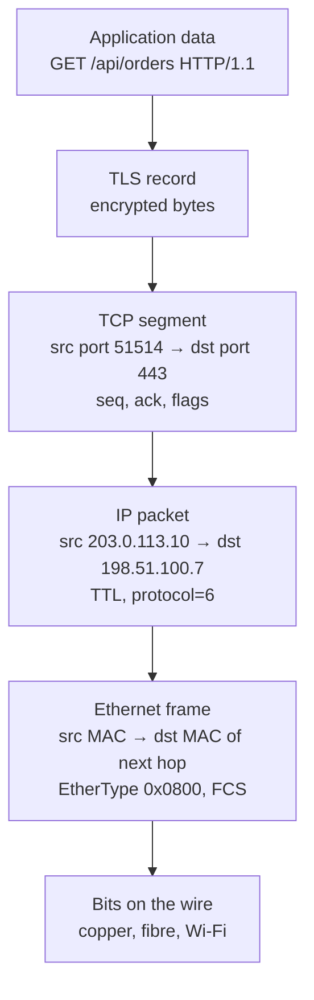
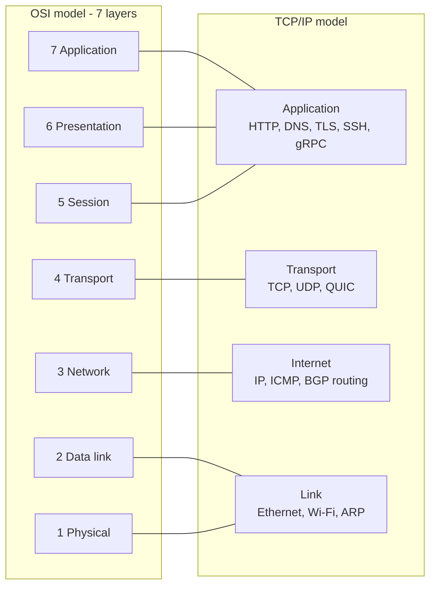

# L12.1 — OSI and TCP/IP Models

> **Level 12: Advanced Networking** · Topic 1 of 14 · ⏱ ~3 hours · Difficulty: Intermediate

## 1. What it is

A **network model** is a way to split the enormous problem "get these bytes from program A on one computer to program B on
another" into **layers**. Each layer solves one narrow problem, talks only to the layer directly above and below it, and
hides its details from everyone else. The two models you will meet are the **OSI model** (Open Systems Interconnection,
seven layers, a teaching and vocabulary tool published by ISO) and the **TCP/IP model** (four or five layers, the
architecture the real Internet actually runs on).

When a program sends data, every layer wraps it in its own envelope — a **header** (and sometimes a trailer) carrying that layer's
addressing and control information. This wrapping is called **encapsulation**; the receiver unwraps in reverse order
(**decapsulation**). If you remember one sentence from this topic: *a packet on the wire is an onion of headers, and every
network tool you own looks at one particular layer of the onion.*

## 2. Why it matters in DevOps

- **Debugging is layer-hunting.** "The site is down" can mean a dead cable (L1), a wrong VLAN or ARP entry (L2), a missing route or
  security group (L3), a closed port or exhausted ephemeral ports (L4), an expired certificate (L5/L6 in OSI terms) or a bad
  `Host` header (L7). Walking up from the bottom turns a vague outage into a yes/no question per layer.
- **Choosing the right product.** A "load balancer" at L4 (AWS NLB, HAProxy in `mode tcp`) and one at L7 (AWS ALB, Nginx, Envoy)
  have different capabilities, costs and failure modes. You cannot choose without knowing what each layer can see.
- **Security rules.** Security groups and NACLs reason about L3/L4 (IPs, ports); a WAF reasons about L7 (paths, headers, bodies).
- **Vocabulary for teammates.** "Is that an L4 or L7 problem?" is a question you will hear on every incident bridge.

## 3. Real-world system example

**An AWS request path.** A browser request to `https://shop.example.com` crosses several layers' worth of products, each operating at
a different layer of the stack (all publicly documented AWS behaviours):

| Layer of the onion | AWS/Linux component that works there | What it can "see" |
|---|---|---|
| L2 (Ethernet/ENI) | the instance's virtual NIC (ENI) | MAC addresses, frames |
| L3 (IP) | VPC route tables, Internet Gateway, NAT Gateway, security group source/CIDR rules, NACLs | IP addresses and protocol (TCP/UDP/ICMP) |
| L4 (TCP/UDP) | Network Load Balancer, security group port rules | IP + port, connection state — not HTTP |
| L5-L6 (TLS) | an ALB or CloudFront terminating HTTPS with an ACM certificate | the TLS handshake, SNI (server name), certificates |
| L7 (HTTP) | Application Load Balancer, AWS WAF, Nginx/Envoy inside the cluster | method, path, headers, cookies, body |

This is exactly why an **NLB can forward TLS traffic it cannot read** (it only needs IP and port), while an **ALB can route
`/api/*` to one target group and `/static/*` to another** (it terminates TLS and parses HTTP). The same split exists in
Kubernetes: a `Service` of type `LoadBalancer` is L4, an `Ingress` controller such as ingress-nginx or Envoy-based gateways is L7.

## 4. Diagram

How data from the `shop-api` is wrapped on its way down the stack — the TCP/IP model on the left, the OSI names on the right:





## 5. How it works

### The layers and the tools that live there

| OSI # | Name | PDU (unit of data) | Addressing | Typical protocols | Tools and products you use here |
|---|---|---|---|---|---|
| 7 | Application | message / request | URL, hostname | HTTP, gRPC, DNS, SMTP, SSH | `curl`, browser dev tools, Nginx, Envoy, ALB, WAF, API gateway |
| 6 | Presentation | — | — | TLS (encryption), JSON/Protobuf encoding | `openssl s_client`, cert-manager, mTLS |
| 5 | Session | — | — | TLS session resumption, RPC sessions | HTTP keep-alive and connection pools (informally) |
| 4 | Transport | segment (TCP) / datagram (UDP) | port numbers | TCP, UDP, QUIC (over UDP) | `ss`, `nc`, `nmap`, NLB, HAProxy `mode tcp`, security-group port rules |
| 3 | Network | packet | IP address | IPv4, IPv6, ICMP, BGP/OSPF for route exchange | `ip route`, `ping`, `traceroute`, `mtr`, route tables, NAT, iptables/nftables |
| 2 | Data link | frame | MAC address | Ethernet, ARP, VLAN (802.1Q), Wi-Fi | `ip neigh`, `ip link`, switches, bridges, `tcpdump -e` |
| 1 | Physical | bits | — | copper, fibre, radio | cables, SFP optics, NIC link lights, `ethtool` |

Notes that save arguments later:

- **OSI layers 5-7 collapse into "Application" in TCP/IP.** TLS is hard to place: it sits above TCP and below HTTP, so people call it
  "L5", "L6" or "L4.5". Say "TLS" and nobody is confused.
- **QUIC** (the transport under HTTP/3, topic 5) is a transport protocol implemented in user space *on top of UDP*, with TLS 1.3 built in —
  it blurs the L4/L5 line on purpose.
- **"L4 load balancer" vs "L7 load balancer"** simply means *the highest layer whose headers the device reads before deciding where to send the
  packet*. See also [L4 versus L7 Load Balancing](../level-02-networking/09-l4-vs-l7-load-balancing.md).
- **MTU (Maximum Transmission Unit)** is an L2/L3 limit — typically 1500 bytes for Ethernet payload. TCP's **MSS** (Maximum Segment Size) is derived from it
  (1460 for IPv4). Tunnels (VPNs, VXLAN, overlay networks) add headers and shrink the usable MTU — a classic source of "small requests work, large ones hang".

### Encapsulation overhead for one HTTP request

For a small request over a normal Ethernet link: Ethernet header 14 bytes + IPv4 header 20 + TCP header 20 (more with options) = **54+ bytes of
overhead before a single byte of your payload**. This is why chatty protocols and tiny messages are expensive, and why topic 10 (connection pooling) matters.

## 6. Step-by-step guide

**Prerequisites:** a Linux shell with `tcpdump`, `curl`, `ip`, `ss` (`sudo apt-get install -y tcpdump curl iproute2 python3`) and `sudo`. Everything stays on `127.0.0.1`.

1. **Start a tiny web server (L7) on a port (L4).**
   ```bash
   python3 -m http.server 8099 --bind 127.0.0.1 &
   ss -ltn 'sport = :8099'
   ```
   You should see a `LISTEN` socket on `127.0.0.1:8099` — the L4 endpoint (IP + port + protocol) that the application owns.

2. **Look at L2 and L3 of your own machine.**
   ```bash
   ip -br link        # interfaces and MAC addresses (L2)
   ip -br addr        # IP addresses (L3)
   ip route           # where packets go next (L3)
   ip neigh           # the ARP/NDP table: IP -> MAC (L2/L3 glue)
   ```
   Output is host-specific. Find your default gateway in `ip route` (`default via … dev eth0`) and its MAC in `ip neigh`.

3. **Capture one HTTP request and read the onion from the outside in.**
   ```bash
   sudo tcpdump -i lo -nn -e -v -c 8 'tcp port 8099' &
   sleep 1; curl -s -o /dev/null http://127.0.0.1:8099/
   ```
   Output (abridged, similar to):
   ```text
   00:00:00:00:00:00 > 00:00:00:00:00:00, ethertype IPv4 (0x0800), length 74: (tos 0x0, ttl 64, ..., proto TCP (6), length 60)
       127.0.0.1.58188 > 127.0.0.1.8099: Flags [S], seq 1393828775, win 65495, options [mss 65495,sackOK,TS ...], length 0
   ```
   Read it layer by layer: `ethertype IPv4` and the MACs are **L2** (all zero on loopback), `ttl 64 ... proto TCP (6)` is **L3**, `Flags [S]`
   with ports `58188 > 8099` is **L4**. The first three packets (`[S]`, `[S.]`, `[.]`) are the TCP three-way handshake.
   Checksum warnings such as `cksum ... (incorrect -> ...)` on `lo` are normal: the kernel skips checksums on loopback ("checksum offload").

4. **See the application layer in clear text.**
   ```bash
   sudo tcpdump -i lo -nn -A -c 12 'tcp port 8099' &
   sleep 1; curl -s -o /dev/null http://127.0.0.1:8099/
   ```
   `-A` prints payload as ASCII: you will see `GET / HTTP/1.1`, `Host: 127.0.0.1:8099`, `User-Agent: curl/…` and the `HTTP/1.0 200 OK` response. That is **L7**, readable because there is no TLS.

5. **Prove which layer fails: walk the stack with deliberate breakage.**
   ```bash
   curl -sS -m 3 http://127.0.0.1:8100/ ; echo "exit=$?"     # nothing listens on 8100
   curl -sS -m 3 http://127.0.0.1:8099/nope -o /dev/null -w '%{http_code}\n'
   ```
   The first command fails with `Failed to connect ... Connection refused` (exit 7): L3 worked (the host answered), **L4 refused** (RST — no listener).
   The second connects fine and returns `404`: L4 is healthy and the **L7** application said "no such path". "Refused" vs "timeout" vs "404" are three different layers.

6. **Map a real request path with `traceroute`/`mtr` (L3) and `curl -w` timings (L4-L7).**
   ```bash
   curl -s -o /dev/null -w 'dns=%{time_namelookup}s tcp=%{time_connect}s tls=%{time_appconnect}s ttfb=%{time_starttransfer}s total=%{time_total}s\n' https://example.com
   ```
   Output (values vary): the jumps between consecutive numbers are DNS, TCP handshake, TLS handshake and server think time — each belongs to a different layer.

7. **Clean up.**
   ```bash
   kill %1 2>/dev/null; jobs
   ```

## 7. Real-world scenario

*(Illustrative.)* After a deployment, `shop-api` pods can reach PostgreSQL for small queries, but the nightly report that returns 8 MB result sets hangs
forever. The on-call engineer works up the stack: DNS resolves (L7), TCP connects (L4), small queries return (so L3 routing is fine). Large responses stall —
a pattern that points at **MTU**. `ping -M do -s 1472 <db-ip>` fails but `-s 1372` succeeds: a new overlay network added a tunnel header, so full-size 1500-byte packets are
silently dropped because ICMP "fragmentation needed" messages were blocked by a firewall. Fix: lower the interface MTU on the overlay (or clamp TCP MSS) and allow
ICMP type 3 code 4. **Lesson:** the symptom appeared at L7 ("report hangs"), but the cause was an L2/L3 size limit; layered debugging found it in minutes.

## 8. Common mistakes and best practices

**Don't**

- Treat the OSI model as a literal description of real software — HTTP over TLS over TCP does not map neatly onto layers 5-7. Use it for vocabulary.
- Block all ICMP "for security" — Path MTU Discovery and `traceroute` break, producing hanging large transfers.
- Debug an L7 symptom only at L7 (reading app logs for an hour) before confirming the lower layers with `ping`, `ss`, `curl -v`.
- Say "the load balancer is down" without saying which layer — an L4 and an L7 balancer fail differently.

**Do**

- Debug **bottom-up** (is the link up, is there a route, is the port open, does TLS complete, does the app answer) or **split the stack in half** with `curl -v` first.
- Learn what each tool sees: `tcpdump` sees everything on the wire but can only decode TLS if you supply keys; `curl -v` shows L4-L7; `ss` shows L4 sockets.
- Keep an MTU budget in mind for any tunnel (VPN, VXLAN, GRE, WireGuard: typically 1420 inside a 1500 link).
- Use the layer in your incident notes: "L4 connection resets from the NLB", not "network issue".

## 9. Tasks

- [ ] **T1 — Label the onion** *(≈30 min, beginner)*
  - **Goal:** attach a layer to every field of a real packet capture.
  - **Steps:**
    1. Follow steps 1 and 3 of the guide and save the output: `sudo tcpdump -i lo -nn -e -v -c 8 'tcp port 8099' 2>&1 | tee capture.txt`.
    2. In `capture.txt`, mark each field with its OSI layer (MAC = L2, TTL = L3, ports and flags = L4).
    3. Identify which three packets are the TCP handshake.
  - **Done when:** your annotated file labels at least 8 fields correctly and names SYN, SYN-ACK and ACK.

- [ ] **T2 — Same request, three tools, three layers** *(≈30 min, beginner)*
  - **Goal:** show that each tool reports a different layer.
  - **Steps:**
    1. Run `ip route get 1.1.1.1` (L3), `ss -tn` while a `curl` is open (L4), and `curl -v http://127.0.0.1:8099/` (L7).
    2. Write one sentence per tool: what it observed and which layer it belongs to.
  - **Done when:** each sentence names a layer and quotes a specific field from the output.

- [ ] **T3 — Read a timing waterfall** *(≈30 min, intermediate)*
  - **Goal:** attribute latency to layers.
  - **Steps:**
    1. Run the `curl -w` command from step 6 against three different HTTPS sites (e.g. `example.com`, one from your own cloud, one in another region).
    2. Compute DNS = `time_namelookup`, TCP = `time_connect - time_namelookup`, TLS = `time_appconnect - time_connect`, server = `time_starttransfer - time_appconnect`.
  - **Done when:** you have a table of the four numbers for each site and one sentence on which layer dominates and why (distance, handshake round-trips, slow backend).

- [ ] **T4 — Break each layer on purpose** *(≈45 min, intermediate)*
  - **Goal:** recognise the signature of failure at L3, L4 and L7.
  - **Steps:**
    1. L7: request a missing path and record the status code.
    2. L4: connect to an unused port and record the error; then drop traffic silently with `sudo iptables -I INPUT -p tcp --dport 8099 -j DROP` and observe a **timeout** instead of "refused". Remove the rule with `sudo iptables -D INPUT -p tcp --dport 8099 -j DROP`.
    3. L3: `curl -m 3 http://192.0.2.1/` (a documentation address with no route to a real host) and record the result.
  - **Done when:** you can explain, from the error text alone, why "refused" (an active RST), "timeout" (silently dropped) and "404" (application answered) point to different layers.

- [ ] **T5 — Discover your path MTU** *(≈30 min, advanced)*
  - **Goal:** use L3 knowledge to find a size limit.
  - **Steps:**
    1. Run `ping -c 2 -M do -s 1472 example.com` (1472 bytes payload + 28 bytes of headers = 1500).
    2. Reduce `-s` until pings succeed; add 28 to get your path MTU.
    3. Explain what would change if you were behind a VPN that adds 60 bytes of overhead.
  - **Done when:** you report a measured MTU (typically 1500, or lower behind a tunnel) and the MSS TCP would derive from it.

- [ ] **T6 — Prove it: place the product** *(≈30 min, advanced)*
  - **Goal:** classify products by layer without notes.
  - **Steps:**
    1. On a blank page write each of: security group, NACL, AWS NLB, AWS ALB, WAF, Nginx, HAProxy `mode tcp`, `iptables`, Envoy, VPN gateway, CDN.
    2. Put each at the highest layer it inspects and list one thing it *cannot* do because of that.
    3. Check against section 3 and 5 and fix your errors, then explain the page to someone aloud.
  - **Done when:** at least 10 of 11 placements are correct and each has a correct "cannot do" example (for instance, an NLB cannot route on URL path).

## 10. Self-check questions

1. What does encapsulation mean, and in which order are headers added when sending?
2. Which layer does `Connection refused` come from, and how does it differ from a connect timeout?
3. Why can a Network Load Balancer pass TLS traffic through but not route on URL path?
4. Why does adding a VPN or overlay network sometimes make large transfers hang while small ones work?
5. Where does TLS sit in the OSI and TCP/IP models, and why is that awkward?
6. QUIC runs over UDP. Which responsibilities that TCP normally handles must QUIC implement itself?

<details>
<summary>Answers</summary>

1. Each layer wraps the data from the layer above in its own header: application data, then TLS record, then TCP, then IP, then Ethernet. The receiver removes them in reverse order.
2. Layer 4. "Refused" means the host answered with a TCP RST because nothing listens on that port; a timeout means packets were silently dropped (firewall, routing, host down).
3. It reads only IP and port (L4). The path is inside the encrypted HTTP payload, which only a device that terminates TLS and parses HTTP (an ALB or proxy) can see.
4. Tunnels add headers, reducing the usable MTU. Full-size packets exceed it and get dropped; if ICMP "fragmentation needed" is also blocked, Path MTU Discovery fails and the connection stalls.
5. Above TCP and below HTTP; it does not map cleanly to OSI 5 or 6, so it is usually just called "TLS" or "L4.5".
6. Reliability (retransmission), ordering per stream, congestion control, flow control and connection setup — plus its own encryption via integrated TLS 1.3.
</details>

## 11. Further reading

- *Computer Networking: A Top-Down Approach* by Kurose and Ross — the clearest layered treatment of the TCP/IP stack.
- *TCP/IP Illustrated, Volume 1* by W. Richard Stevens (and Kevin Fall, 2nd ed.) — packet-level detail with captures.
- RFC 1122 (Requirements for Internet Hosts) and RFC 9293 (TCP) — the primary sources; find them on rfc-editor.org.
- `man tcpdump`, `man ss`, `man ip` — option reference for the tools used above.
- Earlier in this roadmap: [IP, MAC, ARP and DHCP](../level-02-networking/01-ip-mac-arp-dhcp.md) and [Network Debugging Tools](../level-02-networking/10-network-debugging-tools.md).

<!-- nav -->
---
← Previous level: [Level 11 — Security / DevSecOps](../level-11-security-devsecops/README.md) · [Level 12 index](README.md) · Next: [BGP Fundamentals](02-bgp-fundamentals.md) →
