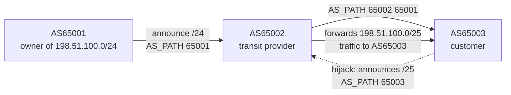
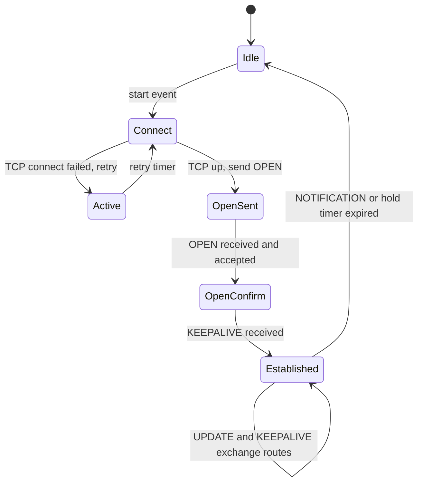

# L12.2 — BGP Fundamentals

> **Level 12: Advanced Networking** · Topic 2 of 14 · ⏱ ~4 hours · Difficulty: Advanced

## 1. What it is

The Internet is not one network; it is roughly a hundred thousand independently run networks glued together. Each of these is an
**Autonomous System (AS)**: a set of IP prefixes under one administrative policy, identified by an **AS Number (ASN)** such as `AS13335` (Cloudflare) or
`AS16509` (Amazon). **BGP — the Border Gateway Protocol (version 4, RFC 4271)** — is the protocol ASes use to tell each other *"I can reach these IP prefixes, and here
is the chain of ASes your traffic would cross."* Routers that speak BGP keep a table of prefixes, each with a list of candidate paths, pick the best, and re-advertise it to neighbours.

BGP is a **path-vector** protocol: every advertisement carries an **AS_PATH** (the ordered list of ASes it has crossed). It carries no notion of link speed or latency; it expresses **policy** (who do I
trust, who do I pay, who do I prefer). Inside your own AS you use other protocols (OSPF, IS-IS, static routes); BGP is the *inter-domain* protocol. Two flavours: **eBGP** between different ASes, **iBGP** between routers inside the same AS.

## 2. Why it matters in DevOps

- **Cloud connectivity runs on it.** AWS Direct Connect, Site-to-Site VPN with dynamic routing, Transit Gateway, Google Cloud Router and Azure ExpressRoute all use BGP. A mis-announced prefix is a connectivity outage.
- **Anycast and global availability.** CDNs, public DNS resolvers and DDoS scrubbers announce the *same* IP from many places using BGP (section 5). You cannot understand "why did users in Europe hit Frankfurt" without it.
- **Kubernetes on bare metal.** MetalLB (BGP mode), Calico and Cilium peer with top-of-rack routers to advertise Service and Pod IPs.
- **Blast radius is the whole Internet.** BGP trusts what neighbours say. Typos, leaks and hijacks cause outages for companies that did nothing wrong, and "we can't even reach our own servers to fix it" is a recurring theme in post-mortems.

## 3. Real-world system example

**Facebook, 4 October 2021.** Facebook has described the incident in its own engineering write-up. During routine maintenance on the global backbone, a command intended to assess
backbone capacity unintentionally disconnected Facebook's data centres from each other, and an audit tool that should have blocked the command failed to do so. Facebook's authoritative DNS servers are designed to
withdraw their BGP advertisements when they cannot reach the data centres (a health-check reaction to avoid serving bad answers). The result: the routes to the DNS servers disappeared from the Internet, `facebook.com`
stopped resolving, and the outage lasted roughly six hours. Recovery was slowed because internal tools and physical access systems depended on the same network. Lessons: **DNS, BGP and your own management plane are one dependency chain**, and an out-of-band path to your routers is not optional.

**Pakistan Telecom and YouTube, 24 February 2008.** Pakistan Telecom (AS17557) was ordered to block YouTube domestically and originated a more specific prefix, `208.65.153.0/24`, inside YouTube's `208.65.152.0/22`. The route leaked to its upstream
provider (PCCW, AS3491) and spread across the Internet. Because routers always prefer the **longest matching prefix**, much of the world's YouTube traffic flowed to Pakistan. YouTube responded by announcing more specific
prefixes of its own; the disruption lasted on the order of two hours. This is the textbook **prefix hijack by more-specific announcement**, and the reason RPKI and prefix filtering exist.

**Cloudflare, Google and AWS use BGP for anycast.** Cloudflare's `1.1.1.1` resolver and Google's `8.8.8.8` are single IP addresses announced from many data centres; each user is routed to a "nearby" one by BGP's shortest-AS-path preference. AWS Global Accelerator provides static anycast IP addresses
that enter the AWS network at the edge location nearest the user.

## 4. Diagram

How an announcement travels and how a hijack by a more specific prefix wins (this is what the lab below reproduces):



The BGP session itself is a small state machine over TCP port 179:



## 5. How it works

### Messages and sessions

| Message | Purpose |
|---|---|
| `OPEN` | Start a session: sends my ASN, hold time, router ID and capabilities (IPv6, 4-byte ASNs, route refresh, graceful restart) |
| `UPDATE` | Announce new/changed routes (prefix + attributes) **or withdraw** routes — the only message that changes the routing table |
| `KEEPALIVE` | Sent about every hold-time/3 to prove the neighbour is alive (default hold time often 90 s, 180 s in some implementations) |
| `NOTIFICATION` | Report an error and close the session |

If the hold timer expires with no KEEPALIVE/UPDATE, the neighbour is declared dead and **all its routes are withdrawn** — this is how a failed link or router "disappears" from the Internet.
Tuning faster detection is done with **BFD** (Bidirectional Forwarding Detection), which fails over in under a second.

### Key path attributes

| Attribute | Meaning |
|---|---|
| `AS_PATH` | ASes crossed so far. Used for loop prevention (a router rejects a path containing its own ASN) and as a tie-breaker (shorter is preferred) |
| `NEXT_HOP` | IP of the router to send packets to |
| `LOCAL_PREF` | iBGP-only preference inside your AS: higher wins. The main knob for "prefer provider A over B" |
| `MED` | Hint to a neighbour AS about which of your entry points you prefer (lower wins) |
| `ORIGIN`, `COMMUNITY` | Origin type and free-form tags that providers use to trigger actions (e.g. blackhole, do not export to X, set local-pref) |

### Best-path selection (simplified)

1. Longest prefix wins before BGP even compares — the forwarding table uses **longest-prefix match** (`/25` beats `/24`).
2. For the same prefix: highest `LOCAL_PREF` → shortest `AS_PATH` → lowest origin type → lowest MED → eBGP over iBGP → lowest IGP metric to next hop → lowest router ID.

### Policy: who gets what

Commercial relationships drive filters. **Customers** pay you (you announce their routes to everyone), **providers** you pay (you announce only your own and your customers' routes to them), **peers** exchange
traffic for free (you announce only your own and your customers' routes). Violating this — re-announcing a provider's routes to another provider — is a **route leak**.

### Anycast

**Anycast** means announcing the same prefix from multiple locations. Every location is a valid destination; BGP delivers each client to the topologically closest one (by AS-path length and policy). Withdraw the prefix at a
failing site and traffic automatically shifts to the next-closest. It underpins DNS roots, public resolvers and CDN edges, and works especially well for UDP and short, stateless requests. Because the path to a site can change mid-flow, long-lived TCP connections need care (e.g. consistent
hashing or connection-state design, topic 6).

### Securing BGP

- **Prefix filters / IRR objects:** accept from customers only the prefixes they are registered to originate.
- **Max-prefix limits:** tear down a session if a neighbour suddenly sends far more prefixes than expected.
- **RPKI (Resource Public Key Infrastructure) and ROV (Route Origin Validation):** the address owner publishes a signed **ROA** (Route Origin Authorization) saying "AS X may originate prefix P up to length N"; routers mark
  announcements `valid`, `invalid` or `not-found` and drop invalids. It stops many accidental hijacks but not forged AS paths.
- **MANRS** (Mutually Agreed Norms for Routing Security) is an industry programme describing baseline operator practices.

## 6. Step-by-step guide

You will build three routers as Linux **network namespaces** on one machine with the **BIRD 2** routing daemon, bring up two eBGP sessions, watch a route propagate, hijack it with a more specific prefix, then stop the hijack with a filter.
All addresses are private/documentation ranges; nothing touches the real Internet.

**Prerequisites:** a Linux VM or laptop with root (`sudo`); Docker is not needed. Install BIRD:

```bash
sudo apt-get update && sudo apt-get install -y bird2
sudo systemctl disable --now bird 2>/dev/null || true   # we will run our own instances
mkdir -p ~/bgplab && cd ~/bgplab
```

Topology: `AS65001 (r1)  ——10.12.0.0/30——  AS65002 (r2)  ——10.23.0.0/30——  AS65003 (r3)`. r1 owns `198.51.100.0/24` (a documentation range).

1. **Create the topology.**
   ```bash
   cat > mk.sh <<'EOF'
   #!/usr/bin/env bash
   set -euo pipefail
   for n in r1 r2 r3; do ip netns add $n; ip netns exec $n ip link set lo up; done
   ip link add v12a type veth peer name v12b
   ip link set v12a netns r1; ip link set v12b netns r2
   ip link add v23a type veth peer name v23b
   ip link set v23a netns r2; ip link set v23b netns r3
   ip netns exec r1 ip addr add 10.12.0.1/30 dev v12a; ip netns exec r1 ip link set v12a up
   ip netns exec r2 ip addr add 10.12.0.2/30 dev v12b; ip netns exec r2 ip link set v12b up
   ip netns exec r2 ip addr add 10.23.0.1/30 dev v23a; ip netns exec r2 ip link set v23a up
   ip netns exec r3 ip addr add 10.23.0.2/30 dev v23b; ip netns exec r3 ip link set v23b up
   EOF
   sudo bash mk.sh && ip netns list
   ```
   Expect `r3`, `r2`, `r1` to be listed.

2. **Write the three BIRD configs.** r1 originates the prefix; r2 is a transit that passes everything; r3 only listens.
   ```bash
   cat > r1.conf <<'EOF'
   router id 10.0.0.1;
   protocol device {}
   protocol static origin {
     ipv4;
     route 198.51.100.0/24 blackhole;     # the prefix AS65001 owns
   }
   protocol bgp to_r2 {
     local 10.12.0.1 as 65001;
     neighbor 10.12.0.2 as 65002;
     ipv4 { import all; export where source = RTS_STATIC; };
   }
   EOF
   cat > r2.conf <<'EOF'
   router id 10.0.0.2;
   protocol device {}
   protocol bgp to_r1 {
     local 10.12.0.2 as 65002;
     neighbor 10.12.0.1 as 65001;
     ipv4 { import all; export all; };
   }
   protocol bgp to_r3 {
     local 10.23.0.1 as 65002;
     neighbor 10.23.0.2 as 65003;
     ipv4 { import all; export all; };
   }
   EOF
   cat > r3.conf <<'EOF'
   router id 10.0.0.3;
   protocol device {}
   protocol bgp to_r2 {
     local 10.23.0.2 as 65003;
     neighbor 10.23.0.1 as 65002;
     ipv4 { import all; export none; };
   }
   EOF
   ```
   (BIRD 2 requires explicit `import`/`export` for eBGP; the `blackhole` static route just gives r1 something to announce.)

3. **Start the daemons, one per namespace.**
   ```bash
   for n in r1 r2 r3; do sudo ip netns exec $n bird -c $PWD/$n.conf -s $PWD/$n.ctl; done
   sleep 6
   for n in r1 r2 r3; do echo "== $n"; sudo birdc -s $PWD/$n.ctl show protocols | tail -n +3; done
   ```
   Expected (similar to): every `BGP` line shows `up ... Established`.

4. **Watch the route propagate.**
   ```bash
   sudo birdc -s $PWD/r3.ctl show route all
   ```
   ```text
   198.51.100.0/24      unicast [to_r2 07:45:32.028] * (100) [AS65001i]
           via 10.23.0.1 on v23b
           BGP.origin: IGP
           BGP.as_path: 65002 65001
           BGP.next_hop: 10.23.0.1
           BGP.local_pref: 100
   ```
   r3 learned r1's prefix with `as_path: 65002 65001` — it crossed AS65002 then originated in AS65001. That is the path vector.

5. **Withdraw and re-announce.**
   ```bash
   sudo birdc -s $PWD/r1.ctl disable to_r2; sleep 2; sudo birdc -s $PWD/r3.ctl show route   # table is empty
   sudo birdc -s $PWD/r1.ctl enable to_r2;  sleep 6; sudo birdc -s $PWD/r3.ctl show route   # route is back
   ```
   This is what a failed uplink looks like to the rest of the world: an `UPDATE` withdrawing the prefix, then convergence on the alternative (here, none).

6. **Hijack it with a more specific prefix.** r3 now announces `198.51.100.0/25`, which it does not own:
   ```bash
   cat > r3.conf <<'EOF'
   router id 10.0.0.3;
   protocol device {}
   protocol static mine {
     ipv4;
     route 198.51.100.0/25 blackhole;     # not ours: the hijack
   }
   protocol bgp to_r2 {
     local 10.23.0.2 as 65003;
     neighbor 10.23.0.1 as 65002;
     ipv4 { import all; export where source = RTS_STATIC; };
   }
   EOF
   sudo birdc -s $PWD/r3.ctl configure; sleep 4
   sudo birdc -s $PWD/r2.ctl show route
   sudo birdc -s $PWD/r2.ctl show route for 198.51.100.10
   ```
   ```text
   198.51.100.0/25      unicast [to_r3 ...] * (100) [AS65003i]   via 10.23.0.2 on v23a
   198.51.100.0/24      unicast [to_r1 ...] * (100) [AS65001i]   via 10.12.0.1 on v12b
   ...
   198.51.100.0/25      unicast [to_r3 ...] * (100) [AS65003i]   via 10.23.0.2 on v23a   <- lookup for .10 goes to the hijacker
   ```
   Both routes are in the table, but a packet for `198.51.100.10` matches the longer `/25` and goes to AS65003, even though AS65001's path is shorter and legitimate.

7. **Stop it with an inbound prefix filter on the transit.** Add to the top of `r2.conf` and change the `to_r3` session:
   ```bash
   python3 - <<'EOF'
   s = open('r2.conf').read()
   s = s.replace("neighbor 10.23.0.2 as 65003;\n  ipv4 { import all; export all; };",
                 "neighbor 10.23.0.2 as 65003;\n  ipv4 { import filter customer_r3_in; export all; };")
   s = '''filter customer_r3_in {
     # AS65003 may only originate 203.0.113.0/24 -- anything else is rejected
     if net ~ [ 203.0.113.0/24 ] then accept;
     reject;
   }
   ''' + s
   open('r2.conf', 'w').write(s)
   EOF
   sudo birdc -s $PWD/r2.ctl configure; sleep 2
   sudo birdc -s $PWD/r2.ctl show route
   ```
   Only the legitimate `198.51.100.0/24 ... [AS65001i]` remains. This is a miniature version of what real providers do with IRR/RPKI-derived customer prefix lists.

8. **Tear down.**
   ```bash
   for n in r1 r2 r3; do sudo birdc -s $PWD/$n.ctl down; done
   for n in r1 r2 r3; do sudo ip netns del $n; done
   ip netns list    # empty
   ```

## 7. Real-world scenario

*(Illustrative.)* `shop-api` runs in AWS `us-east-1` with a Direct Connect link to a partner's data centre, plus a backup Site-to-Site VPN, both with BGP. One Monday the partner's network team adds a new
`/24` and accidentally announces the VPN's prefix with a shorter AS path than the Direct Connect. Orders flow over the slower, encrypted VPN, latency doubles and the VPN gateway saturates; the on-call engineer sees p99 latency climb but no packet loss.
Investigation: `show route` on the router shows the preferred next hop changed; the AWS console's BGP status shows more prefixes received than expected. Fix: raise `LOCAL_PREF` on Direct Connect routes so provider choice is pinned by policy, not by AS-path accident,
and set a max-prefix limit and an inbound prefix-list on both sessions. **Lesson:** never leave path choice to implicit tie-breakers; set `LOCAL_PREF` explicitly and filter what you accept.

## 8. Common mistakes and best practices

**Don't**

- Accept all routes from a customer or peer ("`import all`") on a real network.
- Announce prefixes that are not yours — including "just a more specific for traffic engineering" without checking who else owns the space.
- Re-advertise routes learned from one provider to another (a route leak).
- Build a management plane that depends on the same network you are fixing (out-of-band access, console servers and a second DNS provider matter).
- Assume anycast keeps long-lived TCP flows pinned; path changes can reset them.

**Do**

- Filter inbound by prefix and AS-path, set max-prefix limits, and enable RPKI ROV where your platform supports it.
- Publish ROAs for your own prefixes in your RIR's portal.
- Use BFD for fast failure detection and graceful restart for planned maintenance.
- Set `LOCAL_PREF` explicitly for "primary" and "backup" links, and test failover during business hours before you need it.
- Monitor your prefixes from the outside (public looking glasses, RIPE RIS or RouteViews data, or a commercial BGP monitoring service) and alert on origin changes.

## 9. Tasks

- [ ] **T1 — Build the three-AS lab** *(≈45 min, intermediate)*
  - **Goal:** bring up two eBGP sessions and see a route with its AS path.
  - **Steps:**
    1. Follow guide steps 1-4 on a Linux VM with `sudo`.
    2. Run `sudo birdc -s $PWD/r2.ctl show protocols all to_r1` and find the neighbour AS, session type and capabilities.
  - **Done when:** `show route all` on r3 shows `BGP.as_path: 65002 65001` and all sessions read `Established`.

- [ ] **T2 — Watch a withdrawal** *(≈20 min, beginner)*
  - **Goal:** see how the rest of the network reacts when an origin disappears.
  - **Steps:**
    1. Run step 5 (`disable` then `enable`).
    2. Time how long it takes for the route to return on r3 after `enable`.
  - **Done when:** you have observed an empty table, then the route back, and can say which BGP message type carried the withdrawal.

- [ ] **T3 — Hijack and defend** *(≈45 min, advanced)*
  - **Goal:** reproduce a more-specific hijack and stop it with a filter.
  - **Steps:**
    1. Run steps 6 and 7.
    2. Change the filter so r3 may originate `203.0.113.0/24` only, add a static route for that prefix on r3 and confirm r2 accepts it while rejecting `198.51.100.0/25`.
  - **Done when:** `show route for 198.51.100.10` on r2 returns the `/24` via AS65001, and `203.0.113.0/24` is accepted from r3.

- [ ] **T4 — Break it: prepend and prefer** *(≈45 min, advanced)*
  - **Goal:** control path choice with policy.
  - **Steps:**
    1. Add a fourth router r4 (AS65004) connected to both r2 and r3 and originating `192.0.2.0/24`, or simply a second link r1-r3 so r3 has two paths to `198.51.100.0/24`.
    2. Make r3 prefer the longer AS-path by setting `bgp_local_pref = 200` on an import filter, and observe the best-path change with `show route all`.
    3. Undo it using AS-path prepending (`bgp_path.prepend(65001);` in an export filter) and observe the other direction.
  - **Done when:** `show route all` shows the chosen path flipping between the two sessions as you change local-pref and prepending, and you can state which attribute outranked which.

- [ ] **T5 — Read real outage data** *(≈45 min, intermediate)*
  - **Goal:** connect theory to a public incident.
  - **Steps:**
    1. Read Facebook's engineering post "More details about the October 4 outage" and Cloudflare's blog analysis of the same event.
    2. Draw the dependency chain (backbone → data centres → DNS servers' health check → BGP advertisement → DNS resolution → apps).
    3. Write down three changes that would have shortened recovery.
  - **Done when:** your diagram contains at least five links in the chain and your three proposals include an out-of-band access path.

- [ ] **T6 — Prove it: explain a hijack in five minutes** *(≈30 min, advanced)*
  - **Goal:** teach BGP trust to someone else.
  - **Steps:**
    1. Without notes, explain: AS, prefix, AS_PATH, longest-prefix match, why a `/25` beats a `/24`, and one control (filters, max-prefix, RPKI).
    2. Draw the topology from your lab on paper and mark where the filter sits.
  - **Done when:** a listener can state what RPKI ROV would have done to the `/25` announcement.

## 10. Self-check questions

1. What is an Autonomous System and what does an AS_PATH contain?
2. Why does a more specific prefix (`/25`) hijack traffic even when the legitimate `/24` has a shorter AS path?
3. How does a BGP neighbour failure become visible to the rest of the Internet?
4. How does anycast give you both "nearest site" and automatic failover?
5. What does RPKI ROV protect against, and what does it not?
6. In the Facebook 2021 outage, why did withdrawing BGP routes to DNS servers take the whole site down?

<details>
<summary>Answers</summary>

1. An AS is a set of IP prefixes under a single routing policy, identified by an ASN. AS_PATH is the ordered list of ASNs the announcement has crossed.
2. Forwarding uses longest-prefix match before any BGP preference comparison, so the `/25` is selected for addresses inside it.
3. The hold timer expires (or BFD declares the link down), the session closes, and the router sends UPDATE messages withdrawing all routes learned via that neighbour.
4. The same prefix is announced from many sites. Routers pick the best path (usually the shortest AS path), so users reach a nearby site; if a site withdraws, the next-best path takes over after convergence.
5. It validates that the origin AS is authorised for the prefix and length, stopping many accidental hijacks and origin mistakes; it does not validate the full AS path, so path forgery and some leaks remain possible.
6. The authoritative DNS servers withdrew their own routes after a health check failed; with no route to the DNS servers, nobody could resolve the domain, and internal tooling that relied on the same network could not be used to repair it quickly.
</details>

## 11. Further reading

- RFC 4271 (BGP-4), RFC 6811 (RPKI-based prefix origin validation) and RFC 7454 (BGP operations and security) at rfc-editor.org.
- *Internet Routing Architectures* by Sam Halabi, and *BGP* by Iljitsch van Beijnum (O'Reilly) — operator-focused introductions.
- Facebook Engineering, "More details about the October 4 outage"; Cloudflare's blog posts on the same event and on route leaks.
- The BIRD user's guide (bird.network.cz) and the MANRS website (manrs.org).
- Related topics in this level: [Load Balancing](06-load-balancing-algorithms.md) for global traffic steering and [DNS Architecture](03-dns-architecture.md) for anycast resolvers.

<!-- nav -->
---
← Previous: [OSI and TCP/IP Models](01-osi-and-tcpip-models.md) · [Level 12 index](README.md) · Next: [DNS Architecture](03-dns-architecture.md) →
