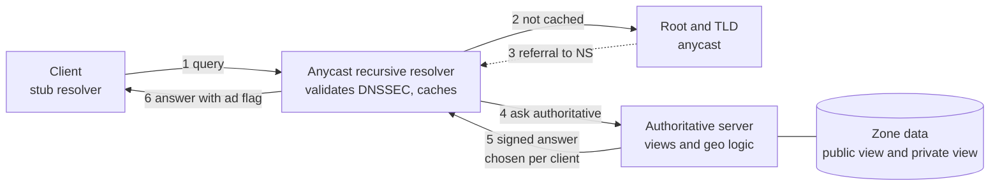
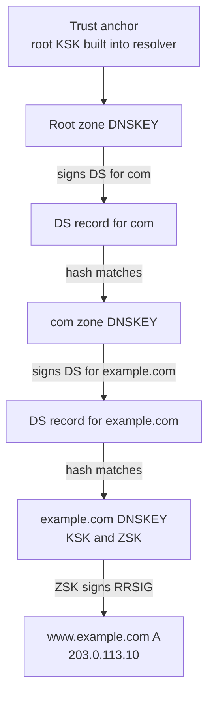

# L12.3 — DNS Architecture

> **Level 12: Advanced Networking** · Topic 3 of 14 · ⏱ ~4 hours · Difficulty: Advanced

## 1. What it is

The **Domain Name System (DNS)** turns names such as `api.example.com` into records (usually IP addresses). In [Level 2](../level-02-networking/05-dns-resolution.md) you learned the lookup path: a stub resolver asks a
**recursive resolver**, which walks the hierarchy (root → TLD → authoritative servers) and caches the answer for its **TTL** (time to live). This topic is about the *architecture* around that path at production scale:

- **Authoritative servers** hold the truth for a zone and answer only for it. **Recursive resolvers** (also called caching resolvers) answer for everyone by asking authoritative servers, and cache. Running both on one box is a classic mistake.
- **Anycast resolvers and authoritative servers:** one IP address announced from many locations over BGP ([topic 2](02-bgp-fundamentals.md)), so each client reaches a nearby instance and a failed site simply stops being announced.
- **Split-horizon DNS** (split-brain): the same name returns *different answers depending on who asks* — typically a private IP inside your network and a public IP outside.
- **GeoDNS / latency-based / weighted routing:** the authoritative server picks the answer based on where the resolver (or, with EDNS Client Subnet, the client) appears to be, or on health and weights.
- **DNSSEC (DNS Security Extensions):** zones are cryptographically signed so a validating resolver can detect forged or tampered answers.

## 2. Why it matters in DevOps

- **DNS is the dependency of every dependency.** Service discovery, TLS certificate issuance (ACME DNS-01), failover, canary releases and multi-region routing all work by changing DNS answers. When DNS is wrong, everything looks broken at once.
- **TTLs are your rollback speed.** A 24-hour TTL on `api.example.com` means a bad record cannot be fixed for up to a day for clients that already cached it; a 30-second TTL means more query load but fast cutover.
- **Failures are correlated and hard to see.** Caches hide a dead authoritative server for minutes or hours, then everything fails together. Retries from stubs and resolvers can multiply a small problem into a flood.
- **Hybrid networks need split-horizon.** Private hosted zones, VPN users and Kubernetes clusters each want to resolve `db.example.com` to a private address that must never be exposed publicly.
- **DNSSEC misconfiguration is an outage.** A validating resolver treats a broken signature as `SERVFAIL`, not as "unsigned", so an expired signature or a stale DS record takes your domain offline for validating users.

## 3. Real-world system example

**Public anycast resolvers.** Cloudflare (`1.1.1.1`), Google Public DNS (`8.8.8.8`) and Quad9 (`9.9.9.9`) each publish one address that is announced from many sites via BGP. A query from Lagos and a query from Frankfurt to `1.1.1.1`
reach different data centres. These services validate DNSSEC and document support for EDNS Client Subnet, QNAME minimisation and encrypted transports (DNS over TLS and DNS over HTTPS).

**The root and TLD servers.** The DNS root is served by 13 named server identities (`a.root-servers.net` … `m.root-servers.net`) operated by multiple organisations; each identity is anycast from hundreds of instances worldwide. Most large TLD operators and DNS hosting providers also use anycast.

**Amazon Route 53** offers public and **private hosted zones** (split-horizon by VPC association), plus weighted, latency, geolocation, failover and multi-value routing policies, with health checks that remove unhealthy endpoints from answers. **Kubernetes** runs CoreDNS as the in-cluster authoritative/forwarding
server for `cluster.local` and forwards everything else upstream ([Level 8, Service Discovery](../level-08-kubernetes/17-service-discovery.md)).

**Dyn, 21 October 2016.** A large DDoS attack by the Mirai botnet (compromised IoT devices) against the managed DNS provider Dyn made many customers' names unresolvable for parts of the day. Well-known sites including Twitter, Netflix, Reddit and GitHub were widely reported as affected for many users. The lesson that stuck: **a single DNS provider is a single point of failure**, and many organisations afterwards
added a second authoritative provider.

**Facebook, 4 October 2021** (see [BGP Fundamentals](02-bgp-fundamentals.md)): authoritative DNS servers withdrew their own BGP routes after a health check failed, so a backbone problem became a "the name does not exist anywhere" problem.

**AWS, 19-20 October 2025.** AWS's published post-event summary of the large `us-east-1` disruption attributes its start to a latent race condition in the DNS management automation for the DynamoDB regional endpoint, which left an empty DNS record for that endpoint; many dependent services were affected. The generic lesson: DNS automation is production code and needs the same guard rails as any deploy pipeline.

## 4. Diagram

Where each architectural piece sits on the path of one query:



How a validating resolver proves an answer, from the root's trust anchor down to your A record (the *chain of trust*):



## 5. How it works

### Authoritative versus recursive

| | Authoritative | Recursive (caching) resolver |
|---|---|---|
| Answers for | Only the zones it hosts | Any name, by querying others |
| Caches? | No (it is the source) | Yes, honouring TTL |
| Open to the Internet? | Yes, must be | Should be restricted or well rate-limited (open resolvers are abused for DDoS amplification) |
| Examples | BIND, NSD, Knot DNS, PowerDNS, Route 53, Cloudflare | Unbound, BIND, Knot Resolver, CoreDNS (forwarding), 1.1.1.1, 8.8.8.8 |

### Anycast for DNS

DNS over UDP is ideal for anycast: a request and response are one packet each, so a mid-flight route change rarely matters. Large queries and zone transfers use TCP, which tolerates anycast because sites are chosen by BGP and change rarely.
Operators add health-based **withdrawal**: a local agent checks the DNS daemon, and if it fails the site stops announcing the prefix, so traffic shifts to the next-closest site in seconds to minutes. Each site is also given a unique unicast address so you can talk to it directly (for debugging and zone transfers).
You can often ask *which* instance answered with `dig CH TXT id.server @<resolver>` or `dig +nsid`; the exact identifiers are operator-specific.

### Split-horizon

Two ways to implement it:

1. **Views** in the DNS server (BIND `view` with `match-clients`): one server, different zone files by source IP. Simple but easy to leak private data if the match rule is too broad.
2. **Separate servers or private zones** (Route 53 private hosted zones, CoreDNS in a cluster, a corporate resolver forwarding `corp.example.com`): clearer blast radius and the preferred cloud pattern.

Rules of thumb: private zones must only be reachable from private networks; keep public and private zone content as similar as possible (otherwise engineers debug the wrong horizon); make sure every record that exists in both has the same *meaning*.

### GeoDNS and traffic-steering policies

| Policy | Chooses answer by | Typical use |
|---|---|---|
| Geolocation | Country or continent of the resolver (or ECS client subnet) | Data residency, regional content |
| Latency-based | Measured latency from the resolver's region to your regions | Multi-region APIs |
| Weighted | Fixed percentages | Canary and migration ([Level 5, Canary](../level-05-cicd/12-canary-deployments.md)) |
| Failover | Health check status (primary/secondary) | Active-passive DR |
| Multi-value / round-robin | Several healthy records returned | Cheap client-side load spreading |

Limits: the authoritative server sees the **recursive resolver's** address, not the user's. If a user in Berlin uses a resolver in the US, GeoDNS thinks they are in the US. **EDNS Client Subnet (ECS, RFC 7871)** passes a truncated client prefix upstream to fix this, at a privacy and cache-efficiency cost; some public resolvers do not send it.
GeoDNS also cannot steer faster than TTLs expire, so pair it with short TTLs and health checks, or use anycast or a global load balancer ([topic 6](06-load-balancing-algorithms.md)) for fast failover.

### DNSSEC essentials

- Each zone has a **ZSK** (zone-signing key) that signs every record set, producing an `RRSIG`, and a **KSK** (key-signing key) that signs the `DNSKEY` set. Public keys are published as `DNSKEY` records.
- The parent zone holds a **DS** (delegation signer) record, a hash of the child's KSK. This is the link in the chain of trust, and it is created *at your registrar*, not in your zone.
- **NSEC / NSEC3** records provide authenticated denial of existence ("this name really does not exist").
- Signatures have **inception and expiration times** (a few weeks is typical) and must be re-signed before they expire. Modern servers (BIND `dnssec-policy`, Knot, PowerDNS, managed providers) automate signing and key rollover.
- A validating resolver sets the **AD** (Authenticated Data) flag on good answers and returns `SERVFAIL` for bogus ones. `dig +cd` (checking disabled) shows what the resolver would have returned without validation.
- DNSSEC protects *integrity*, not confidentiality. It does not encrypt (that is DoT/DoH), and it adds larger responses and more operational risk, which is why adoption varies by organisation.

### DNS failures at scale

| Failure | Mechanism | Mitigation |
|---|---|---|
| Single DNS provider down or DDoSed | All NS records point to one operator | Two independent providers with synchronised zones |
| Long TTL on a bad record | Resolvers legitimately keep serving the old data | Lower TTL *before* planned changes; keep default TTLs moderate (60-300 s for dynamic records) |
| Negative caching | `NXDOMAIN` is cached for the SOA minimum | Avoid creating a name right after clients probed it; keep the SOA negative TTL short |
| Retry storms | Clients and resolvers retry on timeout, multiplying load on struggling servers | Capacity headroom, response rate limiting, jittered backoff ([topic 14](14-circuit-breakers.md)) |
| Resolver overload in-cluster | Many pods, `ndots:5`, search domains: each lookup becomes several queries | NodeLocal DNSCache, tune `ndots`, use trailing dots on external names |
| UDP truncation, MTU black holes | Large (DNSSEC) responses fragment or get dropped | EDNS buffer size around 1232 bytes, TCP fallback works |
| Expired DNSSEC signatures or stale DS | Validators return SERVFAIL | Monitor signature expiry; automate rollovers; coordinate DS changes with the registrar |
| Circular dependency | The DNS servers' own address or the config system depends on DNS | Hard-code critical IPs, out-of-band access ([BGP topic](02-bgp-fundamentals.md)) |
| Bad automation | A script deletes or empties a record set | Review and staged rollout for DNS changes, backups of zone data, delete protection |

## 6. Step-by-step guide

You will build a tiny DNS system on one Linux machine using loopback addresses: an authoritative **BIND** server with split-horizon and geo-style views, then DNSSEC signing, then a validating **Unbound** resolver that catches a forged answer.
No Internet traffic is used and all names are fake (`example.com` is reserved for documentation, and you will serve it only to yourself).

**Prerequisites:** Ubuntu/Debian with root (`sudo`), about 15 minutes, free. Verified with BIND 9.18 and dig from `dnsutils`.

1. **Install and create loopback "client" addresses.** We pretend 127.0.0.3 is an internal host, 127.0.0.4 is a European user and 127.0.0.1 is everyone else. BIND only listens on addresses that exist on an interface.
   ```bash
   sudo apt-get update && sudo apt-get install -y bind9 dnsutils unbound
   sudo systemctl disable --now named unbound 2>/dev/null || true
   for ip in 2 3 4; do sudo ip addr add 127.0.0.$ip/32 dev lo; done
   mkdir -p ~/dns-lab/zones ~/dns-lab/keys && cd ~/dns-lab
   ```

2. **Write three versions of the zone.** Same names, different answers per audience.
   ```bash
   mk() { # $1=file  $2=www  $3=api  $4=db
   cat > zones/$1 <<EOF
   \$TTL 300
   @   IN SOA ns1.example.com. admin.example.com. ( 1 3600 600 86400 300 )
       IN NS  ns1.example.com.
   ns1 IN A   127.0.0.2
   www IN A   $2
   api IN A   $3
   db  IN A   $4
   EOF
   }
   mk example.com.zone          203.0.113.10  203.0.113.20 203.0.113.30   # public
   mk example.com.internal.zone 10.0.1.10     10.0.1.20    10.0.2.30      # private
   mk example.com.eu.zone       198.51.100.10 198.51.100.20 203.0.113.30  # Europe region
   ```
   Paste each block exactly as shown (the closing `EOF` must start at column 0 in your terminal).

3. **Configure BIND with views.** Order matters: the first view whose `match-clients` matches wins.
   ```bash
   cat > named.conf <<EOF
   options {
     directory "$PWD";
     listen-on port 5300 { 127.0.0.2; };
     listen-on-v6 { none; };
     pid-file "$PWD/named.pid";
     recursion no;               # authoritative only
     dnssec-validation no;
   };
   acl eu_clients { 127.0.0.4; };
   view "internal" { match-clients { 127.0.0.3; };
     zone "example.com" { type primary; file "zones/example.com.internal.zone"; }; };
   view "eu" { match-clients { eu_clients; };
     zone "example.com" { type primary; file "zones/example.com.eu.zone"; }; };
   view "default" { match-clients { any; };
     zone "example.com" { type primary; file "zones/example.com.zone"; }; };
   EOF
   named-checkconf named.conf && echo config OK
   sudo named -c $PWD/named.conf -u root     # daemonises; use "-g" in another terminal to watch the log
   ```

4. **Ask the same question from three "places".** `-b` chooses the source address.
   ```bash
   for src in 127.0.0.3 127.0.0.4 127.0.0.1; do
     printf '%s -> ' $src; dig @127.0.0.2 -p 5300 -b $src www.example.com +short
   done
   ```
   ```text
   127.0.0.3 -> 10.0.1.10        # internal horizon
   127.0.0.4 -> 198.51.100.10    # "Europe" GeoDNS answer
   127.0.0.1 -> 203.0.113.10     # everyone else
   ```
   This is exactly what Route 53 private hosted zones and geolocation records do, with the match based on VPC association or resolver location instead of a source IP.

5. **Switch to a signed zone.** Stop BIND and use one zone with `dnssec-policy default` (ECDSA P-256 keys, automatic signing and rollover). `inline-signing` keeps your plain zone file untouched.
   ```bash
   sudo pkill named; sleep 1
   cat > signed.conf <<EOF
   options { directory "$PWD"; listen-on port 5300 { 127.0.0.2; }; listen-on-v6 { none; };
             pid-file "$PWD/signed.pid"; recursion no; dnssec-validation no; };
   zone "example.com" { type primary; file "zones/example.com.zone"; key-directory "keys";
                        inline-signing yes; dnssec-policy default; };
   EOF
   sudo named -c $PWD/signed.conf -u root; sleep 3
   ls keys
   dig @127.0.0.2 -p 5300 www.example.com +dnssec +noall +answer
   ```
   ```text
   Kexample.com.+013+60187.key  Kexample.com.+013+60187.private  Kexample.com.+013+60187.state
   www.example.com.  300 IN A      203.0.113.10
   www.example.com.  300 IN RRSIG  A 13 3 300 20261023072821 20261009112931 60187 example.com. QR9DRJp...
   ```
   Your key tag (`60187`) and dates will differ. The `RRSIG` fields are: type covered, algorithm 13 (ECDSA P-256), labels, original TTL, **expiration**, **inception**, key tag, signer, signature. With the default policy the key is a combined signing key; in a real deployment you then publish its DS at your registrar:
   ```bash
   dnssec-dsfromkey -2 keys/Kexample.com.+013+*.key
   # example.com. IN DS 60187 13 2 486E8BCD...   (give this to your registrar)
   ```

6. **Validate with Unbound.** Real resolvers start from the root's trust anchor; here we install your zone's public key as a local trust anchor and point a stub zone at your server.
   ```bash
   KEY=$(dig @127.0.0.2 -p 5300 example.com DNSKEY +short | head -1)
   cat > unbound.conf <<EOF
   server:
     interface: 127.0.0.1
     port: 5301
     do-ip6: no
     access-control: 127.0.0.0/8 allow
     do-not-query-localhost: no
     chroot: ""
     username: ""
     pidfile: "$PWD/unbound.pid"
     trust-anchor: "example.com. DNSKEY $KEY"
   stub-zone:
     name: "example.com"
     stub-addr: 127.0.0.2@5300
   EOF
   unbound-checkconf unbound.conf
   unbound -c $PWD/unbound.conf; sleep 2
   dig @127.0.0.1 -p 5301 www.example.com | grep -E 'status|flags'
   ```
   ```text
   ;; ->>HEADER<<- opcode: QUERY, status: NOERROR, id: 51796
   ;; flags: qr rd ra ad; QUERY: 1, ANSWER: 1, AUTHORITY: 0, ADDITIONAL: 1
   ```
   The `ad` flag means the resolver cryptographically verified the answer.

7. **Forge an answer and watch validation reject it.** Replace the signed server with an unsigned one that returns an attacker's address for the same zone, simulating a spoofed or hijacked authoritative server.
   ```bash
   sudo pkill named; sleep 1
   sed 's/203.0.113.20/192.0.2.66/' zones/example.com.zone > zones/forged.zone
   cat > forged.conf <<EOF
   options { directory "$PWD"; listen-on port 5300 { 127.0.0.2; }; listen-on-v6 { none; };
             pid-file "$PWD/forged.pid"; recursion no; dnssec-validation no; };
   zone "example.com" { type primary; file "zones/forged.zone"; };
   EOF
   sudo named -c $PWD/forged.conf -u root; sleep 3
   dig @127.0.0.1 -p 5301 api.example.com | grep -E 'status|flags'          # validating: refuses
   dig @127.0.0.1 -p 5301 api.example.com +cd +short                         # checking disabled: forged IP appears
   ```
   ```text
   ;; ->>HEADER<<- opcode: QUERY, status: SERVFAIL, id: 15286
   ;; flags: qr rd ra; QUERY: 1, ANSWER: 0, AUTHORITY: 0, ADDITIONAL: 1
   192.0.2.66
   ```
   `SERVFAIL` instead of a wrong IP is DNSSEC doing its job. It is also what *your* users see if your signatures expire or your DS is stale, which is why monitoring matters.

8. **Clean up.**
   ```bash
   sudo pkill named; pkill unbound
   for ip in 2 3 4; do sudo ip addr del 127.0.0.$ip/32 dev lo; done
   cd ~ && rm -r ~/dns-lab
   ```

## 7. Real-world scenario

*(Illustrative.)* `shop-api` is moving from a single `us-east-1` deployment to two regions. The team creates a latency-based record set for `api.example.com` with a 60-second TTL and health checks on each region's load balancer, and a private hosted zone so that internal callers resolve `db.example.com` to private addresses.
On cutover day, p99 for European users improves, but a partner behind a corporate resolver 300 ms from them still lands in `us-east-1`, because their resolver does not send EDNS Client Subnet. Later that month a Terraform change accidentally deletes the health check on the Frankfurt endpoint; when Frankfurt degrades, DNS keeps sending traffic there until the TTL-bound failover is fixed by hand.
Investigation: `dig +short api.example.com @<resolver>` from several vantage points, comparing answers; `dig +trace` to confirm the authoritative answer; checking health check status in the console. Fix: restore health checks as code with delete protection, document that latency routing is resolver-based, and add synthetic probes from several regions.
**Lesson:** DNS-based steering is coarse and TTL-bound. Treat its records and health checks like production code, and use an anycast or global load balancer in front when you need sub-minute failover.

## 8. Common mistakes and best practices

**Don't**
- Point all NS records at a single provider or a single anycast network.
- Combine authoritative and recursive service on a public-facing server, or leave a recursive resolver open to the world.
- Leave 24-hour TTLs on records you may need to change in an emergency.
- Enable DNSSEC by hand without automation, monitoring of signature expiry, or a tested process for DS updates at the registrar.
- Expose private zone contents through a too-broad split-horizon match rule.
- Assume GeoDNS knows where the *user* is.

**Do**
- Use two independent authoritative providers (or at least separate failure domains) and test failover.
- Lower the TTL a day before a planned migration, and raise it again afterward.
- Manage DNS as code (Terraform, OctoDNS or similar) with review, CI checks and delete protection ([Level 7](../level-07-terraform-iac/01-providers-and-resources.md)).
- Monitor from outside: resolve your key names from several networks and alert on `SERVFAIL`, latency and DNSSEC signature lifetime.
- Run a local caching resolver (NodeLocal DNSCache in Kubernetes) and tune `ndots` for external lookups.
- Document which horizon a given engineer is querying when debugging.

## 9. Tasks

- [ ] **T1 — Build the three-horizon authoritative server** *(≈25 min, intermediate)*
  - **Goal:** serve different answers for the same name to internal, "EU" and default clients.
  - **Steps:**
    1. Follow steps 1-4 of the guide.
    2. Run the three `dig -b` queries for `www`, `api` and `db`.
  - **Done when:** the table of nine answers matches the zone files, and `db.example.com` returns a private address only to 127.0.0.3.

- [ ] **T2 — Add a fourth horizon** *(≈20 min, intermediate)*
  - **Goal:** extend views safely.
  - **Steps:**
    1. Add `127.0.0.5` as a loopback address and a new view `apac` returning `192.0.2.10` for `www`, placed *before* the `default` view.
    2. Run `named-checkconf`, restart, query from `127.0.0.5` and from `127.0.0.1`.
    3. Move the `apac` view *after* `default` and re-test.
  - **Done when:** you can show that view order changes the answer and explain why (first match wins).

- [ ] **T3 — Sign the zone and inspect the chain** *(≈25 min, advanced)*
  - **Goal:** produce and read DNSSEC data.
  - **Steps:**
    1. Follow step 5; fetch `DNSKEY`, `RRSIG` and compute the `DS` with `dnssec-dsfromkey`.
    2. Convert the RRSIG expiration timestamp (`YYYYMMDDHHMMSS`) to a date and state how many days of validity remain.
  - **Done when:** you can state which record the registrar needs and why signature expiry would cause `SERVFAIL`.

- [ ] **T4 — Break and fix validation** *(≈25 min, advanced)*
  - **Goal:** reproduce a bogus-answer outage and recover.
  - **Steps:**
    1. Follow steps 6 and 7 to get `SERVFAIL` through Unbound.
    2. Restart the signed server and flush the resolver (`unbound-control` is disabled by default; simply restart Unbound).
    3. Re-query and confirm `ad` returns.
  - **Done when:** you have output showing `SERVFAIL` then `NOERROR` with `ad`, and can explain what `+cd` showed.

- [ ] **T5 — Measure TTL and cache behaviour** *(≈20 min, intermediate)*
  - **Goal:** see caching hide a failure.
  - **Steps:**
    1. With the signed server up, query Unbound for `www.example.com` and note the TTL.
    2. Stop BIND and query again every 30 seconds; watch the TTL count down and the answer persist.
    3. After the TTL expires, observe `SERVFAIL`.
  - **Done when:** you can state, with timestamps, how long the cache masked the outage.

- [ ] **T6 — Prove it: design DNS for `shop-api`** *(≈45 min, advanced)*
  - **Goal:** explain a resilient DNS architecture without notes.
  - **Steps:**
    1. Without the guide, redo T1 and T4 from scratch.
    2. Write one page: two authoritative providers, TTL policy per record type, private vs public horizon, DNSSEC rollout plan with monitoring, and how you would detect and roll back a bad change within 5 minutes.
  - **Done when:** the lab works from memory and a colleague can find no single point of failure in your page.

## 10. Self-check questions

1. Why is anycast a good fit for DNS over UDP, and how does a site "fail over"?
2. A user in Berlin gets the US answer from your GeoDNS. Name two plausible causes.
3. What is the difference between `RRSIG`, `DNSKEY` and `DS`, and which one lives in the parent zone?
4. Your DNSSEC signatures expired overnight. What do validating and non-validating users see?
5. You must move `api.example.com` to a new load balancer with minimal downtime. What do you do with the TTL and when?
6. Why do many teams use two DNS providers after the Dyn incident?

<details><summary>Answers</summary>

1. A query and answer are single small packets, so a routing change mid-flow almost never breaks anything; each site announces the same prefix and a health agent withdraws it when the DNS daemon fails, so BGP moves traffic to the next-nearest site.
2. They use a resolver located in the US (public or corporate) that does not send EDNS Client Subnet, or the GeoIP database mis-locates the resolver address; also cached answers from an earlier location.
3. `DNSKEY` is a zone's public key, `RRSIG` is the signature over a record set, and `DS` is a hash of the child's KSK published in the **parent** zone to link the chain of trust.
4. Validating resolvers return `SERVFAIL` (outage for those users); non-validating resolvers keep resolving normally, so the problem is partial and hard to notice without validating probes.
5. Lower the TTL (for example to 60 s) at least one old-TTL period before the change, make the switch, verify, then raise the TTL again.
6. A single provider is a single point of failure for the whole name; with two independent providers serving the same zone, resolvers can still reach the other provider if one is under attack or down.
</details>

## 11. Further reading

- RFC 1034 and RFC 1035 (DNS concepts and implementation); RFC 4033-4035 (DNSSEC); RFC 7871 (EDNS Client Subnet); RFC 9199 (considerations for large authoritative DNS operators).
- BIND 9 Administrator Reference Manual (views, `dnssec-policy`) and the Unbound documentation, both on isc.org and nlnetlabs.nl.
- Amazon Route 53 Developer Guide (routing policies, private hosted zones).
- Cloudflare Learning Center articles on DNS, anycast and DNSSEC; the AWS post-event summaries archive; the root-servers.org site.
- Cricket Liu and Paul Albitz, *DNS and BIND*.

<!-- nav -->
---
← Previous: [BGP Fundamentals](02-bgp-fundamentals.md) · [Level 12 index](README.md) · Next: [TLS](04-tls.md) →
