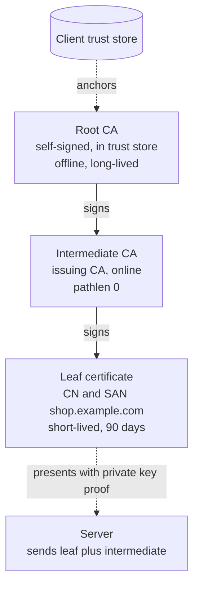
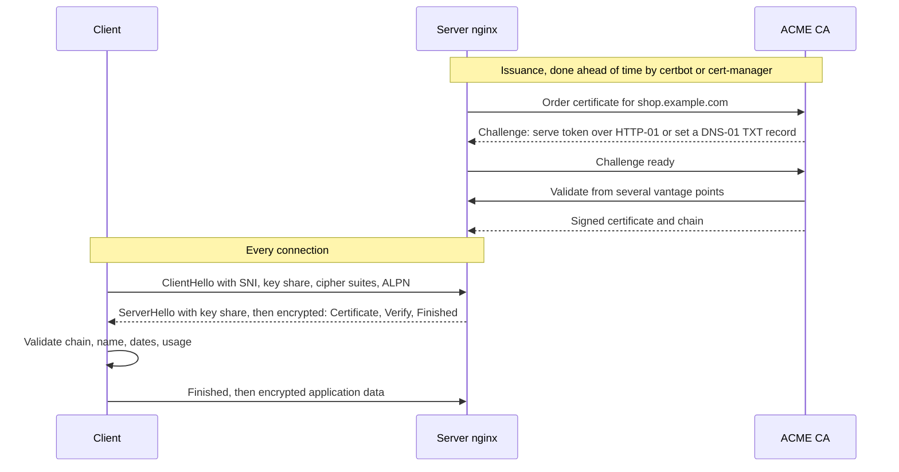

# L12.4 — TLS

> **Level 12: Advanced Networking** · Topic 4 of 14 · ⏱ ~5 hours · Difficulty: Advanced

## 1. What it is

**Transport Layer Security (TLS)** is the protocol that gives a TCP (or, with QUIC, UDP) connection three properties: **confidentiality** (nobody on the path can read it), **integrity** (nobody can alter it undetected) and **authentication** (you are really talking to `shop.example.com`, not an impostor).
[Level 2](../level-02-networking/06-tcp-and-tls-handshakes.md) walked through one handshake. This topic is about running TLS in production: where trust comes from, how certificate chains are built and validated, how certificates are issued and renewed automatically, which cipher suites to allow, and how to rotate everything without an outage.

The trust system behind it is a **PKI (Public Key Infrastructure)**: a **Certificate Authority (CA)** signs a certificate that binds a name (or other identity) to a public key. Your client already trusts a small set of **root CAs** (shipped with the OS, browser or container image). A server presents its **leaf certificate** plus the **intermediate certificates** linking it to a trusted root; the client verifies each signature up the **chain**, checks names, dates and usage, and only then trusts the key.

## 2. Why it matters in DevOps

- **Expired certificates are one of the most common self-inflicted outages.** Nothing is wrong with your code; every client simply refuses to connect. They happen at 3 a.m. because someone's calendar reminder was the only automation.
- **Chain mistakes are invisible from your laptop.** Browsers cache intermediates and can fetch missing ones; `curl`, Java, Python, mobile apps and other servers cannot. "Works in Chrome, fails in the webhook client" is almost always an incomplete chain.
- **Certificate lifetimes are shrinking.** The CA/Browser Forum has approved a schedule that cuts maximum public certificate validity to 200 days (from March 2026), 100 days (March 2027) and 47 days (March 2029). Manual renewal stops being viable; automation (ACME) is mandatory.
- **Security posture and compliance.** Weak protocols (TLS 1.0/1.1, SSLv3), weak ciphers, missing forward secrecy or an exposed private key lead to audit failures and real compromise.
- **Everything else in this level depends on it:** [TLS termination](11-tls-termination.md), [mTLS](12-mtls.md), service meshes and HTTP/3 all reuse these concepts.

## 3. Real-world system example

**Let's Encrypt** (run by the nonprofit ISRG, Internet Security Research Group) issues free certificates automatically over the **ACME** protocol (Automatic Certificate Management Environment, RFC 8555). Its certificates have been 90 days by default, with clients such as `certbot`, `acme.sh`, Caddy, Traefik and cert-manager (Kubernetes) renewing roughly every 60 days without human involvement. It publishes a **staging** environment with generous rate limits for testing. Let's Encrypt has also been moving towards shorter-lived certificates and away from OCSP towards CRLs.
On 30 September 2021 the old "DST Root CA X3" cross-sign expired. Modern clients were fine because Let's Encrypt's own root, **ISRG Root X1**, was already trusted, but older devices and some OpenSSL 1.0.x-based software that lacked ISRG Root X1 or mishandled the alternate chain failed with certificate errors. It is a textbook case of "your trust store is part of your system".

**Certificate Transparency (CT).** Public CAs must log the certificates they issue in public, append-only CT logs, and browsers check for proof of logging. Anyone (including you) can monitor logs such as crt.sh for certificates issued for your domains, which detects mis-issuance.

**Cloud providers.** AWS Certificate Manager (ACM) issues and automatically renews public certificates for use on ALB, CloudFront and API Gateway; the private key never leaves the service. Google Cloud and Azure offer similar managed certificates. Cloudflare terminates TLS at its edge for millions of sites and offers modern TLS defaults (TLS 1.3, HTTP/3).
**Kubernetes** uses TLS everywhere internally (API server, etcd, kubelet) and the **cert-manager** project automates issuance and renewal for Ingress resources.

## 4. Diagram

The chain a client builds and validates (the server sends the leaf and intermediate; the root comes from the client's trust store):



TLS 1.3 handshake and the point where automation (ACME) fits in:



## 5. How it works

### What a certificate contains (X.509)

| Field | Why it matters |
|---|---|
| **Subject / SAN** (Subject Alternative Name) | The DNS names or IPs the certificate is valid for. Clients check the **SAN**; the old Common Name (CN) is ignored by modern clients |
| **Issuer** and **signature** | Who vouched for it and the math that proves it |
| **Validity** (`notBefore`, `notAfter`) | Hard time window; clock skew breaks it |
| **Public key** | RSA (2048+) or ECDSA (P-256 is common); Ed25519 is not yet widely used for public web certs |
| **Basic Constraints** | `CA:TRUE` for CAs, `CA:FALSE` for leaves; `pathlen` limits how many CAs may follow |
| **Key Usage / EKU** | What the key may do: `serverAuth`, `clientAuth` (needed for [mTLS](12-mtls.md)), `digitalSignature`, `keyCertSign` |
| **AIA / CRL / OCSP / SCT** | Where to fetch the issuer, revocation info, and Certificate Transparency proofs |

### Chain validation, in order

1. Build a path from the leaf up to a root in the client's trust store using the intermediates the server sent (and AKI/SKI identifiers).
2. Verify each signature, validity period, `CA:TRUE` and `pathlen` for every CA, and that the leaf's EKU allows the intended use.
3. Match the requested hostname against the SAN list (wildcards `*.example.com` match exactly one label).
4. Optionally check revocation (CRL/OCSP) or a stapled OCSP response; many clients "soft-fail", which is why short lifetimes are the real mitigation.

The server must send **leaf + intermediates** (never the root, never the leaf alone). nginx wants them concatenated in one file (`fullchain.pem`).

### ACME: automated issuance

ACME proves you control a name before the CA signs anything. Challenges:

| Challenge | You prove control by | Good for | Limits |
|---|---|---|---|
| **HTTP-01** | Serving a token at `http://name/.well-known/acme-challenge/<token>` on port 80 | Single public web servers | Needs port 80 reachable; no wildcards |
| **DNS-01** | Creating a `_acme-challenge.name` TXT record | Wildcards, internal services, load-balanced fleets | Needs DNS API credentials (guard them, scope them) |
| **TLS-ALPN-01** | Answering a special TLS handshake on port 443 | Environments where port 80 is blocked | Fewer clients support it |

Typical clients: `certbot` (from the EFF), `acme.sh`, `lego`, Caddy (built in), cert-manager (Kubernetes). Always test with the CA's **staging** endpoint first to avoid rate limits.

### Cipher suites and protocol versions

- **TLS 1.3** (RFC 8446) has only five AEAD suites, three of which are in common use: `TLS_AES_128_GCM_SHA256`, `TLS_AES_256_GCM_SHA384`, `TLS_CHACHA20_POLY1305_SHA256`. Key exchange is always ephemeral (ECDHE) so you get **forward secrecy**: stealing the server key later does not decrypt recorded traffic. There is nothing to tune beyond the list.
- **TLS 1.2** needs care. A modern suite name reads `ECDHE-ECDSA-AES256-GCM-SHA384`: key exchange (ECDHE gives forward secrecy), certificate key type (ECDSA or RSA), bulk cipher (AES-GCM or ChaCha20-Poly1305) and hash. Allow only ECDHE + AEAD suites. Remove RSA key exchange, CBC modes, 3DES, RC4 and export ciphers.
- **TLS 1.0 and 1.1 are deprecated (RFC 8996)**; disable them. SSLv3 is long dead.
- Use a vetted starting point such as the Mozilla SSL Configuration Generator ("intermediate" for general web, "modern" if you control all clients) rather than inventing a list.
- Other knobs: **ALPN** (selects `h2`/`http/1.1`, essential for [HTTP/2 and HTTP/3](05-http2-http3-quic.md)), **OCSP stapling**, **HSTS** (tells browsers to only use HTTPS), **session resumption/tickets** (fewer full handshakes).
- **SNI (Server Name Indication)** is sent in plaintext in the ClientHello, which is why one IP can host many certificates, and why on-path observers can see the hostname (Encrypted Client Hello is the emerging fix).

### Rotation

A rotation plan answers: *what renews it, how does the new cert reach the process, and how do we know it worked?*

| Layer | Practice |
|---|---|
| Leaf certs | Automate with ACME, renew at 2/3 of lifetime, reload (not restart) the server; monitor expiry in days |
| Private keys | Generate on the server, never in tickets or Git. Consider a fresh key per renewal; keep file mode `0600` |
| Intermediates | CAs rotate them; always serve the chain your CA gives you at issuance time |
| Roots | Hard to rotate: depends on client trust stores. Pin to nothing unless you must, and if you pin pin the intermediate or use a backup pin |
| Internal CAs | Short-lived leaves (hours to days) plus an offline root; see [mTLS and SPIFFE](12-mtls.md) |
| Alerting | Probe from outside and alert at 21, 14 and 7 days before expiry; the *monitor* must not depend on the renewal job it is checking |

## 6. Step-by-step guide

You will build a two-level private PKI with OpenSSL, serve it with nginx, inspect what the client sees, break the chain on purpose, restrict protocols and ciphers, and rotate the certificate with a zero-downtime reload. Everything runs on loopback (`127.0.0.1:8443`), free, and was verified with OpenSSL 3.0, nginx 1.24 and curl 8.5.

**Prerequisites:** Linux (or WSL2/macOS with OpenSSL 3), `openssl`, `curl`, `nginx`, `tcpdump` (root for the capture). `sudo apt-get install -y nginx openssl curl tcpdump` on Ubuntu; stop the packaged service so it does not hold port 80: `sudo systemctl disable --now nginx`.
If your shell sets `https_proxy`, run `unset https_proxy HTTPS_PROXY` first or `curl` will try to send loopback traffic through the proxy.

1. **Create a root CA and an intermediate.** The root signs only the intermediate and in real life would then be taken offline.
   ```bash
   mkdir -p ~/tls-lab/pki && cd ~/tls-lab/pki
   # Root CA: self-signed, 10 years
   openssl req -x509 -newkey ec -pkeyopt ec_paramgen_curve:P-256 -nodes \
     -keyout root.key -out root.crt -days 3650 -subj "/O=Example Lab/CN=Example Lab Root CA" \
     -addext "basicConstraints=critical,CA:TRUE" -addext "keyUsage=critical,keyCertSign,cRLSign"
   # Intermediate: CSR then sign with the root; pathlen:0 means it may only sign leaves
   openssl req -newkey ec -pkeyopt ec_paramgen_curve:P-256 -nodes -keyout inter.key -out inter.csr \
     -subj "/O=Example Lab/CN=Example Lab Issuing CA 1"
   printf 'basicConstraints=critical,CA:TRUE,pathlen:0\nkeyUsage=critical,keyCertSign,cRLSign\nsubjectKeyIdentifier=hash\nauthorityKeyIdentifier=keyid\n' > inter.ext
   openssl x509 -req -in inter.csr -CA root.crt -CAkey root.key -CAcreateserial -out inter.crt -days 1825 -extfile inter.ext
   ```
   Expected: `Certificate request self-signature ok` and `subject=O = Example Lab, CN = Example Lab Issuing CA 1`.

2. **Issue a leaf certificate** for `shop.example.com` (and `api.example.com`) valid for 90 days, good for server authentication only.
   ```bash
   openssl req -newkey ec -pkeyopt ec_paramgen_curve:P-256 -nodes -keyout leaf.key -out leaf.csr -subj "/CN=shop.example.com"
   printf 'basicConstraints=critical,CA:FALSE\nkeyUsage=critical,digitalSignature\nextendedKeyUsage=serverAuth\nsubjectAltName=DNS:shop.example.com,DNS:api.example.com\nauthorityKeyIdentifier=keyid\n' > leaf.ext
   openssl x509 -req -in leaf.csr -CA inter.crt -CAkey inter.key -CAcreateserial -out leaf.crt -days 90 -extfile leaf.ext
   cat leaf.crt inter.crt > fullchain.pem       # leaf first, then intermediate; never the root
   openssl x509 -in leaf.crt -noout -subject -issuer -dates -ext subjectAltName
   ```
   ```text
   subject=CN = shop.example.com
   issuer=O = Example Lab, CN = Example Lab Issuing CA 1
   notBefore=Oct  9 12:32:24 2026 GMT
   notAfter=Jan  7 12:32:24 2027 GMT
   X509v3 Subject Alternative Name:
       DNS:shop.example.com, DNS:api.example.com
   ```

3. **Verify the chain the way a client would.** Verification of the leaf alone fails because the issuer is unknown; adding the intermediate fixes it.
   ```bash
   openssl verify -CAfile root.crt leaf.crt                       # error 20: unable to get local issuer certificate
   openssl verify -CAfile root.crt -untrusted inter.crt leaf.crt  # leaf.crt: OK
   ```

4. **Serve it with nginx on port 8443.** Use a private config so you do not touch the system's nginx.
   ```bash
   cd ~/tls-lab && mkdir -p nginx/logs
   cat > nginx/nginx.conf <<EOF
   worker_processes 1;
   daemon off;
   error_log $PWD/nginx/logs/error.log;
   pid $PWD/nginx/nginx.pid;
   events {}
   http {
     access_log off;
     server {
       listen 127.0.0.1:8443 ssl;
       server_name shop.example.com;
       ssl_certificate     $PWD/pki/fullchain.pem;
       ssl_certificate_key $PWD/pki/leaf.key;
       ssl_protocols TLSv1.2 TLSv1.3;
       location / { return 200 "hello from shop.example.com\n"; }
     }
   }
   EOF
   nginx -t -e $PWD/nginx/logs/error.log -c $PWD/nginx/nginx.conf   # syntax is ok / test is successful
   nginx -e $PWD/nginx/logs/error.log -c $PWD/nginx/nginx.conf &     # runs in the background
   sleep 1
   R="--resolve shop.example.com:8443:127.0.0.1"   # map the name to loopback without editing /etc/hosts
   curl -sS $R --cacert pki/root.crt https://shop.example.com:8443/
   curl -sS $R https://shop.example.com:8443/ ; echo "exit=$?"
   ```
   Expected: `hello from shop.example.com` with your private root as trust anchor, and `curl: (60) SSL certificate problem: unable to get local issuer certificate` without it (the system store does not know your CA, which is exactly what should happen).

5. **Inspect what the client negotiated.**
   ```bash
   curl -sv $R --cacert pki/root.crt https://shop.example.com:8443/ 2>&1 | grep -E 'SSL connection|subject:|issuer:|expire date|ALPN'
   echo | openssl s_client -connect 127.0.0.1:8443 -servername shop.example.com -CAfile pki/root.crt 2>/dev/null | sed -n '/Certificate chain/,/Server certificate/p'
   ```
   Look for `TLSv1.3 / TLS_AES_256_GCM_SHA384`, `0 s:CN = shop.example.com i:...Issuing CA 1` and `1 s:...Issuing CA 1 i:...Root CA`. The server sends two certificates; the root is not sent.

6. **Break the chain on purpose.** Serve the leaf alone, reload and compare the client error with step 4's.
   ```bash
   sed -i 's#pki/fullchain.pem#pki/leaf.crt#' nginx/nginx.conf
   kill -HUP $(cat nginx/nginx.pid); sleep 1
   curl -sS $R --cacert pki/root.crt https://shop.example.com:8443/    # curl: (60) ... unable to get local issuer certificate
   sed -i 's#pki/leaf.crt#pki/fullchain.pem#' nginx/nginx.conf
   kill -HUP $(cat nginx/nginx.pid); sleep 1
   curl -sS $R --cacert pki/root.crt https://shop.example.com:8443/    # works again
   ```
   Same error text as an unknown CA, different root cause: this is why you test with a **clean** client (`curl`, `openssl s_client`, SSL Labs) and not only a browser.

7. **Restrict protocols and cipher suites.** Edit the `ssl_protocols` line, reload, and attempt old protocol versions.
   ```bash
   sed -i 's/ssl_protocols TLSv1.2 TLSv1.3;/ssl_protocols TLSv1.3;/' nginx/nginx.conf
   nginx -t -c $PWD/nginx/nginx.conf && kill -HUP $(cat nginx/nginx.pid); sleep 1
   echo | openssl s_client -connect 127.0.0.1:8443 -servername shop.example.com -tls1_2 2>&1 | grep -E 'alert'
   ```
   ```text
   ...ssl3_read_bytes:tlsv1 alert protocol version...SSL alert number 70
   ```
   Now allow TLS 1.2 again but offer only one TLS 1.2 suite (add `ssl_ciphers ECDHE-ECDSA-CHACHA20-POLY1305;` below `ssl_protocols`). A client that insists on `-cipher ECDHE-ECDSA-AES128-GCM-SHA256` gets `sslv3 alert handshake failure` (alert 40), while default clients negotiate `ECDHE-ECDSA-CHACHA20-POLY1305`.
   TLS 1.3 suites are not controlled by `ssl_ciphers` in nginx/OpenSSL.

8. **Watch what is visible on the wire.** The hostname (SNI) is sent in clear even with TLS 1.3; the certificate is encrypted in 1.3 but visible in 1.2.
   ```bash
   sudo timeout 5 tcpdump -i lo -n -A 'tcp port 8443' > /tmp/cap.txt &
   sleep 1; curl -s $R --cacert pki/root.crt https://shop.example.com:8443/ >/dev/null; sleep 5
   grep -a -o 'shop.example.com' /tmp/cap.txt | head -1       # SNI in the ClientHello
   ```
   Repeat after allowing TLS 1.2 and run `curl --tlsv1.2 --tls-max 1.2 ...`; then `grep -a -c 'Example Lab' /tmp/cap.txt` is non-zero because the certificate subject travels unencrypted in TLS 1.2.

9. **Rotate the certificate with zero downtime.** Issue a second leaf with a new key, switch the files, and reload. nginx starts new workers with the new certificate while old workers finish in-flight requests.
   ```bash
   cd pki
   openssl req -newkey ec -pkeyopt ec_paramgen_curve:P-256 -nodes -keyout leaf2.key -out leaf2.csr -subj "/CN=shop.example.com"
   openssl x509 -req -in leaf2.csr -CA inter.crt -CAkey inter.key -CAcreateserial -out leaf2.crt -days 30 -extfile leaf.ext
   cat leaf2.crt inter.crt > fullchain2.pem; cd ..
   get() { echo | openssl s_client -connect 127.0.0.1:8443 -servername shop.example.com 2>/dev/null | openssl x509 -noout -serial -enddate; }
   get
   sed -i 's#fullchain.pem#fullchain2.pem#; s#leaf.key#leaf2.key#' nginx/nginx.conf
   nginx -t -c $PWD/nginx/nginx.conf && kill -HUP $(cat nginx/nginx.pid); sleep 1
   get
   ```
   The serial number and `notAfter` change while the port never closed. If `nginx -t` fails, the reload is skipped and the old certificate keeps serving, which is the behaviour you want from an automated renewer (`certbot --deploy-hook "nginx -t && systemctl reload nginx"`).

10. **ACME on a real server (optional, free).** On a VPS with a DNS name pointing at it and port 80 open, use the staging CA first:
    ```bash
    sudo apt-get install -y certbot python3-certbot-nginx
    sudo certbot --nginx -d shop.example.com --staging --register-unsafely-without-email --agree-tos
    sudo certbot renew --dry-run                 # proves the renewal path works
    systemctl list-timers | grep certbot         # certbot's twice-daily renewal timer
    ```
    Output is similar to `Congratulations! You have successfully enabled HTTPS`. Remove `--staging` to get a browser-trusted certificate. Use your own domain: `example.com` is reserved and cannot be validated.

11. **Clean up.**
    ```bash
    kill $(cat ~/tls-lab/nginx/nginx.pid); rm -r ~/tls-lab /tmp/cap.txt
    ```

## 7. Real-world scenario

*(Illustrative.)* A partner reports that webhooks from `shop-api` have started failing with `certificate verify failed: unable to get local issuer certificate`. The site looks fine in a browser and the monitoring check (an HTTPS GET from the same host) is green.
Investigation: `openssl s_client -connect api.example.com:443 -servername api.example.com` shows a chain depth of one: only the leaf. Last week a deploy replaced `fullchain.pem` with `cert.pem` while moving certbot output paths in the Nginx role. Browsers repair the chain using the intermediate they cached or fetch via AIA; the partner's Java client cannot.
Fix: point `ssl_certificate` back to `fullchain.pem`, reload, and add a CI check that fetches the served chain with `openssl s_client` and fails unless `openssl verify` succeeds with a clean trust store. Add an external probe that verifies the chain and alerts under 21 days to expiry.
**Lesson:** test TLS from a client that does not "help" you, and treat certificate files and renewals as code.

## 8. Common mistakes and best practices

**Don't**
- Serve only the leaf certificate, or include the root in the chain.
- Rely on a calendar reminder to renew; or on a browser check to validate the chain.
- Commit private keys, or reuse one key across environments and years.
- Disable verification (`curl -k`, `verify=False`, `InsecureSkipVerify`) to "fix" an error; fix the trust.
- Keep TLS 1.0/1.1, RC4, 3DES or static-RSA key exchange for a legacy client you no longer have.
- Pin leaf certificates in mobile apps without a rotation plan.
- Forget that wildcard certificates share one key across many hosts: a leak is bigger.

**Do**
- Use ACME everywhere possible, with short lifetimes and a tested `renew --dry-run`.
- Monitor expiry and chain validity from outside the system, and alert days ahead.
- Start from the Mozilla intermediate or modern profile, enable HSTS only after HTTPS works everywhere, and review settings annually.
- Reload, do not restart; validate with `nginx -t` (or the equivalent) before reloading.
- Watch Certificate Transparency for unexpected certificates for your domains.
- Keep roots offline and intermediates scoped (`pathlen:0`) in internal PKIs; issue short-lived leaves.

## 9. Tasks

- [ ] **T1 — Build and inspect a two-level PKI** *(≈30 min, intermediate)*
  - **Goal:** create root, intermediate and leaf, and read their fields.
  - **Steps:**
    1. Do steps 1-3 of the guide.
    2. Print each certificate with `openssl x509 -noout -text` and find `CA:TRUE`, `pathlen`, the SAN and EKU.
  - **Done when:** `openssl verify -CAfile root.crt -untrusted inter.crt leaf.crt` prints `OK` and you can point to the field that makes the intermediate unable to sign another CA.

- [ ] **T2 — Serve and verify with a clean client** *(≈25 min, intermediate)*
  - **Goal:** run nginx with the chain and see what a client receives.
  - **Steps:**
    1. Do steps 4-5.
    2. Capture `openssl s_client -showcerts` output and count certificates in the chain.
  - **Done when:** curl returns the page with `--cacert` and fails with exit code 60 without it, and you can explain both.

- [ ] **T3 — Break and fix the chain** *(≈20 min, advanced)*
  - **Goal:** reproduce the "works in browser, fails in the API client" bug.
  - **Steps:**
    1. Do step 6, then try `openssl s_client -connect ... -CAfile pki/root.crt` and note `Verify return code: 21`.
    2. Fix it and re-verify, then write the CI one-liner that would have caught it.
  - **Done when:** the check script exits non-zero with the broken chain and zero with the good chain.

- [ ] **T4 — Harden protocols and ciphers** *(≈25 min, advanced)*
  - **Goal:** enforce a policy and prove it.
  - **Steps:**
    1. Set TLS 1.3 only, then TLS 1.2 + 1.3 with one AEAD suite (step 7).
    2. Test each with `openssl s_client -tls1_2`, `-tls1_3` and `-cipher ...`; record accepted vs rejected cases in a table.
  - **Done when:** your table matches the alerts you observed (70 protocol version, 40 handshake failure) and the config passes `nginx -t`.

- [ ] **T5 — Zero-downtime rotation plus an expiry monitor** *(≈40 min, advanced)*
  - **Goal:** automate rotation and detect near-expiry.
  - **Steps:**
    1. Run a loop `while true; do curl -s $R --cacert pki/root.crt https://shop.example.com:8443/ || echo FAIL; sleep 0.2; done` in a second terminal.
    2. Rotate the certificate (step 9) while the loop runs.
    3. Write a script that exits 1 if the served leaf expires in under 21 days (`openssl x509 -checkend $((21*86400))`), and test it with a 10-day certificate.
  - **Done when:** the loop prints no `FAIL` across the rotation and your script flags the 10-day certificate.

- [ ] **T6 — Prove it: explain a certificate outage** *(≈45 min, advanced)*
  - **Goal:** diagnose from scratch.
  - **Steps:**
    1. Without the guide, rebuild the PKI and nginx, then have a friend (or a script) break one thing: expiry, wrong SAN, missing intermediate or wrong key.
    2. Using only `openssl s_client`, `openssl x509` and `curl -v`, identify which failure it is and fix it.
    3. Write a five-line runbook: symptoms, command, expected vs actual output, fix, prevention.
  - **Done when:** you correctly diagnose all four failure types and your runbook fits in one screen.

## 10. Self-check questions

1. Why must a server send the intermediate certificate but not the root?
2. A site works in Chrome but not in `curl` or a Java client. What is the most likely cause and how do you confirm it?
3. What gives TLS 1.3 forward secrecy, and why does it matter if the server key is stolen next year?
4. Compare ACME HTTP-01 and DNS-01: when must you use DNS-01?
5. Which cipher-suite name components tell you whether a TLS 1.2 suite is acceptable today?
6. Your certificate expires in three days and renewal is failing. What do you do, in order?

<details><summary>Answers</summary>

1. The client needs the intermediate to connect the leaf to a trusted root and cannot be expected to find it; the root is already in the client's trust store, and sending it adds no trust (a client that does not have it should not trust it).
2. An incomplete chain (leaf only). Browsers cache or fetch intermediates; other clients do not. Confirm with `openssl s_client -connect host:443 -servername host` and look at the number of certificates and `Verify return code`.
3. Ephemeral (EC)DH key exchange, whose per-connection secrets are discarded; a later key theft cannot decrypt recorded traffic. The server key is only used to sign the handshake.
4. HTTP-01 proves control via a file on port 80; DNS-01 proves it via a TXT record. Use DNS-01 for wildcard certificates, servers not reachable from the Internet, or fleets behind load balancers.
5. ECDHE (forward secrecy), AEAD cipher (GCM or ChaCha20-Poly1305) and not CBC/RC4/3DES/static RSA key exchange.
6. Check the logs and run the renewer manually or with a dry-run; fix the cause (DNS credentials, port 80 blocked, rate limit); if it cannot be fixed fast, issue a certificate manually through another route or use a cloud-managed certificate; deploy and reload; verify from outside; then add monitoring and a postmortem action.
</details>

## 11. Further reading

- RFC 8446 (TLS 1.3), RFC 5280 (X.509 and chain validation), RFC 8555 (ACME), RFC 8996 (deprecating TLS 1.0/1.1), RFC 6962 and RFC 9162 (Certificate Transparency).
- Let's Encrypt documentation (letsencrypt.org/docs), including staging environment and rate limits; certbot and cert-manager documentation.
- Mozilla SSL Configuration Generator and the Mozilla "Server Side TLS" guidelines.
- OpenSSL `openssl-x509`, `openssl-req`, `openssl-verify` and `openssl-s_client` manual pages.
- Ivan Ristić, *Bulletproof TLS and PKI*.

<!-- nav -->
---
← Previous: [DNS Architecture](03-dns-architecture.md) · [Level 12 index](README.md) · Next: [HTTP/2, HTTP/3 and QUIC](05-http2-http3-quic.md) →
