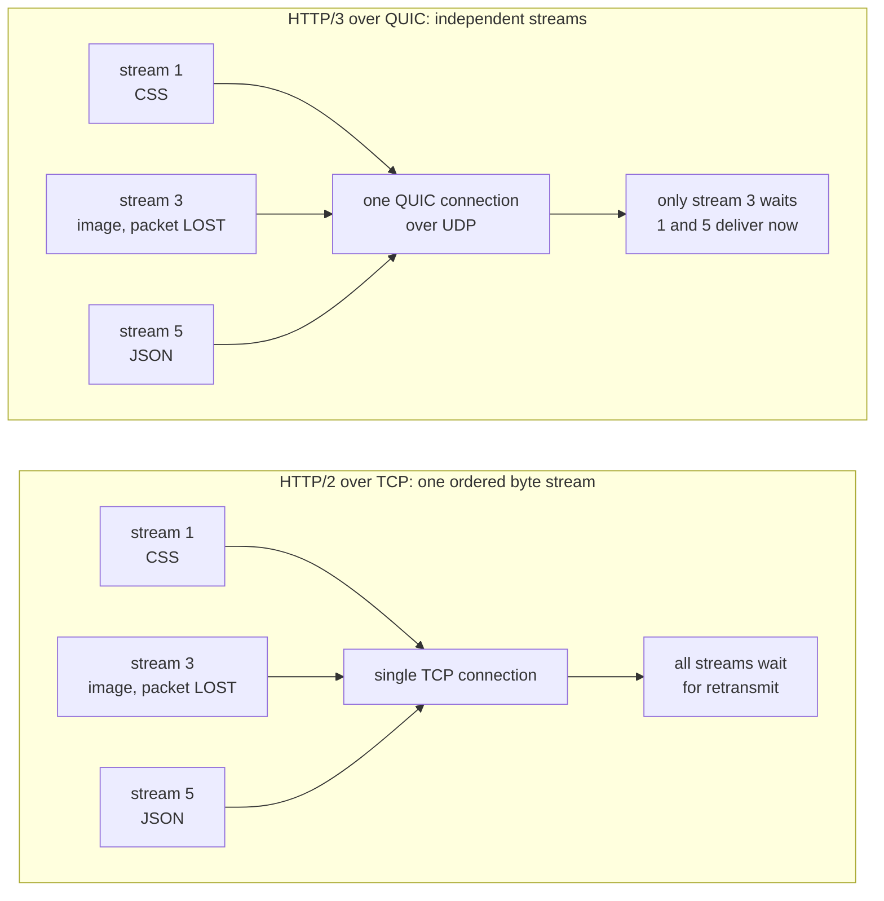
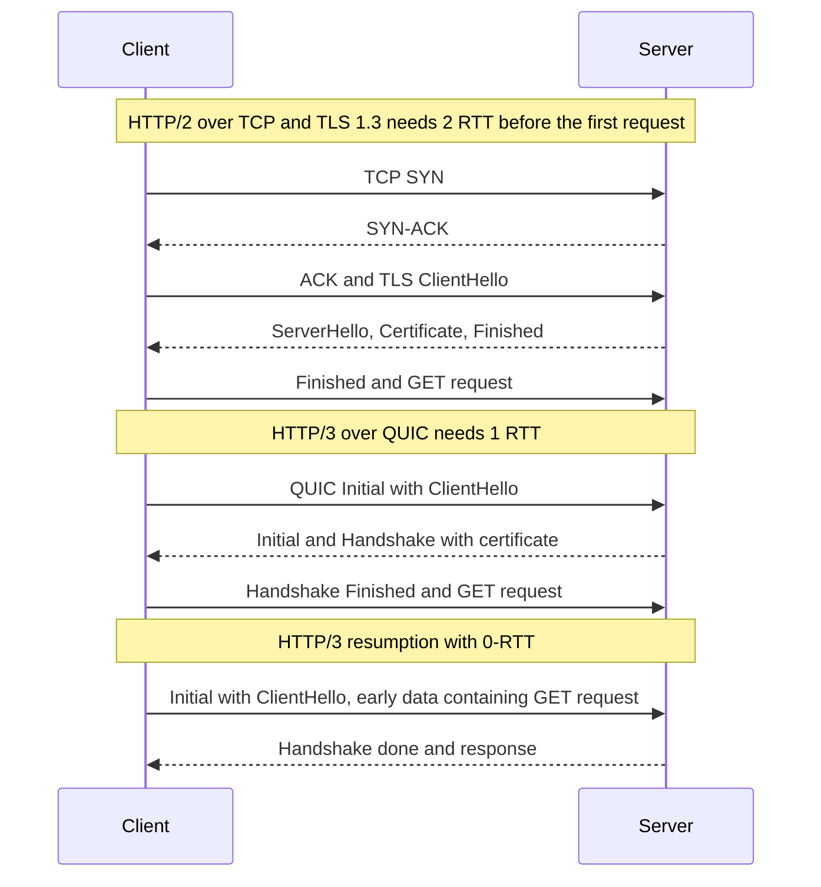

# L12.5 — HTTP/2, HTTP/3 and QUIC

> **Level 12: Advanced Networking** · Topic 5 of 14 · ⏱ ~4 hours · Difficulty: Advanced

## 1. What it is

HTTP has three wire formats in use today, all carrying the same semantics (methods, status codes, headers, bodies from [Level 2](../level-02-networking/07-http-methods-and-status-codes.md)):

- **HTTP/1.1** sends text requests one at a time per TCP connection. To get parallelism a browser opens about six connections per host.
- **HTTP/2 (RFC 9113)** keeps *one* TCP+TLS connection and splits it into binary **frames** belonging to numbered **streams**. Many requests and responses are **multiplexed** (interleaved) on the same connection, and headers are compressed with **HPACK**.
- **HTTP/3 (RFC 9114)** maps the same stream model onto **QUIC (RFC 9000)**, a transport that runs over **UDP**, has TLS 1.3 built into its handshake, and handles loss and ordering **per stream** instead of per connection.

The reason HTTP/3 exists is **head-of-line (HOL) blocking**. TCP promises one ordered byte stream, so if one packet is lost, every byte after it waits for the retransmission, even bytes belonging to unrelated HTTP/2 streams. HTTP/2 fixed HOL blocking at the HTTP layer but moved it into TCP; QUIC removes it by making streams independent at the transport.

## 2. Why it matters in DevOps

- **It changes your infrastructure assumptions.** HTTP/3 needs **UDP 443** open on firewalls, security groups and load balancers, and clients discover it only after a first HTTP/1.1 or HTTP/2 response (`Alt-Svc`). A forgotten UDP rule means "HTTP/3 enabled" that nobody ever uses.
- **Latency on mobile and lossy networks.** Fewer round trips to connect (1-RTT, or 0-RTT on resumption) and no cross-stream HOL blocking improve tail latency where packet loss and Wi-Fi/cellular handoff are common.
- **Capacity and load balancing.** One long-lived multiplexed HTTP/2 connection can pin lots of traffic onto one backend; gRPC (HTTP/2) needs L7 load balancing because L4 balancing sees a single connection ([Load Balancing](06-load-balancing-algorithms.md)).
- **Observability and security tooling.** QUIC encrypts almost everything, including transport headers, so `tcpdump` shows opaque UDP, and middleboxes that depend on inspecting TCP fail or fall back. HTTP/2 introduced new attack surface (for example the 2023 Rapid Reset DDoS, section 3).
- **0-RTT is a security trade-off.** Resumption data can be **replayed**, so only idempotent requests belong in it.

## 3. Real-world system example

**Google** developed QUIC internally (called gQUIC) and deployed it in Chrome and its services before the IETF standardised an improved version as RFC 9000 (2021); HTTP/3 followed as RFC 9114 (2022). **Cloudflare**, **Fastly** and the large cloud CDNs offer HTTP/3 at their edge, and Meta publicly describes using QUIC (mvfst) for mobile app traffic. **AWS CloudFront** and **Google Cloud Load Balancing** support HTTP/3 to clients. On the server side, **nginx** (1.25+ built with QUIC), **HAProxy** (2.6+), **Envoy**, **Caddy** and **LiteSpeed** can terminate HTTP/3.

**gRPC** uses HTTP/2 as its transport: each RPC is a stream, metadata travels as headers and trailers, and the multiplexing is why one gRPC channel can carry thousands of concurrent calls. That is also why Kubernetes needs special handling (headless Services, mesh or L7 balancing) to spread gRPC across pods ([Level 8, Services](../level-08-kubernetes/04-services.md)).

**HTTP/2 Rapid Reset (CVE-2023-44487, October 2023).** Google, Cloudflare and AWS jointly disclosed a DDoS technique that abuses HTTP/2 stream cancellation: the client opens a stream and immediately resets it (`RST_STREAM`), so it never hits the server's concurrent-stream limit yet still forces request setup work. It produced record-setting request rates against large providers and led to patches and new rate limits on stream resets in HTTP/2 servers and proxies. The takeaway: protocol features have limits, and the limits need monitoring.

## 4. Diagram

Where head-of-line blocking comes from, and how QUIC avoids it:



Connection setup compared. HTTP/2 needs a TCP handshake then a TLS handshake; QUIC does transport and TLS 1.3 together; resumption can send data in the first flight (0-RTT):



## 5. How it works

### HTTP/1.1 vs HTTP/2 vs HTTP/3

| | HTTP/1.1 | HTTP/2 | HTTP/3 |
|---|---|---|---|
| Transport | TCP | TCP | QUIC over UDP |
| Encryption | optional (TLS) | TLS in practice (h2 negotiated by ALPN) | always TLS 1.3, inside QUIC |
| Concurrency | ~6 connections per host, one request each | many streams on one connection | many streams on one connection |
| Header compression | none | HPACK | QPACK (designed to avoid HOL blocking) |
| HOL blocking | per connection (pipelining unusable) | gone at HTTP layer, remains at TCP | removed (per-stream loss recovery) |
| Connection setup | TCP + TLS | TCP + TLS (2 RTT with TLS 1.3, 3 with 1.2) | 1 RTT, 0-RTT on resumption |
| Connection migration | no | no | yes (connection IDs survive an IP change) |
| Discovery | URL scheme | ALPN `h2` during TLS | `Alt-Svc: h3=":443"` header or HTTPS DNS record, then ALPN `h3` |

### HTTP/2 in detail

- **Frames and streams.** The connection carries `HEADERS`, `DATA`, `SETTINGS`, `WINDOW_UPDATE`, `RST_STREAM`, `GOAWAY` and other frames. Each request/response is a stream (odd IDs for client-initiated). Frames from different streams interleave.
- **Flow control** is per stream and per connection (`WINDOW_UPDATE`) so a slow consumer does not buffer unbounded data. Servers cap `SETTINGS_MAX_CONCURRENT_STREAMS` (often 100-128).
- **HPACK** compresses repeated headers (cookies, user agent) against a dynamic table, saving many bytes per request.
- **What it does not fix:** TCP HOL blocking, slow start, and the single congestion window shared by all streams. On a clean network HTTP/2 is excellent; on a lossy one a single connection can be slower than six HTTP/1.1 connections.
- **Server push** was removed from browsers in practice; do not build on it. Use `103 Early Hints` or `<link rel=preload>`.
- **Operations:** `GOAWAY` is how a server asks a client to move to a new connection gracefully during deploys; keep-alive and idle timeouts matter for pool behaviour ([Connection Pooling](10-connection-pooling.md)).

### QUIC in detail

- **UDP-based but reliable.** QUIC implements packet numbers, acknowledgements, retransmission and congestion control (RFC 9002) in user space, so it can evolve without OS or middlebox upgrades. Packet payloads are encrypted, including most of the header, which stops middleboxes ossifying the protocol.
- **Streams are independent.** Loss of a packet carrying stream 3 stalls only stream 3.
- **Integrated TLS 1.3 (RFC 9001).** Transport parameters and TLS handshake complete together; there is no TCP handshake plus TLS handshake sequence.
- **Connection IDs** identify a connection instead of the 4-tuple, so a phone moving from Wi-Fi to cellular can keep the connection (**connection migration**), and load balancers can route by connection ID (QUIC-LB) rather than by address.
- **Anti-amplification:** a client's first packet is padded to at least 1200 bytes and a server may send only about three times what it has received until the client's address is validated.
- **Version negotiation and fallback.** UDP can be blocked or throttled by some networks. Browsers race or fall back to HTTP/2 over TCP, so HTTP/3 should be *additive*; never remove TCP 443.
- **Costs.** User-space crypto and per-packet UDP syscalls use more CPU than kernel TCP (UDP GSO/GRO and kernel offloads reduce this); some corporate networks drop UDP 443.

### 0-RTT and replay

On resumption, a TLS 1.3 client can send application data in its first flight, encrypted with a key derived from the previous session. It saves a round trip but has two weaknesses: no forward secrecy for that data, and **replay** (an attacker can capture the first flight and send it again, and a stateless server may process it twice).
Rules: accept 0-RTT only for idempotent requests (`GET` for cacheable resources), pass an `Early-Data: 1` header to the application so it can reject risky requests with `425 Too Early` (RFC 8470), and use server-side anti-replay where available. `POST /orders` must never be processed from early data without an idempotency key ([Level 13, Idempotency](../level-13-databases-distributed-systems/14-idempotency.md)).

### Deploying HTTP/3

1. Keep HTTP/1.1 and HTTP/2 on TCP 443 as the baseline.
2. Open **UDP 443** in security groups, firewalls and cloud load balancer listeners.
3. Advertise it: `Alt-Svc: h3=":443"; ma=86400` on HTTP/2 responses (and optionally an `HTTPS` DNS record).
4. Make sure each QUIC packet for a connection reaches the same backend: use consistent hashing on connection ID or a QUIC-aware load balancer.
5. Measure: client-side protocol mix, fallback rate, handshake time, errors by protocol.

## 6. Step-by-step guide

You will serve HTTP/2 with nginx, prove multiplexing from the server logs, serve HTTP/3 with HAProxy, call it with a small Python HTTP/3 client, look at QUIC packets with tcpdump, and finally demonstrate the 0-RTT replay problem. All of it runs on loopback and is free.

**Prerequisites:** Linux, `nginx` 1.18+, `haproxy` 2.8+ (Ubuntu 24.04's package has QUIC support), `curl` with HTTP/2 (nearly all builds), Python 3.10+, `openssl` 3, `tcpdump`, and the certificate from [L12.4 TLS](04-tls.md) steps 1-2 in `~/tls-lab/pki` (`fullchain.pem`, `leaf.key`, `root.crt`; if you already cleaned it up, redo those two steps).
Run `unset https_proxy HTTPS_PROXY` if your shell uses a proxy. Verified with nginx 1.24, HAProxy 2.8.16, curl 8.5, OpenSSL 3.0 and aioquic 1.3.

1. **Set up files and an HTTP/2 server.** The log format records the TCP connection number so you can see multiplexing.
   ```bash
   mkdir -p ~/h2-lab/www ~/h2-lab/logs && cd ~/h2-lab
   for i in $(seq 1 10); do echo "asset $i" > www/a$i.txt; done
   cat > nginx.conf <<EOF
   user $USER;
   worker_processes 1;
   daemon off;
   error_log $PWD/logs/error.log;
   pid $PWD/nginx.pid;
   events {}
   http {
     log_format h '\$remote_port conn=\$connection req_on_conn=\$connection_requests proto=\$server_protocol \$uri early=\$ssl_early_data';
     access_log $PWD/logs/access.log h;
     server {
       listen 127.0.0.1:8443 ssl http2;       # nginx 1.25.1+ prefers a separate "http2 on;" line
       server_name shop.example.com;
       ssl_certificate     $HOME/tls-lab/pki/fullchain.pem;
       ssl_certificate_key $HOME/tls-lab/pki/leaf.key;
       ssl_protocols TLSv1.2 TLSv1.3;
       root $PWD/www;
       add_header Alt-Svc 'h3=":9443"; ma=60' always;
     }
   }
   EOF
   nginx -t -e $PWD/logs/error.log -c $PWD/nginx.conf
   nginx -e $PWD/logs/error.log -c $PWD/nginx.conf &
   sleep 1
   R="--resolve shop.example.com:8443:127.0.0.1 --cacert $HOME/tls-lab/pki/root.crt"
   curl -sv $R https://shop.example.com:8443/a1.txt 2>&1 | grep -E 'ALPN|using HTTP|< HTTP|alt-svc'
   ```
   ```text
   * ALPN: curl offers h2,http/1.1
   * ALPN: server accepted h2
   * using HTTP/2
   < HTTP/2 200
   < alt-svc: h3=":9443"; ma=60
   ```
   `ALPN` (Application-Layer Protocol Negotiation) is how the TLS handshake selects `h2`. If nginx cannot read your certificate files as `$USER`, fix the permissions or run it with `sudo`.

2. **Prove multiplexing from the server's point of view.** Request 10 URLs in parallel with HTTP/2, then with HTTP/1.1, and look at the connection numbers.
   ```bash
   : > logs/access.log
   curl -s $R --parallel "https://shop.example.com:8443/a[1-10].txt" -o /dev/null
   awk '{print $2}' logs/access.log | sort | uniq -c        # one connection carrying 10 requests
   : > logs/access.log
   curl -s $R --http1.1 --parallel "https://shop.example.com:8443/a[1-10].txt" -o /dev/null
   awk '{print $2}' logs/access.log | sort | uniq -c        # ten connections with one request each
   ```
   ```text
         10 conn=2          # HTTP/2: same client port, req_on_conn counts 1..10
          1 conn=3          # HTTP/1.1: a new connection per request (10 lines like this)
   ```
   Connection numbers vary by run. The signature of multiplexing is a single `conn=` value whose `req_on_conn` climbs to 10, with the same client port on every line.

3. **See the handshake cost on the wire.** Capture a new HTTP/2 connection and count the packets before the request.
   ```bash
   sudo timeout 5 tcpdump -i lo -n 'tcp port 8443' > /tmp/h2.txt &
   sleep 1; curl -s $R https://shop.example.com:8443/a1.txt -o /dev/null; sleep 5
   head -12 /tmp/h2.txt
   ```
   You will see `[S]`, `[S.]`, `[.]` (TCP's three-way handshake) and only then the TLS ClientHello (`[P.]`). Compare it with the QUIC capture in step 6.

4. **Optional: head-of-line blocking under packet loss.** This needs the `netem` kernel module (present on most distributions, not in some containers/sandboxes), so output is described, not shown. Add 3% loss and 25 ms delay to loopback, download 12 files of about 300 KB each over one HTTP/2 connection, then over HTTP/1.1 with 6 connections, and time both.
   ```bash
   for i in $(seq 1 12); do head -c 300000 /dev/urandom | base64 > www/f$i.bin; done
   sudo tc qdisc add dev lo root netem delay 25ms loss 3%
   for p in --http1.1 --http2; do
     echo $p; ( time curl -s $R $p --parallel --parallel-max 6 "https://shop.example.com:8443/f[1-12].bin" -o /dev/null ) 2>&1 | grep real
   done
   sudo tc qdisc del dev lo root          # ALWAYS remove it afterwards
   ```
   Expect HTTP/2's single connection to lose its advantage, or even run slower, as loss rises, because every lost packet stalls all streams; results vary run to run. Always run `tc qdisc del` or all loopback traffic stays degraded.

5. **Serve HTTP/3 with HAProxy and call it.** HAProxy listens on TCP 9443 for HTTP/1.1 and HTTP/2, and on UDP 9443 for QUIC. It answers with a fixed response so no backend is needed. Ubuntu's HAProxy 2.8 uses OpenSSL's compatibility layer for QUIC, enabled with `limited-quic` (this layer does not offer 0-RTT; newer HAProxy builds with a native-QUIC TLS library do).
   ```bash
   cat $HOME/tls-lab/pki/fullchain.pem $HOME/tls-lab/pki/leaf.key > hap.pem && chmod 600 hap.pem
   cat > haproxy.cfg <<EOF
   global
     limited-quic
   defaults
     mode http
     timeout connect 5s
     timeout client 30s
     timeout server 30s
   frontend fe
     bind 127.0.0.1:9443 ssl crt $PWD/hap.pem alpn h2,http/1.1
     bind quic4@127.0.0.1:9443 ssl crt $PWD/hap.pem alpn h3
     http-after-response set-header alt-svc 'h3=":9443"; ma=900'
     http-request return status 200 content-type text/plain lf-string "hello over HTTP/%[fc_http_major]\n"
   EOF
   haproxy -c -f haproxy.cfg           # Configuration file is valid
   haproxy -f haproxy.cfg &
   sleep 1
   curl -s $R --resolve shop.example.com:9443:127.0.0.1 https://shop.example.com:9443/ -D - | head -6
   ```
   ```text
   HTTP/2 200
   content-length: 18
   content-type: text/plain
   alt-svc: h3=":9443"; ma=900
   hello over HTTP/2
   ```
   That response is exactly how a browser learns HTTP/3 exists: over TCP first, then it switches to UDP. Stock `curl` packages rarely include HTTP/3; if yours does (`curl -V` lists `HTTP3`), use `curl --http3 ...`. Otherwise use this small client:
   ```bash
   python3 -m venv ~/h3venv && ~/h3venv/bin/pip install -q aioquic
   cat > h3get.py <<'EOF'
   import asyncio, sys, time
   from aioquic.asyncio.protocol import QuicConnectionProtocol
   from aioquic.h3.connection import H3_ALPN, H3Connection
   from aioquic.h3.events import DataReceived, HeadersReceived
   from aioquic.quic.configuration import QuicConfiguration
   from aioquic.quic.connection import QuicConnection

   class H3Client(QuicConnectionProtocol):
       def __init__(self, *a, **kw):
           super().__init__(*a, **kw)
           self.h3, self.done, self.body = H3Connection(self._quic), {}, {}
       def quic_event_received(self, event):
           for e in self.h3.handle_event(event):
               if isinstance(e, HeadersReceived):
                   print("headers:", {k.decode(): v.decode() for k, v in e.headers})
               elif isinstance(e, DataReceived):
                   self.body[e.stream_id] = self.body.get(e.stream_id, b"") + e.data
                   if e.stream_ended:
                       self.done[e.stream_id].set_result(self.body[e.stream_id])
       async def get(self, host, path):
           sid = self._quic.get_next_available_stream_id()
           self.done[sid] = asyncio.get_running_loop().create_future()
           self.h3.send_headers(sid, [(b":method", b"GET"), (b":scheme", b"https"),
               (b":authority", host.encode()), (b":path", path.encode())], end_stream=True)
           self.transmit()
           return await self.done[sid]

   async def main(host, port, path, ca, sni):
       cfg = QuicConfiguration(is_client=True, alpn_protocols=H3_ALPN, server_name=sni)
       cfg.load_verify_locations(ca)
       t0 = time.time()
       _, c = await asyncio.get_running_loop().create_datagram_endpoint(
           lambda: H3Client(QuicConnection(configuration=cfg)), local_addr=("0.0.0.0", 0))
       c.connect((host, port))
       await c.wait_connected()
       print(f"QUIC handshake done in {1000*(time.time()-t0):.1f} ms, alpn={c._quic.tls.alpn_negotiated}")
       print("body:", (await c.get(sni, path)).decode().strip())
       c.close(); await c.wait_closed()

   asyncio.run(main(sys.argv[1], int(sys.argv[2]), sys.argv[3], sys.argv[4], sys.argv[5]))
   EOF
   ~/h3venv/bin/python h3get.py 127.0.0.1 9443 / $HOME/tls-lab/pki/root.crt shop.example.com
   ```
   ```text
   QUIC handshake done in 13.7 ms, alpn=h3
   headers: {':status': '200', 'content-length': '18', 'content-type': 'text/plain', 'alt-svc': 'h3=":9443"; ma=900'}
   body: hello over HTTP/3
   ```
   Timing will differ. `alpn=h3` and the body proves the request went over HTTP/3.

6. **Look at QUIC on the wire.** It is UDP with opaque payloads.
   ```bash
   sudo timeout 4 tcpdump -i lo -n -c 8 'udp port 9443' &
   sleep 1; ~/h3venv/bin/python h3get.py 127.0.0.1 9443 / $HOME/tls-lab/pki/root.crt shop.example.com >/dev/null; sleep 4
   ```
   ```text
   IP 127.0.0.1.56395 > 127.0.0.1.9443: UDP, length 1200
   IP 127.0.0.1.9443 > 127.0.0.1.56395: UDP, length 1252
   IP 127.0.0.1.9443 > 127.0.0.1.56395: UDP, length 293
   ...
   ```
   The first client datagram is exactly 1200 bytes: QUIC's anti-amplification padding. There is no SYN, no readable SNI, and no certificate in clear text, unlike in the TCP capture of step 3. The ports will differ.

7. **Demonstrate the 0-RTT replay risk (TLS 1.3 early data).** Enable early data in nginx, create a session with a ticket, then replay the same early-data request three times.
   ```bash
   sed -i 's|    ssl_protocols TLSv1.2 TLSv1.3;|    ssl_protocols TLSv1.2 TLSv1.3;\n    ssl_early_data on;|' nginx.conf
   nginx -t -e $PWD/logs/error.log -c $PWD/nginx.conf && kill -HUP $(cat nginx.pid); sleep 1
   printf 'GET /a1.txt HTTP/1.1\r\nHost: shop.example.com\r\nConnection: close\r\n\r\n' > req.txt
   # 1) normal connection, save the session ticket (give the server a moment to send it)
   (cat req.txt; sleep 1) | openssl s_client -connect 127.0.0.1:8443 -servername shop.example.com \
      -tls1_3 -alpn http/1.1 -sess_out sess.pem -quiet >/dev/null 2>&1
   # 2) replay the identical early-data request three times with the same ticket
   : > logs/access.log
   for i in 1 2 3; do
     openssl s_client -connect 127.0.0.1:8443 -servername shop.example.com -tls1_3 -alpn http/1.1 \
        -sess_in sess.pem -early_data req.txt -ign_eof 2>&1 | grep 'Early data'
   done
   sleep 1; cat logs/access.log
   ```
   ```text
   Early data was accepted
   Early data was accepted
   Early data was accepted
   37546 conn=17 req_on_conn=1 proto=HTTP/1.1 /a1.txt early=1
   37560 conn=18 req_on_conn=1 proto=HTTP/1.1 /a1.txt early=1
   37570 conn=19 req_on_conn=1 proto=HTTP/1.1 /a1.txt early=1
   ```
   The same request, sent in the first flight, was executed three times. For `GET /a1.txt` that is harmless; for `POST /orders` it would create three orders. That is why you forward `$ssl_early_data` as `Early-Data` to applications (`proxy_set_header Early-Data $ssl_early_data;`) and answer `425 Too Early` for non-idempotent early requests. Turn `ssl_early_data off;` again if you do not need it.

8. **Clean up.**
   ```bash
   kill $(cat ~/h2-lab/nginx.pid); pkill -f 'haproxy -f haproxy.cfg'
   sudo tc qdisc del dev lo root 2>/dev/null; rm -r ~/h2-lab ~/h3venv /tmp/h2.txt
   ```

## 7. Real-world scenario

*(Illustrative.)* After a CDN rollout, the `shop-api` mobile team reports that image-heavy screens are slow for users on poor cellular links in one region, though server-side latency is unchanged. Real User Monitoring shows the p95 page load on HTTP/2 is much worse than the median, correlating with packet-loss spikes.
Investigation: the CDN dashboard shows HTTP/3 is switched on, yet only a tiny share of requests use it, and `curl -sI https://www.example.com | grep -i alt-svc` returns nothing. The setting had been enabled on the staging hostname, not on production, so production responses never advertised `Alt-Svc`. A second problem surfaces when the team tests the origin directly: the cloud security group allows only TCP 443, so QUIC to the origin's HTTP/3 listener silently times out and clients fall back.
Fix: enable HTTP/3 on the production hostname, open UDP 443 where QUIC is actually terminated, verify the `alt-svc` header in responses, and add a dashboard of request share by protocol and fallback rate. After the change, tail latency improves for lossy cellular clients while desktop clients show little difference.
**Lesson:** HTTP/3 is an opt-in optimisation negotiated per client; verify end to end that it is advertised, reachable and actually used, and measure by percentile, not by average.

## 8. Common mistakes and best practices

**Don't**
- Enable HTTP/3 without opening UDP 443 on every layer (host firewall, security group, NLB/ALB listener, on-prem firewall).
- Remove TCP 443 or treat HTTP/3 as mandatory; some networks block UDP and clients must fall back.
- Accept 0-RTT for non-idempotent requests or ignore `Early-Data`.
- Load-balance gRPC/HTTP/2 at L4 and expect even distribution.
- Assume HTTP/2 is always faster; benchmark with realistic loss and latency.
- Leave HTTP/2 stream and header limits at defaults after a vulnerability advisory; patch proxies and servers promptly.

**Do**
- Keep HTTP/1.1, HTTP/2 and HTTP/3 enabled together, advertised with `Alt-Svc`, and monitor protocol share and fallbacks.
- Pass the negotiated protocol (`$server_protocol`) and `Early-Data` through to logs and applications.
- Use L7 load balancing for HTTP/2 and gRPC, with `GOAWAY`/connection max-age so long-lived connections rebalance after deploys.
- Test with `curl --http1.1/--http2/--http3`, `openssl s_client -alpn`, and browser dev tools' protocol column.
- Use consistent hashing on QUIC connection IDs (or a QUIC-aware balancer) so packets of one connection reach one backend.
- Apply resource limits: max concurrent streams, request rate per connection, header size, idle timeout.

## 9. Tasks

- [ ] **T1 — Show HTTP/2 multiplexing in logs** *(≈25 min, intermediate)*
  - **Goal:** prove many requests share one connection.
  - **Steps:**
    1. Do steps 1-2 of the guide.
    2. Count requests per `conn=` for HTTP/2 and HTTP/1.1 runs.
  - **Done when:** HTTP/2 shows one `conn=` carrying all 10 requests and HTTP/1.1 shows 10 connections.

- [ ] **T2 — Compare handshakes on the wire** *(≈30 min, advanced)*
  - **Goal:** count round trips for TCP+TLS versus QUIC.
  - **Steps:**
    1. Capture an HTTP/2 request (step 3) and an HTTP/3 request (step 6).
    2. Annotate each capture: which packets are the transport handshake, which carry TLS, when the request is sent.
  - **Done when:** you can state the RTT count before the first request for both and see 1200-byte padding in the QUIC capture.

- [ ] **T3 — Discover HTTP/3 like a browser** *(≈20 min, intermediate)*
  - **Goal:** reproduce `Alt-Svc` discovery.
  - **Steps:**
    1. Do step 5, request over h2 with curl and read `alt-svc`.
    2. Change `ma=900` to `ma=0` in `haproxy.cfg`, reload, and explain what that tells clients.
    3. Remove the `bind quic4@` line and confirm the Python client now times out while curl still works.
  - **Done when:** you can explain from observed behaviour why HTTP/3 must be additive to TCP.

- [ ] **T4 — Break and fix: the missing UDP rule** *(≈30 min, advanced)*
  - **Goal:** diagnose "HTTP/3 enabled but unused".
  - **Steps:**
    1. Block UDP 9443 with `sudo iptables -A INPUT -i lo -p udp --dport 9443 -j DROP` (note the rule), run the Python client, observe the timeout.
    2. Confirm TCP/h2 still works, then delete the rule with `-D`.
    3. Write the three checks you would run in production to catch this (listener, firewall, `Alt-Svc`).
  - **Done when:** the client times out with the rule and succeeds without it, and your three checks are written down.

- [ ] **T5 — Make 0-RTT safe** *(≈35 min, advanced)*
  - **Goal:** stop replayed non-idempotent requests.
  - **Steps:**
    1. Reproduce the replay (step 7).
    2. Add a small backend (for example `python3 -m http.server` or a tiny app) behind nginx with `proxy_set_header Early-Data $ssl_early_data;`, and make it return `425` when the header is `1` and the method is `POST`.
    3. Replay a `POST` as early data and confirm it is refused, then retried normally.
  - **Done when:** the replayed `POST` gets `425 Too Early` while a normal `POST` succeeds.

- [ ] **T6 — Prove it: choose protocols for `shop-api`** *(≈40 min, advanced)*
  - **Goal:** justify a protocol plan.
  - **Steps:**
    1. Without the guide, rebuild an HTTP/2 + HTTP/3 server and show both with commands.
    2. Write half a page: which protocol each hop uses (browser to CDN, CDN to ALB, ALB to Nginx, Nginx to Node, Node to PostgreSQL), what must be opened on firewalls, and what you monitor.
  - **Done when:** you can run both protocols from memory and defend each hop's choice, including why internal hops may stay on HTTP/1.1.

## 10. Self-check questions

1. What is head-of-line blocking, and why does HTTP/2 still suffer from it but HTTP/3 does not?
2. How does a browser learn that a site supports HTTP/3?
3. Why is the first QUIC packet padded to 1200 bytes?
4. What is the risk of 0-RTT, and which requests are safe in it?
5. Why does gRPC need L7 load balancing, and what role does `GOAWAY` play?
6. A customer on a corporate network cannot use HTTP/3. Should that break the site? Why not?

<details><summary>Answers</summary>

1. A lost or delayed item blocks everything behind it in an ordered sequence. HTTP/2 multiplexes streams over one TCP byte stream, so one lost TCP segment stalls all streams until retransmitted; QUIC recovers loss per stream, so only the affected stream waits.
2. Via an `Alt-Svc: h3=":443"` response header (or an HTTPS DNS record) seen on an HTTP/1.1 or HTTP/2 connection; the next connection attempt tries QUIC and falls back if it fails.
3. As a defence against amplification attacks: the server will only send a limited multiple of what it receives before validating the client address, so a small spoofed packet cannot trigger a large reflected response.
4. Early data can be replayed by an attacker or a retry, so the server might process it twice; only idempotent, safe requests (for example cacheable `GET`) are acceptable. Servers signal the situation with `Early-Data: 1` and may answer `425 Too Early`.
5. A gRPC channel is one long-lived HTTP/2 connection with many streams, so an L4 balancer places all calls on one backend. An L7 balancer or proxy balances per request/stream, and `GOAWAY` lets servers drain connections gracefully for rebalancing and deploys.
6. No. HTTP/3 is negotiated opportunistically; the client falls back to HTTP/2 or HTTP/1.1 over TCP. That is why TCP 443 must remain enabled.
</details>

## 11. Further reading

- RFC 9113 (HTTP/2), RFC 9114 (HTTP/3), RFC 9000, 9001, 9002 (QUIC transport, TLS, loss recovery), RFC 9204 (QPACK), RFC 8470 (Using early data in HTTP), RFC 7541 (HPACK).
- The HTTP/3 explained book (curl author Daniel Stenberg), and the nginx, HAProxy and Envoy documentation sections on HTTP/3/QUIC.
- Cloudflare and Google engineering blog posts on QUIC deployment, and the joint 2023 Rapid Reset disclosures (CVE-2023-44487).
- Ilya Grigorik, *High Performance Browser Networking* (free online).

<!-- nav -->
---
← Previous: [TLS](04-tls.md) · [Level 12 index](README.md) · Next: [Load Balancing](06-load-balancing-algorithms.md) →
