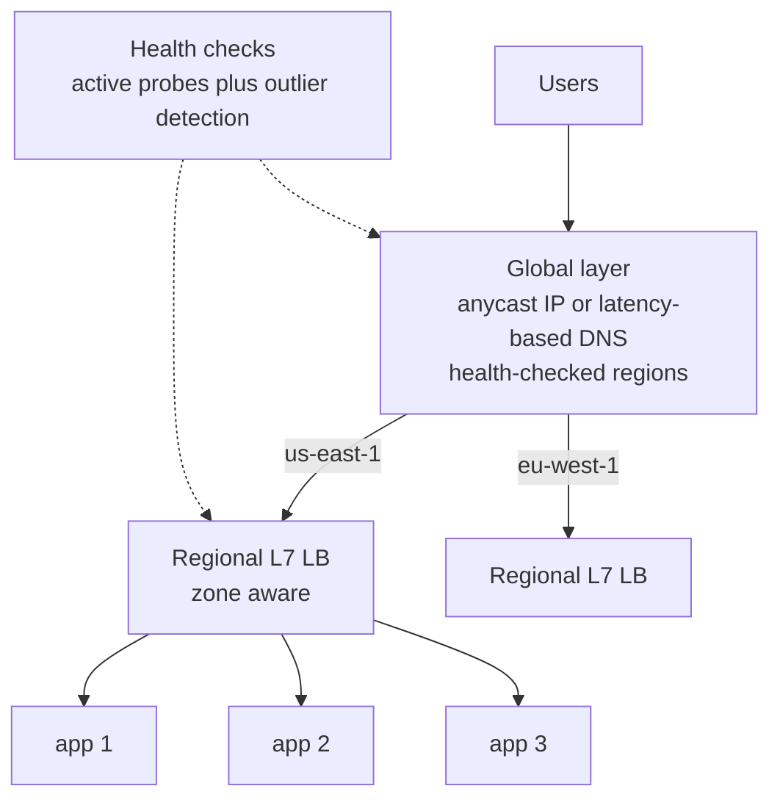
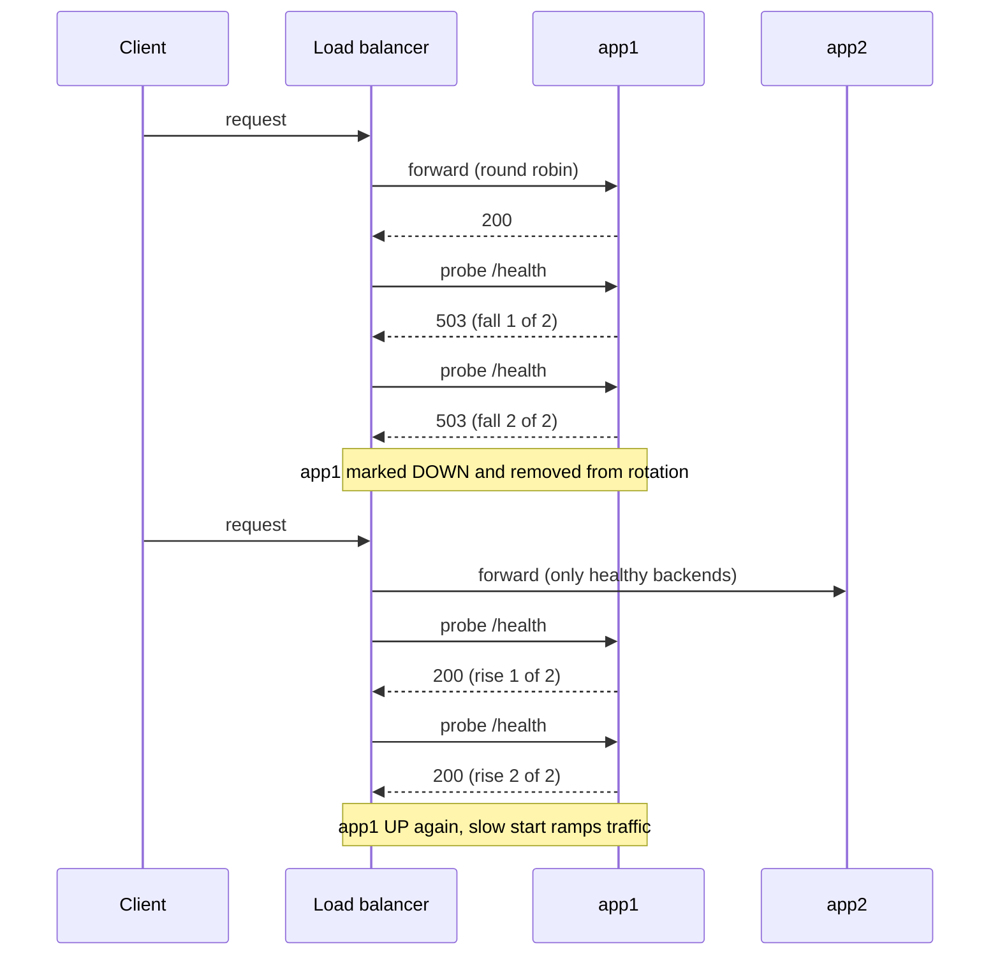

# L12.6 — Load Balancing

> **Level 12: Advanced Networking** · Topic 6 of 14 · ⏱ ~4 hours · Difficulty: Advanced

## 1. What it is

A **load balancer (LB)** spreads requests or connections across a pool of backends so that no single server is overloaded and a failed server is skipped. [Level 2](../level-02-networking/08-reverse-proxies-and-load-balancers.md) and
[L4 vs L7](../level-02-networking/09-l4-vs-l7-load-balancing.md) covered what an LB is and the layers it works at. This topic is about the *decisions* it makes:

- **Algorithms:** how it picks a backend (round-robin, weighted, least connections, least request, random-two-choices, hashing, consistent hashing).
- **Health checking:** how it knows which backends are fit to receive traffic (active probes, passive outlier detection) and how it brings them back safely.
- **Topology:** where balancing happens (client-side, in a proxy, in the network, at a global DNS or anycast layer) and how layers stack: a **global load balancer** picks a region, a regional LB picks a zone or cluster, a local LB picks an instance.

## 2. Why it matters in DevOps

- **The wrong algorithm creates hotspots.** Round-robin is fair in *requests* but not in *work*; a few slow or heavy requests can pile up on one server while others idle.
- **Health checks decide your availability.** A check that is too lax sends users to dead servers; one that is too strict, or that depends on a shared database, can eject the entire fleet at once and turn a partial failure into a full outage.
- **Stateful and cache-heavy workloads need affinity.** Caches, sharded in-memory state, WebSocket sessions and per-user rate limits perform best when the same key reaches the same backend, and badly when a pool change reshuffles everything.
- **Deploys and autoscaling are balancing events.** New instances must receive traffic gradually (slow start) and leaving instances must finish in-flight work (connection draining), or every rollout causes errors ([Level 5, Zero-downtime](../level-05-cicd/08-zero-downtime-deployments.md)).
- **It is a capacity and failure-domain design tool.** Regional failover, active-active and DR all rely on global traffic steering ([Level 0, HA and scalability](../level-00-what-devops-is/08-high-availability-and-scalability.md)).

## 3. Real-world system example

**Google Maglev** is Google's published software network load balancer: a cluster of commodity servers announces service virtual IPs, the network spreads packets over Maglev machines with ECMP (equal-cost multi-path), and each machine picks a backend with a **consistent hashing** scheme built for fast lookup and minimal disruption, so connections keep going to the same backend even when machines fail or join. The Maglev paper (2016) is public.
**Meta's Katran** (open source, XDP/eBPF based) is a layer 4 forwarding plane that uses a consistent-hashing scheme in the same spirit. **GitHub's GLB Director** (documented on the GitHub engineering blog) is a layer 4 balancer that uses a consistent hashing technique so that adding or draining proxies does not break existing connections.

**Envoy** (the data plane behind Istio and many API gateways) supports round robin, **least request** (by default picking two random hosts and sending to the one with fewer active requests, the "power of two choices"), ring hash, Maglev and random, plus active health checks and **outlier detection** (passive ejection of hosts returning errors).
**AWS** offers Application Load Balancers (layer 7; round robin or "least outstanding requests" algorithms), Network Load Balancers (layer 4; flow-hash based), and **AWS Global Accelerator** and **Route 53** for global steering with health checks ([Level 6, ALB](../level-06-cloud-aws/14-alb.md), [Route 53](../level-06-cloud-aws/12-route-53.md)). **Google Cloud's** global external Application Load Balancer exposes a single anycast IP address and routes users to the nearest healthy backend region with spillover when a region is full. **Kubernetes** Services balance across pods in `kube-proxy` (iptables or IPVS) and Ingress controllers (nginx, Envoy) add L7 logic ([Level 8, Services](../level-08-kubernetes/04-services.md)).

## 4. Diagram

A typical stacked design: DNS or anycast picks a region, a regional L7 LB picks an instance, and health checks feed back into every decision:



What a health-checked LB does when a backend breaks and recovers (this is what the lab reproduces):



## 5. How it works

### Algorithms

| Algorithm | How it picks | Good for | Watch out for |
|---|---|---|---|
| **Round robin** | Next backend in a loop | Homogeneous backends, short uniform requests | Ignores load; long requests pile up on one server |
| **Weighted round robin** | Loop, but backends appear in proportion to weight | Mixed instance sizes, canary traffic (5 percent to the new version) | Weights are static |
| **Random** | Uniform random | Simple, stateless clients | Variance at low request rates |
| **Least connections** | Backend with fewest open connections (weighted variants exist) | Long-lived or uneven requests, WebSockets, gRPC streams | Needs shared connection counts across LB nodes; new backends get a burst |
| **Least request / least outstanding requests** | Fewest in-flight requests (L7) | Variable latency, heterogeneous backends | Same as above; per-LB-node view only |
| **Power of two choices (P2C)** | Pick 2 at random, take the less loaded | Large fleets or many LB nodes: near-optimal balance without global state | Slightly more complex to reason about |
| **Source IP hash** | `hash(client IP) mod N` | Crude stickiness | Reshuffles almost everything when N changes; NAT and proxies skew it |
| **Consistent hashing** | Key (URL, user id, header) mapped onto a ring or lookup table of backends | Caches, sharded state, per-key rate limits, QUIC connection ID routing | Skew without virtual nodes; loses balance if the key is hot |
| **Maglev hashing** | Lookup table built from per-backend permutations | L4 balancers needing speed and minimal disruption | Table rebuild on membership change |
| **Power-aware or latency-aware** (EWMA, peak EWMA) | Prefers lowest recent latency | Mixed-latency backends | Needs warm-up and careful smoothing |

**Why consistent hashing?** With `hash(key) mod N`, adding a fifth server to four remaps roughly 80 percent of the keys, which destroys every cache at once. With a consistent-hash ring (each server placed at many pseudo-random points, called virtual nodes), a key maps to the next server clockwise, so adding one server moves only about 1/N of the keys and removing a server moves only the keys it owned.
You will measure both in the lab.

### Health checks

| Type | How | Notes |
|---|---|---|
| **Active, L4** | TCP connect | Cheap; proves the port is open, not that the app works |
| **Active, L7** | `GET /health` expecting `200` (and optionally a body) | The common default; check *this process can serve*, not "everything it depends on" |
| **Passive / outlier detection** | Watch real traffic: eject a host after N consecutive 5xx or timeouts, re-admit after a back-off | Catches failures a probe misses; Envoy, HAProxy (`observe`), nginx (`max_fails`) |
| **Liveness vs readiness** | Kubernetes distinguishes "restart me" from "do not send me traffic" | [Level 8, probes](../level-08-kubernetes/15-liveness-and-readiness-probes.md) |

Parameters to tune: interval, timeout, **fall** (failures before DOWN), **rise** (successes before UP), and a **panic threshold** or "fail open" rule (if too many hosts are unhealthy, route to all of them rather than none; Envoy defaults to a panic threshold of 50 percent).
Design rules: a shallow health endpoint (process alive, thread pool not stuck) for the LB; a deeper "dependency" check only for dashboards or readiness gating with care, because a shared database blip should degrade you, not eject every server simultaneously. Add **slow start** to ramp a newly healthy server and **connection draining** (also called deregistration delay) to let a leaving server finish in-flight requests.

### Where balancing happens

- **Client-side:** the client holds the list (service discovery plus a library or gRPC `round_robin`). No extra hop; every client needs the logic.
- **Proxy / L7:** nginx, HAProxy, Envoy, ALB; can route by path, header and cookie, terminate TLS, retry.
- **L4:** NLB, IPVS, Maglev, Katran; passes TCP/UDP flows without parsing HTTP, higher throughput. With **DSR (direct server return)** replies skip the LB.
- **Service mesh / sidecar:** per-pod proxies do client-side balancing with central policy ([Service Mesh](09-service-mesh.md)).

### Global load balancing

Directing users to the right *region* uses mechanisms that live above the individual LB:

| Mechanism | How | Failover speed | Caveat |
|---|---|---|---|
| **DNS-based (GSLB)** | Authoritative DNS returns different answers by latency, geography, weight or health ([DNS Architecture](03-dns-architecture.md)) | TTL-bound (tens of seconds to minutes; some resolvers ignore TTLs) | Sees the resolver, not the user |
| **Anycast IP** | Same IP announced from many sites via BGP ([BGP](02-bgp-fundamentals.md)); network routes to the nearest | Seconds, by withdrawing routes | Long-lived TCP connections may move mid-flow; need connection-ID aware design |
| **Global anycast L7 LB / CDN** | One anycast address, edge proxies pick an origin using health and latency | Seconds | Vendor feature; origin must be reachable from edges ([CDNs](07-cdns.md)) |
| **Client-side / app-level** | App or SDK picks a region and fails over | Fastest | Logic in every client |

Design for **capacity during failover**: if `us-east-1` fails, `eu-west-1` must absorb its traffic. Use spillover limits and test them; otherwise failover just moves the overload.

## 6. Step-by-step guide

You will run three tiny Python backends, put HAProxy in front with round robin, least-connections and consistent-hash backends, watch each algorithm behave, kill a backend and watch health checks react, and quantify how many keys move with modulo hashing versus a consistent-hash ring. Free, local, no Docker needed (a Compose version is at the end).

**Prerequisites:** Linux with `python3`, `haproxy` 2.4+ and `curl` (`sudo apt-get install -y haproxy curl`; if the package starts a system service, `sudo systemctl disable --now haproxy`). Verified with HAProxy 2.8. Run `unset https_proxy HTTPS_PROXY` if your shell sets a proxy.

1. **Create the backends.** Each answers with its name; `app3` is deliberately slow (0.5 s); `/health` reports status; `/break` and `/fix` toggle health so you can fail a server on demand.
   ```bash
   mkdir -p ~/lb-lab && cd ~/lb-lab
   cat > backend.py <<'EOF'
   import sys, time
   from http.server import BaseHTTPRequestHandler, ThreadingHTTPServer

   name, port = sys.argv[1], int(sys.argv[2])
   delay = float(sys.argv[3]) if len(sys.argv) > 3 else 0.0
   healthy = True

   class H(BaseHTTPRequestHandler):
       protocol_version = "HTTP/1.1"
       def do_GET(self):
           global healthy
           if self.path == "/health":
               code, body = (200, b"ok\n") if healthy else (503, b"sick\n")
           elif self.path == "/break":
               healthy = False; code, body = 200, b"now unhealthy\n"
           elif self.path == "/fix":
               healthy = True; code, body = 200, b"now healthy\n"
           else:
               time.sleep(delay)
               code, body = 200, f"{name}\n".encode()
           self.send_response(code)
           self.send_header("Content-Length", str(len(body)))
           self.end_headers()
           self.wfile.write(body)
       def log_message(self, *a): pass

   ThreadingHTTPServer(("127.0.0.1", port), H).serve_forever()
   EOF
   python3 backend.py app1 9001 &
   python3 backend.py app2 9002 &
   python3 backend.py app3 9003 0.5 &
   sleep 1; for p in 9001 9002 9003; do curl -s localhost:$p/; done
   ```
   Expected: `app1`, `app2`, `app3` (the last after a half-second pause).

2. **Configure HAProxy with three backends using three algorithms.** Ports 8081 (round robin), 8082 (least connections) and 8083 (consistent hash on the URI). Health checks run every second: two failures mark a server DOWN, two successes mark it UP.
   ```bash
   cat > haproxy.cfg <<'EOF'
   global
     maxconn 1000
   defaults
     mode http
     timeout connect 2s
     timeout client 10s
     timeout server 10s
   frontend fe_rr
     bind 127.0.0.1:8081
     default_backend be_rr
   frontend fe_lc
     bind 127.0.0.1:8082
     default_backend be_lc
   frontend fe_hash
     bind 127.0.0.1:8083
     default_backend be_hash
   frontend stats
     bind 127.0.0.1:8404
     stats enable
     stats uri /stats
   backend be_rr
     balance roundrobin
     option httpchk GET /health
     http-check expect status 200
     default-server inter 1s fall 2 rise 2
     server app1 127.0.0.1:9001 check
     server app2 127.0.0.1:9002 check
     server app3 127.0.0.1:9003 check
   backend be_lc
     balance leastconn
     option httpchk GET /health
     default-server inter 1s fall 2 rise 2
     server app1 127.0.0.1:9001 check
     server app2 127.0.0.1:9002 check
     server app3 127.0.0.1:9003 check
   backend be_hash
     balance uri
     hash-type consistent
     option httpchk GET /health
     default-server inter 1s fall 2 rise 2
     server app1 127.0.0.1:9001 check
     server app2 127.0.0.1:9002 check
     server app3 127.0.0.1:9003 check
   EOF
   haproxy -c -f haproxy.cfg           # Configuration file is valid
   haproxy -f haproxy.cfg &
   sleep 2
   ```

3. **Round robin vs least connections under uneven load.** Fire 30 concurrent requests at each; `app3` is slow, so it holds connections open longer.
   ```bash
   echo "round robin:";  for i in $(seq 1 30); do curl -s localhost:8081/ & done | sort | uniq -c; wait
   echo "least conn:";   for i in $(seq 1 30); do curl -s localhost:8082/ & done | sort | uniq -c; wait
   ```
   ```text
   round robin:
        10 app1
        10 app2
        10 app3
   least conn:
        12 app1
        15 app2
         3 app3
   ```
   Round robin sends the slow server its full third; least-connections notices its open connections and shifts work to the fast ones. The exact least-conn split varies from run to run, but `app3` always gets far less.

4. **Consistent hashing gives affinity.** The same URI always reaches the same backend.
   ```bash
   for k in 1 2 3 4 5 6; do echo -n "/p/$k -> "; curl -s localhost:8083/p/$k; done
   for k in 1 2 3 4 5 6; do echo -n "/p/$k -> "; curl -s localhost:8083/p/$k; done    # identical answers
   ```

5. **Fail a backend and watch what moves.** Record where 12 keys land, break `app1`, wait for the health check to eject it, and compare.
   ```bash
   for k in $(seq 1 12); do echo -n "/p/$k -> "; curl -s localhost:8083/p/$k; done > before.txt
   curl -s localhost:9001/break; sleep 3.5          # two failed probes at 1 s interval
   for k in $(seq 1 12); do echo -n "/p/$k -> "; curl -s localhost:8083/p/$k; done > after.txt
   diff before.txt after.txt                          # only keys that were on app1 changed
   curl -s 'localhost:8404/stats;csv' | cut -d, -f1,2,18 | grep -E 'be_hash,app'
   ```
   ```text
   be_hash,app1,DOWN
   be_hash,app2,UP
   be_hash,app3,UP
   ```
   Every line in the `diff` is a key that used to go to `app1`; keys that lived on `app2` and `app3` did not move. That is the property that keeps caches warm during incidents. Now check round robin with a failure, then restore:
   ```bash
   curl -s localhost:9001/fix; curl -s localhost:9002/break; sleep 3.5
   for i in $(seq 1 6); do curl -s localhost:8081/; done | sort | uniq -c       # app1 and app3 only
   curl -s localhost:9002/fix; sleep 3.5
   ```
   You can also browse the live table at `http://127.0.0.1:8404/stats`.

6. **Measure how many keys move: modulo hashing vs a consistent-hash ring.** This is pure arithmetic, no servers needed.
   ```bash
   cat > ring.py <<'EOF'
   import bisect, hashlib

   def h(s):
       return int(hashlib.md5(s.encode()).hexdigest()[:16], 16)

   class Ring:
       def __init__(self, nodes, vnodes=100):
           self.ring = sorted((h(f"{n}#{i}"), n) for n in nodes for i in range(vnodes))
           self.keys = [k for k, _ in self.ring]
       def get(self, key):
           i = bisect.bisect(self.keys, h(key)) % len(self.ring)
           return self.ring[i][1]

   keys = [f"user-{i}" for i in range(100_000)]
   old, new = ["s1", "s2", "s3", "s4"], ["s1", "s2", "s3", "s4", "s5"]
   mod_moved = sum(old[h(k) % 4] != new[h(k) % 5] for k in keys)
   r_old, r_new = Ring(old), Ring(new)
   ring_moved = sum(r_old.get(k) != r_new.get(k) for k in keys)
   print(f"hash(key) % N : {mod_moved/len(keys):.1%} of keys move when going from 4 to 5 servers")
   print(f"consistent ring: {ring_moved/len(keys):.1%} of keys move (ideal is 1/5 = 20.0%)")
   EOF
   python3 ring.py
   ```
   ```text
   hash(key) % N : 80.0% of keys move when going from 4 to 5 servers
   consistent ring: 16.9% of keys move (ideal is 1/5 = 20.0%)
   ```
   Try `vnodes=1` and see how uneven the ring becomes; virtual nodes are what smooth the distribution.

7. **The same ideas in nginx** (syntax validated with `nginx -t`; paste into an `http {}` block):
   ```nginx
   upstream shop_rr   { server 10.0.1.11:3000; server 10.0.1.12:3000; server 10.0.1.13:3000 weight=2; }
   upstream shop_lc   { least_conn; server 10.0.1.11:3000; server 10.0.1.12:3000 max_fails=2 fail_timeout=10s; }
   upstream shop_hash { hash $request_uri consistent; server 10.0.1.11:3000; server 10.0.1.12:3000; }
   server {
     listen 80;
     location / {
       proxy_pass http://shop_hash;
       proxy_next_upstream error timeout http_503;   # retry another backend, only safe for idempotent requests
     }
   }
   ```
   Open-source nginx health checking is passive (`max_fails`/`fail_timeout`); active probes need NGINX Plus or an external check. HAProxy and Envoy do active checks out of the box.

8. **Clean up.**
   ```bash
   pkill haproxy; pkill -f backend.py; cd ~ && rm -r ~/lb-lab
   ```

*Docker Compose variant.* The same lab runs as three `python:3.12-slim` services (`command: python /app/backend.py app1 9001`, with the file bind-mounted) plus an `haproxy:2.8` service mounting `haproxy.cfg` with server addresses changed from `127.0.0.1:900x` to the service names (`app1:9001`). If you use this, validate first with `docker run --rm -v "$PWD/haproxy.cfg:/usr/local/etc/haproxy/haproxy.cfg:ro" haproxy:2.8 haproxy -c -f /usr/local/etc/haproxy/haproxy.cfg`.

## 7. Real-world scenario

*(Illustrative.)* `shop-api` runs 12 instances behind an ALB with a `/health` endpoint that runs `SELECT 1` against PostgreSQL and a Redis `PING`. During a routine PostgreSQL failover the primary is unreachable for 40 seconds. Every instance's health check fails, the ALB marks all 12 unhealthy and, with no healthy targets, begins returning errors to everyone, including requests for the product catalog that could have been served from Redis.
Investigation: target group metrics show `HealthyHostCount` fall to zero while each application's own error rate was moderate; the instances were fine, the check was too deep. Recovery took longer than the database event because instances re-entered service one by one after `rise` thresholds, and all new connections hit freshly healthy instances at once.
Fix: the LB check now hits a shallow `/healthz` (process alive and event loop responsive); a separate `/readyz` includes dependencies and is used only for deployment gating. Slow start (2 minutes) is enabled on the target group, and the app degrades gracefully when the database is down.
**Lesson:** a health check answers "should the LB send traffic here?", not "is the whole system healthy?". Make it shallow, add slow start, and make sure "all unhealthy" fails open or degrades rather than going dark.

## 8. Common mistakes and best practices

**Don't**
- Use `hash(key) mod N` for anything where changing N matters (caches, shards).
- Put dependency checks (database, third-party API) in the LB health endpoint.
- Use round robin for long-lived or highly variable requests without checking the distribution.
- Retry non-idempotent requests (`POST /orders`) automatically on another backend.
- Forget connection draining and slow start in deployment and autoscaling configs.
- Assume DNS failover is instant; TTL and resolver behaviour make it slower than health checks suggest.
- Let one LB become a single point of failure; LBs need redundancy too (VRRP, anycast, multi-AZ managed LBs).

**Do**
- Choose the algorithm from the workload: least-request or P2C for variable latency, consistent hashing for caches and sharded state.
- Combine active health checks with passive outlier detection, and tune `interval`, `fall`, `rise` and timeouts deliberately.
- Define a fail-open or panic behaviour for "most backends unhealthy".
- Export per-backend request rate, error rate, latency, active connections and ejections as metrics ([Level 10](../level-10-observability/11-what-to-monitor.md)).
- Test failover: kill a backend, an AZ and a region and watch the traffic redistribute; confirm surviving capacity is enough.
- Keep weights and capacity in code ([Level 7](../level-07-terraform-iac/03-modules.md)) so canary shifts and scale changes are reviewed.

## 9. Tasks

- [ ] **T1 — Observe round robin vs least connections** *(≈25 min, intermediate)*
  - **Goal:** see how algorithm choice changes distribution under uneven load.
  - **Steps:**
    1. Follow steps 1-3.
    2. Repeat the 30-request test three times for each algorithm and record counts per backend.
    3. Change `app3` delay to 2 seconds and repeat.
  - **Done when:** you have a table of nine runs and can explain why least-conn shifts away from `app3` while round robin does not.

- [ ] **T2 — Weighted canary** *(≈20 min, intermediate)*
  - **Goal:** send roughly 10 percent of traffic to one backend.
  - **Steps:**
    1. In `be_rr`, set `weight 90` on `app1` and `app2` and `weight 20` on `app3` (about 10 percent), reload with `haproxy -f haproxy.cfg -sf $(pidof haproxy) &`.
    2. Send 200 requests and count.
  - **Done when:** `app3` receives roughly 10 percent of the 200 requests (counts will vary by a few percent).

- [ ] **T3 — Break it: health check tuning** *(≈30 min, advanced)*
  - **Goal:** feel the trade-off between detection speed and flapping.
  - **Steps:**
    1. Set `inter 5s fall 3 rise 3`; break `app1` and time (with `date`) how long until `curl` stops hitting it.
    2. Set `inter 500ms fall 1 rise 1`; script a flaky backend that fails every other `/health` call and watch the stats page flap.
    3. Choose a defensible setting and justify it in two sentences.
  - **Done when:** you have measured detection time for both settings and observed flapping in the aggressive one.

- [ ] **T4 — Consistent hashing and the ring** *(≈30 min, advanced)*
  - **Goal:** quantify disruption.
  - **Steps:**
    1. Run `ring.py`; then change `vnodes` to 1, 10, 100, 1000 and record the fraction moved and the per-server key counts (add a counter).
    2. Add a sixth server and a removal case, and compare with modulo hashing.
  - **Done when:** you can show that more virtual nodes give a more even distribution and that removing a node only moves that node's keys.

- [ ] **T5 — Zero-error restart with draining** *(≈35 min, advanced)*
  - **Goal:** deploy without errors.
  - **Steps:**
    1. Run a load loop (`while true; do curl -s -o /dev/null -w '%{http_code}\n' localhost:8081/; done | sort | uniq -c` and stop with Ctrl-C afterwards) in one terminal.
    2. Restart `app2` abruptly (`kill`) and count non-200 responses.
    3. Instead call `/break`, wait for DOWN, restart, `/fix`, and count again.
  - **Done when:** the abrupt kill produces some errors and the drain-first procedure produces none (or fewer), and you write the 4-step safe procedure.

- [ ] **T6 — Prove it: design global traffic steering for `shop-api`** *(≈45 min, advanced)*
  - **Goal:** explain a multi-region balancing design.
  - **Steps:**
    1. Without the guide, rebuild the three-backend HAProxy lab and demonstrate one algorithm per frontend.
    2. Write one page covering: global mechanism (DNS vs anycast) and failover time, regional LB algorithm and health check design, what happens at 100 percent capacity in a failover, and what you monitor.
  - **Done when:** the lab runs from memory and the page states the failover time and the spare capacity needed in the surviving region.

## 10. Self-check questions

1. Why does `hash(key) % N` hurt a cache fleet when you scale from 4 to 5 servers, and how does consistent hashing help?
2. When is least-connections better than round robin, and what is the power-of-two-choices trick?
3. What do `fall`, `rise` and `inter` control in a health check, and what is the risk of setting them too aggressively?
4. Why should a health check not query the database?
5. Compare DNS-based and anycast-based global load balancing for failover speed.
6. What are slow start and connection draining for?

<details><summary>Answers</summary>

1. Changing N changes `key % N` for most keys (about 80 percent from 4 to 5), so almost every cached item is looked up on the wrong server and misses. A consistent-hash ring moves only about 1/N of keys (those that fall between the new server and its neighbour).
2. When requests vary in duration or backends vary in speed, because open-connection count reflects real load. P2C picks two random backends and uses the less loaded, giving near-least-loaded balance without a global view, which scales to many LB nodes.
3. `inter` is the probe interval, `fall` how many consecutive failures mark a server DOWN, `rise` how many successes mark it UP. Too aggressive means flapping and ejecting healthy servers on a hiccup (and amplified load on the rest); too lax means sending users to dead servers.
4. A shared dependency failure would fail every instance's check at once, ejecting the whole fleet and converting a degraded state into a total outage. Keep LB checks shallow and handle dependency failure in the application.
5. DNS failover is bounded by TTLs and resolver caching (tens of seconds to minutes or more, with some clients ignoring TTLs); anycast reacts to routing changes (seconds), but long-lived connections may be re-routed mid-flow.
6. Slow start gradually ramps traffic to a newly healthy or newly launched server so cold caches and JIT warm-up do not cause errors; draining lets a leaving server finish in-flight requests and stop receiving new ones before it is stopped.
</details>

## 11. Further reading

- The Maglev paper: "Maglev: A Fast and Reliable Software Network Load Balancer" (NSDI 2016), and the Envoy documentation on load balancing and outlier detection.
- HAProxy configuration manual (`balance`, `hash-type`, `option httpchk`, `slowstart`) and the nginx `ngx_http_upstream_module` documentation.
- AWS Elastic Load Balancing documentation (target groups, deregistration delay, slow start) and Google Cloud Load Balancing overview.
- GitHub Engineering blog on GLB Director; Meta's open-source Katran repository documentation.
- Michael Mitzenmacher, "The Power of Two Choices in Randomized Load Balancing" (paper).
- Brendan Burns et al., *Designing Distributed Systems*; Google, *Site Reliability Engineering* (load balancing chapters).

<!-- nav -->
---
← Previous: [HTTP/2, HTTP/3 and QUIC](05-http2-http3-quic.md) · [Level 12 index](README.md) · Next: [CDNs](07-cdns.md) →
