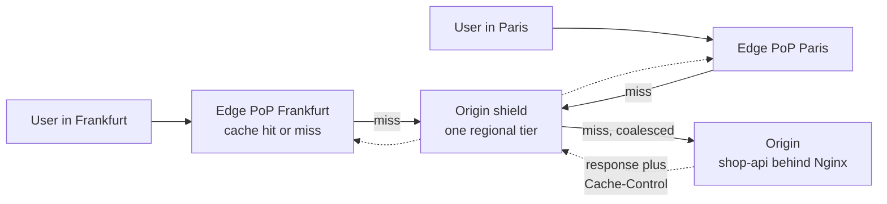
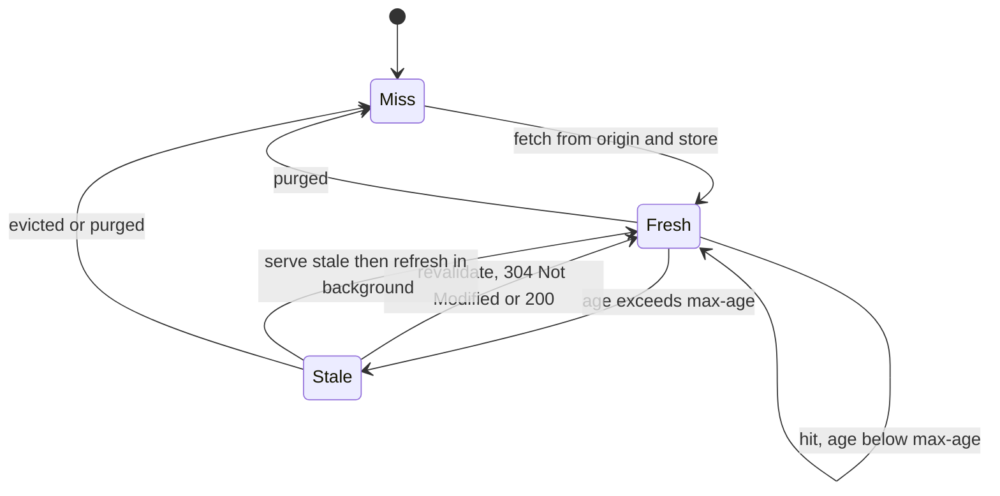

# L12.7 — CDNs

> **Level 12: Advanced Networking** · Topic 7 of 14 · ⏱ ~4 hours · Difficulty: Intermediate

## 1. What it is

A **Content Delivery Network (CDN)** is a geographically distributed fleet of caching reverse proxies (called **edge servers** or **points of presence, PoPs**) that sit between users and your **origin** (the servers you run). A user is steered to a nearby edge using anycast or DNS ([DNS Architecture](03-dns-architecture.md), [BGP](02-bgp-fundamentals.md)). The edge keeps a copy of cacheable responses and answers from memory or disk; only a **cache miss** travels all the way to the origin.

A CDN delivers four things at once: **lower latency** (the TLS handshake and the content are close to the user), **less origin load** (a cache hit never reaches you), **absorbed spikes and attacks** (huge aggregate capacity, DDoS filtering, a web application firewall) and **resilience** (stale content can be served when the origin is down). What it caches and for how long is controlled almost entirely by HTTP headers, above all **`Cache-Control`**, and by the **cache key** (the string that identifies "the same object").

## 2. Why it matters in DevOps

- **A huge share of production traffic should never hit your origin.** Images, JavaScript, CSS, downloads, video segments and even cacheable API responses can be served from the edge. A good cache-hit ratio is the cheapest capacity you will ever buy, and a collapsed one (after a bad deploy or a cache-key mistake) is a classic origin-melting incident.
- **Wrong headers are production bugs.** A missing `private` leaks one user's page to another; an over-long `max-age` on an unversioned file ships a bad deploy to users for a day, and you cannot "roll back" a cache you do not control.
- **Purging, versioning and invalidation are part of your release process.** CDN configuration belongs in code and in CI/CD ([Level 5](../level-05-cicd/01-pipeline-design.md)).
- **Cost.** Egress from your cloud is expensive; CDN egress is typically cheaper and a high hit ratio cuts both ([Level 20, egress costs](../level-20-cost-optimization/07-network-egress-costs.md)).
- **Security.** The CDN is your first line against volumetric DDoS and bots, but it is also a place where **cache poisoning** and **web cache deception** (caching something private under a public key) happen.

## 3. Real-world system example

**Netflix Open Connect** is Netflix's own CDN: purpose-built appliances (Open Connect Appliances) that Netflix offers to place inside ISP networks and at internet exchange points, pre-filled with popular titles during off-peak hours. Netflix documents that its control plane steers clients to the best appliance, and the vast majority of video bytes are served from these caches rather than from AWS.

**Cloudflare, Fastly, Akamai, AWS CloudFront and Google Cloud CDN** cache the web's static and semi-static content for millions of sites. Their documented features map to this topic: **tiered caching / origin shield** (Cloudflare Tiered Cache, CloudFront Origin Shield, Fastly shielding), **purge by URL, prefix or tag** (Fastly surrogate keys, Cloudflare cache tags, CloudFront invalidations), and **stale-while-revalidate / stale-if-error** support. See [Level 6, CloudFront](../level-06-cloud-aws/13-cloudfront.md) for the AWS flavour.

**Fastly, 8 June 2021.** Fastly publicly described a global outage lasting under an hour in which a large fraction of its network returned errors. A software bug that had been introduced in an earlier deployment lay dormant until a customer pushed a valid configuration change that triggered it. Many well-known sites that depend on Fastly were affected, and recovery was fast because the trigger was identified and reverted within minutes. Lessons: the CDN is a dependency with its own blast radius; consider multi-CDN for critical properties and make sure you can route around the CDN (for example by DNS) when needed.

## 4. Diagram

The tiers a request crosses and where each cache decision is made:



The lifecycle of one cached object, driven by `Cache-Control` and revalidation:



## 5. How it works

### Cache-Control, the contract with caches

The origin states how a response may be stored. Directives you must know:

| Directive | Meaning |
|---|---|
| `max-age=N` | Fresh for N seconds in any cache (browser and CDN) |
| `s-maxage=N` | Like `max-age` but for **shared** caches (CDNs, proxies) only; overrides `max-age` there |
| `public` / `private` | `private` means only the user's own browser may store it, never a CDN; use for per-user data |
| `no-store` | Never write it to any cache (sensitive data) |
| `no-cache` | May be stored, but must be **revalidated** with the origin before every reuse (confusing name) |
| `must-revalidate` | After it goes stale it must not be served without successful revalidation |
| `immutable` | The resource will never change at this URL; browsers skip revalidation |
| `stale-while-revalidate=N` | After expiry, serve the stale copy for up to N seconds while refreshing in the background (RFC 5861) |
| `stale-if-error=N` | Serve stale for up to N seconds if the origin errors (RFC 5861) |

Related: **`ETag`** and **`Last-Modified`** let a cache ask "has this changed?" with `If-None-Match` / `If-Modified-Since` and get a tiny `304 Not Modified`. **`Vary: Accept-Encoding`** tells caches the response depends on a request header, so they store a copy per variant. `Vary: Cookie` or `Vary: User-Agent` can destroy your hit ratio. Targeted headers such as `CDN-Cache-Control` / `Surrogate-Control` (RFC 9213) give the CDN different rules from the browser.

A typical policy for `shop-api`:

| Content | Header | Why |
|---|---|---|
| Fingerprinted assets (`/static/app.3f9c1a.js`) | `public, max-age=31536000, immutable` | The filename changes when content changes, so cache forever |
| HTML pages | `public, max-age=0, s-maxage=60, stale-while-revalidate=300` | Short edge TTL, always fresh enough, fast under load |
| Product catalog API | `public, s-maxage=30, stale-if-error=600` | Hot read endpoint, tolerate origin trouble |
| User, cart, checkout | `private, no-store` | Per-user and sensitive; never at the edge |

### The cache key

The **cache key** decides whether two requests are "the same". By default it is the scheme, host, path and query string. Everything you add fragments the cache; everything you leave out risks serving the wrong content.

- **Normalise the query string.** `?utm_source=mail` and `?utm_source=ads` produce the same bytes but separate cache entries unless the CDN ignores or whitelists parameters. Sort parameters, drop tracking ones.
- **Vary by what really matters:** `Accept-Encoding` (gzip/brotli), device class or language *if the content differs*; not the whole `User-Agent` or `Cookie`.
- **Never include a cookie in the key for public content**; strip cookies on cacheable routes so they do not bypass the cache.
- **Unkeyed inputs are poisoning risks.** If the response depends on a header that is not in the key (for example `X-Forwarded-Host` reflected into the HTML), an attacker can poison the cached copy for everyone. Reflect only what is keyed.

### Invalidation, purge and versioning

1. **Versioned URLs (cache busting):** the best "purge" is no purge: a new filename for new content (`app.3f9c1a.js`, built by your bundler in CI). The old objects age out harmlessly.
2. **Purge by URL, by prefix or by tag/surrogate key:** the origin tags responses (for example `Surrogate-Key: product-123 catalog`) and a deploy or admin action purges the tag. Fastly and Cloudflare do this globally in seconds; CloudFront invalidations are path-based, take longer and are limited in the free allowance (check current pricing).
3. **Soft purge / revalidate:** mark content stale rather than deleting, so users still get a fast response while it refreshes.
4. **Short TTL + stale-while-revalidate** for content that changes unpredictably.

With tiered caching, **a purge must reach every tier**: purging only the edge while the shield still holds the old object just refills the edge with old content.

### Origin shield and request collapsing

Without a shield, 200 edge PoPs missing on a new object means 200 simultaneous origin requests. An **origin shield** is a designated cache tier in front of the origin: edges miss to the shield, and the shield alone talks to the origin, giving one origin fetch per object per shield instead of one per PoP. **Request collapsing** (also *cache lock* or *request coalescing*) means that when many requests for the same uncached object arrive at once, only the first goes upstream and the rest wait for its result. Together they prevent the **thundering herd** after a purge, deploy or cache expiry.

### What not to cache

Responses with `Set-Cookie` per user, `Authorization`-protected content, `POST`/`PUT`/`DELETE`, and anything labelled `private` or `no-store` should not be cached by shared caches. Cache `404` and error responses very briefly (seconds) so a broken origin is not hammered, but never for long.

### Beyond caching

CDNs also terminate TLS and HTTP/2/3 near the user ([HTTP/2, HTTP/3 and QUIC](05-http2-http3-quic.md), [TLS termination](11-tls-termination.md)), compress and transform images, run edge compute, apply WAF and rate limiting ([Rate Limiting](13-rate-limiting.md)), and balance across multiple origins with health checks ([Load Balancing](06-load-balancing-algorithms.md)).

## 6. Step-by-step guide

You will build a miniature CDN on your laptop: a slow origin, an **origin shield**, and **two edge PoPs**, all nginx caching proxies. You will watch cache status headers, see the cache key normalise query strings, collapse a thundering herd, use stale-while-revalidate, refresh and purge an object, and count how many requests reach the origin. Free and local. Verified with nginx 1.24 and Python 3.

**Prerequisites:** Linux with `nginx` (OSS), `python3`, `curl`. Run as an ordinary user (not root) so the cache files are yours. If your shell sets a proxy, `unset https_proxy HTTPS_PROXY http_proxy HTTP_PROXY` first. Stop any packaged nginx service (`sudo systemctl disable --now nginx`). Ports used: 18081 and 18083 (edges), 18090 (shield), 19000 (origin).

1. **Create the origin.** It sleeps 200 ms per request (so you can feel cache hits), counts hits per path, and sends a different `Cache-Control` per route.
   ```bash
   mkdir -p ~/cdn-lab/logs ~/cdn-lab/cache_edge ~/cdn-lab/cache_edge_b ~/cdn-lab/cache_shield && cd ~/cdn-lab
   cat > origin.py <<'EOF'
   import json, time
   from http.server import BaseHTTPRequestHandler, ThreadingHTTPServer

   hits = {}

   class H(BaseHTTPRequestHandler):
       protocol_version = "HTTP/1.1"
       def do_GET(self):
           path = self.path
           hits[path] = hits.get(path, 0) + 1
           if path == "/_hits":
               body, ctype, cc = json.dumps(hits, indent=1).encode(), "application/json", "no-store"
           elif path.startswith("/static/"):
               body = f"/* {path} generated at {time.strftime('%H:%M:%S')} */\n".encode()
               ctype, cc = "application/javascript", "public, max-age=60"
           elif path.startswith("/api/"):
               body = f'{{"path": "{path}", "t": "{time.strftime("%H:%M:%S")}"}}\n'.encode()
               ctype, cc = "application/json", "private, no-store"
           elif path.startswith("/news"):
               body = f"news page generated at {time.strftime('%H:%M:%S')}\n".encode()
               ctype, cc = "text/html", "public, max-age=5, stale-while-revalidate=30"
           else:
               body, ctype, cc = b"ok\n", "text/plain", "public, max-age=30"
           time.sleep(0.2)   # pretend the origin is slow
           self.send_response(200)
           self.send_header("Content-Type", ctype)
           self.send_header("Content-Length", str(len(body)))
           self.send_header("Cache-Control", cc)
           self.end_headers()
           self.wfile.write(body)
       def log_message(self, *a): pass

   ThreadingHTTPServer(("127.0.0.1", 19000), H).serve_forever()
   EOF
   python3 origin.py &
   sleep 1; curl -si localhost:19000/static/app.js | head -6
   ```
   Expected: `HTTP/1.1 200 OK` and `Cache-Control: public, max-age=60`.

2. **Configure the shield and two edges.** The edges cache on `host + path` (no query string) and collapse concurrent misses; the shield is the only tier that talks to the origin. Edge B is a second PoP with a separate cache.
   ```bash
   cat > nginx.conf <<EOF
   user $USER;
   worker_processes 1;
   daemon off;
   error_log $PWD/logs/error.log;
   pid $PWD/nginx.pid;
   events {}
   http {
     access_log off;
     proxy_cache_path $PWD/cache_edge   levels=1:2 keys_zone=edge:10m   max_size=100m inactive=10m;
     proxy_cache_path $PWD/cache_edge_b levels=1:2 keys_zone=edgeb:10m  max_size=100m inactive=10m;
     proxy_cache_path $PWD/cache_shield levels=1:2 keys_zone=shield:10m max_size=100m inactive=10m;
     map \$http_x_refresh \$bypass { default 0; "1" 1; }

     server {                                   # origin shield
       listen 127.0.0.1:18090;
       location / {
         proxy_pass http://127.0.0.1:19000;
         proxy_cache shield;
         proxy_cache_key \$host\$uri;
         proxy_cache_lock on;
         proxy_cache_use_stale error timeout updating http_500 http_502 http_503;
       }
     }
     server {                                   # edge PoP A
       listen 127.0.0.1:18081;
       location / {
         proxy_pass http://127.0.0.1:18090;
         proxy_cache edge;
         proxy_cache_key \$host\$uri;             # the query string is NOT part of the key
         proxy_cache_lock on;                     # collapse concurrent misses
         proxy_cache_bypass \$bypass;             # X-Refresh: 1 forces a re-fetch that updates the cache
         proxy_cache_use_stale error timeout updating;
         proxy_cache_background_update on;
         add_header X-Cache-Status \$upstream_cache_status always;
       }
     }
     server {                                   # edge PoP B, same logic, own cache
       listen 127.0.0.1:18083;
       location / {
         proxy_pass http://127.0.0.1:18090;
         proxy_cache edgeb;
         proxy_cache_key \$host\$uri;
         proxy_cache_lock on;
         proxy_cache_bypass \$bypass;
         proxy_cache_use_stale error timeout updating;
         proxy_cache_background_update on;
         add_header X-Cache-Status \$upstream_cache_status always;
       }
     }
   }
   EOF
   nginx -t -e $PWD/logs/error.log -c $PWD/nginx.conf       # syntax is ok / test is successful
   nginx -e $PWD/logs/error.log -c $PWD/nginx.conf &
   sleep 1
   ```
   `nginx` honours the origin's `Cache-Control` and `Expires` by default, so no TTLs are configured here: **the origin is in charge**.

3. **See MISS then HIT.** Define a helper that prints status lines, then request a static file three times.
   ```bash
   H="Host: shop.example.com"
   h() { curl -si -H "$H" "$@" | grep -iE '^(HTTP|x-cache)' | tr -d '\r' | tr '\n' ' '; echo; }
   for i in 1 2 3; do h localhost:18081/static/app.js; done
   ```
   ```text
   HTTP/1.1 200 OK X-Cache-Status: MISS
   HTTP/1.1 200 OK X-Cache-Status: HIT
   HTTP/1.1 200 OK X-Cache-Status: HIT
   ```
   Time it: `curl -s -o /dev/null -w '%{time_total}\n' -H "$H" localhost:18081/static/app.js` takes a few milliseconds (HIT) versus over 0.2 s for a MISS.

4. **Cache key: query strings and private content.**
   ```bash
   h "localhost:18081/static/app.js?utm_source=mail"      # HIT: the query string is ignored by our key
   h localhost:18081/api/me; h localhost:18081/api/me     # MISS, MISS: "private, no-store" is never cached
   curl -s localhost:19000/_hits | tr -d '\n '; echo
   ```
   ```text
   {"/static/app.js":1,"/api/me":2,"/_hits":1}
   ```
   One origin hit for `app.js` across all requests; two for `/api/me`. If you change the key to `$host$request_uri` and reload, each distinct `?utm_...` value becomes a separate MISS: this is how tracking parameters silently wreck hit ratios.

5. **Origin shield: two PoPs, one origin fetch.**
   ```bash
   h localhost:18081/static/shield.js        # MISS at edge A, fills the shield
   h localhost:18083/static/shield.js        # MISS at edge B, but the shield answers
   curl -s localhost:19000/_hits | tr -d '\n '; echo
   ```
   Both edges report `MISS` (neither had the object) yet `/static/shield.js` appears in the origin counter only once. Without the shield tier, it would be two.

6. **Request collapsing: 20 simultaneous requests, one origin fetch.**
   ```bash
   for i in $(seq 1 20); do curl -s -H "$H" -o /dev/null -w '%{http_code}\n' localhost:18081/static/herd.js & done | sort | uniq -c; wait
   curl -s localhost:19000/_hits | tr -d '\n '; echo
   ```
   ```text
        20 200
   {...,"/static/herd.js":1,...}
   ```
   Remove `proxy_cache_lock on;` from both edge and shield, reload (`kill -HUP $(cat nginx.pid)`) and repeat with a new filename: the origin counter will be much higher than 1. That is a thundering herd.

7. **stale-while-revalidate.** `/news` has `max-age=5, stale-while-revalidate=30`.
   ```bash
   h localhost:18081/news; sleep 6; h localhost:18081/news; sleep 1; h localhost:18081/news
   ```
   ```text
   HTTP/1.1 200 OK X-Cache-Status: MISS
   HTTP/1.1 200 OK X-Cache-Status: STALE
   HTTP/1.1 200 OK X-Cache-Status: HIT
   ```
   After expiry the user instantly gets the stale copy (`STALE`, no 200 ms wait) while nginx refreshes in the background; the next request is a fresh `HIT`.

8. **Refresh and purge.** Two ways to evict an object from an edge that has no purge API:
   ```bash
   # a) Refresh: bypass the cache read but store the new response (restrict this header to trusted callers in real life)
   curl -si -H "$H" -H 'X-Refresh: 1' localhost:18081/static/app.js | grep -i x-cache      # BYPASS
   h localhost:18081/static/app.js                                                          # HIT with the new copy

   # b) Purge: delete the cache file. The file name is md5 of the cache key (host + path)
   KEY="shop.example.com/static/app.js"; MD5=$(printf '%s' "$KEY" | md5sum | cut -d' ' -f1)
   find ~/cdn-lab/cache_edge -type f -name "$MD5" -print -delete
   h localhost:18081/static/app.js; h localhost:18081/static/app.js                          # MISS then HIT
   curl -s localhost:19000/_hits | tr -d '\n '; echo
   ```
   Note the origin counter for `/static/app.js` did not grow after the purge: the **shield** still had the object and refilled the edge. To really change content you must purge (or refresh) the shield too, which is the tiered-cache pitfall from section 5. (Production CDNs, and NGINX Plus's purge API, do this for you; for open-source nginx, third-party modules exist.)

9. **Clean up.**
   ```bash
   kill $(cat ~/cdn-lab/nginx.pid); pkill -f 'python3 origin.py'; cd ~ && rm -r ~/cdn-lab
   ```

## 7. Real-world scenario

*(Illustrative.)* Black Friday for `shop-api`. Marketing launches an email campaign with links like `/products?utm_campaign=bf&uid=8f3a...`, where `uid` is a per-recipient identifier. The CDN cache key includes the entire query string, so every recipient generates a unique key: hit ratio drops from 95 to 12 percent, and the origin, sized for the usual 5 percent miss rate, hits its connection limit and starts returning 502s.
Investigation: the CDN dashboard shows the hit-ratio collapse starting at the email send time; origin logs show thousands of requests for the same `/products` with different `uid`s; response headers show `X-Cache: Miss from cloudfront`/`MISS` on every request.
Fix: change the cache policy to include only an allow-list of query parameters (`page`, `sort`, `category`), drop `uid` and `utm_*` from the key (they still reach analytics client-side), enable origin shield and `stale-while-revalidate`, and add an alert on hit ratio below 85 percent.
**Lesson:** the cache key is a production interface. Review it like an API, keep it small and monitor the hit ratio and origin request rate as first-class SLIs ([Level 14](../level-14-sre/01-slis.md)).

## 8. Common mistakes and best practices

**Don't**
- Put long TTLs on unversioned URLs (`/app.js`) and then wonder why users run last week's code.
- Cache anything containing user data without `private`/`no-store` and a checked cache key (web cache deception).
- Include cookies, `User-Agent` or all query parameters in the key for public content.
- Use `Vary: Cookie` or `Vary: *` on cacheable routes.
- Purge only one tier, or purge everything ("purge all") as a routine deploy step: it creates a thundering herd.
- Rely on a single CDN for a revenue-critical path with no way to bypass it.
- Trust forwarded headers (`X-Forwarded-Host`) in cached responses without keying them.

**Do**
- Fingerprint static assets and cache them for a year with `immutable`; keep HTML on short TTLs with `stale-while-revalidate` and `stale-if-error`.
- Use `s-maxage` for CDN-specific TTLs and `private` for per-user responses.
- Normalise query strings, use an allow-list of parameters, and compress at the edge (`Vary: Accept-Encoding`).
- Enable origin shield and request collapsing; size the origin for the miss path, not the hit path.
- Tag responses (surrogate keys) so you can purge precisely, and automate purges from CI/CD or admin actions.
- Monitor hit ratio, origin request rate, edge error rate, p95 latency by region and cache status; test your CDN-bypass runbook.

## 9. Tasks

- [ ] **T1 — Build the three-tier mini CDN** *(≈35 min, intermediate)*
  - **Goal:** observe MISS, HIT and BYPASS across edge, shield and origin.
  - **Steps:**
    1. Follow steps 1-4.
    2. Record `X-Cache-Status` and the origin counter after each request.
  - **Done when:** a table shows `app.js` fetched once from the origin for four edge requests and `/api/me` fetched every time.

- [ ] **T2 — Measure the cost of a bad cache key** *(≈25 min, intermediate)*
  - **Goal:** quantify fragmentation.
  - **Steps:**
    1. Change `proxy_cache_key` on edge A to `$host$request_uri`, reload.
    2. Send 50 requests to `/static/app.js?uid=$i` for `i` in 1..50 and read `/_hits`.
    3. Revert to `$host$uri` and repeat.
  - **Done when:** you can show 50 origin fetches versus 1 and compute the hit ratio for each.

- [ ] **T3 — Thundering herd and collapsing** *(≈30 min, advanced)*
  - **Goal:** prove `proxy_cache_lock` protects the origin.
  - **Steps:**
    1. Send 50 concurrent requests for a new URL with the lock on, then with it off (remove from edge and shield).
    2. Compare the origin count and the p99 latency of the 50 requests.
  - **Done when:** the origin sees 1 request with the lock and many without, with numbers recorded.

- [ ] **T4 — Break and fix: leaked private data** *(≈30 min, advanced)*
  - **Goal:** reproduce and prevent web cache deception.
  - **Steps:**
    1. Change `/api/` in `origin.py` to return `Cache-Control: public, max-age=60` and keep the cache key host+path, with a `Cookie`-dependent body (for example `user=` from the `Cookie` header).
    2. Request as user A, then as user B, and see B receive A's body from the cache.
    3. Fix it three ways: `private`, `Vary: Cookie` (and note the hit-ratio cost), and bypassing the cache when a cookie is present (`proxy_cache_bypass $http_cookie; proxy_no_cache $http_cookie;`).
  - **Done when:** you have shown the leak, and shown B no longer sees A's data after each fix.

- [ ] **T5 — Purge strategy for a release** *(≈40 min, advanced)*
  - **Goal:** design and automate invalidation.
  - **Steps:**
    1. Serve `/static/app.js` with a 1-hour TTL; change the content at the origin and show users still see the old file.
    2. Fix it twice: purge the file on both edge and shield; then switch to a versioned filename (`app.<hash>.js`) generated by a small script.
    3. Write the deploy step list (build, upload, purge or version, verify).
  - **Done when:** both fixes work and you can say why versioning needed no purge.

- [ ] **T6 — Prove it: cache policy for `shop-api`** *(≈45 min, advanced)*
  - **Goal:** produce and defend a cache design.
  - **Steps:**
    1. Without the guide, rebuild edge + shield + origin and demonstrate MISS, HIT, collapse and stale-while-revalidate.
    2. Write the policy table for static assets, HTML, catalog API and cart/checkout: headers, key, purge method and the metrics you alert on.
  - **Done when:** the demo works from memory and the table has no route that could cache private data.

## 10. Self-check questions

1. What is the difference between `no-cache` and `no-store`?
2. A deploy shipped broken JavaScript and users still see it an hour after you fixed it. What are the two likely causes and the long-term fix?
3. Why can adding `Vary: Cookie` or including all query parameters in the key lower your hit ratio drastically?
4. What problem does an origin shield solve, and what is request collapsing?
5. How could a cache be poisoned through an unkeyed header, and how do you prevent it?
6. Why is purging only the edge insufficient with tiered caching?

<details><summary>Answers</summary>

1. `no-store`: nothing may be stored anywhere. `no-cache`: it may be stored but must be revalidated with the origin before each reuse (often resulting in a cheap 304).
2. The old file was cached under a long TTL at the edge/browser (and perhaps the shield); purge the URL on all tiers and tell browsers to revalidate. Long term: fingerprint asset filenames (new content, new URL) and keep HTML short-lived so it points at the new hashes.
3. Every distinct cookie or query value creates its own cache entry, so almost every request is unique and misses.
4. Many edges missing at once would each hit the origin; the shield makes one regional tier fetch from the origin on their behalf. Request collapsing makes concurrent requests for the same uncached object wait for a single upstream fetch instead of each going upstream.
5. If the response varies on a header that is not part of the key (for example reflecting `X-Forwarded-Host` into HTML), an attacker sends a crafted header once and the poisoned response is cached for everyone. Prevent by not reflecting unkeyed inputs, adding the needed headers to the key, stripping unexpected ones at the edge, and validating input.
6. The shield still holds the old object and will refill the edge with it; you must purge every tier (or use a CDN purge that is tier-aware) or use versioned URLs.
</details>

## 11. Further reading

- RFC 9111 (HTTP Caching), RFC 5861 (`stale-while-revalidate`, `stale-if-error`), RFC 9213 (Targeted HTTP Cache Control).
- MDN Web Docs: HTTP caching and the `Cache-Control` header.
- nginx documentation for `ngx_http_proxy_module` (`proxy_cache*` directives).
- Cloudflare, Fastly and Amazon CloudFront documentation on cache keys, tiered caching/origin shield, purging and cache tags.
- Netflix Open Connect documentation and Netflix Tech Blog posts on content delivery.
- James Kettle (PortSwigger), research on web cache poisoning; Omer Gil, original web cache deception write-up.

<!-- nav -->
---
← Previous: [Load Balancing](06-load-balancing-algorithms.md) · [Level 12 index](README.md) · Next: [VPNs](08-vpns.md) →
