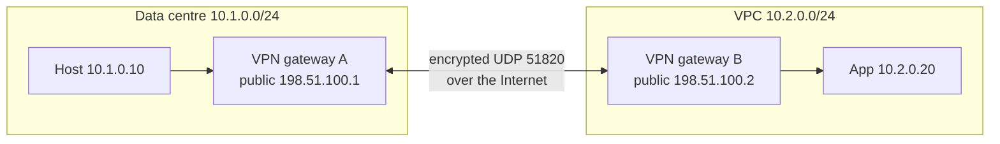
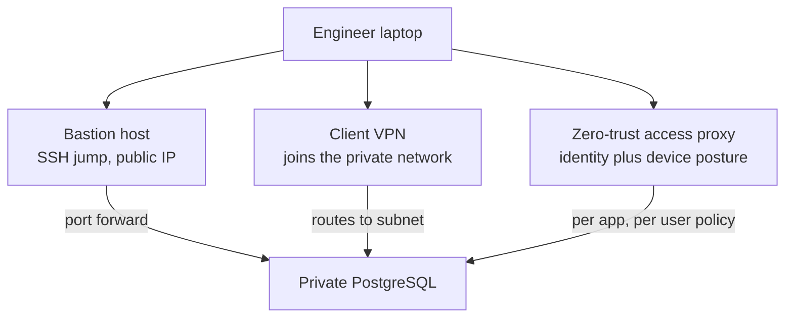

# L12.8 — VPNs

> **Level 12: Advanced Networking** · Topic 8 of 14 · ⏱ ~4 hours · Difficulty: Advanced

## 1. What it is

A **Virtual Private Network (VPN)** builds an encrypted, authenticated tunnel across an untrusted network (usually the Internet) so that two endpoints behave as if they were on the same private network. Packets from the private network are wrapped (**encapsulated**) inside outer packets addressed between the tunnel endpoints, encrypted, sent across the Internet, then unwrapped at the other end. The inner traffic keeps its private addresses (RFC 1918, see [IPv4, IPv6, CIDR and Subnets](../level-02-networking/03-ipv4-ipv6-cidr-subnets.md)).

Two shapes matter in DevOps:

- **Site-to-site VPN:** a gateway at each site (your data centre and an AWS VPC, or two clouds) is permanently connected, and everything behind each gateway can reach the other side. No user action is involved.
- **Client (remote-access) VPN:** one person's laptop or one CI runner connects to a VPN server and gets access to a private network, usually after authenticating with a key, certificate or single sign-on.

Three protocol families dominate:

| Protocol | Layer and transport | Where you meet it |
|---|---|---|
| **IPsec** (IKEv2 + ESP) | Network layer; IKE on UDP 500/4500, ESP as IP protocol 50 (or in UDP 4500 for NAT traversal) | AWS Site-to-Site VPN, Azure/GCP VPN gateways, hardware firewalls, strongSwan, Libreswan |
| **WireGuard** | Network layer virtual interface; UDP | Linux kernel since 5.6, Tailscale, many cloud and self-hosted VPNs |
| **OpenVPN** (TLS-based) | Userspace; UDP or TCP 1194 or 443 | AWS Client VPN, older remote-access setups |

## 2. Why it matters in DevOps

- **Hybrid and multi-cloud connectivity.** A VPN is the quickest way to link an office, a data centre or another cloud to your VPC ([Level 6, VPC](../level-06-cloud-aws/04-vpc-and-subnets.md)) without waiting for a dedicated circuit, and it is the standard backup path for a Direct Connect link ([BGP](02-bgp-fundamentals.md)).
- **Private access to private systems.** Databases, Kubernetes API servers and admin consoles should not have public IP addresses. How engineers reach them (bastion, VPN, zero-trust proxy) is an architecture decision with security and productivity consequences.
- **Subtle failure modes.** Overlapping CIDR ranges, MTU/MSS problems ("ping works but big requests hang"), asymmetric routing, expired pre-shared keys and one-sided rekeys cause outages that look like application bugs.
- **Security posture.** A flat VPN that places every user on the whole network is lateral movement waiting to happen. The trend is least-privilege, identity-aware access ([Level 11](../level-11-security-devsecops/02-least-privilege-iam.md)).

## 3. Real-world system example

**AWS Site-to-Site VPN** gives each VPN connection two IPsec tunnels terminating in different Availability Zones on the AWS side, so a single tunnel endpoint maintenance event does not cut connectivity. It supports static routes or dynamic routing with BGP, attaches to a virtual private gateway or a Transit Gateway, and each tunnel has a documented bandwidth limit (about 1.25 Gbps); equal-cost multipath over several tunnels via Transit Gateway scales it. **AWS Client VPN** is a managed OpenVPN-based service with certificate, Active Directory or SAML authentication.

**Tailscale** builds a mesh VPN on top of **WireGuard**: devices authenticate through your identity provider, a coordination server distributes public keys and policy, and devices connect directly to each other, using NAT traversal techniques and relays (DERP servers) as a fallback. It is a practical example of the shift from "one big VPN concentrator" to identity-based, peer-to-peer access.

**Google's BeyondCorp** (published in a series of papers from 2014 on) is the canonical **zero-trust** design: access to internal applications depends on user identity and device state through an access proxy, not on being "inside the network", which removed the need for a traditional corporate VPN for most applications. Commercial equivalents include Cloudflare Access, AWS Verified Access and Google Identity-Aware Proxy.

**WireGuard** itself was merged into the mainline Linux kernel in version 5.6 (2020) and is used by many providers and tools for its small codebase and simple configuration.

## 4. Diagram

A site-to-site VPN between a data centre and the `shop-api` VPC (what the lab below builds, in miniature):



Three ways to give engineers access to a private database, ordered by increasing trust placed in the identity layer:



## 5. How it works

### Tunnels, encapsulation and routing

A VPN is a virtual network interface plus routes. Traffic for a remote prefix is routed to the interface, the VPN software encrypts it and sends it as UDP (or ESP) to the peer's public address, and the peer decrypts it and injects it into its own network. Because the outer header and encryption add overhead, the effective **MTU** shrinks (WireGuard's default is 1420 on a 1500-byte path). If your TCP path MTU discovery is broken (ICMP blocked), large packets vanish and sessions hang after the handshake. The fix is a lower tunnel MTU or **MSS clamping** (`iptables -t mangle ... --clamp-mss-to-pmtu`).

Two routing styles exist:

- **Policy-based** (older IPsec): the tunnel carries only traffic matching selectors such as `10.1.0.0/24 <-> 10.2.0.0/24`.
- **Route-based:** the tunnel is an interface and the routing table (static routes or BGP) decides what goes in. This is more flexible and is what cloud VPN gateways, WireGuard and modern IPsec use.

### IPsec in a nutshell

1. **IKE (Internet Key Exchange, v2)** authenticates the peers (pre-shared key or certificates) and negotiates keys and algorithms. This creates the IKE security association (SA), then one or more **child SAs**.
2. **ESP (Encapsulating Security Payload)** carries the encrypted, authenticated packets. **Tunnel mode** wraps the whole original packet (the normal VPN case); transport mode protects only the payload.
3. **NAT traversal (NAT-T)** wraps ESP in UDP 4500 when a NAT device sits in the path.
4. Algorithms are negotiated from long lists (AES-GCM, SHA-2, DH groups), which gives compatibility with almost every vendor and a large configuration surface (and mismatch errors like `NO_PROPOSAL_CHOSEN`). Rekeying happens periodically, and **dead peer detection** (DPD) tears down broken tunnels.

### WireGuard in a nutshell

- Each peer has a **key pair** (Curve25519). You exchange *public* keys, like SSH `authorized_keys`. There is no negotiation: one fixed modern suite (Noise protocol, ChaCha20-Poly1305, BLAKE2s) means very little to misconfigure.
- **Cryptokey routing.** Each peer has an `AllowedIPs` list. Outbound, it is a routing table: packets for those prefixes go to that peer. Inbound, it is an access list: a decrypted packet from the peer is accepted only if its source IP is in that list. You will test this.
- It is **silent**: a peer ignores packets not authenticated with a known key, so an unauthenticated scanner gets no reply. It supports **roaming** (the endpoint address updates when the peer's IP changes) and rekeys frequently (about every two minutes of activity).
- It has no built-in user management, address assignment or dynamic routing; tools like Tailscale, Netmaker or your own automation add them. For BGP over WireGuard use a routing daemon on the tunnel interface.
- `PersistentKeepalive = 25` keeps NAT mappings alive for peers behind NAT.

### Comparison

| | IPsec (IKEv2) | WireGuard | OpenVPN |
|---|---|---|---|
| Typical use | Site-to-site with clouds and appliances | Fast site-to-site and client VPN, mesh | Client VPN with legacy compatibility |
| Interop | Universal, every cloud and vendor | Growing, not offered by all cloud-native VPN gateways | Wide client support |
| Config complexity | High (proposals, selectors, lifetimes) | Very low | Medium |
| Performance | Good, kernel, hardware offload | Very good, kernel | Lower (userspace, TLS) |
| Crypto agility | Many suites, negotiated | One fixed modern suite (change = new protocol version) | Many via OpenSSL |
| Identity | PSK or X.509 certificates | Static public keys (add your own layer) | Certificates, username/password, SSO plugins |
| Passes restrictive firewalls | UDP 500/4500 | UDP only | Can use TCP 443 |

### Bastion vs VPN vs zero trust

| | Bastion (jump host) | VPN | Zero-trust access proxy |
|---|---|---|---|
| Unit of access | One host or port at a time (SSH) | Whole network or subnets | Specific application per user |
| Exposure | One public host to harden and patch | VPN endpoint(s) exposed | Identity provider and proxy (managed or self-hosted) |
| Identity and audit | SSH keys or certs; session logs need extra work | Often only "connected"; weak per-resource audit | Per-request identity, device posture, central audit |
| Network position | Trusted once you can reach the bastion | Trusted once connected (lateral movement risk) | No implicit trust from network location |
| Good for | Small teams, break-glass access, SSH to private servers ([Level 1, SSH](../level-01-linux-fundamentals/13-ssh-agent-and-port-forwarding.md)) | Site-to-site, legacy apps that need real network access | Web apps, SSH/DB access with SSO, remote workforce at scale |

Modern practice combines them: site-to-site VPN or private links for networks, a hardened bastion or cloud-native session service (for example AWS Systems Manager Session Manager, no inbound ports) for admin shells, and an identity-aware proxy for human access to internal apps. Whatever you choose, keep the VPN's reach narrow with routes, security groups and firewall rules ([Level 6, Security Groups](../level-06-cloud-aws/06-security-groups-and-nacls.md)).

## 6. Step-by-step guide

You will build a site-to-site WireGuard VPN between two simulated sites on one machine using Linux network namespaces, so there is nothing to buy and nothing touches your real network. A pair of namespaces plays the two gateways, a virtual cable plays the Internet, and each gateway has a private LAN address.

**Prerequisites:** Linux with root (`sudo`), `iproute2`, `wireguard-tools`, `tcpdump`, `iputils-ping`, `curl`, `python3`: `sudo apt-get install -y wireguard-tools tcpdump iputils-ping curl`. The Linux kernel has had WireGuard since 5.6. If `ip link add x type wireguard` says `Unknown device type` (some containers and sandboxes), also install the userspace implementation, `sudo apt-get install -y wireguard-go`; the script below falls back to it automatically (it needs `/dev/net/tun`). Verified with `wireguard-go` on Ubuntu 24.04; the kernel path uses the same `wg` commands.

1. **Build the topology.** Namespace `siteA` is the data centre gateway (LAN `10.1.0.0/24`), `siteB` is the VPC gateway (LAN `10.2.0.0/24`). Their "public" addresses are 198.51.100.1 and 198.51.100.2 (documentation range).
   ```bash
   mkdir -p ~/vpn-lab && cd ~/vpn-lab
   sudo ip netns add siteA; sudo ip netns add siteB
   sudo ip link add vethA type veth peer name vethB          # the "Internet"
   sudo ip link set vethA netns siteA; sudo ip link set vethB netns siteB
   sudo ip -n siteA addr add 198.51.100.1/24 dev vethA; sudo ip -n siteB addr add 198.51.100.2/24 dev vethB
   for n in siteA siteB; do sudo ip -n $n link set lo up; done
   sudo ip -n siteA link set vethA up; sudo ip -n siteB link set vethB up
   sudo ip -n siteA addr add 10.1.0.1/24 dev lo            # a host address standing in for LAN A
   sudo ip -n siteB addr add 10.2.0.1/24 dev lo            # a host address standing in for LAN B
   sudo ip netns exec siteA ping -c1 -W1 198.51.100.2      # underlay reachability
   ```
   Expected: `1 packets transmitted, 1 received`.

2. **Generate key pairs and a pre-shared key.** Each side keeps its private key secret and shares only the public key. The optional pre-shared key (PSK) adds a layer of symmetric protection against future cryptanalysis.
   ```bash
   umask 077
   for n in a b; do wg genkey > $n.key; wg pubkey < $n.key > $n.pub; done
   wg genpsk > psk
   cat a.pub b.pub
   ```

3. **Create the WireGuard interfaces and peers.** `AllowedIPs` lists what each side will send to, and accept from, its peer: the peer's tunnel address and the LAN behind it.
   ```bash
   sudo ip -n siteA link add wgA type wireguard 2>/dev/null || sudo ip netns exec siteA wireguard-go wgA
   sudo ip -n siteB link add wgB type wireguard 2>/dev/null || sudo ip netns exec siteB wireguard-go wgB
   sudo ip -n siteA addr add 10.99.0.1/30 dev wgA; sudo ip -n siteB addr add 10.99.0.2/30 dev wgB
   sudo ip netns exec siteA wg set wgA private-key a.key listen-port 51820 \
       peer $(cat b.pub) preshared-key psk endpoint 198.51.100.2:51820 \
       allowed-ips 10.99.0.2/32,10.2.0.0/24 persistent-keepalive 25
   sudo ip netns exec siteB wg set wgB private-key b.key listen-port 51820 \
       peer $(cat a.pub) preshared-key psk endpoint 198.51.100.1:51820 \
       allowed-ips 10.99.0.1/32,10.1.0.0/24 persistent-keepalive 25
   sudo ip -n siteA link set wgA up; sudo ip -n siteB link set wgB up
   sudo ip -n siteA route add 10.2.0.0/24 dev wgA            # send LAN B traffic into the tunnel
   sudo ip -n siteB route add 10.1.0.0/24 dev wgB
   ```

4. **Send traffic through the tunnel and read the status.** Source the ping from the LAN A address so it behaves like a host on that LAN.
   ```bash
   sudo ip netns exec siteA ping -c2 -I 10.1.0.1 10.2.0.1
   sudo ip netns exec siteA wg show wgA
   ```
   ```text
   64 bytes from 10.2.0.1: icmp_seq=1 ttl=64 time=0.8 ms
   ...
   peer: <public key of B>
     endpoint: 198.51.100.2:51820
     allowed ips: 10.99.0.2/32, 10.2.0.0/24
     latest handshake: 1 second ago
     transfer: 436 B received, 528 B sent
   ```
   `latest handshake` is the single best health indicator of a WireGuard link: if it is missing or older than a few minutes while traffic should be flowing, the tunnel is down.

5. **See what an eavesdropper sees, and what the tunnel carries.** Capture on the "Internet" link and on the tunnel interface at the same time.
   ```bash
   sudo ip netns exec siteA timeout 4 tcpdump -i vethA -n -c 4 &
   sudo ip netns exec siteA timeout 4 tcpdump -i wgA -n -c 2 &
   sleep 1; sudo ip netns exec siteA ping -c2 -I 10.1.0.1 10.2.0.1 >/dev/null; wait
   ```
   ```text
   # on vethA (what the Internet sees)
   IP 198.51.100.1.51820 > 198.51.100.2.51820: UDP, length 128
   IP 198.51.100.2.51820 > 198.51.100.1.51820: UDP, length 128
   # on wgA (what the hosts see)
   IP 10.1.0.1 > 10.2.0.1: ICMP echo request, id 30049, seq 1, length 64
   IP 10.2.0.1 > 10.1.0.1: ICMP echo reply, id 30049, seq 1, length 64
   ```
   The Internet sees only UDP between the two gateways; the private addresses and ICMP exist only inside the tunnel.

6. **Run a real application across the VPN.** Start a web server on LAN B and fetch it from LAN A.
   ```bash
   sudo ip netns exec siteB python3 -m http.server 8080 --bind 10.2.0.1 >/dev/null 2>&1 &
   sleep 1
   sudo ip netns exec siteA curl -s --interface 10.1.0.1 -o /dev/null -w '%{http_code}\n' http://10.2.0.1:8080/
   ```
   Expected: `200`.

7. **Prove cryptokey routing: AllowedIPs is both routing and firewall.** Add a route for a prefix that is not in A's AllowedIPs for B and try to reach it.
   ```bash
   sudo ip -n siteA route add 10.3.0.0/24 dev wgA
   sudo ip netns exec siteA ping -c1 -W1 -I 10.1.0.1 10.3.0.1       # fails: no peer owns 10.3.0.0/24
   sudo ip netns exec siteA wg set wgA peer $(cat b.pub) allowed-ips 10.99.0.2/32,10.2.0.0/24,10.3.0.0/24
   sudo ip netns exec siteA wg show wgA allowed-ips                  # now includes 10.3.0.0/24
   ```
   Before the change, WireGuard has no peer to send `10.3.0.0/24` to and drops it (the kernel implementation reports `Required key not available`). After you add it to the peer's AllowedIPs it is encrypted and sent to B; B will still drop it unless its own AllowedIPs list for A includes the packet's source, which is the inbound access check.

8. **A client VPN uses the same mechanics.** A road-warrior laptop is just a peer with one address and a gateway peer that lists it. Write `wg0.conf` for wg-quick (placeholders only; do not activate here):
   ```ini
   # laptop: /etc/wireguard/wg0.conf  (generate your own keys; never commit private keys)
   [Interface]
   Address = 10.99.0.10/32
   PrivateKey = <LAPTOP_PRIVATE_KEY>
   DNS = 10.2.0.2

   [Peer]
   PublicKey = <GATEWAY_PUBLIC_KEY>
   Endpoint = vpn.example.com:51820
   AllowedIPs = 10.2.0.0/24        # split tunnel: only the VPC range goes through the VPN
   PersistentKeepalive = 25
   ```
   `AllowedIPs = 0.0.0.0/0` would instead send all traffic through the VPN (full tunnel). On the gateway, add a `[Peer]` for the laptop with `AllowedIPs = 10.99.0.10/32`, enable IP forwarding (`sysctl -w net.ipv4.ip_forward=1`), and allow the traffic in the gateway's firewall.

9. **Clean up.**
   ```bash
   sudo pkill wireguard-go 2>/dev/null; sudo pkill -f 'http.server 8080' 2>/dev/null
   sudo ip netns del siteA; sudo ip netns del siteB
   cd ~ && rm -r ~/vpn-lab
   ```
   Deleting the namespaces also removes the veth pair and kernel WireGuard interfaces.

For IPsec, the practical equivalent is a cloud-managed gateway: create a virtual private gateway and a customer gateway in a free-tier-aware sandbox, download the vendor configuration and apply it to strongSwan. Note that AWS Site-to-Site VPN is billed per connection-hour plus data transfer, so delete it promptly ([Level 6](../level-06-cloud-aws/05-route-tables-igw-nat.md)).

## 7. Real-world scenario

*(Illustrative.)* `shop-api` runs in a VPC (`10.20.0.0/16`) and an acquired company's data centre (`10.20.0.0/16`, the same range by coincidence) must now be linked over a Site-to-Site VPN for a data migration. The tunnels come up, BGP is established, yet nothing can talk across: both sides think `10.20.x.x` is local.
Investigation: `ip route get 10.20.4.15` on a VPC instance shows the local subnet route; the VPN's routes are shadowed by the identical connected route. Renumbering either network would take months.
Fix: a NAT layer in the tunnel: the data centre's hosts are presented to the VPC as `10.120.0.0/16` through one-to-one NAT on the VPN gateway, and DNS entries for the migration point to the translated range. After that, a second problem appears: bulk transfers stall at about 1.4 KB because an on-prem firewall drops the ICMP "fragmentation needed" messages; the team lowers the tunnel MTU and clamps TCP MSS.
**Lesson:** plan non-overlapping address space before connecting networks ([Level 6, VPC](../level-06-cloud-aws/04-vpc-and-subnets.md)), and always test MTU with large packets (`ping -M do -s 1372`) rather than only a single small ping.

## 8. Common mistakes and best practices

**Don't**
- Interconnect networks with overlapping CIDR ranges and hope routing sorts it out.
- Rely on a single VPN tunnel or a single VPN gateway as your only path to production.
- Give every VPN user a route to the entire network or an "allow all" firewall rule.
- Commit private keys or pre-shared keys to Git, or share one key among many people.
- Ignore MTU: broken PMTUD yields hangs that only affect large responses.
- Leave a bastion on a public IP with password SSH, or forget to patch it.
- Treat "connected to VPN" as "authenticated and authorised".

**Do**
- Plan IP space centrally, and prefer route-based tunnels with BGP for site-to-site links.
- Run at least two tunnels in different failure domains and test failover.
- Use separate keys per device or peer, rotate them, and revoke departed users promptly.
- Restrict reach with narrow `AllowedIPs`, security groups and firewall rules; log connections.
- Prefer identity-aware access (SSO, MFA, device posture) for humans, and short-lived credentials for automation.
- Monitor tunnel state (`latest handshake`, BGP session, bytes, packet loss, latency) and alert on a down tunnel.
- Document DNS: how private names resolve for VPN users.

## 9. Tasks

- [ ] **T1 — Build the site-to-site tunnel** *(≈35 min, intermediate)*
  - **Goal:** connect two private LANs over an untrusted link.
  - **Steps:**
    1. Follow steps 1-4 of the guide.
    2. Ping both directions and capture `wg show` output.
  - **Done when:** pings succeed in both directions and `latest handshake` shows seconds ago.

- [ ] **T2 — Prove the traffic is encrypted** *(≈20 min, intermediate)*
  - **Goal:** compare underlay and overlay captures.
  - **Steps:**
    1. Run step 5.
    2. Then fetch the web page (step 6) with `tcpdump -A` on `vethA` and search the capture for the string "Directory listing".
  - **Done when:** the string appears on `wgA` but never on `vethA`, and you can explain why packet length differs from the ping payload.

- [ ] **T3 — Break it: revoke a peer, then fix an AllowedIPs bug** *(≈30 min, advanced)*
  - **Goal:** practise failure diagnosis.
  - **Steps:**
    1. On B, remove A (`wg set wgB peer $(cat a.pub) remove`) and observe the failure from A's side (`wg show` handshake ages).
    2. Re-add the peer but with a typo in `AllowedIPs` (`10.1.0.0/25`), find which hosts fail and why.
    3. Write the three commands you would run first in an incident.
  - **Done when:** you restore connectivity and can explain each symptom from `wg show` and `tcpdump` output.

- [ ] **T4 — MTU and MSS** *(≈30 min, advanced)*
  - **Goal:** see the black hole and fix it.
  - **Steps:**
    1. Find the tunnel MTU (`ip -n siteA link show wgA`).
    2. Ping with the Don't Fragment bit and increasing sizes: `ping -M do -s 1300 -I 10.1.0.1 10.2.0.1` up to the limit; note the largest that works.
    3. Lower the tunnel MTU on both ends (`ip link set dev wgA mtu 1280`) and repeat.
  - **Done when:** you can state the relationship between the MTU and the largest payload that passes (MTU minus 28 bytes of IP and ICMP headers).

- [ ] **T5 — Add a third site and a road-warrior client** *(≈45 min, advanced)*
  - **Goal:** extend to a hub-and-spoke topology.
  - **Steps:**
    1. Add `siteC` with LAN `10.3.0.0/24` peering with `siteA` as hub; configure routes so C can reach B through A (A forwards: `sysctl -w net.ipv4.ip_forward=1` in the namespace; AllowedIPs on each side must list the remote LANs).
    2. Ping C to B and read the AllowedIPs tables.
  - **Done when:** C reaches B via A and you can explain why WireGuard needs every transit prefix in AllowedIPs.

- [ ] **T6 — Prove it: choose an access model for `shop-api`** *(≈45 min, advanced)*
  - **Goal:** justify a design.
  - **Steps:**
    1. Without the guide, rebuild the two-site tunnel from memory.
    2. Write one page choosing between bastion, client VPN and zero-trust access for: (a) a developer querying the production replica, (b) a CI runner deploying to a private cluster, (c) the data centre to VPC link. State the protocol, authentication, audit trail and blast radius for each.
  - **Done when:** the tunnel works from memory and the page names a different, justified mechanism for at least two of the three cases.

## 10. Self-check questions

1. What is the difference between a site-to-site VPN and a client VPN?
2. What does `AllowedIPs` do in WireGuard, in both directions?
3. Name two reasons why IPsec is still common in cloud and enterprise environments despite being harder to configure.
4. A VPN "works" for ping but large file downloads hang. What is the likely cause and fix?
5. What are the weaknesses of a flat VPN compared with zero-trust access?
6. Why do overlapping CIDRs break VPN connectivity, and what are the options?

<details><summary>Answers</summary>

1. Site-to-site connects two networks permanently via gateways, transparently to hosts; a client VPN connects an individual device to a network on demand, usually with user authentication.
2. Outbound it is a routing table (which peer to send a destination to); inbound it is an access list (a decrypted packet is accepted only if its source address is within the peer's AllowedIPs).
3. Universal interoperability (every cloud gateway, firewall and router vendor supports it) and mature features such as certificate auth, dynamic routing with BGP, hardware offload and compliance acceptance.
4. MTU/MSS: the tunnel overhead makes full-size packets too large and fragmentation-needed ICMP is blocked, so PMTUD fails. Lower the tunnel MTU and/or clamp the TCP MSS, and allow the ICMP messages.
5. Connecting grants broad network access (lateral movement), authorisation is coarse, auditing is poor per application, and device health is not considered; zero trust authorises per request based on identity and posture.
6. The local connected route wins, so the remote network is unreachable. Renumber, or use NAT (one-to-one translation) at the VPN edge, or reorganise with a different non-overlapping range for the shared segment.
</details>

## 11. Further reading

- WireGuard documentation and whitepaper (wireguard.com), and `man wg`, `man wg-quick`.
- RFC 7296 (IKEv2), RFC 4303 (ESP), RFC 3948 (UDP encapsulation of ESP); strongSwan documentation.
- AWS documentation: Site-to-Site VPN, Client VPN, Transit Gateway; Systems Manager Session Manager.
- Google, "BeyondCorp: A New Approach to Enterprise Security" and follow-up papers; the Tailscale blog "How Tailscale works".
- Jason A. Donenfeld, WireGuard papers; Michael W. Lucas, *Networking for System Administrators*.

<!-- nav -->
---
← Previous: [CDNs](07-cdns.md) · [Level 12 index](README.md) · Next: [Service Mesh](09-service-mesh.md) →
