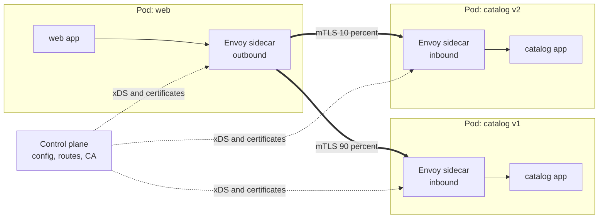
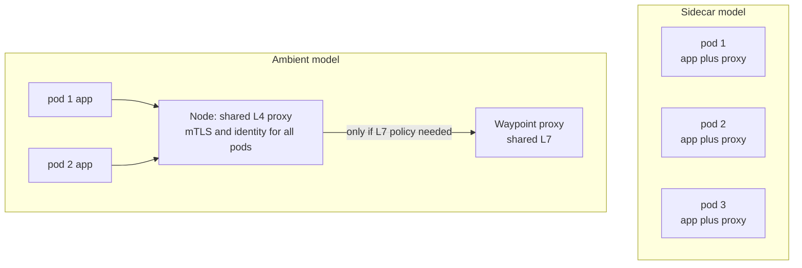

# L12.9 — Service Mesh

> **Level 12: Advanced Networking** · Topic 9 of 14 · ⏱ ~5 hours · Difficulty: Advanced

## 1. What it is

A **service mesh** is a dedicated infrastructure layer that handles service-to-service ("east-west") communication so that application code does not have to. It moves cross-cutting network concerns, namely **mutual TLS (mTLS) identity and encryption, retries, timeouts, circuit breaking, load balancing, traffic splitting and telemetry**, out of every application and library and into proxies that sit on the request path and are configured centrally.

A mesh has two parts:

- The **data plane**: the proxies that carry the traffic. Most meshes use **Envoy** (Istio, Consul, Cilium's L7 mode, many gateways) or a purpose-built proxy (Linkerd's Rust `linkerd2-proxy`). They terminate and originate mTLS, apply routing and resilience policy, and emit metrics, logs and traces.
- The **control plane**: the software that decides what the proxies should do. It watches your platform (for example the Kubernetes API), issues short-lived workload certificates, and pushes configuration to the proxies over a streaming API (Envoy's **xDS** protocols: LDS listeners, RDS routes, CDS clusters, EDS endpoints, SDS secrets).

There are two deployment models:

| Model | How the proxy is placed | Used by |
|---|---|---|
| **Sidecar** | One proxy container per pod/workload, sharing its network namespace; traffic is redirected through it (iptables or eBPF) | Classic Istio, Linkerd, Consul |
| **Ambient / sidecarless** | A shared per-node L4 proxy handles mTLS and identity for all pods on the node, with optional shared L7 "waypoint" proxies per namespace or service | Istio ambient mode (ztunnel + waypoint), Cilium (eBPF in the kernel plus per-node Envoy) |

## 2. Why it matters in DevOps

- **Security by default.** A mesh can give every workload a cryptographic identity and encrypt and authenticate all in-cluster traffic without changing application code ([mTLS](12-mtls.md), [Level 11](../level-11-security-devsecops/08-api-security.md)).
- **Uniform resilience and observability.** Timeouts, retries with budgets, circuit breaking and the "golden signals" ([Level 10](../level-10-observability/11-what-to-monitor.md)) appear consistently for services written in any language ([Circuit Breakers](14-circuit-breakers.md)).
- **Safer releases.** Weighted routing, header-based routing and mirroring make canary and blue/green strategies a configuration change ([Level 5, Canary](../level-05-cicd/12-canary-deployments.md)).
- **But it is a significant operational commitment.** A mesh adds latency, CPU and memory per workload, new failure modes (a broken control plane or expired root certificate can take down all service-to-service traffic), a new upgrade lifecycle and a new debugging surface. The honest question is "is it worth it for us?", answered in section 5.

## 3. Real-world system example

**Istio** (started in 2017 by Google, IBM and Lyft, and a graduated CNCF project) uses Envoy as its data plane, with the `istiod` control plane distributing xDS configuration and issuing workload certificates (SPIFFE-style identities, see [mTLS](12-mtls.md)). Its **ambient mode** replaces per-pod sidecars with a per-node `ztunnel` for mTLS and L4 policy plus optional **waypoint proxies** for L7 features, aimed at cutting the resource overhead and operational friction of sidecars; it has been declared production-ready in recent Istio releases (check the current release notes for status in your version).
**Envoy** itself came from Lyft, which built it to make a polyglot microservice fleet observable and resilient with one consistent proxy; it is now a CNCF graduated project used far beyond meshes (ingress gateways, API gateways, cloud load balancers).
**Linkerd** (CNCF graduated) emphasises simplicity: a small Rust proxy per pod, automatic mTLS and golden-signal metrics out of the box. **Cilium** implements mesh features in the kernel with eBPF and per-node Envoy. **Consul** (HashiCorp) provides service discovery plus a mesh with sidecar proxies that works across VMs and Kubernetes.
Large platforms such as Lyft and others have publicly described meshes as the way to apply uniform policy across hundreds of services; smaller teams often report that the cost exceeded the benefit, which is why the "when is it worth it" question matters. For the Kubernetes-specific view see [Level 16: Service Mesh with Istio or Linkerd](../level-16-advanced-kubernetes/09-service-mesh-istio-linkerd.md) and [Mesh traffic management](../level-16-advanced-kubernetes/10-mesh-traffic-management.md).

## 4. Diagram

Sidecar data plane and control plane. The application only talks to `localhost`; the sidecars do mTLS, routing and telemetry; the control plane pushes configuration and certificates:



Sidecar versus ambient, in terms of where proxies run:



## 5. How it works

### Request path with sidecars

1. Traffic redirection (iptables rules inserted by an init container, or eBPF/CNI) sends the app's outbound connection to the local sidecar's outbound listener instead of directly to the destination.
2. The sidecar resolves the logical destination (`catalog.shop.svc`) to endpoints it received from the control plane (EDS), applies routing rules (path or header match, weighted clusters), picks an endpoint with a load-balancing policy ([Load Balancing](06-load-balancing-algorithms.md)), opens an **mTLS** connection presenting its own workload certificate, and verifies the peer's identity.
3. The destination's sidecar terminates mTLS, authorises the caller (is this identity allowed to call this service and path?), and forwards plain HTTP to the app on `localhost`.
4. Both sidecars record metrics (rate, errors, latency per route and per source/destination identity), access logs and trace spans, and apply timeouts, retries and circuit-breaking limits ([Connection Pooling](10-connection-pooling.md)).

### What the control plane does

| Function | Detail |
|---|---|
| **Service discovery** | Watches the platform's endpoints and keeps each proxy's cluster membership current |
| **Configuration translation** | Turns high-level resources (Istio `VirtualService`/`DestinationRule`, Gateway API `HTTPRoute`, Linkerd `ServiceProfile`/policies) into xDS |
| **Certificate authority** | Issues short-lived workload certificates (hours) with an identity such as `spiffe://example.com/ns/shop/sa/web` and rotates them automatically |
| **Policy** | Distributes authorisation rules (who can call what) enforced in the proxies |
| **Observability wiring** | Configures metric, log and trace emission |

The data plane keeps working if the control plane is briefly down (proxies keep their last configuration and certificates), but certificates expire, so a long control-plane outage becomes a data-plane outage. Treat the control plane as tier-0 infrastructure.

### Sidecar vs ambient

| | Sidecar | Ambient / sidecarless |
|---|---|---|
| Resource cost | Proxy per pod: memory and CPU scale with pod count | Per-node L4 proxy; L7 proxies only where needed |
| Isolation | Strong per-workload (own proxy, own failure domain) | Shared proxies: noisy neighbour and larger blast radius per node |
| Onboarding | Pod restart to inject the sidecar | No pod restart; enable by namespace label |
| Features | Full L7 on every hop | L4 (mTLS, identity, TCP policy) cheap; L7 requires a waypoint hop |
| Maturity and tooling | Longest track record | Newer; evolving quickly; check your mesh's current status |
| Debugging | Per-pod proxy logs and admin endpoint | Node-level and waypoint logs |

### When is a service mesh worth it?

Worth considering when **most** of these are true:

- Dozens of services owned by many teams, in several languages (so a per-language library cannot enforce policy).
- A requirement for **mTLS everywhere** with identity-based authorisation (regulation, zero-trust initiative, multi-tenant clusters).
- You need uniform traffic management (canaries, fault injection, mirroring) and consistent telemetry, and the platform team can own the mesh.

Probably not worth it when:

- Fewer than roughly ten to twenty services, or a single language where a shared library or gRPC's built-in features suffice.
- A small team without dedicated platform capacity; the mesh becomes the new thing nobody understands at 3 a.m.
- Latency or resource budgets are tight, or the workload is mostly batch or north-south.

Alternatives that give part of the value with less cost: an ingress gateway or API gateway for north-south traffic ([Level 8, Ingress](../level-08-kubernetes/05-ingress.md)), Kubernetes NetworkPolicies ([Level 8](../level-08-kubernetes/19-networkpolicies.md)), CNI-level transparent encryption (WireGuard or IPsec in Cilium/Calico), cloud-native service networking (for example VPC Lattice), gRPC with xDS ("proxyless mesh"), and cert-manager-issued certificates with a small client library.

Adopt incrementally: start with observability and mTLS in permissive mode on one namespace, then enforce strict mTLS, then add traffic policy. Have a documented bypass for a broken mesh.

## 6. Step-by-step guide

You will build a miniature service mesh **without Kubernetes**, using Docker Compose and Envoy, so you can see the moving parts: three Envoy sidecars (one outbound for a `web` client, one inbound for each of two `catalog` versions), mTLS with identities from a tiny CA, retries and timeouts, a weighted canary, and a "control plane" that updates the proxy by rewriting a file (Envoy's file-based xDS). Everything is free and local.

**Prerequisites:** Docker with Compose v2, `openssl`, `curl`. About 1 GB of image downloads (Envoy and Node Alpine images). Verified with `envoyproxy/envoy:v1.36-latest` and `node:24-alpine`. If your shell sets `https_proxy`, `unset` it for `curl localhost`.

1. **Create the project and a CA with two workload identities.** Identities are SPIFFE-style URIs in the certificate's Subject Alternative Name.
   ```bash
   mkdir -p ~/mesh-lab/{certs,web,inbound,app} && cd ~/mesh-lab
   cat > gen-certs.sh <<'EOF'
   #!/usr/bin/env bash
   # Tiny CA plus two workload certificates carrying SPIFFE-style identities in a URI SAN.
   set -euo pipefail
   cd "$(dirname "$0")/certs"
   openssl req -x509 -newkey ec -pkeyopt ec_paramgen_curve:P-256 -nodes -keyout ca.key -out ca.crt \
     -days 30 -subj "/O=Example Lab/CN=Mesh Lab CA" -addext "basicConstraints=critical,CA:TRUE" \
     -addext "keyUsage=critical,keyCertSign,cRLSign" 2>/dev/null
   issue() {  # name  spiffe-id  dns-name
     openssl req -newkey ec -pkeyopt ec_paramgen_curve:P-256 -nodes -keyout "$1.key" -out "$1.csr" -subj "/CN=$1" 2>/dev/null
     printf 'basicConstraints=CA:FALSE\nkeyUsage=digitalSignature\nextendedKeyUsage=serverAuth,clientAuth\nsubjectAltName=URI:%s,DNS:%s\n' "$2" "$3" > "$1.ext"
     openssl x509 -req -in "$1.csr" -CA ca.crt -CAkey ca.key -CAcreateserial -out "$1.crt" -days 7 -extfile "$1.ext" 2>/dev/null
     rm -f "$1.csr" "$1.ext"
   }
   issue web     spiffe://example.com/ns/shop/sa/web     web.shop.svc
   issue catalog spiffe://example.com/ns/shop/sa/catalog catalog.shop.svc
   chmod 644 *.crt *.key   # lab only: production uses secret mounts or SDS, never world-readable keys
   ls
   EOF
   chmod +x gen-certs.sh && ./gen-certs.sh
   openssl x509 -in certs/web.crt -noout -ext subjectAltName
   ```
   Expected: `URI:spiffe://example.com/ns/shop/sa/web, DNS:web.shop.svc`. Note both services share the `catalog` identity because identity is per *service*, not per version.

2. **The application.** A 20-line Node service that can be made to fail or stall on demand.
   ```bash
   cat > app/server.js <<'EOF'
   // Tiny demo service: node server.js  (VERSION env var names the build)
   const http = require('http');
   const version = process.env.VERSION || 'v1';
   http.createServer((req, res) => {
     const url = new URL(req.url, 'http://x');
     const send = (code, body) => { res.writeHead(code, { 'content-type': 'text/plain', 'x-app-version': version }); res.end(body + '\n'); };
     if (url.pathname === '/flaky') {                       // fails with probability p (default 0.5)
       const p = parseFloat(url.searchParams.get('p') || '0.5');
       return Math.random() < p ? send(503, `catalog ${version}: transient failure`) : send(200, `catalog ${version}: ok`);
     }
     if (url.pathname === '/slow') {                        // answers after ms milliseconds
       return setTimeout(() => send(200, `catalog ${version}: slow answer`), parseInt(url.searchParams.get('ms') || '3000'));
     }
     send(200, `catalog ${version}: hello from ${url.pathname}`);
   }).listen(8080, () => console.log(`catalog ${version} listening on 8080`));
   EOF
   ```

3. **The inbound sidecar (data plane, server side).** It accepts only mTLS connections whose client certificate chains to the CA **and** whose URI SAN is exactly the `web` identity, then forwards to the local app. The same file is used for both versions.
   ```bash
   cat > inbound/inbound.yaml <<'EOF'
   # Sidecar for the catalog service: accepts ONLY mTLS from the web identity and forwards to the local app.
   admin:
     address: { socket_address: { address: 0.0.0.0, port_value: 9901 } }
   static_resources:
     listeners:
     - name: inbound
       address: { socket_address: { address: 0.0.0.0, port_value: 15006 } }
       filter_chains:
       - transport_socket:
           name: envoy.transport_sockets.tls
           typed_config:
             "@type": type.googleapis.com/envoy.extensions.transport_sockets.tls.v3.DownstreamTlsContext
             require_client_certificate: true
             common_tls_context:
               tls_certificates:
               - certificate_chain: { filename: /certs/catalog.crt }
                 private_key: { filename: /certs/catalog.key }
               validation_context:
                 trusted_ca: { filename: /certs/ca.crt }
                 match_typed_subject_alt_names:
                 - san_type: URI
                   matcher: { exact: "spiffe://example.com/ns/shop/sa/web" }
         filters:
         - name: envoy.filters.network.http_connection_manager
           typed_config:
             "@type": type.googleapis.com/envoy.extensions.filters.network.http_connection_manager.v3.HttpConnectionManager
             stat_prefix: inbound
             access_log:
             - name: envoy.access_loggers.stdout
               typed_config:
                 "@type": type.googleapis.com/envoy.extensions.access_loggers.stream.v3.StdoutAccessLog
                 log_format:
                   text_format_source: { inline_string: "[inbound] %REQ(:METHOD)% %REQ(:PATH)% -> %RESPONSE_CODE% peer=%DOWNSTREAM_PEER_URI_SAN%\n" }
             route_config:
               virtual_hosts:
               - name: local
                 domains: ["*"]
                 routes:
                 - match: { prefix: "/" }
                   route: { cluster: local_app }
             http_filters:
             - name: envoy.filters.http.router
               typed_config: { "@type": type.googleapis.com/envoy.extensions.filters.http.router.v3.Router }
     clusters:
     - name: local_app
       type: STATIC
       connect_timeout: 1s
       load_assignment:
         cluster_name: local_app
         endpoints: [ { lb_endpoints: [ { endpoint: { address: { socket_address: { address: 127.0.0.1, port_value: 8080 } } } } ] } ]
   EOF
   ```

4. **The outbound sidecar (data plane, client side) and its "control plane" files.** `bootstrap.yaml` tells Envoy to load listeners (LDS) and clusters (CDS) from files and to reload them when the directory changes. That is the same mechanism a real control plane uses, just over gRPC instead of the file system.
   ```bash
   cat > web/bootstrap.yaml <<'EOF'
   node: { id: web-proxy, cluster: web }
   admin:
     address: { socket_address: { address: 0.0.0.0, port_value: 9901 } }
   dynamic_resources:
     lds_config:
       resource_api_version: V3
       path_config_source: { path: /etc/envoy/lds.yaml, watched_directory: { path: /etc/envoy } }
     cds_config:
       resource_api_version: V3
       path_config_source: { path: /etc/envoy/cds.yaml, watched_directory: { path: /etc/envoy } }
   EOF
   cat > web/cds.yaml <<'EOF'
   resources:
   - "@type": type.googleapis.com/envoy.config.cluster.v3.Cluster
     name: catalog_v1
     type: STRICT_DNS
     connect_timeout: 1s
     load_assignment:
       cluster_name: catalog_v1
       endpoints: [ { lb_endpoints: [ { endpoint: { address: { socket_address: { address: catalog-v1-proxy, port_value: 15006 } } } } ] } ]
     transport_socket: &mtls
       name: envoy.transport_sockets.tls
       typed_config:
         "@type": type.googleapis.com/envoy.extensions.transport_sockets.tls.v3.UpstreamTlsContext
         sni: catalog.shop.svc
         common_tls_context:
           tls_certificates:
           - certificate_chain: { filename: /certs/web.crt }
             private_key: { filename: /certs/web.key }
           validation_context:
             trusted_ca: { filename: /certs/ca.crt }
             match_typed_subject_alt_names:
             - san_type: URI
               matcher: { exact: "spiffe://example.com/ns/shop/sa/catalog" }
   - "@type": type.googleapis.com/envoy.config.cluster.v3.Cluster
     name: catalog_v2
     type: STRICT_DNS
     connect_timeout: 1s
     load_assignment:
       cluster_name: catalog_v2
       endpoints: [ { lb_endpoints: [ { endpoint: { address: { socket_address: { address: catalog-v2-proxy, port_value: 15006 } } } } ] } ]
     transport_socket: *mtls
   EOF
   cat > web/lds.yaml <<'EOF'
   resources:
   - "@type": type.googleapis.com/envoy.config.listener.v3.Listener
     name: outbound_catalog
     address: { socket_address: { address: 0.0.0.0, port_value: 15001 } }
     filter_chains:
     - filters:
       - name: envoy.filters.network.http_connection_manager
         typed_config:
           "@type": type.googleapis.com/envoy.extensions.filters.network.http_connection_manager.v3.HttpConnectionManager
           stat_prefix: outbound_catalog
           access_log:
           - name: envoy.access_loggers.stdout
             typed_config:
               "@type": type.googleapis.com/envoy.extensions.access_loggers.stream.v3.StdoutAccessLog
               log_format:
                 text_format_source: { inline_string: "[outbound] %REQ(:PATH)% -> %RESPONSE_CODE% cluster=%UPSTREAM_CLUSTER% attempts=%UPSTREAM_REQUEST_ATTEMPT_COUNT% flags=%RESPONSE_FLAGS% %DURATION%ms\n" }
           route_config:
             virtual_hosts:
             - name: catalog
               domains: ["*"]
               routes:
               - match: { prefix: "/" }
                 route:
                   timeout: 2s
                   retry_policy: { retry_on: "5xx,connect-failure", num_retries: 2, per_try_timeout: 1s }
                   weighted_clusters:
                     clusters:
                     - { name: catalog_v1, weight: 100 }
                     - { name: catalog_v2, weight: 0 }
           http_filters:
           - name: envoy.filters.http.router
             typed_config: { "@type": type.googleapis.com/envoy.extensions.filters.http.router.v3.Router }
   EOF
   ```

5. **Wire it together with Compose.** The key line is `network_mode: "service:..."`: the app container joins its sidecar's network namespace, which is exactly what a Kubernetes pod is. In a real mesh, iptables redirects the app's traffic to the sidecar; here you call the outbound listener on port 15001 yourself.
   ```bash
   cat > compose.yaml <<'EOF'
   name: mesh-lab
   x-envoy: &envoy
     image: envoyproxy/envoy:v1.36-latest
     networks: [mesh]
   services:
     catalog-v1-proxy:
       <<: *envoy
       command: ["-c", "/etc/envoy/inbound.yaml", "--log-level", "warn"]
       volumes: ["./inbound:/etc/envoy:ro", "./certs:/certs:ro"]
     catalog-v1:
       image: node:24-alpine
       network_mode: "service:catalog-v1-proxy"      # same network namespace, like containers in one pod
       environment: { VERSION: v1 }
       command: ["node", "/app/server.js"]
       volumes: ["./app:/app:ro"]
     catalog-v2-proxy:
       <<: *envoy
       command: ["-c", "/etc/envoy/inbound.yaml", "--log-level", "warn"]
       volumes: ["./inbound:/etc/envoy:ro", "./certs:/certs:ro"]
     catalog-v2:
       image: node:24-alpine
       network_mode: "service:catalog-v2-proxy"
       environment: { VERSION: v2 }
       command: ["node", "/app/server.js"]
       volumes: ["./app:/app:ro"]
     web-proxy:
       <<: *envoy
       command: ["-c", "/etc/envoy/bootstrap.yaml", "--log-level", "warn"]
       volumes: ["./web:/etc/envoy", "./certs:/certs:ro"]
       ports: ["127.0.0.1:15001:15001", "127.0.0.1:19901:9901"]
       depends_on: [catalog-v1-proxy, catalog-v2-proxy]
   networks:
     mesh: {}
   EOF
   docker compose config -q && docker compose up -d
   sleep 6; docker compose ps --format '{{.Name}} {{.Status}}'
   ```
   Expected: five containers `Up`.

6. **Send traffic through the mesh.** Your `curl` plays the web application, speaking plain HTTP to its local sidecar; everything after that hop is mTLS.
   ```bash
   for i in 1 2 3; do curl -s localhost:15001/hello; done
   sleep 3     # Envoy flushes access logs every few seconds
   docker compose logs web-proxy catalog-v1-proxy 2>&1 | grep -E '\[(outbound|inbound)\]' | tail -4
   ```
   ```text
   catalog v1: hello from /hello
   catalog v1: hello from /hello
   catalog v1: hello from /hello
   [outbound] /hello -> 200 cluster=catalog_v1 attempts=1 flags=- 239ms
   [inbound] GET /hello -> 200 peer=spiffe://example.com/ns/shop/sa/web
   ```
   The inbound log shows the authenticated caller identity (`peer=spiffe://...`): that is what authorisation policy is based on.

7. **Prove mTLS is enforced.** Use `openssl s_client` inside the `web-proxy` container (the Envoy image includes OpenSSL) to connect to the `catalog` sidecar directly with three different identities.
   ```bash
   t() { docker compose exec -T web-proxy sh -c "printf 'GET /who HTTP/1.1\r\nHost: catalog\r\nConnection: close\r\n\r\n' | timeout 5 openssl s_client -connect catalog-v1-proxy:15006 -CAfile /certs/ca.crt $1 -quiet 2>&1 | grep -E 'alert|HTTP/1.1'"; }
   echo "no client cert:";        t ""
   echo "correct web identity:";  t "-cert /certs/web.crt -key /certs/web.key"
   echo "wrong identity:";        t "-cert /certs/catalog.crt -key /certs/catalog.key"
   ```
   ```text
   no client cert:        ...alert certificate required...
   correct web identity:  HTTP/1.1 200 OK
   wrong identity:        ...alert certificate unknown...
   ```
   Even a certificate signed by the same CA is rejected if its identity is not on the allow-list. That is identity-based authorisation, not just encryption.

8. **Resilience policy: retries and timeouts.** The route retries 5xx up to 2 times and times out after 2 seconds.
   ```bash
   for i in $(seq 1 10); do curl -s -o /dev/null -w '%{http_code} ' 'localhost:15001/flaky?p=0.5'; done; echo
   curl -s -w ' [%{http_code} in %{time_total}s]\n' 'localhost:15001/slow?ms=3000'
   sleep 3   # Envoy flushes access logs every few seconds
   docker compose logs web-proxy 2>&1 | grep '\[outbound\] /flaky' | awk '{print $6,$8}' | sort | uniq -c
   ```
   With a 50 percent failure rate and two retries, roughly 1 in 8 requests still fails (0.5 cubed), versus 1 in 2 without retries. The slow call returns `upstream request timeout` with code `504` after about 2 seconds, not 3. The log summary (status code and attempt count, for example `200 attempts=2`) shows how many calls needed retries. Retries are only safe for idempotent requests, and they can multiply load during an incident, which is why [circuit breakers and retry budgets](14-circuit-breakers.md) exist.

9. **Play the control plane: shift 10 percent of traffic to v2 without restarting anything.** Rewrite the listener file atomically (write a temp file, then rename). Envoy notices the rename and applies the new routes.
   ```bash
   sed -e 's/name: catalog_v1, weight: 100/name: catalog_v1, weight: 90/' \
       -e 's/name: catalog_v2, weight: 0/name: catalog_v2, weight: 10/' web/lds.yaml > web/lds.yaml.new
   mv web/lds.yaml.new web/lds.yaml
   sleep 2
   for i in $(seq 1 100); do curl -s localhost:15001/x; done | sort | uniq -c
   curl -s localhost:19901/stats | grep -E 'listener_manager.lds.update_success|cluster.catalog_v[12].upstream_rq_2xx'
   ```
   ```text
        90 catalog v1: hello from /x
        10 catalog v2: hello from /x
   cluster.catalog_v1.upstream_rq_2xx: 103
   cluster.catalog_v2.upstream_rq_2xx: 10
   listener_manager.lds.update_success: 2
   ```
   Counts will be close to 90/10 but not necessarily exact. A real control plane (Istio's `istiod`, for example) does the same over a streaming gRPC connection when you apply a `VirtualService` or Gateway API `HTTPRoute`. `lds.update_success: 2` says the proxy accepted two configuration versions; if a bad config were pushed it would increment `update_rejected` and keep the old one.

10. **Look inside a proxy.** The admin endpoint is the mesh debugger.
    ```bash
    curl -s localhost:19901/clusters | grep -E 'catalog_v1::.*(cx_active|rq_total|health_flags)'
    curl -s localhost:19901/config_dump | head -c 600; echo
    ```
    The `/clusters` view shows endpoints, active connections (pool size, see [Connection Pooling](10-connection-pooling.md)) and health state; `/config_dump` is the effective xDS configuration. `istioctl proxy-config` and `linkerd diagnostics` read these same interfaces.

11. **Clean up.**
    ```bash
    docker compose down -t 1 && cd ~ && rm -r ~/mesh-lab
    ```

## 7. Real-world scenario

*(Illustrative.)* `shop-api` has grown to about 60 services across Node, Go and Java. A security audit requires encryption in transit between all services, and a series of cascading failures (one slow dependency exhausting threads everywhere) shows that every team configured timeouts and retries differently. The platform team installs a mesh in one namespace in permissive mode, enabling mTLS and golden-signal dashboards without changing any application.
During the rollout of strict mTLS, a legacy batch job that calls the pricing service over plain HTTP starts failing with connection resets. Investigation: the sidecar's inbound log shows rejected plaintext connections; the job's pod has no sidecar injected. Fix: inject the sidecar into the job (or add an explicit policy exception for that workload), then enable strict mode namespace by namespace.
A month later, a node-level control-plane outage caused no immediate traffic loss, but the team found the workload certificate lifetime was only 6 hours and the CA's own intermediate certificate had no alert on expiry. **Lesson:** a mesh gives you consistency and security, but it makes certificate and control-plane health critical; roll out gradually (permissive, then strict), monitor certificate expiry and control-plane availability, and keep a tested break-glass path.

## 8. Common mistakes and best practices

**Don't**
- Adopt a mesh because it is fashionable: count services, teams and the concrete problem it solves first.
- Enable strict mTLS everywhere on day one; start permissive and watch which clients are still plaintext.
- Put retries on non-idempotent calls, or let every layer retry (app, sidecar and gateway multiply attempts).
- Treat the mesh as a substitute for application-level timeouts, authentication of end users or input validation.
- Ignore the proxy's resource usage; size requests and limits for sidecars or node proxies.
- Run unpinned or very old mesh versions, or skip the control-plane upgrade runbook.

**Do**
- Pilot on a small namespace, measure added latency and resource use, and write down an exit plan.
- Use short-lived workload certificates with automatic rotation; alert on CA and intermediate expiry.
- Define default timeouts, bounded retries with budgets, and circuit-breaking limits as platform policy.
- Use authorisation policy (identity to service to method) as the next step after encryption.
- Standardise dashboards and alerts on mesh metrics (request rate, errors, latency percentiles by source and destination).
- Keep ingress (north-south) and mesh (east-west) concerns clearly separated, and document debugging steps (`istioctl`, `linkerd`, Envoy admin).

## 9. Tasks

- [ ] **T1 — Build the mini mesh** *(≈45 min, intermediate)*
  - **Goal:** run mTLS sidecars and route a request.
  - **Steps:**
    1. Follow steps 1-6 of the guide.
    2. Capture the outbound and inbound log lines for one request.
  - **Done when:** `curl localhost:15001/hello` returns `catalog v1: hello ...` and the inbound log shows `peer=spiffe://example.com/ns/shop/sa/web`.

- [ ] **T2 — Prove identity-based authorisation** *(≈30 min, advanced)*
  - **Goal:** show that encryption alone is not authorisation.
  - **Steps:**
    1. Run step 7's three connection attempts.
    2. Issue a third identity (`checkout`) from the same CA with `gen-certs.sh`-style commands and test it; then add it to the inbound allow-list by adding a second `match_typed_subject_alt_names` entry and restarting the sidecar.
  - **Done when:** `checkout` is rejected before the change and accepted after, and you can explain each alert code.

- [ ] **T3 — Canary and rollback via the control plane** *(≈30 min, intermediate)*
  - **Goal:** shift traffic gradually and roll back instantly.
  - **Steps:**
    1. Move v2 to 10, then 50, then 100 percent by rewriting `lds.yaml` atomically each time, counting responses over 100 requests.
    2. Roll back to 0 percent and confirm.
  - **Done when:** you have four count tables and the `lds.update_success` counter increments each time.

- [ ] **T4 — Break it: a bad config push** *(≈30 min, advanced)*
  - **Goal:** see how the data plane protects itself.
  - **Steps:**
    1. Rewrite `lds.yaml` with an invalid field (for example a typo in `weighted_clusters`) and `mv` it into place.
    2. Check `curl localhost:19901/stats | grep update_rejected`, the proxy logs, and that traffic still flows on the old config.
    3. Fix and push again.
  - **Done when:** `update_rejected` is non-zero, traffic never failed, and the fixed config is applied.

- [ ] **T5 — Measure the overhead** *(≈40 min, advanced)*
  - **Goal:** put numbers on the cost of the mesh.
  - **Steps:**
    1. Time 200 sequential requests through the mesh (`time` over a curl loop) and directly to a local Node server on the host (`node app/server.js` on another port).
    2. Run `docker stats --no-stream` and note the memory of each Envoy container.
  - **Done when:** you have median added latency per request and MiB of RAM per sidecar, and write one paragraph on what this means for 500 pods.

- [ ] **T6 — Prove it: decide whether `shop-api` needs a mesh** *(≈45 min, advanced)*
  - **Goal:** make and defend a decision.
  - **Steps:**
    1. Without the guide, redraw the sidecar request path and name every component (control plane, xDS, CA, inbound, outbound).
    2. Write a half-page recommendation for a company with 12 services, 3 teams and a PCI requirement for encryption in transit: mesh, ambient, or alternatives? Include exit criteria and costs.
  - **Done when:** the diagram is accurate and the recommendation names concrete trade-offs and at least one alternative.

## 10. Self-check questions

1. What is the difference between the data plane and the control plane of a service mesh?
2. How does the sidecar model differ from ambient mode, and what does each trade away?
3. What does xDS stand for in practice and why does it matter?
4. Why is mTLS alone not enough, and what does identity-based authorisation add?
5. List three situations where you would not adopt a service mesh.
6. What happens to traffic if the control plane goes down for an hour?

<details><summary>Answers</summary>

1. The data plane is the set of proxies that carry and act on requests (route, encrypt, retry, measure). The control plane configures them: service discovery, routing and policy translation, certificate issuance and distribution.
2. Sidecars run a proxy per pod, giving strong isolation and full L7 features at higher resource cost and with injection/restart friction. Ambient uses shared per-node L4 proxies (and optional shared L7 waypoints), lowering overhead but concentrating blast radius and adding a hop for L7 features.
3. xDS is the family of Envoy discovery APIs (listeners, routes, clusters, endpoints, secrets) over which a control plane pushes configuration dynamically, so proxies update without restarts.
4. mTLS proves who each side is and encrypts the link, but any holder of a valid certificate could call anything. Authorisation policy decides which identities may call which services or methods.
5. Few services and a small team; a single-language stack where a shared library or gRPC features suffice; tight latency/resource budgets; no platform team to own it; mostly north-south traffic.
6. Existing proxies keep their last configuration and certificates, so traffic continues; but new pods cannot get configuration or identity, config changes cannot roll out, and when certificates expire connections start failing.
</details>

## 11. Further reading

- Envoy documentation: xDS protocol overview, mTLS (`UpstreamTlsContext`/`DownstreamTlsContext`), retry and outlier detection.
- Istio documentation (architecture, ambient mode, security) and Linkerd documentation (architecture, automatic mTLS); Cilium service mesh docs.
- SPIFFE and SPIRE documentation (spiffe.io).
- Matt Klein's talks and blog posts on Envoy and service mesh data planes; William Morgan's "What's a service mesh? And why do I need one?" (Linkerd).
- Level 16 of this roadmap for Kubernetes-native Istio and Linkerd labs.

<!-- nav -->
---
← Previous: [VPNs](08-vpns.md) · [Level 12 index](README.md) · Next: [Connection Pooling](10-connection-pooling.md) →
