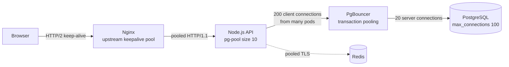
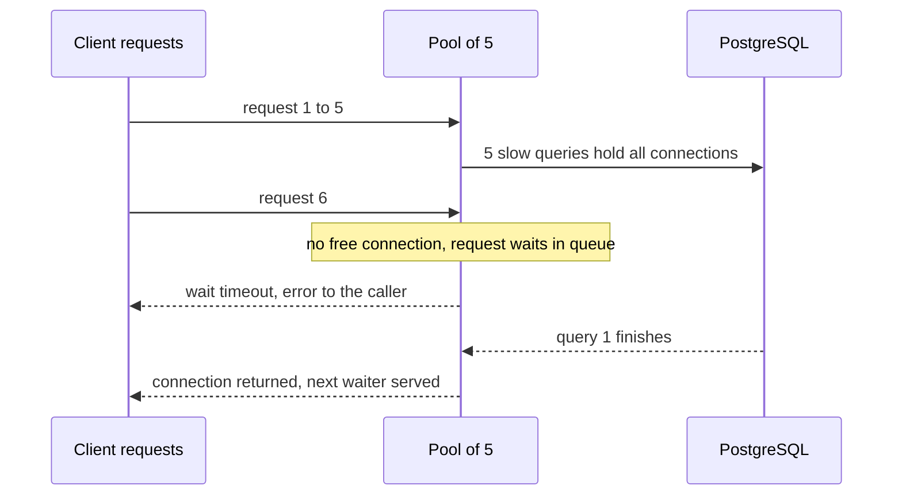

# L12.10 — Connection Pooling

> **Level 12: Advanced Networking** · Topic 10 of 14 · ⏱ ~4 hours · Difficulty: Intermediate

## 1. What it is

Opening a network connection is expensive: a TCP handshake (1 round trip), usually a TLS handshake on top ([TLS](04-tls.md)), TCP slow start before the connection reaches full speed, and, for databases, authentication and a whole server-side process or session. **Connection pooling** keeps a set of already-open connections and **reuses** them for many requests instead of opening and closing one per request.

Pooling appears at several layers, and they stack:

- **HTTP keep-alive (persistent connections):** a client or proxy keeps a TCP/TLS connection open after a response and sends the next request on it (HTTP/1.1 default; HTTP/2 and HTTP/3 go further by multiplexing many requests on one connection, see [HTTP/2, HTTP/3 and QUIC](05-http2-http3-quic.md)).
- **Client-side pools:** an application library holds N connections to a database, cache or downstream service (HikariCP, `pg-pool`, SQLAlchemy, Go's `database/sql`, Envoy and nginx upstream pools).
- **Server-side / proxy pools:** a middle tier such as **PgBouncer** multiplexes thousands of application connections over a few dozen real database connections.

Do not confuse **HTTP keep-alive** (reusing a connection for more requests) with **TCP keepalive** (the kernel sending probes on an idle connection to detect a dead peer); they have different timers and purposes.

## 2. Why it matters in DevOps

- **Latency and CPU.** Without reuse every request pays handshakes. For `shop-api` calling PostgreSQL, Redis and a payment API, that overhead can exceed the work itself, and it burns CPU on TLS handshakes.
- **Ephemeral ports and `TIME_WAIT`.** A proxy opening a fresh upstream connection per request leaves thousands of sockets in `TIME_WAIT` and can exhaust the ~28,000 default ephemeral ports to one destination, producing `Cannot assign requested address` errors. The lab shows it.
- **Databases cannot take unlimited connections.** PostgreSQL runs a backend process per connection; hundreds or thousands of them waste memory and make scheduling and locking worse. A fleet of 200 pods with a pool of 20 each is 4,000 connections, far above what one database can serve efficiently ([Level 13, Database Connection Pooling](../level-13-databases-distributed-systems/06-db-connection-pooling.md)).
- **Pool exhaustion is a classic outage.** One slow query or a leaked connection holds a slot; the pool drains; every request now waits for a connection; latency explodes, threads pile up, and healthy parts of the system look broken. It often cascades ([Circuit Breakers](14-circuit-breakers.md)).
- **Mismatched timeouts cause intermittent 502/504 errors.** If a proxy or client thinks a connection is alive but the other side has closed it, the next request fails.

## 3. Real-world system example

**PgBouncer** is the de facto lightweight PostgreSQL pooler. It is documented as part of GitLab's production architecture and is bundled by hosted platforms (Heroku offers a PgBouncer buildpack; many Kubernetes operators for PostgreSQL deploy it alongside the cluster). **Amazon RDS Proxy** is AWS's managed equivalent for RDS and Aurora: it pools and shares database connections, which is especially useful for AWS Lambda functions that would otherwise open a connection per invocation ([Level 6, RDS and Aurora](../level-06-cloud-aws/10-rds-and-aurora.md)).

**Envoy** keeps a per-upstream-host connection pool and exposes `circuit_breakers` thresholds (`max_connections`, `max_pending_requests`, `max_requests`) so a slow dependency cannot absorb unlimited sockets and memory; its stats expose pool overflow. **nginx** reuses upstream connections only if you configure `keepalive` in the `upstream` block with `proxy_http_version 1.1`; this is a frequently missed optimisation (the lab measures it). **HikariCP**, the default Java pool in Spring Boot, ships a well-known guide ("About Pool Sizing") arguing that small pools often outperform large ones.

**AWS load balancers** have an idle timeout (60 seconds by default for the Application Load Balancer). AWS documentation advises setting the backend's keep-alive timeout higher than the load balancer's idle timeout; Node.js's HTTP server default `keepAliveTimeout` of 5 seconds is the classic cause of intermittent 502 errors behind an ALB.

## 4. Diagram

How pooling layers stack for a request in `shop-api`, and where each pool can run dry:



Pool exhaustion as a state-and-wait problem (what the lab triggers with `query_wait_timeout`):



## 5. How it works

### Keep-alive in HTTP

- **HTTP/1.0** closed after each response unless `Connection: keep-alive` was negotiated; **HTTP/1.1** keeps connections open by default; closing needs `Connection: close`.
- Each side has an **idle timeout** (nginx `keepalive_timeout`, Apache `KeepAliveTimeout`, Node `server.keepAliveTimeout`, ALB idle timeout, client library setting). **The party that closes first wins; the other side then sees a reset.** The safe rule: the *caller's* idle timeout must be **shorter** than the *callee's*, so the caller always retires a connection before the server drops it. Layer by layer this means: client pool idle < proxy idle < backend idle.
- **Reverse proxies need explicit upstream keep-alive.** In nginx: `upstream { keepalive 32; }`, `proxy_http_version 1.1;`, `proxy_set_header Connection "";`. Without it nginx opens a new TCP connection to the backend for every request.
- **Request limits** per connection (`keepalive_requests`, `max_requests_per_connection`) force periodic reconnects, which helps rebalance after deploys but costs handshakes.
- With HTTP/2, one connection carries many concurrent streams, so you need far fewer connections, but one connection can concentrate traffic on one backend ([Load Balancing](06-load-balancing-algorithms.md)).

### Client-side pool parameters

| Parameter | Meaning | Typical guidance |
|---|---|---|
| **Max size** | Upper bound on open connections | Start small (for example 10) and measure; see sizing below |
| **Min idle** | Connections kept warm | Keep modest to avoid reconnect storms after idle periods |
| **Acquire / wait timeout** | How long a caller waits for a free connection | Short (hundreds of ms to a few seconds); fail fast instead of piling up |
| **Max lifetime** | Retire connections after N minutes | Slightly less than any LB/DB-imposed limit; spreads reconnects |
| **Idle timeout** | Close connections unused for N seconds | Shorter than the server/proxy idle timeout |
| **Validation / keepalive probe** | Test a connection before handing it out | Prefer cheap checks; handle "connection reset" with a safe retry for idempotent work |
| **Leak detection** | Warn if a connection is held too long | Enable in non-prod and canary; the best way to find missing `release()` calls |

### Sizing a pool

- **Little's Law:** concurrency = throughput x latency. If a service does 200 queries per second and each holds a connection for 20 ms, it needs about 200 x 0.020 = 4 connections on average. Add headroom for bursts, not for fear.
- A database can usefully execute only about as many queries at once as it has CPU cores and I/O capacity. The HikariCP guide cites a starting point of about `(core_count x 2) + effective_spindle_count` for the *database server*; the rest queue. A **smaller pool with a queue** usually beats a huge pool that overloads the database.
- **Total across the fleet matters:** `pods x pool size` must stay below the database limit, with room for admin, migrations and replicas. Use a pooler (PgBouncer) when it does not.
- Make **pool sizes explicit configuration**, and expose pool metrics: in use, idle, waiting, wait time, timeouts.

### PgBouncer

PgBouncer speaks the PostgreSQL protocol; applications connect to it as if it were the database.

| Pool mode | A server connection is held for | Notes |
|---|---|---|
| **session** | The whole client session | Safest, least multiplexing; needed for session state |
| **transaction** | One transaction | Best multiplexing and the usual choice; session features break (see below) |
| **statement** | One statement | Rare; multi-statement transactions not allowed |

In **transaction mode**, consecutive transactions from one client may run on different server connections, so features that rely on session state are unsafe: `SET` (without `SET LOCAL`), session-level advisory locks, `LISTEN/NOTIFY`, temporary tables, `WITH HOLD` cursors and (historically) protocol-level prepared statements. Recent PgBouncer versions (1.21+) can track prepared statements via `max_prepared_statements`; check your version and driver.
Key settings: `default_pool_size` (server connections per database/user pair), `max_client_conn` (how many app connections it accepts), `reserve_pool_size`, `query_wait_timeout`, `server_idle_timeout`, `server_lifetime`, `auth_type`/`auth_file` or `auth_query`. The admin console (`psql ... pgbouncer`) offers `SHOW POOLS`, `SHOW STATS`, `SHOW CLIENTS`, `SHOW SERVERS`. PgBouncer is single-threaded per process, so at very high connection counts run several instances. Alternatives and neighbours: PgCat, Odyssey, Supavisor, RDS Proxy and, for MySQL, ProxySQL.

### Pool exhaustion: causes and cures

| Cause | Signature | Fix |
|---|---|---|
| **Connection leak** (code path misses `release`) | In-use climbs steadily to max, never falls | Always use `try/finally` or the library's scoped helper; enable leak detection |
| **Slow query or lock** holding connections | Waiters grow, DB shows long-running queries/`idle in transaction` | Query timeouts (`statement_timeout`), `idle_in_transaction_session_timeout`, fix queries and indexes |
| **Pool too small for load** | Brief queue at peaks | Increase carefully, or add replicas/caching |
| **Pool too big** | Database CPU saturated, many active backends | Reduce pool, add PgBouncer, scale the database |
| **Retry storm** | Failures trigger retries which take more connections | Backoff with jitter, retry budgets, circuit breakers ([Circuit Breakers](14-circuit-breakers.md)) |
| **Long-held connections across slow external calls** | Transaction open while calling another API | Never hold a DB connection/transaction across network calls |

## 6. Step-by-step guide

You will (a) measure what upstream keep-alive saves in nginx, (b) overload a tiny PostgreSQL (`max_connections=20`) directly, (c) put PgBouncer in front and run the same load successfully, and (d) trigger pool exhaustion and watch the queue.

**Prerequisites:** Linux; Docker with Compose v2 (for PostgreSQL and `pgbench`), `nginx`, `apache2-utils` (provides `ab`), and `pgbouncer` (`sudo apt-get install -y nginx apache2-utils pgbouncer`; then `sudo systemctl disable --now nginx pgbouncer` so packaged services do not run). Free, local. Verified with nginx 1.24, PgBouncer 1.22, PostgreSQL 17 and Docker Compose v2. If your shell sets a proxy, `unset https_proxy HTTPS_PROXY`.

### Part A: HTTP keep-alive between proxy and backend

1. **Create a proxy that does not reuse upstream connections (the nginx default) and one that does.** Port 18081 is without keep-alive, 18082 is with it.
   ```bash
   mkdir -p ~/pool-lab/ka/logs && cd ~/pool-lab/ka
   cat > nginx.conf <<EOF
   user $USER;
   worker_processes 1;
   daemon off;
   error_log $PWD/logs/error.log;
   pid $PWD/nginx.pid;
   events { worker_connections 4096; }
   http {
     access_log off;
     upstream app_nokeepalive { server 127.0.0.1:19001; }
     upstream app_keepalive   { server 127.0.0.1:19001; keepalive 32; keepalive_time 1h; keepalive_timeout 60s; }
     server {                                  # the backend
       listen 127.0.0.1:19001;
       location / { return 200 "ok\n"; }
     }
     server {                                  # proxy WITHOUT upstream keep-alive
       listen 127.0.0.1:18081;
       location / { proxy_pass http://app_nokeepalive; }
     }
     server {                                  # proxy WITH upstream keep-alive
       listen 127.0.0.1:18082;
       location / {
         proxy_pass http://app_keepalive;
         proxy_http_version 1.1;               # keep-alive to upstreams needs HTTP/1.1
         proxy_set_header Connection "";       # and no "Connection: close" header
       }
     }
   }
   EOF
   nginx -t -e $PWD/logs/error.log -c $PWD/nginx.conf
   nginx -e $PWD/logs/error.log -c $PWD/nginx.conf &
   sleep 1
   ```

2. **Load both and count sockets stuck in `TIME_WAIT` between the proxy and the backend.** `ab -k` keeps the *client* side persistent, so the only difference is nginx's upstream side.
   ```bash
   tw() { ss -tan state time-wait '( dport = :19001 or sport = :19001 )' | tail -n +2 | wc -l; }
   echo "TIME_WAIT before: $(tw)"
   ab -k -q -n 5000 -c 20 http://127.0.0.1:18081/ 2>&1 | grep -E 'Requests per second|Failed'
   echo "TIME_WAIT after, no upstream keep-alive: $(tw)"
   sleep 62; echo "after 62 s: $(tw)"
   ab -k -q -n 5000 -c 20 http://127.0.0.1:18082/ 2>&1 | grep -E 'Requests per second|Failed'
   echo "TIME_WAIT after, with upstream keep-alive: $(tw)"
   ss -tan state established '( dport = :19001 )' | tail -n +2 | wc -l      # pooled connections still open
   ```
   ```text
   TIME_WAIT before: 0
   Requests per second:    13568.37 [#/sec] (mean)
   TIME_WAIT after, no upstream keep-alive: 4582
   after 62 s: 0
   Requests per second:    31828.89 [#/sec] (mean)
   TIME_WAIT after, with upstream keep-alive: 0
   20
   ```
   Numbers will differ on your machine, but the pattern should not: thousands of `TIME_WAIT` sockets and roughly half the throughput without reuse; no `TIME_WAIT` and about 20 persistent connections (one per concurrent client) with reuse. Each `TIME_WAIT` socket occupies an ephemeral port for about 60 seconds; at higher rates this exhausts the range.

3. **Stop nginx.** `kill $(cat ~/pool-lab/ka/nginx.pid)`.

### Part B: a database with too few connections, then PgBouncer

4. **Start PostgreSQL with a deliberately small `max_connections`** and create the `pgbench` tables.
   ```bash
   cd ~/pool-lab
   cat > compose.yaml <<'EOF'
   name: pool-lab
   services:
     postgres:
       image: postgres:17-alpine
       command: ["postgres", "-c", "max_connections=20"]      # deliberately tiny
       environment:
         POSTGRES_USER: shop
         POSTGRES_PASSWORD: devpass-only                       # lab only
         POSTGRES_DB: shop
       ports: ["127.0.0.1:15432:5432"]
       healthcheck:
         test: ["CMD-SHELL", "pg_isready -U shop -d shop"]
         interval: 2s
         retries: 20
   EOF
   docker compose up -d --wait
   pg() { docker run --rm --network host -e PGPASSWORD=devpass-only "$@"; }      # run client tools from the postgres image
   pg postgres:17-alpine pgbench -i -s 1 -h 127.0.0.1 -p 15432 -U shop shop
   ```
   Expected: `done in 0.20 s (...)`.

5. **Overload the database directly: 40 clients against 20 connections.**
   ```bash
   pg postgres:17-alpine pgbench -c 40 -j 4 -T 5 -h 127.0.0.1 -p 15432 -U shop shop 2>&1 | grep -E 'FATAL|error' | sort | uniq -c | head -5
   ```
   ```text
         ...  error: connection to server at "127.0.0.1", port 15432 failed: FATAL:  sorry, too many clients already
   ```
   This is what a fleet of pods with large pools does to a database at deploy time: `sorry, too many clients already`. (You may also see unrelated client errors from the flood.)

6. **Configure PgBouncer in transaction mode with a pool of 5 server connections.** Run it as your own user (it refuses to run as root).
   ```bash
   cat > pgbouncer.ini <<EOF
   [databases]
   shop = host=127.0.0.1 port=15432 dbname=shop

   [pgbouncer]
   listen_addr = 127.0.0.1
   listen_port = 16432
   unix_socket_dir =
   auth_type = scram-sha-256
   auth_file = $PWD/userlist.txt
   admin_users = shop
   pool_mode = transaction
   default_pool_size = 5
   max_client_conn = 200
   query_wait_timeout = 3
   server_idle_timeout = 60
   logfile = $PWD/pgbouncer.log
   pidfile = $PWD/pgbouncer.pid
   EOF
   printf '"shop" "devpass-only"\n' > userlist.txt        # plaintext only for the lab; use SCRAM secrets or auth_query in production
   pgbouncer -d pgbouncer.ini
   sleep 1; tail -2 pgbouncer.log
   ```
   Expected: `LOG listening on 127.0.0.1:16432` and `process up: PgBouncer 1.22.0`.

7. **Run the same 40-client load through PgBouncer while watching the pool.**
   ```bash
   pg postgres:17-alpine pgbench -c 40 -j 4 -T 6 -h 127.0.0.1 -p 16432 -U shop shop > load.out 2>&1 &
   sleep 3
   pg postgres:17-alpine psql -h 127.0.0.1 -p 16432 -U shop pgbouncer -c 'SHOW POOLS'
   pg postgres:17-alpine psql -h 127.0.0.1 -p 15432 -U shop shop -Atc "select count(*) from pg_stat_activity where datname='shop'"
   wait; tail -6 load.out
   ```
   ```text
   number of failed transactions: 0 (0.000%)
   latency average = 41.380 ms
   tps = 966.657813 (without initial connection time)
   ```
   `SHOW POOLS` shows the `shop` row with `cl_active` near 40 clients served by `sv_active`/`sv_idle` of at most 5; PostgreSQL itself sees only about 5-6 backends. Forty clients, zero failures, versus failures against the same database directly.

8. **Cause pool exhaustion on purpose.** Ten clients each run a 5-second query against a pool of 5. The sixth to tenth must queue and, after `query_wait_timeout = 3`, are rejected.
   ```bash
   printf 'select pg_sleep(5);\n' > sleep.sql
   pg -v $PWD/sleep.sql:/sleep.sql postgres:17-alpine pgbench -n -f /sleep.sql -c 10 -j 2 -t 1 \
       -h 127.0.0.1 -p 16432 -U shop shop > ex.out 2>&1 &
   sleep 2
   pg postgres:17-alpine psql -h 127.0.0.1 -p 16432 -U shop pgbouncer -c 'SHOW POOLS' | cut -c1-80
   wait; grep -c query_wait_timeout ex.out
   ```
   ```text
    database  |   user    | cl_active | cl_waiting | ...
    shop      | shop      |         5 |          5 | ...
   5
   ```
   Five clients are active and five are **waiting** (`cl_waiting`); the waiters fail with `FATAL: query_wait_timeout`. That queue depth (`cl_waiting`) and wait time are the metrics to alert on. Raising the pool would let these through only until the database's own limit is hit; the fix for a slow query is the query, and the fix for bursts is bounded queues plus fast failure.

9. **See session state leak under transaction pooling.** One client sets a session variable and disconnects; a completely different client then connects and inherits it, because both landed on the same pooled server connection.
   ```bash
   pg postgres:17-alpine psql -h 127.0.0.1 -p 16432 -U shop shop -Atc "SET statement_timeout = '7s'"    # client 1 (via PgBouncer)
   pg postgres:17-alpine psql -h 127.0.0.1 -p 16432 -U shop shop -Atc "SHOW statement_timeout"          # client 2 (via PgBouncer)
   pg postgres:17-alpine psql -h 127.0.0.1 -p 15432 -U shop shop -Atc "SHOW statement_timeout"          # directly to PostgreSQL
   ```
   ```text
   SET
   7s
   0
   ```
   Client 2 sees `7s` through PgBouncer but the default `0` when talking to PostgreSQL directly. In transaction mode the server connection is shared and not reset between clients, so a plain `SET` leaks to whoever uses that connection next. Use `SET LOCAL` inside a transaction, set parameters per role/database on the server, or use session pooling for code that really needs session state.

10. **Clean up.**
    ```bash
    kill $(cat ~/pool-lab/pgbouncer.pid)
    cd ~/pool-lab && docker compose down -v && cd ~ && rm -r ~/pool-lab
    ```

## 7. Real-world scenario

*(Illustrative.)* After moving `shop-api` behind an Application Load Balancer, the team sees 1-2 percent of requests failing with 502 from the ALB, never reproducible in staging and unrelated to load. The ALB idle timeout is the default 60 seconds; the Node.js server uses its default `keepAliveTimeout` of 5 seconds.
Investigation: the ALB reuses connections to the instances; when a connection has been idle between 5 and 60 seconds, Node closes it just as the ALB sends the next request on it, which fails with a reset and a 502. Access logs show 502s clustered after quiet periods; `tcpdump` shows the instance sending FIN, then the ALB's request meeting a RST.
Fix: set the Node server `keepAliveTimeout` to 65 seconds and `headersTimeout` slightly above it, so the backend never closes first. The 502s vanish.
Two weeks later a different incident: a new report query forgets to release its connection on an error path; the 10-connection pools in each of 30 pods drain over an hour, latency spikes, and health checks fail. Pool metrics show `waiting` growing while PostgreSQL shows `idle in transaction` sessions. Fix: wrap the code in `try/finally`, set `idle_in_transaction_session_timeout` and `statement_timeout`, enable leak detection, and place PgBouncer between the pods and PostgreSQL.
**Lesson:** pooling needs consistent timeouts across layers and explicit exhaustion behaviour: bounded waits, limits, metrics and alerts.

## 8. Common mistakes and best practices

**Don't**
- Open a new database or HTTP connection per request.
- Size pools by guessing "bigger is safer"; a giant pool can crush the database.
- Hold a connection or transaction while calling another service or sleeping.
- Forget nginx's upstream `keepalive` + `proxy_http_version 1.1` + `Connection ""`.
- Let a downstream idle timeout be shorter than the upstream pool's, so the server closes first.
- Use session features (`SET`, advisory locks, `LISTEN`) through a transaction-mode pooler.
- Retry instantly on pool timeouts: that makes the exhaustion worse.

**Do**
- Set explicit pool sizes, acquire timeouts and max lifetimes for every client pool; compute `pods x pool` against the database limit.
- Use PgBouncer (or RDS Proxy) when many app instances or serverless functions connect.
- Align timeouts: client idle < proxy idle < backend idle; keep-alive on backends higher than the load balancer's idle timeout.
- Set `statement_timeout`, `idle_in_transaction_session_timeout` and use leak detection.
- Export and alert on pool metrics: in use, idle, waiting, wait duration, timeouts, `TIME_WAIT` count.
- Prefer HTTP/2 or gRPC multiplexing between services to reduce the number of connections, with L7 balancing ([Load Balancing](06-load-balancing-algorithms.md)).

## 9. Tasks

- [ ] **T1 — Measure keep-alive savings** *(≈30 min, intermediate)*
  - **Goal:** prove reuse matters with numbers.
  - **Steps:**
    1. Do Part A, steps 1-2.
    2. Repeat with `-n 20000 -c 100` and record requests per second and the peak `TIME_WAIT` count for both proxies.
  - **Done when:** you have a two-row table showing throughput and `TIME_WAIT` for each, and can explain why the second proxy keeps about `-c` connections open.

- [ ] **T2 — Overload and rescue PostgreSQL** *(≈30 min, intermediate)*
  - **Goal:** reproduce `too many clients` and fix it with a pooler.
  - **Steps:**
    1. Do steps 4-7.
    2. Change `default_pool_size` to 2 and then 15 and re-run the benchmark.
  - **Done when:** you can show tps for pool sizes 2, 5 and 15 against the 20-connection database and say where the knee is.

- [ ] **T3 — Break it: exhaust the pool and read the signals** *(≈30 min, advanced)*
  - **Goal:** recognise exhaustion from metrics.
  - **Steps:**
    1. Do step 8 and capture `SHOW POOLS`, `SHOW CLIENTS` and `SHOW SERVERS`.
    2. Set `query_wait_timeout = 30` and repeat: observe that waiters now succeed late instead of failing.
    3. Write which of the two behaviours you want in production and why.
  - **Done when:** you can point to `cl_waiting` and `maxwait` in the output and justify a timeout choice.

- [ ] **T4 — Leak a connection** *(≈40 min, advanced)*
  - **Goal:** find a leak using the database.
  - **Steps:**
    1. Write a ten-line script (Python `psycopg` or Node `pg`) that opens a transaction and never closes it; run 10 copies in the background against PgBouncer.
    2. Find them with `select pid, state, now()-xact_start from pg_stat_activity where state='idle in transaction'`.
    3. Set `ALTER ROLE shop SET idle_in_transaction_session_timeout='5s'` and rerun.
  - **Done when:** the leaked sessions appear in `pg_stat_activity` and are terminated automatically after 5 seconds.

- [ ] **T5 — Align idle timeouts** *(≈40 min, advanced)*
  - **Goal:** reproduce and fix an idle-timeout race.
  - **Steps:**
    1. Run a Node server with `server.keepAliveTimeout = 1000` behind the keep-alive nginx proxy from Part A (`keepalive_timeout 60s`).
    2. Send requests spaced 1.0 to 1.2 seconds apart with a loop and look for `502`s or `upstream prematurely closed connection` in nginx's error log.
    3. Fix by setting the Node timeout above nginx's upstream idle time (or lower nginx's `keepalive_timeout` below the server's).
  - **Done when:** the errors appear with the bad pairing and disappear with the fix, and you can state the rule in one sentence.

- [ ] **T6 — Prove it: pooling plan for `shop-api`** *(≈45 min, advanced)*
  - **Goal:** design and justify settings.
  - **Steps:**
    1. Without the guide, rebuild the PgBouncer lab and show a successful 40-client run against `max_connections=20`.
    2. Write the plan for 40 pods at 300 requests/s total, each query 15 ms: compute needed connections with Little's Law, choose app pool size, PgBouncer `default_pool_size`, and the timeouts for each layer; list the five metrics you will alert on.
  - **Done when:** the lab works from memory and the plan's arithmetic is consistent (total server connections under `max_connections` with headroom).

## 10. Self-check questions

1. What does a connection pool save, and what is the difference between HTTP keep-alive and TCP keepalive?
2. A fleet scales from 20 to 200 pods with `pool=20`. What happens to PostgreSQL and what are your options?
3. Why does nginx need `proxy_http_version 1.1` and `proxy_set_header Connection ""` for upstream keep-alive?
4. Which idle timeout must be larger: the load balancer's or the backend's, and why?
5. What breaks in PgBouncer transaction mode?
6. Name three causes of pool exhaustion and the first signal for each.

<details><summary>Answers</summary>

1. It avoids repeated TCP/TLS handshakes, authentication, slow start and (for databases) backend startup. HTTP keep-alive reuses an application-level connection for more requests; TCP keepalive is a kernel probe on an idle connection to detect dead peers.
2. Connections jump to 4,000, far above what PostgreSQL handles well, causing `too many clients`, memory pressure and slowdowns. Options: smaller per-pod pools, a pooler (PgBouncer/RDS Proxy), fewer pods or larger pods, read replicas, and caching.
3. The default is HTTP/1.0 to upstreams with `Connection: close`, which closes after every request. HTTP/1.1 supports persistent connections and clearing the `Connection` header prevents nginx from sending `close`.
4. The backend's keep-alive timeout must be larger than the load balancer's idle timeout, so the load balancer is always the one to close an idle connection. Otherwise the backend closes while the LB sends a request on it, causing 502s.
5. Anything depending on session state across transactions: plain `SET`, session advisory locks, `LISTEN/NOTIFY`, temporary tables, and possibly prepared statements (version dependent).
6. A leak (in-use climbs to max and stays), slow queries or locks (long-running queries/`idle in transaction` in the database), and retry storms (waiters and retries spike with errors). Others: pool too small for the load, holding a connection across external calls.
</details>

## 11. Further reading

- PgBouncer documentation (config reference, `SHOW` commands, pooling modes) and the PostgreSQL docs on `max_connections`, `idle_in_transaction_session_timeout`.
- HikariCP wiki, "About Pool Sizing"; the Amazon RDS Proxy documentation.
- nginx `ngx_http_upstream_module` (`keepalive`) and `ngx_http_proxy_module`; Envoy documentation on connection pooling and circuit breaking.
- AWS Elastic Load Balancing documentation on idle timeout and backend keep-alive; Node.js `http.Server` documentation (`keepAliveTimeout`).
- RFC 9112 (HTTP/1.1) section on persistent connections; Brendan Gregg's writing on TCP `TIME_WAIT` and ephemeral ports.

<!-- nav -->
---
← Previous: [Service Mesh](09-service-mesh.md) · [Level 12 index](README.md) · Next: [TLS Termination](11-tls-termination.md) →
