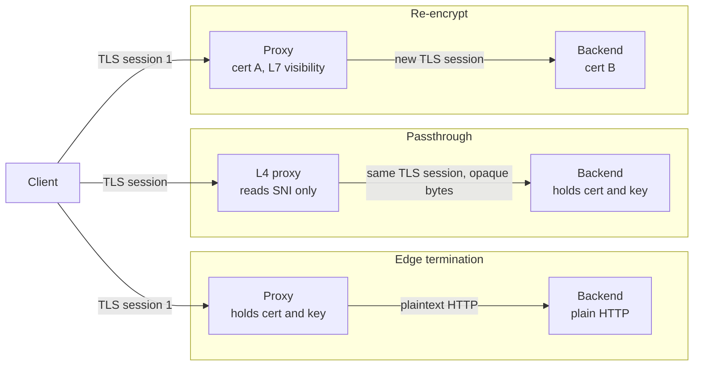
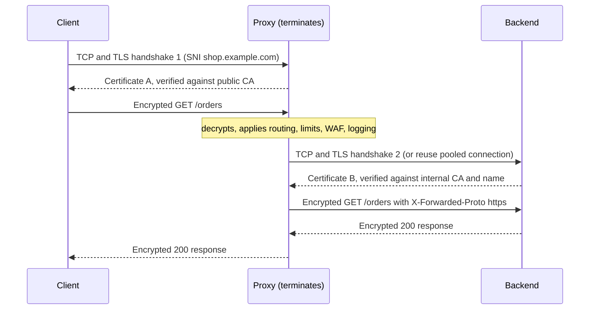

# L12.11 — TLS Termination

> **Level 12: Advanced Networking** · Topic 11 of 14 · ⏱ ~5 hours · Difficulty: Advanced

## 1. What it is

**TLS termination** means a component in front of your application (a reverse proxy, load balancer, CDN edge, Kubernetes ingress controller or service-mesh sidecar) ends the client's TLS session: it holds the certificate and private key, performs the handshake, decrypts the traffic, and forwards the request onward. The thing that "terminates" TLS is the endpoint of the encrypted tunnel; everything behind it sees whatever the proxy chooses to send.

There are three deployment patterns, and choosing between them is a real architecture decision:

- **Edge termination (TLS offload):** TLS ends at the proxy; the proxy talks **plaintext HTTP** to the backend over the internal network. Simple and fast, but the internal hop is unencrypted.
- **Passthrough:** the proxy works at layer 4 (TCP) and forwards the **encrypted bytes untouched**. The backend holds the certificate. The proxy cannot read, route on, or modify HTTP; it can only see the destination IP/port and the **SNI** (Server Name Indication) hostname that the client sends in clear text in the ClientHello ([TLS](04-tls.md)).
- **Re-encryption (TLS bridging):** the proxy terminates the client's TLS, inspects or routes the request at layer 7, then opens a **new, separate TLS connection** to the backend. Two handshakes, two certificates, full visibility in the middle, encrypted everywhere on the wire.

The [TLS topic](04-tls.md) explained certificates and handshakes. This topic is about **where in your architecture** that handshake happens, what that placement buys, and what it costs.

## 2. Why it matters in DevOps

- **Where TLS ends decides what you can do.** Rate limiting by URL path, routing by header, WAF rules, caching, request logging and canary splits all need the proxy to read HTTP, so they need termination ([Rate Limiting](13-rate-limiting.md), [Load Balancing](06-load-balancing-algorithms.md)). A passthrough balancer can do none of it.
- **Certificate management scales with the number of termination points.** Terminating at one edge means one place to renew certificates. Terminating on every pod means thousands. Expired certificates are a top-tier self-inflicted outage.
- **Plaintext inside the network is a security and compliance decision.** "The VPC is private" is a weak argument once an attacker has one foothold, and some standards (for example PCI DSS for cardholder data in transit) push you towards encrypting internal hops too.
- **Handshakes cost CPU.** Public-key operations dominate. Offloading them to a few proxies, using session resumption, and keeping connections alive ([Connection Pooling](10-connection-pooling.md)) is how a fleet stays cheap. The lab measures a roughly 14x throughput gap between a handshake per request and keep-alive.
- **Broken termination fails in confusing ways:** redirect loops because the app thinks it is on HTTP, mixed-content warnings, wrong client IPs in logs, 502s from certificate-name mismatch on the re-encrypted hop.

## 3. Real-world system example

**AWS Elastic Load Balancing.** An **Application Load Balancer (ALB)** terminates HTTPS using a certificate from **AWS Certificate Manager (ACM)**, then forwards to targets over HTTP or HTTPS (re-encryption). A **Network Load Balancer (NLB)** can either forward raw TCP (passthrough, the backend holds the certificate) or use a TLS listener to terminate. See [ALB](../level-06-cloud-aws/14-alb.md) and [CloudFront](../level-06-cloud-aws/13-cloudfront.md) for the AWS pieces. AWS documents which of these checks it performs on the target-side certificate; read that section before relying on the ALB-to-target hop for authentication, and use [mTLS](12-mtls.md) between your own services if you need it.

**Cloudflare** documents its SSL/TLS encryption modes in exactly these terms. "Flexible" encrypts browser-to-Cloudflare only and talks plain HTTP to your origin; "Full" re-encrypts to the origin without validating its certificate; "Full (strict)" re-encrypts and validates the origin certificate. Flexible is the classic edge-offload pattern with its classic problem (the origin cannot tell it is behind HTTPS and may redirect forever).

**Kubernetes Ingress.** An Ingress object's `tls:` section references a Secret holding a certificate; the controller (ingress-nginx, Traefik, HAProxy Ingress, Envoy-based gateways) terminates TLS and routes by host and path ([Ingress](../level-08-kubernetes/05-ingress.md)). ingress-nginx also supports an `ssl-passthrough` mode for backends that must keep their own TLS. **cert-manager** automates the certificates. **Service meshes** like Istio and Linkerd deliberately do the opposite for internal traffic: every pod's sidecar terminates and originates mTLS so the application sees plain HTTP on localhost while the network sees only ciphertext ([Service Mesh](09-service-mesh.md)).

**HAProxy and nginx** both document SNI-based routing in TCP mode (`ssl_preread` in nginx's `stream` module; `req.ssl_sni` in HAProxy), which is how one IP address fronts many TLS backends without decrypting anything.

## 4. Diagram

The three patterns side by side. The client always starts with TLS; the difference is where it stops:



What happens on the wire in the re-encrypt case (two independent sessions, with HTTP visible only inside the proxy):



## 5. How it works

### Comparing the three patterns

| | Edge termination | Passthrough | Re-encrypt |
|---|---|---|---|
| Layer the proxy works at | 7 | 4 | 7 |
| Who holds the public certificate | Proxy | Backend | Proxy (and a second cert on the backend) |
| Proxy can read and route on HTTP | Yes | **No** (SNI and IPs only) | Yes |
| Internal hop encrypted | **No** | Yes | Yes |
| Handshakes per new client connection | 1 (at proxy) | 1 (at backend) | 2 |
| Proxy CPU | TLS work | Minimal | TLS work, twice |
| Certificate management | One place | Every backend | Edge public certs plus internal certs |
| Typical use | Public web tier in a trusted network | Databases, gRPC with backend mTLS, protocols you must not touch | Compliance, zero-trust internals |

### Offload trade-offs

- **Gains.** Central certificate and cipher policy; backends stay simple and need no TLS code; a proxy can use session resumption and large connection reuse; hardware or optimised libraries do crypto efficiently; the proxy can inspect traffic (WAF, caching, compression, rate limits, metrics).
- **Costs.** The proxy becomes a high-value target (it holds the private key and sees all plaintext); the plain-HTTP internal hop can be sniffed or tampered with by anyone on that network; the application sees the proxy's address and `http` scheme, not the client's; the proxy is a capacity bottleneck that you must scale and make highly available ([High Availability](../level-00-what-devops-is/08-high-availability-and-scalability.md)).

### What the backend must be told

After termination the backend has lost the original connection facts, so the proxy passes them as headers, and the backend must be configured to trust them **only from the proxy**:

| Header | Meaning | Gotcha |
|---|---|---|
| `X-Forwarded-Proto` | Original scheme (`https`) | Without it frameworks generate `http://` links and redirect loops |
| `X-Forwarded-For` | Chain of client IPs | Spoofable if you trust it from the internet; only trust known proxy hops |
| `X-Forwarded-Host` / `Host` | Original host name | Needed for correct absolute URLs |
| `Forwarded` (RFC 7239) | Standardised version of the above | Less widely used than the `X-` forms |
| **PROXY protocol** | A small header at connection start carrying the real client IP/port | For L4 proxies (including passthrough) that cannot add HTTP headers; both ends must agree to use it |

### Costs of a handshake and how to reduce them

- **Full handshake:** public-key operations (ECDHE key exchange, certificate signature verification and, on the server, signing with the certificate's key). RSA signing is noticeably more expensive than ECDSA (P-256) signing, which is one reason ECDSA certificates are popular at high scale.
- **TLS 1.3** needs 1 round trip for a fresh connection (TLS 1.2 needs 2) and supports **0-RTT** resumption, which has replay risk and should be limited to idempotent requests.
- **Session resumption** (session IDs or tickets) skips most public-key work on reconnect. nginx: `ssl_session_cache shared:SSL:10m; ssl_session_timeout 1h;`. Rotate ticket keys regularly if you use tickets across a fleet.
- **Keep-alive and HTTP/2** amortise one handshake over thousands of requests ([HTTP/2, HTTP/3 and QUIC](05-http2-http3-quic.md), [Connection Pooling](10-connection-pooling.md)).

### Same idea in Envoy

Envoy terminates with a `DownstreamTlsContext` on the listener's filter chain and re-encrypts with an `UpstreamTlsContext` on the cluster (shape shown for reference; the lab below uses nginx and HAProxy):

```yaml
# listener filter_chain (terminate)
transport_socket:
  name: envoy.transport_sockets.tls
  typed_config:
    "@type": type.googleapis.com/envoy.extensions.transport_sockets.tls.v3.DownstreamTlsContext
    common_tls_context:
      tls_certificates:
        - certificate_chain: { filename: /certs/edge.crt }
          private_key:       { filename: /certs/edge.key }
# cluster (re-encrypt to the backend)
transport_socket:
  name: envoy.transport_sockets.tls
  typed_config:
    "@type": type.googleapis.com/envoy.extensions.transport_sockets.tls.v3.UpstreamTlsContext
    sni: backend.internal
    common_tls_context:
      validation_context:
        trusted_ca: { filename: /certs/ca.crt }
```

## 6. Step-by-step guide

You will run all three patterns side by side on your laptop, prove with `tcpdump` which hops are plaintext, and measure what a handshake costs.

**Prerequisites:** Linux with `nginx`, `haproxy`, `openssl`, `curl`, `tcpdump` (needs `sudo`) and `apache2-utils` for `ab` (`sudo apt-get install -y nginx haproxy openssl curl tcpdump apache2-utils`, then `sudo systemctl disable --now nginx haproxy` so the packaged services do not interfere). Free and local. Verified with nginx 1.24, HAProxy 2.x, OpenSSL 3.0 and curl 8.5. If your shell exports a proxy, run `unset https_proxy HTTPS_PROXY http_proxy HTTP_PROXY` first. All ports below are on `127.0.0.1`. The Docker Compose variant is trivial (the same config files, one container per proxy), but host processes make `tcpdump` simpler.

1. **Create a lab CA and two certificates.** One certificate is for the edge (`shop.example.com`), one for the backend (`backend.internal` and `shop.example.com`, so passthrough can present it).
   ```bash
   export LAB=$HOME/tls-term-lab; mkdir -p $LAB/certs $LAB/logs $LAB/tmp && cd $LAB/certs
   openssl req -x509 -newkey rsa:2048 -nodes -keyout ca.key -out ca.crt -days 30 \
     -subj "/CN=Lab Root CA" -addext "basicConstraints=critical,CA:TRUE" -addext "keyUsage=critical,keyCertSign,cRLSign"
   issue() {   # issue <name> <CN> <SAN list>
     openssl req -newkey rsa:2048 -nodes -keyout $1.key -out $1.csr -subj "/CN=$2"
     printf "subjectAltName=%s\nextendedKeyUsage=serverAuth\n" "$3" > $1.ext
     openssl x509 -req -in $1.csr -CA ca.crt -CAkey ca.key -CAcreateserial -days 30 -extfile $1.ext -out $1.crt
   }
   issue edge    shop.example.com "DNS:shop.example.com,DNS:localhost,IP:127.0.0.1"
   issue backend backend.internal "DNS:backend.internal,DNS:shop.example.com"
   openssl verify -CAfile ca.crt edge.crt backend.crt
   ```
   Expected: `edge.crt: OK` and `backend.crt: OK`. The CA is for this lab only; delete it afterwards. Never reuse lab keys.

2. **Write the nginx config: a plain backend, a TLS backend, an edge-termination server and a re-encrypt server.**
   ```bash
   cd $LAB
   cat > nginx.conf <<EOF
   worker_processes 1;
   daemon off;
   error_log $LAB/logs/error.log notice;
   pid $LAB/nginx.pid;
   events { worker_connections 1024; }
   http {
     access_log $LAB/logs/access.log;
     client_body_temp_path $LAB/tmp/body; proxy_temp_path $LAB/tmp/proxy;
     fastcgi_temp_path $LAB/tmp/fcgi; uwsgi_temp_path $LAB/tmp/uwsgi; scgi_temp_path $LAB/tmp/scgi;

     server {                                # plaintext backend (what shop-api speaks)
       listen 127.0.0.1:9001;
       return 200 "plain backend: scheme=\$scheme xfp=\$http_x_forwarded_proto xff=\$http_x_forwarded_for\n";
     }
     server {                                # TLS backend (re-encrypt target and passthrough target)
       listen 127.0.0.1:9444 ssl;
       ssl_certificate     $LAB/certs/backend.crt;
       ssl_certificate_key $LAB/certs/backend.key;
       return 200 "tls backend: scheme=\$scheme xfp=\$http_x_forwarded_proto proto=\$server_protocol\n";
     }
     server {                                # MODE 1: edge termination
       listen 127.0.0.1:8443 ssl http2;      # on nginx 1.25.1+ use: listen ... ssl; http2 on;
       server_name shop.example.com;
       ssl_certificate     $LAB/certs/edge.crt;
       ssl_certificate_key $LAB/certs/edge.key;
       ssl_protocols TLSv1.2 TLSv1.3;
       ssl_session_cache shared:SSL:10m;
       ssl_session_timeout 1h;
       location / {
         proxy_pass http://127.0.0.1:9001;
         proxy_set_header Host              \$host;
         proxy_set_header X-Forwarded-Proto \$scheme;
         proxy_set_header X-Forwarded-For   \$proxy_add_x_forwarded_for;
       }
     }
     server {                                # MODE 3: re-encrypt
       listen 127.0.0.1:10443 ssl http2;
       server_name shop.example.com;
       ssl_certificate     $LAB/certs/edge.crt;
       ssl_certificate_key $LAB/certs/edge.key;
       location / {
         proxy_pass https://127.0.0.1:9444;
         proxy_ssl_server_name on;
         proxy_ssl_name backend.internal;                 # name to verify and send as SNI
         proxy_ssl_verify on;
         proxy_ssl_trusted_certificate $LAB/certs/ca.crt; # trust only the internal CA
         proxy_set_header X-Forwarded-Proto \$scheme;
       }
     }
   }
   EOF
   nginx -t -c $LAB/nginx.conf -e $LAB/logs/error.log
   ```
   Expected: `syntax is ok` and `test is successful`. Note the `\$` escapes: the heredoc is unquoted so `$LAB` expands while nginx variables survive.

3. **Write the HAProxy config for passthrough.** HAProxy in `mode tcp` reads the SNI from the ClientHello and forwards bytes without decrypting.
   ```bash
   cat > haproxy.cfg <<EOF
   global
     log stdout format raw local0
   defaults
     mode tcp
     timeout connect 3s
     timeout client  30s
     timeout server  30s
     log global
     option tcplog
   frontend passthrough
     bind 127.0.0.1:9443
     tcp-request inspect-delay 3s
     tcp-request content accept if { req.ssl_hello_type 1 }
     use_backend tls_backend if { req.ssl_sni -i backend.internal }
     use_backend tls_backend if { req.ssl_sni -i shop.example.com }
     default_backend tls_backend
   backend tls_backend
     server s1 127.0.0.1:9444
   EOF
   haproxy -c -f haproxy.cfg
   ```
   Expected: `Configuration file is valid`.

4. **Start everything and call all three modes.**
   ```bash
   (nginx -c $LAB/nginx.conf -e $LAB/logs/error.log >/dev/null 2>&1 &)
   haproxy -f haproxy.cfg -D -p $LAB/haproxy.pid
   sleep 1
   C="--cacert $LAB/certs/ca.crt --resolve shop.example.com:8443:127.0.0.1 --resolve shop.example.com:9443:127.0.0.1 --resolve shop.example.com:10443:127.0.0.1"
   curl -sS $C https://shop.example.com:8443/     # edge
   curl -sS $C https://shop.example.com:9443/     # passthrough
   curl -sS $C https://shop.example.com:10443/    # re-encrypt
   ```
   ```text
   plain backend: scheme=http xfp=https xff=127.0.0.1
   tls backend: scheme=https xfp= proto=HTTP/1.1
   tls backend: scheme=https xfp=https proto=HTTP/1.0
   ```
   Read the three lines: in edge mode the backend sees `scheme=http` but learns the truth from `X-Forwarded-Proto: https`; in passthrough the backend itself speaks TLS and *no proxy could add a header* (`xfp=` is empty); in re-encrypt the backend is TLS and the proxy added the header (and nginx talks HTTP/1.0 to upstreams by default, hence `HTTP/1.0`).

5. **See which certificate the client receives in each mode.** The serial number tells you whose certificate it is.
   ```bash
   for p in 8443 9443 10443; do
     echo -n "$p  "; openssl s_client -connect 127.0.0.1:$p -servername shop.example.com </dev/null 2>/dev/null \
       | openssl x509 -noout -subject -serial | tr '\n' ' '; echo
   done
   ```
   ```text
   8443  subject=CN = shop.example.com serial=56AD...F5
   9443  subject=CN = backend.internal serial=56AD...F7
   10443  subject=CN = shop.example.com serial=56AD...F5
   ```
   Edge and re-encrypt present the **edge** certificate (serial ending `F5`; yours will differ). Passthrough presents the **backend's own** certificate (`F7`): the proxy never owned one.

6. **Prove with `tcpdump` that the edge-mode internal hop is plaintext.** Capture the proxy-to-backend port while sending one request.
   ```bash
   sudo timeout 6 tcpdump -i lo -nn -A -l 'tcp port 9001' > $LAB/edge.txt 2>/dev/null &
   sleep 1; curl -sS $C https://shop.example.com:8443/ >/dev/null; wait
   grep -aE 'GET|Host:|X-Forwarded|plain backend' $LAB/edge.txt
   ```
   ```text
   ..H.qe.GET / HTTP/1.0
   Host: shop.example.com
   X-Forwarded-Proto: https
   X-Forwarded-For: 127.0.0.1
   plain backend: scheme=http xfp=https client=127.0.0.1 xff=127.0.0.1
   ```
   Anyone who can capture on that network segment reads the request and response. That is the price of offload.

7. **Repeat for re-encrypt (port 9444) and passthrough (port 9443).**
   ```bash
   sudo timeout 6 tcpdump -i lo -nn -A -l 'tcp port 9444' > $LAB/reenc.txt 2>/dev/null &
   sleep 1; curl -sS $C https://shop.example.com:10443/ >/dev/null; wait
   grep -acE 'GET|X-Forwarded|tls backend' $LAB/reenc.txt        # expect 0
   sudo timeout 6 tcpdump -i lo -nn -A -l 'tcp port 9443' > $LAB/pass.txt 2>/dev/null &
   sleep 1; curl -sS $C https://shop.example.com:9443/ >/dev/null; wait
   grep -ac 'GET /' $LAB/pass.txt                                # expect 0
   grep -a 'shop.example.com' $LAB/pass.txt | head -2            # the SNI is still in clear text
   ```
   The first count is `0`: the backend leg carries only ciphertext. The second is `0` for the request line, but the hostname **is** visible inside the ClientHello. That clear-text SNI is how a passthrough proxy routes, and is also what censors and network monitors see (Encrypted Client Hello, ECH, is the emerging fix).

8. **Measure what offload and handshakes cost.** `ab` without `-k` forces a new TCP and TLS handshake for every request.
   ```bash
   ab -q -n 3000 -c 10 http://127.0.0.1:9001/        2>&1 | grep 'Requests per second'   # plain backend
   ab -q -n 3000 -c 10 https://127.0.0.1:8443/       2>&1 | grep 'Requests per second'   # TLS, new handshake each time
   ab -q -k -n 3000 -c 10 https://127.0.0.1:8443/    2>&1 | grep 'Requests per second'   # TLS, keep-alive
   ```
   ```text
   Requests per second:    15170.21 [#/sec] (mean)
   Requests per second:    1083.72 [#/sec] (mean)
   Requests per second:    13690.13 [#/sec] (mean)
   ```
   Your numbers will differ, but the pattern is stable: a handshake per request cuts throughput by an order of magnitude against a single nginx worker, and keep-alive brings TLS almost back to plaintext speed. Check session resumption separately:
   ```bash
   openssl s_client -connect 127.0.0.1:8443 -servername shop.example.com -tls1_2 -reconnect </dev/null 2>&1 \
     | grep -E '^(New|Reused)' | sort | uniq -c
   ```
   ```text
         1 New, TLSv1.2, Cipher is ECDHE-RSA-AES256-GCM-SHA384
         5 Reused, TLSv1.2, Cipher is ECDHE-RSA-AES256-GCM-SHA384
   ```
   One full handshake, five cheap resumed ones. `curl -w` also shows the split: `time_connect` is the TCP time, `time_appconnect` is TCP plus TLS.

9. **Break the re-encrypt hop on purpose.** Make nginx verify the wrong name, reload and call it.
   ```bash
   sed -i 's#proxy_ssl_name backend.internal;#proxy_ssl_name wrong.internal;#' $LAB/nginx.conf
   nginx -s reload -c $LAB/nginx.conf -e $LAB/logs/error.log; sleep 1
   curl -sS -o /dev/null -w '%{http_code}\n' $C https://shop.example.com:10443/
   grep -a 'upstream SSL' $LAB/logs/error.log | tail -1
   ```
   ```text
   502
   ... upstream SSL certificate does not match "wrong.internal" while SSL handshaking to upstream ...
   ```
   The client got a clean TLS session with the edge; the failure is entirely on the second leg, visible only in the proxy log. Revert the `sed` and reload to restore `200`.

10. **Clean up.**
    ```bash
    kill $(cat $LAB/nginx.pid) $(cat $LAB/haproxy.pid)
    rm -r "$LAB"; unset LAB
    ```

## 7. Real-world scenario

*(Illustrative.)* `shop-api` sits behind an ALB that terminates HTTPS and forwards plain HTTP to Node.js containers. After a marketing campaign adds a login page, users report an endless redirect loop. The browser shows "too many redirects" only on `https://shop.example.com/login`.
Investigation: the app's middleware redirects any request it believes is `http` to `https`. The ALB's hop to the container is plain HTTP, so every request *looks* like `http` to the app, which redirects, the ALB terminates again, and the cycle repeats. Logs show `scheme=http` on every request even though users are on HTTPS, and `curl -v` shows the `301` pointing at the same URL.
Fix: the ALB adds `X-Forwarded-Proto`; the app is told to trust that header from the load balancer's subnet only (`trust proxy` in Express, restricted to the ALB CIDR). The loop disappears. During the postmortem a security review points out that the ALB-to-container hop is plaintext inside the VPC; since the app handles session cookies and payment tokens, the team moves to re-encryption with a certificate from a private CA, rotated automatically, and later to service-mesh mTLS ([mTLS](12-mtls.md)).
**Lesson:** after termination the backend loses the facts about the client's connection. Pass them in headers, trust them only from the proxy, and decide deliberately whether the internal hop must be encrypted.

## 8. Common mistakes and best practices

**Don't**
- Trust `X-Forwarded-*` headers from arbitrary clients; an attacker can set `X-Forwarded-For` to anything the proxy does not overwrite.
- Re-encrypt with `proxy_ssl_verify off` or Cloudflare "Full" and call it secure; an unverified hop is encrypted but unauthenticated, so a man in the middle can still impersonate the backend.
- Use passthrough and then expect L7 features (path routing, header-based rate limits, WAF); they need termination.
- Share one private key across many proxies and environments, or leave keys world-readable on the proxy host.
- Forget that the plaintext internal hop exists; network ACLs and "it's a private subnet" are not encryption.
- Leave the proxy as a single instance; it is now the availability bottleneck for the whole site.

**Do**
- Terminate at a small, hardened, well-monitored edge and automate renewal (ACME, ACM, cert-manager).
- Re-encrypt (or use mesh mTLS) for sensitive traffic, validating the backend certificate chain **and name**.
- Set `X-Forwarded-Proto`/`For`/`Host`, configure the app to trust them only from known proxies, or use PROXY protocol for L4.
- Enable TLS 1.3, modern ciphers, HTTP/2, session resumption and upstream keep-alive; measure handshake rate and CPU.
- Choose ECDSA or at least 2048-bit RSA certificates and monitor expiry with alerts well ahead of the deadline.
- Use passthrough for protocols you must not interpret (databases, client-cert-authenticated backends) or where end-to-end encryption is required.

## 9. Tasks

- [ ] **T1 — Run the three patterns** *(≈45 min, intermediate)*
  - **Goal:** have edge, passthrough and re-encrypt working locally.
  - **Steps:**
    1. Do steps 1-4 of the guide.
    2. For each mode record: which certificate the client sees (step 5), whether the backend sees `X-Forwarded-Proto`, and whether the proxy can route on HTTP paths.
  - **Done when:** you have a three-row table matching the comparison in section 5, backed by your own `curl` and `openssl` output.

- [ ] **T2 — Capture the plaintext hop** *(≈30 min, intermediate)*
  - **Goal:** prove by packet capture which hop is readable.
  - **Steps:**
    1. Do steps 6-7 with `tcpdump`.
    2. Change the edge `proxy_pass` so the path is `/secret?token=abc123` (or add a header `Authorization: Bearer lab-token` with `curl -H`) and find it in the capture.
  - **Done when:** you can show the token in the edge-mode capture and its absence in the re-encrypt and passthrough captures.

- [ ] **T3 — Break the re-encrypt hop three ways** *(≈40 min, advanced)*
  - **Goal:** recognise each failure from the proxy log.
  - **Steps:**
    1. Wrong name (step 9).
    2. Remove `proxy_ssl_trusted_certificate` while `proxy_ssl_verify on`.
    3. Point the backend at a certificate signed by a different, untrusted CA (create a second lab CA and re-issue `backend.crt` from it).
  - **Done when:** each failure produces a 502, and you can quote the matching `error.log` line and name the fix.

- [ ] **T4 — Fix the redirect loop** *(≈40 min, advanced)*
  - **Goal:** reproduce the `X-Forwarded-Proto` bug and fix it.
  - **Steps:**
    1. Put a tiny app behind the edge server (for example `python3 -m http.server` is not enough; write 10 lines of Python or Node that returns `301` to `https://$Host$path` when `X-Forwarded-Proto` is missing or `http`).
    2. Remove `proxy_set_header X-Forwarded-Proto` from nginx and observe the loop with `curl -L --max-redirs 5 -v`.
    3. Restore the header and verify the loop is gone.
  - **Done when:** `curl -L` loops with the header removed and returns `200` with it present.

- [ ] **T5 — Measure and tune handshake cost** *(≈45 min, advanced)*
  - **Goal:** quantify offload decisions.
  - **Steps:**
    1. Repeat step 8 with an ECDSA certificate (`openssl ecparam -name prime256v1 -genkey`) instead of RSA 2048 and compare handshake-per-request throughput.
    2. Disable `ssl_session_cache` and compare `-reconnect` results.
    3. Compare `ab` with `-c 1` and `-c 50`.
  - **Done when:** you have a table of requests per second for RSA vs ECDSA, resumption on vs off, and keep-alive vs not, and a one-paragraph recommendation.

- [ ] **T6 — Prove it: choose a pattern for `shop-api`** *(≈45 min, advanced)*
  - **Goal:** make and defend an architecture decision.
  - **Steps:**
    1. Without the guide, rebuild the edge and re-encrypt servers and demonstrate the plaintext vs ciphertext difference with `tcpdump`.
    2. Write a half-page decision: public web tier, internal API, and a PostgreSQL connection. For each, choose edge, passthrough or re-encrypt, and name the certificate owner, renewal mechanism and what you give up.
  - **Done when:** the demo works from memory and your decision names at least two risks you accept and one control for each.

## 10. Self-check questions

1. What is the difference between edge termination, passthrough and re-encryption?
2. Why can a passthrough load balancer not do path-based routing, but still route by hostname?
3. A user sees an infinite redirect loop behind an HTTPS load balancer. What is the likely cause and fix?
4. Why is re-encryption without certificate verification little better than plaintext?
5. Name three ways to reduce the CPU cost of TLS at a proxy.
6. When would you choose passthrough over termination?

<details><summary>Answers</summary>

1. Edge: TLS ends at the proxy and the backend hop is plaintext. Passthrough: the proxy forwards encrypted bytes and the backend terminates. Re-encrypt: the proxy terminates, then opens a new TLS session to the backend.
2. The HTTP request is encrypted, so only layer-4 facts are visible. The SNI hostname, however, is sent in clear text in the ClientHello, so the proxy can pick a backend from it.
3. The app sees plain HTTP on the proxied hop and redirects to HTTPS repeatedly. Send `X-Forwarded-Proto` from the proxy and make the app honour it (only from trusted proxies).
4. Encryption without authentication protects against passive eavesdropping but not against an active attacker who impersonates the backend; verification of chain and name provides the authentication.
5. Session resumption, keep-alive/HTTP/2 or upstream connection reuse, TLS 1.3, ECDSA certificates, and spreading load over more proxy workers or instances (also hardware offload on some platforms).
6. When the proxy must not see plaintext (end-to-end encryption requirement), for protocols you do not want to interpret (databases, custom TCP), or when the backend authenticates clients itself with client certificates.
</details>

## 11. Further reading

- nginx documentation: `ngx_http_ssl_module`, `ngx_http_proxy_module` (`proxy_ssl_*` directives), and `ngx_stream_ssl_preread_module`.
- HAProxy documentation: SNI inspection in TCP mode (`req.ssl_sni`) and the PROXY protocol specification.
- Envoy documentation: TLS (`DownstreamTlsContext`, `UpstreamTlsContext`) and listener filters such as TLS Inspector.
- AWS Elastic Load Balancing documentation (HTTPS listeners, TLS listeners on NLB, target-side encryption) and Cloudflare's SSL/TLS encryption modes documentation.
- RFC 8446 (TLS 1.3), RFC 7239 (Forwarded header), and Ivan Ristic, *Bulletproof TLS and PKI*.

<!-- nav -->
---
← Previous: [Connection Pooling](10-connection-pooling.md) · [Level 12 index](README.md) · Next: [mTLS](12-mtls.md) →
