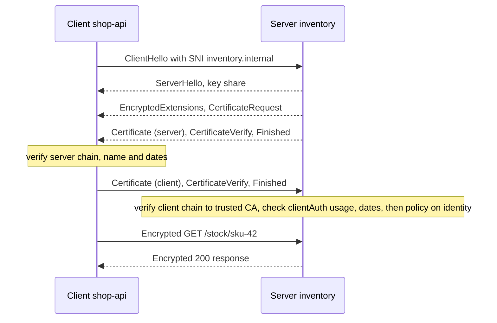
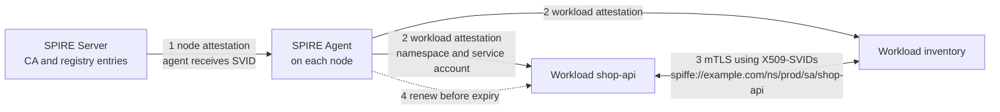

# L12.12 — mTLS

> **Level 12: Advanced Networking** · Topic 12 of 14 · ⏱ ~5 hours · Difficulty: Advanced

## 1. What it is

In ordinary TLS only the **server** proves who it is: the browser checks that `shop.example.com` presents a certificate signed by a CA it trusts, but the server has no cryptographic idea who the browser is (it relies on passwords, cookies or tokens afterwards). **Mutual TLS (mTLS)** adds the reverse: during the handshake the server sends a **CertificateRequest**, the client answers with its own **client certificate** and proves possession of the matching private key, and the server validates it against a CA it trusts. Both ends are authenticated before a single byte of HTTP is exchanged.

The result is **strong, cryptographic service identity**. Instead of "this request came from 10.0.4.17, so it must be `shop-api`" (a claim anyone on that network can forge), you get "this connection was made by whoever holds the private key for a certificate that our CA issued to `shop-api`". mTLS is the foundation of **zero-trust** networking between services, of service meshes ([Service Mesh](09-service-mesh.md)), and of many B2B and device APIs.

This topic builds on [TLS](04-tls.md) (chains, CAs, rotation) and [TLS Termination](11-tls-termination.md) (where the handshake ends). It covers four things: how mutual authentication works, how client certificates carry identity, how **SPIFFE/SPIRE** automate identity at scale, and how to rotate certificates without outages.

## 2. Why it matters in DevOps

- **Network location is not identity.** Firewalls and security groups say which IPs may connect, not which *service* is calling. After one compromised pod, "inside the VPC" means nothing. mTLS binds a call to a cryptographic identity that policy can reference ([Security Architecture](../level-19-architecture/03-security-architecture.md)).
- **It encrypts east-west traffic for free-ish.** The same handshake that authenticates also encrypts, satisfying "encryption in transit" requirements for internal traffic.
- **Authentication is not authorization.** mTLS answers "who are you?", not "may you delete orders?". Every real deployment needs both: the certificate identifies the caller, a policy decides what that identity may do. The lab shows a valid certificate being rejected with `403`.
- **The operational burden is the real cost.** Issuing, distributing, rotating and revoking certificates for hundreds of workloads by hand does not work; certificates that expire silently are a classic 3 a.m. outage. Short-lived, automatically rotated identities (SPIFFE/SPIRE, mesh CAs, cert-manager) are what make mTLS practical.
- **It is a common interview and incident topic** because failure modes are subtle: wrong trust bundle, missing `clientAuth` usage, clock skew, expired intermediates, a proxy that terminates TLS and drops the client identity.

## 3. Real-world system example

**Service meshes.** Istio's control plane (istiod) acts as a certificate authority: it issues each workload a short-lived certificate whose identity is a SPIFFE ID derived from the pod's Kubernetes service account, and the Envoy sidecars use those certificates to do mTLS between every pair of pods, rotating them automatically. Linkerd does the same with its own identity component and lightweight proxies, enabling mTLS by default for meshed TCP traffic. The application code is unchanged. See [Level 16: Service Mesh with Istio or Linkerd](../level-16-advanced-kubernetes/09-service-mesh-istio-linkerd.md) and [Mesh: mTLS, Routing, Retries, Timeouts, Circuit Breaking](../level-16-advanced-kubernetes/10-mesh-traffic-management.md).

**SPIFFE and SPIRE.** SPIFFE (Secure Production Identity Framework For Everyone) is a CNCF-hosted specification for workload identity; SPIRE is its reference implementation. A **SPIRE Server** is the CA and registry; a **SPIRE Agent** on each node attests the node, then attests workloads (for example by Kubernetes namespace and service account, or Unix process attributes) and hands them identities through the **Workload API**, a local Unix domain socket. It is used to give identities to workloads across clouds, VMs and Kubernetes.

**Kubernetes itself** uses mutual TLS between control-plane components: the API server authenticates clients such as kubelets, and etcd peers authenticate each other with certificates. **Cloudflare** documents "Authenticated Origin Pulls", where the origin server requires Cloudflare's client certificate so only Cloudflare's edge can talk to it. **AWS** offers mTLS on API Gateway custom domains and on Application Load Balancers (a verify mode and a passthrough mode). Banks and payment APIs in many jurisdictions require mTLS between institutions, and IoT fleets commonly use per-device certificates.

## 4. Diagram

The handshake with the extra client-authentication steps highlighted (TLS 1.3 shown; in TLS 1.2 the certificates travel in clear text, in 1.3 they are encrypted):



How SPIRE hands out short-lived, automatically rotated identities so nobody manages certificate files by hand:



## 5. How it works

### What each side checks

| Check | Server verifies the client | Client verifies the server |
|---|---|---|
| **Chain** | Client cert chains to a CA in the server's `ssl_client_certificate` / trust bundle | Server cert chains to a CA in the client's trust store |
| **Dates** | Not expired, not yet valid (clock skew matters) | Same |
| **Key usage** | Extended Key Usage includes `clientAuth` | Includes `serverAuth` |
| **Name** | No hostname; instead an **identity** (CN or, better, a SAN) is mapped to policy | Server name matches a SAN for the host the client dialled |
| **Possession** | `CertificateVerify` signature proves the client holds the private key | Same |
| **Revocation** | Optional: CRL or OCSP; in practice short lifetimes replace revocation | Same |

### Client certificates and identity

- A client certificate is an ordinary X.509 certificate with `extendedKeyUsage = clientAuth`. A certificate with only `serverAuth` is rejected as a client certificate by strict servers.
- Identity lives in the **Subject** (CN) or, better, in a **Subject Alternative Name (SAN)**. The standards-based form is a URI SAN such as `spiffe://example.com/ns/prod/sa/shop-api`; DNS SANs are also used. Policies should match the full identity, not a substring.
- The server **trusts a set of CAs for client authentication**. Use a *separate* internal CA for workload identities; do not point `ssl_client_certificate` at the public web CA bundle, or anyone with a public certificate can authenticate.
- Proxies must forward the verified identity to the app in a trustworthy way (nginx variables `$ssl_client_s_dn`, `$ssl_client_verify`; Envoy `x-forwarded-client-cert` header). If a proxy terminates mTLS ([TLS Termination](11-tls-termination.md)), the application sees only what the proxy chooses to pass on, and must trust it only from that proxy.

### SPIFFE and SPIRE vocabulary

| Term | Meaning |
|---|---|
| **Trust domain** | The administrative boundary of an identity system, for example `example.com`; one root of trust |
| **SPIFFE ID** | A URI naming a workload: `spiffe://<trust-domain>/<path>` |
| **SVID** (SPIFFE Verifiable Identity Document) | The credential proving a SPIFFE ID: an **X509-SVID** (a certificate with the ID in a URI SAN) or a **JWT-SVID** (a signed token) |
| **Trust bundle** | The CA certificates that validate SVIDs of a trust domain; can be federated between domains |
| **Workload API** | Local API (Unix socket) from which a workload fetches its SVIDs and bundles, and receives updates when they rotate |
| **Attestation** | Evidence used to decide who a node or workload is, instead of a pre-shared secret |

SVIDs are deliberately **short-lived** (SPIRE's defaults are on the order of an hour, configurable) and renewed well before expiry, so there is no long-lived key to steal and revocation is rarely needed.

### Certificate rotation

Rotation is the hard part. Rotate three kinds of things, each differently:

- **Leaf (workload) certificates:** automate. The agent, sidecar or cert-manager renews at around half of the lifetime; the proxy or app must **reload without dropping connections** (Envoy's SDS, the Secret Discovery Service, pushes new certificates live; nginx needs `nginx -s reload`; most Go and Java servers can hot-load via a custom callback or library).
- **Intermediate CAs:** issue new intermediates from the root on a schedule shorter than their expiry; clients must receive the new chain.
- **Root / trust anchor:** the dangerous one. Use **overlap**: publish a bundle containing old and new roots, move signers to the new root, wait for all old leaves to expire, then drop the old root. Doing it in any other order breaks connections. The lab practises exactly this.

Revocation (CRL, OCSP) exists but is fragile at runtime; prefer lifetimes of hours to days over trying to revoke.

## 6. Step-by-step guide

You will build a private CA, a server that **requires** client certificates, three different clients (valid and allowed, valid but not allowed, forged), watch the handshake with `tcpdump`, then practise rotation, expiry and a CA-bundle rollover.

**Prerequisites:** Linux with `nginx`, `openssl`, `curl` and `tcpdump` (`sudo apt-get install -y nginx openssl curl tcpdump`; then `sudo systemctl disable --now nginx`). Free and local. Verified with nginx 1.24, OpenSSL 3.0 and curl 8.5. If your shell exports a proxy, run `unset https_proxy HTTPS_PROXY http_proxy HTTP_PROXY`. The Docker Compose version simply mounts the same files into an `nginx` container and a `curlimages/curl` container; host processes make `tcpdump` easier.

1. **Create two CAs (the real internal one and a rogue one) and four certificates.**
   ```bash
   export LAB=$HOME/mtls-lab; mkdir -p $LAB/certs $LAB/logs $LAB/tmp && cd $LAB/certs
   mkca() { openssl req -x509 -newkey rsa:2048 -nodes -keyout $1.key -out $1.crt -days 30 \
              -subj "/CN=$2" -addext "basicConstraints=critical,CA:TRUE" -addext "keyUsage=critical,keyCertSign,cRLSign"; }
   mkca ca "Lab Internal CA"; mkca rogue-ca "Rogue CA"
   issue() {   # issue <name> <CN> <SAN> <EKU> <signing-ca> <days>
     openssl req -newkey rsa:2048 -nodes -keyout $1.key -out $1.csr -subj "/CN=$2"
     printf "subjectAltName=%s\nextendedKeyUsage=%s\n" "$3" "$4" > $1.ext
     openssl x509 -req -in $1.csr -CA $5.crt -CAkey $5.key -CAcreateserial -days $6 -extfile $1.ext -out $1.crt
   }
   issue inventory inventory.internal "DNS:inventory.internal"                          serverAuth ca       30
   issue shop-api  shop-api  "URI:spiffe://example.com/ns/prod/sa/shop-api"              clientAuth ca       7
   issue billing   billing   "URI:spiffe://example.com/ns/prod/sa/billing"               clientAuth ca       7
   issue rogue     shop-api  "URI:spiffe://example.com/ns/prod/sa/shop-api"              clientAuth rogue-ca 7
   openssl x509 -in shop-api.crt -noout -subject -ext subjectAltName,extendedKeyUsage -dates
   ```
   ```text
   subject=CN = shop-api
   X509v3 Subject Alternative Name:
       URI:spiffe://example.com/ns/prod/sa/shop-api
   X509v3 Extended Key Usage:
       TLS Web Client Authentication
   notBefore=...
   notAfter=...
   ```
   The `rogue` certificate has the *same* name and SPIFFE ID as `shop-api` but is signed by a CA the server will not trust: the point is that a matching name proves nothing without the chain.

2. **Configure nginx to require and verify client certificates, and to authorize by identity.**
   ```bash
   cd $LAB
   cat > nginx.conf <<EOF
   worker_processes 1;
   daemon off;
   error_log $LAB/logs/error.log info;
   pid $LAB/nginx.pid;
   events { worker_connections 256; }
   http {
     access_log $LAB/logs/access.log;
     client_body_temp_path $LAB/tmp/body; proxy_temp_path $LAB/tmp/proxy;
     fastcgi_temp_path $LAB/tmp/fcgi; uwsgi_temp_path $LAB/tmp/uwsgi; scgi_temp_path $LAB/tmp/scgi;
     map \$ssl_client_s_dn \$caller_allowed { "CN=shop-api" 1; default 0; }   # authorization policy
     server {
       listen 127.0.0.1:9443 ssl;
       server_name inventory.internal;
       ssl_certificate        $LAB/certs/inventory.crt;
       ssl_certificate_key    $LAB/certs/inventory.key;
       ssl_client_certificate $LAB/certs/ca.crt;      # CAs trusted to sign CLIENT certificates
       ssl_verify_client      on;                      # on = required; optional = ask but allow none
       ssl_verify_depth       2;
       location / {
         if (\$caller_allowed = 0) { return 403 "authenticated as [\$ssl_client_s_dn] but not allowed\n"; }
         return 200 "hello \$ssl_client_s_dn verify=\$ssl_client_verify serial=\$ssl_client_serial days_left=\$ssl_client_v_remain\n";
       }
     }
   }
   EOF
   mkdir -p tmp/body tmp/proxy tmp/fcgi tmp/uwsgi tmp/scgi
   nginx -t -c $LAB/nginx.conf -e $LAB/logs/error.log && (nginx -c $LAB/nginx.conf -e $LAB/logs/error.log >/dev/null 2>&1 &)
   sleep 1
   ```
   Expected: `syntax is ok` / `test is successful`. Authentication happens in the TLS layer (`ssl_verify_client`); the `map` and `if` are the separate authorization step. (`if` in a `location` that only uses `return` is safe in nginx.)

3. **Try four clients.**
   ```bash
   R="--cacert $LAB/certs/ca.crt --resolve inventory.internal:9443:127.0.0.1"
   echo "1 no cert:";        curl -sS $R https://inventory.internal:9443/ | grep -o '<title>.*</title>'
   echo "2 shop-api:";       curl -sS $R --cert $LAB/certs/shop-api.crt --key $LAB/certs/shop-api.key https://inventory.internal:9443/
   echo "3 billing:";        curl -sS $R --cert $LAB/certs/billing.crt  --key $LAB/certs/billing.key  https://inventory.internal:9443/
   echo "4 rogue-signed:";   curl -sS $R --cert $LAB/certs/rogue.crt    --key $LAB/certs/rogue.key    https://inventory.internal:9443/ | grep -o '<title>.*</title>'
   ```
   ```text
   1 no cert:
   <title>400 No required SSL certificate was sent</title>
   2 shop-api:
   hello CN=shop-api verify=SUCCESS serial=45DF...79A4 days_left=6
   3 billing:
   authenticated as [CN=billing] but not allowed
   4 rogue-signed:
   <title>400 The SSL certificate error</title>
   ```
   Client 1 never authenticated. Client 2 passed both steps. Client 3 passed **authentication** (valid certificate from the trusted CA) but failed **authorization** (`403`). Client 4 failed authentication despite claiming `shop-api`.

4. **Read the server's reasons.** Because the log level is `info`, nginx tells you exactly why:
   ```bash
   grep -aE 'client SSL certificate verify error|no required SSL' $LAB/logs/error.log | sed 's/^.*\[info\] //' | cut -c1-150
   ```
   ```text
   ... client SSL certificate verify error: (21:unable to verify the first certificate) while reading client request headers ...
   ... client sent no required SSL certificate while reading client request headers ...
   ```
   Error 21 for the rogue certificate means "I cannot build a chain to a CA I trust". Remember these strings; they are what you will grep for in an incident.

5. **Watch the handshake: client certificates are visible in TLS 1.2 and hidden in TLS 1.3.** Capture the server port twice with different protocol versions.
   ```bash
   for v in "--tlsv1.2 --tls-max 1.2" "--tlsv1.3"; do
     sudo timeout 5 tcpdump -i lo -nn -A -l 'tcp port 9443' > $LAB/cap.txt 2>/dev/null &
     sleep 1
     curl -sS -o /dev/null $R $v --cert $LAB/certs/shop-api.crt --key $LAB/certs/shop-api.key https://inventory.internal:9443/; wait
     echo "[$v] 'shop-api' in capture: $(grep -ac 'shop-api' $LAB/cap.txt), 'spiffe': $(grep -ac 'spiffe' $LAB/cap.txt)"
   done
   ```
   ```text
   [--tlsv1.2 --tls-max 1.2] 'shop-api' in capture: 2, 'spiffe': 1
   [--tlsv1.3] 'shop-api' in capture: 0, 'spiffe': 0
   ```
   In TLS 1.2 the client's identity crosses the network in clear text for any observer; in TLS 1.3 it is encrypted. That is a good reason to set `ssl_protocols TLSv1.3` for internal mTLS where all clients support it. (Wireshark shows the same thing with the "Certificate Request" and "Certificate" messages decoded.)

6. **Rotate the leaf certificate.** A client simply starts presenting a new certificate; the server needs no change because it trusts the CA, not the individual certificate.
   ```bash
   cd $LAB/certs
   openssl req -newkey rsa:2048 -nodes -keyout shop-api-new.key -out shop-api-new.csr -subj "/CN=shop-api" 2>/dev/null
   openssl x509 -req -in shop-api-new.csr -CA ca.crt -CAkey ca.key -CAcreateserial -days 7 -extfile shop-api.ext -out shop-api-new.crt 2>/dev/null
   curl -sS $R --cert shop-api-new.crt --key shop-api-new.key https://inventory.internal:9443/
   ```
   Expected: `hello CN=shop-api verify=SUCCESS serial=<a different serial> days_left=6`. In production the old and new certificates are valid at the same time, so rotation has no gap. What takes effort is making the *running process* load the new file: in this lab each `curl` reads files fresh, but a long-lived proxy such as nginx reads the certificate at start and on `nginx -s reload`.

7. **Expire a certificate.** `-days 0` makes a certificate that is already past `notAfter` a second later.
   ```bash
   openssl x509 -req -in shop-api-new.csr -CA ca.crt -CAkey ca.key -CAcreateserial -days 0 -extfile shop-api.ext -out expired.crt 2>/dev/null
   sleep 2
   curl -sS -o /dev/null -w '%{http_code}\n' $R --cert expired.crt --key shop-api-new.key https://inventory.internal:9443/
   grep -a 'verify error' $LAB/logs/error.log | tail -1 | sed 's/^.*\[info\] //' | cut -c1-110
   openssl verify -CAfile ca.crt -purpose sslclient expired.crt
   ```
   ```text
   400
   ... client SSL certificate verify error: (10:certificate has expired) while reading client request headers
   error 10 at 0 depth lookup: certificate has expired
   ```
   This is the outage that automation exists to prevent. Note that the client sees a bare `400`; the reason is only in the server log.

8. **Roll the CA with an overlap bundle.** Create a new CA, issue a client certificate from it, and watch it fail until the server trusts both.
   ```bash
   openssl req -x509 -newkey rsa:2048 -nodes -keyout ca2.key -out ca2.crt -days 30 -subj "/CN=Lab Internal CA v2" \
     -addext "basicConstraints=critical,CA:TRUE" -addext "keyUsage=critical,keyCertSign,cRLSign" 2>/dev/null
   openssl req -newkey rsa:2048 -nodes -keyout shop-api-v2.key -out shop-api-v2.csr -subj "/CN=shop-api" 2>/dev/null
   openssl x509 -req -in shop-api-v2.csr -CA ca2.crt -CAkey ca2.key -CAcreateserial -days 7 -extfile shop-api.ext -out shop-api-v2.crt 2>/dev/null
   curl -sS -o /dev/null -w 'before: %{http_code}\n' $R --cert shop-api-v2.crt --key shop-api-v2.key https://inventory.internal:9443/
   cat ca.crt ca2.crt > trust-bundle.pem
   sed -i "s#ssl_client_certificate .*#ssl_client_certificate $LAB/certs/trust-bundle.pem;#" $LAB/nginx.conf
   nginx -t -c $LAB/nginx.conf -e $LAB/logs/error.log && nginx -s reload -c $LAB/nginx.conf -e $LAB/logs/error.log; sleep 1
   curl -sS -o /dev/null -w 'new CA client:  %{http_code}\n' $R --cert shop-api-v2.crt --key shop-api-v2.key https://inventory.internal:9443/
   curl -sS -o /dev/null -w 'old CA client:  %{http_code}\n' $R --cert shop-api.crt    --key shop-api.key    https://inventory.internal:9443/
   ```
   ```text
   before: 400
   new CA client:  200
   old CA client:  200
   ```
   During the overlap both generations work, so you can migrate clients gradually. The final step (not run here) is to remove `ca.crt` from the bundle and reload after every old leaf has been replaced or has expired.

9. **Clean up.**
   ```bash
   kill $(cat $LAB/nginx.pid); cd ~; rm -r "$LAB"; unset LAB
   ```

## 7. Real-world scenario

*(Illustrative.)* A platform team enables mTLS between `shop-api` and the `inventory` service using certificates issued once a year by a script and copied into Kubernetes Secrets. On the anniversary, at 02:10, every call from `shop-api` to `inventory` starts failing with `503 upstream connect error ... certificate has expired`, checkout stops, and the on-call engineer cannot find any recent deploy or code change.
Investigation: dashboards show 100 percent failures between exactly these two services and nothing else. Envoy logs on the `inventory` side state `CERTIFICATE_VERIFY_FAILED: certificate has expired`. `kubectl get secret ... -o jsonpath='{.data.tls\.crt}' | base64 -d | openssl x509 -noout -dates` confirms `notAfter` was an hour ago. Because the wiki page for renewal was written by someone who has left, the first 40 minutes go on rediscovering the script.
Fix: reissue and restart, then, in the postmortem, move to short-lived workload certificates issued by the mesh (or SPIRE) with automatic renewal at half-life, add an alert that fires when any certificate has under 14 days left, and rehearse a root-CA rollover with a trust-bundle overlap in staging.
**Lesson:** long-lived certificates turn rotation into an annual emergency. Make rotation boring by making it frequent and automatic, and monitor expiry as a first-class metric.

## 8. Common mistakes and best practices

**Don't**
- Use the same CA for public web certificates and for client authentication, or trust a public CA bundle for `ssl_client_certificate`.
- Treat a valid client certificate as permission; always add an authorization step keyed on the verified identity.
- Match identities by loose substring (`*shop*`) or by CN alone when SANs are available.
- Issue long-lived (multi-year) workload certificates, or let one private key be copied across many workloads.
- Rotate the trust anchor by replacing it in place; that breaks every connection at once.
- Forget `extendedKeyUsage = clientAuth` and clock sync (NTP); both produce confusing handshake failures.

**Do**
- Prefer automatic, short-lived identities (SPIRE, a mesh CA, cert-manager with a private issuer) and rotate at about half of the lifetime.
- Use a dedicated private CA per environment, keep roots offline, and use intermediates for issuing.
- Use SPIFFE-style URI SANs as identities and write policy against them (mesh `AuthorizationPolicy`, Envoy RBAC, nginx `map`).
- Practise CA rollover with an overlap bundle and monitor "days until expiry" for every certificate and CA.
- Log the *reason* for verification failures server-side and alert on spikes; clients usually only see a generic error.
- Prefer TLS 1.3 internally so client identities are not visible on the wire.

## 9. Tasks

- [ ] **T1 — Build the mTLS server and four clients** *(≈45 min, intermediate)*
  - **Goal:** see authentication and authorization as separate steps.
  - **Steps:**
    1. Do steps 1-4 of the guide.
    2. Fill in a table: client, TLS result, HTTP status, and the log line that explains it.
  - **Done when:** your table shows `400` (no cert), `200` (shop-api), `403` (billing, valid but not allowed), `400` (rogue CA) with the matching `error.log` messages.

- [ ] **T2 — Observe the handshake** *(≈40 min, advanced)*
  - **Goal:** prove what is visible on the wire.
  - **Steps:**
    1. Do step 5, then repeat with `openssl s_client -connect 127.0.0.1:9443 -cert ... -key ... -tls1_2 -msg` and find the `CertificateRequest` message.
    2. Set `ssl_protocols TLSv1.3;` on the server, reload, and confirm a `--tls-max 1.2` client now fails.
  - **Done when:** you can show the SPIFFE ID in a TLS 1.2 capture and its absence in TLS 1.3, and the failing `--tls-max 1.2` call.

- [ ] **T3 — Break it three more ways** *(≈40 min, advanced)*
  - **Goal:** diagnose the common failure modes.
  - **Steps:**
    1. Issue a client certificate with `extendedKeyUsage = serverAuth` only and try it.
    2. Send the right certificate with the wrong key (`--key` from another client).
    3. Set `ssl_verify_client optional` and observe what `$ssl_client_verify` contains for a client with no certificate (`NONE`) and with a bad one (`FAILED:...`).
  - **Done when:** you can state, for each case, the status code, the nginx log message, and the one-line fix.

- [ ] **T4 — Rotate without downtime** *(≈45 min, advanced)*
  - **Goal:** make rotation a non-event.
  - **Steps:**
    1. Write a loop `while true; do curl ...; sleep 0.2; done` that calls the server and prints the status code.
    2. While it runs, perform the CA overlap rollover (step 8), then remove the old CA from the bundle once only new-CA clients remain.
    3. Count non-200 results during each phase.
  - **Done when:** the old-CA client fails only after you remove the old CA, the new-CA client succeeds throughout, and you can explain the order of operations.

- [ ] **T5 — Automate issuance with a script** *(≈60 min, advanced)*
  - **Goal:** the "short-lived and automatic" model in miniature.
  - **Steps:**
    1. Write a script that reissues `shop-api` as a 1-hour certificate every 30 minutes (or every 30 seconds with `-days 0`-style tricks for the demo) into a directory.
    2. Write a small client loop that re-reads the files for every request and a server-side check of `$ssl_client_v_remain`.
    3. Add a check that fails when a certificate has less than a threshold remaining (`openssl x509 -checkend`).
  - **Done when:** the loop keeps getting `200` across several rotations, and the `-checkend` check flags a certificate that is about to expire.

- [ ] **T6 — Prove it: identity design for `shop-api`** *(≈60 min, advanced)*
  - **Goal:** design and defend an mTLS rollout.
  - **Steps:**
    1. Without the guide, rebuild the CA, server and two clients and demonstrate authentication-vs-authorization.
    2. Write a one-page plan for `shop-api`, `inventory`, `billing` and PostgreSQL: SPIFFE IDs, who issues certificates (SPIRE or mesh), lifetime, rotation trigger, how policy is expressed, how a root rollover is done, and the three alerts you would create.
  - **Done when:** the demo works from memory and your plan names concrete lifetimes, an overlap procedure for the trust anchor, and an expiry alert threshold.

## 10. Self-check questions

1. What does mTLS add to ordinary TLS, and what does it still not do?
2. A client has a valid certificate from your internal CA but receives `403`. Which layer rejected it and why?
3. Why prefer a URI SAN such as a SPIFFE ID over the CN?
4. What are SPIFFE, SPIRE, a trust domain and an SVID?
5. How do you rotate a root CA without breaking existing connections?
6. Why are client identities visible in a TLS 1.2 packet capture but not in TLS 1.3?

<details><summary>Answers</summary>

1. The server also demands a certificate from the client and verifies it, so both sides are authenticated cryptographically. It does not authorize actions; you still need policy on the verified identity, and it does not protect a compromised-but-valid workload.
2. The application/proxy authorization layer (here the nginx `map` plus `403`). The TLS layer accepted the certificate (authentication), but the identity is not on the allow-list.
3. SANs are the standard place for identities, can be typed (URI, DNS), are unambiguous and machine-parsable, and avoid the free-form ambiguity of CN; a SPIFFE ID names a workload independent of its network address.
4. SPIFFE is the spec for workload identity; SPIRE is its reference implementation (server plus per-node agents with attestation and the Workload API). A trust domain is the root-of-trust boundary (for example `example.com`). An SVID is the credential (X.509 certificate or JWT) proving a SPIFFE ID.
5. Add the new root alongside the old in every trust bundle, then start signing with the new root, wait until all certificates signed by the old root have been replaced or expired, then remove the old root. Never swap the root in place.
6. In TLS 1.2 the Certificate messages are sent before encryption is established; in TLS 1.3 everything after the ServerHello, including certificates, is encrypted.
</details>

## 11. Further reading

- SPIFFE and SPIRE documentation (spiffe.io): concepts, the SPIFFE specification, and the SPIRE deployment guides.
- Istio documentation on security and mutual TLS; Linkerd documentation on automatic mTLS and identity; Envoy documentation on TLS and the Secret Discovery Service.
- nginx documentation: `ngx_http_ssl_module` (`ssl_verify_client`, `ssl_client_certificate`, `ssl_crl` and the `$ssl_client_*` variables).
- RFC 8446 (TLS 1.3), RFC 5280 (X.509 and CRLs), and the NIST SP 800-207 *Zero Trust Architecture* publication.
- Ivan Ristic, *Bulletproof TLS and PKI*; Evan Gilman and Doug Barth, *Zero Trust Networks*.

<!-- nav -->
---
← Previous: [TLS Termination](11-tls-termination.md) · [Level 12 index](README.md) · Next: [Rate Limiting](13-rate-limiting.md) →
