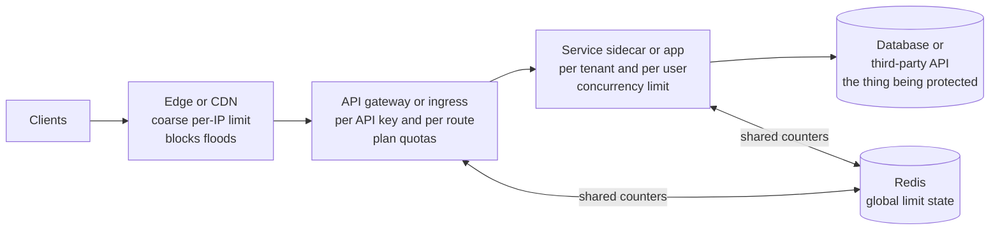
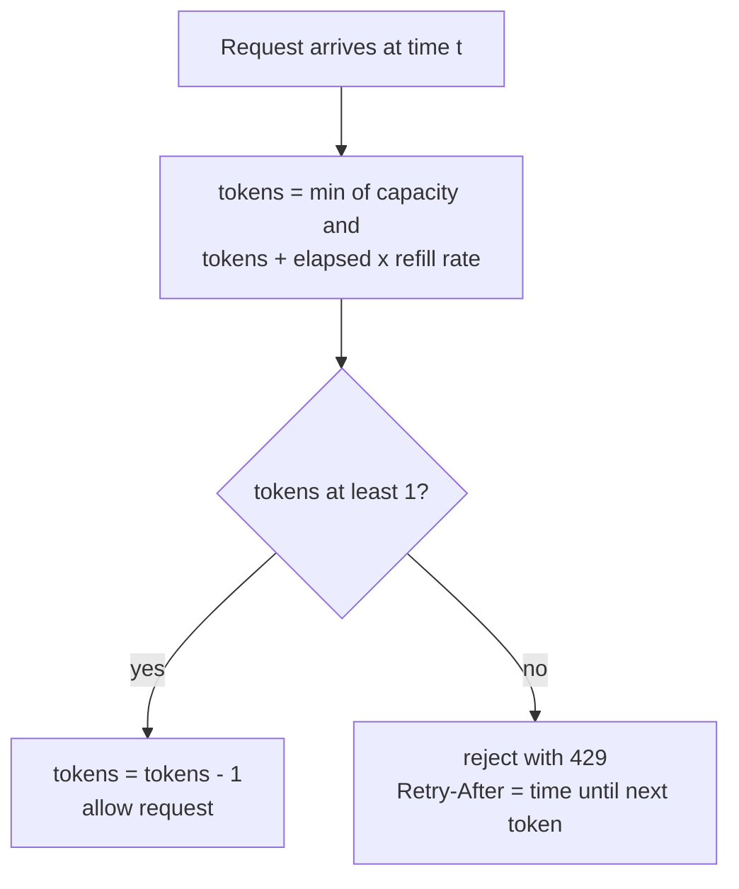

# L12.13 — Rate Limiting

> **Level 12: Advanced Networking** · Topic 13 of 14 · ⏱ ~5 hours · Difficulty: Advanced

## 1. What it is

**Rate limiting** caps how much work a given caller (or the whole system) may ask of a service in a period of time: "100 requests per minute per API key", "5 login attempts per minute per IP", "10 concurrent exports per tenant". When a caller exceeds the limit, the service refuses the extra work quickly and cheaply, usually with HTTP **429 Too Many Requests** and a `Retry-After` header, instead of letting the excess overload everything for everyone.

It is one member of a family of overload controls that are easy to confuse:

- **Rate limiting / throttling:** limits *how fast* a caller may go (requests per second).
- **Quotas:** limit *how much in total* over a long period (10,000 calls per month, billing-related).
- **Concurrency limiting:** limits *how many at once* (in-flight requests), which tracks real load better than a rate when requests vary in cost.
- **Load shedding:** the server drops work when *it* is saturated, regardless of who sent it.
- **Circuit breakers** ([Circuit Breakers](14-circuit-breakers.md)) protect a *caller* from a failing dependency; rate limits protect a *server* from its callers.

This topic covers the four classic algorithms (token bucket, leaky bucket, fixed window, sliding window), where to enforce limits, and how to share a limit across many servers with Redis.

## 2. Why it matters in DevOps

- **Noisy neighbours and abuse.** One tenant's runaway script, a scraper, or a credential-stuffing botnet can consume the capacity everyone else pays for. A limit turns "site down for everyone" into "429 for one caller".
- **Protecting the expensive resource.** The app can often scale out; the database cannot. Limits at the edge keep the load the database sees bounded ([Connection Pooling](10-connection-pooling.md)).
- **Retry storms are self-inflicted DDoS.** When a dependency slows down, clients retry, multiplying load exactly when capacity is shortest. Limits plus well-behaved clients (backoff with jitter, see [Circuit Breakers](14-circuit-breakers.md)) stop the spiral.
- **Cost control.** Pay-per-request backends (serverless, third-party APIs, LLM or SMS providers) can turn unlimited traffic into unlimited bills.
- **Fairness and contracts.** Public APIs sell tiers ("free: 60 per hour, pro: 5,000 per hour"); limits make those plans enforceable.
- **Naive implementations fail in production.** A per-process in-memory counter allows `N x limit` when you run `N` replicas; a Redis-backed counter without atomic updates races; a limiter that fails closed when Redis is down becomes an outage of its own.

## 3. Real-world system example

**Stripe** has published how it protects its API with rate limiters built on the token bucket algorithm and backed by Redis. It describes four layers: a request-rate limiter per user, a concurrent-requests limiter, a fleet-usage load shedder that reserves capacity for critical traffic, and a worker-utilisation load shedder that drops low-priority work first when servers are saturated. Its API returns `429` when you are limited, and Stripe's documentation advises clients to retry with exponential backoff.

**GitHub's REST API** documents primary rate limits per authenticated user or app (for example 5,000 requests per hour for a personal access token on github.com, with higher limits for some apps), exposes your state in `x-ratelimit-limit`, `x-ratelimit-remaining`, `x-ratelimit-used` and `x-ratelimit-reset` response headers, and applies additional "secondary" limits for rapid bursts and expensive operations. Clients are told to back off using `Retry-After` or the reset time.

**Cloudflare** has described building rate limiting that scales to millions of domains using a counter-based approximation of the sliding-window technique to avoid keeping every timestamp. **AWS API Gateway** documents a token bucket model with a steady-state rate and a burst size, applied per account, per stage and per API key through usage plans. **Envoy** supports both **local** rate limiting (a token bucket in each proxy) and **global** rate limiting by calling an external rate-limit service (Lyft's open-source `ratelimit` service uses Redis). **Kubernetes** protects its own API server with API Priority and Fairness, a form of concurrency limiting with queues per priority level. **nginx** (`limit_req`, `limit_conn`) and **HAProxy** (stick tables) provide limits at the proxy.

## 4. Diagram

Where limits are enforced in a typical request path, and what each layer protects:



Token bucket: the state machine behind a request check. Tokens refill continuously up to the bucket size; each request needs one:



## 5. How it works

### The algorithms

| Algorithm | Idea | Allows bursts? | Memory per key | Strengths | Weaknesses |
|---|---|---|---|---|---|
| **Token bucket** | Bucket of up to `capacity` tokens refilled at `rate`; each request takes one | **Yes**, up to `capacity` | O(1): tokens + timestamp | Simple, permits controlled bursts, long-run rate is exact | Burst size and rate must be tuned together |
| **Leaky bucket** | Requests enter a queue (the bucket) drained at a fixed rate; a full queue rejects. As a *meter* it is equivalent to a token bucket with different bookkeeping | Absorbed by the queue, **output is smooth** | O(1) as a meter, O(queue) as a queue | Smooth, constant output to the backend | A queue adds latency; old requests may be served late |
| **Fixed window** | Counter per window (for example per minute), reset at window boundaries | Allows up to **2x the limit** across a boundary | O(1) | Trivial, one `INCR` | Boundary burst (the lab shows 20 of 20 allowed for "10 per second") |
| **Sliding window log** | Keep each request's timestamp; count those in the last window | No | **O(requests)** | Exact | Memory and CPU grow with the limit |
| **Sliding window counter** | Estimate = previous window count x overlap fraction + current count | Roughly bounded | O(1): two counters | Cheap and nearly accurate | An approximation (small over- or under-count) |

Rule of thumb: **token bucket** for APIs that should tolerate short bursts, **leaky bucket / queue** when the backend needs a smooth flow (nginx's `limit_req` is a leaky bucket), **sliding window counter** for "N per minute" quotas at large scale, and **fixed window** only when approximate is fine.

### Choosing what to count (the key)

A limit is a function `limit(key)`. Common keys: client IP (weak behind NAT or proxies and with IPv6), API key or token (best for APIs), authenticated user, tenant or account, route (`POST /login` stricter than `GET /products`), or a combination. Use cheaper limits earlier: a coarse per-IP limit at the edge, finer per-user limits later where identity is known. Behind proxies, take the client IP from a **trusted** `X-Forwarded-For`/PROXY protocol, not from the connection ([TLS Termination](11-tls-termination.md)).

### What the client sees

- **Status `429 Too Many Requests`** (RFC 6585); `503` is used by some systems for load shedding rather than per-caller limits.
- **`Retry-After`** (RFC 9110): seconds or an HTTP date. Well-behaved clients wait at least that long.
- **Informational headers** such as `X-RateLimit-Limit`, `-Remaining`, `-Reset` (de facto; an IETF draft is standardising `RateLimit` headers). Document them; clients use them to pace themselves.
- A clear JSON error body naming the limit and how to raise it.

### Local versus global (distributed) limiting

| | Local (per instance) | Global (shared state) |
|---|---|---|
| Where state lives | In each proxy/app process | In a shared store, typically **Redis**, or a rate-limit service |
| Accuracy | Effective limit = `limit x instances` unless traffic is evenly spread | Accurate across the fleet |
| Latency / dependency | None, nothing to fail | One extra network call per request; the store is now a dependency |
| Best for | Protecting each instance from overload; cheap first line | Per-customer plans, billing-grade quotas |

Practical designs combine them: a **local** limiter as a cheap guard and a **global** one for customer-visible limits, optionally syncing counts in batches (each node takes a slice of the budget from Redis) to avoid a round trip per request.

**Doing it correctly in Redis.** The check is read-modify-write, so it must be **atomic**: use a Lua script (executed atomically by Redis) or `MULTI/EXEC`; do not `GET`, compute in the app, then `SET` (two instances race and both pass). Use Redis's own clock (`TIME`) rather than each app server's clock to avoid skew. Give every key a TTL so idle buckets disappear. Typical data structures: `INCR`+`EXPIRE` (fixed window), a hash of `tokens`/`ts` (token bucket), a sorted set of timestamps (sliding window log). Decide **fail-open or fail-closed** when Redis is unreachable: public read APIs usually fail open (with a local fallback limit); security-critical limits such as login attempts may fail closed.

### Tuning and pitfalls

- Set limits from data: measure normal p99 per-key traffic, add headroom, and ship in **log-only mode first** (nginx: `limit_req_dry_run on`, Envoy: a `filter_enabled` without `filter_enforced`) before enforcing.
- Rate by *cost*, not just count, when requests vary widely (an export is not a health check); or add a concurrency limit.
- Rejected requests should be cheap: reject early, before auth, parsing or database access.
- Limit retries too: a client that retries every `429` immediately makes things worse; reward `Retry-After` and add jitter.
- Keep state bounded: key cardinality (one key per IP) can itself exhaust memory; size zones and set TTLs (nginx `10m` zone holds roughly 160,000 states of 64 bytes).

## 6. Step-by-step guide

You will (a) simulate the algorithms and see why fixed windows leak bursts, (b) enforce a leaky-bucket limit in nginx and compare `burst`, `nodelay` and no burst, (c) write an atomic token bucket in Redis and share it between two clients, (d) rate limit in HAProxy with a stick table, and (e) read the equivalent Envoy configuration.

**Prerequisites:** Linux with `python3`, `nginx`, `haproxy`, `curl` and `redis-server` + `redis-cli` (`sudo apt-get install -y python3 nginx haproxy curl redis-server redis-tools`; then `sudo systemctl disable --now nginx haproxy redis-server`). Free and local. Verified with Python 3.13, nginx 1.24, HAProxy 2.x and Redis 7.0. If your shell exports a proxy, `unset https_proxy HTTPS_PROXY http_proxy HTTP_PROXY`. Use Docker Compose if you prefer (one container each for nginx, HAProxy and Redis with the same files mounted); host processes keep the guide short.

### Part A: the algorithms, with simulated time

1. **Write the algorithms with an injectable clock** so you can control time exactly.
   ```bash
   export LAB=$HOME/ratelimit-lab; mkdir -p $LAB && cd $LAB
   cat > limiters.py <<'EOF'
   from collections import deque

   class TokenBucket:                       # bursts up to capacity, average `rate` per second
       def __init__(self, rate, capacity):
           self.rate, self.capacity = rate, capacity
           self.tokens, self.last = capacity, 0.0
       def allow(self, now):
           self.tokens = min(self.capacity, self.tokens + (now - self.last) * self.rate)
           self.last = now
           if self.tokens >= 1:
               self.tokens -= 1
               return True
           return False

   class LeakyBucketMeter:                  # level drains at `rate`; a full bucket rejects
       def __init__(self, rate, capacity):
           self.rate, self.capacity = rate, capacity
           self.level, self.last = 0.0, 0.0
       def allow(self, now):
           self.level = max(0.0, self.level - (now - self.last) * self.rate)
           self.last = now
           if self.level + 1 <= self.capacity:
               self.level += 1
               return True
           return False

   class FixedWindow:
       def __init__(self, limit, window):
           self.limit, self.window, self.count, self.start = limit, window, 0, 0
       def allow(self, now):
           w = int(now // self.window)
           if w != self.start:
               self.start, self.count = w, 0
           if self.count < self.limit:
               self.count += 1
               return True
           return False

   class SlidingWindowLog:
       def __init__(self, limit, window):
           self.limit, self.window, self.log = limit, window, deque()
       def allow(self, now):
           while self.log and self.log[0] <= now - self.window:
               self.log.popleft()
           if len(self.log) < self.limit:
               self.log.append(now)
               return True
           return False

   class SlidingWindowCounter:              # weights the previous window by how much of it still overlaps
       def __init__(self, limit, window):
           self.limit, self.window = limit, window
           self.cur_w, self.cur, self.prev = 0, 0, 0
       def allow(self, now):
           w = int(now // self.window)
           if w != self.cur_w:
               self.prev = self.cur if w == self.cur_w + 1 else 0
               self.cur, self.cur_w = 0, w
           frac = (now % self.window) / self.window
           if self.prev * (1 - frac) + self.cur < self.limit:
               self.cur += 1
               return True
           return False
   EOF
   ```

2. **Run three traffic patterns through all of them.**
   ```bash
   cat > simulate.py <<'EOF'
   from limiters import *
   LIMIT, WINDOW = 10, 1.0                  # "10 requests per second"
   def run(name, lim, times):
       ok = sum(1 for t in times if lim.allow(t))
       print(f"{name:<26} allowed {ok:>2} of {len(times)}")

   boundary = [0.95 + i * 0.001 for i in range(10)] + [1.05 + i * 0.001 for i in range(10)]
   print("Scenario 1: 20 requests in 0.1 s across a window boundary")
   run("fixed window",           FixedWindow(LIMIT, WINDOW),          boundary)
   run("sliding window log",     SlidingWindowLog(LIMIT, WINDOW),     boundary)
   run("sliding window counter", SlidingWindowCounter(LIMIT, WINDOW), boundary)
   run("token bucket 10/s b10",  TokenBucket(10, 10),                 boundary)
   run("leaky bucket 10/s q10",  LeakyBucketMeter(10, 10),            boundary)

   burst = [5.0] * 30
   print("\nScenario 2: quiet period, then 30 requests at once")
   run("token bucket 10/s b10",  TokenBucket(10, 10),                 burst)
   run("token bucket 10/s b30",  TokenBucket(10, 30),                 burst)
   run("sliding window log",     SlidingWindowLog(LIMIT, WINDOW),     burst)

   steady = [i / 20 for i in range(100)]
   print("\nScenario 3: steady 20 requests per second for 5 s (long-run limit 10 per second)")
   run("token bucket 10/s b10",  TokenBucket(10, 10),                 steady)
   run("sliding window log",     SlidingWindowLog(LIMIT, WINDOW),     steady)
   run("fixed window",           FixedWindow(LIMIT, WINDOW),          steady)
   EOF
   python3 simulate.py
   ```
   ```text
   Scenario 1: 20 requests in 0.1 s across a window boundary
   fixed window               allowed 20 of 20
   sliding window log         allowed 10 of 20
   sliding window counter     allowed 11 of 20
   token bucket 10/s b10      allowed 11 of 20
   leaky bucket 10/s q10      allowed 11 of 20

   Scenario 2: quiet period, then 30 requests at once
   token bucket 10/s b10      allowed 10 of 30
   token bucket 10/s b30      allowed 30 of 30
   sliding window log         allowed 10 of 30

   Scenario 3: steady 20 requests per second for 5 s (long-run limit 10 per second)
   token bucket 10/s b10      allowed 59 of 100
   sliding window log         allowed 50 of 100
   fixed window               allowed 50 of 100
   ```
   Read it: the **fixed window** let all 20 through in a tenth of a second (twice the intended limit) because 10 landed at the end of one window and 10 at the start of the next; the others did not (the token bucket's extra request is the token refilled in 0.1 s). A big bucket (`b30`) is a policy decision: it admits a 30-request burst after idle time. In scenario 3 the token bucket allows about 59: the initial full bucket (10) plus 5 seconds x 10 per second, which is the long-run rate plus one burst.

### Part B: leaky-bucket limiting in nginx

3. **Configure `limit_req` with three variants** and a backend. Note that `limit_req` must apply to a request that is *proxied or served*; a bare `return` in the same `location` runs before the limit and would bypass it.
   ```bash
   mkdir -p $LAB/logs $LAB/tmp/{body,proxy,fcgi,uwsgi,scgi}
   cat > nginx.conf <<EOF
   worker_processes 1;
   daemon off;
   error_log $LAB/logs/error.log warn;
   pid $LAB/nginx.pid;
   events { worker_connections 256; }
   http {
     access_log off;
     client_body_temp_path $LAB/tmp/body; proxy_temp_path $LAB/tmp/proxy;
     fastcgi_temp_path $LAB/tmp/fcgi; uwsgi_temp_path $LAB/tmp/uwsgi; scgi_temp_path $LAB/tmp/scgi;

     limit_req_zone \$binary_remote_addr zone=per_ip:10m rate=5r/s;   # 5 per second per client IP
     limit_req_status 429;

     server {
       listen 127.0.0.1:8080;
       add_header Retry-After 1 always;
       location /strict  { limit_req zone=per_ip;                   proxy_pass http://127.0.0.1:8081; }
       location /burst   { limit_req zone=per_ip burst=10;          proxy_pass http://127.0.0.1:8081; }
       location /nodelay { limit_req zone=per_ip burst=10 nodelay;  proxy_pass http://127.0.0.1:8081; }
     }
     server {                                   # the protected backend
       listen 127.0.0.1:8081;
       location / { return 200 "ok\n"; }
     }
   }
   EOF
   nginx -t -c $LAB/nginx.conf -e $LAB/logs/error.log && (nginx -c $LAB/nginx.conf -e $LAB/logs/error.log >/dev/null 2>&1 &)
   sleep 1
   ```
   Expected: `syntax is ok` and `test is successful`.

4. **Send 20 requests as fast as possible to each endpoint.**
   ```bash
   burst() { for i in $(seq 1 20); do curl -s -o /dev/null -w '%{http_code} ' http://127.0.0.1:8080$1; done; echo; }
   echo strict:;  burst /strict;  sleep 3
   echo burst:;   time burst /burst; sleep 4
   echo nodelay:; burst /nodelay
   ```
   ```text
   strict:
   200 429 429 429 429 429 429 429 429 429 429 429 429 429 429 429 429 429 429 429
   burst:
   200 200 200 200 200 200 200 200 200 200 200 200 200 200 200 200 200 200 200 200
   real    0m3.8s
   nodelay:
   200 200 200 200 200 200 200 200 200 200 200 429 429 429 429 429 429 429 429 429
   ```
   The three behaviours: **strict** admits one and rejects the rest of the instantaneous burst. **`burst=10`** (the leaky bucket's queue) *delays* excess requests so they leave at exactly 5 per second: the first ten queued requests plus pacing took about 3.8 seconds, yet nothing failed. **`burst=10 nodelay`** serves the first 11 immediately (1 + burst of 10) and rejects the rest; the slots then refill at 5 per second. Pick `nodelay` when latency matters more than smoothness; pick delaying when the backend needs a gentle flow.

5. **See the client-visible contract and the log.**
   ```bash
   curl -si http://127.0.0.1:8080/strict >/dev/null; curl -si http://127.0.0.1:8080/strict | sed -n '1p;/Retry-After/p'
   grep -a 'limiting requests' $LAB/logs/error.log | tail -1 | sed 's/^.*\[error\]/[error]/' | cut -c1-150
   ```
   ```text
   HTTP/1.1 429 Too Many Requests
   Retry-After: 1
   [error] ...: *309 limiting requests, excess: 10.485 by zone "per_ip", client: 127.0.0.1, server: , request: "GET /nodelay HTTP/1.1" ...
   ```
   `excess` is how far over the rate the bucket is, a handy number for tuning `burst`. Stop nginx for now: `kill $(cat $LAB/nginx.pid)`.

### Part C: a distributed token bucket in Redis

6. **Start a throwaway Redis and write the atomic token bucket as a Lua script.**
   ```bash
   cd $LAB
   cat > tb.lua <<'EOF'
   -- KEYS[1] = bucket key; ARGV[1] = refill rate (tokens/s), ARGV[2] = capacity, ARGV[3] = cost
   local t = redis.call('TIME')
   local now = t[1] * 1000 + math.floor(t[2] / 1000)               -- Redis clock in milliseconds
   local rate, cap, cost = tonumber(ARGV[1]), tonumber(ARGV[2]), tonumber(ARGV[3])
   local b = redis.call('HMGET', KEYS[1], 'tokens', 'ts')
   local tokens, ts = tonumber(b[1]), tonumber(b[2])
   if tokens == nil then tokens, ts = cap, now end                  -- new key: start full
   tokens = math.min(cap, tokens + (now - ts) * rate / 1000)        -- refill
   local allowed = 0
   if tokens >= cost then tokens = tokens - cost; allowed = 1 end
   redis.call('HSET', KEYS[1], 'tokens', tokens, 'ts', now)
   redis.call('PEXPIRE', KEYS[1], math.ceil(cap / rate * 1000) * 2) -- idle buckets expire
   return { allowed, math.floor(tokens) }
   EOF
   redis-server --port 16379 --save "" --appendonly no --daemonize yes --dir $LAB --pidfile $LAB/redis.pid --logfile $LAB/redis.log >/dev/null
   sleep 1
   R="redis-cli -p 16379"
   SHA=$($R SCRIPT LOAD "$(cat tb.lua)"); echo $SHA
   ```
   Expected: a 40-character SHA1 of the script. `EVALSHA` runs it atomically, so no other client can interleave between the read and the write.

7. **Exercise it: bucket of 10, refill 5 per second.**
   ```bash
   for i in $(seq 1 15); do $R EVALSHA $SHA 1 rl:user:42 5 10 1 | tr '\n' ' '; done; echo
   sleep 1; echo "after 1 second:"; for i in $(seq 1 7); do $R EVALSHA $SHA 1 rl:user:42 5 10 1 | tr '\n' ' '; done; echo
   ```
   ```text
   1 9 1 8 1 7 1 6 1 5 1 4 1 3 1 2 1 1 1 0 0 0 0 0 0 0 0 0 0 0
   after 1 second:
   1 4 1 3 1 2 1 1 1 0 0 0 0 0
   ```
   Each pair is `allowed tokens-left`. The first 10 requests drain the bucket, the next 5 are refused (`0`). After one second about 5 tokens have refilled, so 5 more succeed.

8. **Prove the limit is shared and race-free: two independent clients, one bucket.** Two background loops (standing in for two app instances) hammer the same key with a bucket of 10 and a slow refill.
   ```bash
   $R DEL rl:user:99 >/dev/null
   ( for i in $(seq 1 10); do $R EVALSHA $SHA 1 rl:user:99 1 10 1 | head -1; done ) > a.out &
   ( for i in $(seq 1 10); do $R EVALSHA $SHA 1 rl:user:99 1 10 1 | head -1; done ) > b.out &
   wait; echo "allowed in total: $(cat a.out b.out | grep -c '^1')"
   ```
   ```text
   allowed in total: 10
   ```
   Twenty attempts from two clients, exactly the bucket's 10 allowed (a refill of 1 per second can occasionally add one more on a slow machine). With per-process counters you would have seen 20. Sliding-window and fixed-window variants use the same pattern (`ZREMRANGEBYSCORE`/`ZCARD`/`ZADD` in Lua, or `INCR` + `EXPIRE`); try them in task T3.

### Part D: HAProxy stick table and Envoy for comparison

9. **Rate limit in HAProxy by tracking each source IP's request rate.**
   ```bash
   cat > haproxy.cfg <<'EOF'
   global
     maxconn 1000
   defaults
     mode http
     timeout connect 3s
     timeout client  30s
     timeout server  30s
   frontend fe
     bind 127.0.0.1:8090
     stick-table type ip size 100k expire 30s store http_req_rate(1s)
     http-request track-sc0 src
     http-request deny deny_status 429 if { sc_http_req_rate(0) gt 5 }
     default_backend be
   backend be
     server s1 127.0.0.1:8081
   EOF
   haproxy -c -f haproxy.cfg
   (nginx -c $LAB/nginx.conf -e $LAB/logs/error.log >/dev/null 2>&1 &); sleep 1       # the 8081 backend
   haproxy -f haproxy.cfg -D -p $LAB/haproxy.pid; sleep 1
   for i in $(seq 1 12); do curl -s -o /dev/null -w '%{http_code} ' http://127.0.0.1:8090/; done; echo
   sleep 3; curl -s -o /dev/null -w '%{http_code}\n' http://127.0.0.1:8090/
   ```
   ```text
   Configuration file is valid
   200 200 200 200 200 429 429 429 429 429 429 429
   200
   ```
   The first five pass, then HAProxy denies until the measured one-second rate drops below five. Note that denied requests still count towards the rate, so a client that keeps hammering stays blocked; waiting is what frees it.

10. **Read the Envoy equivalent (reference only, not run in this lab).** Envoy's local rate limit filter is a token bucket in each proxy:
    ```yaml
    http_filters:
      - name: envoy.filters.http.local_ratelimit
        typed_config:
          "@type": type.googleapis.com/envoy.extensions.filters.http.local_ratelimit.v3.LocalRateLimit
          stat_prefix: http_local_rate_limiter
          token_bucket:
            max_tokens: 10          # bucket capacity (burst)
            tokens_per_fill: 5      # refill amount
            fill_interval: 1s       # refill period -> 5 per second
          filter_enabled:           # evaluate on 100% of requests
            runtime_key: local_rate_limit_enabled
            default_value: { numerator: 100, denominator: HUNDRED }
          filter_enforced:          # and enforce on 100% (set lower for a dry run)
            runtime_key: local_rate_limit_enforced
            default_value: { numerator: 100, denominator: HUNDRED }
      - name: envoy.filters.http.router
        typed_config:
          "@type": type.googleapis.com/envoy.extensions.filters.http.router.v3.Router
    ```
    For fleet-wide per-customer limits Envoy's *global* rate limit filter calls an external gRPC rate-limit service, commonly backed by Redis as in Part C.

11. **Clean up.**
    ```bash
    kill $(cat $LAB/haproxy.pid) $(cat $LAB/nginx.pid); redis-cli -p 16379 shutdown nosave
    cd ~; rm -r "$LAB"; unset LAB
    ```

## 7. Real-world scenario

*(Illustrative.)* `shop-api` exposes `POST /login` and a public product search. One Saturday night, p99 latency climbs and the PostgreSQL CPU pins at 100 percent. Dashboards show that 70 percent of requests come from a few hundred IPs hitting `/login` with different email addresses (credential stuffing), and each attempt triggers a password-hash computation and a database lookup.
Investigation: the only limit in place is a per-process counter inside the Node.js app: 100 requests per minute per IP. With 12 replicas the effective limit is up to 1,200 per minute per IP, and the botnet spreads across many IPs anyway. The counter is also checked *after* the database lookup.
Fix: (1) at the edge, an nginx `limit_req` zone on `/login` of 5 per minute per IP with a small `burst`, plus a per-account limit of 10 attempts per hour kept in Redis with an atomic script (keyed by the submitted email, normalised); (2) the check runs before any database work; (3) the limit returns `429` with `Retry-After`; (4) global search gets a token bucket per API key; (5) a dry-run period first, then enforcement. CPU falls back within minutes.
Follow-up: the security team notices the Redis limiter fails *open* during a Redis failover, so a short window of unlimited login attempts exists; they add a conservative local fallback limit and an alert on limiter errors.
**Lesson:** limit early, on the right key, with shared atomic state, and decide explicitly what happens when the limiter itself fails.

## 8. Common mistakes and best practices

**Don't**
- Rely on per-instance counters for customer-facing limits when you run several replicas.
- Implement the check as `GET`, compute in the app, then `SET`; concurrent requests race through the gap.
- Use fixed windows for strict limits (the boundary doubles the burst) or client IP as the only key behind a NAT or CDN.
- Trust `X-Forwarded-For` from the open internet when picking the key.
- Do expensive work (auth, DB lookups) before the limit check.
- Reject with a vague `500`/`503` and no `Retry-After`, or let clients retry `429` immediately.
- Forget TTLs on limiter keys (memory grows without bound) or what happens when the limiter store is down.

**Do**
- Return `429` with `Retry-After` and clear rate-limit headers; document limits per plan.
- Combine layers: coarse per-IP at the edge, per-key/tenant at the gateway, concurrency limits near the database.
- Use token bucket for burst-tolerant APIs and a leaky bucket/queue for smoothing; use sliding-window counters for large-scale "per minute" quotas.
- Do shared limits in Redis with atomic Lua scripts and Redis's own clock; fail open or closed on purpose.
- Roll out in dry-run/log-only mode first; alert on 429 rates per key and on limiter errors.
- Limit retries on the client side too: exponential backoff with jitter and a retry budget ([Circuit Breakers](14-circuit-breakers.md)).

## 9. Tasks

- [ ] **T1 — Compare the algorithms** *(≈40 min, intermediate)*
  - **Goal:** see algorithmic differences in numbers.
  - **Steps:**
    1. Do Part A, steps 1-2.
    2. Add a fourth scenario: a request every 0.1 s for 10 seconds, with a 1-second pause in the middle.
    3. Record how many each algorithm allows and why.
  - **Done when:** you have a table of allowed counts per algorithm for each scenario and can explain the fixed-window boundary result in one sentence.

- [ ] **T2 — Tune nginx limits** *(≈40 min, intermediate)*
  - **Goal:** feel the difference between rejecting and delaying.
  - **Steps:**
    1. Do Part B.
    2. Change `rate` to `20r/m` for a new `/login` location with `burst=3 nodelay`, and send 8 requests.
    3. Use `ab -n 200 -c 10 http://127.0.0.1:8080/burst` and compare the latency distribution to `/nodelay`.
  - **Done when:** you can show the status codes for `/login`, and explain from `ab`'s percentiles why `/burst` has higher latency but zero 429s.

- [ ] **T3 — Build a sliding window in Redis** *(≈50 min, advanced)*
  - **Goal:** implement a second distributed algorithm and compare.
  - **Steps:**
    1. Write a Lua script using a sorted set: `ZREMRANGEBYSCORE key 0 (now-window)`, `ZCARD`, then `ZADD key now id` and `PEXPIRE` when under the limit.
    2. Run 12 requests with limit 10 per second: expect 10 allowed then 2 rejected, and a new success after about 1.1 s.
    3. Run the boundary pattern from Part A against it.
  - **Done when:** the Redis sliding window allows exactly 10 of the 20-in-0.1-s boundary burst, unlike a fixed window (`INCR`/`EXPIRE`) which you also implement and show allowing 20.

- [ ] **T4 — Break it: race and failure modes** *(≈50 min, advanced)*
  - **Goal:** prove why atomicity and failure policy matter.
  - **Steps:**
    1. Implement a naive limiter in a shell loop using separate `GET` and `SET` commands, run two copies concurrently, and count how many get through compared with the Lua script.
    2. Stop Redis during a request loop and write down what your client sees; then decide fail-open vs fail-closed and implement a local fallback in the Python simulator.
  - **Done when:** the naive version lets through more than the limit and the Lua version never does, and you can state your fail-open or fail-closed choice for login and for search with reasons.

- [ ] **T5 — Per-key limits and a good client** *(≈60 min, advanced)*
  - **Goal:** complete the contract between limiter and caller.
  - **Steps:**
    1. Key the nginx zone on an `X-Api-Key` header instead of the IP (`limit_req_zone $http_x_api_key ...`) with two different keys.
    2. Return `Retry-After` computed from the Redis script (time until the next token).
    3. Write a client that respects `Retry-After` and adds jitter, and show it completes 100 requests without a single 429 after the first backoff.
  - **Done when:** two keys have independent limits (one blocked, the other not), and the client log shows waits that match `Retry-After`.

- [ ] **T6 — Prove it: limit plan for `shop-api`** *(≈45 min, advanced)*
  - **Goal:** design and demonstrate a layered limit.
  - **Steps:**
    1. Without the guide, demonstrate nginx `limit_req` with `nodelay` and a Redis atomic token bucket shared by two clients.
    2. Write the plan: edge limit, per-API-key limit, login limit, concurrency limit for `/export`, the key for each, algorithm, numbers, headers returned, dry-run plan, behaviour when Redis is down, and three metrics to alert on.
  - **Done when:** both demos work from memory and the plan states a concrete number, key and algorithm for each limit, with a reason.

## 10. Self-check questions

1. Compare token bucket and leaky bucket. Which allows bursts, and which gives smooth output?
2. Why does a fixed-window limit of 10 per second sometimes allow 20 requests in a tenth of a second?
3. You run 8 replicas each with a local limit of 100 per minute per client. What is the effective limit, and how do you get an exact fleet-wide one?
4. Why must a Redis rate-limit check be atomic, and how do you make it so?
5. What should a client do when it receives `429` with `Retry-After: 30`?
6. What is the difference between rate limiting, load shedding and a circuit breaker?

<details><summary>Answers</summary>

1. A token bucket permits bursts up to the bucket size while enforcing a long-run average. A leaky bucket drains at a constant rate, so its output is smooth, with a queue absorbing bursts (or rejecting when full).
2. The counter resets at the window boundary; 10 requests at the end of one window and 10 at the start of the next are both within their own window, giving 2x the limit in a short span.
3. Up to 800 per minute (if the client's requests spread over every replica). Keep the counter in shared state (Redis or a rate-limit service) so every replica checks the same bucket.
4. The check is read-modify-write; two concurrent requests could both read the same count and both pass. Use a Lua script or `MULTI/EXEC` so Redis runs it as one indivisible operation, and use Redis's `TIME` for the clock.
5. Stop sending, wait at least 30 seconds (plus jitter), then retry; do not retry immediately and do not retry in parallel. Reduce its own request rate going forward.
6. Rate limiting caps what each caller may send (protecting the server from its callers). Load shedding drops work when the server itself is overloaded, regardless of caller. A circuit breaker is on the caller side: it stops calling a failing dependency to let it recover and fail fast.
</details>

## 11. Further reading

- Stripe engineering blog, "Scaling your API with rate limiters"; GitHub REST API documentation on rate limits; Cloudflare's engineering blog on rate limiting at scale; AWS API Gateway documentation on throttling.
- nginx documentation: `ngx_http_limit_req_module` and `ngx_http_limit_conn_module`; HAProxy documentation on stick tables; Envoy documentation on local and global rate limiting.
- Redis documentation on Lua scripting (`EVAL`, `EVALSHA`) and the `TIME` command.
- RFC 6585 (429 Too Many Requests), RFC 9110 (`Retry-After`), and the IETF HTTPAPI working group's draft on RateLimit header fields.
- Betsy Beyer et al., *Site Reliability Engineering* (Google), chapters on handling overload and addressing cascading failures.

<!-- nav -->
---
← Previous: [mTLS](12-mtls.md) · [Level 12 index](README.md) · Next: [Circuit Breakers](14-circuit-breakers.md) →
