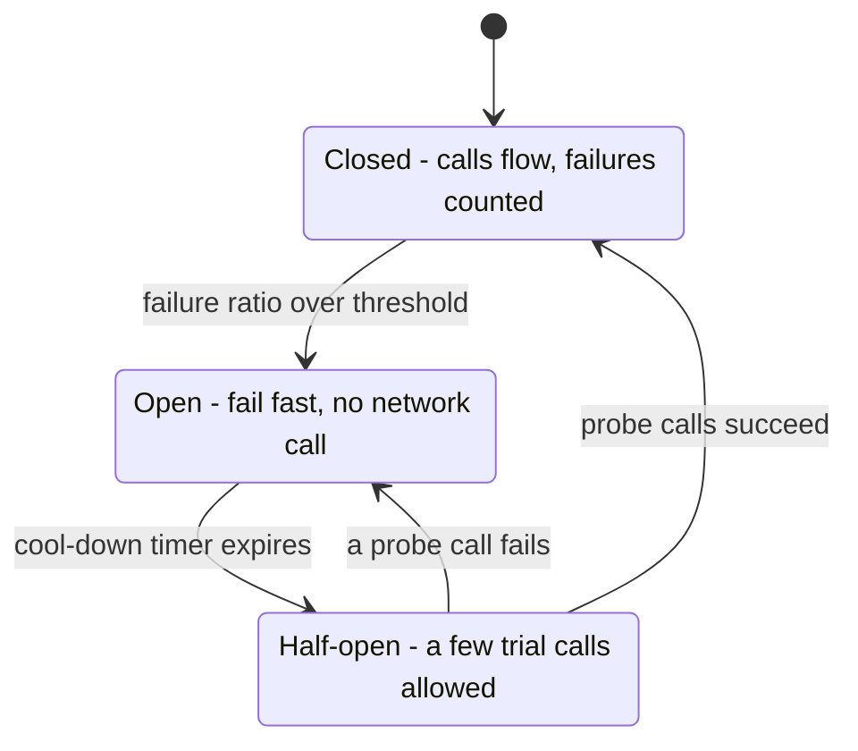
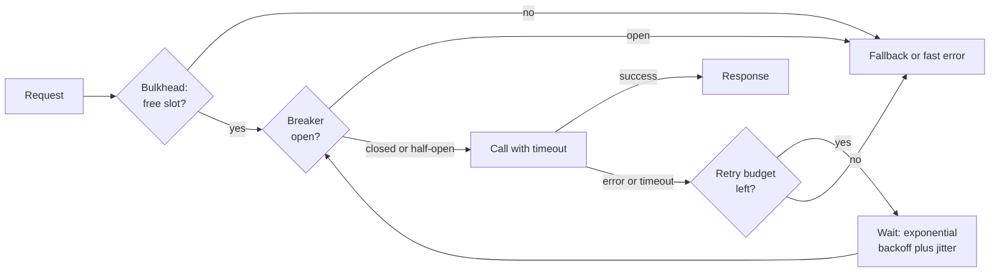

# L12.14 — Circuit Breakers

> **Level 12: Advanced Networking** · Topic 14 of 14 · ⏱ ~5 hours · Difficulty: Advanced

## 1. What it is

A **circuit breaker** is a small state machine wrapped around a call to a remote dependency. While the dependency is healthy the breaker is **closed** and calls flow through. When failures pile up past a threshold, the breaker **opens**: calls are rejected *immediately*, without touching the network, so the failing dependency gets breathing room and the caller stops wasting threads, sockets and seconds waiting. After a cool-down the breaker goes **half-open** and lets a few trial calls through; if they succeed it closes again, if they fail it reopens. The name comes from the electrical device that trips to prevent a fire.

A breaker is one tool in a small toolkit for surviving partial failure. They work as a set, and each one covers a gap the others leave:

- **Timeouts** put a ceiling on how long any single call may take. Without them a hung dependency holds your threads forever.
- **Retries with exponential backoff and jitter** recover from brief, transient errors without hammering a struggling service.
- **Circuit breakers** stop calling something that is clearly down.
- **Bulkheads** isolate resources (thread pools, connection pools, semaphores) per dependency, so one slow dependency cannot consume everything. The name comes from the watertight compartments in a ship's hull.

Together they implement the idea that in a distributed system a slow dependency is worse than a dead one: **fail fast, fail small, recover gracefully.**

## 2. Why it matters in DevOps

- **Cascading failure is the dominant way large systems go down.** One slow service makes its callers' threads and connections pile up; they become slow; their callers pile up; within minutes a single degraded dependency has taken down the whole request path. Breakers, timeouts and bulkheads cut the chain.
- **Retries are the amplifier.** If each of three layers retries three times, one user request becomes 27 calls into the struggling service exactly when it can least cope. Retries without budgets, backoff and jitter turn a blip into an outage (a "retry storm" or "metastable failure").
- **A hung call is worse than an error.** An error returns in milliseconds and can be handled; a missing timeout holds a connection from your pool ([Connection Pooling](10-connection-pooling.md)) until the pool is exhausted.
- **Graceful degradation needs a decision point.** An open breaker is the natural place to serve a fallback: cached data, a default, a "recommendations unavailable" panel, a queue for later processing.
- **It is operational, not just code.** Thresholds, timeouts and retry budgets are tuned from metrics and incidents; an open breaker is a signal you page on, and a good postmortem asks "which timeout and breaker should have caught this?".

## 3. Real-world system example

**Netflix Hystrix** popularised the pattern in the early 2010s: every dependency call was wrapped in a command with a timeout, a thread-pool or semaphore bulkhead, a circuit breaker and a fallback, with a real-time dashboard. Netflix put Hystrix into maintenance mode in 2018 and points to its successors (Resilience4j for Java); the ideas live on in Resilience4j, Polly for .NET, `gobreaker` and similar libraries, and in proxies.

**Envoy** (and so Istio and many gateways) separates two mechanisms that are often both called "circuit breaking": **circuit breakers** are per-cluster *concurrency limits* (maximum connections, pending requests, parallel requests, parallel retries, and an optional retry budget), while **outlier detection** *ejects* individual endpoints that return consecutive 5xx errors for a while and brings them back later, which is a passive, per-host breaker. Envoy's retry policy uses a jittered exponential backoff. **Istio** exposes these as `DestinationRule` `connectionPool` and `outlierDetection` settings ([Service Mesh](09-service-mesh.md), [Level 16: Mesh traffic management](../level-16-advanced-kubernetes/10-mesh-traffic-management.md)). **nginx** gives a passive form with `max_fails`/`fail_timeout` and `proxy_next_upstream`; **HAProxy** has `observe layer7` / `on-error` passive health checking.

**AWS** published guidance in the Amazon Builders' Library on "Timeouts, retries and backoff with jitter" and on load shedding, and AWS SDKs implement exponential backoff with jitter and client-side retry throttling by default. **Google's SRE book** describes the same family of techniques under "Handling Overload" and "Addressing Cascading Failures", including per-client retry budgets. **gRPC** supports retry policies and a retry throttling token bucket. Michael Nygard's book *Release It!* is where the names "circuit breaker" and "bulkhead" entered mainstream engineering vocabulary.

## 4. Diagram

The circuit breaker state machine:



A caller combining timeout, retry, breaker and bulkhead around one dependency, in the order they are applied:



## 5. How it works

### Timeouts: the foundation

Every network call needs a **connect timeout** and a **total/read timeout**, set from the dependency's observed latency (for example slightly above its p99.9), not left at library defaults (which are often infinite). Propagate a **deadline** down the call chain, so a request that has already used 900 ms of a 1 s budget does not start a 1 s call downstream. Timeouts must also shrink as you go deeper: the caller's timeout must exceed the callee's, or the caller gives up while the callee keeps working for nobody.

### Retries, backoff and jitter

- **Retry only what is safe:** idempotent operations (GET, PUT, DELETE) or requests carrying an idempotency key (see [Level 13: Idempotency](../level-13-databases-distributed-systems/14-idempotency.md)). Retrying a non-idempotent `POST /charge` can double-charge.
- **Retry only transient errors:** connection failures, timeouts, 429/503 (honouring `Retry-After`), not 4xx client errors.
- **Exponential backoff:** wait `base x 2^attempt`, capped at a maximum.
- **Jitter:** randomise the wait so thousands of clients that failed together do not retry together. **Full jitter** picks `uniform(0, min(cap, base x 2^attempt))`. The lab shows 200 clients going from 200 simultaneous retries to a peak of about 30.
- **Budgets:** cap retries globally, for example "no more than 10 percent of requests may be retries" (Envoy `retry_budget`, gRPC retry throttling), and retry at one layer only; otherwise the multiplication across layers (3 x 3 x 3 = 27) takes the dependency down.

### The breaker

| State | Behaviour | Moves on |
|---|---|---|
| **Closed** | Calls pass through; outcomes recorded in a count- or time-based sliding window | Failure rate or slow-call rate over the threshold (after a minimum number of calls) opens it |
| **Open** | Calls fail immediately with a "circuit open" error (or run the fallback) | After a wait duration it becomes half-open |
| **Half-open** | A limited number of probe calls are allowed | Enough successes close it, any failure reopens it (often with a longer wait) |

Design choices that matter:

- **What counts as failure:** exceptions, timeouts, 5xx (not 4xx), and **slow calls** (many libraries count calls slower than a threshold, since slowness is the real killer).
- **Minimum volume:** do not open on 2 failures out of 2 requests at 3 a.m.; require a minimum number of calls in the window.
- **Granularity:** one breaker *per dependency* (and often per endpoint or per host), not one global breaker. Envoy's outlier detection works per endpoint so one bad pod is ejected while the rest serve.
- **Probe discipline:** in half-open let only one or a few calls through so a recovering service is not stampeded.
- **Fallbacks:** cached or default data, degraded UI, enqueue for later. A fallback must itself be cheap and reliable.
- **Observability:** export state changes, rejected-call counts and failure rates; alert when a breaker has been open for several minutes ([Observability](../level-00-what-devops-is/10-observability.md)).

### Bulkheads

Give each dependency its own bounded resource: a separate thread pool, a semaphore with a fixed number of permits, a separate connection pool, or separate worker processes. When `inventory` degrades it exhausts its own compartment and calls to it are rejected with "bulkhead full", while `payments` keeps its capacity. Size compartments by Little's Law (concurrency = throughput x latency) plus headroom. At the infrastructure level the same idea appears as per-tenant queues, separate node pools or separate clusters (cell-based architecture).

### Where to implement it

| Layer | Pros | Cons |
|---|---|---|
| **Library in the app** (Resilience4j, Polly, `gobreaker`) | Understands business errors, easy fallbacks, per-method tuning | Per-language, every team must adopt it, config drift |
| **Sidecar or proxy** (Envoy, Istio, Linkerd, nginx, HAProxy) | Uniform across languages, changed by config, rich telemetry | Limited fallback logic, generic error classification |
| **Both** | Proxy handles connection-level protection; app handles semantics and fallbacks | Must avoid doubled retries (retry at one layer only) |

### Related Envoy settings (reference)

```yaml
clusters:
  - name: inventory
    type: STRICT_DNS
    connect_timeout: 1s
    circuit_breakers:                     # concurrency limits (bulkhead-like), not a failure-rate state machine
      thresholds:
        - priority: DEFAULT
          max_connections: 100
          max_pending_requests: 50
          max_requests: 200
          max_retries: 3
          retry_budget: { budget_percent: { value: 20.0 }, min_retry_concurrency: 3 }
    outlier_detection:                    # passive per-endpoint breaker (eject, then re-admit)
      consecutive_5xx: 5
      interval: 10s
      base_ejection_time: 30s
      max_ejection_percent: 50
# in the route:
#   timeout: 2s
#   retry_policy: { retry_on: "5xx,connect-failure,reset", num_retries: 2, per_try_timeout: 0.5s,
#                   retry_back_off: { base_interval: 0.1s, max_interval: 1s } }
```

## 6. Step-by-step guide

You will build a flaky dependency, watch a naive client suffer, wrap the client in a circuit breaker and see it trip, probe and recover, quantify jitter, demonstrate a bulkhead, and use nginx's passive failover. Everything is plain Python 3 and nginx: no Docker needed.

**Prerequisites:** Linux with `python3` (3.9+), `curl` and `nginx` (`sudo apt-get install -y python3 curl nginx`; then `sudo systemctl disable --now nginx`). Free and local. Verified with Python 3.13, nginx 1.24 and curl 8.5. If your shell exports a proxy, `unset https_proxy HTTPS_PROXY http_proxy HTTP_PROXY`. Timings will vary slightly on your machine.

1. **Create the flaky `inventory` service.** It listens on port 9100 and misbehaves on command: `ok`, `slow` (sleeps 2 seconds) or `error` (HTTP 500).
   ```bash
   export LAB=$HOME/breaker-lab; mkdir -p $LAB && cd $LAB
   cat > backend.py <<'EOF'
   """Flaky 'inventory' service. POST /mode/ok | /mode/slow | /mode/error changes its behaviour."""
   import json, time
   from http.server import BaseHTTPRequestHandler, ThreadingHTTPServer

   MODE = {"m": "ok"}
   STATS = {"requests": 0}

   class H(BaseHTTPRequestHandler):
       protocol_version = "HTTP/1.1"
       def log_message(self, *a): pass
       def _send(self, code, body):
           data = body.encode()
           self.send_response(code)
           self.send_header("Content-Length", str(len(data)))
           self.end_headers()
           self.wfile.write(data)
       def do_POST(self):
           if self.path.startswith("/mode/"):
               MODE["m"] = self.path.split("/")[2]
               return self._send(200, f"mode={MODE['m']}\n")
           self._send(404, "no\n")
       def do_GET(self):
           STATS["requests"] += 1
           if self.path == "/stats":
               return self._send(200, json.dumps({**STATS, "mode": MODE["m"]}) + "\n")
           m = MODE["m"]
           if m == "slow":
               time.sleep(2)
           if m == "error":
               return self._send(500, "boom\n")
           self._send(200, "stock=42\n")

   if __name__ == "__main__":
       ThreadingHTTPServer(("127.0.0.1", 9100), H).serve_forever()
   EOF
   (python3 backend.py > backend.log 2>&1 &)
   sleep 1; curl -s http://127.0.0.1:9100/work
   ```
   Expected: `stock=42`.

2. **Write the resilience toolkit: a circuit breaker, a bulkhead and a jittered backoff generator.**
   ```bash
   cat > breaker.py <<'EOF'
   import random, threading, time
   from collections import deque

   class CircuitOpen(Exception): pass
   class BulkheadFull(Exception): pass

   class CircuitBreaker:
       CLOSED, OPEN, HALF_OPEN = "closed", "open", "half-open"
       def __init__(self, window=10, min_calls=5, failure_ratio=0.5, open_seconds=3.0,
                    probes_to_close=2, clock=time.monotonic):
           self.window, self.min_calls, self.ratio = window, min_calls, failure_ratio
           self.open_seconds, self.probes_to_close, self.clock = open_seconds, probes_to_close, clock
           self.state, self.results = self.CLOSED, deque(maxlen=window)
           self.opened_at, self.probe_ok = 0.0, 0
           self.lock = threading.Lock()

       def _transition(self, new):
           if new != self.state:
               print(f"    [breaker] {self.state} -> {new}")
               self.state = new

       def before_call(self):                      # raise CircuitOpen to fail fast
           with self.lock:
               if self.state == self.OPEN:
                   if self.clock() - self.opened_at >= self.open_seconds:
                       self._transition(self.HALF_OPEN); self.probe_ok = 0
                   else:
                       raise CircuitOpen()

       def record(self, ok):                       # report the outcome of a call that was allowed
           with self.lock:
               if self.state == self.HALF_OPEN:
                   if not ok:
                       self.opened_at = self.clock(); self._transition(self.OPEN)
                   else:
                       self.probe_ok += 1
                       if self.probe_ok >= self.probes_to_close:
                           self.results.clear(); self._transition(self.CLOSED)
                   return
               self.results.append(ok)
               fails = self.results.count(False)
               if len(self.results) >= self.min_calls and fails / len(self.results) >= self.ratio:
                   self.opened_at = self.clock(); self._transition(self.OPEN)

   class Bulkhead:
       def __init__(self, max_concurrent):
           self.sem = threading.BoundedSemaphore(max_concurrent)
       def __enter__(self):
           if not self.sem.acquire(blocking=False):
               raise BulkheadFull()
       def __exit__(self, *exc):
           self.sem.release()

   def backoff_delays(base=0.1, cap=5.0, attempts=5, jitter="full", rng=random):
       """Delay before retry n: exponential, capped, optionally fully jittered."""
       for n in range(attempts):
           exp = min(cap, base * 2 ** n)
           yield rng.uniform(0, exp) if jitter == "full" else exp
   EOF
   python3 -c "import breaker; print('toolkit loads')"
   ```
   Expected: `toolkit loads`. (This breaker is deliberately minimal and single-threaded in its probing; production libraries add per-call permits in half-open state, slow-call tracking, metrics and thread-safe counters.)

3. **Write a client that calls the service every 200 ms with a 300 ms timeout**, with or without the breaker.
   ```bash
   cat > demo.py <<'EOF'
   import sys, time, urllib.request, urllib.error
   from breaker import CircuitBreaker, CircuitOpen

   URL, TIMEOUT = "http://127.0.0.1:9100/work", 0.3

   def call():
       try:
           with urllib.request.urlopen(URL, timeout=TIMEOUT) as r:
               return r.status == 200
       except (urllib.error.URLError, TimeoutError, OSError):
           return False                            # 5xx raises HTTPError, a URLError subclass

   use_breaker = sys.argv[1] == "breaker"
   cb = CircuitBreaker(open_seconds=3.0)
   t0 = time.monotonic()
   for i in range(1, 41):
       start = time.monotonic()
       try:
           if use_breaker: cb.before_call()
           ok = call()
           if use_breaker: cb.record(ok)
           outcome = "ok" if ok else "FAIL (timeout or 5xx)"
       except CircuitOpen:
           outcome = "rejected instantly by open breaker"
       print(f"t={start - t0:5.1f}s call {i:2d}: {outcome:<36} took {(time.monotonic() - start) * 1000:5.0f} ms")
       time.sleep(0.2)
   EOF
   ```

4. **Break the dependency and run the naive client.**
   ```bash
   curl -s -X POST http://127.0.0.1:9100/mode/slow
   timeout 8 python3 demo.py naive
   ```
   ```text
   mode=slow
   t=  0.0s call  1: FAIL (timeout or 5xx)                took   319 ms
   t=  0.5s call  2: FAIL (timeout or 5xx)                took   301 ms
   t=  1.0s call  3: FAIL (timeout or 5xx)                took   301 ms
   ...
   ```
   Every call burns the full 300 ms timeout. With a real thread pool, each of those is a thread occupied for 300 ms for nothing, and the dependency still receives every request, which is exactly what it does not need. (The timeout at least bounds the damage: remove `timeout=TIMEOUT` and each call hangs for 2 seconds.)

5. **Run with the breaker, and let the dependency recover after 4 seconds.**
   ```bash
   curl -s -X POST http://127.0.0.1:9100/mode/slow >/dev/null
   ( sleep 4; curl -s -X POST http://127.0.0.1:9100/mode/ok >/dev/null ) &
   python3 demo.py breaker | grep -v 'rejected instantly'
   wait
   ```
   ```text
   t=  0.0s call  1: FAIL (timeout or 5xx)                took   319 ms
   t=  0.5s call  2: FAIL (timeout or 5xx)                took   301 ms
   t=  1.0s call  3: FAIL (timeout or 5xx)                took   301 ms
   t=  1.5s call  4: FAIL (timeout or 5xx)                took   301 ms
       [breaker] closed -> open
   t=  2.0s call  5: FAIL (timeout or 5xx)                took   301 ms
       [breaker] open -> half-open
   t=  5.3s call 20: ok                                   took     2 ms
       [breaker] half-open -> closed
   t=  5.5s call 21: ok                                   took     2 ms
   ...
   ```
   Run it again without the `grep` to see the whole story: five failed calls (the minimum volume, then a 100 percent failure ratio) trip the breaker; calls 6-19 are **rejected in 0 ms** for the 3-second cool-down, and during that time the dependency receives no traffic; call 20 is the first half-open probe, which succeeds because the service recovered, the second probe closes the breaker, and normal calls resume. Notice the recovery time is bounded by the cool-down, not by the client noticing: if the backend had still been slow, the probe would have failed (taking 300 ms) and the breaker would have gone back to open.

6. **Measure what jitter does to a retry storm.** 200 clients all fail at the same instant and retry four times with exponential backoff.
   ```bash
   cat > herd.py <<'EOF'
   import random
   from collections import Counter
   from breaker import backoff_delays

   random.seed(7)
   def schedule(jitter, clients=200, attempts=4):
       times = []
       for _ in range(clients):
           t = 0.0
           for d in backoff_delays(base=0.5, cap=8.0, attempts=attempts, jitter=jitter):
               t += d
               times.append(t)
       return times

   for jitter in ("none", "full"):
       times = schedule(jitter)
       buckets = Counter(int(t // 0.05) for t in times)          # requests per 50 ms bucket
       print(f"jitter={jitter:<4} retries={len(times)}  busiest 50 ms buckets (requests): {[n for _, n in buckets.most_common(3)]}")
   EOF
   python3 herd.py
   ```
   ```text
   jitter=none retries=800  busiest 50 ms buckets (requests): [200, 200, 200]
   jitter=full retries=800  busiest 50 ms buckets (requests): [32, 29, 28]
   ```
   Same total work, but without jitter all 200 clients hit the recovering service in the same 50 ms, round after round, in synchronised waves; with full jitter the peak is about six times lower. That synchronised wave is the "thundering herd" that keeps a service pinned down.

7. **Demonstrate a bulkhead.** A degraded `inventory` (1 s per call) and a healthy `payments` (50 ms per call) share a pool of 4 workers, then get separate pools.
   ```bash
   cat > bulkhead_demo.py <<'EOF'
   import time
   from concurrent.futures import ThreadPoolExecutor

   def inventory(): time.sleep(1.0)        # degraded dependency
   def payments():  time.sleep(0.05)       # healthy dependency

   def run(label, inv_pool, pay_pool):
       inv = [inv_pool.submit(inventory) for _ in range(8)]      # a burst of inventory calls arrives first
       time.sleep(0.1)
       start = time.monotonic()
       pay_pool.submit(payments).result()                        # then one payment
       print(f"{label:<24} payment finished in {(time.monotonic() - start) * 1000:6.0f} ms")
       for f in inv: f.result()

   shared = ThreadPoolExecutor(max_workers=4)
   run("one shared pool of 4", shared, shared); shared.shutdown()
   a, b = ThreadPoolExecutor(max_workers=3), ThreadPoolExecutor(max_workers=1)
   run("bulkheads 3 + 1", a, b); a.shutdown(); b.shutdown()
   EOF
   python3 bulkhead_demo.py
   ```
   ```text
   one shared pool of 4     payment finished in   1950 ms
   bulkheads 3 + 1          payment finished in     51 ms
   ```
   In the shared pool the slow dependency occupies every worker and a healthy payment waits behind eight 1-second calls (about 2 seconds). With a bulkhead the payment finishes in 51 ms. This is why a slow recommendations service must never be able to take down checkout.

8. **Passive circuit breaking in nginx.** Put nginx in front of two replicas: the flaky one on 9100 and a healthy one on 9101. nginx counts failures per server (`max_fails`) and stops sending to a failed server for `fail_timeout` seconds; once that period ends it lets a request through again (a probe).
   ```bash
   mkdir -p $LAB/logs $LAB/tmp/{body,proxy,fcgi,uwsgi,scgi}
   cat > nginx.conf <<EOF
   worker_processes 1;
   daemon off;
   error_log $LAB/logs/error.log warn;
   pid $LAB/nginx.pid;
   events { worker_connections 256; }
   http {
     log_format up '\$status via \$upstream_addr in \$request_time s (statuses \$upstream_status)';
     access_log $LAB/logs/access.log up;
     client_body_temp_path $LAB/tmp/body; proxy_temp_path $LAB/tmp/proxy;
     fastcgi_temp_path $LAB/tmp/fcgi; uwsgi_temp_path $LAB/tmp/uwsgi; scgi_temp_path $LAB/tmp/scgi;

     upstream inventory {
       server 127.0.0.1:9100 max_fails=2 fail_timeout=5s;    # the flaky one
       server 127.0.0.1:9101;                                 # a healthy replica
     }
     server {
       listen 127.0.0.1:8080;
       location / {
         proxy_pass http://inventory;
         proxy_connect_timeout 1s;
         proxy_read_timeout 500ms;                            # a per-try timeout
         proxy_next_upstream error timeout http_500;          # what counts as a failure and may be retried
         proxy_next_upstream_tries 2;                         # retry budget: at most one retry
         proxy_next_upstream_timeout 2s;                      # overall cap across tries
       }
     }
     server { listen 127.0.0.1:9101; access_log off; location / { return 200 "healthy replica\n"; } }
   }
   EOF
   nginx -t -c $LAB/nginx.conf -e $LAB/logs/error.log && (nginx -c $LAB/nginx.conf -e $LAB/logs/error.log >/dev/null 2>&1 &)
   curl -s -X POST http://127.0.0.1:9100/mode/error; sleep 1
   for i in $(seq 1 6); do curl -s -o /dev/null -w '%{http_code} ' http://127.0.0.1:8080/; done; echo
   cat $LAB/logs/access.log
   ```
   ```text
   200 200 200 200 200 200
   200 via 127.0.0.1:9100, 127.0.0.1:9101 in 0.001 s (statuses 500, 200)
   200 via 127.0.0.1:9101 in 0.000 s (statuses 200)
   200 via 127.0.0.1:9100, 127.0.0.1:9101 in 0.001 s (statuses 500, 200)
   200 via 127.0.0.1:9101 in 0.000 s (statuses 200)
   200 via 127.0.0.1:9101 in 0.000 s (statuses 200)
   200 via 127.0.0.1:9101 in 0.000 s (statuses 200)
   ```
   The client never saw an error: requests 1 and 3 hit the bad server, got a `500`, and nginx retried on the healthy one (the `statuses 500, 200` lines). After the second failure the flaky server was marked unavailable, so requests 4-6 went straight to the healthy replica. Wait 6 seconds and send three more: one request goes to `9100` again as a probe (the half-open step), fails, and the server is parked again. Now try the slow failure:
   ```bash
   curl -s -X POST http://127.0.0.1:9100/mode/slow; sleep 6
   for i in 1 2 3; do curl -s -o /dev/null -w '%{http_code} %{time_total}s\n' http://127.0.0.1:8080/; done
   ```
   ```text
   200 0.000538s
   200 0.501425s
   200 0.000503s
   ```
   One request paid the 500 ms per-try timeout and was retried successfully. This is a *passive* breaker (it learns from live traffic, with no separate health check) and it is crude compared with a library breaker: no failure-rate window, no half-open probe count, and failures only matter if `proxy_next_upstream` lists them.

9. **Clean up.**
   ```bash
   kill $(cat $LAB/nginx.pid); pkill -f "$LAB/backend.py" || pkill -f "python3 backend.py"
   cd ~; rm -r "$LAB"; unset LAB
   ```

## 7. Real-world scenario

*(Illustrative.)* On a busy Friday, `shop-api`'s product page calls a recommendations service that starts taking 20 seconds per request after a bad deploy of its cache layer. `shop-api` has no timeout on that call (the HTTP client default is infinite) and uses one shared thread pool of 200 for all downstream calls. Within a minute every thread is blocked on recommendations, checkout requests wait for a thread, and the load balancer's health checks begin to fail, removing instances from rotation and concentrating load on the rest. The site is down although only an optional widget is broken.
Investigation: thread dumps show 200 of 200 threads in `socketRead`; recommendations latency graphs are off the chart; error rate on `shop-api` is 100 percent, almost all timeouts at the load balancer. Retries in the mobile app, three attempts each, tripled the incoming load.
Fix: (1) immediate: a feature flag turns the recommendations call off; (2) permanent: a 300 ms timeout and one retry with full jitter on idempotent GETs, a breaker per downstream (open after 50 percent failures or slow calls over 20 requests, 10-second cool-down), a bulkhead of 20 concurrent calls for recommendations, and a fallback of "popular items" from a local cache; (3) the mobile client gets exponential backoff with jitter and honours `Retry-After`; (4) an alert fires when any breaker has been open for 2 minutes and a game-day drill injects 20-second latency to prove the page degrades instead of dying.
**Lesson:** optional dependencies must not be able to take down critical paths. Timeouts, bulkheads and breakers turn a total outage into a missing widget.

## 8. Common mistakes and best practices

**Don't**
- Call anything over the network without a timeout, or leave library defaults (often infinite) in place.
- Retry at every layer (client, gateway, service, SDK); retries multiply (3 x 3 x 3 = 27 calls).
- Retry without jitter or without a budget, or retry non-idempotent operations without idempotency keys.
- Use one global breaker or one shared thread pool for every dependency.
- Open on tiny samples (2 of 2 requests failed) or count 4xx client errors as dependency failures.
- Let half-open admit all traffic at once; the recovering dependency collapses again.
- Ship a fallback that calls the same failing dependency, or never test the fallback.

**Do**
- Set connect and request timeouts per dependency, propagate deadlines, and keep caller timeouts above callee timeouts.
- Retry only transient, idempotent failures: exponential backoff, full jitter, a retry budget (for example 10 percent of traffic), honouring `Retry-After`.
- Use a breaker per dependency (and per endpoint where the library or proxy supports it), with minimum volume, slow-call detection and a limited half-open probe.
- Isolate dependencies with bulkheads (separate pools or semaphores) sized by Little's Law.
- Design graceful degradation: cached data, defaults, queues, feature flags, "partial page" rendering.
- Export breaker state, rejection counts and retry rates; alert on open breakers; rehearse failures with chaos or game-day exercises.
- Combine app-level breakers (semantics, fallbacks) with proxy-level protection (outlier detection, concurrency limits), and keep retry at one layer.

## 9. Tasks

- [ ] **T1 — Trip and recover the breaker** *(≈40 min, intermediate)*
  - **Goal:** watch all three states happen.
  - **Steps:**
    1. Do steps 1-5.
    2. Repeat but switch the backend to `ok` only after 12 seconds, so at least one half-open probe fails.
    3. Record the sequence of transitions with timestamps.
  - **Done when:** your log shows `closed -> open -> half-open -> open -> half-open -> closed`, and you can explain why the failed probe reopened the breaker.

- [ ] **T2 — Tune it** *(≈45 min, advanced)*
  - **Goal:** understand what each parameter trades off.
  - **Steps:**
    1. Run the demo with `min_calls=2`, then `min_calls=20`, `failure_ratio=0.9`, and `open_seconds=1` and `open_seconds=10`.
    2. For each configuration count how many calls hit the dependency while it was down and how long recovery took after it came back.
  - **Done when:** you have a table of (parameters, wasted calls, time to recover) and a paragraph explaining which setting you would pick for a payment service and why.

- [ ] **T3 — Add retries with jitter and a budget** *(≈60 min, advanced)*
  - **Goal:** combine timeout, retry, breaker and fallback correctly.
  - **Steps:**
    1. Write a `resilient_get()` that applies, in order: bulkhead, breaker, timeout, up to 2 retries using `backoff_delays`, then a fallback returning `stock=unknown`.
    2. Add a global retry budget (retries allowed only while retries are below 10 percent of calls in the last 10 seconds).
    3. Run it against `slow`, `error` and `ok` modes and count backend hits with `curl http://127.0.0.1:9100/stats`.
  - **Done when:** in `error` mode the backend sees at most about 1.1x the requests the client attempted (budget respected), and the client prints the fallback instead of exceptions.

- [ ] **T4 — Break it: retry amplification** *(≈45 min, advanced)*
  - **Goal:** prove that naive retries make outages worse.
  - **Steps:**
    1. Start `slow` mode and run 20 concurrent clients (shell `&` or threads) that each retry 3 times with no backoff and no breaker; read `/stats` to see total requests.
    2. Repeat with breaker, jittered backoff and a budget.
    3. Compare backend request counts and the client-observed error latency.
  - **Done when:** you can show the request multiplication factor for both setups (for example 4x versus close to 1x) and explain why layered retries multiply.

- [ ] **T5 — Production-style breaker at the proxy** *(≈60 min, advanced)*
  - **Goal:** use outlier detection instead of app code.
  - **Steps:**
    1. Write an Envoy bootstrap (or Istio `DestinationRule`) for a cluster of two endpoints using the `circuit_breakers` and `outlier_detection` block from section 5, with the flaky backend as one endpoint. Run it with the `envoyproxy/envoy` Docker image or `func-e`.
    2. Send traffic with `curl` while the flaky endpoint errors; inspect `/clusters` and `/stats` on the Envoy admin port for ejections (`outlier_detection.ejections_active`) and overflows.
    3. Add `retry_policy` with `per_try_timeout` and `retry_back_off`.
  - **Done when:** the admin stats show the bad endpoint ejected and later re-admitted, and clients mostly receive `200`.

- [ ] **T6 — Prove it: resilience design for `shop-api`** *(≈60 min, advanced)*
  - **Goal:** design and defend a resilience policy.
  - **Steps:**
    1. Without the guide, reproduce steps 4-5 (naive client versus breaker) and the bulkhead demo, and explain the output.
    2. Write the policy for three `shop-api` dependencies (PostgreSQL, a payment provider, a recommendations service): timeout, retries (and whether safe), breaker thresholds, bulkhead size, fallback, and the alert for each.
  - **Done when:** the demos run from memory, and your policy gives numeric values and a distinct fallback strategy for each dependency (including "no fallback: fail the checkout cleanly" for payments).

## 10. Self-check questions

1. Describe the three states of a circuit breaker and what moves it between them.
2. Why add jitter to exponential backoff? What problem does it solve that backoff alone does not?
3. Why can retrying at every layer of a call chain take a system down?
4. What is a bulkhead, and how does it differ from a circuit breaker?
5. Which calls are safe to retry automatically?
6. What is the difference between Envoy's `circuit_breakers` and `outlier_detection`?

<details><summary>Answers</summary>

1. Closed: calls pass and failures are counted; when the failure (or slow-call) rate crosses a threshold after a minimum volume, it opens. Open: calls fail immediately for a cool-down period; then it becomes half-open. Half-open: a few probe calls are allowed; if they succeed it closes, if one fails it reopens.
2. Backoff spreads one client's retries over time, but clients that failed together still retry together in synchronised waves. Randomising the delay (full jitter) spreads the herd, lowering the peak load on the recovering service.
3. Retries multiply: three layers with three attempts each can produce 27 calls for one user request, at the moment the dependency is least able to cope. Retry at one layer, with budgets, backoff and jitter.
4. A bulkhead limits resources (threads, connections, concurrency) per dependency so one slow dependency cannot starve others; it limits the blast radius. A circuit breaker watches failures and stops calling a failing dependency. They complement each other.
5. Idempotent operations (GET, PUT, DELETE, or POSTs with an idempotency key) that failed with transient errors (connection failures, timeouts, 429 or 503), within a retry budget; not 4xx errors or non-idempotent writes without keys.
6. `circuit_breakers` set per-cluster concurrency limits (connections, pending requests, requests, retries) that reject overflow immediately; `outlier_detection` observes failures per endpoint, ejects bad hosts for a while, then re-admits them (a passive per-host breaker).
</details>

## 11. Further reading

- Michael Nygard, *Release It!* (stability patterns: timeouts, circuit breaker, bulkheads); Martin Fowler's article "CircuitBreaker" on martinfowler.com.
- Amazon Builders' Library: "Timeouts, retries and backoff with jitter" and the article on using load shedding to avoid overload; AWS Architecture Blog on exponential backoff and jitter.
- Google, *Site Reliability Engineering*: the chapters "Handling Overload" and "Addressing Cascading Failures".
- Resilience4j documentation (CircuitBreaker, Bulkhead, Retry); the Netflix Hystrix wiki (archived); Polly documentation for .NET.
- Envoy documentation on circuit breaking, outlier detection and retry policies; Istio documentation on `DestinationRule` traffic policy; nginx `ngx_http_upstream_module` and `ngx_http_proxy_module`.
