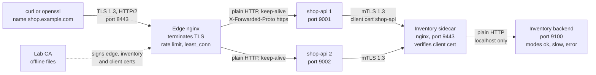
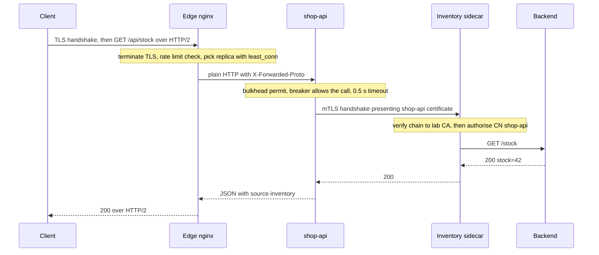

# L12 Capstone — Secure Edge and Resilient Services Lab

> **Level 12: Advanced Networking** · Capstone · ⏱ ~8 hours

## 1. Goal and outcome

You will build, break, observe and repair a small but realistic traffic path for `shop-api`: **an nginx edge that terminates TLS, two `shop-api` replicas, and an `inventory` service that only accepts calls over mutual TLS**, with **rate limiting** at the edge and a **circuit breaker, timeouts, retries with jitter and a bulkhead** inside `shop-api`. You will watch every hop with `curl`, `openssl`, `ss` and `tcpdump` and prove each property with a script.

This is the "Practice project" for Level 12 from the roadmap: *a lab with TLS termination, mTLS between two services, rate limiting and a circuit breaker, observed with tcpdump and curl.* By the end you can:

- explain, with packet captures as evidence, which hop is plaintext and which is encrypted, and why ([TLS Termination](11-tls-termination.md));
- issue, present, authorise, rotate and expire a client certificate, and read the matching server log line ([mTLS](12-mtls.md), [TLS](04-tls.md));
- make a service reject a flood with `429 Retry-After` instead of falling over ([Rate Limiting](13-rate-limiting.md));
- make a service degrade gracefully, with a fast fallback, when a dependency hangs, and recover by itself ([Circuit Breakers](14-circuit-breakers.md), [Connection Pooling](10-connection-pooling.md));
- map the toy lab onto the real internet path of DNS, BGP, CDN, VPN and mesh ([DNS](03-dns-architecture.md), [BGP](02-bgp-fundamentals.md), [CDNs](07-cdns.md), [VPNs](08-vpns.md), [Service Mesh](09-service-mesh.md)).

## 2. Architecture

Everything runs on `127.0.0.1`; each box is a separate process with its own port, so packet captures on the loopback interface show exactly what a network between machines would carry.



What a single `GET /api/stock` does, and where each protection acts:



How the 14 topics of Level 12 show up in the lab:

| Topic | Where you meet it |
|---|---|
| [01 OSI and TCP/IP](01-osi-and-tcpip-models.md) | Milestone 4: you read L3/L4 (`ss`, ports), L5/L6 (TLS version, ALPN) and L7 (HTTP) from the same capture |
| [02 BGP](02-bgp-fundamentals.md) | Task T6: how the edge address is announced and anycast in the real world |
| [03 DNS](03-dns-architecture.md) | `--resolve` plays the role of DNS for `shop.example.com` and `inventory.internal`; T6 designs the real records |
| [04 TLS](04-tls.md) | Milestone 0: your own CA, SAN certificates, chain verification, TLS 1.3 |
| [05 HTTP/2, HTTP/3, QUIC](05-http2-http3-quic.md) | Edge speaks HTTP/2 (ALPN `h2`); stretch goal adds HTTP/3 |
| [06 Load balancing](06-load-balancing-algorithms.md) | `least_conn` across two `shop-api` replicas, passive failover |
| [07 CDNs](07-cdns.md) | T6: where a CDN would sit in front of the edge and what it changes |
| [08 VPNs](08-vpns.md) | T6: replacing "localhost only" with a private tunnel to the inventory network |
| [09 Service mesh](09-service-mesh.md) | The inventory sidecar is a hand-built mesh sidecar; stretch goal replaces it with Envoy |
| [10 Connection pooling](10-connection-pooling.md) | Edge-to-app keep-alive pool (`ss` shows reuse); bulkhead; the missing pool in `shop-api` is a task |
| [11 TLS termination](11-tls-termination.md) | Edge terminates, inventory sidecar re-establishes TLS on the next hop |
| [12 mTLS](12-mtls.md) | Client certificate with a SPIFFE-style identity, authorisation by CN, rotation and expiry drills |
| [13 Rate limiting](13-rate-limiting.md) | `limit_req` with burst at the edge, `429` with `Retry-After` |
| [14 Circuit breakers](14-circuit-breakers.md) | Breaker, timeout, jittered retry and bulkhead in `shop-api`; breaker drill |

## 3. Prerequisites and cost

- **Cost:** none. Everything is free and local; no cloud account, no containers required.
- **Machine:** Linux (a VM or WSL2 is fine) with `sudo` for `tcpdump`. About 1 GB of RAM and a few hundred MB of disk.
- **Tools:** `python3` (3.9 or newer), `nginx` (1.18+; the lab was verified on 1.24, which uses `listen ... ssl http2`; on 1.25.1+ prefer `listen ... ssl; http2 on;`, the old form still works with a warning), `openssl` 3, `curl` (with HTTP/2), `tcpdump`, `iproute2` (`ss`).
  ```bash
  sudo apt-get install -y python3 nginx openssl curl tcpdump iproute2 bc
  sudo systemctl disable --now nginx        # we run our own nginx instances as ordinary processes
  ```
- **Ports used on 127.0.0.1:** 8443 (edge), 9001 and 9002 (`shop-api`), 9443 (inventory sidecar), 9100 (inventory backend).
- **Proxies:** if your shell exports `https_proxy`/`HTTPS_PROXY`, run `unset https_proxy HTTPS_PROXY http_proxy HTTP_PROXY` so `curl` talks to localhost directly.
- **Security note:** keys are generated in the lab directory and are for this exercise only. The CA key sits next to the leaf keys purely for convenience; in real life a CA key lives offline or in a KMS/HSM.
- **Docker alternative:** if you prefer containers, run each process from `python:3.12-slim` and `nginx:stable` images with these same files mounted and the `127.0.0.1` addresses replaced by Compose service names (and `listen` addresses by `0.0.0.0`). The host-process version is used here because `tcpdump -i lo` is simpler and every step below was run end to end.

## 4. Build it step by step

Work in one directory. All commands assume you stay in `$LAB`.

```bash
export LAB=$HOME/l12-capstone; mkdir -p $LAB && cd $LAB
```

### Milestone 0 — A private CA and four certificates (topics 03, 04)

One script creates the CA and four certificates: the **edge** server certificate for `shop.example.com`, the **inventory** server certificate for `inventory.internal`, a **client** certificate for `shop-api` that carries a SPIFFE-style URI identity, and a second valid client certificate for `billing` that we will use to prove authentication is not authorisation.

```bash
cat > make-certs.sh <<'EOF'
#!/usr/bin/env bash
# Creates a private CA and the four certificates used by the lab. Lab use only.
set -euo pipefail
mkdir -p certs && cd certs
openssl req -x509 -newkey rsa:2048 -nodes -keyout ca.key -out ca.crt -days 30 -subj "/CN=Lab Root CA" \
  -addext "basicConstraints=critical,CA:TRUE" -addext "keyUsage=critical,keyCertSign,cRLSign" 2>/dev/null
issue() {   # issue <name> <CN> <SAN> <EKU> <days>
  openssl req -newkey rsa:2048 -nodes -keyout "$1.key" -out "$1.csr" -subj "/CN=$2" 2>/dev/null
  printf "subjectAltName=%s\nextendedKeyUsage=%s\n" "$3" "$4" > "$1.ext"
  openssl x509 -req -in "$1.csr" -CA ca.crt -CAkey ca.key -CAcreateserial -days "$5" -extfile "$1.ext" -out "$1.crt" 2>/dev/null
}
issue edge      shop.example.com "DNS:shop.example.com,DNS:localhost,IP:127.0.0.1"      serverAuth 30
issue inventory inventory.internal "DNS:inventory.internal"                              serverAuth 30
issue shop-api  shop-api  "URI:spiffe://example.com/ns/prod/sa/shop-api"                 clientAuth 7
issue billing   billing   "URI:spiffe://example.com/ns/prod/sa/billing"                  clientAuth 7
rm -f *.csr *.ext *.srl
chmod 600 *.key
openssl verify -CAfile ca.crt edge.crt inventory.crt shop-api.crt billing.crt
EOF
chmod +x make-certs.sh && ./make-certs.sh
cp certs/shop-api.crt certs/client.crt; cp certs/shop-api.key certs/client.key     # the identity shop-api will present
```

Expected: four `OK` lines (`edge.crt: OK`, `inventory.crt: OK`, `shop-api.crt: OK`, `billing.crt: OK`). Inspect one: `openssl x509 -in certs/shop-api.crt -noout -subject -ext subjectAltName,extendedKeyUsage -dates` should show `CN = shop-api`, the URI SAN `spiffe://example.com/ns/prod/sa/shop-api`, usage `TLS Web Client Authentication` and a 7-day validity.

### Milestone 1 — Inventory behind an mTLS sidecar (topics 12, 04)

The backend is a deliberately unreliable service whose mode you flip with a `POST`. The sidecar is an nginx that **requires** a client certificate from our CA, **authorises** only the identity `CN=shop-api`, and forwards to the backend over localhost.

```bash
cat > backend.py <<'EOF'
"""Flaky 'inventory' service. POST /mode/ok | /mode/slow | /mode/error changes its behaviour."""
import json, threading, time
from http.server import BaseHTTPRequestHandler, ThreadingHTTPServer

MODE = {"m": "ok"}
STATS = {"requests": 0}

class H(BaseHTTPRequestHandler):
    protocol_version = "HTTP/1.1"
    def log_message(self, *a): pass
    def _send(self, code, body):
        data = body.encode()
        self.send_response(code)
        self.send_header("Content-Length", str(len(data)))
        self.end_headers()
        self.wfile.write(data)
    def do_POST(self):
        if self.path.startswith("/mode/"):
            MODE["m"] = self.path.split("/")[2]
            return self._send(200, f"mode={MODE['m']}\n")
        self._send(404, "no\n")
    def do_GET(self):
        STATS["requests"] += 1
        if self.path == "/stats":
            return self._send(200, json.dumps({**STATS, "mode": MODE["m"]}) + "\n")
        m = MODE["m"]
        if m == "slow":
            time.sleep(2)
        if m == "error":
            return self._send(500, "boom\n")
        self._send(200, "stock=42\n")

if __name__ == "__main__":
    ThreadingHTTPServer(("127.0.0.1", 9100), H).serve_forever()
EOF
mkdir -p logs tmp/{body,proxy,fcgi,uwsgi,scgi}
cat > tmp.conf <<EOF
client_body_temp_path $LAB/tmp/body; proxy_temp_path $LAB/tmp/proxy; fastcgi_temp_path $LAB/tmp/fcgi; uwsgi_temp_path $LAB/tmp/uwsgi; scgi_temp_path $LAB/tmp/scgi;
EOF
cat > inventory.conf <<EOF
worker_processes 1;
daemon off;
error_log $LAB/logs/inv-error.log info;
pid $LAB/inv.pid;
events { worker_connections 256; }
http {
  log_format inv '\$ssl_protocol caller=[\$ssl_client_s_dn] verify=\$ssl_client_verify "\$request" \$status';
  access_log $LAB/logs/inv-access.log inv;
  include $LAB/tmp.conf;

  map \$ssl_client_s_dn \$caller_allowed { "CN=shop-api" 1; default 0; }

  server {
    listen 127.0.0.1:9443 ssl;
    server_name inventory.internal;
    ssl_certificate        $LAB/certs/inventory.crt;
    ssl_certificate_key    $LAB/certs/inventory.key;
    ssl_protocols          TLSv1.3;
    ssl_client_certificate $LAB/certs/ca.crt;
    ssl_verify_client      on;
    location / {
      if (\$caller_allowed = 0) { return 403 "caller not allowed\n"; }
      proxy_pass http://127.0.0.1:9100;
      proxy_connect_timeout 1s;
      proxy_read_timeout 5s;
    }
  }
}
EOF
nginx -t -c $LAB/inventory.conf -e $LAB/logs/inv-error.log
```

Expected: `syntax is ok` and `test is successful`. (The unquoted heredoc expands `$LAB`; the `\$` escapes keep nginx variables intact.)

### Milestone 2 — `shop-api` with timeout, retry, bulkhead and circuit breaker (topics 14, 10, 12)

`shop-api` is a small Python service. It calls inventory over mTLS using the client certificate (re-reading it when the file changes, which makes rotation a non-event), with: a 0.5 s per-try **timeout**; one **retry** using full-jitter backoff; a **bulkhead** of 4 concurrent inventory calls; and a **circuit breaker** (opens at 50 percent failures over at least 5 calls in a window of 10, stays open 5 s, then needs 2 successful probes, one at a time). When the dependency is unavailable it returns a **fallback** (`stock: unknown`) instead of an error.

```bash
cat > app.py <<'EOF'
"""shop-api: calls inventory over mTLS, protected by timeout, retry with jitter, bulkhead and circuit breaker."""
import json, os, random, socket, ssl, sys, threading, time
from http.server import BaseHTTPRequestHandler, ThreadingHTTPServer

HERE = os.path.dirname(os.path.abspath(__file__))
CERTS = os.path.join(HERE, "certs")
PORT = int(sys.argv[1]) if len(sys.argv) > 1 else 9001
INVENTORY = ("127.0.0.1", 9443)
INVENTORY_NAME = "inventory.internal"          # name that must appear in the server certificate
TIMEOUT = 0.5                                  # per-try timeout in seconds
MAX_TRIES = 2                                  # 1 call + 1 retry
BULKHEAD = threading.BoundedSemaphore(4)       # at most 4 concurrent inventory calls

def log(msg):
    print(time.strftime("%H:%M:%S"), msg, file=sys.stderr, flush=True)

# ---------- circuit breaker (closed -> open -> half-open -> closed) ----------
class Breaker:
    def __init__(self, window=10, min_calls=5, ratio=0.5, open_seconds=5.0, probes_to_close=2):
        self.window, self.min_calls, self.ratio = window, min_calls, ratio
        self.open_seconds, self.probes_to_close = open_seconds, probes_to_close
        self.state, self.results, self.opened_at = "closed", [], 0.0
        self.probe_ok, self.probing, self.rejected = 0, False, 0
        self.lock = threading.Lock()
    def _to(self, new):
        if new != self.state:
            log(f"breaker {self.state} -> {new}")
            self.state = new
    def allow(self):
        with self.lock:
            if self.state == "open":
                if time.monotonic() - self.opened_at < self.open_seconds:
                    self.rejected += 1
                    return False
                self._to("half-open"); self.probe_ok = 0; self.probing = False
            if self.state == "half-open":
                if self.probing:                       # one probe at a time
                    self.rejected += 1
                    return False
                self.probing = True
            return True
    def record(self, ok):
        with self.lock:
            if self.state == "half-open":
                self.probing = False
                if not ok:
                    self.opened_at = time.monotonic(); self._to("open")
                else:
                    self.probe_ok += 1
                    if self.probe_ok >= self.probes_to_close:
                        self.results = []; self._to("closed")
                return
            self.results = (self.results + [ok])[-self.window:]
            fails = self.results.count(False)
            if len(self.results) >= self.min_calls and fails / len(self.results) >= self.ratio:
                self.opened_at = time.monotonic(); self._to("open")

BREAKER = Breaker()

# ---------- mTLS client to inventory (reloads the certificate when the file changes) ----------
_ctx = {"mtime": None, "ctx": None}
def tls_context():
    cert = os.path.join(CERTS, "client.crt")
    mtime = os.stat(cert).st_mtime
    if _ctx["mtime"] != mtime:
        ctx = ssl.SSLContext(ssl.PROTOCOL_TLS_CLIENT)
        ctx.minimum_version = ssl.TLSVersion.TLSv1_3
        ctx.load_verify_locations(os.path.join(CERTS, "ca.crt"))          # trust only our CA
        ctx.load_cert_chain(cert, os.path.join(CERTS, "client.key"))      # our identity
        _ctx.update(mtime=mtime, ctx=ctx)
        log("loaded client certificate")
    return _ctx["ctx"]

def inventory_get(path):
    raw = socket.create_connection(INVENTORY, timeout=TIMEOUT)
    with tls_context().wrap_socket(raw, server_hostname=INVENTORY_NAME) as s:
        s.settimeout(TIMEOUT)
        s.sendall(f"GET {path} HTTP/1.1\r\nHost: {INVENTORY_NAME}\r\nConnection: close\r\n\r\n".encode())
        data = b""
        while chunk := s.recv(4096):
            data += chunk
    head, _, body = data.partition(b"\r\n\r\n")
    status = int(head.split(b" ", 2)[1])
    if status != 200:
        raise RuntimeError(f"inventory returned {status}")
    return body.decode().strip()

def backoff(attempt, base=0.05, cap=0.5):
    return random.uniform(0, min(cap, base * 2 ** attempt))         # full jitter

def get_stock():
    if not BULKHEAD.acquire(blocking=False):
        return {"stock": "unknown", "source": "fallback", "reason": "bulkhead full"}
    try:
        for attempt in range(MAX_TRIES):
            if not BREAKER.allow():
                return {"stock": "unknown", "source": "fallback", "reason": "circuit open"}
            try:
                body = inventory_get("/stock")
                BREAKER.record(True)
                return {"stock": body, "source": "inventory", "attempts": attempt + 1}
            except (OSError, ssl.SSLError, RuntimeError) as e:
                BREAKER.record(False)
                log(f"inventory call failed (attempt {attempt + 1}): {type(e).__name__}: {e}")
                if attempt + 1 < MAX_TRIES:
                    time.sleep(backoff(attempt))
        return {"stock": "unknown", "source": "fallback", "reason": "inventory failed"}
    finally:
        BULKHEAD.release()

class H(BaseHTTPRequestHandler):
    protocol_version = "HTTP/1.1"
    def log_message(self, *a): pass
    def _json(self, code, obj):
        data = (json.dumps(obj) + "\n").encode()
        self.send_response(code)
        self.send_header("Content-Type", "application/json")
        self.send_header("Content-Length", str(len(data)))
        self.end_headers()
        self.wfile.write(data)
    def do_GET(self):
        if self.path == "/healthz":
            return self._json(200, {"ok": True})
        if self.path == "/whoami":
            return self._json(200, {"served_by_port": PORT, "scheme_seen_by_app": "http",
                                    "x_forwarded_proto": self.headers.get("X-Forwarded-Proto"),
                                    "x_forwarded_for": self.headers.get("X-Forwarded-For")})
        if self.path == "/breaker":
            return self._json(200, {"state": BREAKER.state, "rejected": BREAKER.rejected})
        if self.path == "/api/stock":
            r = get_stock(); r["breaker"] = BREAKER.state
            return self._json(200, r)
        self._json(404, {"error": "not found"})

if __name__ == "__main__":
    ThreadingHTTPServer(("127.0.0.1", PORT), H).serve_forever()
EOF
python3 -c "import ast,sys; ast.parse(open('app.py').read()); print('app.py parses')"
```

### Milestone 3 — The edge: TLS termination, HTTP/2, load balancing, rate limiting (topics 11, 05, 06, 13, 10)

The edge terminates TLS 1.2/1.3, speaks HTTP/2 to clients, spreads requests over the two replicas with `least_conn`, keeps a pool of 16 idle keep-alive connections to them, passes the original scheme in `X-Forwarded-Proto`, and limits each client IP to 5 requests per second with a burst of 5 (excess gets `429` and `Retry-After`).

```bash
cat > edge.conf <<EOF
worker_processes 1;
daemon off;
error_log $LAB/logs/edge-error.log warn;
pid $LAB/edge.pid;
events { worker_connections 1024; }
http {
  log_format edge '\$remote_addr \$ssl_protocol \$ssl_cipher "\$request" \$status upstream=\$upstream_response_time';
  access_log $LAB/logs/edge-access.log edge;
  include $LAB/tmp.conf;

  limit_req_zone \$binary_remote_addr zone=per_ip:10m rate=5r/s;
  limit_req_status 429;

  upstream shop_api {
    least_conn;
    server 127.0.0.1:9001;
    server 127.0.0.1:9002;
    keepalive 16;
  }

  server {
    listen 127.0.0.1:8443 ssl http2;
    server_name shop.example.com;
    ssl_certificate     $LAB/certs/edge.crt;
    ssl_certificate_key $LAB/certs/edge.key;
    ssl_protocols       TLSv1.2 TLSv1.3;
    ssl_session_cache   shared:SSL:10m;

    error_page 429 @limited;
    location @limited {
      add_header Retry-After 1 always;
      return 429 "rate limited, retry after 1 second\n";
    }
    location / {
      limit_req zone=per_ip burst=5 nodelay;
      proxy_pass http://shop_api;
      proxy_http_version 1.1;
      proxy_set_header Connection "";
      proxy_set_header Host              \$host;
      proxy_set_header X-Forwarded-Proto \$scheme;
      proxy_set_header X-Forwarded-For   \$proxy_add_x_forwarded_for;
      proxy_connect_timeout 1s;
      proxy_read_timeout 5s;
    }
  }
}
EOF
nginx -t -c $LAB/edge.conf -e $LAB/logs/edge-error.log
```

Now start everything and check it with the helper scripts:

```bash
cat > up.sh <<'EOF'
#!/usr/bin/env bash
# Starts the four processes of the lab. Run from the lab directory.
set -euo pipefail
cd "$(dirname "$0")"
mkdir -p logs tmp/edge tmp/inv
[ -f certs/client.crt ] || { cp certs/shop-api.crt certs/client.crt; cp certs/shop-api.key certs/client.key; }
python3 backend.py        > logs/backend.log 2>&1 & echo $! > backend.pid
python3 app.py 9001       > logs/app1.log    2>&1 & echo $! > app1.pid
python3 app.py 9002       > logs/app2.log    2>&1 & echo $! > app2.pid
nginx -c "$PWD/inventory.conf" -e "$PWD/logs/inv-error.log"  > /dev/null 2>&1 &
nginx -c "$PWD/edge.conf"      -e "$PWD/logs/edge-error.log" > /dev/null 2>&1 &
sleep 1
echo "up: edge https://shop.example.com:8443  ->  shop-api :9001  ->(mTLS) inventory :9443  ->  backend :9100"
EOF
cat > down.sh <<'EOF'
#!/usr/bin/env bash
cd "$(dirname "$0")"
for p in edge.pid inv.pid app1.pid app2.pid backend.pid; do [ -f "$p" ] && kill "$(cat "$p")" 2>/dev/null; done
echo down
EOF
chmod +x up.sh down.sh && ./up.sh
E="--cacert $LAB/certs/ca.crt --resolve shop.example.com:8443:127.0.0.1"
curl -sS $E https://shop.example.com:8443/api/stock
curl -sS $E https://shop.example.com:8443/whoami
```

```text
up: edge https://shop.example.com:8443  ->  shop-api :9001  ->(mTLS) inventory :9443  ->  backend :9100
{"stock": "stock=42", "source": "inventory", "attempts": 1, "breaker": "closed"}
{"served_by_port": 9002, "scheme_seen_by_app": "http", "x_forwarded_proto": "https", "x_forwarded_for": "127.0.0.1"}
```

The first line proves the whole chain works. The second shows the termination effect from [TLS Termination](11-tls-termination.md): the app saw plain `http` and learned the truth only from `X-Forwarded-Proto`. (`served_by_port` may be 9001 or 9002.) The `--resolve` flag is our stand-in for DNS: it tells `curl` that the name `shop.example.com` lives at `127.0.0.1` while still sending the right SNI and `Host`.

### Milestone 4 — Observe: curl, openssl, ss and tcpdump (topics 01, 05, 10, 11, 12)

**4a. Client view.** What TLS and HTTP version did the client get, and where did the time go?

```bash
curl -s $E -o /dev/null -w 'http=%{http_version} tcp=%{time_connect}s tls_done=%{time_appconnect}s total=%{time_total}s\n' https://shop.example.com:8443/api/stock
curl -s $E --http1.1 -o /dev/null -w 'forced http=%{http_version}\n' https://shop.example.com:8443/api/stock
openssl s_client -connect 127.0.0.1:8443 -servername shop.example.com -CAfile certs/ca.crt -alpn h2 </dev/null 2>&1 | grep -E 'Verification|Protocol|ALPN|Cipher is'
```

```text
http=2 tcp=0.000149s tls_done=0.003006s total=0.063492s
forced http=1.1
Verification: OK
New, TLSv1.3, Cipher is TLS_AES_256_GCM_SHA384
ALPN protocol: h2
```

(Timings differ on your machine; `total` is larger than `tls_done` because it includes the whole mTLS call to inventory.) TLS 1.3 and the `h2` ALPN result come from the edge; compare with [HTTP/2, HTTP/3 and QUIC](05-http2-http3-quic.md).

**4b. Connection pooling.** The edge keeps connections to the replicas open and reuses them:

```bash
for i in $(seq 1 6); do curl -s $E https://shop.example.com:8443/whoami | grep -o '"served_by_port": [0-9]*'; sleep 0.3; done | sort | uniq -c
ss -tn state established '( dport = :9001 or dport = :9002 )' | tail -n +2 | wc -l
```

```text
      3 "served_by_port": 9001
      3 "served_by_port": 9002
2
```

Six requests were spread three and three by `least_conn`, yet only two TCP connections exist from the edge to the replicas, one per replica: the keep-alive pool at work ([Connection Pooling](10-connection-pooling.md)). Without `keepalive 16` and `proxy_http_version 1.1` you would see a new connection per request.

**4c. Packet captures: which hop is readable?** This helper captures a set of ports on the loopback interface while sending one request, then counts what an eavesdropper could read. (The edge picks either replica, so the app hop is captured on both ports.)

```bash
peek() {   # peek <label> <tcpdump filter>
  sudo timeout 5 tcpdump -i lo -nn -A -l "$2" > cap-$1.txt 2>/dev/null &
  sleep 1; curl -s $E -o /dev/null https://shop.example.com:8443/api/stock; wait
  echo "$1: request lines=$(grep -ac 'GET /' cap-$1.txt)  'stock'=$(grep -ac stock cap-$1.txt)  X-Forwarded-Proto=$(grep -ac X-Forwarded-Proto cap-$1.txt)  shop-api identity=$(grep -acE 'spiffe|shop-api' cap-$1.txt)"
}
peek client-edge 'tcp port 8443'; peek edge-app 'tcp port 9001 or tcp port 9002'; peek app-inventory 'tcp port 9443'
```

```text
client-edge: request lines=0  'stock'=0  X-Forwarded-Proto=0  shop-api identity=0
edge-app: request lines=1  'stock'=2  X-Forwarded-Proto=1  shop-api identity=0
app-inventory: request lines=0  'stock'=0  X-Forwarded-Proto=0  shop-api identity=0
```

Read it layer by layer, like [OSI and TCP/IP](01-osi-and-tcpip-models.md): on **client-edge** (port 8443) and **app-inventory** (port 9443) the HTTP is encrypted, so nothing is readable. On **edge-app** (ports 9001 and 9002) the request line, header and JSON are plain text: this is the edge-termination trade-off from [TLS Termination](11-tls-termination.md). Note the client identity is also invisible on the inventory hop, because the sidecar enforces TLS 1.3, where certificates are encrypted ([mTLS](12-mtls.md)). The SNI name is still visible in the ClientHello: run `sudo tcpdump -i lo -nn -A -c 20 'tcp port 9443'` in one terminal and send a request from another, and you will find `inventory.internal` in the output.

**4d. mTLS from the outside.** Call the sidecar directly with different identities:

```bash
I="--cacert $LAB/certs/ca.crt --resolve inventory.internal:9443:127.0.0.1"
curl -sS $I https://inventory.internal:9443/stock | grep -o '<title>.*</title>'
curl -sS $I --cert certs/billing.crt  --key certs/billing.key  https://inventory.internal:9443/stock
curl -sS $I --cert certs/shop-api.crt --key certs/shop-api.key https://inventory.internal:9443/stock
curl -sS $I --tlsv1.2 --tls-max 1.2 --cert certs/shop-api.crt --key certs/shop-api.key https://inventory.internal:9443/stock; echo "exit=$?"
tail -4 logs/inv-access.log
```

```text
<title>400 No required SSL certificate was sent</title>
caller not allowed
stock=42
curl: (35) OpenSSL/3.0.13: error:0A00042E:SSL routines::tlsv1 alert protocol version
exit=35
TLSv1.3 caller=[-] verify=NONE "GET /stock HTTP/1.1" 400
TLSv1.3 caller=[CN=billing] verify=SUCCESS "GET /stock HTTP/1.1" 403
TLSv1.3 caller=[CN=shop-api] verify=SUCCESS "GET /stock HTTP/1.1" 200
```

No certificate: rejected at the TLS layer (400). A valid certificate for the wrong identity: authenticated, but not authorised (403). The right identity: 200. A TLS 1.2 client: refused, because the sidecar is pinned to TLS 1.3.

### Milestone 5 — Break it and fix it (topics 12, 13, 14, 06)

**5a. Rate limiting.** Send 20 requests as fast as possible:

```bash
sleep 3
for i in $(seq 1 20); do curl -s -o /dev/null -w '%{http_code} ' $E https://shop.example.com:8443/healthz; done; echo
curl -si $E https://shop.example.com:8443/healthz | sed -n '1p;/retry-after/Ip'
```

```text
200 200 200 200 200 200 429 429 429 429 429 429 200 429 429 429 429 429 429 429
HTTP/2 429
retry-after: 1
```

The base rate plus a burst of five are served at once (the first six); after that nearly everything gets `429` with `Retry-After`, apart from an occasional `200` when a token has refilled (5 per second). Your exact pattern will vary with how fast your machine runs `curl`. The counters are per client IP at the edge, so the upstream services never see the flood.

**5b. Circuit breaker drill.** Make inventory hang (each call sleeps 2 s, longer than `shop-api`'s 0.5 s timeout) and watch `shop-api` degrade:

```bash
req() { curl -s $E -w ' -> %{http_code} in %{time_total}s\n' https://shop.example.com:8443/api/stock | paste -sd' '; }
sleep 3; req; req
curl -s -X POST http://127.0.0.1:9100/mode/slow; echo
for i in 1 2 3 4 5 6; do req; sleep 0.3; done
tail -n 6 logs/app1.log
```

```text
{"stock": "stock=42", "source": "inventory", "attempts": 1, "breaker": "closed"} -> 200 in 0.011235s
{"stock": "stock=42", "source": "inventory", "attempts": 1, "breaker": "closed"} -> 200 in 0.008216s
mode=slow
{"stock": "unknown", "source": "fallback", "reason": "inventory failed", "breaker": "closed"} -> 200 in 1.069847s
{"stock": "unknown", "source": "fallback", "reason": "inventory failed", "breaker": "closed"} -> 200 in 1.053009s
{"stock": "unknown", "source": "fallback", "reason": "inventory failed", "breaker": "closed"} -> 200 in 1.055133s
{"stock": "unknown", "source": "fallback", "reason": "circuit open", "breaker": "open"} -> 200 in 0.541513s
{"stock": "unknown", "source": "fallback", "reason": "circuit open", "breaker": "open"} -> 200 in 0.520906s
{"stock": "unknown", "source": "fallback", "reason": "circuit open", "breaker": "open"} -> 200 in 0.005615s
HH:MM:SS inventory call failed (attempt 1): TimeoutError: The read operation timed out
HH:MM:SS breaker closed -> open
```

The first slow requests each pay two 0.5 s timeouts (about 1 s) and fall back. As failures accumulate in a replica's window the breaker trips mid-request (the 0.54 s lines: one timeout, then the retry is refused by the now-open breaker), and from then on that replica answers in about 5 ms with the fallback, without touching inventory. Note the status stays `200`: the page degrades instead of failing. Each replica runs its **own** breaker (they are separate processes), so how quickly the whole fleet stops calling depends on traffic reaching each one; that is the argument for per-endpoint outlier detection in a proxy or mesh. Now recover:

```bash
curl -s -X POST http://127.0.0.1:9100/mode/ok; echo
sleep 6
for i in 1 2 3 4 5 6; do req; sleep 0.3; done
grep breaker logs/app1.log | tail -n 4
```

```text
mode=ok
{"stock": "stock=42", "source": "inventory", "attempts": 1, "breaker": "half-open"} -> 200 in 0.009436s
{"stock": "stock=42", "source": "inventory", "attempts": 1, "breaker": "half-open"} -> 200 in 0.010496s
{"stock": "stock=42", "source": "inventory", "attempts": 1, "breaker": "closed"} -> 200 in 0.009242s
...
HH:MM:SS breaker closed -> open
HH:MM:SS breaker open -> half-open
HH:MM:SS breaker half-open -> closed
```

After the cool-down each replica's breaker lets single probes through (half-open; the two `half-open` lines are the two replicas), two successes close it, and normal service resumes with no human action.

**5c. Rotation and expiry drill.** Replace the client certificate while `shop-api` is running. Write the key first and the certificate last, atomically, because `shop-api` watches the certificate file:

```bash
cd certs
openssl req -newkey rsa:2048 -nodes -keyout new.key -out new.csr -subj "/CN=shop-api" 2>/dev/null
printf "subjectAltName=URI:spiffe://example.com/ns/prod/sa/shop-api\nextendedKeyUsage=clientAuth\n" > new.ext
openssl x509 -req -in new.csr -CA ca.crt -CAkey ca.key -CAcreateserial -days 7 -extfile new.ext -out new.crt 2>/dev/null
echo "old: $(openssl x509 -in client.crt -noout -serial)"
cp new.key client.key.tmp && mv client.key.tmp client.key
cp new.crt client.crt.tmp && mv client.crt.tmp client.crt
echo "new: $(openssl x509 -in client.crt -noout -serial)"
cd ..; req; grep 'loaded client' logs/app1.log logs/app2.log | tail -n 2
```

```text
old: serial=6FFF...1A
new: serial=DD60...CE
{"stock": "stock=42", "source": "inventory", "attempts": 1, "breaker": "closed"} -> 200 in 0.0120s
logs/app1.log:HH:MM:SS loaded client certificate
```

(The serials and which log file shows the reload differ; each replica reloads on its first call after the file changes.) No restart, no dropped request. Now simulate the outage that automation prevents, an expired certificate:

```bash
cd certs
openssl x509 -req -in new.csr -CA ca.crt -CAkey ca.key -CAcreateserial -days 0 -extfile new.ext -out client.crt.tmp 2>/dev/null && mv client.crt.tmp client.crt
cd ..; sleep 2; req
grep -a 'verify error' logs/inv-error.log | tail -n 1 | sed 's/^.*\[info\] //' | cut -c1-100
```

```text
{"stock": "unknown", "source": "fallback", "reason": "inventory failed", "breaker": "closed"} -> 200 in 0.0474s
... client SSL certificate verify error: (10:certificate has expired) while reading client request headers
```

`shop-api` keeps serving through its fallback while the cause is only visible in the inventory sidecar's log, which is exactly why you alert on certificate expiry and read server-side logs. Restore a good identity before moving on:

```bash
cp certs/shop-api.crt certs/client.crt; cp certs/shop-api.key certs/client.key
```

**5d. Load balancer failover.** Kill one replica and keep calling the edge:

```bash
kill $(cat app2.pid); sleep 0.5
for i in $(seq 1 8); do curl -s $E https://shop.example.com:8443/whoami | grep -o '"served_by_port": [0-9]*'; sleep 0.3; done | sort | uniq -c
python3 app.py 9002 > logs/app2.log 2>&1 & echo $! > app2.pid
```

```text
      8 "served_by_port": 9001
```

All eight requests succeed from the surviving replica: nginx marked the refused connection as a failure and retried on the other server (`grep 'Connection refused' logs/edge-error.log`). The replacement replica is picked up again after nginx's default 10-second `fail_timeout`.

### Milestone 6 — Automate the proof (topics 11, 12, 13, 14)

Collect every property above into one script that reports `PASS` or `FAIL`; it is the lab's acceptance test and a starting point for a CI check.

```bash
cat > verify.sh <<'EOF'
#!/usr/bin/env bash
# Runs the lab's acceptance checks. Needs the lab running (./up.sh) and a healthy backend.
cd "$(dirname "$0")"
E="--cacert certs/ca.crt --resolve shop.example.com:8443:127.0.0.1"
I="--cacert certs/ca.crt --resolve inventory.internal:9443:127.0.0.1"
pass() { printf 'PASS  %s\n' "$1"; }
fail() { printf 'FAIL  %s\n' "$1"; }
check() { if eval "$2"; then pass "$1"; else fail "$1"; fi; }

curl -s -X POST http://127.0.0.1:9100/mode/ok >/dev/null; sleep 6          # let limiter and breaker settle
check "TLS terminates at the edge (HTTP/2, TLS 1.3)" \
  '[ "$(curl -s $E -o /dev/null -w "%{http_version} %{ssl_verify_result}" https://shop.example.com:8443/healthz)" = "2 0" ]'
check "plain HTTP to the TLS port is refused" \
  '[ "$(curl -s -o /dev/null -w "%{http_code}" http://127.0.0.1:8443/)" = "400" ]'
check "app sees X-Forwarded-Proto https" \
  'curl -s $E https://shop.example.com:8443/whoami | grep -q "\"x_forwarded_proto\": \"https\""'
check "inventory rejects a caller with no client certificate" \
  '[ "$(curl -s $I -o /dev/null -w "%{http_code}" https://inventory.internal:9443/stock)" = "400" ]'
check "inventory rejects a valid but unauthorised identity (billing)" \
  '[ "$(curl -s $I --cert certs/billing.crt --key certs/billing.key -o /dev/null -w "%{http_code}" https://inventory.internal:9443/stock)" = "403" ]'
check "shop-api reaches inventory over mTLS" \
  'curl -s $E https://shop.example.com:8443/api/stock | grep -q "\"source\": \"inventory\""'
sleep 3
codes=$(for i in $(seq 1 15); do curl -s $E -o /dev/null -w "%{http_code} " https://shop.example.com:8443/healthz; done)
check "rate limit returns 429 after the burst" 'echo "$codes" | grep -q 429'
sleep 3
curl -s -X POST http://127.0.0.1:9100/mode/slow >/dev/null
for i in 1 2 3 4 5 6; do curl -s $E -o /dev/null https://shop.example.com:8443/api/stock; sleep 0.3; done
check "circuit breaker opens in both replicas when inventory is slow" \
  'curl -s http://127.0.0.1:9001/breaker | grep -q "\"state\": \"open\"" && curl -s http://127.0.0.1:9002/breaker | grep -q "\"state\": \"open\""'
out=$(curl -s $E -w " %{time_total}" https://shop.example.com:8443/api/stock)
check "open breaker answers with a fast fallback" 'echo "$out" | grep -q "circuit open" && echo "$out" | awk "{ exit !(\$NF < 0.2) }"'
curl -s -X POST http://127.0.0.1:9100/mode/ok >/dev/null; sleep 6
for i in 1 2 3 4 5 6; do curl -s $E -o /dev/null https://shop.example.com:8443/api/stock; sleep 0.3; done
check "breakers close again after recovery" \
  'curl -s http://127.0.0.1:9001/breaker | grep -q "\"state\": \"closed\"" && curl -s http://127.0.0.1:9002/breaker | grep -q "\"state\": \"closed\""'
EOF
chmod +x verify.sh && ./verify.sh
```

```text
PASS  TLS terminates at the edge (HTTP/2, TLS 1.3)
PASS  plain HTTP to the TLS port is refused
PASS  app sees X-Forwarded-Proto https
PASS  inventory rejects a caller with no client certificate
PASS  inventory rejects a valid but unauthorised identity (billing)
PASS  shop-api reaches inventory over mTLS
PASS  rate limit returns 429 after the burst
PASS  circuit breaker opens in both replicas when inventory is slow
PASS  open breaker answers with a fast fallback
PASS  breakers close again after recovery
```

The script takes about 40 seconds because it waits for the limiter and breaker to settle. If a check fails, run the corresponding command by hand from Milestones 3-5 and read the logs in `$LAB/logs/`.

## 5. Tasks

- [ ] **T1 — Stand up the secure path** *(≈90 min, intermediate; Milestones 0-3; topics 04, 11, 12)*
  - **Goal:** a working edge, two replicas and an mTLS-protected inventory.
  - **Steps:**
    1. Create the certificates, configs and scripts and run `./up.sh`.
    2. Fetch `/api/stock` and `/whoami` through the edge, then run `openssl x509 -text` on the edge and client certificates and note each one's issuer, SAN, key usage and validity.
  - **Done when:** `/api/stock` returns `"source": "inventory"`, `/whoami` shows `x_forwarded_proto: https`, and you can say which certificate is presented on which hop and who verifies it.

- [ ] **T2 — Prove which hop is encrypted** *(≈60 min, intermediate; Milestone 4; topics 01, 05, 10, 11)*
  - **Goal:** back the architecture diagram with captures and counters.
  - **Steps:**
    1. Run `peek` for the three hops (client-edge, edge-app, app-inventory) and capture the output.
    2. Add `proxy_set_header Authorization "Bearer lab-token";` to the edge, reload (`nginx -s reload -c $LAB/edge.conf -e $LAB/logs/edge-error.log`) and find the token in the capture of the edge-app hop only.
    3. Fill a table of OSI layers (L3, L4, L5/L6, L7) against what you saw (IP and port via `ss`, TLS version and ALPN via `openssl s_client`, HTTP version via `curl -w`, headers via `tcpdump`).
  - **Done when:** the token appears in cleartext on the edge-app hop and nowhere on 8443 or 9443, and your layer table has a command and an observed value for each row.

- [ ] **T3 — Authenticate, authorise, rotate** *(≈75 min, advanced; Milestones 1, 5c; topics 04, 12)*
  - **Goal:** control and break identity on purpose.
  - **Steps:**
    1. Reproduce the four mTLS results in 4d (no certificate, billing, shop-api, TLS 1.2).
    2. Issue a client certificate from a second, rogue CA with the same CN and show the exact `error.log` message.
    3. Do the live rotation and the expiry drill, then change `shop-api` to reload the certificate every request without a file watcher and explain the trade-off.
  - **Done when:** you can show the 400/403/200 matrix, the rogue-CA log line (`unable to verify the first certificate` or similar), and a rotation with zero failed requests (loop `curl` while rotating).

- [ ] **T4 — Tune the limiter and the balancer** *(≈75 min, advanced; Milestones 3, 5a, 5d; topics 06, 10, 13)*
  - **Goal:** understand burst, rate and algorithm choices.
  - **Steps:**
    1. Change the limiter to `burst=10 nodelay`, then to `burst=10` (delaying), run 20 rapid requests each time and compare the status codes and total time.
    2. Add a third replica on port 9003 and compare `least_conn`, round robin (remove the directive) and `ip_hash`, using `/whoami`.
    3. Make one replica slow (add `time.sleep(1)` for `/whoami` on port 9002 only) and see which algorithm handles it best under 20 concurrent requests (`xargs -P 20`).
  - **Done when:** you have a small table for limiter variants and a second one for balancing algorithms, each with a one-sentence explanation of the difference.

- [ ] **T5 — Run the resilience drills and add a missing control** *(≈90 min, advanced; Milestones 2, 5b; topics 10, 14)*
  - **Goal:** go beyond the provided breaker.
  - **Steps:**
    1. Run 5b with `error` mode instead of `slow` and compare time-to-open and request latency.
    2. Make `shop-api` retry only idempotent calls and add a global retry budget (retries at most 10 percent of calls in the last 10 seconds); count backend hits via `GET http://127.0.0.1:9100/stats`.
    3. Replace the connect-per-call in `inventory_get` with a small pool of keep-alive TLS connections and measure the latency change with `curl -w`.
  - **Done when:** `/stats` shows at most about 1.1x the attempted requests in `error` mode, and a before/after latency comparison shows the effect of connection reuse.

- [ ] **T6 — Map the lab onto the real internet** *(≈60 min, advanced; all topics, especially 02, 03, 07, 08, 09)*
  - **Goal:** connect the toy to production practice.
  - **Steps:**
    1. Write a one-page design (diagram plus bullets) for serving `shop.example.com` globally: DNS records and TTLs ([DNS](03-dns-architecture.md)), anycast announcements ([BGP](02-bgp-fundamentals.md)), a CDN in front with its own TLS termination and origin pull ([CDNs](07-cdns.md)), a private link or VPN to the inventory network ([VPNs](08-vpns.md)), and a mesh replacing the hand-built sidecar ([Service Mesh](09-service-mesh.md)).
    2. For each box, say where TLS terminates or re-originates, what identity authenticates the hop, and what would break first if its certificate expired.
  - **Done when:** the design names every Level 12 topic at least once, labels each hop plain/TLS/mTLS, and states one failure mode and one control per hop.

- [ ] **T7 — Prove it: rebuild and defend** *(≈2 hours, advanced; all milestones)*
  - **Goal:** demonstrate mastery without the guide.
  - **Steps:**
    1. From an empty directory, rebuild the stack (own CA, edge termination, mTLS inventory, limiter, breaker) using only your notes and the man pages.
    2. Run your own acceptance checks and a 15-minute walkthrough: capture proof for each hop, break and fix a certificate, trip and recover the breaker, trigger a `429`.
    3. Explain aloud why you chose re-encryption or plaintext for the edge-to-app hop, what the breaker's thresholds protect, and what happens to each control when its dependency (certificate, Redis, DNS) fails.
  - **Done when:** `verify.sh` (or your own equivalent) passes from a clean state and you can answer follow-up questions on every topic in the table in section 2.

## 6. Verification checklist

- [ ] `./verify.sh` prints ten `PASS` lines and no `FAIL`.
- [ ] `openssl s_client -connect 127.0.0.1:8443 -servername shop.example.com -CAfile certs/ca.crt` shows `Verification: OK`, TLS 1.3 and (with `-alpn h2`) `ALPN protocol: h2`.
- [ ] `curl http://127.0.0.1:8443/` (plain HTTP to the TLS port) returns `400`, not content.
- [ ] A capture of ports 9001/9002 shows `X-Forwarded-Proto` in clear text; captures of 8443 and 9443 contain no request lines.
- [ ] The inventory sidecar log shows `verify=SUCCESS` for `shop-api`, `403` for `billing`, `verify=NONE` or an error for the rest.
- [ ] 20 rapid requests produce `200` for the first six and `429` with `Retry-After` afterwards.
- [ ] With inventory in `slow` mode, `/api/stock` returns the fallback in under 10 ms once the breaker is open, and returns `"source": "inventory"` again within about 10 seconds of switching back to `ok`.
- [ ] Rotating `certs/client.crt` triggers `loaded client certificate` in the app log with no failed request, and an expired certificate is reported in `logs/inv-error.log` as `certificate has expired`.
- [ ] Killing a replica does not produce client errors.

## 7. Teardown

```bash
cd $LAB && ./down.sh
# make sure nothing is left listening
ss -ltn | grep -E ':(8443|9001|9002|9443|9100)\b' || echo "all lab ports free"
cd ~ && rm -r "$LAB"; unset LAB E I
```

Nothing outside `$LAB` was modified, so removing the directory removes the CA, keys and logs. If you disabled the system nginx service earlier, re-enable it with `sudo systemctl enable --now nginx` if you want it back.

## 8. Stretch goals and what to learn next

- **Swap nginx for Envoy.** Re-create the edge and the sidecar with Envoy (`DownstreamTlsContext` on the listener, `UpstreamTlsContext` with a client certificate on the cluster, `circuit_breakers` plus `outlier_detection` and a `local_ratelimit` filter, all shown in topics 11, 13 and 14) and compare the admin stats and the failure behaviour.
- **Automatic identity.** Replace `make-certs.sh` with a SPIRE server and agent (or cert-manager with a private issuer) so client certificates live for an hour and rotate on their own ([mTLS](12-mtls.md)).
- **Global rate limits.** Move the limiter state into Redis with the atomic Lua token bucket from [Rate Limiting](13-rate-limiting.md), shared by both edge instances, and decide fail-open versus fail-closed.
- **HTTP/3.** Put a QUIC-capable front end (nginx 1.25+ built with QUIC, Caddy or Envoy) in front, advertise it with `Alt-Svc`, and compare handshakes and head-of-line blocking against HTTP/2 ([HTTP/2, HTTP/3 and QUIC](05-http2-http3-quic.md)).
- **Containerise it** with Docker Compose (one service per process, an internal network for the 9100/9443 hops, the edge as the only published port), then deploy to Kubernetes with an Ingress and a mesh.
- **Observability.** Export breaker state, `429` counts and handshake rates as Prometheus metrics and alert on an open breaker, a certificate with fewer than 14 days left, and a rising 429 rate ([Observability](../level-00-what-devops-is/10-observability.md)).
- **Next:** [Level 13: Databases and Distributed Systems](../level-13-databases-distributed-systems/01-postgresql-indexes.md) takes the resilience ideas deeper into state: replication, connection pooling for databases, idempotency and consistency, and later [Level 16: Advanced Kubernetes](../level-16-advanced-kubernetes/09-service-mesh-istio-linkerd.md) automates this lab's sidecars, mTLS and breakers with Istio or Linkerd.

<!-- nav -->
---
← Previous: [Circuit Breakers](14-circuit-breakers.md) · [Level 12 index](README.md) · Next level: [Level 13 — Databases & Distributed Systems](../level-13-databases-distributed-systems/README.md) →
