# Level 12 — Advanced Networking

> **Goal:** Understand the network layers, protocols and traffic-management patterns behind large-scale production systems.

| | |
|---|---|
| **Recommended time** | 3-4 weeks |
| **Topics** | 14 |
| **Practice / capstone** | Build a lab: Envoy/Nginx with TLS termination, mTLS between two services, rate limiting and a circuit breaker, and observe it with tcpdump/curl. |

## Topics

| # | Topic | What you will learn |
|---|-------|---------------------|
| 1 | [OSI and TCP/IP Models](01-osi-and-tcpip-models.md) | layers, encapsulation, where each tool/product lives |
| 2 | [BGP Fundamentals](02-bgp-fundamentals.md) | autonomous systems, route advertisement, anycast, famous BGP outages |
| 3 | [DNS Architecture](03-dns-architecture.md) | anycast resolvers, split-horizon, GeoDNS, DNSSEC, DNS failures at scale |
| 4 | [TLS](04-tls.md) | PKI, cert chains, ACME/Let's Encrypt, cipher suites, rotation |
| 5 | [HTTP/2, HTTP/3 and QUIC](05-http2-http3-quic.md) | multiplexing, head-of-line blocking, QUIC over UDP, 0-RTT |
| 6 | [Load Balancing](06-load-balancing-algorithms.md) | round-robin, least-conn, consistent hashing, health checks, global LB |
| 7 | [CDNs](07-cdns.md) | edge caching, cache keys, purge, origin shield, Cache-Control |
| 8 | [VPNs](08-vpns.md) | IPsec vs WireGuard, site-to-site, client VPN, bastion vs VPN vs zero-trust |
| 9 | [Service Mesh](09-service-mesh.md) | sidecar vs ambient, control/data plane, when it is worth it |
| 10 | [Connection Pooling](10-connection-pooling.md) | keep-alive, pool sizing, PgBouncer, pool exhaustion |
| 11 | [TLS Termination](11-tls-termination.md) | edge vs passthrough vs re-encrypt, offload trade-offs |
| 12 | [mTLS](12-mtls.md) | mutual auth, client certs, SPIFFE/SPIRE, cert rotation |
| 13 | [Rate Limiting](13-rate-limiting.md) | token bucket, leaky bucket, sliding window, distributed limiting with Redis |
| 14 | [Circuit Breakers](14-circuit-breakers.md) | closed/open/half-open, retries with backoff+jitter, bulkheads, timeouts |
| ★ | [Level capstone project](99-capstone-project.md) | Build a lab: Envoy/Nginx with TLS termination, mTLS between two services, rate limiting and a circuit breaker, and observe it with tcpdump/curl. |

## How to work through this level

1. Read each topic in order: *what it is → why it matters → real-world example → diagram → guide*.
2. Do **every task** in the topic's *Tasks* section and tick the box (`- [x]`) in your own fork or notes.
3. Answer the *Self-check questions* without looking, then reveal the answers.
4. Finish with the **capstone project**, which combines all topics of the level.
5. Move on only when you can do the capstone's *Prove it* task without the guide.

## Topic flow

```mermaid
flowchart LR
    T1["1. OSI and TCP/IP Models"]
    T2["2. BGP Fundamentals"]
    T3["3. DNS Architecture"]
    T4["4. TLS"]
    T5["5. HTTP/2, HTTP/3 and QUIC"]
    T6["6. Load Balancing"]
    T7["7. CDNs"]
    T8["8. VPNs"]
    T9["9. Service Mesh"]
    T10["10. Connection Pooling"]
    T11["11. TLS Termination"]
    T12["12. mTLS"]
    T13["13. Rate Limiting"]
    T14["14. Circuit Breakers"]
    CAP(["Capstone"])
    T1 --> T2 --> T3 --> T4 --> T5 --> T6 --> T7 --> T8 --> T9 --> T10 --> T11 --> T12 --> T13 --> T14 --> CAP
```

---
← [Level 11 — Security / DevSecOps](../level-11-security-devsecops/README.md) · [Roadmap home](../README.md) · [Level 13 — Databases & Distributed Systems](../level-13-databases-distributed-systems/README.md) →
