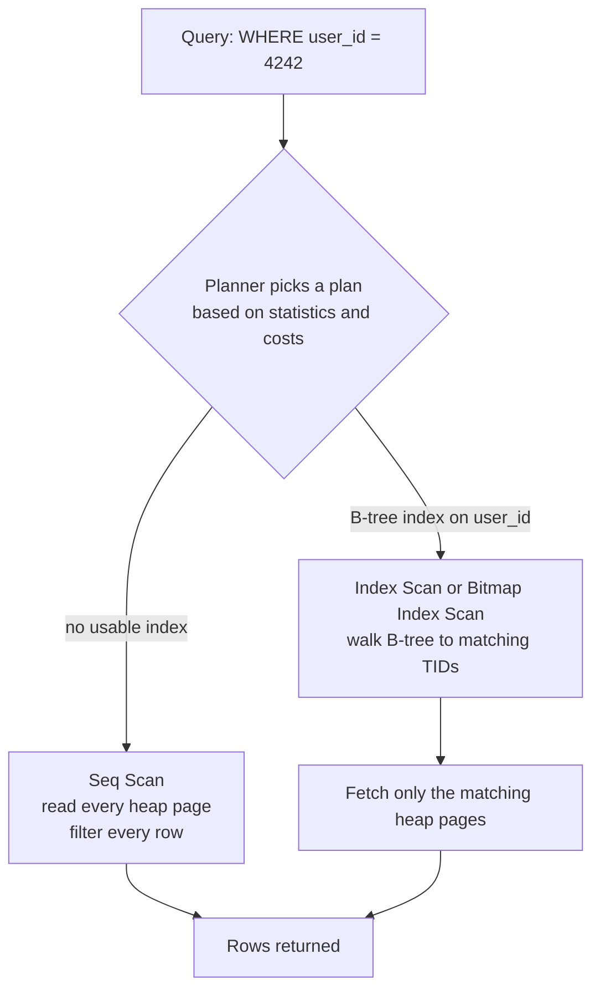
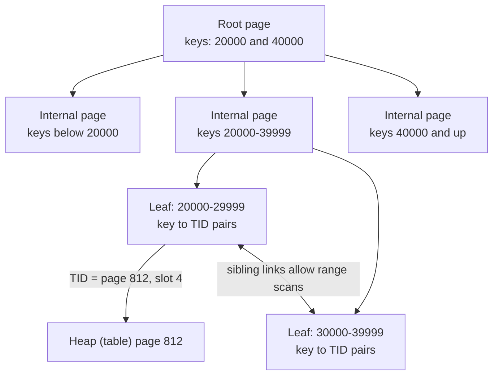

# L13.1 — PostgreSQL Indexes

> **Level 13: Databases & Distributed Systems** · Topic 1 of 15 · ⏱ ~4 hours · Difficulty: Intermediate

## 1. What it is

An **index** is a separate, sorted (or otherwise organised) data structure that lets PostgreSQL find rows without reading the
whole table. Without an index, a query like `WHERE user_id = 4242` forces a **sequential scan** ("seq scan"): read every
page of the table and test every row. With a suitable index, PostgreSQL walks a small tree, gets a list of row
locations (**TIDs**, tuple identifiers: page number + slot) and fetches only those rows from the table (the "heap").

PostgreSQL ships several index types, each suited to different questions. The default and by far the most common is the
**B-tree** (balanced tree), good for equality (`=`), ranges (`<`, `BETWEEN`) and `ORDER BY`. **GIN** (Generalized
Inverted Index) maps "values inside a column" (array elements, JSONB keys, full-text lexemes) to the rows containing them.
**GiST**, **SP-GiST**, **BRIN** (Block Range INdex) and **Hash** cover geometric data, very large naturally-ordered tables and
pure-equality lookups. A **partial index** indexes only the rows matching a `WHERE` predicate, and an **expression index** indexes
the result of a function, e.g. `lower(email)`.

The tool for finding out *whether PostgreSQL uses an index and how well* is `EXPLAIN` (shows the plan) and
`EXPLAIN ANALYZE` (actually runs the query and shows real timings and row counts).

## 2. Why it matters in DevOps

- **Most "the database is slow" pages are a missing or unused index.** A query that took 2 ms with 10 000 rows takes
  20 s with 10 million rows, and CPU on the primary pins at 100% while the API times out.
- **Indexes are not free.** Every `INSERT`, `UPDATE` and `DELETE` must maintain every index on the table, indexes consume disk and
  RAM (they compete with table data for `shared_buffers` and the OS page cache), and they slow down replication replay and
  backups. Over-indexing is as real a problem as under-indexing.
- **Schema changes are operational events.** `CREATE INDEX` takes a lock that blocks writes unless you use
  `CREATE INDEX CONCURRENTLY`; running the wrong form in a deploy pipeline (see
  [Database Migrations in Pipelines](../level-05-cicd/09-database-migrations.md)) causes an outage.
- **You will be asked to read a plan.** DevOps/SRE engineers are routinely handed a slow query from `pg_stat_statements` or a
  slow-log and are expected to say "seq scan on a 40 GB table, add a composite index" or "the planner is right, the
  index is not selective".

## 3. Real-world system example

**PostgreSQL itself, in production at scale.** Many well-known products run on PostgreSQL, and their engineering blogs
repeatedly describe indexing as day-to-day operational work. GitLab publishes its database
guidelines publicly: they require that migrations adding indexes to large tables use concurrent index creation, and their
developer docs tell engineers to include `EXPLAIN (ANALYZE, BUFFERS)` output for new queries in merge requests.
Instagram's engineering team has written about using **partial indexes** and **functional indexes** in PostgreSQL to keep
indexes small for hot, selective queries. Cloud-managed offerings such as Amazon RDS for PostgreSQL and Aurora PostgreSQL expose
`pg_stat_statements` and Performance Insights precisely so operators can find the queries that need an index.

The pattern is the same everywhere: identify the top queries by total time (`pg_stat_statements`), read their plans, add the
smallest index that turns a seq scan into an index scan, verify with `EXPLAIN ANALYZE`, and ship it with `CONCURRENTLY`.

## 4. Diagram

How a lookup differs with and without an index:



Inside a B-tree (simplified): each lookup touches about 3-4 pages even for tens of millions of rows.



## 5. How it works

### Index types at a glance

| Type | Good for | Typical use | Not good for |
|------|----------|-------------|--------------|
| **B-tree** (default) | `=`, `<`, `>`, `BETWEEN`, `ORDER BY`, `LIKE 'abc%'` (with C collation or `text_pattern_ops`) | primary keys, foreign keys, timestamps, most columns | `LIKE '%abc'`, containment inside JSON/arrays |
| **GIN** | "contains" queries: `@>`, `?`, `&&`, full-text `@@` | JSONB, arrays, `tsvector`, `pg_trgm` for `LIKE '%abc%'` | frequently-updated columns (slower writes), range scans |
| **GiST / SP-GiST** | geometry, ranges, nearest-neighbour, exclusion constraints | PostGIS, `tstzrange` overlap | plain scalar equality |
| **BRIN** | huge, naturally ordered tables (append-only logs, time series) | `created_at` on a 2 TB event table, index of a few MB | randomly ordered data |
| **Hash** | equality only | rarely better than B-tree | everything else |

### Variants that matter in operations

- **Composite (multi-column) index** `(a, b)`: usable for filters on `a`, or `a` and `b`, but **not efficiently for `b` alone**.
  Column order is a design decision: equality columns first, then range/sort columns.
- **Partial index** `... WHERE status = 'pending'`: tiny, fast, and only used when the query's `WHERE` implies the predicate.
- **Expression index** `ON users (lower(email))`: required if the query says `WHERE lower(email) = ...`. Indexing `email` does not help.
- **Covering index** `ON orders (user_id) INCLUDE (total_cents)`: stores extra payload columns so PostgreSQL can answer from the index
  alone (an **index-only scan**) without visiting the heap. Index-only scans depend on the **visibility map**, kept current by `VACUUM`
  (see [MVCC](03-mvcc.md)).
- **Unique index**: enforces a constraint and is the engine behind `PRIMARY KEY` and `UNIQUE`.

### Reading `EXPLAIN (ANALYZE, BUFFERS)`

| Plan node | Meaning |
|-----------|---------|
| `Seq Scan` | reads the whole table. Fine for small tables or queries returning a large share of rows. |
| `Index Scan` | walks the index and fetches heap rows one by one in index order (good for `ORDER BY ... LIMIT`). |
| `Bitmap Index Scan` + `Bitmap Heap Scan` | builds a bitmap of matching pages first, then reads them in physical order. Used for medium selectivity and for combining indexes. |
| `Index Only Scan` | answers from the index; look for `Heap Fetches: 0`. |
| `cost=0.42..8.44` | planner's estimated startup cost..total cost in arbitrary units. |
| `rows=21` vs `actual ... rows=17` | estimated vs actual rows. **Large mismatches mean stale or insufficient statistics** (`ANALYZE`). |
| `Rows Removed by Filter: N` | work thrown away. A big N next to a seq scan is the classic "needs an index" signal. |
| `Buffers: shared hit=… read=…` | pages found in cache (`hit`) vs read from the OS/disk (`read`). |
| `Execution Time` | real time. Only `EXPLAIN ANALYZE` has it. |

**Warning:** `EXPLAIN ANALYZE` really executes the statement. For `INSERT/UPDATE/DELETE` wrap it in a transaction and roll back:
`BEGIN; EXPLAIN ANALYZE UPDATE ...; ROLLBACK;`.

### Why the planner sometimes ignores your index

1. The query returns a large fraction of the table; a seq scan is genuinely cheaper.
2. The predicate wraps the column in a function or cast (`WHERE date_trunc('day', created_at) = ...`) without a matching expression index.
3. A type mismatch forces an implicit cast on the column side.
4. Statistics are stale, so the planner guesses wrong. Run `ANALYZE`.
5. The table is tiny. PostgreSQL correctly prefers a seq scan.

### The cost side

- **Writes:** each index adds work to every row insert and to every `UPDATE` that touches an indexed column (or cannot use a
  **HOT**, heap-only tuple, update). GIN indexes are especially expensive to maintain.
- **Space:** an index is often 10-30% of the table size for a single narrow column and can exceed the table for wide composite indexes.
- **Maintenance:** indexes bloat after heavy update/delete churn and sometimes need `REINDEX CONCURRENTLY`.

## 6. Step-by-step guide

**Prerequisites:** Docker, or a local PostgreSQL 16+ with `psql`. Cost: free. Time: ~30 minutes. The sample data is about 1M rows (~100 MB).

1. **Start PostgreSQL in a throwaway container.**
   ```bash
   docker run -d --name pg-idx -e POSTGRES_PASSWORD=<YOUR_PASSWORD> -p 5432:5432 postgres:16
   docker exec -it pg-idx psql -U postgres
   ```
   You should land at a `postgres=#` prompt. Then `CREATE DATABASE shop; \c shop`.

2. **Create the `shop-api` orders table and load 1 million rows.** About 97% of orders are `shipped`, 2% `pending`, 1% `cancelled`; 0.1% carry a campaign tag in JSONB.
   ```sql
   CREATE TABLE orders (
     id          bigserial PRIMARY KEY,
     user_id     int         NOT NULL,
     status      text        NOT NULL,
     total_cents int         NOT NULL,
     created_at  timestamptz NOT NULL DEFAULT now(),
     metadata    jsonb       NOT NULL DEFAULT '{}'
   );

   INSERT INTO orders (user_id, status, total_cents, created_at, metadata)
   SELECT (random() * 50000)::int,
          CASE WHEN r < 0.97 THEN 'shipped' WHEN r < 0.99 THEN 'pending' ELSE 'cancelled' END,
          (random() * 20000)::int,
          now() - random() * interval '365 days',
          CASE WHEN random() < 0.001
               THEN jsonb_build_object('channel', 'web', 'campaign', 'black-friday')
               ELSE jsonb_build_object('channel', (ARRAY['web','ios','android'])[1 + (random()*2)::int]) END
   FROM (SELECT random() AS r FROM generate_series(1, 1000000)) s;

   ANALYZE orders;
   ```
   Expect `INSERT 0 1000000`. The `PRIMARY KEY` already created a B-tree index called `orders_pkey`.

3. **Run a slow query and read the plan.**
   ```sql
   EXPLAIN (ANALYZE, BUFFERS) SELECT * FROM orders WHERE user_id = 4242;
   ```
   Similar to (timings vary with hardware):
   ```text
    Gather  (cost=1000.00..16808.43 rows=21 width=56) (actual time=4.268..31.186 rows=17 loops=1)
      Workers Planned: 2
      ->  Parallel Seq Scan on orders  (cost=0.00..15806.33 rows=9 width=56) (actual time=4.045..23.528 rows=6 loops=3)
            Filter: (user_id = 4242)
            Rows Removed by Filter: 333328
            Buffers: shared hit=10598
    Execution Time: 31.212 ms
   ```
   About 1 million rows were read to return 17. That is the "needs an index" signature.

4. **Add a B-tree index and compare.**
   ```sql
   CREATE INDEX idx_orders_user_id ON orders (user_id);
   EXPLAIN (ANALYZE, BUFFERS) SELECT * FROM orders WHERE user_id = 4242;
   ```
   Similar to:
   ```text
    Bitmap Heap Scan on orders  (cost=4.59..86.05 rows=21 width=56) (actual time=0.031..0.063 rows=17 loops=1)
      Recheck Cond: (user_id = 4242)
      ->  Bitmap Index Scan on idx_orders_user_id  (cost=0.00..4.58 rows=21 width=0) (actual ... rows=17 loops=1)
            Index Cond: (user_id = 4242)
    Execution Time: 0.080 ms
   ```
   Roughly 400x faster here, and a few buffers touched instead of 10 000.

5. **Make it ordered: a composite index for "latest orders for a user".**
   ```sql
   CREATE INDEX idx_orders_user_created ON orders (user_id, created_at DESC);
   EXPLAIN ANALYZE SELECT * FROM orders WHERE user_id = 4242 ORDER BY created_at DESC LIMIT 10;
   ```
   Expect an `Index Scan using idx_orders_user_created` with **no `Sort` node**: the index already delivers rows in order. You can now
   drop the single-column index because the composite one serves `WHERE user_id = ...` too:
   `DROP INDEX idx_orders_user_id;`

6. **Use a GIN index for JSONB containment.**
   ```sql
   EXPLAIN ANALYZE SELECT id FROM orders WHERE metadata @> '{"campaign":"black-friday"}';   -- parallel seq scan, ~100 ms
   CREATE INDEX idx_orders_metadata ON orders USING gin (metadata jsonb_path_ops);
   EXPLAIN ANALYZE SELECT id FROM orders WHERE metadata @> '{"campaign":"black-friday"}';
   ```
   Expect a `Bitmap Index Scan on idx_orders_metadata` and an execution time of a couple of milliseconds. `jsonb_path_ops`
   makes a smaller, faster index than the default operator class but supports only `@>` (and `@?`/`@@` JSON-path operators), not `?` key-exists.
   GIN pays off for *selective* predicates; `@> '{"channel":"web"}'` matches a third of the table and will not benefit.

7. **Use a partial index for a hot, small subset.**
   ```sql
   CREATE INDEX idx_orders_pending ON orders (created_at) WHERE status = 'pending';
   EXPLAIN ANALYZE SELECT id FROM orders WHERE status = 'pending' ORDER BY created_at LIMIT 20;
   SELECT pg_size_pretty(pg_relation_size('idx_orders_pending')) AS partial_size,
          pg_size_pretty(pg_relation_size('orders_pkey'))          AS pkey_size;
   ```
   The plan is an `Index Scan using idx_orders_pending` finishing in well under a millisecond, and the index is roughly 450 kB against ~21 MB for the primary key.
   The same query with `status = 'shipped'` cannot use it.

8. **Get an index-only scan with a covering index.**
   ```sql
   CREATE INDEX idx_orders_user_cov ON orders (user_id) INCLUDE (total_cents);
   VACUUM (ANALYZE) orders;      -- sets visibility-map bits
   EXPLAIN (ANALYZE) SELECT user_id, total_cents FROM orders WHERE user_id = 4242;
   ```
   Look for `Index Only Scan ... Heap Fetches: 0`.

9. **Build indexes safely on a live table.**
   ```sql
   CREATE INDEX CONCURRENTLY idx_orders_status_created ON orders (status, created_at);
   ```
   `CONCURRENTLY` does not block writes but takes longer, cannot run inside a transaction block, and if it fails leaves an
   `INVALID` index behind. Find those with:
   ```sql
   SELECT indexrelid::regclass FROM pg_index WHERE NOT indisvalid;
   ```
   and remove with `DROP INDEX CONCURRENTLY <name>;` before retrying.

10. **Audit index usage and size.**
    ```sql
    SELECT s.indexrelid::regclass AS idx,
           pg_size_pretty(pg_relation_size(s.indexrelid)) AS size,
           s.idx_scan
    FROM pg_stat_user_indexes s
    JOIN pg_index i USING (indexrelid)
    WHERE s.relname = 'orders' AND NOT i.indisunique
    ORDER BY pg_relation_size(s.indexrelid) DESC;
    ```
    Indexes with `idx_scan = 0` over a representative period (check `pg_stat_database.stats_reset` first) are candidates for removal.

11. **Clean up.** `docker rm -f pg-idx`

## 7. Real-world scenario

*Illustrative scenario, not a documented incident.* On a Monday after a marketing email, the `shop-api` "My orders" endpoint goes
from 40 ms to 6 s p95 and the RDS primary hits 95% CPU. The on-call engineer opens `pg_stat_statements`, sorts by `total_exec_time` and finds one query
consuming 70% of database time: `SELECT * FROM orders WHERE user_id = $1 ORDER BY created_at DESC LIMIT 20`. `EXPLAIN (ANALYZE, BUFFERS)` shows a
parallel seq scan with `Rows Removed by Filter: 41,000,000`: the table grew from 2 M to 42 M rows over the past year and the
`user_id` index was never created (the ORM added only the primary key). They run `CREATE INDEX CONCURRENTLY idx_orders_user_created ON orders (user_id, created_at DESC)`
during the incident; it takes 9 minutes without blocking checkout writes. The plan flips to an index scan, p95 drops to 8 ms, CPU falls to 15%.
**Lesson:** read the plan before guessing; build concurrently; then add a check to the migration review process ("every foreign key and every
`WHERE` column in a hot query has an index, with `EXPLAIN` output in the PR").

## 8. Common mistakes and best practices

**Don't**

- Create an index on every column "just in case": write latency, disk and replication lag all rise.
- Run plain `CREATE INDEX` on a busy production table: it blocks writes for the duration.
- Assume `EXPLAIN` (no `ANALYZE`) shows real behaviour. Estimates can be wildly wrong.
- Wrap indexed columns in functions or casts in `WHERE` clauses without an expression index.
- Run `EXPLAIN ANALYZE` on a destructive statement without a surrounding `BEGIN ... ROLLBACK`.
- Index low-cardinality columns (boolean, status with 3 values) with a full B-tree when a partial index or no index would do.

**Do**

- Use `EXPLAIN (ANALYZE, BUFFERS)` on realistic data volumes; a 1 000-row dev table hides every indexing problem.
- Put equality columns first and the range/sort column last in composite indexes.
- Prefer partial and covering indexes for hot queries on big tables.
- Use `CREATE INDEX CONCURRENTLY` and check for `INVALID` indexes afterwards.
- Index foreign-key columns you join or delete by (PostgreSQL does **not** index them automatically).
- Review `pg_stat_user_indexes` and `pg_stat_statements` periodically and drop unused or duplicate indexes.
- Keep statistics fresh: autovacuum runs `ANALYZE`, but run it manually after bulk loads.

## 9. Tasks

- [ ] **T1 — Seq scan to index scan** *(≈30 min, beginner)*
  - **Goal:** reproduce the before/after of adding a B-tree index.
  - **Steps:**
    1. Start PostgreSQL, create and load `orders` exactly as in section 6, steps 1-2.
    2. Run `EXPLAIN (ANALYZE, BUFFERS) SELECT * FROM orders WHERE user_id = 4242;` and note `Execution Time` and `Buffers`.
    3. Create `idx_orders_user_id`, re-run the same query.
  - **Done when:** you have a two-line table "before vs after" showing node type, execution time and shared buffers, and the new plan uses `idx_orders_user_id`.

- [ ] **T2 — Find the planner's tipping point** *(≈30 min, intermediate)*
  - **Goal:** see that an index is not always used, and why.
  - **Steps:**
    1. With `idx_orders_user_id` in place, run `EXPLAIN SELECT * FROM orders WHERE user_id < 100;` then `< 1000`, `< 10000`, `< 40000`.
    2. Record the node type for each (Index Scan, Bitmap Heap Scan, Seq Scan) and the estimated rows.
    3. Run `SET enable_seqscan = off;` on the last query and compare `cost` and real time with `EXPLAIN ANALYZE`, then `RESET enable_seqscan;`.
  - **Done when:** you can state at roughly what fraction of the table the planner switches to a seq scan, and show that forcing the index was slower (or not) with numbers.

- [ ] **T3 — Partial and GIN indexes** *(≈45 min, intermediate)*
  - **Goal:** pick a specialised index that matches a query.
  - **Steps:**
    1. Create the GIN index from step 6 and the partial index from step 7.
    2. Compare `pg_relation_size` of the partial index, the GIN index and `orders_pkey`.
    3. Run `SELECT id FROM orders WHERE metadata @> '{"channel":"web"}'` with `EXPLAIN ANALYZE`; explain why it does or does not use the GIN index.
  - **Done when:** you have the three sizes written down and a one-paragraph explanation of selectivity for the `channel` query.

- [ ] **T4 — Break it: defeat an index, then fix it with an expression index** *(≈30 min, intermediate)*
  - **Goal:** recognise a non-sargable (index-defeating) predicate and repair it.
  - **Steps:**
    1. Create a B-tree index on `created_at`. Run `EXPLAIN SELECT count(*) FROM orders WHERE date_trunc('day', created_at) = '2026-01-01';`. Observe the seq scan.
    2. Rewrite as a range: `created_at >= '2026-01-01' AND created_at < '2026-01-02'`. Observe the index being used.
    3. Alternatively, try `CREATE INDEX ON orders (date_trunc('day', created_at));`. PostgreSQL rejects it with `functions in index expression must be marked IMMUTABLE`, because `date_trunc` on `timestamptz` depends on the session time zone. Create `CREATE INDEX ON orders (date_trunc('day', created_at AT TIME ZONE 'UTC'));` instead and show that `WHERE date_trunc('day', created_at AT TIME ZONE 'UTC') = '2026-01-01'` now uses it.
  - **Done when:** you have three plans (seq scan, range rewrite, expression index) and can say which fix you would choose and why.

- [ ] **T5 — Measure the write cost of indexes** *(≈45 min, advanced)*
  - **Goal:** quantify what indexes cost on writes.
  - **Steps:**
    1. Create `orders_noidx` and `orders_many` with `CREATE TABLE ... (LIKE orders INCLUDING DEFAULTS)`; add four indexes (including one GIN on `metadata`) to `orders_many`.
    2. With `\timing on`, run `INSERT INTO <table> SELECT * FROM orders LIMIT 300000;` into each.
    3. Compare sizes with `pg_total_relation_size`, and write a short script `index-audit.sql` listing unused non-unique indexes (query from step 10).
  - **Done when:** you have timings for both inserts (expect the heavily-indexed table to be several times slower, e.g. around 0.7 s vs several seconds, but it varies) and `index-audit.sql` runs without error.

- [ ] **T6 — Prove it: diagnose a slow query without the guide** *(≈45 min, advanced)*
  - **Goal:** demonstrate the full workflow on a query you did not see beforehand.
  - **Steps:**
    1. Have a teammate (or yourself, a day later) write a slow query against `orders` (a join to a new `users` table with a filter and `ORDER BY ... LIMIT`).
    2. Without this page, find the bottleneck from `EXPLAIN (ANALYZE, BUFFERS)`, design the minimal index, create it `CONCURRENTLY`, and verify.
    3. Write a 5-line PR description: query, evidence (plan before), change, evidence (plan after), write-cost consideration.
  - **Done when:** a reviewer can read your PR description and reproduce the improvement.

## 10. Self-check questions

1. Why is the composite index `(user_id, created_at)` useful for `WHERE user_id = 1` but not for `WHERE created_at > ...` alone?
2. A query returning 40% of a table ignores your index. Is that a bug?
3. What is the difference between `EXPLAIN` and `EXPLAIN ANALYZE`, and what is the danger of the latter?
4. What does `CREATE INDEX CONCURRENTLY` trade away, and how do you detect a failed one?
5. When would you choose a partial index over a full one?
6. Estimated rows are 10 and actual rows are 400 000. What do you suspect and do first?

<details>
<summary>Answers</summary>

1. A B-tree is sorted by the first column, then the second within equal first values. Without a constraint on the leading column, PostgreSQL cannot narrow the search (it would have to scan the whole index).
2. No. Fetching 40% of rows via an index means a huge number of random heap reads; a seq scan (or bitmap scan) is cheaper. The planner is behaving correctly.
3. `EXPLAIN` shows the estimated plan only. `EXPLAIN ANALYZE` executes the statement and reports real timings and row counts, so `INSERT/UPDATE/DELETE` really change data unless you roll back.
4. It trades speed and simplicity (two table scans, waits for old transactions, cannot run in a transaction block) for not blocking writes. A failed build leaves an `INVALID` index (`pg_index.indisvalid = false`), which you `DROP INDEX CONCURRENTLY` and retry.
5. When queries target a small, stable subset (`status = 'pending'`, `deleted_at IS NULL`): the index is tiny, cheap to maintain and fast to scan.
6. Stale or inadequate statistics. Run `ANALYZE`, check for correlated columns (consider `CREATE STATISTICS`) or increase the statistics target, then re-check the plan.
</details>

## 11. Further reading

- PostgreSQL documentation: *Chapter "Indexes"* and *"Using EXPLAIN"* (under Performance Tips) at postgresql.org/docs.
- PostgreSQL documentation: `CREATE INDEX` reference page, including the "Building Indexes Concurrently" section.
- *The Art of PostgreSQL* by Dimitri Fontaine.
- *Use The Index, Luke!* by Markus Winand (free online) — a clear guide to how B-tree indexes interact with SQL.
- Next: [Transactions and Locks](02-transactions-and-locks.md) (what `CREATE INDEX` locks, and why) and [Database Costs](../level-20-cost-optimization/08-database-costs.md).

<!-- nav -->
---
← Previous level: [Level 12 — Advanced Networking](../level-12-advanced-networking/README.md) · [Level 13 index](README.md) · Next: [Transactions and Locks](02-transactions-and-locks.md) →
