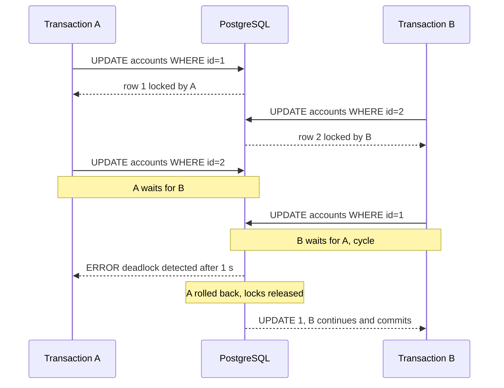
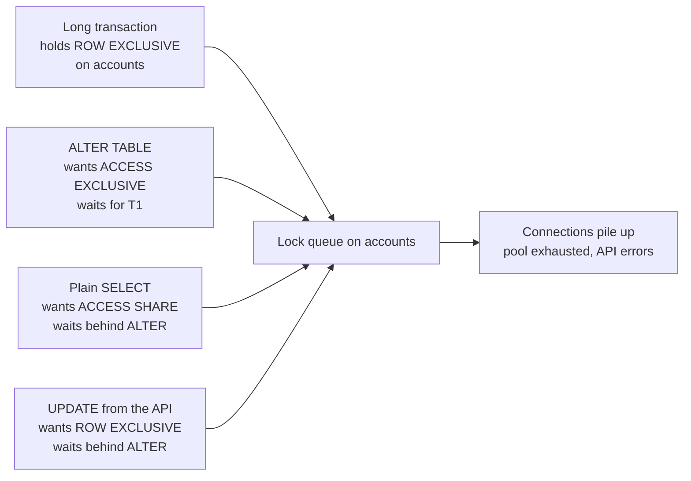

# L13.2 — Transactions and Locks

> **Level 13: Databases & Distributed Systems** · Topic 2 of 15 · ⏱ ~5 hours · Difficulty: Intermediate

## 1. What it is

A **transaction** is a group of SQL statements that the database treats as one unit of work: either all of it takes effect
(`COMMIT`) or none of it does (`ROLLBACK`). Transactions are described by the **ACID** properties:

- **Atomicity** — all or nothing. A transfer that debits one account and crashes before crediting the other leaves no trace.
- **Consistency** — a transaction takes the database from one valid state to another; constraints (`CHECK`, `FOREIGN KEY`, `UNIQUE`) hold at commit.
- **Isolation** — concurrent transactions do not see each other's half-finished work; *how much* they see is set by the **isolation level**.
- **Durability** — once `COMMIT` returns, the data survives a crash (PostgreSQL guarantees this by flushing the **write-ahead log**, WAL, to disk first).

A **lock** is the mechanism a database uses to stop two transactions from clashing. PostgreSQL takes **row-level locks**
(when you `UPDATE`, `DELETE` or `SELECT ... FOR UPDATE` a row) and **table-level locks** (nearly every statement takes one: even a plain `SELECT` takes
`ACCESS SHARE`). When transaction B needs a lock that transaction A holds in a conflicting mode, B **waits**. If A is waiting for B at the same time,
you have a **deadlock**, and PostgreSQL resolves it by aborting one of them.

## 2. Why it matters in DevOps

- **"The site is frozen but CPU is idle"** is the signature of lock waits: connections pile up behind one stuck transaction until the pool is exhausted
  (see [Database Connection Pooling](06-db-connection-pooling.md)).
- **Migrations and deploys take locks.** `ALTER TABLE` needs an `ACCESS EXCLUSIVE` lock, and because lock requests queue, a single
  harmless-looking migration can block *every* query on the table behind a long-running one (demonstrated in the guide).
- **Idle transactions are poison.** An application that opens `BEGIN` and then waits on an HTTP call holds locks and, as you will see in
  [MVCC](03-mvcc.md), prevents cleanup.
- **Retries are your job.** Deadlocks and serialization failures are normal in correct systems. Application code and job runners must retry them;
  you set the policy (timeouts, retry budgets, alerting on rates).

## 3. Real-world system example

**Stripe and other payment systems** are the textbook case for the importance of transactional guarantees: moving money must be atomic, and
retrying a failed request must not charge twice (see [Idempotency](14-idempotency.md)). Stripe's public API documentation describes idempotency keys for exactly this reason, and
engineering write-ups from payment companies commonly describe relying on database transactions plus unique constraints for the "exactly one ledger entry" guarantee.

**GitLab** publishes its database guidance openly; it documents that long transactions, lock waits and migrations that take heavy locks are a leading cause of incidents,
and that migrations must be written to avoid blocking (using `lock_timeout` and retries, a pattern described in the GitLab developer docs). The PostgreSQL manual itself documents
the table-level lock modes and which SQL commands acquire them, which is what migration tools such as `strong_migrations` (Rails) encode as rules.

**Job queues on PostgreSQL.** Libraries such as `River` (Go), `Graphile Worker` (Node.js) and `Oban` (Elixir) build job queues on
`SELECT ... FOR UPDATE SKIP LOCKED`, a lock feature described below.

## 4. Diagram

A deadlock, step by step. PostgreSQL waits `deadlock_timeout` (default 1 s) before checking for a cycle, then aborts one transaction:



The lock queue that makes a migration dangerous:



## 5. How it works

### Isolation levels in PostgreSQL

| Level | What a statement sees | Anomalies still possible | Typical use |
|-------|----------------------|--------------------------|-------------|
| **READ COMMITTED** (default) | a fresh snapshot per *statement* | non-repeatable reads, lost updates with read-modify-write, write skew | most OLTP code |
| **REPEATABLE READ** | one snapshot for the whole transaction | write skew (PostgreSQL's version also prevents phantom reads); concurrent updates raise `could not serialize access due to concurrent update` | reports needing consistent reads |
| **SERIALIZABLE** | as if transactions ran one at a time | none, but you get `could not serialize access` errors and must retry | correctness-critical invariants |

(`READ UNCOMMITTED` exists in syntax but behaves as READ COMMITTED in PostgreSQL. Dirty reads never happen.)

**Write skew** is the anomaly worth remembering: two transactions each read "at least 2 engineers are on call", each remove a different engineer, both commit, and now nobody is on call.
Neither wrote the same row, so row locks never conflicted. Only `SERIALIZABLE` (or an explicit lock) prevents it.

### Lock types you will meet

| Lock | Taken by | Blocks |
|------|----------|--------|
| `ACCESS SHARE` (table) | `SELECT` | only `ACCESS EXCLUSIVE` |
| `ROW EXCLUSIVE` (table) | `INSERT`, `UPDATE`, `DELETE` | `SHARE` and stronger (so it blocks plain `CREATE INDEX`) |
| `SHARE UPDATE EXCLUSIVE` | `VACUUM`, `CREATE INDEX CONCURRENTLY`, some `ALTER TABLE` forms | itself and stronger; does **not** block writes |
| `SHARE` | plain `CREATE INDEX` | all writes (`INSERT/UPDATE/DELETE`) |
| `ACCESS EXCLUSIVE` | most `ALTER TABLE`, `DROP TABLE`, `TRUNCATE`, `VACUUM FULL`, `REINDEX` | **everything**, including `SELECT` |
| Row lock `FOR UPDATE` | `UPDATE`, `DELETE`, `SELECT ... FOR UPDATE` | other writers/lockers of the same row (readers are never blocked) |
| Row lock `FOR SHARE` / `FOR KEY SHARE` | `SELECT ... FOR SHARE`; foreign-key checks | writers of the row |
| Advisory lock | `pg_advisory_lock(key)` | whoever asks for the same key; app-defined mutual exclusion |

Key facts:

- **Readers never block writers and writers never block readers** for row data (this is MVCC, [next topic](03-mvcc.md)). Only `ACCESS EXCLUSIVE` blocks reads.
- **Locks are held until the end of the transaction**, not the end of the statement. Hold them briefly.
- **Lock requests queue.** A waiting `ACCESS EXCLUSIVE` request blocks all later requests behind it, even compatible ones.
- `SELECT ... FOR UPDATE SKIP LOCKED` skips rows other sessions have locked, which is how workers pull jobs without stepping on each other.
  `NOWAIT` fails immediately instead of waiting.

### Settings that protect you

| Setting | Meaning | Common production value |
|---------|---------|-------------------------|
| `lock_timeout` | give up if a lock isn't acquired within this time | `2s`-`5s` set at the start of migrations |
| `statement_timeout` | cancel any statement exceeding this | per-role, e.g. `30s` for web, higher for batch |
| `idle_in_transaction_session_timeout` | kill sessions that sit in `BEGIN` doing nothing | `30s`-`60s` for web roles |
| `deadlock_timeout` | how long to wait before checking for a deadlock (default `1s`) | leave at default |
| `log_lock_waits` | log any lock wait longer than `deadlock_timeout` | `on` |

### Inspecting locks

```sql
-- who is blocked, and by whom
SELECT pid, pg_blocking_pids(pid) AS blocked_by, wait_event_type, wait_event, state, left(query, 60) AS query
FROM pg_stat_activity WHERE cardinality(pg_blocking_pids(pid)) > 0;
```

`pg_blocking_pids(pid)` returns the sessions holding or queued ahead of the lock a given backend wants. `pg_locks` shows every lock and whether it was `granted`.

## 6. Step-by-step guide

**Prerequisites:** Docker, or local PostgreSQL 16+. You need **two or three** terminals each running `psql`.
Cost: free. All commands below were verified on PostgreSQL 16; error text can differ slightly between versions.

1. **Start PostgreSQL and open the first session.**
   ```bash
   docker run -d --name pg-tx -e POSTGRES_PASSWORD=<YOUR_PASSWORD> -p 5432:5432 postgres:16
   docker exec -it pg-tx psql -U postgres        # terminal A
   ```
   Open the other terminals with the same `docker exec` command (B, C).

2. **Create sample data in A.**
   ```sql
   CREATE TABLE accounts (id int PRIMARY KEY, owner text, balance int NOT NULL CHECK (balance >= 0));
   INSERT INTO accounts VALUES (1, 'alice', 100), (2, 'bob', 100);
   ```

3. **Atomicity: a rolled-back transfer.**
   ```sql
   BEGIN;
   UPDATE accounts SET balance = balance - 50 WHERE id = 1;
   UPDATE accounts SET balance = balance + 50 WHERE id = 2;
   SELECT * FROM accounts ORDER BY id;     -- inside the tx: 50 / 150
   ROLLBACK;
   SELECT * FROM accounts ORDER BY id;     -- back to 100 / 100
   ```
   Now try `UPDATE accounts SET balance = balance - 500 WHERE id = 1;` and note the `CHECK` constraint error: consistency enforced by the database.

4. **Row-lock blocking.** In A:
   ```sql
   BEGIN;
   UPDATE accounts SET balance = balance - 10 WHERE id = 1;     -- A now holds the row lock; do NOT commit
   ```
   In B:
   ```sql
   UPDATE accounts SET balance = balance + 1 WHERE id = 1;      -- hangs: waiting for A
   ```
   In C, find the blocker:
   ```sql
   SELECT pid, pg_blocking_pids(pid) AS blocked_by, wait_event_type, wait_event, state, left(query, 50) AS query
   FROM pg_stat_activity WHERE datname = current_database() AND pid <> pg_backend_pid();
   ```
   Similar to: B shows `wait_event_type = Lock`, `wait_event = transactionid`, `blocked_by = {<A's pid>}`. In A run `COMMIT;` and B instantly completes.
   Note that a plain `SELECT * FROM accounts WHERE id = 1` in C was never blocked.

5. **A deadlock.** In A: `BEGIN; UPDATE accounts SET balance = balance - 1 WHERE id = 1;`. In B: `BEGIN; UPDATE accounts SET balance = balance - 1 WHERE id = 2;`.
   In A: `UPDATE accounts SET balance = balance + 1 WHERE id = 2;` (waits). In B: `UPDATE accounts SET balance = balance + 1 WHERE id = 1;`.
   After about one second one session gets:
   ```text
   ERROR:  deadlock detected
   DETAIL:  Process 7021 waits for ShareLock on transaction 777; blocked by process 7033.
   Process 7033 waits for ShareLock on transaction 776; blocked by process 7021.
   HINT:  See server log for query details.
   ```
   (PIDs and transaction ids differ.) Run `ROLLBACK;` in both. The fix is **consistent lock ordering**: always update the lower `id` first.

6. **Compare isolation levels with the on-call (write skew) example.**
   ```sql
   CREATE TABLE oncall (engineer text PRIMARY KEY, on_call boolean NOT NULL);
   INSERT INTO oncall VALUES ('alice', true), ('bob', true);
   ```
   In A and B, run (replacing the level as you test each one):
   ```sql
   BEGIN ISOLATION LEVEL REPEATABLE READ;
   SELECT count(*) FROM oncall WHERE on_call;                  -- both see 2
   ```
   Then A runs `UPDATE oncall SET on_call = false WHERE engineer = 'alice';`, B runs `UPDATE oncall SET on_call = false WHERE engineer = 'bob';`, and both `COMMIT;`.
   Check `SELECT count(*) FROM oncall WHERE on_call;`. With `READ COMMITTED` and `REPEATABLE READ` the result is **0**: nobody is on call. Reset with
   `UPDATE oncall SET on_call = true;` and repeat with `ISOLATION LEVEL SERIALIZABLE`: the second committer fails with
   ```text
   ERROR:  could not serialize access due to read/write dependencies among transactions
   DETAIL:  Reason code: Canceled on identification as a pivot, during write.
   HINT:  The transaction might succeed if retried.
   ```
   and the count stays 1. The application must catch SQLSTATE `40001` and retry.

7. **See the repeatable-read update conflict.** In A: `BEGIN ISOLATION LEVEL REPEATABLE READ; SELECT balance FROM accounts WHERE id = 1;`.
   In B: `UPDATE accounts SET balance = balance + 20 WHERE id = 1;` (autocommits). In A: `UPDATE accounts SET balance = balance + 10 WHERE id = 1;`.
   Result: `ERROR:  could not serialize access due to concurrent update`. In `READ COMMITTED` the same sequence just works, re-reading the new value.

8. **Reproduce the migration pile-up.** In A: `BEGIN; UPDATE accounts SET balance = balance WHERE id = 1;` (leave open).
   In B: `ALTER TABLE accounts ADD COLUMN note text;` (hangs). In C: `SELECT * FROM accounts;` (**also hangs**, even though nobody is writing).
   In another session look at `SELECT pid, pg_blocking_pids(pid), left(query,40) FROM pg_stat_activity WHERE datname = current_database();` : C is blocked by B, B by A.
   Then `COMMIT;` in A and watch everything drain. Now repeat with a safety net:
   ```sql
   SET lock_timeout = '500ms';
   ALTER TABLE accounts ADD COLUMN note2 text;
   -- ERROR:  canceling statement due to lock timeout   (retry later instead of freezing the app)
   ```

9. **Job-queue pattern with `SKIP LOCKED`.**
   ```sql
   CREATE TABLE jobs (id serial PRIMARY KEY, payload text, state text DEFAULT 'queued');
   INSERT INTO jobs (payload) SELECT 'job-' || g FROM generate_series(1, 5) g;
   -- worker 1 (terminal A)
   BEGIN;
   SELECT id FROM jobs WHERE state = 'queued' ORDER BY id LIMIT 2 FOR UPDATE SKIP LOCKED;   -- gets 1, 2
   -- worker 2 (terminal B) while A is still open
   SELECT id FROM jobs WHERE state = 'queued' ORDER BY id LIMIT 2 FOR UPDATE SKIP LOCKED;   -- gets 3, 4
   ```

10. **Enable the production safety nets.**
    ```sql
    ALTER ROLE postgres SET idle_in_transaction_session_timeout = '60s';
    ALTER SYSTEM SET log_lock_waits = on;
    SELECT pg_reload_conf();
    ```
    (Use a dedicated application role in real systems, not `postgres`.)

11. **Clean up.** `docker rm -f pg-tx`

## 7. Real-world scenario

*Illustrative scenario, not a documented incident.* At 10:05 a deploy of `shop-api` runs a migration `ALTER TABLE orders ADD COLUMN gift_message text`. Normally it is instant. Today, the nightly analytics export
had opened a `REPEATABLE READ` transaction on `orders` at 09:58 and was still running. The `ALTER` requested `ACCESS EXCLUSIVE` and queued behind it.
Within seconds every checkout `INSERT` and every `SELECT` on `orders` queued behind the `ALTER`; the pool of 100 connections filled, the load balancer health checks failed, and the status page went red.
The on-call runs the blocking query using `pg_blocking_pids`, sees the chain (checkout → ALTER → export), and cancels the *ALTER* with `pg_cancel_backend`; the pile drains in about a second.
They re-run the migration later with `SET lock_timeout = '3s'` inside a retry loop. **Lesson:** the dangerous party is not the long-running reader; it is the *waiting* `ACCESS EXCLUSIVE` request. Always set
`lock_timeout` for DDL, schedule migrations away from long jobs, and set `statement_timeout` for exports.

## 8. Common mistakes and best practices

**Don't**

- Leave transactions open while calling external services, waiting for user input, or sleeping.
- Run DDL without `lock_timeout`.
- Assume `READ COMMITTED` prevents read-modify-write races (`SELECT balance` in the app, then `UPDATE ... SET balance = <computed>`). Use `UPDATE ... SET balance = balance - 10`, `SELECT ... FOR UPDATE`, or `SERIALIZABLE`.
- Take locks in different orders in different code paths (the recipe for deadlocks).
- Treat `deadlock detected` or `40001` as a bug to hide. They are a signal to retry; alert on a high rate.
- Use `SERIALIZABLE` globally without retry logic everywhere.

**Do**

- Keep transactions short: do the I/O before `BEGIN` and after `COMMIT`.
- Lock rows in a consistent order (for example, ascending primary key).
- Set `idle_in_transaction_session_timeout`, `statement_timeout`, `lock_timeout` and `log_lock_waits`.
- Use `FOR UPDATE SKIP LOCKED` for queues and `NOWAIT` for "fail fast" semantics.
- Use `CREATE INDEX CONCURRENTLY` and, for risky DDL, a retry loop with a short `lock_timeout` (see [Database Migrations in Pipelines](../level-05-cicd/09-database-migrations.md)).
- Monitor `pg_stat_activity` for `idle in transaction` sessions older than a few seconds and for long `wait_event_type = Lock` waits.

## 9. Tasks

- [ ] **T1 — Atomicity and constraints** *(≈20 min, beginner)*
  - **Goal:** see rollback and constraint enforcement.
  - **Steps:**
    1. Create `accounts` (section 6, step 2).
    2. In one transaction debit alice 50, credit bob 50, `SELECT` inside, then `ROLLBACK`; `SELECT` again.
    3. Attempt a debit that violates the `CHECK` constraint inside a transaction and observe what `COMMIT` does after the error.
  - **Done when:** you have shown balances unchanged after rollback and can explain why `COMMIT` after an error acts like `ROLLBACK` (the transaction is in an aborted state).

- [ ] **T2 — Observe a lock wait and name the blocker** *(≈30 min, beginner)*
  - **Goal:** use `pg_stat_activity` and `pg_blocking_pids` like an on-call engineer.
  - **Steps:**
    1. Reproduce step 4 with three terminals.
    2. Write the query that lists blocked sessions, their blockers and the blockers' queries (join `pg_stat_activity` to itself on `pg_blocking_pids`).
    3. Also run `SELECT locktype, mode, granted, pid FROM pg_locks WHERE relation = 'accounts'::regclass;`.
  - **Done when:** your query output shows one blocked session, its blocker pid, and the blocker's state `idle in transaction`.

- [ ] **T3 — Cause and fix a deadlock** *(≈40 min, intermediate)*
  - **Goal:** produce a deadlock deliberately, find it in the server log, and remove it by lock ordering.
  - **Steps:**
    1. Reproduce step 5. Enable `log_lock_waits` and read the full deadlock report in the PostgreSQL log (`docker logs pg-tx`).
    2. Write a `transfer(from_id, to_id, amount)` SQL function (or script) that always updates the lower id first.
    3. Run two concurrent opposite transfers 20 times each using `pgbench -f` custom scripts or two shell loops.
  - **Done when:** the naive version produces at least one `deadlock detected`, and the ordered version produces none across all runs.

- [ ] **T4 — Isolation level shootout** *(≈45 min, intermediate)*
  - **Goal:** demonstrate which anomalies each level permits.
  - **Steps:**
    1. Run the on-call experiment (step 6) under `READ COMMITTED`, `REPEATABLE READ`, `SERIALIZABLE`; record the final count each time.
    2. Run the lost-update experiment (step 7) under both `READ COMMITTED` and `REPEATABLE READ`.
    3. Write a table: level × (write skew possible? serialization error raised?).
  - **Done when:** your table matches the results (write skew at the first two levels, none at `SERIALIZABLE`; a `concurrent update` error at `REPEATABLE READ`).

- [ ] **T5 — Safe migrations: timeout and retry** *(≈45 min, advanced)*
  - **Goal:** automate the safe-DDL pattern.
  - **Steps:**
    1. Write a shell script `safe-ddl.sh` that runs `psql` with `SET lock_timeout='2s'; ALTER TABLE accounts ADD COLUMN flag boolean;` and retries up to 10 times with 1-5 s random sleep when it sees `lock timeout`.
    2. Hold a conflicting transaction open for 8 seconds in another terminal.
    3. Watch the script fail a few times and then succeed once the blocker commits; confirm that a concurrent `SELECT` loop never stalled more than ~2 s.
  - **Done when:** the script's log shows failed attempts followed by success, and the column exists.

- [ ] **T6 — Prove it: explain the freeze** *(≈45 min, advanced)*
  - **Goal:** teach lock queues to someone else, with evidence.
  - **Steps:**
    1. Without this page, recreate the "ALTER TABLE behind a long transaction" pile-up and capture the `pg_stat_activity` blocking chain.
    2. Write a 10-line runbook: how to detect (query), how to decide what to cancel (`pg_cancel_backend` vs `pg_terminate_backend`), and how to prevent (`lock_timeout`, idle timeout).
  - **Done when:** a teammate can use your runbook to resolve a staged lock pile-up in under five minutes.

## 10. Self-check questions

1. What does ACID's "I" mean in PostgreSQL's default isolation level, and what can still go wrong?
2. Why did the harmless `SELECT` in step 8 hang even though no one was writing?
3. Two transactions each updated a different row after reading the same count and violated a business rule. Which anomaly is it and how do you prevent it?
4. What is the difference between `pg_cancel_backend` and `pg_terminate_backend`?
5. How do you avoid deadlocks, and what must the application do when one still happens?
6. Why is `idle in transaction` dangerous?

<details>
<summary>Answers</summary>

1. Each statement sees a snapshot as of its start (`READ COMMITTED`), so no dirty reads, but two reads in a transaction can differ and read-modify-write sequences can lose updates or produce write skew.
2. Lock requests queue. The `ALTER TABLE` waiting for `ACCESS EXCLUSIVE` sits in the queue and every later request, even a compatible `ACCESS SHARE`, waits behind it.
3. Write skew. Use `SERIALIZABLE` (and retry on `40001`) or take an explicit lock that makes the transactions conflict (for example `SELECT ... FOR UPDATE` on the rows, or a lock on a parent row).
4. `pg_cancel_backend` cancels the current query but keeps the connection; `pg_terminate_backend` closes the whole connection (rolling back its transaction).
5. Acquire locks in a consistent order and keep transactions short. The application must catch the error (SQLSTATE `40P01`) and retry the whole transaction.
6. It holds locks and a snapshot while doing nothing: it can block DDL and other writers, and it stops vacuum from removing dead rows (bloat).
</details>

## 11. Further reading

- PostgreSQL documentation: *Chapter "Concurrency Control"* (Transaction Isolation, Explicit Locking, Serialization Failure Handling) at postgresql.org/docs.
- PostgreSQL documentation: `pg_locks`, `pg_stat_activity` and `pg_blocking_pids` reference pages.
- *Designing Data-Intensive Applications* by Martin Kleppmann — chapter on transactions (isolation levels and write skew).
- Related: [PostgreSQL Indexes](01-postgresql-indexes.md), [MVCC](03-mvcc.md), [Distributed Locks and Queues](15-distributed-locks-and-queues.md), and [Database Migrations in Pipelines](../level-05-cicd/09-database-migrations.md).

<!-- nav -->
---
← Previous: [PostgreSQL Indexes](01-postgresql-indexes.md) · [Level 13 index](README.md) · Next: [MVCC](03-mvcc.md) →
