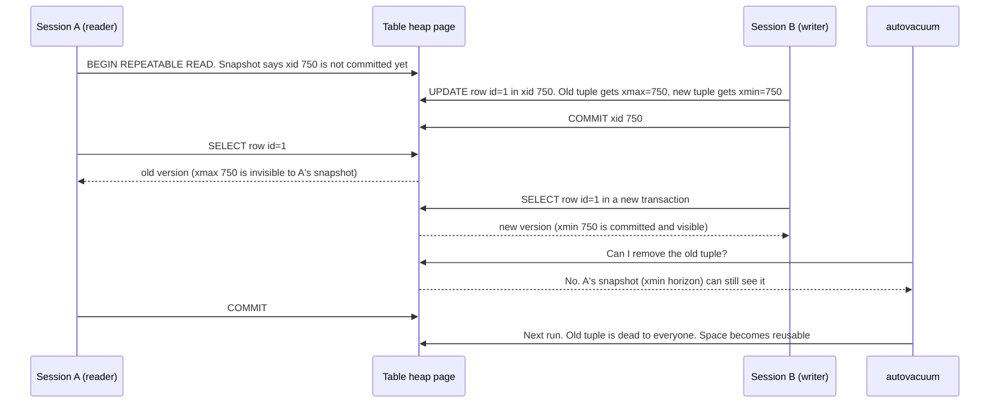
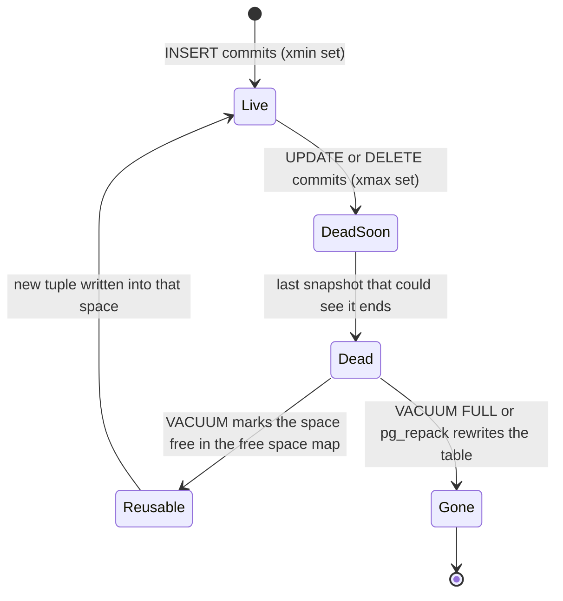

# L13.3 — MVCC

> **Level 13: Databases & Distributed Systems** · Topic 3 of 15 · ⏱ ~5 hours · Difficulty: Intermediate

## 1. What it is

**MVCC** (Multi-Version Concurrency Control) is the trick that lets PostgreSQL serve readers and writers at the same time
without readers blocking writers or writers blocking readers. Instead of overwriting a row in place, an `UPDATE` writes a
**new version** of the row and leaves the old version where it is. Each transaction is then shown the versions that were
"current" at the moment its **snapshot** was taken. Two transactions can legitimately see different values for the same
logical row at the same instant.

The price is that old versions pile up. A row that is updated 1,000 times exists as 1,000 physical **tuples** (row versions)
until something removes the ones nobody can see any more. That something is **VACUUM**. Almost every PostgreSQL
operations problem that is not "a missing index" or "a lock" is some form of "VACUUM could not keep up": table **bloat**
(disk space full of dead tuples), slow sequential scans, runaway disk usage, or, in the worst case, transaction ID
**wraparound**. This topic builds the mental model you need to diagnose all of them.

## 2. Why it matters in DevOps

- **Disk and performance incidents:** "the table is 40 GB but holds 4 GB of live data" is bloat. It slows scans, wastes cache
  (RAM) and backups, and costs real money on managed databases that bill per GB (see
  [Database Costs](../level-20-cost-optimization/08-database-costs.md)).
- **One forgotten transaction can hurt the whole database.** An `idle in transaction` session, an abandoned replication slot or a
  multi-hour report pins the **xmin horizon** so VACUUM cannot clean *any* table in that database. This is the single most common
  cause of mysterious bloat on production systems.
- **Wraparound is an outage, not a slowdown.** Transaction IDs are 32-bit. If anti-wraparound vacuuming falls behind far enough,
  PostgreSQL refuses writes to protect your data. You must monitor `age(datfrozenxid)`.
- **Replication interacts with it:** a long query on a replica or `hot_standby_feedback` can hold back cleanup on the primary
  (see [Replication](04-replication.md)).
- **It explains the isolation levels** you met in [Transactions and Locks](02-transactions-and-locks.md): they differ only in
  *when* the snapshot is taken.

## 3. Real-world system example

**PostgreSQL itself.** MVCC with in-heap old versions and a background cleaner is the core design of PostgreSQL. The
`autovacuum` daemon ships enabled by default and is the reason most databases "just work" without a DBA scheduling cleanups.
The trade-off was publicly debated when **Uber's engineering blog (2016)** described moving a major workload from PostgreSQL to
MySQL, citing, among other things, write amplification from PostgreSQL's row-versioning and its interaction with
replication. Other engineers disputed parts of that analysis, which is a good illustration of the point: MVCC designs have
real trade-offs, and which one is "better" depends on workload. MySQL's InnoDB also uses MVCC but keeps old versions in a separate
**undo log** rather than in the table itself.

**Transaction ID wraparound in production.** Several companies have publicly written about outages or near-misses caused by
wraparound protection on very large or very busy PostgreSQL databases (Sentry and the Mailchimp/Mandrill transactional-email
service have both published write-ups). The common pattern is the same: autovacuum was blocked or too slow on a huge table, nobody
alerted on transaction ID age, and the database finally went read-only until a long manual vacuum finished.

Managed services expose the same machinery: Amazon RDS and Aurora PostgreSQL, Google Cloud SQL and Azure Database for
PostgreSQL all run autovacuum and document tuning it; Amazon RDS publishes guidance on monitoring `age(datfrozenxid)`.

## 4. Diagram

How one row is "updated" and who sees which version:



The life cycle of a tuple:



## 5. How it works

### Tuple headers: xmin and xmax

Every row version carries hidden system columns you can select:

| Column | Meaning |
|--------|---------|
| `xmin` | ID of the transaction that **created** this version (the `INSERT`, or the `UPDATE` that wrote the new version) |
| `xmax` | ID of the transaction that **deleted or replaced** it (0 means nobody has, or the deleter rolled back). Also used for row locks such as `SELECT ... FOR UPDATE` |
| `ctid` | Physical location `(page, item)`. An `UPDATE` changes it because the new version lives somewhere else |

Transaction IDs (**XIDs**) are 32-bit counters that only grow. Every write transaction gets one.

### Snapshots and visibility

A **snapshot** is, roughly, three facts: "everything below X is finished", "everything at or above Y has not started", and
"this list of transactions in between were still running". Run `SELECT pg_current_snapshot();` to see it as `xmin:xmax:xip_list`.
A tuple is visible to a snapshot when its `xmin` transaction committed *before* the snapshot and its `xmax` is either unset, aborted,
or not yet visible to that snapshot. Commit status is looked up in the **commit log** (`pg_xact`), and cached as hint bits on the tuple.

When is the snapshot taken?

| Isolation level | Snapshot taken | Effect |
|-----------------|----------------|--------|
| `READ COMMITTED` (default) | at the start of **each statement** | each statement sees the latest committed data |
| `REPEATABLE READ` | at the first statement of the transaction | whole transaction sees one frozen view |
| `SERIALIZABLE` | same as repeatable read, plus conflict tracking (SSI) | may abort with a serialization failure |

### Why UPDATE is "delete + insert"

An `UPDATE` marks the old tuple's `xmax` and inserts a new tuple. If the new version fits on the same page and no indexed
column changed, PostgreSQL can do a **HOT update** (Heap-Only Tuple): no new index entries are needed, and the old version can be
pruned cheaply. Leaving some free space per page (`fillfactor`, e.g. 90 or 80 for hot tables) makes HOT updates more likely.

### VACUUM

`VACUUM` scans the table (using a visibility map to skip pages that are all-visible), removes index entries that point to dead
tuples, and records the freed space in the free space map so future inserts and updates **reuse it**. Key facts:

- Plain `VACUUM` does **not** shrink the file (except trailing empty pages) and does not block reads or writes. It makes space *reusable*.
- `VACUUM FULL` rewrites the whole table into a new file and *does* return space to the OS, but takes an `ACCESS EXCLUSIVE` lock (blocks
  all reads and writes) for the duration. Online alternatives are the `pg_repack` extension or `pg_squeeze`.
- `VACUUM` also **freezes** old tuples so that XIDs can be recycled (see wraparound below), and updates the statistics `ANALYZE` uses.
- **Autovacuum** launches workers automatically when dead tuples exceed
  `autovacuum_vacuum_threshold + autovacuum_vacuum_scale_factor * reltuples`. Defaults: 50 + 20% of the table.
  On a 100M row table that is 20M dead rows before it even starts. Large hot tables need per-table settings.

### The xmin horizon: why long transactions are dangerous

VACUUM may only remove a dead tuple if **no existing or future snapshot can see it**. The oldest snapshot anywhere in the cluster
defines the **xmin horizon**. Things that hold it back:

| Culprit | How to spot it |
|---------|----------------|
| Long-running query or an `idle in transaction` session | `pg_stat_activity.xact_start`, `backend_xmin` |
| Abandoned or lagging **replication slot** | `pg_replication_slots.xmin` / `catalog_xmin`, `active = false` |
| `hot_standby_feedback = on` with a long query on a replica | replica's `backend_xmin` appears on the primary via the walsender |
| Forgotten **prepared transaction** (`PREPARE TRANSACTION`) | `pg_prepared_xacts` |

While the horizon is stuck, `VACUUM` reports `N are dead but not yet removable` and every update keeps growing the table.
Besides bloat, long transactions also keep locks and, with `REPEATABLE READ`, can hit serialization errors.

### Wraparound

With 32-bit XIDs, "older" and "newer" are defined modulo about 2 billion. A tuple whose `xmin` is more than ~2 billion
transactions in the past would suddenly look like it is in the future, so VACUUM **freezes** old tuples (marks them as
visible-to-everyone). Related settings: `autovacuum_freeze_max_age` (default 200 million) forces an *anti-wraparound* autovacuum
even if autovacuum is otherwise disabled. If the age approaches the hard limit, PostgreSQL stops accepting new write transactions. Monitor
`age(datfrozenxid)` per database and `age(relfrozenxid)` per table.

### Command and view reference

| Tool | Use |
|------|-----|
| `SELECT xmin, xmax, ctid, * FROM t;` | See version metadata |
| `pageinspect` extension, `heap_page_items()` | Look at raw tuples on a page |
| `pgstattuple` extension | Exact dead-tuple and free-space percentages (reads the whole table) |
| `pg_stat_user_tables` | `n_live_tup`, `n_dead_tup`, `last_autovacuum`, `autovacuum_count` |
| `pg_stat_progress_vacuum` | Live progress of a running vacuum |
| `VACUUM (VERBOSE, ANALYZE) t;` | Manual run with a report |
| `idle_in_transaction_session_timeout` | Kill sessions that sit idle inside a transaction |
| `statement_timeout`, `transaction_timeout` (PostgreSQL 17+) | Cap runaway queries / transactions |

## 6. Step-by-step guide

**Prerequisites:** PostgreSQL 16 or newer with `psql`, and contrib modules (`pageinspect`, `pgstattuple`). With Docker, the
official image includes them: `docker run -d --name pg-mvcc -e POSTGRES_PASSWORD=<YOUR_PASSWORD> postgres:16` then
`docker exec -it pg-mvcc psql -U postgres`. Cost: free. Time: ~40 minutes. Outputs below were captured on PostgreSQL 16.15;
your transaction numbers and sizes will differ slightly.

1. **Create a database and a small table.**
   ```sql
   CREATE DATABASE mvcc_demo;
   \c mvcc_demo
   CREATE EXTENSION pageinspect;
   CREATE EXTENSION pgstattuple;
   CREATE TABLE accounts (id int PRIMARY KEY, balance int NOT NULL);
   INSERT INTO accounts VALUES (1, 100), (2, 200);
   SELECT xmin, xmax, ctid, * FROM accounts;
   ```
   ```text
    xmin | xmax | ctid  | id | balance
   ------+------+-------+----+---------
     748 |    0 | (0,1) |  1 |     100
     748 |    0 | (0,2) |  2 |     200
   ```
   Both rows were created by the same transaction (`xmin` is equal) and nobody deleted them (`xmax = 0`).

2. **Update a row and watch the version move.**
   ```sql
   UPDATE accounts SET balance = 150 WHERE id = 1;
   SELECT xmin, xmax, ctid, * FROM accounts;
   ```
   ```text
    xmin | xmax | ctid  | id | balance
   ------+------+-------+----+---------
     748 |    0 | (0,2) |  2 |     200
     750 |    0 | (0,3) |  1 |     150
   ```
   Row `id=1` now has a new `xmin` and lives at `ctid (0,3)`: it is a different physical tuple.

3. **Look at the old version that is still on the page.**
   ```sql
   SELECT lp, t_xmin, t_xmax, t_ctid FROM heap_page_items(get_raw_page('accounts', 0));
   ```
   ```text
    lp | t_xmin | t_xmax | t_ctid
   ----+--------+--------+--------
      1 |    748 |    750 | (0,3)
      2 |    748 |      0 | (0,2)
      3 |    750 |      0 | (0,3)
   ```
   Item 1 is the dead version: `t_xmax = 750` and `t_ctid` points to its successor (item 3). Your `SELECT` skips it, but it is
   still on disk until VACUUM removes it.

4. **Prove that two sessions see different truths.** Open two `psql` windows on `mvcc_demo`.
   ```sql
   -- Session A
   BEGIN ISOLATION LEVEL REPEATABLE READ;
   SELECT balance FROM accounts WHERE id = 2;      -- 200
   ```
   ```sql
   -- Session B
   UPDATE accounts SET balance = 999 WHERE id = 2; -- autocommits
   ```
   ```sql
   -- Session A again
   SELECT balance FROM accounts WHERE id = 2;      -- still 200
   COMMIT;
   SELECT balance FROM accounts WHERE id = 2;      -- now 999
   ```
   Session A keeps its snapshot until it ends. Repeat with `READ COMMITTED` (the default) and the second `SELECT` returns 999.

5. **Generate bloat on a bigger table.**
   ```sql
   CREATE TABLE events (id serial PRIMARY KEY, payload text);
   INSERT INTO events (payload) SELECT repeat('x', 100) FROM generate_series(1, 100000);
   SELECT pg_size_pretty(pg_relation_size('events')) AS size;
   UPDATE events SET payload = repeat('y', 100);
   SELECT pg_size_pretty(pg_relation_size('events')) AS size_after_update;
   ```
   ```text
    size
   -------
    13 MB
    size_after_update
   -------------------
    27 MB
   ```
   Same 100,000 live rows, twice the disk. The old versions of every row are still there.

6. **Now break VACUUM with a long transaction.** In a second `psql` window start a transaction and leave it open:
   ```sql
   BEGIN ISOLATION LEVEL REPEATABLE READ;
   SELECT count(*) FROM events;
   -- leave this window open; do not commit
   ```
   Back in the first window:
   ```sql
   UPDATE events SET payload = repeat('z', 100);
   VACUUM (VERBOSE) events;
   ```
   ```text
   tuples: 0 removed, 200000 remain, 100000 are dead but not yet removable
   removable cutoff: 753, which was 1 XIDs old when operation ended
   ```
   `not yet removable` is the signature of a pinned xmin horizon. Find the culprit:
   ```sql
   SELECT pid, state, now() - xact_start AS xact_age, backend_xmin, age(backend_xmin) AS xmin_age, left(query, 40) AS query
   FROM pg_stat_activity
   WHERE backend_xmin IS NOT NULL
   ORDER BY age(backend_xmin) DESC;
   ```
   The idle session with the oldest `backend_xmin` is at the top. (In a real incident you would also check `pg_replication_slots`
   and `pg_prepared_xacts`.)

7. **Release the horizon and vacuum for real.** In the second window run `COMMIT;`, then:
   ```sql
   VACUUM (VERBOSE) events;
   ```
   ```text
   tuples: 100000 removed, 100000 remain, 0 are dead but not yet removable
   ```
   Check the size:
   ```sql
   SELECT pg_size_pretty(pg_relation_size('events'));          -- still ~27 MB
   UPDATE events SET payload = repeat('q', 100);
   SELECT pg_size_pretty(pg_relation_size('events'));          -- still ~27 MB, no new growth
   ```
   Plain `VACUUM` did not shrink the file, but the freed space was **reused** by the next update instead of growing the table.

8. **Measure bloat, then reclaim the space.**
   ```sql
   UPDATE events SET payload = 'a' WHERE id <= 50000;
   SELECT table_len, tuple_count, dead_tuple_count, round(dead_tuple_percent) AS dead_pct FROM pgstattuple('events');
   VACUUM FULL events;     -- takes an ACCESS EXCLUSIVE lock; fine in a lab, careful in production
   SELECT pg_size_pretty(pg_relation_size('events'));
   ```
   The file drops back to roughly 13 MB. In production prefer `pg_repack` (online) or fix the cause so you never need it.

9. **Add the production guard rails.** Monitoring queries you can drop into a dashboard or alert:
   ```sql
   -- Oldest transaction in the cluster (alert if > 15-30 minutes on an OLTP system)
   SELECT max(now() - xact_start) FROM pg_stat_activity WHERE xact_start IS NOT NULL;

   -- Wraparound distance per database (alert well before 1 billion; the forced-vacuum trigger is 200 million by default)
   SELECT datname, age(datfrozenxid) FROM pg_database ORDER BY 2 DESC;

   -- Tables with the most dead tuples
   SELECT relname, n_live_tup, n_dead_tup, last_autovacuum
   FROM pg_stat_user_tables ORDER BY n_dead_tup DESC LIMIT 10;

   -- Replication slots that might be pinning the horizon
   SELECT slot_name, active, xmin, catalog_xmin, restart_lsn FROM pg_replication_slots;
   ```
   And two safety settings (adjust to your workload; set per role if only some clients need them):
   ```sql
   ALTER SYSTEM SET idle_in_transaction_session_timeout = '5min';
   SELECT pg_reload_conf();
   ALTER TABLE events SET (autovacuum_vacuum_scale_factor = 0.02, autovacuum_vacuum_threshold = 1000);
   ```

10. **Clean up.** `DROP DATABASE mvcc_demo;` (from another database) or `docker rm -f pg-mvcc`.

## 7. Real-world scenario

*(Illustrative, not a documented incident.)* **The `orders` table that ate the disk.** The `shop-api` team gets a 02:10 page:
the database volume is at 91% and growing 3 GB per hour. `orders` has 6 million rows and is 55 GB. A quick `pgstattuple` sample
shows 70% dead tuples. Autovacuum has been running on `orders` for hours but `VACUUM VERBOSE` says `dead but not yet removable`
for millions of rows.

The on-call engineer queries `pg_stat_activity` and finds a session from a BI tool, `idle in transaction`, whose
`xact_start` was 9 days ago. An analyst opened a notebook with a driver that wraps everything in a transaction and walked away.
That one `backend_xmin` has pinned the cleanup horizon for the entire database. They `pg_terminate_backend()` the session,
autovacuum frees the space within minutes, and growth stops. Because the file does not shrink, they schedule `pg_repack` on `orders`
for the next maintenance window.

**Follow-ups:** `idle_in_transaction_session_timeout = '10min'` for all application and BI roles, a Prometheus alert on oldest
transaction age (for example via `postgres_exporter`), a per-table autovacuum override for `orders`, and a read replica for
analysts (with a documented `max_standby_streaming_delay` and `hot_standby_feedback` trade-off).
**Lesson:** the bloat was a symptom; the cause was a single idle session, and the cure was a guard rail, not a bigger disk.

## 8. Common mistakes and best practices

**Don't**

- Leave sessions `idle in transaction`. Connection libraries with auto-begin and forgotten `COMMIT`s are the usual cause.
- Run `VACUUM FULL` on a busy production table without understanding that it blocks everything on that table.
- Disable autovacuum "because it uses I/O". Tune it (cost limits, scale factors) instead. Disabling it leads to bloat and eventually wraparound.
- Assume `DELETE` frees disk space. It only creates dead tuples.
- Ignore replication slots from decommissioned consumers; an inactive slot pins the horizon and retains WAL forever.
- Rely on the default 20% scale factor for tables with hundreds of millions of rows.

**Do**

- Set `idle_in_transaction_session_timeout` and sane `statement_timeout` values per role; keep application transactions short.
- Alert on oldest transaction age, `age(datfrozenxid)`, dead tuple ratio, inactive replication slots and disk growth rate.
- Lower `autovacuum_vacuum_scale_factor` (and set `fillfactor`) per hot table; raise `autovacuum_vacuum_cost_limit` if vacuum is throttled too hard.
- Batch large updates and deletes (for example 10,000 rows at a time) so vacuum can clean between batches.
- Use `pg_repack` or partitioning with `DROP PARTITION` (see [Partitioning and Sharding](11-partitioning-and-sharding.md)) instead of mass deletes on huge tables.
- Run analytics on a replica or a warehouse, not on the primary OLTP database.

## 9. Tasks

- [ ] **T1 — See the versions** *(≈25 min, beginner)*
  - **Goal:** observe `xmin`, `xmax` and `ctid` change across an update.
  - **Steps:**
    1. Create `accounts` as in section 6 and run `SELECT xmin, xmax, ctid, * FROM accounts;`.
    2. `UPDATE` one row three times, selecting the system columns after each update.
    3. Use `heap_page_items(get_raw_page('accounts', 0))` to list every tuple on the page.
  - **Done when:** you can point at the three dead versions in the page output and explain what each `t_xmax` and `t_ctid` means.

- [ ] **T2 — Two sessions, two realities** *(≈25 min, beginner)*
  - **Goal:** show how the isolation level decides when the snapshot is taken.
  - **Steps:**
    1. Run the Session A / Session B experiment from section 6 under `REPEATABLE READ`.
    2. Repeat under `READ COMMITTED` and record what Session A reads the second time.
    3. In Session A run `SELECT pg_current_snapshot();` before and after Session B commits (under `REPEATABLE READ`).
  - **Done when:** you have a two-row table (level vs. second read value) and can explain the difference in one sentence.

- [ ] **T3 — Measure bloat and reclaim it** *(≈35 min, intermediate)*
  - **Goal:** produce, measure and fix table bloat.
  - **Steps:**
    1. Create `events` with 100,000 rows and update every row twice.
    2. Record `pg_relation_size` and `pgstattuple` results; run `VACUUM`, and record the size again.
    3. Run `VACUUM FULL` and record the size a third time.
  - **Done when:** you have three size measurements and can say which command made space reusable and which returned it to the OS.

- [ ] **T4 — Break it: pin the horizon with a long transaction** *(≈40 min, intermediate)*
  - **Goal:** reproduce `dead but not yet removable` and find the culprit like an on-call engineer.
  - **Steps:**
    1. In window B open `BEGIN ISOLATION LEVEL REPEATABLE READ; SELECT count(*) FROM events;` and leave it.
    2. In window A update every row, then `VACUUM (VERBOSE) events;` and capture the `not yet removable` line.
    3. Find the session with the monitoring query from step 9, then end it with `SELECT pg_terminate_backend(<pid>);`.
    4. Rerun `VACUUM (VERBOSE)`.
  - **Done when:** the second vacuum reports `0 are dead but not yet removable` and you can name the `pid` and `backend_xmin` that caused the first.

- [ ] **T5 — Automate the guard rails** *(≈45 min, advanced)*
  - **Goal:** make the problem alert before it becomes an outage.
  - **Steps:**
    1. Set `idle_in_transaction_session_timeout = '30s'` for a test role (`ALTER ROLE demo SET ...`), then open an idle transaction as that role and watch the server terminate it.
    2. Write one SQL query that returns a single number: seconds since the oldest `xact_start`. Wrap it in a shell script that exits non-zero above a threshold.
    3. Optional: wire the query into `postgres_exporter` custom queries or a Prometheus alert rule from [Prometheus and PromQL](../level-10-observability/02-prometheus-and-promql.md).
  - **Done when:** the idle session is killed on its own with `FATAL: terminating connection due to idle-in-transaction timeout` and your script exits non-zero while a long transaction is open.

- [ ] **T6 — Prove it: explain a bloat incident** *(≈45 min, advanced)*
  - **Goal:** teach MVCC and vacuum from a blank page.
  - **Steps:**
    1. Without the guide, reproduce "table doubled in size and VACUUM cannot clean it" on a fresh database.
    2. Write a half-page runbook: symptoms, the three queries you run (activity, slots/prepared transactions, bloat), the fixes, and prevention.
    3. Explain aloud why `DELETE` does not free disk and why a one-line idle session can bloat tables it never touched.
  - **Done when:** a teammate can follow your runbook on a fresh lab database and arrive at the same diagnosis.

## 10. Self-check questions

1. What do `xmin` and `xmax` mean, and why does `UPDATE` change the row's `ctid`?
2. Why can a reader never block a writer in PostgreSQL, and what is the cost of that design?
3. What does it mean when `VACUUM VERBOSE` reports "dead but not yet removable", and what are four things that cause it?
4. Why does plain `VACUUM` not shrink the table file, and what are your options when you need the space back?
5. What is transaction ID wraparound, how does PostgreSQL protect against it, and what do you monitor?
6. The default autovacuum threshold is 20% of the table. Why is that a problem for a 500-million-row table, and what do you do?

<details>
<summary>Answers</summary>

1. `xmin` is the transaction that created the tuple version; `xmax` is the one that deleted or replaced it (0 if none). An `UPDATE` writes a brand-new tuple elsewhere (or at least in a new slot), so the physical address `ctid` changes.
2. Readers look at old tuple versions according to their snapshot and never take row locks, so they do not wait for writers. The cost is dead tuples that must be cleaned by VACUUM, plus extra storage and write amplification.
3. A dead tuple still might be visible to some snapshot, so cleanup is not allowed. Causes: long-running or `idle in transaction` sessions, abandoned or lagging replication slots, `hot_standby_feedback` with long replica queries, and forgotten prepared transactions.
4. Plain `VACUUM` marks space reusable inside the file, but only trailing empty pages are given back. To return space: `VACUUM FULL` (exclusive lock, rewrites), `pg_repack`/`pg_squeeze` (online), or partition and drop old partitions.
5. XIDs are 32-bit, so very old tuples would appear to be in the future. VACUUM freezes old tuples; an anti-wraparound autovacuum is forced at `autovacuum_freeze_max_age`; as a last resort PostgreSQL refuses new write transactions. Monitor `age(datfrozenxid)` and `age(relfrozenxid)` and the health of autovacuum.
6. Autovacuum would wait for about 100 million dead rows (20% of 500M) before starting, which is huge and slow to clean. Set a much smaller per-table `autovacuum_vacuum_scale_factor` (such as 0.01 or lower) or a fixed threshold, and consider partitioning.
</details>

## 11. Further reading

- PostgreSQL documentation: *Concurrency Control* (the MVCC chapter), *Routine Vacuuming* and the `VACUUM` reference page. Start from <https://www.postgresql.org/docs/current/>.
- PostgreSQL documentation for the `pageinspect` and `pgstattuple` modules (Appendix F, Additional Supplied Modules).
- *The Internals of PostgreSQL* by Hironobu Suzuki (free online), chapters on concurrency control and vacuum.
- *PostgreSQL 14 Internals* by Egor Rogov (free PDF from Postgres Professional), the chapters on snapshots and vacuum.
- Related: [Transactions and Locks](02-transactions-and-locks.md), [Replication](04-replication.md), [Database Costs](../level-20-cost-optimization/08-database-costs.md).

<!-- nav -->
---
← Previous: [Transactions and Locks](02-transactions-and-locks.md) · [Level 13 index](README.md) · Next: [Replication](04-replication.md) →
