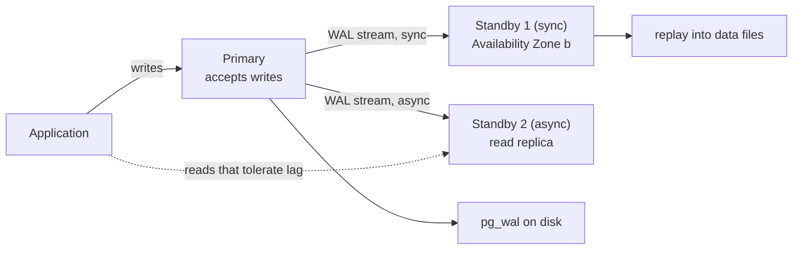
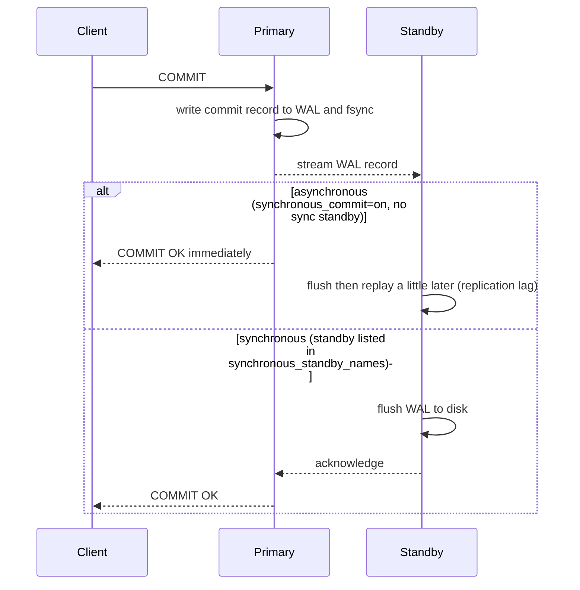

# L13.4 — Replication

> **Level 13: Databases & Distributed Systems** · Topic 4 of 15 · ⏱ ~6 hours · Difficulty: Intermediate

## 1. What it is

**Replication** means keeping copies of a database on more than one server. In PostgreSQL the standard form is
**physical streaming replication**: the **primary** (the only server that accepts writes) writes every change to its
**WAL** (Write-Ahead Log, the sequential journal that records each change before it is applied to data files), and one or more
**standbys** (also called **replicas**) connect, receive that WAL as a stream, and **replay** it to stay byte-for-byte identical.
A standby can serve read-only queries (**hot standby**) while it replays.

Copies exist for two different jobs: **availability** (if the primary dies, promote a standby and carry on) and
**read scaling** (spread read-only queries across replicas). They also introduce the central trade-off of distributed data:
by default replication is **asynchronous**, so a replica is always slightly *behind* ("replication lag"), and if the primary
disappears at the wrong moment the most recent commits may be lost. **Synchronous** replication closes that gap at the cost of
latency and availability. Everything else in this topic (monitoring lag, failover tools, split-brain) is a consequence of that choice.

## 2. Why it matters in DevOps

- **Single point of failure:** a database on one VM or one disk is the thing that ends your company's weekend. Replication is the first
  layer of [High Availability](../level-00-what-devops-is/08-high-availability-and-scalability.md).
- **Read-your-writes bugs:** a user changes their profile, the next page load reads from a lagging replica, and shows the old value.
  This is the most common application bug caused by replication.
- **Failover is where data gets lost.** Promoting the wrong replica, promoting while the old primary is still alive (**split-brain**), or
  not testing the procedure are classic postmortems. Failover is also your [RTO and RPO](../level-15-disaster-recovery/06-rpo.md) in practice.
- **Operational traps:** an abandoned replication slot fills the primary's disk with WAL; a long query on a replica fights WAL replay;
  a replica that falls too far behind has to be rebuilt.
- **Replication is not a backup.** A bad `DELETE` or `DROP TABLE` replicates in milliseconds. You still need
  [Backups and PITR](05-backups-and-pitr.md).

## 3. Real-world system example

**Amazon RDS and Aurora.** RDS for PostgreSQL offers two different replication features and the difference is exactly sync vs. async.
A **Multi-AZ** deployment keeps a standby in another Availability Zone that is replicated synchronously and is used for automatic
failover (you cannot read from the classic Multi-AZ instance standby). **Read replicas** are asynchronous copies you can query to scale reads
and can show lag in the `ReplicaLag` CloudWatch metric. See [RDS and Aurora](../level-06-cloud-aws/10-rds-and-aurora.md).

**GitLab** documents running PostgreSQL in its Linux package with **Patroni** for leader election and automatic failover, plus
PgBouncer for connection routing; **Zalando** created Patroni and runs it in its Kubernetes-based Postgres Operator. Patroni stores the
cluster's "who is the leader" state in a distributed configuration store (etcd, Consul, ZooKeeper or the Kubernetes API) so that only
one node can hold the leader key. **CloudNativePG**, another Kubernetes operator, manages primaries and standbys directly with the
Kubernetes API instead of an external store. In every case the underlying data movement is PostgreSQL's own streaming replication;
the tools add *decision making* (who is primary now?) around it.

## 4. Diagram

Streaming replication with one synchronous and one asynchronous standby:



What happens on a commit, and where the asynchronous gap appears:



## 5. How it works

### Building blocks

| Piece | What it does |
|-------|--------------|
| `wal_level = replica` (default) | WAL contains enough information to rebuild a physical copy |
| `max_wal_senders` | How many replication connections the primary accepts (standbys, `pg_basebackup`, `pg_receivewal`) |
| `pg_basebackup` | Copies the primary's data directory to seed a standby; `-R` writes `standby.signal` and `primary_conninfo` for you |
| `standby.signal` | An empty file in the data directory that tells PostgreSQL to start in standby (recovery) mode |
| `primary_conninfo` | Connection string the standby uses to reach the primary (`host=... user=replicator ...`) |
| **Replication slot** | Primary-side bookmark that remembers how much WAL a standby still needs, so WAL is not recycled too early |
| `hot_standby = on` (default) | Allow read-only queries on a standby |
| `pg_hba.conf` entry with database `replication` | Authorizes the replication role. The word `all` does *not* match replication connections |

### Synchronous vs. asynchronous

| | Asynchronous (default) | Synchronous |
|---|------------------------|-------------|
| Setting | `synchronous_standby_names = ''` | `synchronous_standby_names = 'FIRST 1 (replica1)'` or `'ANY 1 (a, b)'` (quorum) |
| Commit returns after | primary's own WAL flush | WAL is also confirmed by the standby |
| Data loss on primary crash (RPO) | possibly the last moments of commits | zero for acknowledged commits, as long as the sync standby survives |
| Commit latency | lowest | + network round trip to the standby |
| If the standby goes away | nothing happens | **commits block** until it returns or you change the setting |

`synchronous_commit` chooses *how far* the standby must get before the ack: `remote_write` (OS cache), `on` (flushed to disk, the
default level when a sync standby is configured), `remote_apply` (replayed and therefore visible to reads on the standby; this is
the setting for "read-your-writes" from replicas). `off` and `local` loosen guarantees on a per-transaction basis.
Quorum commit (`ANY 2 (a, b, c)`) tolerates one slow or dead standby without stalling; a single required synchronous standby
means your availability is now bounded by that one machine.

### Replication lag

Lag has three places to hide, visible in `pg_stat_replication` on the primary:

- **write_lag / flush_lag / replay_lag** (time) and `sent_lsn`, `write_lsn`, `flush_lsn`, `replay_lsn` (positions). The byte gap is
  `pg_wal_lsn_diff(pg_current_wal_lsn(), replay_lsn)`.
- On the standby, `pg_last_wal_receive_lsn()` versus `pg_last_wal_replay_lsn()` (received but not yet applied), and
  `now() - pg_last_xact_replay_timestamp()` (but that value looks huge on an idle primary because there is nothing new to replay, so
  alert on bytes or on `replay_lag` rather than on the timestamp alone).

Typical causes: network bandwidth, a standby with slower disks than the primary, a large transaction or bulk load, and
**recovery conflicts** where replay waits for a long-running query on the standby (`max_standby_streaming_delay`, default 30 seconds). The
alternative, `hot_standby_feedback = on`, tells the primary not to vacuum rows that standby queries still need, which prevents cancellations but can
bloat the primary (see [MVCC](03-mvcc.md)).

### Replication slots: protection and danger

A slot guarantees the primary keeps WAL until the standby has consumed it, so a replica that is offline for an hour can catch up.
But an *inactive* slot (a replica you decommissioned) retains WAL forever and fills the primary's disk. Set
`max_slot_wal_keep_size` as a safety limit (the slot is invalidated instead of the disk filling) and alert on
`pg_replication_slots` where `active = false`.

### Failover

Failover = promote a standby to be the new primary (`pg_ctl promote` or `SELECT pg_promote();`). It starts a new **timeline**
(WAL file names change from `00000001...` to `00000002...`). The hard parts are not the command:

1. **Decide** that the primary is really dead (not just unreachable from your monitor).
2. **Fence** the old primary so it cannot accept writes (STONITH, "shoot the other node in the head"; revoke its network or kill the instance). Two primaries accepting writes is **split-brain**, and the data diverges.
3. **Choose the best standby** (the one with the highest replayed LSN, unless you have synchronous replication).
4. **Redirect clients** (virtual IP, DNS, HAProxy, PgBouncer, or the cloud's endpoint).
5. **Rebuild or rewind the old primary** as a standby: `pg_rewind` can resync a diverged old primary quickly, but requires `wal_log_hints = on` or data checksums enabled beforehand; otherwise use a fresh `pg_basebackup`.

| Tool | Approach |
|------|----------|
| **Patroni** | Python daemon per node; leader election via a DCS (etcd, Consul, ZooKeeper, Kubernetes); manages `pg_ctl`, config and replication; REST API for HAProxy health checks |
| **repmgr** | Cluster management and automatic failover daemon (`repmgrd`) using PostgreSQL itself for state; witness node to avoid split-brain |
| **pg_auto_failover** | A "monitor" node coordinates a primary and standby(s) with a state machine |
| **Kubernetes operators** (CloudNativePG, Zalando postgres-operator, Crunchy) | Primary/standby pods, automated failover via the Kubernetes API |
| **Managed services** (RDS/Aurora, Cloud SQL, Azure) | Provider does detection, promotion and endpoint switch; you configure Multi-AZ / HA |
| **Manual runbook** | `pg_promote()` plus a human; fine for small systems if rehearsed |

Physical replication copies the *entire cluster* and requires the same major version. **Logical replication** (publications and
subscriptions) replicates selected tables row by row, works across major versions and is used for zero-downtime upgrades and data
integration; it is a different feature, not a substitute for HA standbys.

## 6. Step-by-step guide

**Prerequisites:** Docker. Cost: free. Time: ~60 minutes. The `psql` output shown was captured on a PostgreSQL 16.15 primary and standby
set up with the same settings on a Linux VM using `pg_basebackup`; the Docker wrapper commands are standard but your container IDs,
LSNs and timings will differ ("similar to"). Passwords are placeholders.

1. **Create a network and start the primary.**
   ```bash
   docker network create pgnet
   docker run -d --name pg-primary --network pgnet \
     -e POSTGRES_PASSWORD=<YOUR_PASSWORD> \
     postgres:16 \
     -c wal_level=replica -c max_wal_senders=10 -c max_replication_slots=10 -c wal_log_hints=on
   docker exec pg-primary pg_isready -U postgres
   ```
   Expect `/var/run/postgresql:5432 - accepting connections` (it may take a few seconds on first start). `wal_log_hints=on` is what lets you use `pg_rewind` later.

2. **Create the replication role and allow it in `pg_hba.conf`.**
   ```bash
   docker exec pg-primary psql -U postgres -c "CREATE ROLE replicator WITH REPLICATION LOGIN PASSWORD '<REPL_PASSWORD>';"
   docker exec pg-primary bash -c "echo 'host replication replicator all scram-sha-256' >> /var/lib/postgresql/data/pg_hba.conf"
   docker exec pg-primary psql -U postgres -c "SELECT pg_reload_conf();"
   ```

3. **Create some data to replicate.**
   ```bash
   docker exec pg-primary psql -U postgres -c "CREATE TABLE orders (id serial PRIMARY KEY, item text, created timestamptz DEFAULT now());" \
     -c "INSERT INTO orders (item) VALUES ('widget');"
   ```

4. **Seed the standby with `pg_basebackup`** into a new volume (a throwaway container runs the copy as the `postgres` user), then start it.
   ```bash
   docker volume create pg-replica-data
   docker run --rm --network pgnet --user postgres \
     -e PGPASSWORD=<REPL_PASSWORD> \
     -v pg-replica-data:/var/lib/postgresql/data \
     postgres:16 \
     pg_basebackup -h pg-primary -U replicator -D /var/lib/postgresql/data -R -C -S replica1 -X stream -c fast -P -v
   docker run -d --name pg-replica --network pgnet -v pg-replica-data:/var/lib/postgresql/data postgres:16
   ```
   `-R` wrote `standby.signal` and `primary_conninfo`; `-C -S replica1` created a replication slot called `replica1`;
   `-c fast` forces an immediate checkpoint (without it the copy can wait minutes for a spread checkpoint). The tail of the output looks like:
   ```text
   pg_basebackup: base backup completed
   ```

5. **Confirm streaming from the primary's side.**
   ```bash
   docker exec pg-primary psql -U postgres -x -c "SELECT application_name, client_addr, state, sync_state, replay_lag FROM pg_stat_replication;"
   ```
   ```text
   application_name | replica1
   client_addr      | 172.18.0.3
   state            | streaming
   sync_state       | async
   replay_lag       | 00:00:00.000143
   ```
   `state = streaming` and `sync_state = async` are what you want at this stage.

6. **Read from the standby, and prove it refuses writes.**
   ```bash
   docker exec pg-replica psql -U postgres -c "SELECT pg_is_in_recovery();" -c "SELECT * FROM orders;"
   docker exec pg-replica psql -U postgres -c "INSERT INTO orders (item) VALUES ('x');"
   ```
   ```text
    pg_is_in_recovery
   -------------------
    t
   ERROR:  cannot execute INSERT in a read-only transaction
   ```

7. **Create lag on purpose.** Pause replay on the standby, write on the primary, and measure the gap.
   ```bash
   docker exec pg-replica psql -U postgres -c "SELECT pg_wal_replay_pause();"
   docker exec pg-primary psql -U postgres -c "INSERT INTO orders (item) SELECT 'bulk' FROM generate_series(1,5);"
   docker exec pg-primary psql -U postgres -c "SELECT application_name, pg_size_pretty(pg_wal_lsn_diff(pg_current_wal_lsn(), replay_lsn)) AS replay_gap FROM pg_stat_replication;"
   docker exec pg-replica psql -U postgres -c "SELECT count(*) FROM orders;" \
     -c "SELECT pg_last_wal_receive_lsn(), pg_last_wal_replay_lsn();" \
     -c "SELECT now() - pg_last_xact_replay_timestamp() AS apparent_lag;"
   ```
   The primary shows a few hundred bytes to a few KB of replay gap; the standby still returns `count = 1` while
   `pg_last_wal_receive_lsn()` is ahead of `pg_last_wal_replay_lsn()`: WAL has *arrived* but is not *applied*. In a real
   run the `apparent_lag` interval kept growing (about 4 seconds after a few seconds' pause). Resume and watch it catch up:
   ```bash
   docker exec pg-replica psql -U postgres -c "SELECT pg_wal_replay_resume();"
   docker exec pg-replica psql -U postgres -c "SELECT count(*) FROM orders;"      # 6
   ```

8. **Switch to synchronous replication and see the cost.**
   ```bash
   docker exec pg-primary psql -U postgres -c "ALTER SYSTEM SET synchronous_standby_names = 'FIRST 1 (replica1)';" -c "SELECT pg_reload_conf();"
   docker exec pg-primary psql -U postgres -c "SELECT application_name, sync_state FROM pg_stat_replication;"   # sync
   ```
   Now stop the standby and try to commit (the `timeout` ends the stuck client after 6 seconds):
   ```bash
   docker stop pg-replica
   timeout 6 docker exec pg-primary psql -U postgres -c "INSERT INTO orders (item) VALUES ('hang');" ; echo "exit=$?"
   docker exec pg-primary psql -U postgres -c "SELECT pid, wait_event, left(query,40) FROM pg_stat_activity WHERE wait_event = 'SyncRep';"
   ```
   ```text
   exit=124
    pid  | wait_event |                  left
   ------+------------+------------------------------------------
    ...  | SyncRep    | INSERT INTO orders (item) VALUES ('hang'
   ```
   The commit is **blocked waiting for the standby** (`wait_event = SyncRep`). Start the standby again (`docker start pg-replica`) and the waiting commit completes.
   When you are done, restore async mode:
   ```bash
   docker exec pg-primary psql -U postgres -c "ALTER SYSTEM RESET synchronous_standby_names;" -c "SELECT pg_reload_conf();"
   ```
   This is why one required synchronous standby lowers availability, and why production setups prefer a quorum such as `ANY 1 (a, b)`.

9. **Inspect and monitor the slot.**
   ```bash
   docker exec pg-primary psql -U postgres -c "SELECT slot_name, active, wal_status, pg_size_pretty(pg_wal_lsn_diff(pg_current_wal_lsn(), restart_lsn)) AS retained_wal FROM pg_replication_slots;"
   ```
   With the standby stopped, `active = f` and `retained_wal` grows as you write. That is the disk-fill risk.

10. **Fail over by hand.**
    ```bash
    docker stop pg-primary                                    # the "outage"
    docker exec pg-replica psql -U postgres -c "SELECT pg_promote();"
    docker exec pg-replica psql -U postgres -c "SELECT pg_is_in_recovery();" \
      -c "INSERT INTO orders (item) VALUES ('after-promote');" -c "SELECT pg_walfile_name(pg_current_wal_lsn());"
    ```
    ```text
     pg_is_in_recovery
    -------------------
     f
    INSERT 0 1
          pg_walfile_name
    --------------------------
     00000002000000000000000B
    ```
    The standby is now writable and has started **timeline 2** (the WAL file name begins `00000002`). Do **not** simply start `pg-primary`
    again, because it would accept writes as a second primary (split-brain). Rebuild it as a standby of the new primary with a fresh
    `pg_basebackup` (or `pg_rewind` if you enabled `wal_log_hints`).

11. **Clean up.**
    ```bash
    docker rm -f pg-primary pg-replica
    docker volume rm pg-replica-data
    docker network rm pgnet
    ```

## 7. Real-world scenario

*(Illustrative, not a documented incident.)* **"The profile page shows the old email."** After `shop-api` adds a read replica, support
tickets arrive: customers change their address and the confirmation page still shows the old one. The team's dashboard shows replica
lag normally under 50 ms, so they first suspect the cache. Tracing a request shows the page `POST` goes to the primary, the redirect
`GET` goes to the replica, and for batch-import minutes the replica lag spikes to 20 seconds because the import's large transaction replays slowly.

Fix, in order: route reads that follow a write in the same session to the primary for a few seconds (a "sticky" window), mark
the few read-your-writes endpoints to use the primary only, and alert when `replay_lag` exceeds 5 seconds. Later the same month the primary host
dies; Patroni promotes the standby in about half a minute, but a decommissioned replica's slot from an earlier experiment had retained weeks
of WAL and the disk had already been at 90%. They add `max_slot_wal_keep_size`, an alert on inactive slots, and a quarterly failover game day.
**Lesson:** replication adds a consistency dimension to the application (reads may be stale) and an operations dimension (slots, lag, failover rehearsal).

## 8. Common mistakes and best practices

**Don't**

- Treat replicas as backups; a destructive statement replicates within moments.
- Send read-your-writes traffic to an async replica without a strategy.
- Require exactly one synchronous standby on a two-node cluster and expect high availability; its failure freezes writes.
- Restart a failed old primary without fencing it or rebuilding it.
- Leave unused replication slots; they fill the primary's disk.
- Fail over because a monitor timed out once; flapping failovers cause more outages than they prevent.

**Do**

- Use `pg_basebackup -R` (or your operator) to build standbys, a replication slot (or `wal_keep_size`/WAL archive) so a standby can catch up, and a dedicated `replication` role with a strong password and TLS.
- Monitor bytes and time of replay lag, slot state and retained WAL, and `pg_stat_replication` row count (is the standby connected at all?).
- Put at least one standby in a different failure domain (Availability Zone), and consider a quorum for synchronous commit.
- Use an automated failover manager with a quorum-based store (Patroni and etcd, a cloud-managed service, or an operator) rather than a script, and **rehearse** failover on a schedule.
- Route clients through an endpoint that follows the primary (HAProxy with Patroni health checks, PgBouncer, or the cloud writer endpoint). See [Database Connection Pooling](06-db-connection-pooling.md).
- Keep [backups and WAL archiving](05-backups-and-pitr.md) in addition to replication.

## 9. Tasks

- [ ] **T1 — Build a primary and a streaming standby** *(≈45 min, beginner)*
  - **Goal:** have a working primary/standby pair.
  - **Steps:**
    1. Follow steps 1 to 6 in section 6.
    2. Insert three rows on the primary and read them from the standby.
    3. Show that writes to the standby fail.
  - **Done when:** `pg_stat_replication` shows `state = streaming` and the standby returns your three rows but rejects an `INSERT` with `cannot execute INSERT in a read-only transaction`.

- [ ] **T2 — Measure lag** *(≈30 min, intermediate)*
  - **Goal:** produce and measure replication lag in both bytes and time.
  - **Steps:**
    1. Pause replay on the standby with `pg_wal_replay_pause()`.
    2. Generate load on the primary: `INSERT INTO orders (item) SELECT repeat('x', 200) FROM generate_series(1, 200000);`.
    3. Record `pg_wal_lsn_diff(pg_current_wal_lsn(), replay_lsn)` on the primary and the receive-versus-replay LSNs on the standby.
    4. Resume replay and record how long it takes to reach zero lag.
  - **Done when:** you have a table of (bytes of lag, seconds to catch up) and can explain why `now() - pg_last_xact_replay_timestamp()` is misleading on an idle primary.

- [ ] **T3 — Break it: synchronous commit stall** *(≈30 min, intermediate)*
  - **Goal:** feel the availability cost of synchronous replication.
  - **Steps:**
    1. Set `synchronous_standby_names = 'FIRST 1 (replica1)'` and confirm `sync_state = sync`.
    2. Stop the standby and run an `INSERT`; observe `SyncRep` in `pg_stat_activity`.
    3. Start a second standby (`replica2`) and change the setting to `ANY 1 (replica1, replica2)`; stop `replica1` and show that commits proceed.
  - **Done when:** you demonstrate a commit that hangs with one required sync standby and succeeds with a quorum of two.

- [ ] **T4 — Break it: slot that eats the disk** *(≈30 min, intermediate)*
  - **Goal:** see WAL retention from an inactive slot and put a guard in place.
  - **Steps:**
    1. Stop the standby and write ~200 MB of changes on the primary.
    2. Show the growth of retained WAL with the slot query from step 9 and `du -sh` on `pg_wal`.
    3. Set `max_slot_wal_keep_size = '100MB'`, reload, write more, and watch `wal_status` become `unreserved` or `lost`.
    4. Drop the unneeded slot with `pg_drop_replication_slot('replica1')` (or rebuild the standby).
  - **Done when:** you have seen `wal_status` change and can state when a standby with a `lost` slot must be rebuilt.

- [ ] **T5 — Fail over and rebuild** *(≈60 min, advanced)*
  - **Goal:** run a complete failover drill including the old primary's return.
  - **Steps:**
    1. Do step 10: stop the primary and promote the standby; write a row on the new primary.
    2. Rebuild the old primary as a standby of the new one using a fresh `pg_basebackup` into a new volume (or `pg_rewind` if you set `wal_log_hints=on` and cleanly shut it down).
    3. Confirm the new standby has the row written after promotion.
    4. Write down the sequence as a numbered runbook: detect, fence, promote, redirect, rebuild.
  - **Done when:** `pg_stat_replication` on the new primary lists the rebuilt node as `streaming` and your runbook has all five phases.

- [ ] **T6 — Prove it: compare failover options** *(≈45 min, advanced)*
  - **Goal:** explain how production systems automate what you did by hand.
  - **Steps:**
    1. Without the guide, repeat T1 and T5 on a fresh pair of containers.
    2. Read the Patroni or CloudNativePG documentation overview and write half a page: what decides the leader, how split-brain is prevented, how clients find the primary.
    3. State the RPO and RTO of your manual drill versus an automated setup.
  - **Done when:** a teammate can name, from your write-up, why async failover can lose data, what fencing is, and which component in Patroni or the operator prevents two primaries.

## 10. Self-check questions

1. What does the primary send to a standby, and why must the standby be the same major version?
2. Explain synchronous vs. asynchronous replication and the RPO and availability trade-off of each.
3. A user saves a change and immediately sees old data. What is the probable cause and what are two application-level fixes?
4. What is split-brain and which steps of a failover procedure prevent it?
5. Why can a replication slot fill a primary's disk, and how do you limit that risk?
6. Why is a replica not a backup?

<details>
<summary>Answers</summary>

1. WAL records describing physical block changes; replay applies them to the exact on-disk format, which differs across major versions.
2. Async: commit returns after the primary's local WAL flush, so a primary crash can lose the last commits (non-zero RPO) but commits never wait for a standby. Sync: commit waits for the standby's acknowledgement, giving zero loss of acknowledged commits at the price of latency, and commits block if the required standby is unavailable (use quorum `ANY n (...)` to mitigate).
3. The read hit an async replica that had not replayed the write yet. Fixes: send reads right after a write (or critical reads) to the primary, use a sticky window or session token, or use `synchronous_commit = remote_apply` for those transactions.
4. Two nodes both accepting writes, creating diverged data. Prevent by deciding with a quorum (a DCS or witness), fencing or shutting down the old primary before promotion, and rebuilding it as a standby rather than restarting it as primary.
5. A slot makes the primary retain all WAL the consumer has not yet confirmed; an inactive consumer means unbounded retention. Set `max_slot_wal_keep_size`, alert on inactive slots and retained bytes, and drop unused slots.
6. Replication copies every change, including `DROP TABLE` and bad `DELETE`s, almost immediately. A backup plus WAL archive lets you go back to a point before the mistake.
</details>

## 11. Further reading

- PostgreSQL documentation: *High Availability, Load Balancing, and Replication* (log-shipping standby servers, streaming replication, synchronous replication, hot standby) and the `pg_basebackup` and `pg_rewind` reference pages. Start from <https://www.postgresql.org/docs/current/>.
- Patroni documentation (readthedocs) and the CloudNativePG documentation for operator-based failover.
- *PostgreSQL 14 Internals* by Egor Rogov and *The Internals of PostgreSQL* by Hironobu Suzuki (free online), chapters on replication.
- *Designing Data-Intensive Applications* by Martin Kleppmann, chapter 5 "Replication".
- Related: [MVCC](03-mvcc.md), [Backups and PITR](05-backups-and-pitr.md), [Replication in disaster recovery](../level-15-disaster-recovery/02-replication.md), [Failover](../level-15-disaster-recovery/05-failover.md).

<!-- nav -->
---
← Previous: [MVCC](03-mvcc.md) · [Level 13 index](README.md) · Next: [Backups and Point-in-Time Recovery](05-backups-and-pitr.md) →
