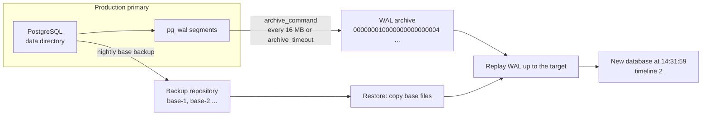
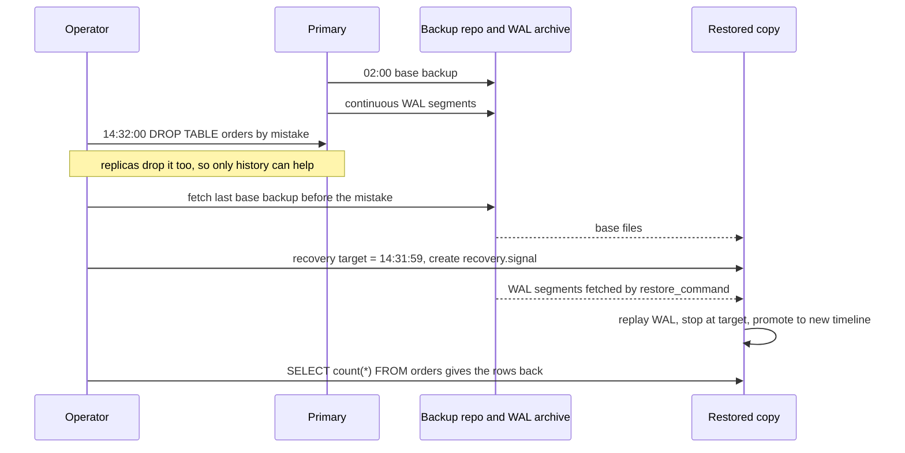

# L13.5 — Backups and Point-in-Time Recovery

> **Level 13: Databases & Distributed Systems** · Topic 5 of 15 · ⏱ ~6 hours · Difficulty: Intermediate

## 1. What it is

A database **backup** is a copy of your data that lets you rebuild the database after something destroys it: a dropped table, a bad
deploy, a corrupted disk, a deleted cloud account. PostgreSQL has two fundamentally different kinds:

- **Logical backup** (`pg_dump`, `pg_dumpall`): reads the data through SQL and writes `CREATE TABLE` / `COPY` statements (or a compressed
  archive of them). It is portable across PostgreSQL versions and lets you restore a single table, but it is a snapshot of *one moment*
  and restoring means re-loading and re-indexing every row, which gets slow as the database grows.
- **Physical backup** (a **base backup** plus archived **WAL**): copies the data directory files themselves, then continuously ships the
  **WAL** (Write-Ahead Log, the journal of every change) to separate storage. Restoring means copying the files back and replaying WAL.
  Because the WAL is a complete history, you can stop the replay at any chosen moment, which is **Point-in-Time Recovery (PITR)**:
  "give me the database as it was at 14:31:59, one second before the bad `DELETE`."

Two numbers frame every backup design. **RPO** (Recovery Point Objective) is how much data you can afford to lose; **RTO** (Recovery Time
Objective) is how long you can afford to be down. A nightly `pg_dump` has an RPO of up to 24 hours. Base backup plus continuous WAL
archiving has an RPO of seconds to minutes. See [RPO](../level-15-disaster-recovery/06-rpo.md) and [RTO](../level-15-disaster-recovery/07-rto.md).

## 2. Why it matters in DevOps

- **Replication is not a backup.** A mistaken `DROP TABLE` replicates to every standby within milliseconds
  (see [Replication](04-replication.md)). Only a backup with history lets you go back in time.
- **An untested backup is a hope, not a backup.** The classic failure is discovering during the incident that the backup job has been
  failing for months, that the files are empty, or that nobody knows the restore procedure. The only proof is a **restore drill**.
- **Silent failure modes:** a broken `archive_command` makes the primary keep every WAL file until the disk fills and the database stops.
  A backup in the same account/region/disk as the database dies with it.
- **Time pressure:** during an outage, restore *speed* is your RTO. A 2 TB `pg_dump` restore can take many hours of loading and index
  building; a physical restore is bounded mostly by disk and network throughput plus WAL replay. Know the number before you need it.
- **Compliance and security:** retention periods, encryption of backups at rest, and who can delete them are audit questions. A backup
  that the compromised production credentials can delete is not protection against ransomware.

## 3. Real-world system example

**Amazon RDS for PostgreSQL** documents exactly the model in this topic. Automated backups take a daily snapshot of the instance's
storage and also capture transaction logs continuously. You choose a retention period (up to 35 days) and can restore to any point within
it; RDS always restores into a **new** DB instance rather than rewinding the existing one. That is PITR as a managed feature: base backup
plus continuous WAL. See [RDS and Aurora](../level-06-cloud-aws/10-rds-and-aurora.md).

**GitLab's January 2017 database incident** is one of the best-documented public backup postmortems. An engineer removed the data
directory on the wrong database server while repairing replication. GitLab then found that several of their backup mechanisms had not been
working as assumed (for example the scheduled `pg_dump` had been failing, and failure notification emails were not arriving), so they
recovered from an older staging-related copy and lost several hours of data. They published a candid write-up and a lesson that is now
standard advice: *monitor that backups succeed and regularly restore them*. (Read their postmortem for the exact details; this summary
is intentionally brief.)

**Tools in the ecosystem:** **pgBackRest** (parallel, incremental, compressed, encrypted backups with built-in WAL archiving and
restore, supports S3/GCS/Azure and local repositories), **WAL-G** (a Go tool descended from WAL-E for shipping base backups and WAL to
object storage), and **Barman**. Kubernetes operators such as CloudNativePG and Zalando's Postgres Operator wire WAL archiving and base
backups to object storage for you. They all implement the same two ideas: *base backup* and *WAL archive*.

## 4. Diagram

How a base backup and the WAL archive combine to restore to any moment:



The timeline of an accident and what PITR does about it:



## 5. How it works

### Logical vs. physical

| | `pg_dump` (logical) | Base backup + WAL (physical) |
|---|---------------------|------------------------------|
| What it stores | SQL / custom-format archive of objects and rows | Copy of the data files + the WAL stream |
| Restore to | any PostgreSQL version (usually newer), any architecture | same major version and compatible architecture |
| Granularity | one table, schema or database | the whole cluster (all databases) |
| Recovery point | the moment the dump started | any moment covered by WAL (PITR) |
| Restore speed | slow: re-inserts rows, rebuilds indexes | fast: file copy + WAL replay |
| Impact while running | long-running transaction (holds back `VACUUM` cleanup), read load | I/O load, no long transaction needed |
| Best for | small DBs, migrations and upgrades, extracting one table | production DR, RPO of seconds, large databases |

They are complementary: physical backups for disaster recovery, `pg_dump` for portability (major-version upgrades, copying data to a
developer machine).

### The pieces of physical backup and PITR

| Piece | Role |
|-------|------|
| `wal_level = replica` (default) | WAL contains enough detail for archive recovery and replication |
| `archive_mode = on` | Turn on WAL archiving (changing it needs a restart) |
| `archive_command` | Shell command run for every completed WAL segment, `%p` = path, `%f` = file name. Must return non-zero on failure and must **never overwrite** an existing archived file |
| `archive_timeout` | Force a segment switch at least this often so a quiet database still archives (bounds your RPO) |
| `pg_basebackup` | Built-in tool that copies the running cluster consistently (uses the backup protocol; no downtime) |
| `backup_label` / `backup_manifest` | Metadata in a backup: where WAL replay must start, and checksums to verify it (`pg_verifybackup`) |
| `restore_command` | How the recovering server fetches an archived WAL file, e.g. `cp /archive/%f %p` |
| `recovery.signal` | Empty file that makes the server start in archive recovery (target recovery) mode |
| `recovery_target_time` / `recovery_target_name` / `recovery_target_lsn` / `recovery_target_xid` / `recovery_target = 'immediate'` | Where to stop. A **named restore point** made with `pg_create_restore_point('name')` is the most precise way to mark "just before the migration" |
| `recovery_target_action` | `pause` (default: stop and let you inspect), `promote`, or `shutdown` |
| **Timeline** | After a PITR-promote the server starts a new timeline (`00000002.history`) so WAL from the "future" you rejected cannot be confused with the new history |

Two details trip people up:

1. **Recovery is not instant.** After PostgreSQL reaches a consistent state it begins accepting read-only connections (hot standby) while
   it is *still replaying* toward the target. `pg_ctl -w start` returns at that point. Always poll `SELECT pg_is_in_recovery()` until it is
   `f` before you check the data or declare success.
2. **Recovery stops at the *first* point that matches.** A time target earlier than the end of the base backup is invalid (the backup
   itself must finish before the target). Choose a base backup taken *before* the target.

### pgBackRest in one paragraph

pgBackRest is configured with a **stanza** (one PostgreSQL cluster) in `pgbackrest.conf` (`/etc/pgbackrest.conf` by default). You set
`archive_command = 'pgbackrest --stanza=shop archive-push %p'`, run `stanza-create` and `check`, then schedule `backup --type=full|diff|incr`.
Full = everything, differential = changes since the last full, incremental = changes since the last backup of any type. It restores with
`pgbackrest restore` (adding `--type=time --target=...` for PITR, `--delta` to reuse files already on disk), handles retention
(`repo1-retention-full`), verifies checksums, supports encryption (`repo1-cipher-type`) and object storage repositories, and can
back up from a standby to keep load off the primary.

## 6. Step-by-step guide

**Prerequisites:** a Linux machine or VM with PostgreSQL 16 or newer client and server packages, and permission to run them as a
non-root user (PostgreSQL refuses to run as root). `sudo -u postgres` on Debian/Ubuntu works. Everything below runs on one machine in a
throwaway directory `/var/tmp/pitrlab`; no cloud cost. Output is from PostgreSQL 16 and is "similar to" what you will see.

1. **Create a lab cluster with WAL archiving on.**
   ```bash
   sudo mkdir -p /var/tmp/pitrlab/archive /var/tmp/pitrlab/backups && sudo chown -R postgres /var/tmp/pitrlab
   B=$(ls -d /usr/lib/postgresql/*/bin | tail -1)      # Debian/Ubuntu path to the PostgreSQL binaries
   sudo -u postgres $B/initdb -D /var/tmp/pitrlab/data
   sudo -u postgres tee -a /var/tmp/pitrlab/data/postgresql.conf >/dev/null <<'EOF'
   port = 5455
   unix_socket_directories = '/var/tmp/pitrlab'
   listen_addresses = ''
   archive_mode = on
   archive_command = 'test ! -f /var/tmp/pitrlab/archive/%f && cp %p /var/tmp/pitrlab/archive/%f'
   EOF
   sudo -u postgres $B/pg_ctl -D /var/tmp/pitrlab/data -l /var/tmp/pitrlab/log -w start
   alias lab='sudo -u postgres psql -X -h /var/tmp/pitrlab -p 5455'
   ```
   Expect `server started`. The `test ! -f ... && cp` pattern refuses to overwrite an existing archive file, as the PostgreSQL
   documentation recommends.

2. **Load some data, then take a base backup.**
   ```bash
   lab -c "create table orders(id serial primary key, total numeric)"
   lab -c "insert into orders(total) select random()*100 from generate_series(1,1000)"
   sudo -u postgres $B/pg_basebackup -h /var/tmp/pitrlab -p 5455 -D /var/tmp/pitrlab/backups/base1 -Ft -z -X none -c fast -P
   ```
   `-Ft -z` writes a gzip-compressed tar, `-X none` omits WAL because we archive it separately, `-c fast` forces an immediate checkpoint.
   Expect `NOTICE: all required WAL segments have been archived` and a `base.tar.gz` plus `backup_manifest` in `backups/base1`.

3. **Make more changes, then mark the safe moment.**
   ```bash
   lab -c "insert into orders(total) select 5 from generate_series(1,500)"
   lab -tc "select pg_create_restore_point('before_oops')"
   ```
   The row count is now 1500 and the restore point `before_oops` is recorded in the WAL.

4. **Cause the disaster, and force the WAL out to the archive.**
   ```bash
   lab -c "drop table orders"
   lab -c "select pg_switch_wal()"      # close the current segment so it is archived now
   lab -tc "select archived_count, failed_count, last_archived_wal from pg_stat_archiver"
   ```
   `failed_count` should be `0`. (In production the segment fills or `archive_timeout` fires on its own.)

5. **Restore the base backup to a new directory and point it at the archive.**
   ```bash
   R=/var/tmp/pitrlab/restored
   sudo -u postgres mkdir -m 700 $R
   sudo -u postgres tar -xzf /var/tmp/pitrlab/backups/base1/base.tar.gz -C $R
   sudo -u postgres tee -a $R/postgresql.conf >/dev/null <<'EOF'
   port = 5456
   restore_command = 'cp /var/tmp/pitrlab/archive/%f %p'
   recovery_target_name = 'before_oops'
   recovery_target_action = 'promote'
   archive_mode = off
   EOF
   sudo -u postgres touch $R/recovery.signal
   ```
   We switch `archive_mode` off on the copy so it does not try to push WAL into the production archive.

6. **Start it, then wait for recovery to finish.**
   ```bash
   sudo -u postgres $B/pg_ctl -D $R -l /var/tmp/pitrlab/restore.log -w start
   until [ "$(sudo -u postgres psql -X -h /var/tmp/pitrlab -p 5456 -tAc 'select pg_is_in_recovery()')" = f ]; do sleep 1; done
   sudo -u postgres psql -X -h /var/tmp/pitrlab -p 5456 -tAc "select count(*) from orders"
   grep -E "recovery stopping|archive recovery complete" /var/tmp/pitrlab/restore.log
   ```
   Expect `1500`, and log lines similar to `recovery stopping at restore point "before_oops"` and `archive recovery complete`.
   The dropped table is back, and `pg_control_checkpoint()` now reports `timeline_id = 2`. If you query too early you will see
   `1000` rows (the base backup state) and `pg_is_in_recovery() = t`: that is the "recovery is not instant" trap from section 5.

7. **Verify a plain-format backup with the built-in checker.**
   ```bash
   sudo -u postgres $B/pg_basebackup -h /var/tmp/pitrlab -p 5455 -D /var/tmp/pitrlab/backups/plain1 -X stream -c fast
   sudo -u postgres $B/pg_verifybackup /var/tmp/pitrlab/backups/plain1
   ```
   Expect `backup successfully verified`. (`pg_verifybackup` needs the plain format, not tar.)

8. **Same thing with pgBackRest.** Install it (`sudo apt-get install pgbackrest` on Debian/Ubuntu) and create a config for the lab:
   ```bash
   sudo mkdir -p /var/tmp/pitrlab/repo /var/tmp/pitrlab/pgbr-log && sudo chown postgres /var/tmp/pitrlab/repo /var/tmp/pitrlab/pgbr-log
   sudo -u postgres tee /var/tmp/pitrlab/pgbackrest.conf >/dev/null <<'EOF'
   [global]
   repo1-path=/var/tmp/pitrlab/repo
   repo1-retention-full=2
   log-path=/var/tmp/pitrlab/pgbr-log
   start-fast=y

   [shop]
   pg1-path=/var/tmp/pitrlab/data
   pg1-port=5455
   pg1-socket-path=/var/tmp/pitrlab
   EOF
   C=/var/tmp/pitrlab/pgbackrest.conf
   lab -c "alter system set archive_command = 'pgbackrest --config=$C --stanza=shop archive-push %p'"
   lab -c "select pg_reload_conf()"
   sudo -u postgres pgbackrest --config=$C --stanza=shop stanza-create
   sudo -u postgres pgbackrest --config=$C --stanza=shop check
   sudo -u postgres pgbackrest --config=$C --stanza=shop --type=full backup
   sudo -u postgres pgbackrest --config=$C info
   ```
   `info` should show `status: ok`, the WAL archive range and the full backup with its size in the repository (smaller than the
   database size because it is compressed). Note the explicit `--config=` inside `archive_command`: the PostgreSQL server process does
   not inherit your shell's environment, so a config in a non-default location must be named in the command itself. Production setups
   just use `/etc/pgbackrest.conf`.

9. **PITR with pgBackRest.** Note a time, make a mistake, restore to just before it:
   ```bash
   T=$(lab -tAc "select now()::text")
   lab -c "create table payments(id serial, amt int)" -c "insert into payments(amt) select 1 from generate_series(1,100)"
   lab -c "select pg_switch_wal()" ; sleep 3
   sudo -u postgres pgbackrest --config=$C --stanza=shop --pg1-path=/var/tmp/pitrlab/pgr \
        --type=time "--target=$T" --target-action=promote restore
   sudo grep -A5 "pgBackRest" /var/tmp/pitrlab/pgr/postgresql.auto.conf
   ```
   The generated `restore_command` calls `pgbackrest archive-get`, `recovery_target_time` is your timestamp, and `recovery.signal` exists.
   Start it with a different port (`pg_ctl -D ... -o "-p 5457" start`), wait for `pg_is_in_recovery()` to be `f`, and `payments`
   will not exist (it was created after the target).

10. **Clean up the lab.**
    ```bash
    sudo -u postgres $B/pg_ctl -D /var/tmp/pitrlab/data stop -m fast
    sudo -u postgres $B/pg_ctl -D /var/tmp/pitrlab/restored stop -m fast 2>/dev/null
    sudo -u postgres $B/pg_ctl -D /var/tmp/pitrlab/pgr stop -m fast 2>/dev/null
    sudo rm -rf /var/tmp/pitrlab
    ```

**Logical backup in one minute** (for contrast):
```bash
pg_dump -Fc -f shop.dump shop            # custom format, compressed, parallel-restorable
pg_restore --list shop.dump | head       # see what is inside without restoring
createdb shop_restored && pg_restore -d shop_restored -j 4 shop.dump
pg_dump -Fd -j 4 -f shop_dir shop        # directory format allows parallel dump too
```

## 7. Real-world scenario

*(Illustrative, not a documented incident.)* The `shop-api` team ships a data-cleanup migration that was meant to delete test customers
(`WHERE email LIKE '%@test.example.com'`). A last-minute edit drops the `WHERE`. The migration runs in the deploy pipeline and
commits at 14:32:07. Customer service reports empty order histories at 14:41. The read replicas already show the deletion, so
failing over would change nothing.

Investigation: the on-call engineer freezes writes (puts the API in maintenance mode so nothing new is lost or entangled), reads the
migration log to find the exact commit time, and picks the restore target `14:32:06`. The nightly pgBackRest full is from 02:00 and WAL
has been archiving continuously. They run `pgbackrest restore --type=time --target="2026-10-09 14:32:06+00" --target-action=pause` on a
**new** VM, so the broken production database is left untouched for forensics. After replay they inspect the data, see the customers
back, and extract just the affected tables with `pg_dump -t customers -t orders` from the restored copy, then load them into
production and re-apply the legitimate writes made since 14:32 from the application log.

Total downtime for the affected feature: about 40 minutes, mostly the base backup copy and WAL replay (the team had measured a
restore in a previous drill, so they knew the estimate in advance). Follow-ups: migrations now run inside a transaction with a
row-count assertion; the pipeline creates a named restore point (`pg_create_restore_point('pre_migration_<id>')`) before every
destructive migration (see [Database Migrations in Pipelines](../level-05-cicd/09-database-migrations.md)); and the restore is
rehearsed monthly by an automated drill.
**Lesson:** the value of PITR is choosing a *moment*, but the real enabler was a rehearsed procedure and a known RTO.

## 8. Common mistakes and best practices

**Don't**

- Treat replicas, RAID or "the cloud disk is redundant" as backups. Redundancy protects against hardware loss, not against your own commands.
- Rely only on nightly `pg_dump` if your RPO is smaller than a day.
- Ignore `archive_command` failures. A failing command keeps WAL on the primary until `pg_wal` fills the disk and the database stops.
  Alert on `pg_stat_archiver.failed_count` growth and on `last_archived_time` being old.
- Store backups on the same disk, host, account or region as the database, or let the production credentials delete them.
- Copy the data directory with `cp`/`rsync` while PostgreSQL is running and call it a backup (it is inconsistent without the backup
  protocol or a coordinated snapshot).
- Delete `backup_label` "because the server won't start" (it is what tells recovery where to begin), or skip `recovery.signal`.
- Say "backups are green" without ever restoring one.

**Do**

- Keep a physical base backup + continuous WAL archive for production, plus occasional logical dumps for portability.
- Use a purpose-built tool (pgBackRest, WAL-G, Barman, or your cloud's managed backups) rather than hand-rolled scripts; get
  checksums, retention, parallelism and encryption for free.
- Follow **3-2-1**: three copies, two media types, one off-site (and consider an immutable/object-locked copy; see
  [Off-site Backups](../level-15-disaster-recovery/08-offsite-backups.md)). Encrypt backups and manage the keys separately.
- **Drill the restore** on a schedule, time it, compare against your RTO, and record the run
  ([Testing Backup Restoration](../level-15-disaster-recovery/09-testing-backup-restoration.md)). Fail the drill if row counts or a checksum query disagree.
- Create **named restore points** before risky changes; set `archive_timeout` to match your RPO; monitor backup age and size.
- Document the runbook: who decides the target, how writes are frozen, how the new primary is promoted and how replicas are rebuilt
  from it (restoring creates a new timeline, so old standbys must be re-seeded or rewound).

## 9. Tasks

- [ ] **T1 — Dump and restore one table** *(≈30 min, beginner)*
  - **Goal:** use a logical backup and understand what it is good for.
  - **Steps:**
    1. Create a database with a few tables and ~10,000 rows (`pgbench -i -s 1` is a quick source).
    2. Run `pg_dump -Fc -f db.dump <dbname>`, then `pg_restore --list db.dump`.
    3. Create a new database and restore **only** `pgbench_accounts` with `pg_restore -t pgbench_accounts -d newdb db.dump`.
  - **Done when:** `select count(*) from pgbench_accounts` in `newdb` equals the original count, and you can state two things a dump cannot do that PITR can.

- [ ] **T2 — Restore to a named restore point** *(≈60 min, intermediate)*
  - **Goal:** perform a full PITR by hand.
  - **Steps:**
    1. Follow steps 1-6 of the guide in your own lab directory.
    2. Check `pg_stat_archiver` before and after `pg_switch_wal()`.
    3. Confirm the restored server is on timeline 2 and look at the `00000002.history` file.
  - **Done when:** the dropped table exists again with the exact row count from before the drop, and you can explain why the first query right after `pg_ctl start` may show older data.

- [ ] **T3 — Restore to a timestamp, not a name** *(≈45 min, intermediate)*
  - **Goal:** practice choosing a target when nobody created a restore point.
  - **Steps:**
    1. In the lab, insert a row with `now()` in a loop every second for 30 seconds (`\watch 1` in psql works) into a `heartbeat` table.
    2. `drop table heartbeat`, then restore with `recovery_target_time` set to 10 seconds before the drop (use `heartbeat` timestamps and the log to pick it).
    3. Try `recovery_target_inclusive = off`.
  - **Done when:** the restored table's last row is the last heartbeat before your chosen time, and you can state how `inclusive` changes it.

- [ ] **T4 — Break the archive and fix it** *(≈45 min, intermediate)*
  - **Goal:** see the most dangerous silent failure and how to alert on it.
  - **Steps:**
    1. In the lab, set `archive_command = '/bin/false'` and reload.
    2. Generate WAL (`pgbench -T 60`) and watch `pg_stat_archiver.failed_count` grow and `ls pg_wal | wc -l` increase; read the PostgreSQL log warnings.
    3. Fix the command, reload, and watch the backlog drain.
    4. Write a one-line monitoring query that would have alerted you (for example `failed_count` increasing, or `now() - last_archived_time > interval '5 minutes'`).
  - **Done when:** `pg_wal` shrinks back after the fix and you have a working alert query.

- [ ] **T5 — Automate a nightly backup and a restore drill with pgBackRest** *(≈2 hours, advanced)*
  - **Goal:** make backups and proof of recoverability a scheduled job.
  - **Steps:**
    1. Complete step 8 of the guide. Add `repo1-retention-full=2` and take a `diff` and `incr` backup after changing data; compare sizes in `pgbackrest info`.
    2. Write `restore-drill.sh` that: restores the latest backup into an empty scratch directory (`--pg1-path=...`) and starts it on another port, waits for `pg_is_in_recovery() = f`, runs a validation query (row counts of key tables, `pg_amcheck` or a `select max(created)`), records elapsed seconds, stops and deletes the copy, and exits non-zero on any mismatch.
    3. Schedule full backups (weekly), incrementals (daily) and the drill (weekly) with cron or a systemd timer.
  - **Done when:** the script prints something like `restore OK in 14s, orders=1500` and exits 0, and exits non-zero if you deliberately delete one row from the expected count.

- [ ] **T6 — Prove it: lose a production table and get it back** *(≈60 min, advanced)*
  - **Goal:** demonstrate end-to-end recoverability, without the guide, with a time budget.
  - **Steps:**
    1. Stand up a fresh lab cluster with WAL archiving and a base backup, load `pgbench` data.
    2. Run `pgbench -T 120` in the background to simulate traffic, then drop `pgbench_history` at a time you note.
    3. Restore to just before the drop on a different port, extract the table with `pg_dump -t pgbench_history`, and load it back into the live cluster.
    4. Write down your RPO, the measured RTO, and one change you would make to improve each.
  - **Done when:** `pgbench_history` exists in the live cluster with rows from before the drop, and your write-up names the timings and the target you chose.

## 10. Self-check questions

1. Why is a streaming replica not a backup?
2. What two things do you need, besides the server software, to restore a PostgreSQL cluster to 14:31:59 yesterday?
3. What happens to the primary if `archive_command` keeps failing?
4. After `pg_ctl start` on a PITR restore the table is missing rows. Is the restore broken?
5. When would you choose `pg_dump` over a physical backup, and when the reverse?
6. How do you know your backups work?

<details>
<summary>Answers</summary>

1. It applies every change, including mistakes, within milliseconds. It protects against hardware failure, not against logical errors such as a bad `DELETE`.
2. A base backup taken before that time and the continuous WAL archive from the end of that backup through the target moment (and a `restore_command`, `recovery.signal` and a target setting to drive the replay).
3. Completed WAL segments cannot be recycled until they are archived, so `pg_wal` grows until the disk fills and the primary stops accepting writes. Alert on archiver failures and a stale `last_archived_time`.
4. Probably not. The server accepts read-only connections once it is consistent while it is still replaying WAL. Wait for `pg_is_in_recovery()` to become false (or the log to say `archive recovery complete`) before judging the data.
5. `pg_dump` for portability (upgrading major versions, moving a single database or table, small databases). Physical backup + WAL for disaster recovery, large databases, a low RPO and PITR.
6. You restore them on a schedule into a scratch environment, validate the data, measure the time and alert when the drill fails or exceeds the RTO. Green backup jobs alone prove nothing.
</details>

## 11. Further reading

- PostgreSQL documentation, chapter *Backup and Restore*: "SQL Dump", "File System Level Backup" and "Continuous Archiving and Point-in-Time Recovery (PITR)"; plus the `pg_basebackup`, `pg_verifybackup` and `pg_dump` reference pages.
- pgBackRest user guide (pgbackrest.org) and WAL-G documentation on GitHub.
- GitLab's public postmortem of the 31 January 2017 database incident.
- Amazon RDS User Guide, "Backing up and restoring" and "Restoring a DB instance to a specified time".
- *PostgreSQL 14 Administration Cookbook* (Riggs and Ciolli) and *The Art of PostgreSQL* (Dimitri Fontaine) for practical backup recipes.
- Related in this repo: [Replication](04-replication.md), [Backups](../level-15-disaster-recovery/01-backups.md), [Restore Procedures](../level-15-disaster-recovery/04-restore-procedures.md).

<!-- nav -->
---
← Previous: [Replication](04-replication.md) · [Level 13 index](README.md) · Next: [Database Connection Pooling](06-db-connection-pooling.md) →
