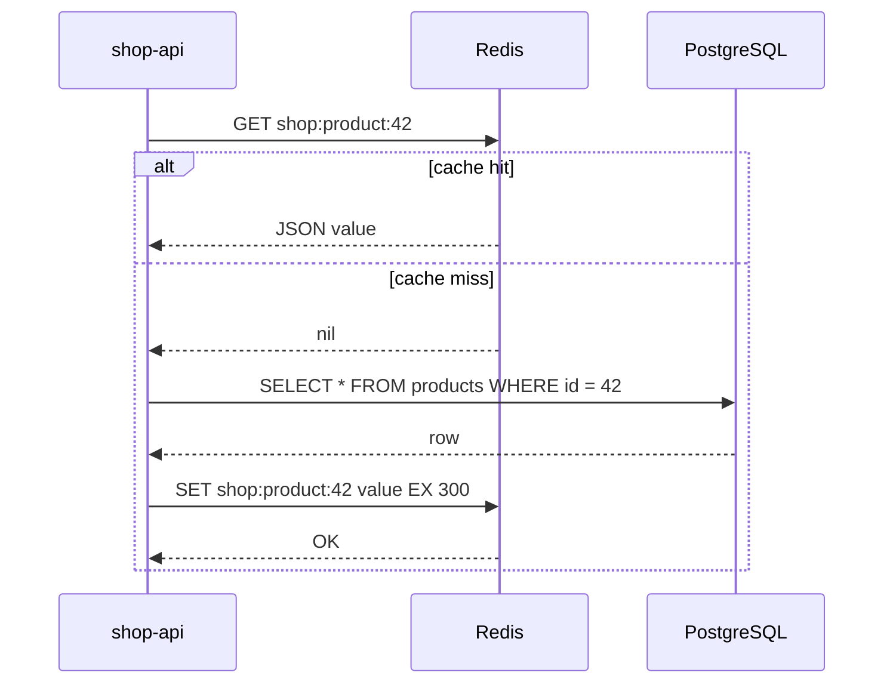
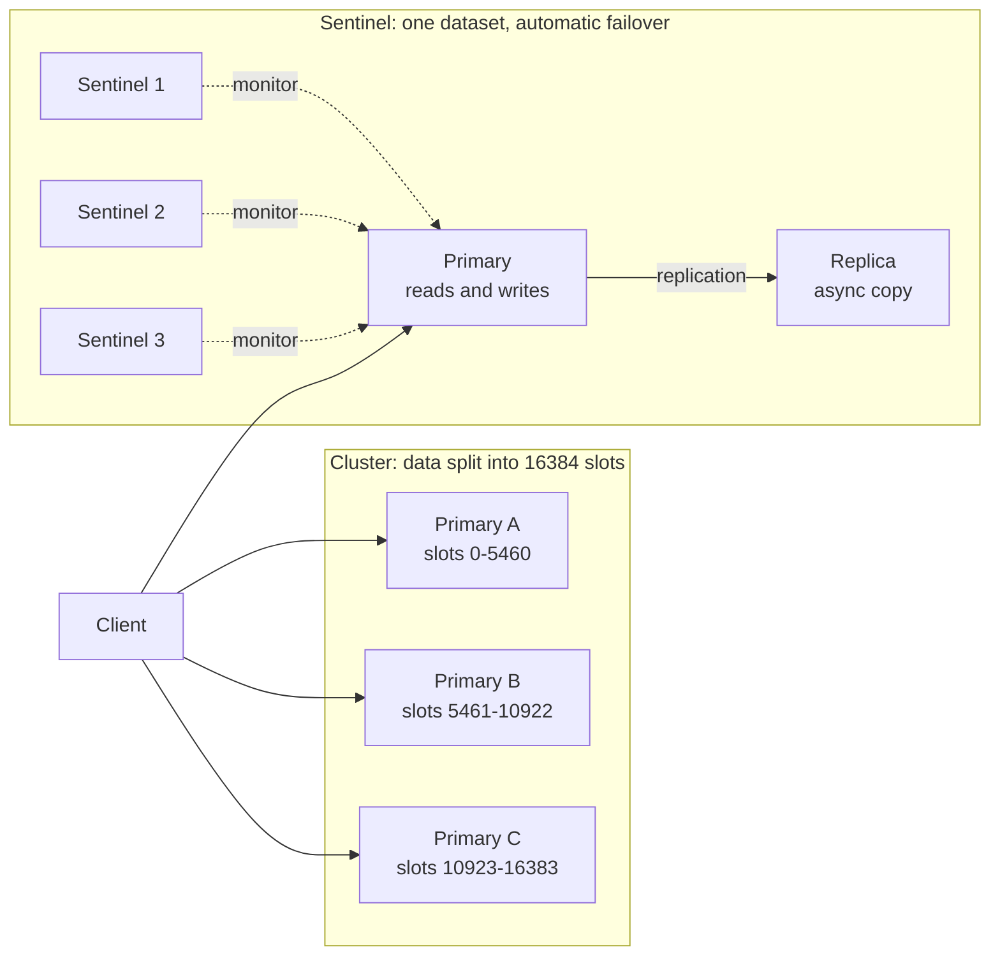

# L13.7 — Redis

> **Level 13: Databases & Distributed Systems** · Topic 7 of 15 · ⏱ ~6 hours · Difficulty: Intermediate

## 1. What it is

**Redis** (REmote DIctionary Server) is an in-memory data-structure server. You connect over TCP, send commands such as `SET`, `HSET`,
`ZADD` or `XADD`, and get answers in well under a millisecond because the data lives in RAM and commands are executed on a single main
thread. Unlike a plain key-value cache, the values are rich types (strings, hashes, lists, sets, sorted sets, streams, bitmaps,
HyperLogLogs and more) with server-side operations such as "increment this counter atomically" or "give me the top 10 scores".

People use it for four things: a **cache** in front of a slower database, **ephemeral state** (sessions, rate-limit counters, feature
flags), **coordination** (locks, queues, leaderboards, pub/sub) and, with care, a **primary store** for small, fast-changing data.
Memory is expensive and finite, so Redis comes with the questions this topic answers: what happens when it fills up (**eviction**), what
happens if it restarts (**persistence**, via RDB snapshots and the AOF log) and what happens if its server dies (**replication** with
**Sentinel**, or sharding with **Redis Cluster**).

> Licensing note: Redis changed its license in 2024, and the Linux Foundation project **Valkey** forked from the last BSD-licensed
> release. Commands, persistence and clustering behave the same for the purposes of this topic; managed services (for example
> Amazon ElastiCache) offer Redis OSS-compatible engines and Valkey. Check which engine and version your platform provides.

## 2. Why it matters in DevOps

- **Latency and database load:** a well-placed cache can remove most reads from PostgreSQL. A cache that is *cold* after a restart,
  or that expires all keys at once (**cache stampede**), sends that load back to the database and can take it down.
- **Memory is a hard limit.** With no `maxmemory`, Redis grows until the kernel's OOM killer ends it. With `maxmemory` and the wrong
  eviction policy, it either throws errors on writes or silently evicts data you needed (session keys!).
- **Persistence is a choice, not a default guarantee.** Depending on settings, a crash loses nothing, a second, or minutes of writes.
  Calling Redis "a database" without knowing which one you configured is a postmortem waiting to happen.
- **Single-threaded command execution:** one slow command (`KEYS *`, a huge `SMEMBERS`, a big Lua script) blocks every other client.
- **High availability is not automatic.** A lone Redis is a single point of failure. Sentinel or a managed service gives failover, and
  failover can still lose the last few acknowledged writes because replication is asynchronous (the same trade-off as in
  [Replication](04-replication.md)).
- It shows up everywhere else in this roadmap: [ElastiCache](../level-06-cloud-aws/11-elasticache.md), rate limiting in
  [Rate Limiting](../level-12-advanced-networking/13-rate-limiting.md), and [Distributed Locks and Queues](15-distributed-locks-and-queues.md).

## 3. Real-world system example

**Stripe's API rate limiters.** Stripe published how they protect the API with several kinds of limiters (request rate, concurrent
requests, fleet-usage load shedding, worker-utilization shedding), implemented with the token-bucket algorithm backed by Redis, because
a shared, atomic, low-latency counter is exactly what a fleet of stateless API servers needs.

**Background-job libraries.** **Resque** (created at GitHub) and **Sidekiq**, two widely used Ruby job libraries, keep their job
queues in Redis; many Rails applications therefore treat Redis as part of their core infrastructure, and "Redis is full" becomes "jobs stop."

**Managed Redis.** **Amazon ElastiCache** runs Redis-compatible nodes with replicas across Availability Zones and automatic
failover, and a cluster mode that shards data across many nodes. Kubernetes shops commonly run
a Redis Sentinel or Cluster deployment with a Helm chart or operator for sessions and caches.
Whatever the platform, the operational questions are the same: how much memory, what eviction policy, what persistence, how does
failover work, how do clients find the new primary.

## 4. Diagram

The cache-aside pattern, the most common use:



High availability with Sentinel (one primary, replicas, three Sentinels voting) versus sharding with Redis Cluster:



## 5. How it works

### Data structures and when to use them

| Type | Typical commands | Use for | Example key |
|------|------------------|---------|-------------|
| **String** | `SET key v EX 60`, `GET`, `INCR`, `SET key v NX PX 30000` | cached JSON, counters, simple locks, feature flags | `shop:product:42` |
| **Hash** | `HSET`, `HGET`, `HGETALL`, `HINCRBY` | objects with fields: a shopping cart (`sku -> qty`), session | `cart:u1` |
| **List** | `LPUSH`, `RPOP`, `BRPOP`, `LRANGE` | simple queues, recent-items feeds | `queue:email` |
| **Set** | `SADD`, `SISMEMBER`, `SINTER`, `SCARD` | unique members, tags, "who is online" | `online` |
| **Sorted set** | `ZADD`, `ZRANGE ... REV WITHSCORES`, `ZRANGEBYSCORE` | leaderboards, rate-limit windows, delayed jobs | `leaderboard` |
| **Stream** | `XADD`, `XREADGROUP`, `XACK` | durable-ish event log with consumer groups (a small Kafka-like log; see [Kafka](08-kafka.md)) | `events` |
| **Bitmap / HyperLogLog** | `SETBIT`/`BITCOUNT`, `PFADD`/`PFCOUNT` | daily-active flags; approximate unique counts in about 12 KB | `visits:2026-10-09` |
| **Pub/Sub** | `PUBLISH`, `SUBSCRIBE` | fire-and-forget broadcast (messages are lost if no subscriber is connected) | `channel:orders` |

Every key can carry a **TTL** (time to live): `EXPIRE key 60`, `TTL key`. Expired keys are removed lazily when touched plus by a periodic
background sample, so memory may not drop at the exact second of expiry.

Two habits that matter in production: **name keys with a prefix scheme** (`service:entity:id`) and **never run `KEYS *`** on a live
server. Use `SCAN` (incremental, cursor-based) instead.

### Caching patterns

| Pattern | How it works | Trade-off |
|---------|--------------|-----------|
| **Cache-aside** (lazy loading) | App reads cache, on a miss reads the database and writes the cache | simplest; stale data until TTL or invalidation; first request after a miss is slow |
| **Read-through** | Cache layer itself loads from the DB on a miss | simpler app code; needs a caching library or proxy |
| **Write-through** | Writes go to cache and database together | cache stays fresh; slower writes; caches data that may never be read |
| **Write-behind** (write-back) | Write to cache, flush to DB asynchronously | fastest writes; **risk of data loss** if Redis dies before the flush |
| **TTL only** | Everything expires after N seconds | trivially safe; you choose how stale is acceptable |

Cache problems you must plan for:

- **Stampede (thundering herd):** a hot key expires and 500 requests rebuild it at once. Mitigate with a short per-key rebuild lock
  (`SET lock NX PX`), **TTL jitter** (add a random few seconds), or serving stale data while one worker refreshes.
- **Penetration:** requests for keys that never exist always miss and hit the DB. Cache "not found" with a short TTL.
- **Invalidation is the hard part.** On update, delete the key (`DEL`) rather than trying to rewrite it; keep TTLs as a safety net.
- **Cold start:** an empty cache after a restart or failover can overload the database; warm it or ramp traffic.

### Persistence: RDB and AOF

| | **RDB** snapshot | **AOF** (Append-Only File) |
|---|------------------|----------------------------|
| What it is | Point-in-time binary dump (`dump.rdb`), written by a forked child (`BGSAVE`) | A log of every write command, replayed on start |
| Config | `save 3600 1 300 100 60 10000` | `appendonly yes`, `appendfsync always`, `everysec` (default), or `no` |
| Data you can lose on crash | everything since the last snapshot (minutes) | about 1 second with `everysec`; almost none with `always` (much slower) |
| Restart speed | fast (compact file) | slower (replay), mitigated by AOF rewrite and an RDB preamble |
| File size | small | larger, compacted by background rewrite |
| Good for | backups, fast restarts, replication seeding | durability closest to a database |

In Redis 7 the AOF is a set of files in an `appendonlydir/` (a base file plus incremental logs and a manifest). Using **both** is the
usual recommendation when you need durability: AOF for recovery, RDB files for backups. For a pure cache you often disable persistence
entirely (`save ""`, `appendonly no`) and accept a cold start. Remember that `BGSAVE` and AOF rewrite use `fork()`, and under heavy writes
copy-on-write can temporarily need extra RAM, so leave headroom (do not size the host exactly to `maxmemory`). Redis is **not** a
substitute for a backup of your system of record; copy RDB files off the host just like [PostgreSQL backups](05-backups-and-pitr.md).

### Eviction: what happens at `maxmemory`

Set `maxmemory` (for example `maxmemory 2gb`) and choose `maxmemory-policy`:

| Policy | Behaviour |
|--------|-----------|
| `noeviction` (default) | reject writes with `OOM command not allowed when used memory > 'maxmemory'`, reads still work |
| `allkeys-lru` / `allkeys-lfu` | evict the least recently / frequently used key of any kind. **Typical for a pure cache** |
| `volatile-lru` / `volatile-lfu` / `volatile-ttl` / `volatile-random` | evict only keys that have a TTL. If none have, behaves like `noeviction` |
| `allkeys-random` | random key |

The golden rule: **a cache and a data store should not share an instance.** If sessions or queues sit in the same Redis as a cache using
`allkeys-lru`, memory pressure will delete them. Use separate instances (or at least separate policies) for different jobs.
Watch `evicted_keys` and the hit ratio (`keyspace_hits` / (`keyspace_hits` + `keyspace_misses`)) in `INFO stats`.

### High availability and scale-out

- **Replication:** `replicaof host port` makes a node an asynchronous copy. Replicas are read-only by default, so reads from them can be stale.
  `WAIT n timeout` blocks until n replicas acknowledge, which reduces but does not eliminate loss.
- **Sentinel:** a set of at least three small Sentinel processes that monitor the primary and replicas, agree (a **quorum**) that the primary
  is down (`+sdown`, then `+odown`), elect one to run a failover, promote a replica and tell clients the new address. Sentinel-aware clients
  ask Sentinel for the current primary (`SENTINEL get-master-addr-by-name <name>`). It gives HA but **not** sharding: your dataset
  must still fit on one machine.
- **Redis Cluster:** the key space is divided into **16384 hash slots** (`CRC16(key) mod 16384`) spread across primaries, each ideally with a
  replica. It gives both sharding and failover with no external Sentinel. Clients must be cluster-aware and follow `MOVED` redirects. Multi-key
  commands only work if all keys hash to the same slot; use **hash tags** (`{cart:1}:items`, `{cart:1}:total`) to force that. Otherwise you get
  `CROSSSLOT Keys in request don't hash to the same slot`.
- **Choosing:** one dataset that fits in RAM and needs HA means primary + replica + Sentinel (or a managed Multi-AZ service). A dataset or
  throughput larger than one node means Cluster. Both are asynchronous, so both can lose recent writes on failover.

## 6. Step-by-step guide

**Prerequisites:** Linux/macOS/WSL2 and `redis-server` + `redis-cli` (Debian/Ubuntu: `sudo apt-get install redis-server redis-tools`; or Docker:
`docker run -d --name redis-lab -p 7001:6379 redis:7`, then `docker exec -it redis-lab redis-cli`). Redis 7 or newer. No cloud cost. The guide uses
ports 7001 and up and a throwaway directory so it will not touch a system Redis on 6379. Outputs were captured with Redis 7.0.

1. **Start a Redis with AOF persistence and talk to it.**
   ```bash
   mkdir -p ~/redislab/r1 && cd ~/redislab
   redis-server --port 7001 --dir ~/redislab/r1 --appendonly yes --save "" --daemonize yes
   redis-cli -p 7001 ping
   ```
   Expect `PONG`.

2. **Try each data structure.**
   ```bash
   R="redis-cli -p 7001"
   $R set shop:product:42 '{"name":"mug","price":9.5}' EX 60 ; $R ttl shop:product:42      # OK then 60
   $R hset cart:u1 sku42 2 sku7 1 ; $R hgetall cart:u1                                     # field/value pairs
   $R incr ratelimit:u1 ; $R expire ratelimit:u1 60                                          # atomic counter with a window
   $R zadd leaderboard 100 alice 250 bob 175 carol ; $R zrevrange leaderboard 0 1 withscores # bob 250, carol 175
   $R lpush queue:email job1 job2 ; $R rpop queue:email                                      # job1 (first in, first out)
   $R sadd online u1 u2 ; $R sadd online u2 u3 ; $R scard online                              # 3 unique members
   $R xadd events '*' type order_created id 7 ; $R xlen events                               # stream entry id like 1791549546599-0, then 1
   $R pfadd hll a b c ; $R pfcount hll                                                       # 3 (approximate unique count)
   $R object encoding cart:u1                                                                # listpack (compact small-hash encoding)
   ```

3. **Implement a lock and see why `NX` matters.**
   ```bash
   $R set lock:order:7 worker-A NX PX 30000     # OK  (acquired, auto-expires in 30 s)
   $R set lock:order:7 worker-B NX PX 30000     # (nil)  not acquired
   ```
   `NX` means "only if absent" and `PX` is a millisecond expiry, in one atomic command. A safe release must only delete the key if you still
   own it (compare the stored value in a Lua script). See [Distributed Locks and Queues](15-distributed-locks-and-queues.md) for why this is subtle.

4. **Cache-aside with stampede protection (Node.js sketch).** `npm install ioredis@5`, save as `cache.mjs`:
   ```javascript
   import Redis from "ioredis";
   const redis = new Redis(7001);
   let dbHits = 0;
   const loadProductFromDb = async (id) => { dbHits++; await new Promise(r => setTimeout(r, 50)); return { id, name: "mug", price: 9.5 }; };

   async function getProduct(id) {
     const key = `shop:product:${id}`;
     const cached = await redis.get(key);
     if (cached) return JSON.parse(cached);                       // hit
     const lockKey = `lock:${key}`;
     const got = await redis.set(lockKey, "1", "PX", 5000, "NX");  // only one caller rebuilds
     if (!got) { await new Promise(r => setTimeout(r, 60)); return getProduct(id); }
     try {
       const row = await loadProductFromDb(id);
       const ttl = 300 + Math.floor(Math.random() * 60);           // jitter avoids synchronized expiry
       await redis.set(key, JSON.stringify(row), "EX", ttl);
       return row;
     } finally { await redis.del(lockKey); }
   }

   await Promise.all(Array.from({ length: 50 }, () => getProduct(42)));
   console.log("50 concurrent requests, db hits:", dbHits);
   redis.disconnect();
   ```
   Run `node cache.mjs`. Expect `50 concurrent requests, db hits: 1`. Remove the lock and you will see many more database hits: that is the stampede. (The simple
   retry loop is a sketch; production code needs a retry limit and a fallback.)

5. **Watch eviction work.** Cap memory and fill it past the cap:
   ```bash
   $R config set maxmemory 5mb ; $R config set maxmemory-policy allkeys-lru
   redis-benchmark -p 7001 -t set -n 100000 -d 100 -r 100000 -q
   $R dbsize ; $R info stats | grep evicted_keys ; $R info memory | grep -E "used_memory_human|maxmemory_policy"
   ```
   `dbsize` stays in the thousands (well below 100,000 distinct keys), `evicted_keys` is large and used memory stays near the cap.
   Now switch to refusing writes and try again:
   ```bash
   $R config set maxmemory-policy noeviction
   redis-benchmark -p 7001 -t set -n 1000 -d 100 -r 100000000 -q     # fails once memory is full
   ```
   You will see `OOM command not allowed when used memory > 'maxmemory'`. Reset with `$R config set maxmemory 0` and `$R flushall`.

6. **Prove AOF durability by crashing it.**
   ```bash
   $R set durable yes ; sleep 2 ; pkill -9 -f "redis-server.*7001"
   redis-server --port 7001 --dir ~/redislab/r1 --appendonly yes --save "" --daemonize yes ; sleep 1
   $R get durable
   ```
   Expect `yes`: with `appendfsync everysec` the write reached disk within a second and was replayed from `r1/appendonlydir/`.
   Repeat after switching to RDB only (`--appendonly no --save ""`): the key is gone. Also try `$R bgsave` and look at `dump.rdb`.

7. **Replication plus Sentinel failover on one machine.**
   ```bash
   mkdir -p r2 s1
   redis-server --port 7002 --dir ~/redislab/r2 --replicaof 127.0.0.1 7001 --daemonize yes
   cat > s1/sentinel.conf <<'EOF'
   port 26379
   dir /home/YOU/redislab/s1
   sentinel monitor shopmaster 127.0.0.1 7001 1
   sentinel down-after-milliseconds shopmaster 3000
   sentinel failover-timeout shopmaster 10000
   sentinel parallel-syncs shopmaster 1
   EOF
   sed -i "s#/home/YOU#$HOME#" s1/sentinel.conf
   redis-server s1/sentinel.conf --sentinel --daemonize yes --logfile sentinel.log
   redis-cli -p 7001 info replication | head -5                       # role:master, connected_slaves:1
   redis-cli -p 26379 sentinel get-master-addr-by-name shopmaster      # 127.0.0.1 / 7001
   ```
   The quorum of `1` is for the lab only; production uses three Sentinels on separate hosts and a quorum of 2. Now kill the primary:
   ```bash
   redis-cli -p 7001 shutdown nosave ; sleep 8
   redis-cli -p 26379 sentinel get-master-addr-by-name shopmaster      # now 127.0.0.1 / 7002
   redis-cli -p 7002 info replication | head -3                        # role:master
   grep -E "sdown|odown|switch-master" ~/redislab/s1/sentinel.log
   ```
   The log shows `+sdown`, `+odown`, `+elected-leader`, `+promoted-slave` and `+switch-master shopmaster 127.0.0.1 7001 127.0.0.1 7002`.
   Clients that used the fixed address 7001 are now broken; Sentinel-aware clients re-ask Sentinel. That is why you configure clients with the
   Sentinel list, not a primary IP. (If a lab port is in use, change the numbers consistently.)

8. **Redis Cluster in three commands.**
   ```bash
   for p in 7101 7102 7103; do mkdir -p c$p; redis-server --port $p --cluster-enabled yes --cluster-config-file nodes.conf --dir ~/redislab/c$p --daemonize yes; done
   redis-cli --cluster create 127.0.0.1:7101 127.0.0.1:7102 127.0.0.1:7103 --cluster-replicas 0 --cluster-yes
   redis-cli -p 7101 set user:1 a                       # MOVED 10778 127.0.0.1:7102 (wrong node)
   redis-cli -c -p 7101 set user:1 a                    # -c follows redirects, OK
   redis-cli -c -p 7101 mset a 1 b 2                    # CROSSSLOT error
   redis-cli -c -p 7101 mset '{cart:1}:a' 1 '{cart:1}:b' 2     # OK, same slot via a hash tag
   ```
   The slot layout is similar to 0-5460, 5461-10922, 10923-16383. A real cluster uses `--cluster-replicas 1` and six nodes.

9. **Clean up.**
   ```bash
   for p in 7001 7002 26379 7101 7102 7103; do redis-cli -p $p shutdown nosave 2>/dev/null; done
   rm -rf ~/redislab
   ```

## 7. Real-world scenario

*(Illustrative, not a documented incident.)* The `shop-api` team caches product pages in Redis with `maxmemory 4gb`, the default policy
and no TTL on session keys, because "Redis is fast." After a marketing push the cache fills; every write now fails with
`OOM command not allowed`. Logins break (they write sessions), and the API falls back to PostgreSQL for everything, so the database CPU
doubles. The on-call engineer sees `used_memory` at the cap and `evicted_keys: 0` (nothing is allowed to evict under `noeviction`).

Fix, in order: raise `maxmemory` temporarily to stop the bleeding; find the offenders with `redis-cli --bigkeys` and `MEMORY USAGE`
(a `cart:*` hash with no TTL has been accumulating abandoned carts); set TTLs; **split** the instance in two: a cache instance with
`allkeys-lru` and a small session instance with `noeviction` and AOF `everysec`. They add alerts on `used_memory / maxmemory > 80%`,
`evicted_keys` rate and cache hit ratio, and add TTL jitter to prevent the synchronized expiry they also noticed.
**Lesson:** eviction policy and workload separation are architecture decisions; a cache that cannot evict, or a session store that can,
are both outages.

## 8. Common mistakes and best practices

**Don't**

- Run `KEYS *`, `FLUSHALL`, or big `SMEMBERS`/`HGETALL`/`LRANGE 0 -1` on a live production instance (one slow command stalls everyone).
- Use Redis as the only copy of important data without understanding RDB/AOF and failover loss.
- Put caches, queues and sessions in one instance with `allkeys-lru`.
- Expose Redis to the internet or run it without authentication. It was designed for trusted networks; use `requirepass`/ACLs, TLS,
  `bind` to private addresses and firewall port 6379 (see [Security Groups and NACLs](../level-06-cloud-aws/06-security-groups-and-nacls.md)).
- Set TTLs to the same value for every key, or forget to jitter.
- Use Pub/Sub for messages you cannot afford to lose, or a single-node lock for correctness-critical mutual exclusion.

**Do**

- Set `maxmemory` below the host's RAM (leave room for fork copy-on-write, replica buffers and the OS) and pick the eviction policy deliberately.
- Choose persistence per instance: none for a pure cache, AOF `everysec` (plus RDB backups copied off-host) for data you care about.
- Use `SCAN`, pipelines and short commands; keep values small; use key prefixes and TTLs everywhere possible.
- Run Sentinel with three or more independent members, or a managed Multi-AZ service, and configure clients with the Sentinel/cluster discovery list.
- Monitor memory, evictions, hit ratio, connected clients, latency (`redis-cli --latency`, `SLOWLOG GET`), replication offset/lag and fork time.
  Export these to Prometheus ([Prometheus and PromQL](../level-10-observability/02-prometheus-and-promql.md)).
- Design the application to survive an empty Redis: the database remains the source of truth for cached data.

## 9. Tasks

- [ ] **T1 — Tour the data structures** *(≈40 min, beginner)*
  - **Goal:** pick the right type for a job.
  - **Steps:**
    1. Start Redis (guide step 1).
    2. Model: a product cache (string with TTL), a cart (hash), a top-5 sellers board (sorted set), a "recently viewed" list (list capped with `LTRIM`), and unique visitors (HyperLogLog).
    3. For each, run the commands that read it back and `TYPE key`, `TTL key`.
  - **Done when:** each of the five structures exists with sensible keys and you can say why a string would have been the wrong choice for the cart.

- [ ] **T2 — Cache-aside with a measured hit ratio** *(≈60 min, intermediate)*
  - **Goal:** implement the pattern and measure its effect.
  - **Steps:**
    1. Run the `cache.mjs` sketch (or port it to your language), with a fake 50 ms DB call.
    2. Call `getProduct` for 1,000 random ids drawn from 100 popular ids.
    3. Compute hit ratio from `INFO stats` (`keyspace_hits`, `keyspace_misses`), and total elapsed time versus no cache.
  - **Done when:** you can report hit ratio and speedup (for example 90%+ hits and a large drop in DB calls) with the numbers from your run.

- [ ] **T3 — Cause and fix a cache stampede** *(≈45 min, intermediate)*
  - **Goal:** see thundering-herd load and remove it.
  - **Steps:**
    1. Remove the lock from `getProduct`, fire 200 concurrent requests for one cold key, and count DB hits.
    2. Restore the `SET NX PX` rebuild lock and compare.
    3. Add TTL jitter and show with `TTL` that keys cached at the same moment expire at different times.
  - **Done when:** DB hits fall from many to 1 for a cold key, and you can explain what happens if the lock holder crashes (the lock's `PX` expiry).

- [ ] **T4 — Choose and test an eviction policy** *(≈45 min, intermediate)*
  - **Goal:** understand what each policy keeps and drops.
  - **Steps:**
    1. Set `maxmemory 5mb`. Insert 20 "session" keys with no TTL and 50,000 "cache" keys with a 600 s TTL.
    2. Under `allkeys-lru`, check whether the session keys survive; repeat under `volatile-lru` and `noeviction`.
    3. Record `evicted_keys`, `dbsize` and the error for `noeviction`.
  - **Done when:** you have a 3-row table (policy, sessions survived?, write errors?) and a written recommendation to split sessions from cache.

- [ ] **T5 — Crash it, then fail it over** *(≈75 min, advanced)*
  - **Goal:** compare persistence options and observe Sentinel.
  - **Steps:**
    1. Run guide step 6 with AOF `everysec`, then with RDB-only (`--save "" --appendonly no`), and then with `appendfsync always`; time 100,000 writes with `redis-benchmark -t set -n 100000 -q` each way.
    2. Run guide step 7. While a loop writes `INCR counter` once per 100 ms against the primary, kill the primary.
    3. Compare the last value the client saw acknowledged with the value on the promoted replica.
  - **Done when:** you can state which persistence mode lost data on a crash, the throughput cost of `always`, the failover time from the Sentinel log, and whether the promoted replica was missing any acknowledged increments.

- [ ] **T6 — Prove it: design the Redis layer for `shop-api`** *(≈45 min, advanced)*
  - **Goal:** make and defend the architecture decisions without notes.
  - **Steps:**
    1. Write a one-page design covering: what goes in Redis (cache, sessions, rate limits, job queue), which instances are separate, each instance's `maxmemory-policy` and persistence, how HA works (Sentinel or managed), and how the app behaves if Redis is empty.
    2. Include the three metrics you would alert on and their thresholds.
    3. Demonstrate the one riskiest assumption on your lab instance (for example, a restart with the cache emptied while load continues) and show the database holds.
  - **Done when:** a teammate can read the design, and your demo shows `shop-api` still serving correct data (slower) with an empty cache.

## 10. Self-check questions

1. Why is Redis fast, and what is the downside of its threading model?
2. What is the difference between RDB and AOF, and how much data can each lose?
3. You set `maxmemory 2gb` and leave the default policy. What happens when it fills?
4. When would you choose Sentinel and when Redis Cluster?
5. What is a cache stampede and two ways to prevent it?
6. Why does a failover to a replica possibly lose acknowledged writes?

<details>
<summary>Answers</summary>

1. Data is in RAM, structures are simple and commands run on one main thread without locking. The downside is that one slow command blocks all clients, and a single thread can saturate one CPU core.
2. RDB is periodic snapshots (you can lose everything since the last snapshot, minutes). AOF logs every write; with `everysec` you can lose about a second, with `always` almost nothing at a throughput cost. They can be combined.
3. The default is `noeviction`, so writes are rejected with an `OOM command not allowed` error while reads continue. That may be right for a datastore but is usually wrong for a cache.
4. Sentinel gives HA for a dataset that fits on one node (single primary, replicas, automatic failover). Cluster shards across nodes for capacity and throughput and has built-in failover, at the cost of multi-key limitations and cluster-aware clients.
5. Many requests rebuild an expired hot key simultaneously and overload the database. Prevent with a per-key rebuild lock, TTL jitter, serving stale while refreshing, or pre-warming.
6. Replication is asynchronous: the primary acknowledges a write before replicas have it. If the primary dies before replicating and a replica is promoted, those writes are gone. `WAIT` narrows but does not close the gap.
</details>

## 11. Further reading

- Redis documentation (redis.io/docs): *Data types*, *Persistence*, *Eviction*, *High availability with Redis Sentinel*, *Scale with Redis Cluster* and the command reference. The Valkey documentation (valkey.io) covers the fork.
- Stripe Engineering blog: *Scaling your API with rate limiters*.
- Salvatore Sanfilippo (antirez), the original author of Redis, has written widely about Redis persistence and replication design on his blog.
- *Redis in Action* (Josiah Carlson) for patterns; read with the current docs in hand since some features have moved on.
- Martin Kleppmann, *Designing Data-Intensive Applications*, chapters on replication and caching trade-offs.
- Related: [ElastiCache](../level-06-cloud-aws/11-elasticache.md), [Database Connection Pooling](06-db-connection-pooling.md), [Idempotency](14-idempotency.md).

<!-- nav -->
---
← Previous: [Database Connection Pooling](06-db-connection-pooling.md) · [Level 13 index](README.md) · Next: [Kafka](08-kafka.md) →
