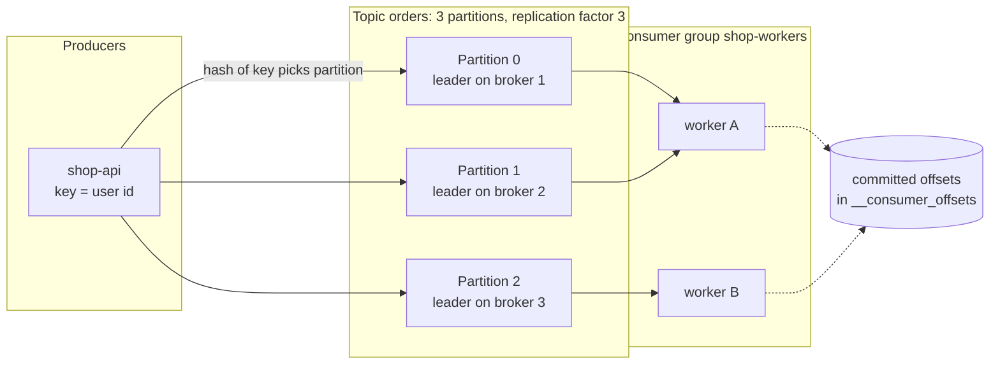
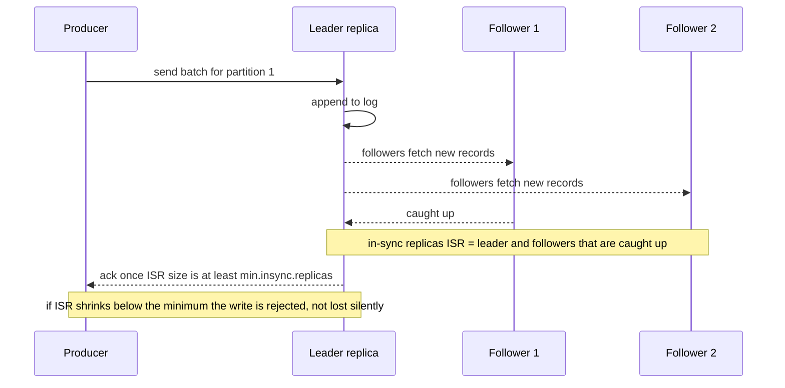

# L13.8 — Kafka

> **Level 13: Databases & Distributed Systems** · Topic 8 of 15 · ⏱ ~7 hours · Difficulty: Advanced

## 1. What it is

**Apache Kafka** is a distributed, replicated, append-only **commit log** that many programs can write to and read from. A
**producer** appends **records** (a key, a value, a timestamp and optional headers) to a named **topic**. Each topic is split into
**partitions**, and each partition is an ordered, immutable sequence of records, each with a sequential number called its **offset**.
**Consumers** read records by offset, and remember how far they have read by **committing** an offset. Records are not deleted when read;
they are kept for a configurable **retention** period (or until a size limit) so that many independent consumers can read the same data, and a
consumer that fell behind or was fixed after a bug can rewind and read it again.

That differs from a classic message queue such as RabbitMQ (see [RabbitMQ](09-rabbitmq.md)), where a broker pushes messages to consumers
and removes them once acknowledged. Kafka is a *log you read*, not a *queue you drain*. It is used to decouple services, stream events
between systems, feed analytics, and to propagate database changes (change data capture).

## 2. Why it matters in DevOps

- **It is infrastructure you operate.** Brokers need disk, network and careful sizing; partitions and replication factors are
  decisions that are painful to change later; upgrades and rebalances need planning.
- **Lag is the new "queue depth".** A consumer group that falls behind means orders, emails or analytics are delayed. Consumer lag is a key
  [SLI](../level-14-sre/01-slis.md) for event-driven systems, and rebalances, slow consumers and poison messages are common on-call topics.
- **Ordering and duplicates surprise people.** Kafka orders records *within a partition* only, and the normal delivery guarantee is
  *at least once*, so consumers must be [idempotent](14-idempotency.md). Adding partitions silently changes which partition a key maps to.
- **Data durability depends on configuration:** `acks`, `replication.factor` and `min.insync.replicas` together decide whether an
  acknowledged write can be lost when a broker dies (the same trade-offs as [Replication](04-replication.md)).
- **Disk fills:** retention is how you control cost and how long consumers can fall behind. A forgotten topic with infinite retention
  quietly eats the volume.

## 3. Real-world system example

**LinkedIn** created Kafka to handle activity-stream and operational-metrics data and open-sourced it; it became an Apache project.
LinkedIn's engineering writing describes the log as the central abstraction connecting data systems, an idea
laid out in Jay Kreps' essay *The Log: What every software engineer should know about real-time data's unifying abstraction*.

**Netflix** has written publicly about building its Keystone data pipeline on Kafka for routing large volumes of events (such as
viewing and operational events) to downstream consumers, using Kafka clusters per use case and separating producers from consumers.
**Uber, Shopify** and many others describe Kafka as the backbone for event streaming; and **Debezium** (change data capture)
reads the PostgreSQL write-ahead log and publishes row changes into Kafka topics, linking this topic to [Replication](04-replication.md).
Cloud equivalents include **Amazon MSK** (managed Kafka), **Confluent Cloud**, and, with a different API, Kinesis and Google Pub/Sub.

On Kubernetes, Kafka is commonly run with an operator such as **Strimzi**. Since Kafka 3.3, **KRaft** mode (Kafka's own Raft-based
metadata quorum) is production-ready, and Kafka 4.0 removed the dependency on ZooKeeper entirely, so new clusters should use KRaft.

## 4. Diagram

A topic with three partitions, replicated, and a consumer group dividing the work:



A durable write with `acks=all` and `min.insync.replicas=2`:



## 5. How it works

### The vocabulary

| Term | Meaning |
|------|---------|
| **Broker** | A Kafka server. A cluster is typically 3+ brokers |
| **Topic** | Named stream of records (`orders`, `payments`, `inventory.events`) |
| **Partition** | One ordered log; the unit of **parallelism** and of **ordering**. A topic's partitions are spread over brokers |
| **Offset** | Position of a record in a partition (0, 1, 2 ...). Unique only within a partition |
| **Replication factor** | Copies of each partition (3 is the production norm). One is the **leader** (serves reads/writes), the others are **followers** |
| **ISR** | In-Sync Replicas: followers that are caught up with the leader. Only ISR members are eligible to become leader without data loss |
| **Producer** | Writes records. Chooses the partition by hashing the key, or round-robin/sticky when there is no key |
| **Consumer group** | A set of consumers sharing a `group.id`. Each partition is assigned to **exactly one** consumer in the group at a time |
| **Group coordinator / rebalance** | A broker tracks membership. When consumers join or leave, partitions are redistributed (a **rebalance**) |
| **Committed offset** | The group's saved position, stored in the internal topic `__consumer_offsets`. After a restart consumers resume from it |
| **Lag** | `log-end-offset - committed offset` per partition: how far behind a group is |
| **KRaft controller** | Quorum of nodes that stores cluster metadata (replaces ZooKeeper) |

### Partitions, consumer groups and parallelism

- Within one consumer group, **parallelism is capped by the number of partitions**. With 3 partitions, a 4th consumer sits idle.
  Different groups are independent and each reads the whole topic: a "billing" group and an "analytics" group both see every order.
- Choosing partition count: enough for peak consumer parallelism and throughput (a rough rule is target throughput divided by what one
  partition/consumer can do), with room to grow. More partitions mean more open files, more replication work and longer recovery,
  so avoid hundreds per topic "just in case".
- **You can add partitions but never remove them**, and adding changes the key-to-partition mapping (see ordering below).

### Ordering guarantees

- Kafka guarantees order **within a partition** only. There is no ordering across partitions or across topics.
- To keep all events for one entity ordered (all events of order 123, all actions of user u1), use that entity id as the **record key**:
  the same key always goes to the same partition (as long as the partition count does not change).
- Retries can reorder records unless the producer is **idempotent** (`enable.idempotence=true`, the default in recent clients, which implies
  `acks=all` and bounded in-flight requests). It also removes duplicates caused by producer retries.
- **Adding partitions to a live keyed topic breaks per-key ordering** for a time: new records for key `u1` may land in a different partition
  than old ones, and a consumer may process new before old. You will reproduce this in the guide.
- A consumer processing a partition in parallel with threads, or a rebalance mid-batch, can also break your effective ordering.

### Durability settings (producer + topic)

| Setting | Effect |
|---------|--------|
| `acks=0` | Fire and forget. Fast, lossy |
| `acks=1` | Leader has it. Lost if the leader dies before followers copy it |
| `acks=all` | All in-sync replicas have it. Use with the next setting |
| `min.insync.replicas=2` (with RF 3) | Writes fail if fewer than 2 replicas are in sync, instead of silently accepting risky writes. RF 3 + `min.insync.replicas=2` + `acks=all` tolerates losing one broker without losing acknowledged data |
| `unclean.leader.election.enable=false` (default) | Never elect an out-of-sync replica (prefers unavailable to losing data) |

### Delivery semantics and offsets

- **At-most-once:** commit the offset *before* processing. A crash loses the message.
- **At-least-once** (the practical default): process, *then* commit. A crash between the two causes redelivery, so handlers must be idempotent.
- **Exactly-once** in Kafka means idempotent producers plus **transactions** (atomic read-process-write between Kafka topics, `isolation.level=read_committed`).
  Once you write to an *external* system (PostgreSQL, an email API) you are back to at-least-once plus an idempotent handler or a deduplication
  key. See [Idempotency](14-idempotency.md).
- Key consumer settings: `enable.auto.commit` (turn it off if you need control), `auto.offset.reset` (`earliest` or `latest` when the group
  has no committed offset), `max.poll.interval.ms` (if processing a batch takes longer, the consumer is kicked out and a rebalance happens),
  `session.timeout.ms`, `max.poll.records`.
- **Poison messages:** a record that always fails will block its partition forever if you retry endlessly. Common solutions are a
  **dead-letter topic** and bounded retries.

### Retention and compaction

| Policy | Config | Behaviour |
|--------|--------|-----------|
| Time/size retention | `retention.ms` (default 7 days), `retention.bytes` | Old **segments** (files) are deleted once they pass the limit. Deletion works on whole closed segments, a periodic check (`log.retention.check.interval.ms`, default 5 minutes) does it, so it is approximate |
| Log compaction | `cleanup.policy=compact` | Keeps at least the **latest record per key** (tombstones, a null value, delete a key). Used for "current state" topics, such as changelogs and `__consumer_offsets` |
| Both | `cleanup.policy=compact,delete` | Latest per key but also bounded by time |

Also relevant: `segment.bytes` / `segment.ms` (when a new file starts), `message.max.bytes`, and the disk layout `log.dirs/<topic>-<partition>/`
with `.log`, `.index` and `.timeindex` files. Consumers can only read what still exists: a group that is offline longer than retention
loses data (its offsets point to deleted records and `auto.offset.reset` decides what happens).

## 6. Step-by-step guide

**Prerequisites:** Java 17 or newer (Java 11+ for clients), a Linux/macOS/WSL2 shell, about 1.5 GB RAM, and a Kafka download (3.9 or newer;
current releases are listed at kafka.apache.org/downloads). Free, local. The commands are in the Kafka `bin/` directory; the outputs below came from
Kafka 3.9.0 in single-node KRaft mode and yours will be "similar to" them. A single broker means replication factor 1 here: it demonstrates
partitions, groups, offsets and ordering, but **not** broker-failure durability. For three brokers, use a Compose file or the Strimzi operator.

1. **Install and start a single-node KRaft broker.**
   ```bash
   cd ~ && curl -fsSLO https://archive.apache.org/dist/kafka/3.9.0/kafka_2.13-3.9.0.tgz
   tar xzf kafka_2.13-3.9.0.tgz && cd kafka_2.13-3.9.0
   mkdir -p ~/kafkalab
   cat > ~/kafkalab/server.properties <<'EOF'
   process.roles=broker,controller
   node.id=1
   controller.quorum.voters=1@localhost:19093
   listeners=PLAINTEXT://localhost:19092,CONTROLLER://localhost:19093
   advertised.listeners=PLAINTEXT://localhost:19092
   controller.listener.names=CONTROLLER
   inter.broker.listener.name=PLAINTEXT
   listener.security.protocol.map=CONTROLLER:PLAINTEXT,PLAINTEXT:PLAINTEXT
   log.dirs=/tmp/kafkalab/data
   num.partitions=1
   offsets.topic.replication.factor=1
   transaction.state.log.replication.factor=1
   transaction.state.log.min.isr=1
   group.initial.rebalance.delay.ms=0
   EOF
   ID=$(bin/kafka-storage.sh random-uuid)
   bin/kafka-storage.sh format -t "$ID" -c ~/kafkalab/server.properties
   bin/kafka-server-start.sh -daemon ~/kafkalab/server.properties
   sleep 10 && bin/kafka-topics.sh --bootstrap-server localhost:19092 --list
   ```
   `format` prints `Formatting metadata directory ...`; the empty `--list` output means the broker is up. The ports 19092/19093 avoid clashing with a Kafka on the
   default 9092. (Alternative with Docker: `docker run -d --name kafka -p 9092:9092 apache/kafka:3.9.0`, then use `localhost:9092`.) Set
   `export BS="--bootstrap-server localhost:19092"` for the next steps.

2. **Create a topic and look at it.**
   ```bash
   bin/kafka-topics.sh $BS --create --topic orders --partitions 3 --replication-factor 1 --config retention.ms=604800000
   bin/kafka-topics.sh $BS --describe --topic orders
   ```
   You should see three partitions each with a `Leader: 1`, `Replicas: 1` and `Isr: 1`. On a real cluster these show different brokers.

3. **Produce keyed records and see the key-to-partition mapping.**
   ```bash
   printf 'u1:order-1\nu2:order-2\nu1:order-3\nu3:order-4\nu2:order-5\nu1:order-6\n' | \
     bin/kafka-console-producer.sh $BS --topic orders --property parse.key=true --property key.separator=:
   bin/kafka-console-consumer.sh $BS --topic orders --from-beginning --max-messages 6 \
     --property print.key=true --property print.partition=true --property print.offset=true --timeout-ms 8000
   ```
   Expected shape (partition numbers may differ slightly by key hashing, but the pattern is fixed):
   ```text
   Partition:0  Offset:0  u2  order-2
   Partition:0  Offset:1  u2  order-5
   Partition:1  Offset:0  u1  order-1
   Partition:1  Offset:1  u1  order-3
   Partition:1  Offset:2  u3  order-4
   Partition:1  Offset:3  u1  order-6
   ```
   All `u1` records sit in one partition in the order they were sent; across partitions there is no global order. Offsets restart at 0 in every partition.

4. **Consume as a group and read the lag.**
   ```bash
   bin/kafka-console-consumer.sh $BS --topic orders --group shop-workers --from-beginning --max-messages 3 --timeout-ms 8000 > /dev/null
   bin/kafka-consumer-groups.sh $BS --describe --group shop-workers
   ```
   Output similar to:
   ```text
   GROUP         TOPIC   PARTITION  CURRENT-OFFSET  LOG-END-OFFSET  LAG  CONSUMER-ID  HOST  CLIENT-ID
   shop-workers  orders  0          2               2               0    -            -     -
   shop-workers  orders  1          1               4               3    -            -     -
   shop-workers  orders  2          0               0               0    -            -     -
   ```
   `LAG` of 3 on partition 1 is exactly "three records the group has not processed". The group has no active members now, but its committed
   offsets live in `__consumer_offsets`. Run the same consumer again and it continues from there.

5. **Run two consumers in one group and watch partitions get split.**
   ```bash
   for i in 1 2; do
     bin/kafka-console-consumer.sh $BS --topic orders --group g2 --from-beginning --consumer-property client.id=worker-$i > /dev/null &
     sleep 6
   done
   bin/kafka-consumer-groups.sh $BS --describe --group g2
   bin/kafka-consumer-groups.sh $BS --describe --group g2 --state
   ```
   Each partition is assigned to exactly one `CLIENT-ID` (for example worker-1 holds partitions 0 and 1 and worker-2 holds partition 2) and the state shows `Stable` with
   `#MEMBERS 2`. Stop one consumer (`kill %1`) and describe again: the survivor takes everything over, within a few seconds after a clean shutdown or up to `session.timeout.ms` (45 s by default in recent clients) if the consumer is killed hard. That is a rebalance.
   Stop the background jobs with `kill %1 %2` when done.

6. **Reset offsets to replay history.**
   ```bash
   bin/kafka-consumer-groups.sh $BS --group shop-workers --topic orders --reset-offsets --to-earliest --dry-run
   bin/kafka-consumer-groups.sh $BS --group shop-workers --topic orders --reset-offsets --to-earliest --execute
   ```
   The group must have no active members. This is how you reprocess after a bug fix (and why consumers must tolerate duplicates). `--to-datetime`, `--shift-by` and
   `--to-offset` are also available.

7. **Break ordering by adding partitions.**
   ```bash
   bin/kafka-topics.sh $BS --create --topic remap --partitions 3 --replication-factor 1
   printf 'u1:before\nu2:before\nu3:before\nu4:before\nu5:before\nu6:before\n' | \
     bin/kafka-console-producer.sh $BS --topic remap --property parse.key=true --property key.separator=:
   bin/kafka-topics.sh $BS --alter --topic remap --partitions 6
   sleep 3
   printf 'u1:after\nu2:after\nu3:after\nu4:after\nu5:after\nu6:after\n' | \
     bin/kafka-console-producer.sh $BS --topic remap --property parse.key=true --property key.separator=:
   bin/kafka-console-consumer.sh $BS --topic remap --from-beginning --max-messages 12 \
     --property print.key=true --property print.partition=true --timeout-ms 8000 | sort
   ```
   Some keys keep their partition and some move. In our run `u1` and `u3` and `u6` moved from partition 1 to partition 4, `u5` from 2 to 5, while `u2` and `u4` stayed in 0.
   For moved keys, "before" and "after" records are now in different partitions, so a consumer can see `after` before `before`.
   Also try shrinking: `--alter --partitions 2` fails with `InvalidPartitionsException ... would not be an increase`.

8. **Retention, size and the files on disk.**
   ```bash
   bin/kafka-configs.sh $BS --entity-type topics --entity-name orders --alter --add-config retention.ms=86400000,retention.bytes=1073741824
   bin/kafka-configs.sh $BS --entity-type topics --entity-name orders --describe
   ls /tmp/kafkalab/data/orders-1
   bin/kafka-dump-log.sh --files /tmp/kafkalab/data/orders-1/00000000000000000000.log --print-data-log | head
   ```
   You see `.log`, `.index` and `.timeindex` files, and the dump shows each record's offset, key size and payload. To see deletion happen, set
   `segment.bytes=1048576` (a small segment) and `retention.ms=60000` on a scratch topic, produce a few MB with
   `bin/kafka-producer-perf-test.sh --topic scratch --num-records 100000 --record-size 200 --throughput -1 --producer-props bootstrap.servers=localhost:19092`, and wait for
   the retention check; old `.log` segment files disappear and the log-start offset moves forward (`bin/kafka-get-offsets.sh $BS --topic scratch --time earliest`).
   Exact timing depends on the check interval (default 5 minutes), so allow several minutes. (This deletion walk-through was not run in our lab; the config names are from the Kafka documentation.)

9. **A consumer that commits after processing (at-least-once).** With `pip install confluent-kafka`, save as `worker.py`:
   ```python
   from confluent_kafka import Consumer, Producer
   import json

   p = Producer({"bootstrap.servers": "localhost:19092", "enable.idempotence": True, "acks": "all"})
   for i in range(5):
       p.produce("orders", key=f"u{i % 2}", value=json.dumps({"order_id": i}))
   p.flush()

   c = Consumer({
       "bootstrap.servers": "localhost:19092",
       "group.id": "py-workers",
       "auto.offset.reset": "earliest",
       "enable.auto.commit": False,      # commit only after the work is done
   })
   c.subscribe(["orders"])
   while True:
       msg = c.poll(2.0)
       if msg is None:
           break
       if msg.error():
           raise RuntimeError(msg.error())
       print(f"partition={msg.partition()} offset={msg.offset()} key={msg.key().decode()}")
       c.commit(message=msg)             # a crash before this line means redelivery (at-least-once)
   c.close()
   ```
   Run `python3 worker.py`; it prints each record and `kafka-consumer-groups.sh --describe --group py-workers` shows `LAG 0`.
   Kill the process in the middle (add `time.sleep(1)` in the loop) and restart: it resumes from the last committed offset, possibly repeating one record.

10. **Clean up.**
    ```bash
    bin/kafka-server-stop.sh
    rm -rf /tmp/kafkalab ~/kafkalab
    ```

## 7. Real-world scenario

*(Illustrative, not a documented incident.)* The `shop-api` order service publishes `order.created` events to an `orders` topic with 6 partitions,
keyed by `order_id`. A `fulfilment` consumer group of six pods reads it and a `notifications` group sends emails. On a Monday morning customer
support reports "I got the shipping email twice", and an hour later "orders from Saturday have not shipped."

Investigation: `kafka-consumer-groups.sh --describe --group fulfilment` shows partition 3 with a lag of 41,000 and growing, while the other five partitions are at 0, and
the consumer for partition 3 keeps restarting. The logs show one malformed record (a missing `currency`) crashes the handler; the consumer restarts, re-reads the same offset, and crashes
again. A poison message is blocking one partition. Meanwhile the duplicate emails: each restart replays the batch that was already partly
processed before the offset was committed, and the email handler is not idempotent.

Fix: skip the bad record by moving it to a `orders.dlq` dead-letter topic and continuing, deploy a fix for the validation, and make the email
handler record `order_id` in a table (unique key) before sending, so redelivery does not resend. Add alerts on lag per group/partition and on consumer restarts; and
set `max.poll.interval.ms` so a slow batch does not trigger endless rebalances. **Lesson:** at-least-once delivery is a contract that your code
must honour: bounded retries, a dead-letter path, idempotent side effects and lag alerts.

## 8. Common mistakes and best practices

**Don't**

- Use `acks=1` or RF 1 for data you cannot lose, or set `min.insync.replicas=1` and believe it is durable.
- Assume global ordering, or add partitions to a keyed topic without planning the ordering impact.
- Create hundreds of partitions per topic "for later", or one topic per customer.
- Retry a failing record forever without a dead-letter path, or do long processing between `poll()` calls so the consumer is evicted from the group.
- Auto-commit offsets and then do slow or failure-prone work (you may commit what you have not finished).
- Put large blobs (tens of MB) in records; store the file in object storage and send a reference.
- Leave the cluster without disk-usage, under-replicated-partition and lag alerts; run a single broker in production.

**Do**

- Use RF 3, `acks=all`, `min.insync.replicas=2`, idempotent producers, and spread brokers across Availability Zones (with rack awareness).
- Pick keys that give both ordering where you need it and even distribution (avoid a hot key).
- Make consumers idempotent ([Idempotency](14-idempotency.md)) and design for replays; keep a dead-letter topic and bounded retries.
- Monitor consumer lag, under-replicated partitions, ISR shrink events, request latency and disk usage; export JMX metrics to Prometheus ([Observability](../level-10-observability/01-three-pillars.md)).
- Set retention deliberately per topic, document it, and use compaction for "latest state" topics.
- Version your event schemas (for example with a schema registry and compatible evolution) and treat topics as public APIs.
- Use KRaft, keep clients and brokers on supported versions, and rehearse broker replacement and rolling upgrades.

## 9. Tasks

- [ ] **T1 — Single-node KRaft broker and your first topic** *(≈45 min, beginner)*
  - **Goal:** run Kafka and inspect a topic's structure.
  - **Steps:**
    1. Follow guide steps 1-2 to start a broker and create `orders` with 3 partitions.
    2. Run `kafka-topics.sh --describe` and `kafka-get-offsets.sh --topic orders`.
    3. Look at the partition directories under `log.dirs`.
  - **Done when:** you can point at the leader, replica and ISR columns, and show three `orders-N` directories on disk, explaining what each file type is for.

- [ ] **T2 — Prove per-key ordering** *(≈45 min, intermediate)*
  - **Goal:** demonstrate that Kafka orders within a partition, not across the topic.
  - **Steps:**
    1. Produce 1,000 records with keys `u1`..`u20` and an increasing sequence number in the value.
    2. Consume with `print.partition`, `print.key` and `print.offset`.
    3. For each key, verify that sequence numbers are increasing and all of a key's records came from one partition (a short script is fine); then show that the global sequence is not monotonic.
  - **Done when:** your check prints "all keys ordered within partition" and your output also shows at least one place where the global sequence is out of order.

- [ ] **T3 — Scale a consumer group and cause a rebalance** *(≈60 min, intermediate)*
  - **Goal:** see partition assignment, parallelism limits and lag.
  - **Steps:**
    1. Produce 200,000 records with `kafka-producer-perf-test.sh`.
    2. Start one consumer in group `g3`, then add consumers one by one (up to 4 on a 3-partition topic), recording `--describe` each time.
    3. Kill one consumer and time how long until the partitions are reassigned.
  - **Done when:** you can show that the 4th consumer received no partitions, and report the reassignment time and the lag before/after.

- [ ] **T4 — Break ordering with partitions, then recover from a poison message** *(≈75 min, advanced)*
  - **Goal:** reproduce two classic production failures.
  - **Steps:**
    1. Reproduce guide step 7 and list which keys moved partition.
    2. Write a consumer that throws on records whose value is `BAD`; produce one `BAD` into the middle of a partition and show the group stuck on it with growing lag.
    3. Change the consumer to retry 3 times, then publish the record to `orders.dlq` and commit past it.
  - **Done when:** lag returns to 0, the `BAD` record is readable in `orders.dlq`, and you can state how a key's ordering guarantee was affected by adding partitions.

- [ ] **T5 — Replay with offset reset and make the handler idempotent** *(≈60 min, advanced)*
  - **Goal:** design for at-least-once delivery.
  - **Steps:**
    1. Write a consumer that "sends an email" by appending `order_id` to a file, committing after processing. Run it to completion.
    2. Reset the group's offsets to earliest and run it again: observe duplicates.
    3. Add a deduplication check (a set in SQLite or a PostgreSQL table with a unique key) before the side effect, and run the replay again.
  - **Done when:** the second replay produces zero new "emails", and the dedup store contains exactly one row per `order_id`.

- [ ] **T6 — Prove it: choose the settings for a payments topic** *(≈45 min, advanced)*
  - **Goal:** justify durability and ordering decisions without the guide.
  - **Steps:**
    1. For a `payments` topic that must not lose or reorder a given customer's events, write the topic config (partitions, RF, `min.insync.replicas`, retention, cleanup policy), the producer config and the consumer config (commit strategy, offset reset), with a one-line reason for each.
    2. Explain what happens to the producer when one of three brokers fails, and when two fail.
    3. Apply the topic settings to your lab broker (the RF/ISR values you cannot test on one broker should be noted as untested) and demonstrate the ordering and the retention settings with `--describe`.
  - **Done when:** a teammate agrees with every setting, and you can describe the broker-failure behaviour precisely (`NotEnoughReplicas` errors when ISR drops below the minimum).

## 10. Self-check questions

1. What is the unit of ordering in Kafka, and how do you make sure all events for one order are processed in sequence?
2. A topic has 4 partitions and a consumer group has 6 consumers. What happens?
3. What do `acks=all`, replication factor 3 and `min.insync.replicas=2` give you together?
4. What does consumer lag measure, and what are three causes of growing lag?
5. Why can adding partitions to a topic break your application, and why can't you remove them?
6. Is Kafka "exactly once"? What do you need in the consumer?

<details>
<summary>Answers</summary>

1. The partition. Use the order id as the record key so all of an order's records hash to the same partition (and keep the partition count stable).
2. Four consumers each get one partition; two sit idle. A group's parallelism is capped at the partition count.
3. An acknowledged write is on at least two replicas, so you can lose one broker without losing it. If fewer than two replicas are in sync, producers get errors instead of silently reduced durability.
4. `log-end-offset - committed offset` per partition: records waiting to be processed. Causes: slow or stuck consumers (poison message, slow downstream dependency), too few consumers or partitions for the throughput, or frequent rebalances.
5. The hash of a key mod partition count changes, so a key's new records can land in another partition and be processed out of order with old ones. Removing partitions would delete data and reorder everything, so it is not supported; you create a new topic and migrate.
6. Within Kafka (idempotent producer plus transactions with `read_committed`) it can be, but delivery to an external system is at-least-once. The consumer must be idempotent, for example by deduplicating on a unique business key.
</details>

## 11. Further reading

- Apache Kafka documentation (kafka.apache.org/documentation): *Design*, *Operations*, and the producer/consumer configuration reference.
- Jay Kreps, *The Log: What every software engineer should know about real-time data's unifying abstraction* (LinkedIn Engineering).
- *Kafka: The Definitive Guide* (Shapira, Palino, Sivaram, Petty), the standard book.
- *Designing Data-Intensive Applications* by Martin Kleppmann, chapter on stream processing.
- Netflix Technology Blog: articles on the Keystone data pipeline.
- Strimzi documentation (strimzi.io) for running Kafka on Kubernetes; Debezium documentation for change data capture from PostgreSQL.
- Related: [RabbitMQ](09-rabbitmq.md), [Replication](04-replication.md), [Eventual Consistency](13-eventual-consistency.md), [Distributed Locks and Queues](15-distributed-locks-and-queues.md).

<!-- nav -->
---
← Previous: [Redis](07-redis.md) · [Level 13 index](README.md) · Next: [RabbitMQ](09-rabbitmq.md) →
