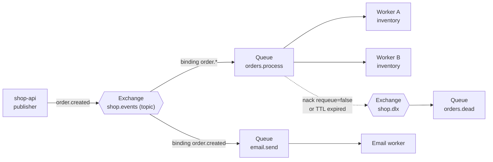
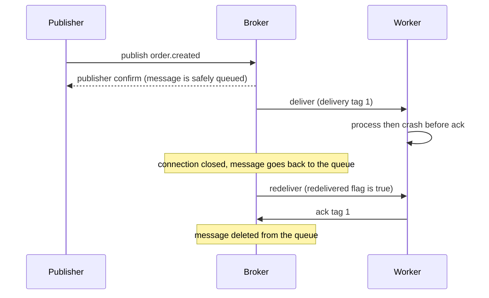

# L13.9 — RabbitMQ

> **Level 13: Databases & Distributed Systems** · Topic 9 of 15 · ⏱ ~5 hours · Difficulty: Intermediate

## 1. What it is

**RabbitMQ** is an open-source **message broker**: a server that sits between programs that produce work
("publishers") and programs that do the work ("consumers"). A publisher hands a message to the broker and moves on;
the broker holds it safely until a consumer is ready. It implements **AMQP 0-9-1** (Advanced Message Queuing
Protocol) natively and supports others (MQTT, STOMP, AMQP 1.0) through plugins.

What makes RabbitMQ different from "just a queue" is **routing**. Publishers never write to a queue directly. They
publish to an **exchange**, and the exchange decides — using **bindings** and a **routing key** — which **queues** receive
a copy. Consumers read from queues and **acknowledge** (ack) each message when they have really finished with it. If a
message cannot be processed it can be rejected and sent to a **dead-letter queue (DLQ)** instead of being lost or looping
forever.

```text
publisher --> [exchange] --(binding + routing key)--> [queue] --> consumer
```

## 2. Why it matters in DevOps

- **Decoupling and burst absorption:** the web tier answers the user in milliseconds and queues the slow work (emails,
  PDF generation, image resizing). A traffic spike makes the queue longer, not the site slower.
- **Reliability under failure:** with acks and durable queues, a crashed worker means the message is redelivered, not lost.
  The flip side is **at-least-once delivery**, so consumers must be idempotent (see [Idempotency](14-idempotency.md)).
- **Operational hazards you get paged for:** a queue growing without bound, memory/disk alarms that block publishers,
  poison messages that crash-loop a consumer, unacked messages piling up behind a stuck worker, and network partitions.
- **Choosing the right tool:** teams that use a log (Kafka) where a work queue is enough, or the reverse, pay for it in
  complexity. Knowing the difference is a senior-level skill (see section 5 and [Kafka](08-kafka.md)).

## 3. Real-world system example

RabbitMQ is widely used as the task-distribution backbone in web back ends. Two publicly documented patterns:

- **Celery (Python task queue)** supports RabbitMQ as its recommended broker: your web app calls
  `task.delay(...)`, Celery publishes a message to RabbitMQ, and a pool of Celery workers consume and ack it.
  Django and Flask shops use exactly this for background jobs.
- **OpenStack** services use RabbitMQ as the default transport for their RPC and notification messaging between
  components such as Nova and Neutron (via the `oslo.messaging` library).

RabbitMQ itself is maintained by VMware/Broadcom (Tanzu) and runs on Erlang/OTP, whose lightweight processes are why a
single broker node can handle very large numbers of connections and queues. Modern RabbitMQ (3.8+) offers **quorum queues**,
a replicated queue type built on the Raft consensus algorithm, which is the recommended type for data you cannot lose;
the old "mirrored classic queues" are deprecated in favour of them.

In our running example, `shop-api` publishes `order.created` events. A worker sends the confirmation email, another
updates inventory — each with its own queue bound to the same exchange.

## 4. Diagram



The life of one message, with acknowledgements and a crash:



## 5. How it works

### Exchange types

| Exchange type | Routing rule | Typical use |
|---------------|--------------|-------------|
| `direct` | routing key must equal the binding key exactly | send a job to one specific queue |
| `fanout` | ignores the key, copies to every bound queue | broadcast (cache invalidation, DLX) |
| `topic` | key is dot-separated words, binding patterns use `*` (one word) and `#` (zero or more) | `order.*`, `*.eu.#` event routing |
| `headers` | matches on message headers instead of the key | rare |
| default (`""`) | built-in direct exchange; routing key = queue name | quick "send to queue X" |

If an exchange has no matching binding the message is **dropped silently** unless the publisher sets the `mandatory`
flag, in which case it is returned. This is a classic cause of "messages vanish".

### Queues

- **Quorum queues** (`x-queue-type: quorum`): replicated across nodes with Raft, durable by design. Use for important data.
- **Classic queues**: single node, simplest, fastest, fine for transient or low-value work.
- **Streams**: an append-only log type (Kafka-like, non-destructive reads) added in 3.9 for replay and fan-out at scale.
- Properties: `durable` (queue survives a restart), `exclusive`, `auto-delete`, plus arguments such as `x-message-ttl`,
  `x-max-length`, `x-dead-letter-exchange`. Prefer setting TTL/limits/DLX through **policies** so you can change them
  without redeclaring queues.

### Acknowledgements and reliability

| Mechanism | Who | Protects against |
|-----------|-----|------------------|
| **Publisher confirms** | broker to publisher | message lost between publisher and broker |
| **Durable queue + persistent message** (`delivery_mode=2`) | publisher/declarer | broker restart losing messages (non-quorum queues need both) |
| **Consumer ack** (`basic_ack`) | consumer to broker | worker crash mid-processing |
| **nack / reject** with `requeue=false` | consumer | poison messages: route to the DLX |
| **Prefetch** (`basic_qos`) | consumer | one slow worker hoarding unacked messages |

Auto-ack ("fire and forget" delivery) means the broker deletes the message the moment it is sent. A worker crash then
loses the message. Use manual acks for anything that matters.

### Dead-lettering

A message is **dead-lettered** when it is rejected with `requeue=false`, its TTL expires, or the queue length limit is
exceeded (and, for quorum queues, when the delivery limit is exceeded). It is republished to the queue's
`x-dead-letter-exchange` with an `x-death` header recording the reason, the original queue and a count. A DLQ is just a queue you
monitor and replay from — never let it grow unattended.

### RabbitMQ versus Kafka

| | RabbitMQ | Kafka (see [Kafka](08-kafka.md)) |
|---|----------|-------|
| Model | smart broker, "push" to consumers, per-message ack | dumb append-only log, consumers pull and track an offset |
| Message after consumption | deleted | retained for a configured time or size, replayable |
| Routing | rich: exchanges, topic patterns, headers | topic and partition only |
| Ordering | per queue, broken by multiple consumers or requeues | strict per partition |
| Scale-out of consumers | competing consumers on one queue, easy | limited to the partition count |
| Throughput | tens of thousands of msgs/s per node typical | designed for very high throughput |
| Retry / DLQ / delayed delivery | built in (DLX, TTL) | build it yourself with retry topics |
| Best for | task queues, RPC-style work, complex routing | event streaming, event sourcing, analytics pipelines, replay |

Rule of thumb: **"do this job once" is a queue (RabbitMQ); "here is a fact that happened, many readers may want it, maybe
later" is a log (Kafka).**

## 6. Step-by-step guide

**Prerequisites:** Docker, and Python 3.9+. No cost. The commands below were run against RabbitMQ 3.13 and pika 1.4.

1. **Start the broker with the management UI.**
   ```bash
   docker run -d --name rmq -p 127.0.0.1:5672:5672 -p 127.0.0.1:15672:15672 rabbitmq:3.13-management-alpine
   sleep 20 && docker exec rmq rabbitmq-diagnostics -q ping
   ```
   Expected: `Ping succeeded`. The UI is at <http://localhost:15672> (default login `guest` / `guest`, which only works from
   localhost — never expose it publicly; create a real user for anything else).

2. **Install a client library in a virtual environment.**
   ```bash
   python3 -m venv venv && ./venv/bin/pip install pika
   ```

3. **Declare a topology and publish with confirms.** Save as `rmq_demo.py`:
   ```python
   import pika

   conn = pika.BlockingConnection(pika.ConnectionParameters("localhost"))
   ch = conn.channel()

   # Dead-letter exchange + queue
   ch.exchange_declare("shop.dlx", "fanout", durable=True)
   ch.queue_declare("orders.dead", durable=True)
   ch.queue_bind("orders.dead", "shop.dlx")

   # Main topic exchange + quorum work queue wired to the DLX
   ch.exchange_declare("shop.events", "topic", durable=True)
   ch.queue_declare("orders.process", durable=True,
                    arguments={"x-dead-letter-exchange": "shop.dlx",
                               "x-queue-type": "quorum"})
   ch.queue_bind("orders.process", "shop.events", routing_key="order.*")

   ch.confirm_delivery()                      # publisher confirms
   for i, key in enumerate(["order.created", "order.created", "order.cancelled", "user.signup"]):
       try:
           ch.basic_publish("shop.events", key, f"msg-{i}".encode(),
                            properties=pika.BasicProperties(delivery_mode=2),
                            mandatory=True)   # return unroutable messages
           print("published", key, "-> confirmed")
       except pika.exceptions.UnroutableError:
           print("published", key, "-> UNROUTABLE (returned)")

   # Consume with manual acks; reject msg-1 to exercise the DLQ
   while True:
       method, props, body = ch.basic_get("orders.process", auto_ack=False)
       if not method:
           break
       print("got", body.decode(), "redelivered=", method.redelivered)
       if body == b"msg-1":
           ch.basic_nack(method.delivery_tag, requeue=False)
           print("  nack(requeue=False) -> dead-lettered")
       else:
           ch.basic_ack(method.delivery_tag)
           print("  ack")

   method, props, body = ch.basic_get("orders.dead", auto_ack=True)
   death = props.headers["x-death"][0]
   print("DLQ has:", body.decode(), "reason:", death["reason"], "queue:", death["queue"])
   conn.close()
   ```
   ```bash
   ./venv/bin/python rmq_demo.py
   ```
   Expected output:
   ```text
   published order.created -> confirmed
   published order.created -> confirmed
   published order.cancelled -> confirmed
   published user.signup -> UNROUTABLE (returned)
   got msg-0 redelivered= False
     ack
   got msg-1 redelivered= False
     nack(requeue=False) -> dead-lettered
   got msg-2 redelivered= False
     ack
   DLQ has: msg-1 reason: rejected queue: orders.process
   ```
   `user.signup` matched no binding, so `mandatory=True` made the broker return it instead of silently dropping it.

4. **Inspect the topology from the CLI.**
   ```bash
   docker exec rmq rabbitmqctl list_queues name type messages consumers
   docker exec rmq rabbitmqctl list_bindings | grep shop
   ```
   You should see `orders.process` with type `quorum` and `orders.dead` with type `classic`.

5. **Prove redelivery after a crash.** Save as `rmq2.py`:
   ```python
   import pika
   c = pika.BlockingConnection(pika.ConnectionParameters("localhost")); ch = c.channel()
   ch.queue_declare("demo.q", durable=True)
   ch.basic_publish("", "demo.q", b"hello", pika.BasicProperties(delivery_mode=2))
   m, p, b = ch.basic_get("demo.q"); print("first get redelivered=", m.redelivered, "(no ack, closing)")
   c.close()                                  # simulates a worker crash: no ack was sent
   c = pika.BlockingConnection(pika.ConnectionParameters("localhost")); ch = c.channel()
   m, p, b = ch.basic_get("demo.q"); print("second get redelivered=", m.redelivered)
   ch.basic_ack(m.delivery_tag)
   ```
   ```bash
   ./venv/bin/python rmq2.py
   ```
   Expected: `first get redelivered= False ...` then `second get redelivered= True`.

6. **Apply a policy instead of hard-coding arguments.**
   ```bash
   docker exec rmq rabbitmqctl set_policy ttl-60s "^orders\." '{"message-ttl":60000}' --apply-to queues
   docker exec rmq rabbitmqctl list_policies
   ```
   Every queue whose name starts with `orders.` now expires messages after 60 s; with a DLX configured they land in the DLQ.

7. **Watch the metrics that matter.**
   ```bash
   docker exec rmq rabbitmqctl list_queues name messages_ready messages_unacknowledged
   curl -s -u guest:guest localhost:15672/api/overview | head -c 200; echo
   ```
   `messages_ready` growing means consumers are too slow or absent; `messages_unacknowledged` stuck high means a consumer
   is holding messages without finishing. The `rabbitmq_prometheus` plugin (enabled in the official 3.13 management image, serving port 15692 inside the
   container; add `-p 127.0.0.1:15692:15692` to scrape it) exposes both for Prometheus.

8. **Clean up.** `docker rm -f rmq`

## 7. Real-world scenario

*(Illustrative.)* At 02:10 an alert fires: "orders.process depth > 50,000 for 10 minutes". `shop-api` is healthy and
customers are placing orders, but confirmation emails are hours late.

**Investigation:** the management UI shows `messages_ready` climbing, `messages_unacknowledged = 10` and two consumers —
exactly the prefetch window times the worker count — and the consumer logs show the same message ID failing repeatedly.
One malformed order (a `null` shipping country) throws an exception, the worker does `basic_nack(requeue=True)`, the
broker redelivers it to the front of the queue instantly, and both workers are stuck in a tight loop on one poison message.

**Fix:** change the handler to `nack(requeue=False)` for non-retryable errors so the message goes to `shop.dlx`, and add a
retry counter (read `x-death` count) so transient errors retry with a delay but permanent ones park in `orders.dead`.
The queue drained in minutes; the DLQ held the one bad order for a human to fix and replay.

**Lesson:** requeue-on-failure is an infinite loop for deterministic errors. Always have a DLQ, alert on its depth, and
alert on queue age, not just on queue length.

## 8. Common mistakes and best practices

**Don't**
- Use auto-ack for work you cannot afford to lose.
- `nack(requeue=True)` on every exception — it creates poison-message hot loops.
- Leave `prefetch` unlimited: one consumer can drain the whole queue into its memory while others sit idle.
- Let queues grow without a limit, TTL or alert; RabbitMQ will raise a memory/disk alarm and **block all publishers**.
- Use the default `guest` account or expose ports 5672/15672 to the internet.
- Assume exactly-once delivery. RabbitMQ gives at-least-once; duplicates will happen.
- Rely on message order when running several consumers or requeuing — order is only guaranteed for a single consumer without requeues.

**Do**
- Use quorum queues for important data, publisher confirms, `mandatory` publishing, durable exchanges/queues and persistent messages.
- Use manual acks, a sensible `prefetch` (start with 10-50, lower for slow jobs), and idempotent handlers.
- Configure a DLX and monitor DLQ depth and oldest-message age. Build a "replay from DLQ" tool before you need it.
- Use policies for TTL, length limits and DLX so you can change behaviour without redeploying.
- Put connections in a reconnect loop; connections drop during upgrades and partitions. Use one long-lived connection per process, with a channel per thread.
- Run an odd number (3 or 5) of nodes for quorum queues so a majority survives a node loss.

## 9. Tasks

- [ ] **T1 — Run the broker and the topic demo** *(≈25 min, beginner)*
  - **Goal:** publish through a topic exchange and see routing, an unroutable return and a dead-letter.
  - **Steps:**
    1. Start RabbitMQ with the Docker command from section 6 and install `pika`.
    2. Run `rmq_demo.py` unchanged.
    3. Open the management UI, find the `shop.events` exchange and its bindings.
  - **Done when:** the output matches section 6 step 3 and the UI shows `orders.process` bound with `order.*`.

- [ ] **T2 — Route with new bindings** *(≈25 min, beginner)*
  - **Goal:** add a second consumer queue and see fan-out through the exchange.
  - **Steps:**
    1. Declare queue `email.send` and bind it to `shop.events` with key `order.created`.
    2. Publish one `order.created` and one `order.cancelled`.
    3. Run `rabbitmqctl list_queues name messages` and explain the counts.
  - **Done when:** `email.send` holds 1 message and `orders.process` holds 2, and you can say why.

- [ ] **T3 — Competing consumers and prefetch** *(≈40 min, intermediate)*
  - **Goal:** observe fair dispatch with `basic_qos`.
  - **Steps:**
    1. Publish 20 messages to a queue; write a consumer using `basic_consume` that sleeps 1 s per message and acks after.
    2. Start two copies with `prefetch_count=1`, then repeat with `prefetch_count=20`.
    3. Record which worker processed how many messages in each run.
  - **Done when:** with prefetch 1 the load is split about evenly; with prefetch 20 the first worker grabs most of the batch.

- [ ] **T4 — Break it: poison message** *(≈40 min, intermediate)*
  - **Goal:** reproduce the requeue hot loop and fix it with a DLQ.
  - **Steps:**
    1. Write a consumer that raises on a message containing `"bad"` and calls `nack(requeue=True)`; publish one bad message and watch `redelivered=True` repeat.
    2. Change to `requeue=False` with the DLX configured; republish.
    3. Add a retry counter from the `x-death` header that dead-letters after 3 attempts.
  - **Done when:** the bad message ends in `orders.dead` with `x-death` count visible, and the queue is empty.

- [ ] **T5 — Kill the worker, keep the message** *(≈30 min, intermediate)*
  - **Goal:** prove at-least-once delivery and show why idempotency is mandatory.
  - **Steps:**
    1. Run a consumer that writes "processed <id>" to a file, then sleeps 10 s before acking.
    2. `kill -9` it during the sleep, then start it again.
    3. Count how many times the file lists the same ID.
  - **Done when:** the same message ID appears twice in the file and you can explain which step would have to be idempotent.

- [ ] **T6 — Prove it: choose queue or log** *(≈45 min, advanced)*
  - **Goal:** justify RabbitMQ versus Kafka for three workloads without notes.
  - **Steps:**
    1. For (a) sending password-reset emails, (b) a click-stream feeding three analytics jobs plus replays, (c) an order
       workflow with per-customer delayed retries, pick a broker and write two sentences why.
    2. Re-do your T4 DLQ setup from memory on a fresh broker in under 15 minutes.
  - **Done when:** your written answer names ack/delete semantics, replay and routing as the deciding factors, and the fresh broker routes a rejected message to a DLQ.

## 10. Self-check questions

1. What is the difference between an exchange, a binding and a queue?
2. A publisher sends a message with a routing key that matches no binding. What happens, and how do you detect it?
3. Why does `nack(requeue=True)` sometimes make an outage worse?
4. Which failures do publisher confirms, durable queues and consumer acks each protect against?
5. Why are quorum queues preferred over classic queues for important data, and how many nodes do you run?
6. When would you pick Kafka over RabbitMQ?

<details>
<summary>Answers</summary>

1. The exchange receives published messages and routes them; a binding is a rule (key or pattern) linking an exchange to a queue; the queue stores messages until a consumer acks them. Publishers talk to exchanges, consumers to queues.
2. By default it is dropped silently. Publishing with `mandatory=true` makes the broker return it (pika raises `UnroutableError` with confirms on); an alternate exchange is another option.
3. A deterministic failure is retried instantly and forever, occupying consumers and starving good messages. Use `requeue=false` plus a DLX and bounded retries.
4. Confirms: loss between publisher and broker. Durable queue plus persistent messages (or a quorum queue): broker restart. Consumer ack: worker crash mid-processing.
5. They replicate through Raft, so data survives a node failure and leadership fails over automatically; run 3 or 5 nodes so a majority remains.
6. When you need replay, multiple independent consumer groups reading the same history, very high throughput, strict per-key ordering or stream processing; for task queues with rich routing, per-message retry and delay, RabbitMQ is simpler.
</details>

## 11. Further reading

- RabbitMQ documentation (rabbitmq.com/docs): "AMQP 0-9-1 Model Explained", "Reliability Guide", "Quorum Queues", "Dead Letter Exchanges".
- *RabbitMQ in Depth* by Gavin M. Roy (Manning).
- Related topics: [Kafka](08-kafka.md), [Idempotency](14-idempotency.md), [Distributed Locks and Queues](15-distributed-locks-and-queues.md), and the circuit-breaker pattern in [Circuit Breakers](../level-12-advanced-networking/14-circuit-breakers.md).

<!-- nav -->
---
← Previous: [Kafka](08-kafka.md) · [Level 13 index](README.md) · Next: [Horizontal and Vertical Scaling](10-horizontal-and-vertical-scaling.md) →
