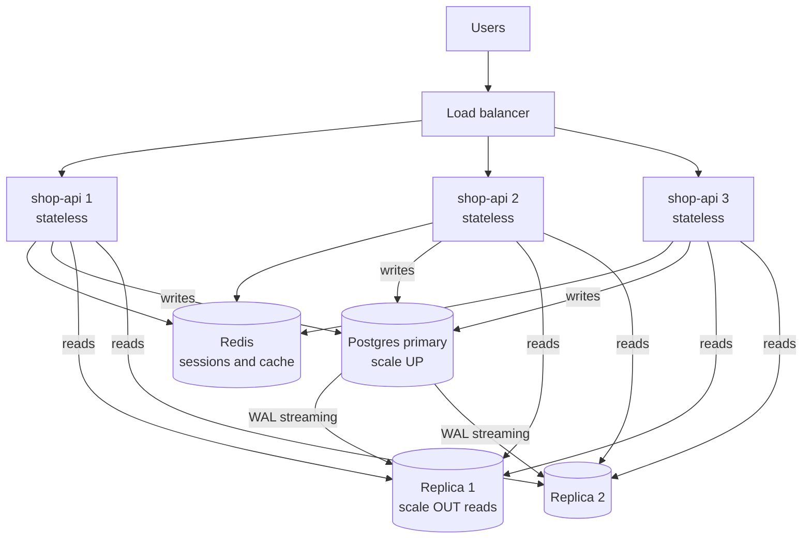
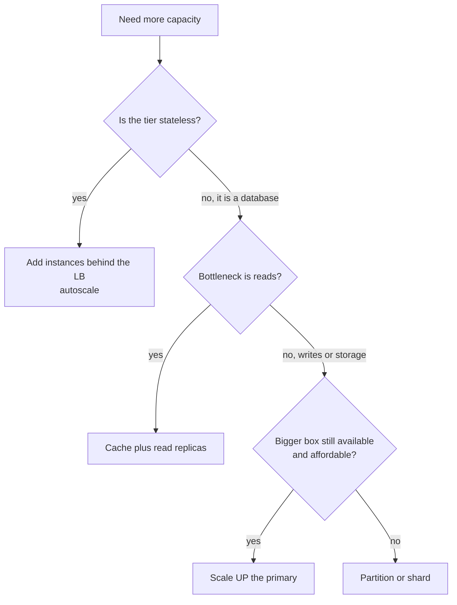

# L13.10 — Horizontal and Vertical Scaling

> **Level 13: Databases & Distributed Systems** · Topic 10 of 15 · ⏱ ~4 hours · Difficulty: Intermediate

## 1. What it is

**Vertical scaling** ("scaling up") means giving one machine more resources: a bigger instance with more CPU cores, RAM,
faster disks or network. **Horizontal scaling** ("scaling out") means adding more machines and spreading the work across
them behind a load balancer, a connection router or a partitioning scheme.

Scaling up is easy and needs no code change, but it has a ceiling (the biggest machine your provider sells), a price curve that
bends upward, and it is still one machine that can fail. Scaling out has almost no ceiling and gives redundancy, but
only works if the work can actually be divided — which depends on whether the component is **stateless** (any instance can
serve any request) or **stateful** (the instance holds data that others do not have).

## 2. Why it matters in DevOps

- **Capacity planning and cost:** choosing between "resize the instance" and "add three more" is a recurring on-call and budget decision.
- **Outages from hidden state:** an app that keeps sessions, uploads or counters in local memory or disk breaks the moment a
  second instance appears — users get logged out at random, files "disappear", counters disagree.
- **The database is the hard part:** web tiers scale out trivially; the primary database usually does not. Most real scaling
  work is moving load off the primary (caching, read replicas, queues) before ever sharding (see [Partitioning and Sharding](11-partitioning-and-sharding.md)).
- **Autoscaling only works on stateless tiers.** Kubernetes HPAs and AWS Auto Scaling groups assume instances are interchangeable
  (see [Auto Scaling](../level-06-cloud-aws/02-auto-scaling.md) and [High Availability and Scalability](../level-00-what-devops-is/08-high-availability-and-scalability.md)).

## 3. Real-world system example

- **Stack Overflow** has publicly described (in engineering blog posts and talks by its engineers) running a famously
  small number of powerful servers, including SQL Server with large RAM, and scaling up before out. It is the standard counter-example to
  "you must go distributed": a well-tuned monolith on strong hardware can serve enormous traffic.
- **Instagram** publicly documented running PostgreSQL with a large number of logical shards and read replicas as it grew; **GitHub** documented
  scaling MySQL with replicas and later partitioning by functional area; **Slack** and **YouTube** adopted **Vitess** to shard MySQL.
  The common arc: scale up → add caching and read replicas → split by function → shard.
- **Amazon RDS / Aurora** productizes both axes: change the instance class (vertical, brief downtime for a Multi-AZ failover),
  add up to 15 Aurora read replicas (horizontal reads), and Aurora storage grows automatically. See [RDS and Aurora](../level-06-cloud-aws/10-rds-and-aurora.md).
- **Kubernetes** treats stateless Deployments as horizontally scalable (HPA adds Pods) and offers StatefulSets for workloads that need stable identity and storage.

## 4. Diagram



Where the decision comes from:



## 5. How it works

### Comparison

| | Vertical (up) | Horizontal (out) |
|---|---------------|------------------|
| How | bigger instance type | more instances |
| Code changes | none | often (externalize state, handle replica lag) |
| Ceiling | largest instance size | practically none, but coordination cost rises |
| Failure impact | single point of failure unless paired with a standby | one node lost = small capacity loss |
| Downtime to apply | usually a restart or failover | none if rolled gradually |
| Cost curve | superlinear at the top end | roughly linear, plus operational overhead |
| Best for | primary databases, quick wins, early stage | stateless web/API tiers, caches, read traffic, queues |

### Stateless vs stateful

A component is **stateless** when everything needed to answer a request arrives with the request or sits in a shared
backing service. To make `shop-api` stateless:

| State | Where it hides | Move it to |
|-------|----------------|------------|
| Login sessions | process memory or local files | Redis, or signed tokens (JWT) |
| File uploads | local disk | object storage such as S3 |
| Counters, rate limits, locks | process variables | Redis (see [Redis](07-redis.md)) |
| Background jobs | in-process timers or threads | a queue ([RabbitMQ](09-rabbitmq.md), [Kafka](08-kafka.md)) |
| Config and secrets | files edited on the host | environment, a config service, a secrets manager |

**Stateful** systems (databases, Kafka brokers, Redis with data) scale out differently: by **replication** (copies for reads and
failover, see [Replication](04-replication.md)), by **partitioning** (each node owns a slice) or both.

### Read replicas: what they do and do not fix

A read replica applies the primary's write-ahead log (WAL) and can serve `SELECT`s. This scales **read throughput**, not write
throughput: every write still happens on the single primary and is replayed on every replica. Costs and caveats:

- **Replication lag:** a replica is slightly behind. A user who just saved a profile and is routed to a replica may not see it
  (the *read-your-writes* problem, see [Eventual Consistency](13-eventual-consistency.md)).
- **Routing:** the application (or a proxy such as PgBouncer plus HAProxy, or RDS Proxy / Aurora reader endpoints) must send writes to the primary and
  reads to replicas. Reads that must be fresh (right after a write, inside a transaction, checkout flows) stay on the primary.
- **Long queries on replicas** can conflict with WAL replay (`max_standby_streaming_delay`, `hot_standby_feedback` trade-offs).
- Each replica adds primary load for WAL shipping, and connection counts multiply (see [Database Connection Pooling](06-db-connection-pooling.md)).

### Scaling limits to keep in mind

- **Amdahl's law:** if 10 % of a request is serial (a lock, a single DB row), 10x more servers can never give more than 10x speed-up, and in practice far less.
- **Hot rows and global locks** do not scale out: a single `counter` row updated by every request caps throughput regardless of fleet size.
- **Coordination cost:** more nodes mean more connections to the database, more cache misses after deploys and more failure modes.

## 6. Step-by-step guide

**Prerequisites:** Docker and Python 3.9+; no cost. You will see the stateless/stateful problem in a minute, then fix it.

1. **Start Redis.**
   ```bash
   docker run -d --name scale-redis -p 127.0.0.1:6379:6379 redis:7-alpine
   python3 -m venv venv && ./venv/bin/pip install redis
   ```

2. **Write a tiny app with a switchable hit counter.** Save as `app.py`:
   ```python
   import os, sys, json
   from http.server import BaseHTTPRequestHandler, HTTPServer
   import redis

   PORT = int(sys.argv[1])
   MODE = os.environ.get("MODE", "memory")          # memory | redis
   r = redis.Redis(decode_responses=True, port=int(os.environ.get("REDIS_PORT", 6379))) if MODE == "redis" else None
   local = {"hits": 0}

   class H(BaseHTTPRequestHandler):
       def do_GET(self):
           if r:
               hits = r.incr("cart:hits")
           else:
               local["hits"] += 1
               hits = local["hits"]
           body = json.dumps({"instance": PORT, "mode": MODE, "hits": hits}).encode()
           self.send_response(200); self.send_header("Content-Type", "application/json"); self.end_headers()
           self.wfile.write(body)
       def log_message(self, *a): pass

   HTTPServer(("127.0.0.1", PORT), H).serve_forever()
   ```

3. **Run two instances with in-memory state and alternate requests (a poor man's round robin).**
   ```bash
   MODE=memory ./venv/bin/python app.py 9001 &
   MODE=memory ./venv/bin/python app.py 9002 &
   sleep 1
   for i in 1 2 3 4; do curl -s localhost:$((9001 + i % 2)); echo; done
   kill %1 %2
   ```
   Output similar to:
   ```text
   {"instance": 9002, "mode": "memory", "hits": 1}
   {"instance": 9001, "mode": "memory", "hits": 1}
   {"instance": 9002, "mode": "memory", "hits": 2}
   {"instance": 9001, "mode": "memory", "hits": 2}
   ```
   Four requests, but each instance thinks it has seen two. Add a third instance and it gets worse. This is the bug that
   appears the day you scale out an app that keeps state in memory.

4. **Externalize the state and repeat.**
   ```bash
   MODE=redis ./venv/bin/python app.py 9001 &
   MODE=redis ./venv/bin/python app.py 9002 &
   sleep 1
   for i in 1 2 3 4; do curl -s localhost:$((9001 + i % 2)); echo; done
   kill %1 %2
   ```
   Output: `hits` now reads 1, 2, 3, 4 regardless of which instance answered. The instances are interchangeable, so you can add
   a third or kill one without anyone noticing.

5. **Measure a vertical limit.** Use Docker CPU limits to emulate instance sizes and benchmark Postgres with `pgbench`:
   ```bash
   nproc
   for c in 1 2 4; do
     docker rm -f pgb >/dev/null 2>&1
     docker run -d --name pgb --cpus=$c -e POSTGRES_PASSWORD=pw postgres:16-alpine >/dev/null; sleep 8
     docker exec pgb pgbench -U postgres -i -s 5 postgres >/dev/null 2>&1
     echo "cpus=$c"; docker exec pgb pgbench -U postgres -c 8 -j 4 -T 10 postgres | grep tps
   done
   docker rm -f pgb
   ```
   On a 4-core sandbox the output was similar to `cpus=1` about 1,200 tps and `cpus=2` about 2,600 tps (your numbers will differ).
   Note where throughput stops growing as you add CPUs — past that point the limit is disk, locks or the client, not cores.

6. **Sketch read/write splitting in application code.**
   ```python
   import psycopg2
   primary = psycopg2.connect("host=db-primary dbname=shop user=app")
   replica = psycopg2.connect("host=db-replica dbname=shop user=app")

   def conn_for(readonly: bool, just_wrote: bool = False):
       return replica if readonly and not just_wrote else primary
   ```
   The `just_wrote` escape hatch (pin the session to the primary for a few seconds after a write) is the simplest
   read-your-writes protection. The capstone builds a real primary and replica and measures their lag.

7. **Clean up.** `docker rm -f scale-redis`

## 7. Real-world scenario

*(Illustrative.)* `shop-api` has run happily on one `m5.large`-class VM. A marketing email lands; CPU hits 100 % and p95 latency
goes from 120 ms to 6 s. The team does the quick fix first: resize to a bigger instance (vertical), which works in ten minutes
of downtime.

Next quarter they add two more app servers behind an ALB. Within an hour support tickets arrive: "I keep getting logged out" and
"my cart empties". **Investigation:** sessions are stored in each process's memory, and the load balancer spreads requests. **Fix:** sessions
move to Redis, uploads to S3. The app tier now autoscales on CPU. Then the database primary becomes the bottleneck at 85 %
CPU, driven by 90 % read traffic from product pages. They add a Redis cache for hot product reads and two read replicas for reporting
and search, keeping checkout on the primary.

**Lesson:** scale up for speed, scale out for resilience, and make state explicit first. Fix the shared bottleneck (the database)
with caching and replicas before reaching for sharding.

## 8. Common mistakes and best practices

**Don't**
- Scale out an app before removing in-memory or local-disk state.
- Use sticky sessions as a permanent fix; they hide the state problem and make deploys and failures lumpy.
- Add read replicas for a write-bound database, or read from a replica right after the same user wrote.
- Assume more app instances are free: each opens database connections, and 50 instances times 20 connections can exhaust `max_connections`.
- Jump to sharding because "that is what big companies do" while a bigger instance, an index or a cache would do.

**Do**
- Treat app servers as cattle: immutable images, externalized state, health checks, graceful shutdown.
- Scale the primary database up first (cheap, simple), and plan the failover or maintenance window it needs.
- Offload reads with caching and replicas; route freshness-sensitive reads to the primary.
- Load-test to find the real bottleneck (CPU, I/O, locks, connections) before choosing a scaling direction.
- Put a connection pooler between a large app fleet and the database.
- Keep a documented headroom target (for example, scale at 60-70 % sustained CPU) and review it with [capacity planning](../level-14-sre/09-capacity-planning.md).

## 9. Tasks

- [ ] **T1 — See the state bug** *(≈20 min, beginner)*
  - **Goal:** reproduce divergent in-memory state across two instances.
  - **Steps:**
    1. Create `app.py` from section 6 and run two instances with `MODE=memory`.
    2. Send 6 alternating requests with `curl`.
  - **Done when:** the two instances report independent `hits` counters and you can explain why a load balancer breaks this.

- [ ] **T2 — Fix it with Redis** *(≈20 min, beginner)*
  - **Goal:** make the instances interchangeable.
  - **Steps:**
    1. Start Redis and run both instances with `MODE=redis`.
    2. Send 6 requests; kill instance 9001 midway and continue against 9002.
  - **Done when:** `hits` increases monotonically across instances and survives killing one.

- [ ] **T3 — Add a third instance and a tiny load balancer** *(≈40 min, intermediate)*
  - **Goal:** scale out horizontally behind real round-robin.
  - **Steps:**
    1. Write an Nginx `upstream` block with the three ports, run Nginx in Docker with `--network host` (or use `host.docker.internal` as the upstream host).
    2. Fire 30 requests at Nginx and count responses per `instance`.
  - **Done when:** roughly one third of responses come from each instance and the Redis counter reads 30.

- [ ] **T4 — Break it: connection exhaustion** *(≈40 min, intermediate)*
  - **Goal:** feel how horizontal scaling can overload a stateful tier.
  - **Steps:**
    1. Run a local Postgres with `max_connections=20`.
    2. Start 10 processes that each open a pool of 5 connections.
    3. Observe the `too many clients already` error, then fix it with PgBouncer or smaller pools (see [Database Connection Pooling](06-db-connection-pooling.md)).
  - **Done when:** the error reproduces, and after the fix all 10 workers run with `SELECT count(*) FROM pg_stat_activity` below the limit.

- [ ] **T5 — Measure a scale-up curve** *(≈45 min, intermediate)*
  - **Goal:** produce evidence of diminishing returns.
  - **Steps:**
    1. Run `pgbench` against a Postgres container at `--cpus=1`, `2`, `4` (as far as your machine allows).
    2. Record transactions per second for each, and plot or tabulate.
  - **Done when:** you have a three-row table and a one-sentence explanation of where and why the curve flattens.

- [ ] **T6 — Prove it: scaling plan** *(≈45 min, advanced)*
  - **Goal:** write a scaling plan for `shop-api` without notes.
  - **Steps:**
    1. List every piece of state in the app and where each should live.
    2. State, for each tier (web, cache, DB reads, DB writes), whether you would scale up or out first and what metric triggers it.
    3. Explain to a peer why read replicas will not fix a write bottleneck.
  - **Done when:** your written plan covers all four tiers with a metric and a threshold each, and your peer cannot find a stateful component you missed.

## 10. Self-check questions

1. Give two reasons to scale a database up before scaling it out.
2. Name three kinds of hidden state that stop an app from scaling horizontally, and where each should go.
3. What does a read replica scale, and what does it not?
4. A user updates their address and the page immediately shows the old one. What probably happened, and how do you mitigate it?
5. Why can adding more app servers make the database fall over?

<details>
<summary>Answers</summary>

1. It is simple (no code or data-model change) and often cheaper in engineering time; sharding adds permanent complexity (cross-shard queries, resharding) that you should defer until a single node truly cannot cope.
2. Sessions (Redis or signed tokens), uploaded files (object storage), counters/locks/rate limits (Redis), in-process jobs (a queue), local config (a config service or env).
3. It scales read throughput and provides failover candidates; it does not scale writes, which all go through the primary and are replayed on every replica.
4. The read hit a replica that had not yet replayed the write (replication lag). Pin that user's reads to the primary briefly after a write, read from primary in that flow, or wait for the replica to reach the write's LSN.
5. Each instance holds its own connection pool, so connections multiply with the fleet; use a pooler, smaller pools, and raise capacity deliberately.
</details>

## 11. Further reading

- *Designing Data-Intensive Applications* by Martin Kleppmann, chapters on replication and partitioning.
- *Site Reliability Engineering* (Google), chapters on load balancing and handling overload.
- The Twelve-Factor App (12factor.net), especially "Processes" and "Disposability".
- PostgreSQL documentation, "High Availability, Load Balancing, and Replication".
- Related: [Replication](04-replication.md), [Partitioning and Sharding](11-partitioning-and-sharding.md), [Scalability architecture](../level-19-architecture/01-scalability.md).

<!-- nav -->
---
← Previous: [RabbitMQ](09-rabbitmq.md) · [Level 13 index](README.md) · Next: [Partitioning and Sharding](11-partitioning-and-sharding.md) →
