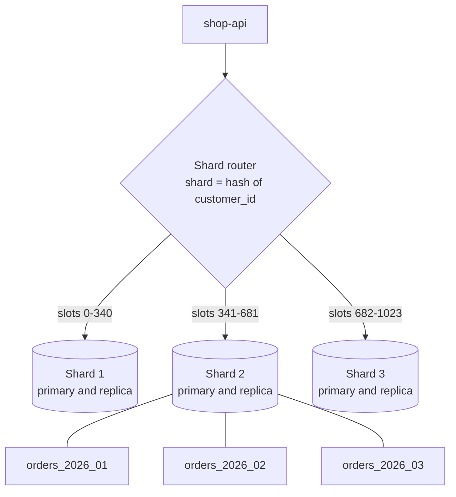
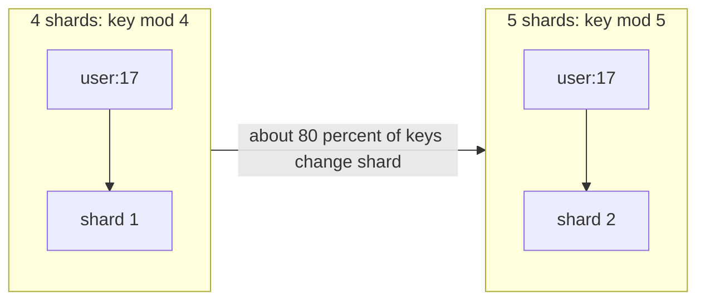

# L13.11 — Partitioning and Sharding

> **Level 13: Databases & Distributed Systems** · Topic 11 of 15 · ⏱ ~5 hours · Difficulty: Advanced

## 1. What it is

**Partitioning** means splitting one large logical table into smaller physical pieces ("partitions") that the database manages
as a single table. In PostgreSQL this is *declarative partitioning*: you declare `PARTITION BY RANGE | LIST | HASH`, and rows are
routed into child tables automatically. All partitions normally live on **one server**.

**Sharding** is partitioning *across servers*: the data is split by a **shard key** so each database node ("shard") owns a
subset of the rows and no single node holds everything. The application, a proxy or the database itself must route each query
to the right shard. Sharding is horizontal scaling for writes and storage — the thing read replicas cannot give you
(see [Horizontal and Vertical Scaling](10-horizontal-and-vertical-scaling.md)).

Same idea, different scope: partitioning helps one machine manage a big table (faster scans, cheap retention); sharding
lets a dataset exceed what one machine can hold or write.

## 2. Why it matters in DevOps

- **Retention and maintenance:** dropping a month-old partition is instant, while `DELETE`-ing 200 million rows bloats the
  table, generates huge WAL and keeps `VACUUM` busy for hours (see [MVCC](03-mvcc.md)).
- **Query speed:** with **partition pruning**, a query for "last week" touches one partition instead of the whole table.
- **Capacity ceiling:** when the primary is at its write limit and the biggest instance is not enough, sharding is the way out — and
  one of the most expensive changes you can make to a system. A wrong shard key is painful to undo.
- **Operations:** every shard needs backups, monitoring, upgrades and failover; ten shards is ten times the on-call surface.
  Resharding under live traffic is a classic high-risk project.

## 3. Real-world system example

- **Instagram** publicly described sharding PostgreSQL into many *logical* shards mapped onto fewer physical servers, embedding the
  shard ID inside generated 64-bit IDs so a row's location can be derived from its ID. Many logical shards on few machines
  makes later rebalancing a data move, not a re-hash.
- **Notion** wrote publicly about sharding its monolithic Postgres database by workspace, since most queries are scoped to one workspace.
- **Vitess** (created at YouTube, now a CNCF project) is a sharding layer for MySQL used by companies such as Slack; it handles routing
  (VTGate) and online resharding.
- **Redis Cluster** splits the key space into 16,384 *hash slots* assigned to nodes; **Cassandra** and **DynamoDB** hash a partition key to place data on nodes;
  **Kafka** partitions topics by key (see [Kafka](08-kafka.md)).
- **Citus** (open source Postgres extension, also offered by Microsoft as Azure Cosmos DB for PostgreSQL) distributes tables across worker nodes by a distribution column.
- **Amazon DynamoDB** is the hot-key cautionary tale: its docs devote guidance to avoiding "hot partitions" by choosing high-cardinality partition keys.

## 4. Diagram



Each shard may itself use table partitioning (bottom of the diagram): sharding spreads across servers, partitioning organizes within one.

Why modulo hashing makes resharding painful, and slot maps fix it:



## 5. How it works

### Partitioning strategies (PostgreSQL)

| Strategy | Rule | Good for | Watch out |
|----------|------|----------|-----------|
| `RANGE` | value ranges (dates, ids) | time-series, logs, orders; retention by `DROP` | must create future partitions in advance (cron, `pg_partman`) |
| `LIST` | explicit values | region, tenant tier | uneven sizes |
| `HASH` | `MODULUS m REMAINDER r` | spreading load evenly when no natural range | no pruning for range queries; changing `m` rewrites data |

Rules that bite:

- The **partition key must be part of every unique/primary key**: `PRIMARY KEY (id, created_at)`, not `(id)`. A global unique constraint across partitions does not exist.
- **Pruning only happens when the query filters on the partition key.** Without it, the planner scans every partition (often slower than the unpartitioned table).
- Too many partitions (thousands) slow planning and increase memory. Aim for tens to low hundreds.
- A `DEFAULT` partition catches rows outside all ranges — and blocks adding new overlapping partitions until it is checked. Monitor it, do not let it become a dumping ground.
- Detach safely: `ALTER TABLE ... DETACH PARTITION ... CONCURRENTLY` (PG 14+) avoids long locks on busy tables.

### Choosing a shard key

A good shard key has **high cardinality**, is **present in most queries**, and spreads **both data and traffic** evenly.

| Candidate key | Verdict for `shop-api` |
|---------------|------------------------|
| `customer_id` | Good: most queries are per customer, high cardinality. Cross-customer reports need scatter-gather. |
| `created_at` | Bad as a shard key: all new writes hit the newest shard (a **hotspot**). Fine as a *partitioning* key within a shard. |
| `country` | Bad: a handful of values, wildly uneven. |
| `order_id` (random UUID) | Even spread, but orders of one customer scatter across all shards. |
| auto-increment `id` with range sharding | Monotonic: the last shard takes every insert. |

**Hotspots** come from skew (one celebrity customer, one huge tenant), monotonic keys, and popular items. Mitigations: pick a better
key, add a salt/suffix to split a hot key (`user:7#0..#9`), give big tenants their own shard (directory-based lookup), cache hot reads.

### Routing models

| Model | How the shard is found | Resharding |
|-------|------------------------|-----------|
| Modulo `hash(key) % N` | computed | terrible: changing N moves most keys |
| **Fixed logical slots** (Redis Cluster 16,384 slots, Instagram logical shards) | `hash(key) % slots`, slot-to-node map | move whole slots between nodes |
| **Consistent hashing** with virtual nodes (Cassandra, Dynamo-style) | position on a ring | adding a node moves about `1/N` of the keys |
| **Directory / lookup table** | table maps tenant to shard | flexible: move one tenant at a time, but the directory is a critical dependency |
| **Range sharding** | key ranges per shard (e.g. Spanner/CockroachDB style, splitting ranges automatically) | split and move ranges; watch monotonic-key hotspots |

### What sharding costs you

- **Cross-shard queries** (joins, aggregates, global secondary indexes) become scatter-gather or are forbidden.
- **Cross-shard transactions** need two-phase commit or sagas; most designs avoid them by keeping a tenant on one shard.
- **Global uniqueness** (emails, order numbers) needs an ID scheme (snowflake-style IDs, shard-prefixed IDs) or a central allocator.
- **Operational multiplication:** schema migrations, backups ([Backups and PITR](05-backups-and-pitr.md)) and failover per shard.

### Resharding, the safe way

Typical online resharding: (1) create new shards, (2) start copying the data for the moving slots while logging changes
(logical replication or CDC), (3) catch up, (4) briefly pause writes for the moving slot, verify, flip the routing map, (5) resume and delete
the old copy later. Tools like Vitess `MoveTables`/`Reshard` and Citus shard rebalancing automate this; doing it by hand is where outages happen.

## 6. Step-by-step guide

**Prerequisites:** Docker; Python 3 for the resharding experiment. No cost.

1. **Start Postgres.**
   ```bash
   docker run -d --name pgp -e POSTGRES_PASSWORD=pw postgres:16-alpine
   sleep 8 && docker exec -it pgp psql -U postgres
   ```

2. **Create a range-partitioned `orders` table and load data.** Paste into `psql`:
   ```sql
   CREATE TABLE orders (
     id          bigint GENERATED ALWAYS AS IDENTITY,
     customer_id int         NOT NULL,
     created_at  timestamptz NOT NULL,
     total_cents int         NOT NULL,
     PRIMARY KEY (id, created_at)
   ) PARTITION BY RANGE (created_at);

   CREATE TABLE orders_2026_01 PARTITION OF orders FOR VALUES FROM ('2026-01-01') TO ('2026-02-01');
   CREATE TABLE orders_2026_02 PARTITION OF orders FOR VALUES FROM ('2026-02-01') TO ('2026-03-01');
   CREATE TABLE orders_2026_03 PARTITION OF orders FOR VALUES FROM ('2026-03-01') TO ('2026-04-01');
   CREATE TABLE orders_default PARTITION OF orders DEFAULT;

   INSERT INTO orders (customer_id, created_at, total_cents)
   SELECT (random()*1000)::int,
          timestamptz '2026-01-01' + (random()*89) * interval '1 day',
          (random()*10000)::int
   FROM generate_series(1, 30000);
   ANALYZE orders;

   SELECT tableoid::regclass AS partition, count(*) FROM orders GROUP BY 1 ORDER BY 1;
   ```
   Expected: three partitions with roughly 10,000 rows each (exact counts vary because the data is random); `orders_default` is empty and absent from the output.

3. **Prove partition pruning.**
   ```sql
   EXPLAIN (COSTS OFF) SELECT sum(total_cents) FROM orders
   WHERE created_at >= '2026-02-10' AND created_at < '2026-02-20';
   ```
   Expected: the plan scans only `orders_2026_02`:
   ```text
    Aggregate
      ->  Seq Scan on orders_2026_02 orders
            Filter: ((created_at >= ...) AND (created_at < ...))
   ```
   Now filter on a non-key column:
   ```sql
   EXPLAIN (COSTS OFF) SELECT sum(total_cents) FROM orders WHERE customer_id = 42;
   ```
   Expected: an `Append` node scanning **all four** partitions. Lesson: queries must include the partition key (or you need an index per partition, which Postgres creates for you if you `CREATE INDEX` on the parent).

4. **Retire old data instantly.**
   ```sql
   ALTER TABLE orders DETACH PARTITION orders_2026_01;   -- add CONCURRENTLY on a busy production table
   SELECT count(*) FROM orders;                           -- January is gone from the parent
   DROP TABLE orders_2026_01;                             -- or archive it to cold storage first
   ```
   This took milliseconds and generated almost no WAL, unlike `DELETE FROM orders WHERE created_at < '2026-02-01'`.

5. **See a hash-partition hotspot.**
   ```sql
   CREATE TABLE events (user_id int NOT NULL, payload text) PARTITION BY HASH (user_id);
   CREATE TABLE events_p0 PARTITION OF events FOR VALUES WITH (MODULUS 4, REMAINDER 0);
   CREATE TABLE events_p1 PARTITION OF events FOR VALUES WITH (MODULUS 4, REMAINDER 1);
   CREATE TABLE events_p2 PARTITION OF events FOR VALUES WITH (MODULUS 4, REMAINDER 2);
   CREATE TABLE events_p3 PARTITION OF events FOR VALUES WITH (MODULUS 4, REMAINDER 3);
   INSERT INTO events SELECT g, 'x' FROM generate_series(1,10000) g;
   SELECT tableoid::regclass, count(*) FROM events GROUP BY 1 ORDER BY 1;     -- about 2,500 each
   INSERT INTO events SELECT 7, 'celebrity' FROM generate_series(1,20000);    -- one hot key
   SELECT tableoid::regclass, count(*) FROM events GROUP BY 1 ORDER BY 1;     -- one partition now has ~22,000
   ```
   Even a perfect hash cannot spread a single hot key. On shards, that one partition would be one overloaded server.

6. **Measure how painful modulo resharding is.** Save as `reshard.py` and run `python3 reshard.py`:
   ```python
   import hashlib, bisect

   def h(s): return int(hashlib.md5(s.encode()).hexdigest(), 16)
   keys = [f"user:{i}" for i in range(10000)]

   # 1) naive modulo: 4 -> 5 shards
   a = {k: h(k) % 4 for k in keys}; b = {k: h(k) % 5 for k in keys}
   print("modulo 4 -> 5:", sum(a[k] != b[k] for k in keys) / len(keys))

   # 2) fixed logical slots: move only enough slots to fill the new node
   SLOTS = 1024
   slot = {k: h(k) % SLOTS for k in keys}
   old = {s: s % 4 for s in range(SLOTS)}
   new = dict(old)
   for s in range(SLOTS // 5): new[s] = 4
   print("slot map 4 -> 5:", sum(old[slot[k]] != new[slot[k]] for k in keys) / len(keys))

   # 3) consistent hashing with virtual nodes
   def ring(nodes, vn=100):
       r = sorted((h(f"{n}#{i}"), n) for n in nodes for i in range(vn))
       return [x[0] for x in r], [x[1] for x in r]
   def lookup(r, k):
       pts, names = r
       return names[bisect.bisect(pts, h(k)) % len(pts)]
   r4, r5 = ring(range(4)), ring(range(5))
   print("consistent hash 4 -> 5:", sum(lookup(r4, k) != lookup(r5, k) for k in keys) / len(keys))
   ```
   Output similar to:
   ```text
   modulo 4 -> 5: 0.796
   slot map 4 -> 5: 0.2021
   consistent hash 4 -> 5: 0.1939
   ```
   Modulo moves about 80 % of keys; slot maps and consistent hashing move about 20 % (the ideal `1/5`).

7. **Clean up.** `docker rm -f pgp`

## 7. Real-world scenario

*(Illustrative.)* The `events` table of `shop-api` has reached 1.8 billion rows (900 GB). Nightly `DELETE` of 90-day-old rows takes six
hours, runs `autovacuum` constantly and slows checkout queries; the replica falls behind every night.

**Investigation:** the deletes produce enormous WAL and dead tuples; indexes are larger than RAM. Nearly every query filters by a recent time
range. **Fix:** migrate to `PARTITION BY RANGE (created_at)` with daily partitions: create the partitioned table, backfill with batched
copies, dual-write briefly, swap names in one transaction, and run a cron job (or `pg_partman`) that creates tomorrow's partition and detaches
partitions older than 90 days. Retention becomes a metadata operation; most queries prune to one or two partitions.

Two years later, write volume outgrows the largest instance. The team chooses `customer_id` as shard key, uses 1,024 logical slots over four servers, and gives
the one wholesale customer that generates 15 % of traffic a dedicated shard through a directory entry.

**Lesson:** partition first (cheap, local, reversible-ish); shard only when a single node cannot hold or write the data, and choose the shard key from the query patterns.

## 8. Common mistakes and best practices

**Don't**
- Shard before exhausting indexing, caching, read replicas, partitioning and a bigger instance.
- Use a monotonic key (timestamp, auto-increment) as a range shard key — all new writes land on one shard.
- Shard with `hash(key) % N` and no slot or directory layer; you will be unable to add capacity gracefully.
- Forget to create future partitions; inserts then fail or fall into `DEFAULT`.
- Run queries without the partition key and assume partitioning "made it faster".
- Rely on cross-shard transactions or foreign keys; design so related rows share a shard.

**Do**
- Partition by time for append-heavy data and automate create/detach/drop (cron, `pg_partman`, a Kubernetes CronJob).
- Choose the shard key from your top ten queries; check cardinality and skew with real data before committing.
- Use many logical shards over few physical nodes so rebalancing means moving slots, not re-hashing.
- Put a tenant's data on one shard and keep a directory for exceptions ("whale" customers).
- Test resharding (and restoring one shard from backup) in staging before you need it.
- Monitor per-shard size, QPS and p99 latency to spot hotspots early; see [Observability](../level-10-observability/01-three-pillars.md).

## 9. Tasks

- [ ] **T1 — Partition a table by month** *(≈30 min, intermediate)*
  - **Goal:** build and populate a range-partitioned table.
  - **Steps:**
    1. Run the SQL from section 6 steps 1-2.
    2. Check row distribution per partition with `tableoid::regclass`.
  - **Done when:** each of the three partitions holds about a third of the 30,000 rows.

- [ ] **T2 — Prove pruning and its absence** *(≈25 min, intermediate)*
  - **Goal:** use `EXPLAIN` to show when pruning happens.
  - **Steps:**
    1. Run both `EXPLAIN` queries from step 3.
    2. Create `CREATE INDEX ON orders (customer_id);` and re-run the second one with `SET enable_seqscan = off;`.
  - **Done when:** you can show one query scanning one partition and another scanning four, and the per-partition index names appear in the plan.

- [ ] **T3 — Automate partition lifecycle** *(≈45 min, intermediate)*
  - **Goal:** a script that creates next month's partition and detaches the oldest.
  - **Steps:**
    1. Write a SQL function or shell script that computes next month's bounds and runs `CREATE TABLE ... PARTITION OF`.
    2. Make it idempotent (`IF NOT EXISTS`) and run it twice.
    3. Add the detach step for partitions older than N months.
  - **Done when:** running it twice creates exactly one new partition and `\d+ orders` lists the expected set.

- [ ] **T4 — Break it: insert outside every range** *(≈20 min, intermediate)*
  - **Goal:** see what happens without a matching partition.
  - **Steps:**
    1. `DROP TABLE orders_default` (after detaching), then `INSERT` a row dated `2027-01-01`.
    2. Re-create the default partition, insert again, then try to add `orders_2027_01` and read the error.
    3. Fix by moving the rows and re-adding.
  - **Done when:** you have seen the "no partition of relation found" error, and a successful `CREATE TABLE orders_2027_01 PARTITION OF ...` after clearing the default partition.

- [ ] **T5 — Compare resharding strategies** *(≈40 min, advanced)*
  - **Goal:** quantify key movement for each routing model.
  - **Steps:**
    1. Run `reshard.py`; then change it to go from 4 to 8 shards.
    2. Add a hot key (50 % of requests for one user) and compute the load per shard under each model.
  - **Done when:** a table shows % keys moved (4 to 5 and 4 to 8) and per-shard load with the hot key, and you can state which model you would choose and why.

- [ ] **T6 — Prove it: design a shard plan** *(≈45 min, advanced)*
  - **Goal:** write a shard design for `shop-api` without the guide.
  - **Steps:**
    1. Choose a shard key, list the five queries that become scatter-gather or impossible, and name the routing model.
    2. Describe the zero-downtime steps to go from 1 to 4 shards.
    3. Explain what you do about the biggest customer and about global unique order numbers.
  - **Done when:** a reviewer can follow your document, and it addresses hotspots, resharding steps, cross-shard queries and ID generation.

## 10. Self-check questions

1. What is the difference between partitioning and sharding?
2. Why must the partition key be part of the primary key in PostgreSQL?
3. Why is `created_at` a good partitioning key but a poor shard key?
4. Why does `hash(key) % N` make adding a shard so expensive?
5. What is a hotspot and name two ways to mitigate one?
6. Which problems appear the moment you shard that did not exist before?

<details>
<summary>Answers</summary>

1. Partitioning splits a table into pieces managed by one database (usually one server); sharding places pieces on different servers, each owning a subset of the data, with routing in front.
2. Unique indexes are enforced per partition; Postgres can only guarantee global uniqueness if the partition key is in the key, so rows with equal keys land in the same partition.
3. Time ranges let queries prune and let you drop old data cheaply, but as a shard key all current writes hit the newest shard.
4. Changing N changes the result for most keys (about 80 % moving from 4 to 5), so most data must be copied. Fixed slots, consistent hashing or a directory limit movement to about 1/N.
5. A node or partition receiving disproportionate traffic or data. Mitigate with a better key, salting a hot key, a dedicated shard for big tenants, caching, or splitting ranges.
6. Cross-shard joins and transactions, global uniqueness, scatter-gather queries, per-shard migrations/backups/failover, and resharding.
</details>

## 11. Further reading

- PostgreSQL documentation: "Table Partitioning" (in the DDL chapter), and the `pg_partman` extension.
- *Designing Data-Intensive Applications* by Martin Kleppmann, chapter on partitioning.
- Vitess and Citus documentation (vitess.io, citusdata.com) for production sharding.
- Amazon DynamoDB Developer Guide: "Partition key design".
- Instagram Engineering blog post "Sharding & IDs at Instagram".
- Related: [Replication](04-replication.md), [Kafka](08-kafka.md), [Eventual Consistency](13-eventual-consistency.md), [Scalability](../level-19-architecture/01-scalability.md).

<!-- nav -->
---
← Previous: [Horizontal and Vertical Scaling](10-horizontal-and-vertical-scaling.md) · [Level 13 index](README.md) · Next: [Consistency, Availability and the CAP Theorem](12-cap-theorem-and-consistency.md) →
