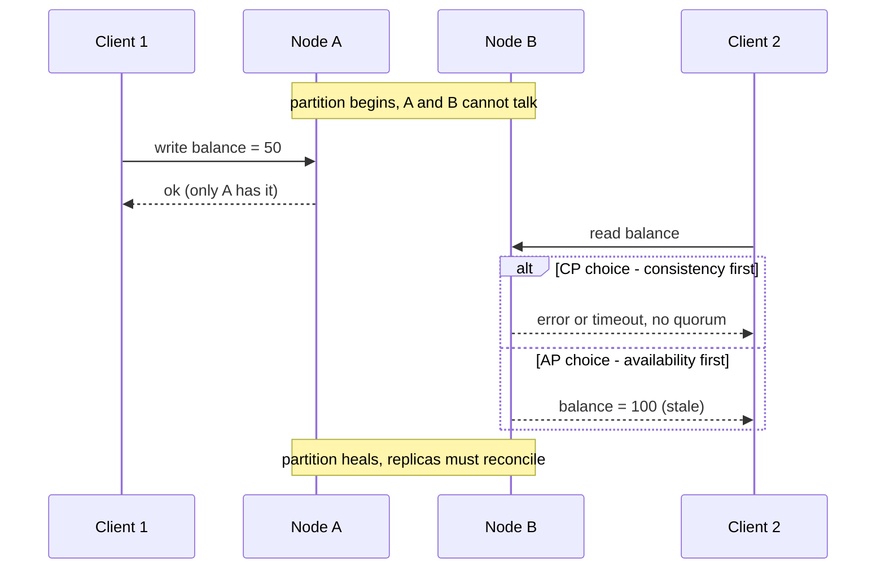
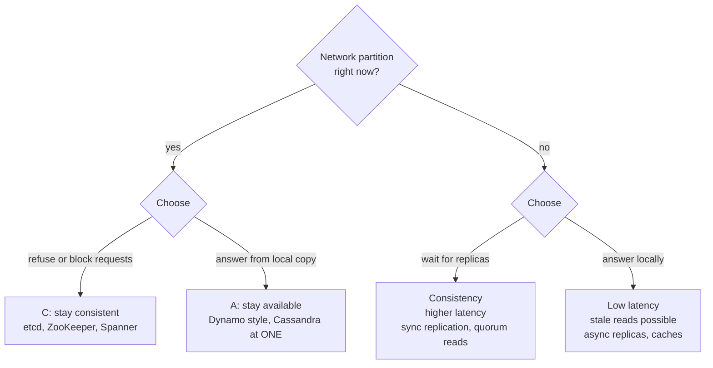

# L13.12 — Consistency, Availability and the CAP Theorem

> **Level 13: Databases & Distributed Systems** · Topic 12 of 15 · ⏱ ~5 hours · Difficulty: Advanced

## 1. What it is

The **CAP theorem** says that when a distributed data store is cut in two by a network failure, it must choose between two
properties for the requests that arrive during the failure:

- **Consistency (C)**, in the CAP sense, means **linearizability**: every read sees the most recent completed write, and the whole
  system behaves as if there were a single copy of the data and each operation happened atomically at one instant.
- **Availability (A)** means every request sent to a node that is still working receives a (non-error) response, even if that node
  cannot reach the others.
- **Partition tolerance (P)** means the system keeps operating even when messages between nodes are lost or delayed.

Eric Brewer proposed the idea around 2000; Seth Gilbert and Nancy Lynch published the formal proof in 2002. Networks do partition
(a bad switch, a misconfigured firewall, a saturated link, a long GC pause that looks like a dead node), so "pick two of three" is
misleading: **P is not optional, and the real choice is C or A *during a partition*.** When there is no partition, a well-built
system can offer both.

**PACELC** (Daniel Abadi, 2012) fixes the part CAP ignores: *if* there is a **P**artition, choose **A** or **C**; **E**lse (normal
operation), choose **L**atency or **C**onsistency. Even on a healthy network, keeping replicas strictly in sync costs round
trips, so a store like a synchronously replicated database trades latency for consistency every day, not only during outages.

## 2. Why it matters in DevOps

- **Every replicated system you operate has already made this choice** (a Postgres standby, a Redis replica, a Kafka partition, an
  etcd cluster). If you do not know which side it chose, you cannot predict what it does at 3 a.m. when a switch fails.
- **Failover is a CAP decision.** Promoting a replica that is behind keeps the service available but loses acknowledged writes
  (see [Replication](04-replication.md)); refusing to promote preserves data but means downtime.
- **"Highly available" claims are partial.** A cluster that needs a quorum (majority) stops accepting writes without one. That is
  correct behaviour, not a bug, but your runbooks and SLOs must expect it.
- **Application bugs hide here.** Reading from a lagging replica right after a write, or writing to both sides of a split, produces
  bugs that no unit test finds. See [Eventual Consistency](13-eventual-consistency.md) for how to live with the weaker choice.

## 3. Real-world system example

- **GitHub, October 2018.** GitHub's public post-incident analysis describes a roughly 43-second loss of connectivity between its US
  East Coast network hub and its primary data center. Automated failover promoted MySQL primaries in another region while the
  original primaries had accepted writes that had not replicated, so the two sides diverged. GitHub chose to preserve data
  integrity and reconcile, which meant hours of degraded service (the report gives the total as just over 24 hours). It is a textbook
  case of choosing consistency over fast recovery after a partition.
- **etcd and Kubernetes.** etcd uses the Raft consensus algorithm and requires a majority of members to commit a write. Lose the
  majority and the Kubernetes API server can no longer write cluster state (a **CP** behaviour), although pods already running on
  nodes keep running. This is why etcd clusters have 3 or 5 members, spread across failure zones.
- **Amazon Dynamo and Apache Cassandra** favour availability: the 2007 Dynamo paper describes accepting writes on any reachable
  replica and reconciling later with vector clocks; Cassandra exposes **tunable consistency levels** per query (`ONE`, `QUORUM`,
  `ALL`). The managed **Amazon DynamoDB** service offers eventually consistent reads by default and strongly consistent reads as an option.
- **Google Spanner** is described by Google as externally consistent (strictly serializable) across regions using TrueTime, a clock
  API with bounded uncertainty. Brewer's own 2017 article explains that Spanner is technically CP but runs on a private,
  carefully engineered network so that partitions are rare enough for very high availability in practice.
- **Jepsen** (Kyle Kingsbury's testing project) publishes analyses where real databases are tested under injected partitions;
  they are the best public source of "what a database claims versus what it does".

## 4. Diagram

What a partition forces a replicated register to do. Node A and node B each hold a copy of `balance`; the link between them fails:



How the two acronyms divide the decision space:



## 5. How it works

### Linearizability, and what it is not

A history is **linearizable** if every operation appears to take effect atomically at some point between its start and its
end, and that order matches real time: once a read returns the new value, no later read may return the old one. It is a
property of a *single object* (one key, one row, one register).

It is easy to confuse with other terms:

| Term | Meaning | Typical place |
|------|---------|---------------|
| **Linearizability** | Single-object, real-time ordering ("the latest value") | etcd reads, Spanner, Postgres primary reads |
| **Serializability** | Multi-object *transactions* behave as if run one at a time (no real-time guarantee) | `SERIALIZABLE` isolation, see [Transactions and Locks](02-transactions-and-locks.md) |
| **Strict serializability** | Both: serial order that also respects real time | Spanner |
| **ACID "C"** | Application invariants hold after a transaction (unique, foreign keys) | Any SQL database; unrelated to CAP "C" |

### A ladder of consistency models

Weaker models are cheaper and more available; each rung up costs latency or availability.

| Model | Guarantee | Example |
|-------|-----------|---------|
| Linearizable | Always the latest completed write | primary reads, Raft leader reads |
| Sequential | All nodes see the same order, not necessarily the latest | some queue systems |
| Causal | If B was caused by A, everyone sees A before B | comment replies after the post |
| Read-your-writes / monotonic reads | You see your own writes; time never goes backward for you | sticky sessions, LSN waits |
| Eventual | If writes stop, all replicas converge | async replicas, DNS, caches |

### Where common systems sit

Classifications are tendencies, not labels: most systems are configurable and a single product can behave CP or AP depending on settings.

| System (default or typical setup) | During a partition | Normally (PACELC) | Notes |
|-----------------------------------|--------------------|-------------------|-------|
| etcd, Consul, ZooKeeper | **CP** (minority side refuses) | PC/EC | consensus; reads can be made linearizable |
| PostgreSQL, one primary + async replica | writes only on primary; replica reads stale | PA/EL for replica reads | failover may lose acknowledged writes |
| PostgreSQL with `synchronous_commit` and a required standby | **CP-leaning**: commits block | PC/EC | the stall you meet in [Replication](04-replication.md) |
| Redis primary + replicas | AP-leaning: async, can lose acked writes on failover | PA/EL | `WAIT` and `min-replicas-to-write` shift it toward C |
| Kafka with `acks=all`, `min.insync.replicas=2`, unclean election off | CP-leaning for produce | PC/EC | see [Kafka](08-kafka.md) |
| Cassandra / DynamoDB-style | AP (with `QUORUM` or strong reads it leans CP) | PA/EL | tunable |
| MongoDB | depends on write concern, read concern | varies | majority write plus majority read is the strong end |
| Google Spanner | **CP** | PC/EC | uses TrueTime, bounded clock uncertainty |

### Tuning knobs you actually touch

- **Quorums:** with N replicas, write to W and read from R. If **W + R > N**, every read overlaps at least one node holding the
  latest write (the basis of tunable consistency in Dynamo-style stores). Raft/etcd use majority for both.
- **Synchronous vs asynchronous replication:** a commit waits for the standby (C, latency) or does not (A, speed, possible data loss).
- **Failover policy:** automatic promotion (availability) versus human approval or fencing first (consistency); see
  [Distributed Locks and Queues](15-distributed-locks-and-queues.md) for fencing tokens that stop a stale primary from writing.
- **Timeouts:** a "partition" is indistinguishable from a slow node; your timeout decides when a node is declared dead.

## 6. Step-by-step guide

**Prerequisites:** Linux or macOS, `redis-server` and `redis-cli` 6.2 or newer (`sudo apt-get install -y redis-server` then
`sudo systemctl disable --now redis-server`, or `brew install redis`). Cost: free. Time: ~45 minutes. Everything below was run
against Redis 7.0.15; ports, PIDs and timings will differ ("similar to"). We build one primary and one replica, then break the link in
three ways and watch Redis pick a side each time.

1. **Start a primary and a replica.**
   ```bash
   mkdir -p /tmp/cap/r1 /tmp/cap/r2
   redis-server --port 6381 --dir /tmp/cap/r1 --save "" --daemonize yes
   redis-server --port 6382 --dir /tmp/cap/r2 --save "" --daemonize yes --replicaof 127.0.0.1 6381
   sleep 2
   redis-cli -p 6381 info replication | grep -E "role|slave0"
   ```
   ```text
   role:master
   slave0:ip=127.0.0.1,port=6382,state=online,offset=14,lag=1
   ```

2. **Write and read from the replica.** Replication is asynchronous, so this *usually* shows the value, but nothing guarantees it.
   ```bash
   redis-cli -p 6381 SET k v1
   redis-cli -p 6382 GET k
   ```
   Expect `OK` then `"v1"`. A read that came back before the write arrived would be a stale (non-linearizable) read.

3. **Partition the replica.** Freeze its process so it can neither receive nor acknowledge anything (the effect of a dead link):
   ```bash
   RP=$(redis-cli -p 6382 info server | grep process_id | tr -d '\r' | cut -d: -f2)
   kill -STOP "$RP"
   ```
   Do not use `pgrep -f`: it can also match your own shell.

4. **Primary chooses availability: it accepts the write.** `WAIT` only counts acknowledgements for writes made on the *same
   connection*, so send both commands through one `redis-cli` session:
   ```bash
   printf 'SET k v2\nWAIT 1 500\n' | redis-cli -p 6381
   ```
   ```text
   OK
   0
   ```
   The client got `OK` (write acknowledged) but `WAIT` reports **0 replicas** have it. If the primary died now and the replica were promoted,
   `v2` would be lost. That is the "A" side of the choice.

5. **Flip the primary to consistency: refuse writes without a replica.**
   ```bash
   redis-cli -p 6381 CONFIG SET min-replicas-to-write 1
   redis-cli -p 6381 CONFIG SET min-replicas-max-lag 2
   sleep 3
   redis-cli -p 6381 SET k v3
   ```
   ```text
   NOREPLICAS Not enough good replicas to write.
   ```
   The primary now sacrifices availability to avoid unreplicated writes. Heal and watch it recover:
   ```bash
   kill -CONT "$RP"; sleep 2
   printf 'SET k v4\nWAIT 1 500\n' | redis-cli -p 6381     # OK then 1
   redis-cli -p 6382 GET k                                  # "v4"
   ```

6. **Create a split-brain on purpose** (both sides accept writes, the AP failure mode). Promote the replica while the old primary is still alive,
   as an over-eager failover script would:
   ```bash
   redis-cli -p 6381 CONFIG SET min-replicas-to-write 0
   redis-cli -p 6382 replicaof no one
   redis-cli -p 6381 SET cart:42 "book"
   redis-cli -p 6382 SET cart:42 "book,pen"
   ```
   Both return `OK`: two nodes each accepted a different "truth". Now reconnect the old replica and wait 5-10 seconds for it to resync:
   ```bash
   redis-cli -p 6382 replicaof 127.0.0.1 6381
   sleep 8; redis-cli -p 6382 GET cart:42
   ```
   ```text
   "book"
   ```
   The `pen` write was silently discarded. The system converged but **lost an acknowledged write**, which is the cost of
   availability without a conflict-resolution strategy (see [Eventual Consistency](13-eventual-consistency.md)).

7. **Clean up.**
   ```bash
   redis-cli -p 6382 shutdown nosave; redis-cli -p 6381 shutdown nosave; rm -rf /tmp/cap
   ```

## 7. Real-world scenario

*Illustrative, not a documented incident.* `shop-api` runs Postgres in two availability zones: a primary in `us-east-1a` and an async
standby in `us-east-1b`, with an automatic failover tool and a 10-second health timeout. A network device between the zones starts dropping
packets for 40 seconds. The tool cannot reach the primary, so it promotes the standby. But the primary was alive and kept serving
the web tier in its own zone, so for about 40 seconds both databases accepted `INSERT INTO orders`. After the network
heals, the old primary holds 312 orders the new primary has never seen, and order IDs overlap.

*Investigation:* `pg_controldata` showed two timelines; the order-ID gap and `pg_stat_replication` on the new primary made the
divergence obvious. *Fix:* the team fenced the old primary (stopped it, blocked its traffic), exported its post-divergence orders,
re-inserted them with new IDs through the application, and rebuilt it as a standby with `pg_rewind`.
*Lesson:* automatic failover chose **availability** without a fencing step; they added STONITH-style fencing (shoot the old node first),
raised the health-check timeout, required a quorum of observers to agree before promotion, and put the decision in the runbook so the
next on-call knew it was a deliberate C-versus-A trade.

## 8. Common mistakes and best practices

**Don't**

- Say "we are CA". With a network in the middle, a system that is neither CP nor AP during a partition is simply undefined behaviour.
- Treat CAP "C" as the C in ACID, or linearizability as serializability.
- Read from an async replica right after a write and assume you see it.
- Auto-promote a standby without fencing the old primary.
- Pick a label from a vendor page and stop; check the actual defaults (write concern, `acks`, consistency level, `synchronous_commit`).

**Do**

- Decide per feature: payments and inventory want C; feeds, counters and recommendations usually tolerate stale reads.
- Run odd-sized quorums (3 or 5) across failure domains and monitor quorum health.
- Make failover a rehearsed procedure, with fencing, and test it with injected faults (a staging chaos experiment).
- Expose the choice: use read-your-writes tricks, `WAIT`, quorum reads or LSN waits where a feature needs them.
- Read the Jepsen report for any new database you adopt.

## 9. Tasks

- [ ] **T1 — Build the Redis pair and see the stale window** *(≈25 min, beginner)*
  - **Goal:** run one primary and one replica and read a replicated key.
  - **Steps:**
    1. Follow steps 1-2.
    2. Write 1,000 keys in a loop with `redis-cli -p 6381` and read the last one from `6382` immediately.
    3. Run `redis-cli -p 6381 info replication` and note `master_repl_offset` versus the replica's offset.
  - **Done when:** you can show both offsets and say which one is "behind" and what that means for a read.

- [ ] **T2 — Show that an acknowledged write can be unreplicated** *(≈20 min, intermediate)*
  - **Goal:** prove `OK` does not mean "durable on a second node".
  - **Steps:**
    1. Freeze the replica as in step 3, then `SET` and `WAIT 1 500` through one connection.
    2. Record the `0` result, then unfreeze and `WAIT` again.
  - **Done when:** you have the transcript showing `OK` with `WAIT` = 0 during the freeze and `1` afterward.

- [ ] **T3 — Flip the knob: refuse writes** *(≈20 min, intermediate)*
  - **Goal:** convert an AP-leaning setup to a CP-leaning one.
  - **Steps:**
    1. Set `min-replicas-to-write 1` and `min-replicas-max-lag 2`.
    2. Freeze the replica and attempt a write after 3 seconds.
    3. Restore the replica and confirm writes resume without restarting the primary.
  - **Done when:** you captured `NOREPLICAS` and later a successful write, and can explain which side of CAP each state was on.

- [ ] **T4 — Break it: cause a split-brain and measure the loss** *(≈30 min, advanced)*
  - **Goal:** quantify what is thrown away.
  - **Steps:**
    1. Run step 6, but write 10 different keys on each side before reconnecting.
    2. After resync, count which keys survive on `6382` (`redis-cli -p 6382 dbsize`, `keys '*'` on a toy dataset is fine).
    3. Write a short note: which writes were lost and which node's history won.
  - **Done when:** you can list exactly the lost keys and name the mechanism (full resync from the new primary).

- [ ] **T5 — Classify your own stack** *(≈40 min, intermediate)*
  - **Goal:** make the C-or-A choice explicit for the `shop-api` components.
  - **Steps:**
    1. Fill a table for Postgres (primary and replica reads), Redis cache, Kafka topic and the load balancer's health checks: partition behaviour, normal-time behaviour (PACELC), and the setting that controls it.
    2. For each, write one sentence on what a user sees during a 60-second partition.
  - **Done when:** the table has no blank cells and each setting name is a real config key you could grep for.

- [ ] **T6 — Prove it: explain a partition to a teammate** *(≈30 min, advanced)*
  - **Goal:** teach the trade without jargon.
  - **Steps:**
    1. Without this page, draw the sequence diagram from section 4 on paper and annotate where C and A are given up.
    2. Explain why "CA" is not a real option, and what PACELC adds.
    3. Recommend CP or AP for three features (checkout, product view counter, session store) with one sentence each.
  - **Done when:** a teammate can restate your three recommendations and the reason for each.

## 10. Self-check questions

1. Why is "choose two of C, A and P" misleading?
2. What does *linearizable* mean, and how is it different from *serializable*?
3. What does PACELC say that CAP does not?
4. Your 3-node etcd cluster loses two nodes. What can and can't the cluster do, and what happens to running pods?
5. With N = 5 replicas, W = 3 and R = 3, do reads always see the latest write? What if W = 2 and R = 2?

<details>
<summary>Answers</summary>

1. Partitions are a fact of networks, so P cannot be given up. The real decision is whether to give up C or A while a partition lasts. With no partition, you can have both.
2. Linearizable is a single-object, real-time guarantee (reads see the latest completed write). Serializable is about multi-object transactions behaving as if run one after another, with no promise about real-time order. Strict serializability is both.
3. Even with no partition there is a trade between latency and consistency (synchronous replication, quorum reads cost round trips); the "else" half of the decision matters every day.
4. A single member is a minority, so it cannot commit writes or serve linearizable reads (CP). The Kubernetes control plane cannot change state, but already-running pods on nodes keep running.
5. W + R = 6 > 5, so every read quorum overlaps the latest write quorum: yes. With W = 2 and R = 2, W + R = 4 which is not above 5, so a read can miss the latest write.
</details>

## 11. Further reading

- Gilbert and Lynch, *Brewer's Conjecture and the Feasibility of Consistent, Available, Partition-Tolerant Web Services* (2002).
- Eric Brewer, *CAP Twelve Years Later: How the "Rules" Have Changed* (IEEE Computer, 2012) and *Spanner, TrueTime and the CAP Theorem* (2017).
- Daniel Abadi, *Consistency Tradeoffs in Modern Distributed Database System Design* (the PACELC paper).
- *Designing Data-Intensive Applications* by Martin Kleppmann: chapters on replication, consistency and consensus.
- Jepsen (jepsen.io): consistency model map and database analyses.
- GitHub Engineering blog: the October 2018 post-incident analysis.

<!-- nav -->
---
← Previous: [Partitioning and Sharding](11-partitioning-and-sharding.md) · [Level 13 index](README.md) · Next: [Eventual Consistency](13-eventual-consistency.md) →
