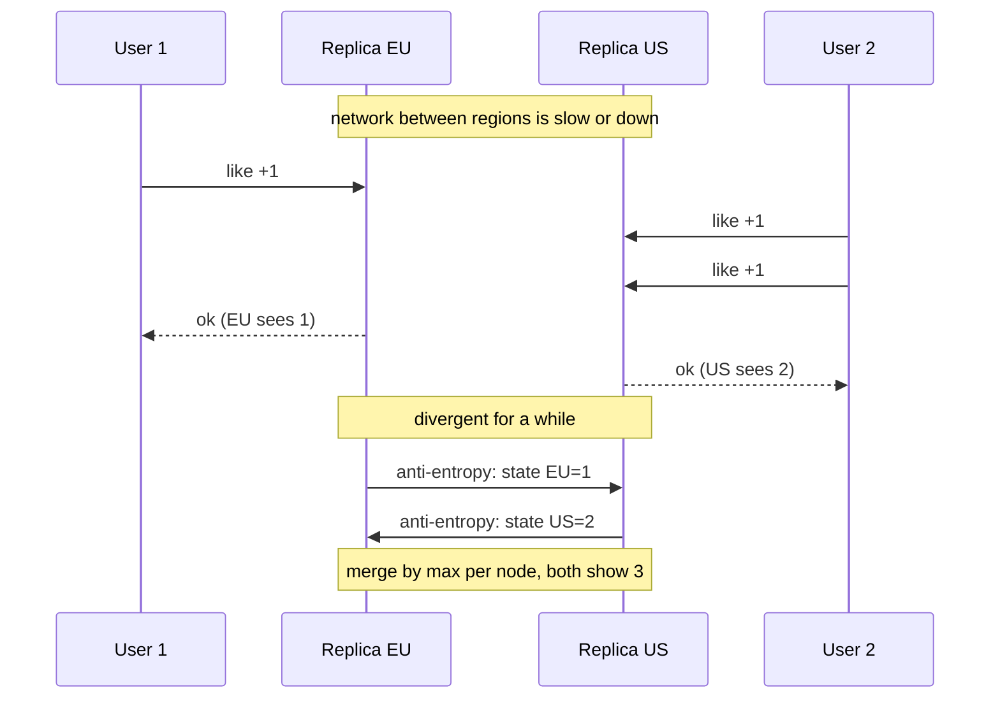
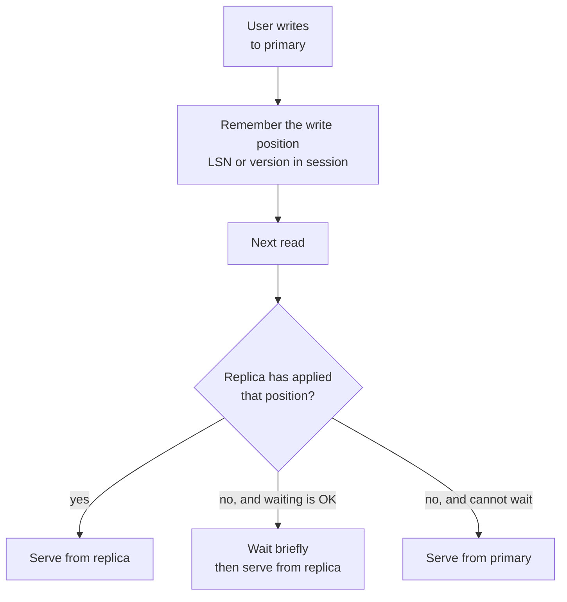

# L13.13 — Eventual Consistency

> **Level 13: Databases & Distributed Systems** · Topic 13 of 15 · ⏱ ~5 hours · Difficulty: Advanced

## 1. What it is

A system is **eventually consistent** if, when updates stop, all replicas of a piece of data **converge** to the same value after
some time. It promises nothing about *how long* that takes, and during the gap different readers may see different values. It is
the weak end of the consistency spectrum described in [Consistency, Availability and the CAP Theorem](12-cap-theorem-and-consistency.md):
you give up "every read sees the latest write" in exchange for lower latency, higher availability and the ability to keep working across
slow or partitioned networks.

Eventual consistency is not "anything goes". Real systems add targeted guarantees on top (*session guarantees* such as
**read-your-writes**), and a rule for resolving **conflicts** when two replicas accepted different writes (last-writer-wins, application
merge, or **CRDTs**, Conflict-free Replicated Data Types, whose merge function is designed so replicas always converge without coordination).

## 2. Why it matters in DevOps

- **You already run eventually consistent components.** Async Postgres replicas, Redis replicas, CDN caches, DNS, search indexes and
  read models fed by Kafka all lag behind their source. Alert thresholds, cache TTLs and runbooks must assume it.
- **"I saved it but it's gone" tickets** are usually read-your-writes violations: the write went to the primary, the next read hit a lagging replica.
- **Multi-region designs depend on it.** Active-active across regions cannot wait for a cross-ocean quorum on every write, so conflicts are real and need a policy.
- **Silent data loss hides here.** Last-writer-wins with unsynchronised clocks drops writes with no error. You find out from a customer.
- **Convergence time is an SLI.** "Replica lag" and "time until the search index shows a new product" are measurable and belong on a dashboard (see [Replication](04-replication.md)).

## 3. Real-world system example

- **Amazon Dynamo (2007 paper) and its shopping cart.** The paper describes accepting cart updates on any reachable replica and
  reconciling divergent versions on read by merging them; the stated trade-off was that a deleted item could occasionally reappear,
  which was preferred over refusing the customer's add-to-cart. Cassandra and Riak descend from these ideas, using **read repair**,
  **hinted handoff** and **anti-entropy** (background comparison of replicas) to converge.
- **Amazon S3.** Historically S3 was eventually consistent for overwrite and delete operations; since December 2020 AWS documents
  **strong read-after-write consistency** for all S3 operations. A good example of a system moving up the spectrum when engineering allowed.
- **DNS.** Record changes propagate as caches expire; the TTL is literally the upper bound on how stale a resolver may be. See [DNS Resolution](../level-02-networking/05-dns-resolution.md).
- **Collaborative editing.** Tools such as Google Docs use operational transformation; open-source libraries such as **Yjs** and **Automerge**
  use CRDTs so offline edits merge deterministically. Figma has written publicly that its multiplayer design is inspired by CRDT ideas
  but uses a central server to order changes.
- **Riak** (data types), **Redis Enterprise Active-Active** and **Azure Cosmos DB** (multi-region writes) document conflict-free or policy-based
  conflict resolution built on CRDT concepts or last-writer-wins.

## 4. Diagram

Two replicas diverge during a partition, then converge through anti-entropy and a merge function:



Where reads go decides what a user sees. A common read-your-writes routing rule:



## 5. How it works

### Convergence mechanisms

| Mechanism | What it does | Where you see it |
|-----------|--------------|------------------|
| Asynchronous log shipping | Replica replays the primary's change stream; converges as fast as it catches up | Postgres streaming replication, Redis replicas |
| Read repair | A read that finds stale copies writes the fresh value back | Cassandra, Dynamo-style stores |
| Hinted handoff | A node holds writes for a down replica and replays them later | Cassandra, Dynamo |
| Anti-entropy / Merkle trees | Background process compares replica contents and syncs differences | Cassandra repair, Riak |
| TTL expiry | Stale copies simply age out | DNS, CDN and application caches |
| Event-driven projection | A consumer updates a read model after the event | Kafka consumers, search indexing (see [Kafka](08-kafka.md)) |

### Session guarantees (what applications actually need)

| Guarantee | Meaning | Typical implementation |
|-----------|---------|-----------------------|
| **Read-your-writes** | You see your own earlier writes | route to primary for a short window, or wait for replica position (LSN) |
| **Monotonic reads** | You never see data go backwards in time | pin a session to one replica |
| **Monotonic writes** | Your writes are applied in the order you issued them | per-session ordering, single partition key |
| **Writes-follow-reads** | A write based on what you read is ordered after it | causal metadata (version vectors) |

### Resolving conflicts

When two replicas accept concurrent writes to the same item, one of these happens:

1. **Last-writer-wins (LWW):** keep the value with the highest timestamp. Simple and always converges, but it **silently discards the other write**, and clock skew picks the "winner" arbitrarily.
2. **Version vectors:** each replica keeps a counter per node; if neither vector dominates, the writes are *concurrent* and both are kept as **siblings** for the application to merge (Dynamo, Riak).
3. **Application-level merge:** the application knows the domain rule (union of cart items, sum of counters).
4. **CRDTs:** pick a data structure whose merge is mathematically guaranteed to converge.

### CRDTs in two minutes

A CRDT's merge operation is **commutative** (order does not matter), **associative** (grouping does not matter) and **idempotent**
(merging the same state twice changes nothing). Those three properties mean replicas can exchange state in any order, with duplicates and delays,
and still agree. This is called *strong eventual consistency*.

| CRDT | Use | How it merges |
|------|-----|---------------|
| **G-Counter** | likes, page views | one slot per node; merge = max per slot; value = sum |
| **PN-Counter** | stock, balances that move both ways | two G-Counters (adds and removes) |
| **LWW-Register** | a profile field | highest timestamp wins (loses concurrent writes) |
| **OR-Set** (observed-remove) | shopping cart, tags | adds carry unique tags; a remove deletes only the tags it saw |
| **Sequence CRDTs** | collaborative text | each character gets a unique, ordered ID (Yjs, Automerge) |

Limits: CRDTs cannot enforce invariants such as "balance never below zero" or "only one winner", because that needs coordination (see
[Distributed Locks and Queues](15-distributed-locks-and-queues.md) and consensus-based stores).

## 6. Step-by-step guide

**Prerequisites:** Python 3.9+ for steps 1-2 (no libraries). Steps 3-4 reuse the Postgres primary and standby (`pg-primary`,
`pg-replica`, database `postgres`, table `orders`) you built in [Replication](04-replication.md), or the capstone's lab; the SQL was
verified on PostgreSQL 16.15 using two local instances, the `docker exec` wrapper is the standard form (container names are from
topic 04). Cost: free. Time: ~60 minutes.

1. **Build and merge CRDTs.** Save as `crdt.py`:
   ```python
   class GCounter:                              # grow-only counter: one slot per replica
       def __init__(self, node): self.node, self.slots = node, {}
       def incr(self, n=1): self.slots[self.node] = self.slots.get(self.node, 0) + n
       def value(self): return sum(self.slots.values())
       def merge(self, other):                  # element-wise max: commutative, associative, idempotent
           for k, v in other.slots.items():
               self.slots[k] = max(self.slots.get(k, 0), v)

   class PNCounter:                             # increments and decrements = two G-Counters
       def __init__(self, node): self.p, self.n = GCounter(node), GCounter(node)
       def incr(self, k=1): self.p.incr(k)
       def decr(self, k=1): self.n.incr(k)
       def value(self): return self.p.value() - self.n.value()
       def merge(self, o): self.p.merge(o.p); self.n.merge(o.n)

   # 1. Three data centres count likes while partitioned, then gossip in a messy order (with repeats).
   a, b, c = GCounter("a"), GCounter("b"), GCounter("c")
   a.incr(3); b.incr(2); c.incr(5)
   for x, y in [(a, b), (b, c), (c, a), (a, b), (b, c), (a, c)]:
       x.merge(y)
   print("G-Counter values:", {n.node: n.value() for n in (a, b, c)})

   # 2. Why merge must be idempotent: a naive "add the other replica's total" double counts on retry.
   naive = a.value()
   for _ in range(2): naive += b.value()
   print("naive sum after a duplicate message:", naive, "vs correct", a.value())

   # 3. PN-Counter: stock level that goes up and down.
   s1, s2 = PNCounter("w1"), PNCounter("w2")
   s1.incr(10); s2.decr(3); s1.decr(1)
   s1.merge(s2); s2.merge(s1)
   print("PN-Counter stock:", s1.value(), s2.value())

   # 4. Last-writer-wins register and clock skew. Each write is (timestamp, value).
   def lww(x, y): return x if x[0] >= y[0] else y
   real_first  = (1000.0, "cart=[book]")            # node A, true time 1000
   real_second = (1001.0 - 4.0, "cart=[book,pen]")  # node B at true time 1001, but its clock is 4 s slow
   print("LWW keeps:", lww(real_first, real_second)[1], "(the later real write was lost)")
   ```
   ```bash
   python3 crdt.py
   ```
   ```text
   G-Counter values: {'a': 10, 'b': 10, 'c': 10}
   naive sum after a duplicate message: 30 vs correct 10
   PN-Counter stock: 6 6
   LWW keeps: cart=[book] (the later real write was lost)
   ```
   All three replicas agree on 10 despite repeats and reordering; the naive "just add" merge triple counts; the last line is the silent data loss of LWW with a skewed clock.

2. **Try to break convergence.** Edit the loop in part 1 so a replica merges a *stale copy* of another (take `copy.deepcopy(b)` before `b.incr(1)` and merge the copy afterwards).
   The value never goes down, because `max` ignores older state. Then change `merge` to overwrite (`self.slots = dict(other.slots)`) and observe it lose increments: this is why the merge function is the whole design.

3. **Reproduce a read-your-writes violation.** Pause replay on the standby so the lag is visible, write on the primary, read from the replica:
   ```bash
   docker exec pg-replica psql -U postgres -c "SELECT pg_wal_replay_pause();"
   docker exec pg-primary psql -U postgres -At -c "INSERT INTO orders (item) VALUES ('ryw-demo');"
   docker exec pg-replica psql -U postgres -At -c "SELECT count(*) FROM orders WHERE item='ryw-demo';"
   ```
   ```text
   INSERT 0 1
   0
   ```
   The user's order is "missing": a stale read from a lagging replica.

4. **Fix it with an LSN wait.** Capture the primary's write position *after* the commit (a separate command, otherwise you record a position before the commit record), then wait for the replica to pass it before reading:
   ```bash
   LSN=$(docker exec pg-primary psql -U postgres -At -c "SELECT pg_current_wal_lsn();")
   echo "need replica to reach $LSN"
   ( sleep 3; docker exec pg-replica psql -U postgres -c "SELECT pg_wal_replay_resume();" >/dev/null ) &   # simulate lag ending
   until [ "$(docker exec pg-replica psql -U postgres -At -c "SELECT pg_wal_lsn_diff(pg_last_wal_replay_lsn(), '$LSN') >= 0;")" = "t" ]; do sleep 0.2; done
   docker exec pg-replica psql -U postgres -At -c "SELECT count(*) FROM orders WHERE item='ryw-demo';"
   ```
   ```text
   need replica to reach 0/3000148
   1
   ```
   (The LSN value will differ.) The read now blocks for the length of the lag and then returns the user's own write. In an application, the session stores the LSN (or a version number) and the router applies the decision flow from the second diagram, with a timeout that falls back to the primary.

5. **Watch eventual consistency in the wild.** DNS TTLs are the convergence clock:
   ```bash
   dig +noall +answer example.com A
   sleep 5
   dig +noall +answer example.com A
   ```
   The TTL (second column) counts down on a caching resolver; a record change on the authoritative server becomes visible to that resolver only after it reaches 0 (output varies by resolver).

6. **Clean up** the lag pause if you left it on: `docker exec pg-replica psql -U postgres -c "SELECT pg_wal_replay_resume();"`.

## 7. Real-world scenario

*Illustrative, not a documented incident.* After `shop-api` adds a Postgres read replica, support receives "my order disappeared" tickets that nobody can reproduce.
*Symptom:* right after checkout the "Order confirmed" page runs `SELECT ... WHERE id = ?` against the replica and shows a 404 about one time in two hundred.
*Investigation:* replica lag graphs show spikes of 1-2 seconds during the nightly import job; the failing requests line up exactly with those spikes.
*Fix:* the confirmation endpoint reads the primary for the first 10 seconds after an order is created (a short "primary-only window" stored in a signed cookie), and the order-history page, which can tolerate staleness, stays on the replica. A later iteration stored the commit LSN in the session and waited up to 200 ms for the replica.
*Lesson:* the bug was not the replica; it was an unstated consistency requirement. The team added "replica lag p99" as an SLI and wrote the read-your-writes rule into the API design doc.

## 8. Common mistakes and best practices

**Don't**

- Assume a read after a write sees the write when the read can be served from a replica or cache.
- Use last-writer-wins on data you cannot afford to lose, or rely on wall-clock timestamps from unsynchronised machines.
- Treat eventual consistency as "no guarantees": you can specify bounds (lag p99) and session guarantees.
- Build counters or sets by read-modify-write across replicas; that is how updates get lost.
- Use a CRDT for an invariant that needs coordination (unique username, non-negative balance).

**Do**

- Measure and alert on convergence time (replica lag, index freshness, cache age).
- Give each feature an explicit consistency requirement: strong for money and inventory reservation, eventual for feeds and analytics.
- Implement read-your-writes with a primary window, an LSN/version wait or sticky sessions.
- Choose merge semantics deliberately: sibling merge, domain merge or a CRDT.
- Make consumers idempotent so redelivery cannot change the converged result (see [Idempotency](14-idempotency.md)).

## 9. Tasks

- [ ] **T1 — Run the CRDT demo** *(≈20 min, beginner)*
  - **Goal:** watch replicas converge despite reordered and duplicated merges.
  - **Steps:**
    1. Save and run `crdt.py` from step 1.
    2. Shuffle the merge order in the loop and re-run three times.
  - **Done when:** every run prints the same value (10) for all three counters.

- [ ] **T2 — Break convergence with a bad merge** *(≈25 min, intermediate)*
  - **Goal:** prove idempotency and commutativity are what make a CRDT safe.
  - **Steps:**
    1. Replace `merge` with `self.slots[k] = self.slots.get(k, 0) + v`.
    2. Run the same gossip loop and record the values.
    3. Restore `max` and explain the difference in one sentence.
  - **Done when:** you have both outputs and can name which property the broken merge violates.

- [ ] **T3 — Add an OR-Set** *(≈45 min, advanced)*
  - **Goal:** implement a mergeable set where add and remove can happen concurrently.
  - **Steps:**
    1. Implement `add(x)` creating a unique tag, `remove(x)` deleting only observed tags, and `merge` as the union of added tags minus the union of removed tags.
    2. Simulate replica A removing `pen` while replica B concurrently adds `pen`, then merge both ways.
  - **Done when:** both replicas end with `pen` present (the concurrent add wins) and identical contents.

- [ ] **T4 — Reproduce and fix read-your-writes** *(≈30 min, intermediate)*
  - **Goal:** turn a stale read into a correct one.
  - **Steps:**
    1. Do steps 3 and 4 of the guide on your own replica pair.
    2. Time how long the LSN wait blocks with `time`.
  - **Done when:** the naive read returns `0` and the LSN-gated read returns `1`, with a measured wait.

- [ ] **T5 — Automate a lag SLI** *(≈40 min, advanced)*
  - **Goal:** make convergence time observable.
  - **Steps:**
    1. Write a script that inserts a heartbeat row on the primary every second and measures how long until it appears on the replica.
    2. Print `p50` and `max` over one minute, once normally and once with replay paused for 5 seconds.
  - **Done when:** the paused run shows a max of at least 5 seconds and the normal run is well under 1 second.

- [ ] **T6 — Prove it: design a conflict policy** *(≈40 min, advanced)*
  - **Goal:** choose a resolution strategy and defend it.
  - **Steps:**
    1. Without the guide, list four `shop-api` fields (profile name, cart, view count, inventory level) and choose LWW, merge or CRDT for each.
    2. For each, write the worst thing that happens under your choice if two regions write concurrently.
  - **Done when:** a teammate agrees with each choice or you can explain the disagreement.

## 10. Self-check questions

1. What exactly does "eventually consistent" guarantee, and what does it not?
2. Why does last-writer-wins lose data, and what makes it worse in practice?
3. Name the three properties a CRDT merge must have, and what each buys you.
4. A user posts a comment and does not see it after a refresh. List two root causes and two fixes.
5. Why can a CRDT not enforce "balance never below zero"?

<details>
<summary>Answers</summary>

1. If updates stop, replicas converge to the same value. It does not bound the time or promise what a read sees in the meantime.
2. Of two concurrent writes it keeps one and discards the other with no error. Clock skew makes the "latest" arbitrary, so it can discard the genuinely later write.
3. Commutative (order of merges does not matter), associative (grouping does not matter), idempotent (duplicate merges are harmless). Together they allow unordered, duplicated delivery with guaranteed convergence.
4. Causes: a read from a lagging replica; a cache or search index not yet updated. Fixes: read from the primary for a window or wait for the write's LSN; invalidate or write-through the cache; make the UI optimistic.
5. An invariant that spans replicas needs coordination to prevent two replicas from each spending the last of the balance concurrently. CRDT merges are coordination-free by design.
</details>

## 11. Further reading

- DeCandia et al., *Dynamo: Amazon's Highly Available Key-value Store* (SOSP 2007).
- Shapiro et al., *Conflict-free Replicated Data Types* (2011) and the CRDT.tech resource page.
- Werner Vogels, *Eventually Consistent* (ACM Queue / All Things Distributed).
- *Designing Data-Intensive Applications* by Martin Kleppmann, chapters on replication lag and leaderless replication.
- Docs for Cassandra (repair, hinted handoff), Yjs and Automerge.

<!-- nav -->
---
← Previous: [Consistency, Availability and the CAP Theorem](12-cap-theorem-and-consistency.md) · [Level 13 index](README.md) · Next: [Idempotency](14-idempotency.md) →
